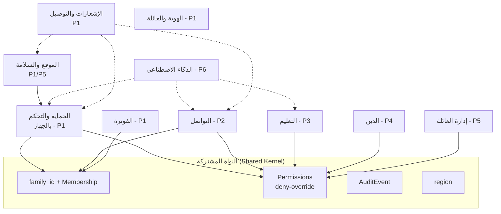

# خريطة مجالات المنصة (DDD Context Map) — Family OS

> **الحالة:** معتمدة — حكم المالك 2026-11-05 · **التاريخ:** 2026-11-05
> **الأساس:** G-010 (الهيكلية المعتمدة: حوكمة ← معمارية ← مواصفات ← تصميم ← كود)
> **القاعدة:** كل مجال هنا يتتبع إلى قرار معتمد أو دليل مفكك موثّق. ما لا يتتبع لا يُكتب.

## 1. الغرض

هذه الخريطة تجيب عن سؤال واحد قبل أي مواصفة نظام: **أين يبدأ كل مجال وأين ينتهي، وكيف تتحدث المجالات مع بعضها دون أن تتلوث؟**

المشكلة التي تحلها: المنصة توحّد 8 تطبيقات، وكل تطبيق له مفهومه الخاص لـ"العائلة" و"العضو" و"الصلاحية" و"المجموعة". بدون حدود صريحة، ستنتج منصة بمفاهيم متصادمة — وهذا بالضبط ما قتل الفرع القديم.

## 2. المجالات المحددة (Bounded Contexts)

| # | المجال | الاسم الإنجليزي | الغرض | التطبيق المرجعي | المرحلة | النوع | المجاميع الرئيسية (Aggregates) |
|---|---|---|---|---|---|---|---|
| 1 | الهوية والعائلة | Identity & Family | العائلة، العضوية، الأدوار، الإقران، الإعداد | FamilyWall / Qustodio | 1 | **أساسي (Core)** | `Family` · `Membership` · `Device` · `Invitation` |
| 2 | الصلاحيات | Permissions | محرك تقييم الصلاحيات الذرية | FamilyWall (FWPermission) | 1 | **نواة مشتركة** | `PermissionGrant` · `PolicyRule` |
| 3 | الحماية والتحكم بالجهاز | Child Protection | وكيل الطفل، حظر التطبيقات، الجداول الأسبوعية، مقاومة الإزالة | Qustodio Kids / FamiSafe Jr / Bark Kids | 1 | **أساسي (Core)** | `ChildDevice` · `AppRule` · `WeeklySchedule` · `EnforcementState` |
| 4 | الموقع والسلامة | Location & Safety | تتبع الموقع، الأسوار الجغرافية، SOS | Life360 | 1 (أساسي: SOS + خريطة العائلة) / 5 (أسوار كاملة) | أساسي | `LocationReport` · `Geofence` · `SosAlert` |
| 5 | الإشعارات والتوصيل | Notifications & Delivery | موجّه OTP، أوامر الأجهزة (FCM/MQTT/HMS)، إشعارات الأهل | — (بنية تحتية) | 1 | داعم | `OtpRequest` · `DeviceCommand` · `PushChannel` |
| 6 | التواصل | Messaging | المحادثة العائلية، المجموعات، الإشراف، الصلاحيات الإدارية الذرية | Telegram | 2 | أساسي | `Chat` · `Message` · `ChatRole` |
| 7 | التعليم | Education | أوضاع الدراسة، التكرار المتباعد، التقدم | Quizlet | 3 | أساسي | `StudySet` · `StudySession` · `SrsCard` |
| 8 | الدين | Religion | مواقيت الصلاة (على الجهاز)، القبلة، القرآن، المراجعة الشرعية | Muslim Pro | 4 | أساسي | `PrayerSettings` · `QuranBookmark` |
| 9 | إدارة العائلة | Family Coordination | المهام، التقويم، القوائم، المكافآت | FamilyWall | 5 | أساسي | `Task` · `CalendarEvent` · `Reward` |
| 10 | الذكاء الاصطناعي | AI Services | بوابة الذكاء، الفرز على الجهاز، وكيل الأب، الميزانيات | Bark Kids (ONNX) | 6 (كامل)؛ عقد البوابة + الميزانية من 1 | داعم | `AgentCapability` · `AiBudget` · `AgentActionLog` |
| 11 | الفوترة والاشتراكات | Billing & Subscriptions | الخطط، الحصص، مسارات الدفع (محافظ/Play/بطاقات) | — (بنية تجارية) | 1 (الحد الأدنى) | عام | `Plan` · `Subscription` · `PaymentRoute` |

**ملاحظة التتبع:** نوع كل مجال (أساسي/داعم/عام) وصفٌ معماري لا قرار منتج؛ أي تغيير في نوع مجال يُسجَّل كقرار.

## 3. النواة المشتركة (Shared Kernel)

مجموعة مفاهيم **واحدة** يفهمها كل المجالات بنفس المعنى، ولا يعيد أي مجال تعريفها:

| المفهوم | التعريف الموحد | القرار الحاكم |
|---|---|---|
| `family_id` | معرّف العائلة الواحدة — في كل جدول، مع عزل RLS من اليوم الأول | Q-008 / D-021 |
| `Membership` | عضوية شخص في عائلة بدور (`owner` / `adult` / `teen` / `child`) + صفة `is_owner` على `adult` | Q-006 / D-038 |
| `PermissionGrant` | منح ذري (`domain.action`) بنطاق `scope` ومدة `valid_until`؛ `is_granted=false` = منع صريح؛ المنع يغلب المنح | Q-007 |
| `region` | منطقة العائلة (اليمن / الخليج / …) — تحكم إقامة البيانات والمدفوعات والثقافة | Q-005 / R-007 |
| `AuditEvent` | سجل تدقيق موحد لكل فعل رقابي أو إداري (من فعله، متى، على من، بنتيجة ماذا) | D-023 |

**قاعدة صلبة:** أي مجال يحتاج مفهوماً من النواة يستخدمه **كما هو** — لا يعيد تعريفه ولا ينسخ حقوله. خلاف ذلك يُبلَّغ كتعارض (CHANGE-CONTROL §4).

## 4. خريطة العلاقات (Context Map)

| من | إلى | العلاقة | نمط DDD | ملاحظة |
|---|---|---|---|---|
| الحماية | الصلاحيات | يستعلم: هل هذا الفعل مسموح الآن؟ | عميل/مورّد (Customer/Supplier) | التقييم على الجهاز أولاً، والخادم مرجع |
| الحماية | الهوية والعائلة | يقرأ: أعضاء العائلة وأجهزتهم | عميل/مورّد | الإقران برمز الجهاز |
| الموقع | الحماية | يعتمد: حالة الجهاز وصلاحية التتبع | عميل/مورّد | لا تتبع بلا صلاحية سارية |
| التواصل | الصلاحيات | يستعلم: الصلاحيات الإدارية الذرية (كتم/إزالة/حذف/تثبيت/مسح) | عميل/مورّد | Q-010 |
| التواصل | الهوية والعائلة | يقرأ: العضوية والأدوار | عميل/مورّد | |
| التعليم / الدين / إدارة العائلة | الصلاحيات | يستعلم: حدود العرض والتحكم لكل دور | عميل/مورّد | |
| التعليم / الدين / إدارة العائلة | الهوية والعائلة | يقرأ: العضوية | عميل/مورّد | |
| كل المجالات | الذكاء الاصطناعي | يطلب: قدرات ذكاء عبر البوابة (بميزانية وشفافية) | عميل/مورّد | Q-011 / Q-012 |
| كل المجالات | الإشعارات والتوصيل | يرسل: أوامر وتنبيهات عبر قناة موحدة | لغة منشورة (Published Language) | أحداث موحدة الشكل |
| كل المجالات | الفوترة | يستعلم: خطة العائلة وحصصها | عميل/مورّد | |
| الهوية والعائلة | الفوترة | يبلّغ: إنشاء/تغيير العائلة | أحداث المجال (Domain Events) | |
| الحماية | الموقع | يبلّغ: دخول/خروج سور جغرافي | أحداث المجال | |

**طبقة مكافحة الفساد (ACL):** أي بيانات تأتي من نظام خارجي (مزود خرائط، مزود دفع، مزود ذكاء) تدخل عبر طبقة ترجمة — لا يتسرب نموذج المزود إلى أي مجال.

## 5. اللغة الموحدة — المصطلحات المتصادمة وحسمها

| المصطلح | التصادم في المراجع | التعريف الموحد في Family OS |
|---|---|---|
| **العائلة (Family)** | FamilyWall: أسرة بأدوار · Life360: "دائرة" (Circle) · Telegram: مجموعة | **أسرة واحدة بحساب واحد**: مالك + بالغون + مراهقون + أطفال (Q-008: عائلة واحدة لكل حساب في MVP) |
| **العضو (Member)** | لكل تطبيق تعريف عضوية مختلف | شخص ينتمي لعائلة عبر `Membership` بدور واحد واضح |
| **الصلاحية (Permission)** | FamilyWall: أدوار جامدة · Qustodio: قواعد جهاز | **منح ذري** `domain.action` بنطاق ومدة؛ المنع يغلب (Q-007) |
| **الجدول (Schedule)** | FamiSafe: ترميز خاص للجدول الأسبوعي | **جدول أسبوعي بقناع بت (bitmask)** موحد — يُحسب على الجهاز والخادم بنفس المنطق |
| **المجموعة (Group)** | Telegram: مجموعة محادثة · Life360: دائرة موقع | **لا يوجد "Group" عام** — كل سياق يسمّي تجميعه باسمه (محادثة / دائرة موقع / عائلة) |
| **المكافأة (Reward)** | Quizlet: نقاط/شارات · Qustodio: مكافآت أطفال | مكافآت **للأطفال فقط** (D-012)؛ للمراهق "تقدير" غير مادي لاحقاً إن ثبتت الحاجة (Q-009) |
| **الوكيل (Agent)** | — (جديد في المنصة) | وكيل ذكاء بقدرات ذرية `agent.action` يفوّضها الأب؛ الافتراضي أضيق نطاق (Q-003) |

## 6. مخطط الخريطة

## 7. القرارات المحسومة (حكم المالك 2026-11-05 — اعتمد كل توصيات Juno)

1. **Q-054 — الذكاء:** عقد البوابة + الميزانية + مفتاح الإيقاف من المرحلة 1 (هيكل رفيع فقط، بلا ميزة ذكاء فعلية)؛ الطبقة الكاملة في المرحلة 6.
2. **Q-055 — الفوترة:** الحد الأدنى في المرحلة 1 (خطط + اشتراكات + فحص الخطة + مسارات الدفع)؛ الخطط أعلام ميزات وحصص قابلة للتعديل بلا كود.
3. **Q-056 — الموقع:** الأساسي في المرحلة 1 (خريطة العائلة + SOS)؛ الأسوار الجغرافية الكاملة في المرحلة 5.
4. **Q-057 — التسمية:** يُعدَّل اسمان فقط — "التنسيق العائلي" ← **"إدارة العائلة"**، و"الذكاء" ← **"الذكاء الاصطناعي"**؛ باقي الأسماء كما هي.

## 8. التتبع

| القرار | أين انعكس |
|---|---|
| Q-001 (Kotlin/Ktor + PostgreSQL، Modular Monolith) | المجالات = وحدات المونوليث المقسّم |
| Q-002 (نواة الحماية أولاً) | ترتيب المراحل في الجدول |
| Q-003 (مرونة يحددها الأب) | مجال الذكاء + حدود التفويض |
| Q-005 (اليمن والخليج معاً؛ مرونة ثقافية) | `region` في النواة |
| Q-006 (is_owner صفة) | تعريف `Membership` |
| Q-007 (deny-override) | مجال الصلاحيات + النواة |
| Q-008 (عائلة واحدة + RLS) | `family_id` في النواة |
| Q-010 (صلاحيات محادثة ذرية) | علاقة التواصل ← الصلاحيات |
| Q-011 (حياد مزود الذكاء) | مجال الذكاء كبوابة |
| Q-012 (ميزانية + مفتاح إيقاف) | `AiBudget` |
| Q-020 (OSM + تجريد) | طبقة مكافحة الفساد (مزود الخرائط) |
| Q-021 (موجّه OTP) | مجال الإشعارات |
| Q-022 (MQTT أساسي) | مجال الإشعارات |
| Q-025 (محافظ اليمن / Play الخليج) | مجال الفوترة |
| Q-031 (مثل المنافسين + Device Owner لاحقاً) | مجال الحماية |
| Q-054 (عقد بوابة الذكاء + الميزانية من 1؛ الطبقة الكاملة في 6) | مجال الذكاء الاصطناعي |
| Q-055 (الحد الأدنى للفوترة في 1) | مجال الفوترة |
| Q-056 (الموقع الأساسي في 1؛ الأسوار الكاملة في 5) | مجال الموقع |
| Q-057 (تسمية: إدارة العائلة + الذكاء الاصطناعي) | أسماء المجالات |
| D-023 / D-038 / G-006 | النواة + قاعدة مكافحة الفساد |
