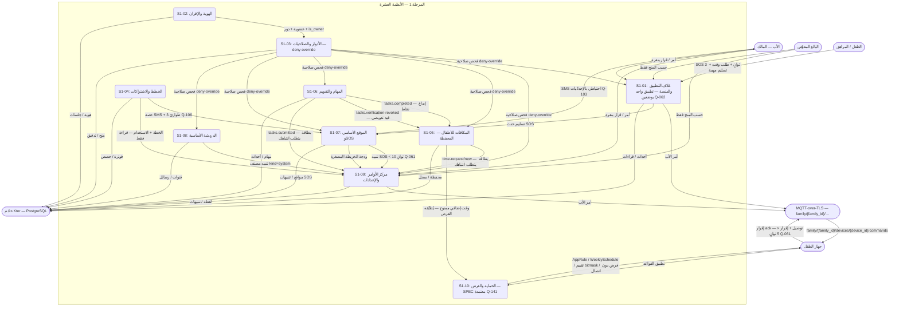

# المرحلة 1: المخطط الموحد (OVERVIEW)

- **الحالة:** مسودة للمراجعة على GitHub — الأنظمة التسعة S1-01…S1-09 مواصفاتها معتمدة بالكامل في التخطيط؛ وS1-10 مواصفته معتمدة بالكامل في التخطيط (Q-141 · Q-146)؛ وهذا الملف مسودة بانتظار مراجعة المالك على GitHub (لم يُعتمد بعد)
- **المصدر:** Q-135 (حكم المالك 2026-11-06) — يُكتب هذا الملف بعد اكتمال مخططات الأنظمة التسعة
- **القرارات الحاكمة:** Q-135 · Q-141 (S1-10) · Q-142 (PIN محلي) · Q-061 (أهداف الأداء) · Q-062 (تطبيق واحد بوضعين) · Q-068 (Flutter + وحدة Kotlin للفرض)
- **الأشكال الموحدة:** مستطيل = جهة خارجية · مستطيل مستدير = عملية · معين = قرار · أسطوانة = مخزن بيانات · خط متقطع = يتضمن / اختياري

كل عنصر في هذا الملف يتتبع إلى مواصفة معتمدة (S1-01…S1-09) أو مخططاتها أو قرار محكوم — لا عناصر مخترعة ولا متطلبات جديدة. وS1-10 يظهر بصفته مالكاً حسب Q-141 فقط، ومواصفته معتمدة بالكامل في التخطيط، والتفاصيل المنسوبة إليه هنا تقتصر على الملكية وقرارات البطاقة (Q-141 · Q-143 · Q-144 · Q-145 · Q-146).

## 1. المخطط الموحد — الأنظمة العشرة والتدفقات العابرة

## 2. التدفقات العابرة الأربعة (من Q-135)

### 2-أ. أمر الأب ← MQTT ← جهاز الطفل ← الفرض

الأب يصدر أمراً من مركز الأوامر (S1-09) أو لوحة الأهل (S1-01)؛ يُسلَّم عبر MQTT (`family/{family_id}/devices/{device_id}/commands` — S1-01 §4.3) إلى جهاز الطفل؛ ويطبّقه الفرض (S1-10: `AppRule` / `WeeklySchedule` / تقييم bitmask / فرض دون اتصال — Q-141)؛ ويعود الإقرار (ack) إلى الأب. **الهدف: توصيل الأمر + الإقرار < 5 ثوانٍ (Q-061).** والغلاف (S1-01) يستضيف وحدة Kotlin للفرض داخل التطبيق الواحد (Q-068)؛ وملكية قواعد الفرض وتقييمها لـ S1-10 (Q-141).

### 2-ب. SOS: S1-01 ← S1-07 ← S1-09

زر SOS دائم في الغلاف (S1-01 — ضغط مطول 3 ثوانٍ، Q-067) يسلّم الحدث إلى نظام الموقع (S1-07)؛ فيصل التنبيه للأب وكل البالغين في **أقل من 10 ثوانٍ** مع الموقع (Q-061 · Q-104)؛ ويظهر التنبيه في مركز الأوامر (S1-09). ودون اتصال: SMS بالإحداثيات إلى هواتف الوالدين (Q-103) تُحسب من حصة الخطة، مع 3 رسائل SOS طارئة بعد نفاد الحصة في كل دورة — SOS فقط (Q-106)؛ ومستلمو SMS دون اتصال = الأب + كل البالغين + جهات الطوارئ (Q-138 — محكوم).

### 2-ج. المهام ← المحفظة: S1-06 ← S1-05

إنجاز مهمة + تحقق الذكاء يصدر `tasks.completed` (يحمل `source_system=S1-06`) فيودع النقاط في محفظة الطفل (S1-05 — Q-118، عقد الكسب العام)؛ وإلغاء تحقق يصدر `tasks.verification-revoked` فيعوَّض الإيداع بقيد سالب. وتسليم مهمة (`tasks.submitted`) وطلب وقت إضافي (`time-request/new`) يظهران في بطاقة "يتطلب انتباهك" في S1-09؛ والأب يقرر بنقرة واحدة. وصرف النقاط كوقت إضافي (10 نقاط = 10 دقائق) يطبّقه الفرض (S1-10) على التطبيق الذي نفد وقته تحديداً.

### 2-د. حصص SMS: S1-04 ↔ S1-07

نظام الفوترة (S1-04) يملك عدّاد حصص SMS (Free ‏20/شهر، Basic ‏50/شهر، Premium ‏100/شهر — Q-129؛ وحزمة تعبئة 50 رسالة)؛ ونظام الموقع (S1-07) يستشير الحارس قبل كل SMS صادر (Q-106)؛ وشراء التعبئة عبر S1-04 للمالك حصراً. وكل SMS صادر — SOS أو غيره — يُحسب من الحصة.

## 3. جدول الاعتماديات
- **الترتيب:** صفوف الجدول بترتيب التنفيذ (Q-199) — S1-10 رابعاً؛ يُنسخ D-027.

| النظام | يملك | يعتمد على | يقدّم إلى |
|---|---|---|---|
| S1-01 غلاف التطبيق والمنصة | وضع الجهاز (Q-062/Q-063)، بوابة الوالدين PIN فقط (Q-065 — التحقق محلي Q-142)، زر SOS الدائم (Q-067)، Outbox، وضع النطاق المنخفض (Q-064) | S1-02 (الإقران يحدد الوضع)، S1-03 (فحص الصلاحية)، S1-10 (قواعد الفرض) | اللوحة + الفرض + SOS إلى S1-07 |
| S1-02 الهوية والإقران | العائلة، العضوية (`membership` — الدور + `is_owner`)، ملفات الأطفال، الإقران برمز جهاز، OTP/Bريد/بصمة الأهل | — (النواة المشتركة) | العضوية والدور إلى S1-03 وكل الأنظمة |
| S1-03 الأدوار والصلاحيات | سجل المفاتيح المركزي، المنح، القوالب الثلاثة، نقل الملكية (PIN أو بصمة Q-093)، محرك التقييم deny-override (Q-007) | S1-02 (العضوية)، S1-01 (بوابة الوالدين للمنح الحساسة) | فحص الصلاحية إلى كل الأنظمة |
| S1-10 الحماية والفرض — **SPEC معتمدة** | `AppRule`، `WeeklySchedule`، تقييم bitmask، الفرض دون اتصال، مقاومة الإزالة (Q-141) | S1-01 (الغلاف يستضيف وحدة Kotlin — Q-068)، S1-02 (الأجهزة المقترنة)، S1-03 (القواعد المفروضة) | فرض القواعد والوقت الممنوح على أجهزة الأطفال |
| S1-09 مركز الأوامر والإعدادات | اللوحة الموحدة، السجل المركزي (وقت النشر)، بطاقة "يتطلب انتباهك"، اللقطة دون اتصال | S1-03 (تصفية الودجات عبر `required_key`)، S1-04 (الخطة قراءة فقط)، S1-05/S1-06/S1-07/S1-08 (الحالة والتنبيهات) | أمر الأب + قرار بنقرة إلى S1-05/S1-06 |
| S1-07 الموقع الأساسي وSOS | خريطة العائلة، التتبع التكيفي (Q-101)، SOS، جهات الطوارئ، سجل 7 أيام (Q-105) | S1-01 (زر SOS)، S1-03 (تصفية الرؤية)، S1-04 (حصة SMS) | تنبيهات SOS + ودجة الخريطة إلى S1-09 |
| S1-08 الدردشة الأساسية | القنوات، الرسائل، قناة الوالدين E2E الكاملة (Q-100)، المصنف الخفيف (Q-083/Q-140: دائماً للأطفال دون 13؛ وللمراهقين بمفتاح تحكم بيد الأب، الافتراضي مفعّل) | S1-02 (الأعضاء)، S1-03 (رؤية القاصرين وإغلاق المحادثات) | تنبيهات المصنف (`kind=system`) إلى S1-09 |
| S1-05 المكافآت للأطفال | محفظة الطفل الواحدة، سجل النقاط، طلبات الوقت، السلاسل والتجميد | S1-06 (حدث `tasks.completed` + `tasks.verification-revoked`)، S1-10 (تطبيق الوقت الممنوح)، S1-01 (حدود الوقت) | طلبات الوقت إلى بطاقة S1-09 |
| S1-06 المهام والتقويم | المهام، الفئات، التقويم المزدوج (هجري/ميلادي Q-124)، التذكير، التحقق بالذكاء (Q-110) | S1-05 (إيداع النقاط)، S1-09 (بطاقة الانتباه) | `tasks.completed` / `tasks.submitted` / `tasks.verification-revoked` |
| S1-04 الخطط والاشتراكات | الخطط الثلاث (Free/Basic/Premium — Q-126)، الأسعار (Q-127)، حصص SMS (Q-129)، التجربة 7 أيام (Q-130)، السماح 3 أيام (Q-131) | S1-02 (عدد الأعضاء لحصة الأفراد) | الحصص والخطة إلى S1-07/S1-09 |

## 4. ملاحظات

- **أهداف الأداء (Q-061):** توصيل أمر الأب + إقراره < 5 ثوانٍ؛ وتنبيه SOS < 10 ثوانٍ؛ وقراءات اللوحة p95 < 300ms. وهي معايير قبول قابلة للقياس في مختبر Q-027.
- **اتفاقية مواضيع MQTT:** كل موضوع مسبوق بـ `family/{family_id}/` (عزل D-021) — ومنها: `family/{family_id}/devices/{device_id}/commands` (أوامر الأب)، `family/{family_id}/sos/new` (تنبيه SOS)، `family/{family_id}/alerts/new` (تنبيهات المركز)، `family/{family_id}/tasks.submitted` و`family/{family_id}/time-request/new` (بطاقة الانتباه).
- **PIN محلي فقط (Q-142):** hash الـ PIN محفوظ مشفراً على الجهاز والتحقق محلي؛ والخادم يسجل إثبات التحقق + القفل فقط في التدقيق؛ ونقطة `POST /shell/parent-gate/verify` محذوفة.
- **S1-10:** يظهر هنا مالكاً حسب Q-141 فقط — `AppRule` / `WeeklySchedule` / تقييم bitmask / الفرض دون اتصال / مقاومة الإزالة. وبطاقته ومواصفته معتمدتان بالكامل في التخطيط؛ والتفاصيل المنسوبة إليه هنا تقتصر على الملكية وقرارات البطاقة.
- **الأسئلة المفتوحة ذات الصلة:** Q-132 (سعر اليمن — مفتوح، بلا رقم).
