# S1-01: مخططات هندسة البرمجيات (DIAGRAMS)

- **تحديث 2026-11-16 (Q-397) — إعادة رسم:** أُعيد رسم كل مخطط مسّه التصميم المعتمد (SPEC §9-8)، فالرسم والنص متطابقان ولا ملاحظة تسود على رسم. ما تغيّر: (1) الإقلاع يعرض المحفوظ أولاً ثم يحدّث؛ (2) الرقم السري محلي لكل جهاز، يُنشأ على هاتف الأب ويُكتب على جهاز الطفل عند الإقران (3-ط)؛ (3) إدخال واحد للرقم يفتح البوابة ويوقّع تحدي الخادم؛ (4) «الخروج من وضع الطفل» صار «أوقف القواعد مؤقتاً» والوضع لا يتغير؛ (5) التحديث ثلاث درجات؛ (6) الاستغاثة في كل شاشة وفوق كل ورقة ونافذة. المرسوم من جديد: حالات الاستخدام، التسلسلات 3-أ و3-ب و3-ز و3-ط، تدفق المستخدم، النشاط. ERD وDFD بلا تغيير. **تأكيد المالك للرسم الجديد بكلمة (Q-289) لم يصدر بعد.**
- **إعادة رسم 2026-11-19 (Q-434 — Q-416 · Q-424 · Q-426):** زر SOS على أجهزة الأبناء فقط — لا يظهر في وضع الأهل إطلاقاً، فصار فاعل UC3 «المراهق والطفل»؛ وحالة استخدام جديدة UC21 «أحتاج مساعدة» للطفل والمراهق؛ وقالبان للعرض فقط (طفل ومراهق) بلا قالب لدون 7. المرسوم من جديد: حالات الاستخدام (UC3 · UC21)، تدفق المستخدم (قسّم 4-أ/4-ب/4-ج)، النشاط (قسّم 6-أ/6-ب واتجاهه TD). ERD وDFD والتسلسلات بلا تغيير في المحتوى؛ وقُصّرت تسمياتها وبقي معناها. **تأكيد المالك للرسم الجديد بكلمة (Q-289) لم يصدر بعد.**
- **الحالة:** معتمدة — المخططات الستة معتمدة (حكم المالك 2026-11-06)؛ وأُعيد تأكيدها بكلمة واحدة من المالك 2026-11-08 على الفرق المعروض (261+/91- من الأساس 92b1b40 إلى الرأس 93c1d60)؛ والمواصفة معتمدة بالكامل في التخطيط
- **المواصفة:** `SPEC.md` (§§1–8 + §10 معتمدة بالكامل في التخطيط)
- **السياق المحدد (Bounded Context):** بلا سياق خاص — عنصر عابر يعبر كل السياقات (الغلاف، `CONTEXT-MAP.md` §2-أ)
- **القرارات الحاكمة:** Q-001 · Q-007 · Q-010 · Q-134 (هيكل الملف) · Q-062 · Q-063 · Q-065 · Q-067 · Q-068 · Q-070 · Q-234 · Q-236 · Q-244 · Q-141 · Q-069 · Q-142 · Q-164 · Q-397 · Q-416 · Q-424 · Q-426
- **الأنواع الستة:** 1. حالات الاستخدام · 2. ERD · 3. التسلسل · 4. تدفق المستخدم · 5. DFD · 6. النشاط
- **الأشكال الموحدة:** مستطيل بطرفين مستديرين = طرف خارج العملية المرسومة (مستخدم، نظام مجاور، خدمة، أو الخادم) · مستطيل = شاشة أو خطوة، وفي مخطط تدفق البيانات عملية مرسومة في لوحة أخرى · مستطيل مستدير الزوايا = عملية · معين = قرار · أسطوانة = مخزن بيانات · خط متقطع = يتضمن / اختياري

## 1. حالات الاستخدام

21 حالة استخدام من السيناريوهات التسعة والمتطلبات (§2/§3) ومن التصميم المعتمد (SPEC §9-8 — Q-397 · Q-416 · Q-424): الأب والبالغ يفتحان اللوحة، الأبناء وحدهم يضغطون SOS (Q-416)، الطفل والمراهق يعملان دون اتصال، وأي إجراء مقيّد على جهاز طفل يتضمن بوابة PIN. والتسليم لنظام الموقع (S1-07) والإقران (S1-02) ممثلان كجهات خارجية؛ وتقييم القواعد والجداول الأسبوعية ملك نظام الحماية والفرض S1-10 (S1-01 REQ-003 · Q-141).

الحالات الإحدى والعشرون على لوحتين ليُقرأ كل خط: الأولى لما يفعله كل من يحمل التطبيق، والثانية لما يخص الأب وجهاز الطفل والأنظمة المجاورة.

### 1-أ. ما يفعله كل مستخدم

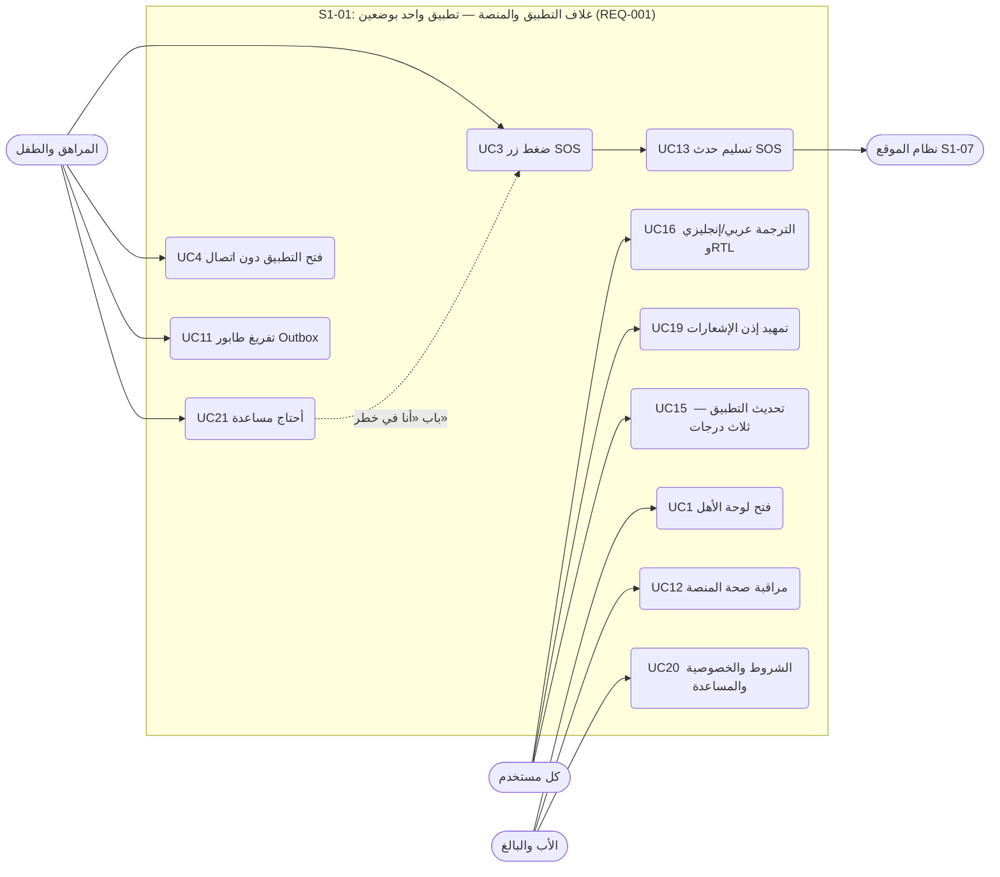

### 1-ب. الأب وجهاز الطفل والأنظمة المجاورة

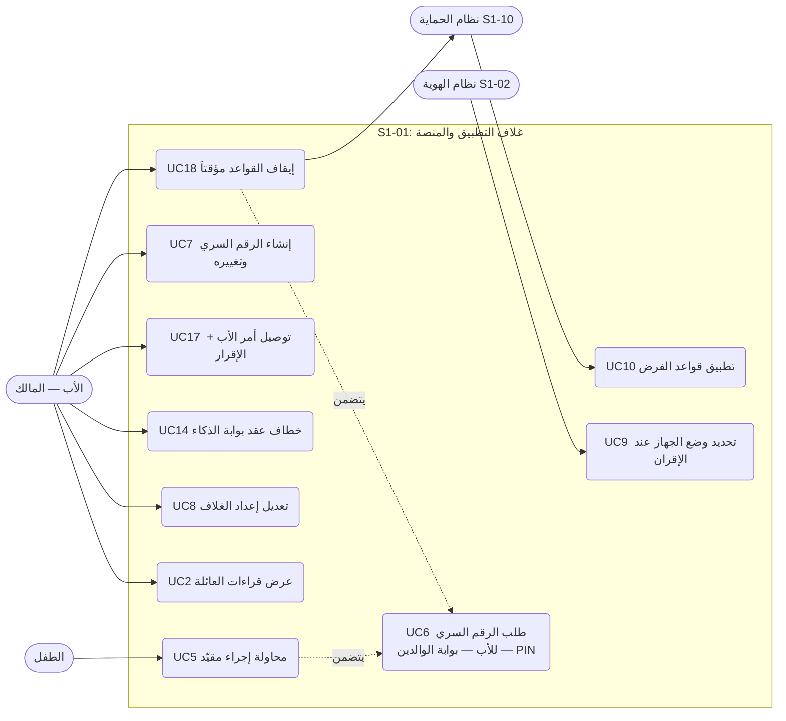

- **إعادة رسم 2026-11-16 (Q-397):** UC7 يشمل إنشاء الرقم على هاتف الأب وكتابته على جهاز الطفل عند الإقران (3-ط)؛ UC18 هو ما كان «الخروج من وضع الطفل»: إيقاف مؤقت للقواعد (الوضع الحر — S1-10 REQ-018) خلف البوابة، ووضع الجهاز لا يتغير (Q-062)؛ UC15 ثلاث درجات (3-ز)؛ UC19 وUC20 من الشاشات الأربع الجديدة (SCR-13 · SCR-15 · SCR-16)، وشاشة أول فتح بلا اتصال (SCR-14) ضمن UC4.

- **أُعيد رسمه 2026-11-19 (Q-434 — Q-416 · Q-424):** زر SOS في كل شاشة وفوق كل ورقة — في وضع الطفل فقط (Q-416)؛ فصار فاعل UC3 «المراهق والطفل» وحده، ولا زر في وضع الأهل إطلاقاً. وUC21 «أحتاج مساعدة» (Q-424): ورقة هادئة بأربعة أبواب — كلام الأب، كلام الأم، «شيء أزعجني»، «أنا في خطر» يفتح تأكيد الاستغاثة نفسه — في آخر رئيسية الطفل والمراهق وفي الملف. و«كل مستخدم» يجمع الأدوار الأربعة؛ وقالبا العرض اثنان فقط (طفل ومراهق — Q-426). [تحديث 2026-11-19 (Q-440): باب «شيء أزعجني» يرسل طلباً إلى S1-09 (child-requests)، ويُحفظ دون اتصال في Outbox.]

- قراءة اللوحتين: «كل مستخدم» في 1-أ يجمع الأدوار الأربعة، و«الأب والبالغ» و«المراهق والطفل» مجموعتان للاختصار؛ فتح التطبيق دون اتصال وتفريغ الطابور يعملان للأب والبالغ أيضاً، ورُسما عند المراهق والطفل لأن سيناريو §2 عنهما. والأب في 1-ب يملك كل ما في 1-أ.

- متطلبات بلا حالة استخدام مستقلة (مغطاة بتدفق أو قيد):

| المتطلب | لماذا بلا حالة استخدام مستقلة |
|---|---|
| REQ-003 | مكوّن داخلي (وحدة Kotlin) — لا هدف مستخدم مستقل |
| REQ-010 | سلوك عابر (وضع النطاق المنخفض) — يُمارَس في تدفق §4 |
| REQ-012 | سلوك نظامي (أعلام الميزات) — يُمارَس في 3-أ |
| REQ-015 | عنصر عرض عابر (الإشعار الدائم) — يُمارَس في تدفق §4 |
| REQ-016 | قيد بناء (بلا إعلانات/تتبع) — لا تدفق مستخدم |
| REQ-018 | رفض تبديل الوضع — يُمارَس في تدفق §4 |
| REQ-019 | قيد منصة (طريق iOS محفوظ) — لا تدفق مستخدم |
| REQ-023 | جزء من تدفق الإجراء المقيّد (UC5/UC6) — إثبات التحدي خلف البوابة |

- كل REQ من REQ-001 إلى REQ-023 مغطى إما بحالة استخدام أو بالجدول أعلاه؛ بلا REQ بلا تغطية.

- ملاحظة طريق iOS (REQ-019 · Q-005/Q-068): واجهة Flutter مشتركة للوضعين؛ وحدة الفرض Kotlin أندرويد فقط — التحكم العميق أندرويد فقط لقيد Apple؛ فعلى iOS لا توجد وحدة فرض Kotlin ولا خدمة خلفية دائمة للفرض.

- ملاحظة الخصوصية (REQ-016 · Q-046): لا إعلانات ولا تتبع ولا تحليلات في التطبيق؛ ولا أحداث تحليلية لحسابات الأطفال قبل حسم Q-046.

## 2. مخطط قاعدة البيانات (ERD)

الجداول السبعة من §5 كما هي، مع ثلاثة مراجع خارجية: العائلة (S1-02)، ومفتاح الصلاحية (S1-03)، و`AuditEvent` (النواة المشتركة — صيغته في S1-03 §5-6 بنطاق `shell` — SPEC §5). ملاحظتان: `outbox_event` محلي على الجهاز (SQLite) وليس جدول خادم، و`pin_hash` هو **Argon2id (m=64MiB، t=3، p=1) مع ملح عشوائي (Q-164)** — لا يُحفظ PIN نصاً أبداً. و`parent_gate` **مخزن محلي على الجهاز** (Q-142): hash الـ PIN محفوظ في مخزن آمن مدعوم بالعتاد والتحقق يتم محلياً، والخادم لا يستلم PIN ولا hashه أبداً — يسجل إثبات التحقق + القفل فقط في التدقيق عبر Outbox. جداول العائلة تحمل `family_id` + عزل RLS (D-021)؛ أما السجلات العالمية (`shell_registry` كعرض قراءة، و`notification_registry`) وملف المنطقة (`country_profile`) فبلا `family_id`؛ والسجلات المركزية الأربعة (`ControlRegistry`/`PermissionRegistry`/`WidgetRegistry`/`NotificationRegistry` — قيم `shell_registry.registry`: `control`/`permission`/`widget`/`notification`) — ولا مفتاح تحكم يعمل دون تسجيل (REQ-011). **قاعدة الساعة (Q-236/D-18):** كل الطوابع UTC مخزنة؛ و`locked_until` انتهاء صادر من الخادم عند الاتصال، ومنقضٍ رتيب (monotonic) دون اتصال؛ وتُعاد تثبيت المرساة عند كل اتصال. و`family.time_zone` معرَّف في S1-02 §5 (سجل العائلة) — مرساة «منتصف الليل المحلي للعائلة» (Q-183) دون مسّ دلالتها.

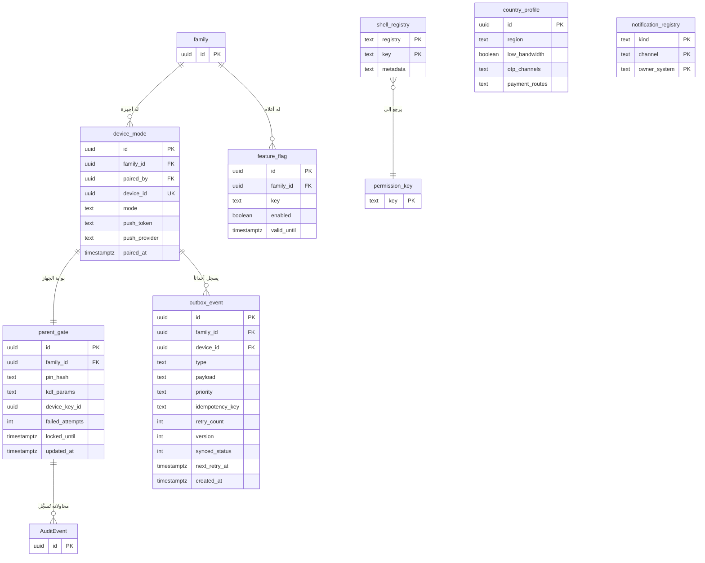

- أُعيد رسمه 2026-11-19 (Q-434 — شكل فقط، بلا تغيير في الجداول أو الحقول أو العلاقات): تعريف `family` أولاً ثم الجداول المترابطة متجاورة؛ وحقول التواريخ في آخر كل جدول؛ وتسمية علاقة `shell_registry` قُصّرت إلى «يرجع إلى».

- ملاحظات ERD: `parent_gate` مخزن محلي على الجهاز بلا علاقة خادمية — علاقته `device_mode ||--|| parent_gate` («بوابة الجهاز»)؛ و`family_id` فيه حقل محلي منسوخ لا علاقة خادم (Q-142). و`country_profile` مرجع بحث بالمنطقة (`family.region = country_profile.region`) بلا مفتاح أجنبي. والمفاتيح المركبة: `shell_registry` بمفتاح (`registry`, `key`)؛ و`notification_registry` بمفتاح (`kind`, `channel`, `owner_system`). و`paired_by` معرّف شخص (uuid — FK إلى `person`)؛ و`device_mode.device_id` فريد (UK) — جهاز واحد = صف وضع واحد.

## 3. التسلسل (Sequence) — من عقود §4

تسعة مخططات، كل واحد لتدفق واحد (3-أ … 3-ط):

### 3-أ. الإقلاع وتحديد الوضع (REQ-002/012/017)


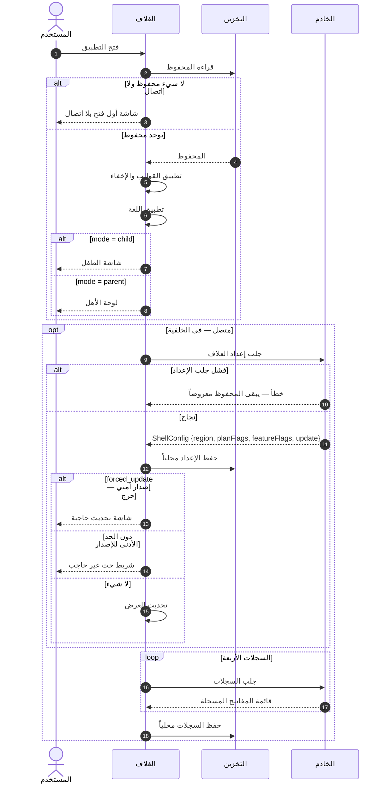

- الرسالة 9: `GET /api/v1/families/{id}/shell/config`.
- الرسالة 16: `GET /api/v1/shell/registries/{registry}`.
- ShellConfig يحمل أيضاً time_zone (Q-439).

- أُعيد رسمه 2026-11-16 (Q-397 — ب-07): يُعرض المحفوظ محلياً أولاً ثم يُجلب الإعداد والسجلات في الخلفية، مع فرع فحص الإصدار ومسار وضع الطفل؛ فيوافق REQ-017 (أقل من 1.2 ثانية) ونص SCR-02. التسلسل السابق (جلب ثم عرض) في تاريخ الفرع قبل `ceb5241`.

- أُعيد رسمه 2026-11-19 (Q-434 — شكل فقط + توضيح Q-416): قُصّرت تسميات الرسائل وبقي معناها. قراءة المحفوظ = `device_mode` + الإعداد والسجلات المحفوظة؛ وتطبيق القوالب والإخفاء (REQ-004 · Q-007)؛ وتطبيق اللغة — العربية افتراضياً + RTL (REQ-021 · Q-070)؛ وشاشة أول فتح بلا اتصال هي SCR-14؛ وإقلاع كل وضع < 1.2s. وشاشة التحديث الحاجبة تُبقي الاستغاثة فوقها في وضع الطفل فقط (Q-416).


- السجلات الأربعة تُجلب بحلقة فوق القيم الأربع لـ `registry` (تثبيت §4)؛ ودون اتصال تُستخدم النسخ المحفوظة؛ والحقيقة `GET config` عند الاتصال.

### 3-ب. بوابة الوالدين (REQ-005/006 — §4.1 + §4.2)

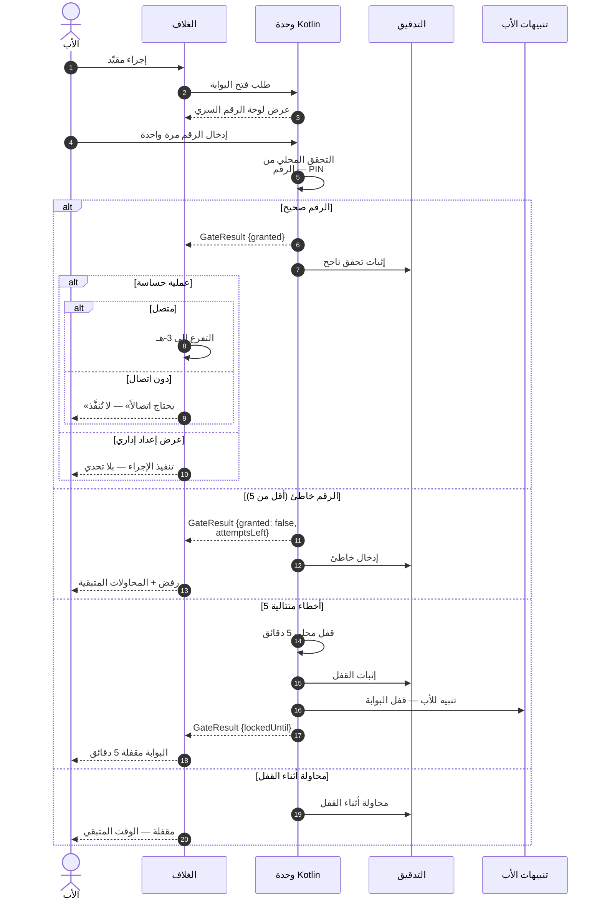

- الرسالة 2: `requestParentGate(action)`.

- التحقق من PIN **محلي فقط** (Q-142): hash الـ PIN محفوظ مشفراً على الجهاز وتتحقق منه وحدة Kotlin محلياً؛ والخادم يسجل إثبات التحقق + القفل فقط في التدقيق (عبر Outbox عند عدم الاتصال) ولا يستلم PIN ولا hashه أبداً. ونقطة التحقق الخادمي من PIN **محذوفة** — لا مكالمة Ktor للتحقق من PIN في هذا التدفق. **لكن العمليات الحساسة (تعداد REQ-006) تتفرع بعد فتح البوابة إلى 3-هـ:** الخادم يصدر تحدياً يوقّعه الجهاز قبل التنفيذ (REQ-023) — ففتح الإعداد الإداري للعرض بلا تحدي، وأي كتابة خادمية داخله تتحدى كمفتاح العملية نفسها. ولا سؤال حسابي في أي مسار (Q-065). وعند تعيين PIN جديد أو تغييره (UC7): 6 أرقام حداً أدنى، مع منع الأنماط الشائعة (123456، أرقام مكررة، سنوات الميلاد) (REQ-005 · Q-164). PIN فقط يفتح Parent Gate؛ البصمة تفتح مفتاح التوقيع بعدها (Q-244). **قاعدة الساعة (Q-236/D-18):** `locked_until` انتهاء صادر من الخادم عند الاتصال، ومنقضٍ رتيب (monotonic) دون اتصال؛ وتُعاد تثبيت المرساة عند كل اتصال.

- أُعيد رسمه 2026-11-16 (Q-397 — ب-08/أ-07/أ-10): إدخال واحد للرقم يفتح البوابة ويوقّع تحدي الخادم في 3-هـ؛ ودون اتصال العمليات الحساسة (أ)–(ج) تعرض «يحتاج اتصالاً» ولا تُنفَّذ؛ وكل إدخال خاطئ وكل قفل وكل محاولة أثناء القفل تُسجَّل، والقفل يرفع تنبيهاً للأب. و«الخروج من وضع الطفل» في التعداد (أ) هو «أوقف القواعد مؤقتاً» — وضع الجهاز لا يتغير (Q-062).

- أُعيد رسمه 2026-11-19 (Q-434 — شكل فقط): قُصّرت تسميات الرسائل وبقي معناها. الإجراء المقيّد أحد أربعة (REQ-006): إيقاف القواعد مؤقتاً، فك إقران، إلغاء تثبيت الوكيل، إعداد إداري؛ والحساسة منها (أ/ب/ج) تتفرع إلى 3-هـ حيث الإدخال نفسه يوقّع تحدي الخادم (REQ-023) بلا طلب الرقم مرة ثانية. والقفل `locked_until` 5 دقائق، وإثبات القفل يُسلَّم عبر Outbox عند عدم الاتصال.

- رُسم 2026-11-19 (Q-440): أُزيلت علامتا الاقتباس عن اسم المشارك «وحدة Kotlin» — بلا تغيير في عدد الرسائل أو المشاركين.

### 3-ج. تفريغ طابور Outbox (REQ-009 — §4.2)

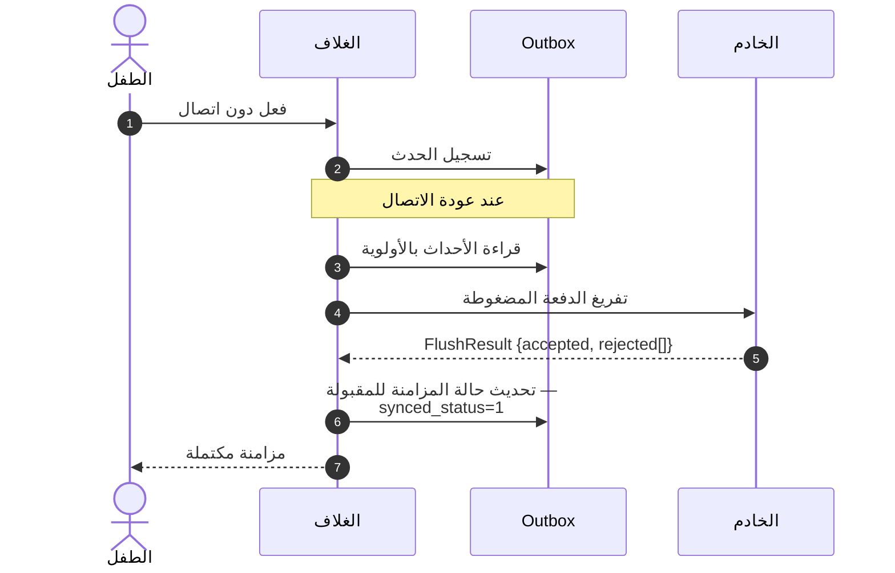

- الرسالة 4: `POST /api/v1/shell/outbox/flush`.

- كل حدث يحمل `idempotency_key` (§5)؛ والخادم يزيل التكرار على (`family_id`, `idempotency_key`)؛ ولا يسقط حدث قبل إقرار الخادم أبداً. والتسجيل يحمل `synced_status=0`؛ والقراءة بترتيب الأولوية ثم الزمن (critical أولاً)؛ والطلب يحمل `Idempotency-Key` ومفتاح عدم تكرار لكل حدث.

- أُعيد رسمه 2026-11-19 (Q-434 — شكل فقط): قُصّرت تسميات الرسائل وبقي معناها.

### 3-د. زر SOS (REQ-007 — §4.1/§4.3)

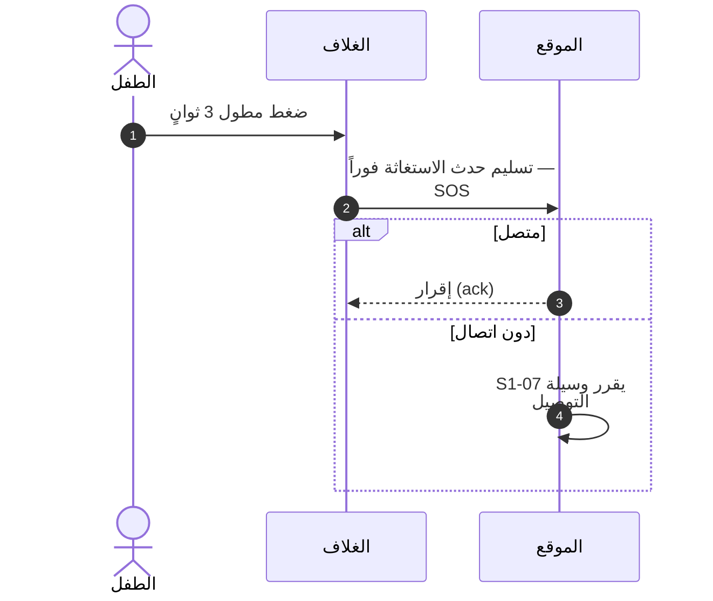

- أُعيد رسمه 2026-11-19 (Q-434 — Q-416): الفاعل الطفل أو المراهق على جهازه فقط — لا استغاثة في وضع الأهل (Q-416). والضغط باهتزاز تصاعدي؛ والتسليم عبر `EventChannel: sos_triggered` (`SosEvent` §4.3)؛ وS1-07 يملك النقل — الغلاف يسلّم `sos_triggered` فوراً (Q-234/D-6)، وOutbox ليس نقلاً بديلاً لـ SOS.

### 3-هـ. إثبات التحقق بتحدٍّ من الخادم (REQ-023 — §4.2 · Q-164)

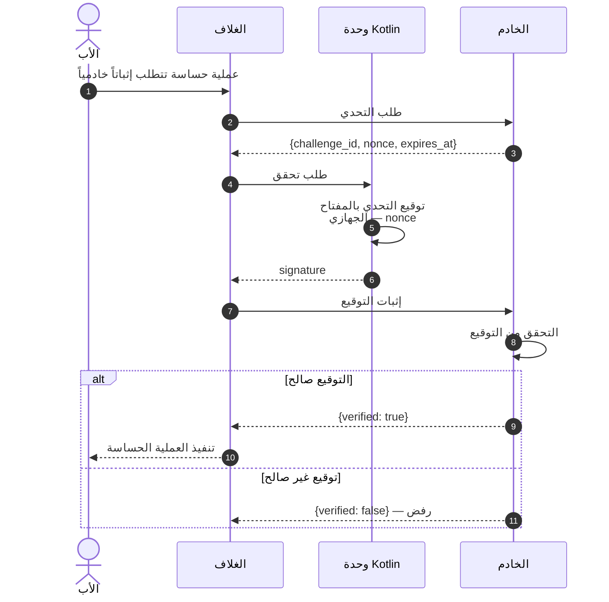

- الرسالة 2: `POST /api/v1/shell/verification/challenge`.
- الرسالة 7: `POST /api/v1/shell/verification/prove {challenge_id, signature, method}`.

- الإثبات القابل للتحقق **ليس** تحقق PIN خادمياً (Q-142 يبقى: لا نقطة PIN خادمية، ولا PIN ولا hash يغادران الجهاز أبداً) — بل إثبات توقيع: الخادم يتحقق من توقيع التحدي بمفتاح الجهاز العام المسجَّل قبل تنفيذ أي عملية حساسة. والمفتاح وُلد عند الإقران (S1-02 3-د) ومعرّفه `device_key_id` في `parent_gate` (§5).

- أُعيد رسمه 2026-11-19 (Q-434 — شكل فقط): قُصّرت تسميات الرسائل وبقي معناها. التحدي صلاحيته 5 دقائق واستخدام واحد؛ وطلب التحقق — PIN فقط يفتح Parent Gate، والبصمة تفتح مفتاح التوقيع بعدها (Q-244)؛ والتوقيع بمفتاح التوقيع الجهازي (ECDSA P-256) بعد التحقق المحلي؛ والتحقق من التوقيع بمفتاح الجهاز العام المسجَّل (Q-164)؛ والرفض يشمل بلا verification أو تحدٍّ منتهٍ.

- رُسم 2026-11-19 (Q-440): أُزيلت علامتا الاقتباس عن اسم المشارك «وحدة Kotlin» — بلا تغيير في عدد الرسائل أو المشاركين.


### 3-و. خطاف عقد بوابة الذكاء — هيكل فقط (REQ-014 — Q-054)

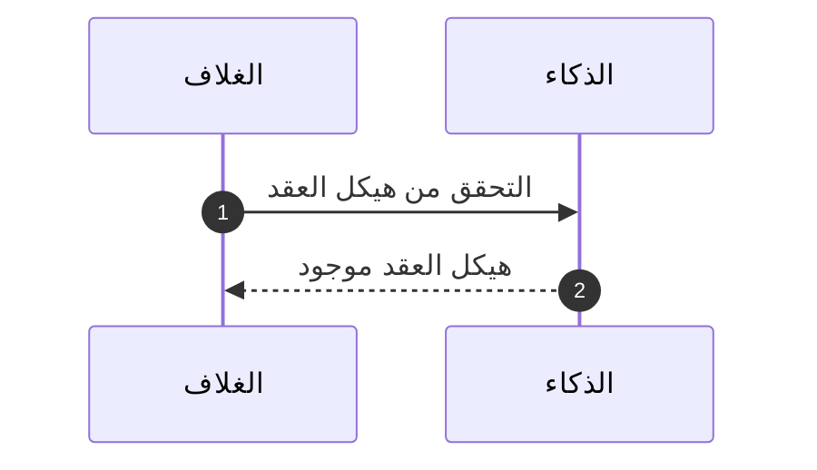

- خطاف هيكلي فقط: العقد والميزانية ومفتاح الإيقاف (Q-054)؛ لا ميزة ذكاء فعلية، ولا استدعاء ذكاء في أي تدفق. ويستشهد الخطاف بعقد تحقق الذكاء الملزم (Q-167): الفحص يثبت وجود العقد وقراءة الميزانية ومفتاح الإيقاف؛ وبلا مفاتيح `agent.*` هنا. ولا ميزة ذكاء فعلية في هذا النظام (REQ-014).

- أُعيد رسمه 2026-11-19 (Q-434 — شكل فقط): قُصّرت تسمية الرسالة وبقي معناها.

### 3-ز. تدفق التحديث (REQ-020 — Q-069)

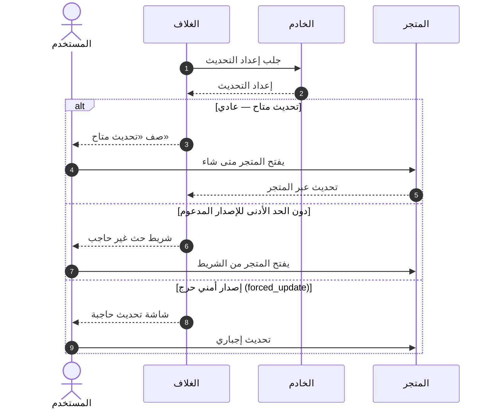

- الرسالة 1: `GET /api/v1/families/{id}/shell/config`.
- الرسالة 2: `ShellConfig.update {minimum_version, latest_version, forced_update}`.

- التحديثات العادية عبر المتجر؛ والتحديث الإجباري داخل التطبيق للإصدارات الأمنية الحرجة فقط؛ والأجهزة دون الحد الأدنى للإصدار المدعوم تُحث على التحديث (REQ-020 · Q-069). ودون اتصال: يُؤجَّل الفحص؛ ويبقى التطبيق يعمل ومسار SOS يعمل (SCR-12) — في وضع الطفل.

- أُعيد رسمه 2026-11-16 (Q-397 — أ-12/ب-03): الدرجات الثلاث كما تظهر على الشاشة — صف في «عن التطبيق»، ثم شريط حث غير حاجب، ثم شاشة حاجبة تبقى فيها الاستغاثة.

- أُعيد رسمه 2026-11-19 (Q-434 — شكل فقط + توضيح Q-416): قُصّرت تسميات الرسائل وبقي معناها. الطلب `GET /api/v1/families/{id}/shell/config` في الخلفية بعد عرض المحفوظ (3-أ)؛ وصف «تحديث متاح» في «عن التطبيق» لا يقاطع شيئاً؛ وشريط الحث عند كل فتح والتطبيق يعمل؛ والشاشة الحاجبة (SCR-12) بلا مسار تجاوز، والاستغاثة تبقى فوقها في وضع الطفل فقط (Q-416).

### 3-ح. توصيل أمر الأب + الإقرار (REQ-022 — §4.3 · Q-061)

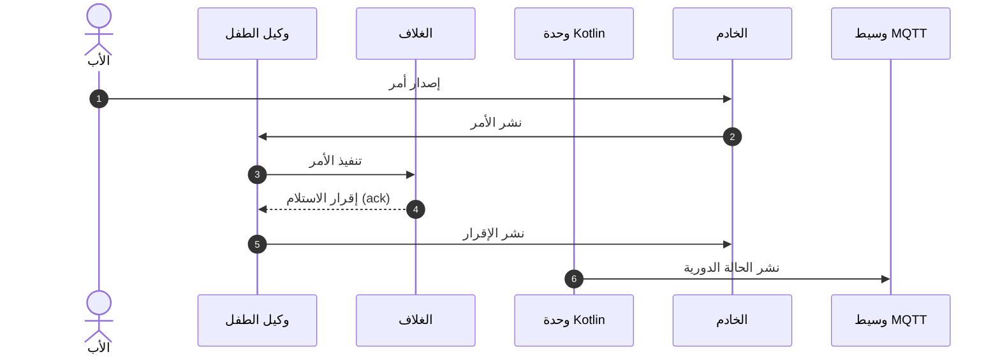

- توصيل الأمر + الإقرار < 5 ثوانٍ؛ إعادة المحاولة بتراجع أسّي (REQ-022 · Q-061). والأمر يُنشر على `family/{family_id}/devices/{device_id}/commands`، والإقرار على `family/{family_id}/devices/{device_id}/acks`.

- الرسالة 6: `family/{family_id}/device/{device_id}/state` — الحالة الدورية: عند كل تغيّر حالة فوراً + نبضة كل 5 دقائق في وضع الطفل النشط (§4.3).

- أُعيد رسمه 2026-11-19 (Q-434 — شكل فقط): ترتيب المشاركين وحّد على ترتيب المشروع (المستخدم، ثم التطبيق، ثم الخادم)؛ وقُصّرت تسميات الرسائل وبقي معناها.

- رُسم 2026-11-19 (Q-440): أُضيفت الرسالة 6 «نشر الحالة الدورية» من وحدة Kotlin إلى وسيط MQTT (6 رسائل بدل 5)، ومشاركان جديدان K وMQTT (6 مشاركين)؛ والموضوع في سطر الرسالة 6؛ وأُزيلت علامتا الاقتباس عن «وكيل الطفل».

### 3-ط. إنشاء الرقم السري ووصوله إلى جهاز الطفل (REQ-005 — Q-142 · Q-164 · Q-397)

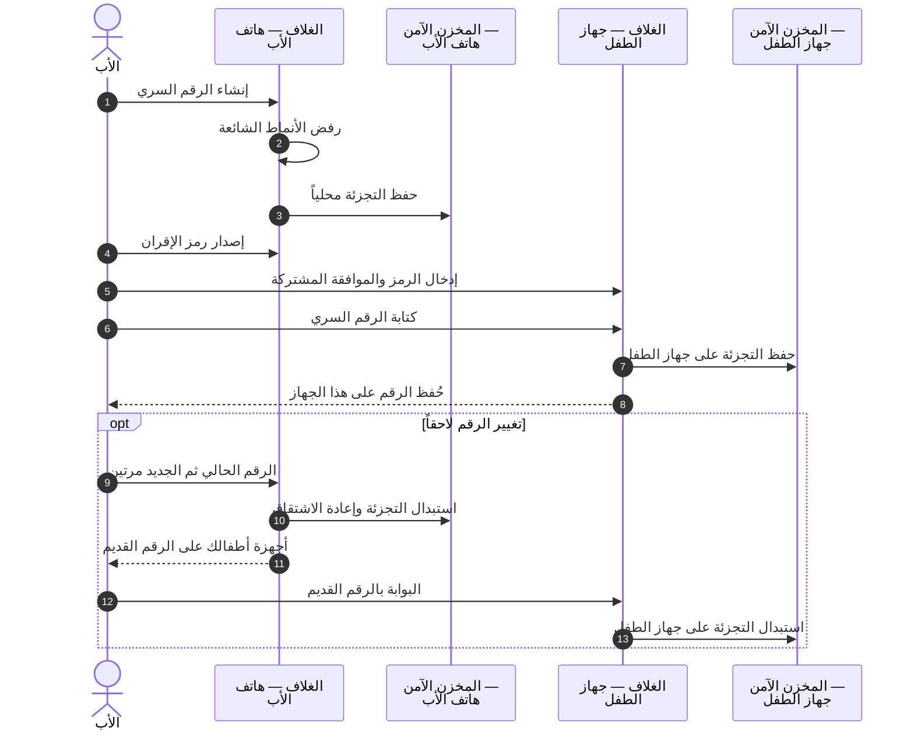

- الرقم محلي على كل جهاز (Q-142)، فلا مطابقة بين الجهازين: جهاز الطفل يحفظ ما يكتبه الأب عليه، ولذلك الإدخال ثم التأكيد إلزامي هناك. وقبل إنشاء الرقم لا يُعرض رمز إقران جهاز طفل؛ وإصدار الرمز في S1-02؛ وإدخال الرمز ثم الموافقة المشتركة (S1-02 REQ-017)؛ وكتابة الرقم إدخال ثم تأكيد؛ والتجزئة Argon2id والرقم لا يغادر الجهاز؛ واستبدالها يعيد اشتقاق مفتاح الاسترداد (Q-164)؛ والأجهزة الأخرى تبقى على الرقم القديم فيُغيَّر على كل جهاز.

- أُعيد رسمه 2026-11-19 (Q-434 — شكل فقط): قُصّرت تسميات الرسائل وبقي معناها.


## 4. تدفق المستخدم (User Flow) — من السيناريوهات التسعة (§2)

ثلاث لوحات: الإقلاع وعرض الوضع (4-أ)، ثم وضع الطفل والاتصال والاستغاثة (4-ب)، ثم الإجراء المقيّد والبقاء (4-ج). والمسار السعيد عمود واحد مستقيم في كل لوحة.

### 4-أ. الإقلاع وعرض الوضع (REQ-002/004/010/012/017/020)

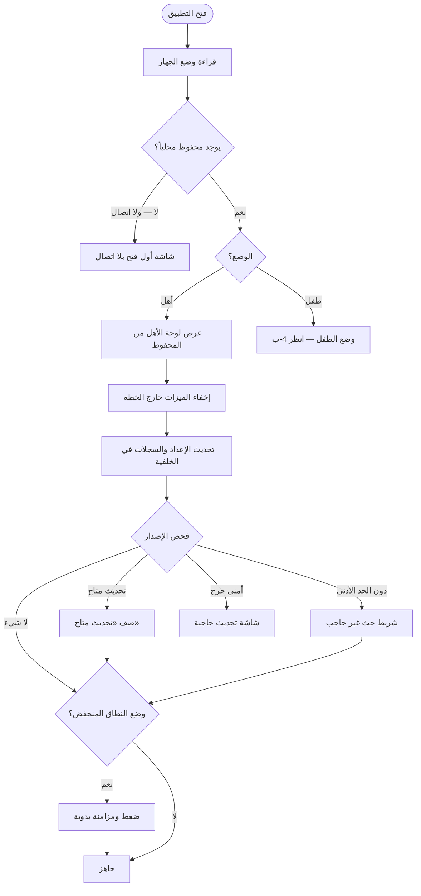

- يقرأ: فتح التطبيق إقلاع بارد < 1.2s (REQ-017)؛ ولوحة الأهل بقالب الدور وتبويبات المفوَّض من منحه؛ وتحديث الخلفية يشمل `region` و`planFlags` و`featureFlags` والسجلات؛ وشاشة أول فتح بلا اتصال هي SCR-14 — بلا زر استغاثة لأن لا عضوية بعد (REQ-007)؛ وشاشة التحديث الحاجبة تُبقي الاستغاثة فوقها في وضع الطفل فقط (Q-416)؛ ووضع النطاق المنخفض لليمن (Q-064 · REQ-010): استجابات مضغوطة Brotli/Gzip، ولا تحديثات تلقائية، والمزامنة يدوية أو مجدولة، وقنوات OTP بديلة (Q-021)؛ وجاهز تعني قراءات p95 < 300ms.

### 4-ب. وضع الطفل: الاتصال والاستغاثة (REQ-007/008/009/015)

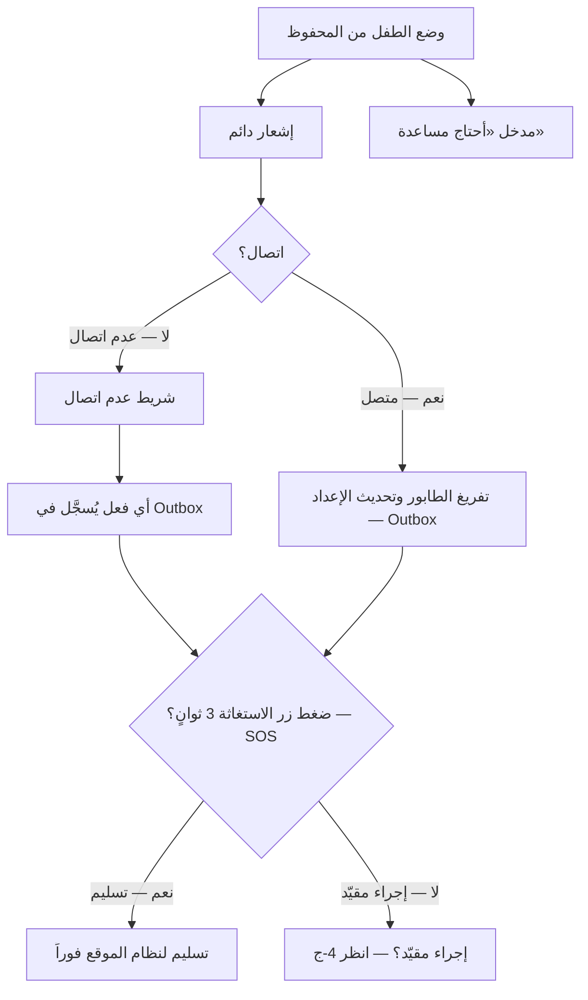

- يقرأ: وضع الطفل من المحفوظ — فرض + خدمة خلفية؛ والإشعار الدائم معلومات نافعة — الوقت المتبقي — لا عبارة رقابية (REQ-015 · G-006)؛ ومدخل «أحتاج مساعدة» في آخر الرئيسية وفي الملف — أبوابه: كلام الأب، كلام الأم، «شيء أزعجني»، «أنا في خطر» يفتح تأكيد الاستغاثة نفسه (Q-424 · REQ-007)؛ وشريط عدم الاتصال خفيف + بيانات محفوظة (REQ-008)؛ والتسليم لنظام الموقع فوراً — S1-07 يملك النقل.

### 4-ج. الإجراء المقيّد والبقاء (REQ-005/006/018/023)

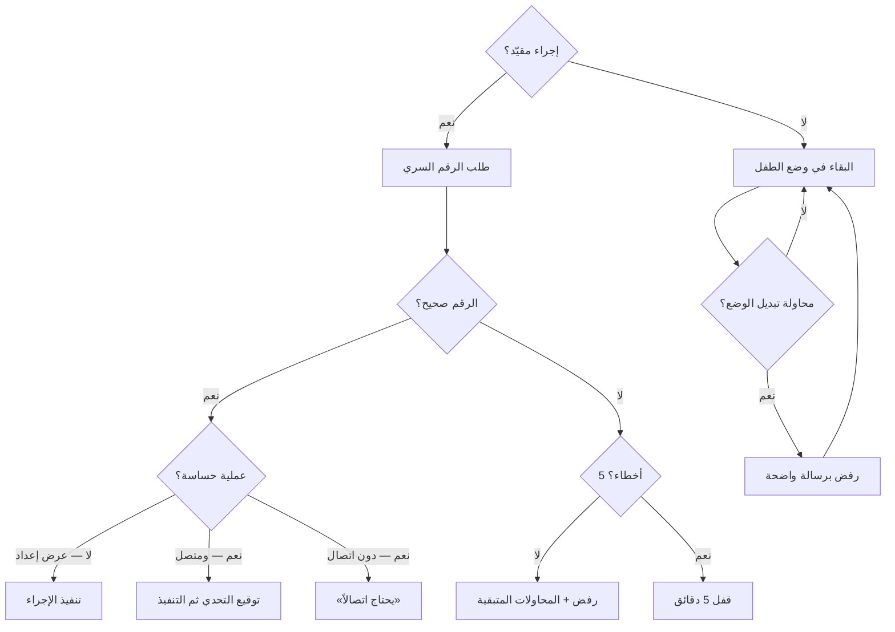

- يقرأ: الإجراء المقيّد أحد ثلاثة — إيقاف القواعد مؤقتاً، فك إقران، إعداد إداري؛ وطلب الرقم مرة واحدة للعملية؛ والعملية الحساسة تعداد REQ-006؛ و«يحتاج اتصالاً» تعني لا تُنفَّذ؛ والقفل 5 دقائق + تسجيل في AuditEvent + تنبيه الأب؛ ومحاولة التبديل تشمل الوضع والملف؛ والرفض برسالة واضحة بلا طلب PIN (REQ-018 · Q-063).

- أُعيد رسمه 2026-11-19 (Q-434 — Q-416 · Q-424): قُسّم التدفق الواحد (37 عقدة) إلى ثلاث لوحات (16/10/13 عقدة)؛ وزر SOS في وضع الطفل فقط فحُذف من فرع الأهل؛ وشاشة أول فتح بلا اتصال بلا زر استغاثة (REQ-007) — وكان نصها يقول «والاستغاثة تبقى» خلاف المواصفة؛ ومدخل «أحتاج مساعدة» في 4-ب؛ وقُصّرت التسميات وبقي معناها.

- ملاحظة: تسجيل دخول الأب على جهاز طفل **لا** يبدّل الوضع — الوضع يتحدد بالإقران (REQ-002).
- ملاحظة (إعادة رسم 2026-11-16 — Q-397): العرض من المحفوظ يسبق أي جلب؛ وفحص الإصدار ثلاث درجات؛ و«أوقف القواعد مؤقتاً» حلّ محل «الخروج من وضع الطفل» — الوضع لا يتغير؛ والعملية الحساسة دون اتصال لا تُنفَّذ.
- ملاحظة: أي محاولة لتبديل الوضع أو الملف في المرحلة 1 تُرفض برسالة واضحة **بلا طلب PIN** (REQ-018 · Q-063) — الوضع ثابت لكل جهاز ولا تبديل ملفات في المرحلة 1. ووضع النطاق المنخفض (Q-064 · REQ-010) إلزامي لليمن: ضغط Brotli/Gzip، ولا تحديثات تلقائية، والمزامنة يدوية أو مجدولة، وقنوات OTP بديلة (Q-021).
- ملاحظة: الإشعار الدائم في وضع الأهل يعرض معلومات نافعة عن حالة العائلة، وفي وضع الطفل يعرض الوقت المتبقي — لا عبارة رقابية في أي وضع (REQ-015 · G-006)؛ والموافقة على المراقبة مرة واحدة في إعداد مشترك (أب + طفل)، والشفافية عن الفئات لا المحتوى.

## 5. مخطط تدفق البيانات (DFD — المستوى 1) — من §4/§5

العمليات مرقمة 1.0–7.0، والمخازن D1–D7. المخزن D4 محلي على الجهاز (SQLite)؛ بقية المخازن جداول خادم (PostgreSQL) مع نسخة محفوظة محلياً للإعداد — **عدا D2 (`parent_gate`) فهو مخزن محلي على الجهاز (Q-142)**: hash الـ PIN مشفر على الجهاز ولا يغادر الجهاز أبداً، والخادم يسجل إثبات التحقق + القفل فقط عبر Outbox. ووضع النطاق المنخفض (Q-064 · REQ-010): الاستجابات مضغوطة Brotli/Gzip، ولا تحديثات تلقائية، والمزامنة يدوية/مجدولة (P4). و`notification_registry` (D7) سجل عالمي مستقل لقنوات التنبيه — لا عرض فوق `shell_registry` — وتقرأه P2. وD3 نسخة محلية محفوظة من الأعلام — والحقيقة `GET config` (§4.2). والحافة P6→Outbox موجودة (Q-266): SOS دون اتصال يُسجَّل بأولوية قصوى في Outbox (P4/D4)؛ والحافة الحية P6→S1-07 باقية؛ وOutbox يخزّن فقط وS1-07 وحده ينقل؛ وQ-234 بلا مسّ. وP3 يطلب التحدي الخادمي للعمليات الحساسة فقط (تعداد REQ-006)؛ وفتح الإعداد الإداري للعرض بلا تحدي.

- **تغطية نقاط §4:** التسلسلات في §3 تغطي التدفقات الأساسية فقط؛ وكل نقطة §4 تظهر هنا على الأقل: `GET /api/v1/families/{id}/shell/config` (3-أ) · `GET /api/v1/shell/registries/{registry}` (3-أ) · `POST /api/v1/shell/outbox/flush` (3-ج) · `POST /api/v1/shell/verification/challenge` (3-هـ) · `POST /api/v1/shell/verification/prove` (3-هـ) · `POST /api/v1/shell/push/register` (§4.4 — استدعاء واحد عند تسجيل الدخول/الإقران، بلا تسلسل مستقل) · أوامر MQTT `family/{family_id}/devices/{device_id}/commands` + الإقرار على `family/{family_id}/devices/{device_id}/acks` (3-ح · P7) · والحالة الدورية على `family/{family_id}/device/{device_id}/state` (3-ح). ونقطة التحقق الخادمي من PIN **محذوفة** per Q-142 — التحقق من PIN محلي فقط (P3 ← D2).

### 5-أ. تحديد وضع الجهاز (REQ-002/017)


- يقرأ: الإقران يحدد وضع الجهاز ويُحفظ؛ والوضع والقالب يذهبان إلى لوحة الأهل (5-ب).

### 5-ب. عرض لوحة الأهل وتطبيق القوالب (REQ-004/012)

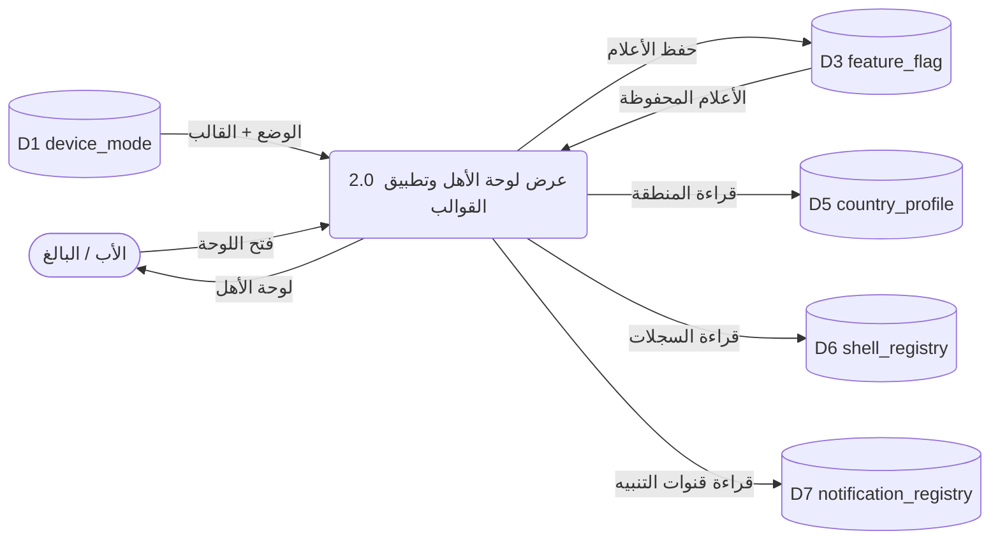

- يقرأ: اللوحة تقرأ الوضع والقالب والأعلام والمنطقة والسجلات وقنوات التنبيه من المخازن.

### 5-ج. بوابة الوالدين — التحقق من PIN (REQ-005/006/023)

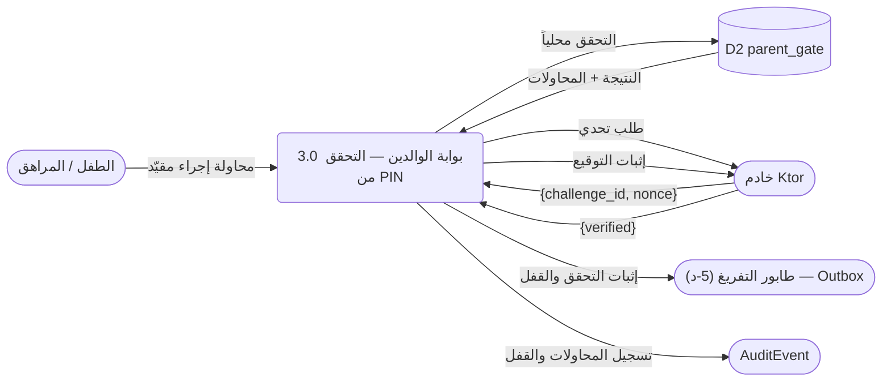

- يقرأ: البوابة تتحقق من الرقم محلياً (Q-142) وتتحدى الخادم للعمليات الحساسة فقط (REQ-006 أ/ب/ج)؛ وإثبات التحقق والقفل يذهب إلى الطابور (5-د) وإلى التدقيق؛ وطلب التحدي `POST /api/v1/shell/verification/challenge` وإثباته `POST /api/v1/shell/verification/prove`.

### 5-د. طابور Outbox — تسجيل وتفريغ (REQ-009)

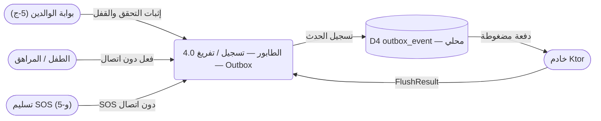

- يقرأ: الطابور يخزّن الأحداث دون اتصال ويرسلها دفعة مضغوطة؛ وSOS دون اتصال يُسجَّل بأولوية قصوى؛ وإثبات التحقق والقفل يأتي من البوابة (5-ج).

### 5-هـ. مراقبة صحة المنصة (REQ-013/015)


- يقرأ: الصحة تراقب الجهاز وتنبّه أو تعطل الانتقالات — أقل من 2GB: تعطيل Lottie/Blur للحفاظ على 60fps (REQ-013).

### 5-و. تسليم SOS (REQ-007)

```mermaid
flowchart LR
    Child([الطفل / المراهق])
    P6(6.0 تسليم SOS)
    S107([نظام الموقع S1-07])
    P4x(["طابور Outbox (5-د)"])

    Child -->|ضغط مطول 3 ثوانٍ<br/>— SOS| P6
    P6 -->|حدث SOS| S107
    P6 -->|"SOS دون اتصال"| P4x
```

- يقرأ: SOS يسلَّم لنظام الموقع فوراً، ودون اتصال يُسجَّل بأولوية قصوى في الطابور (5-د).

### 5-ز. توصيل أمر الأب + الإقرار (REQ-022)

```mermaid
flowchart LR
    Ktor([خادم Ktor])
    P7(7.0 توصيل أمر الأب + الإقرار)
    Shell([الغلاف])
    Push(["موفر الدفع"])
    P2x(["لوحة الأهل (5-ب)"])

    Ktor -->|"أمر الأب"| P7
    Ktor -->|"إشعار (payload — §4.4)"| Push
    Push -->|"دفع للوحة الأهل"| P2x
    P7 -->|تنفيذ الأمر| Shell
    Shell -->|"إقرار الاستلام"| P7
    P7 -->|"نشر الإقرار"| Ktor
```

- يقرأ: أمر الأب يصل عبر MQTT ويُقرّ باستلامه في أقل من 5 ثوانٍ؛ وأمر الأب على `family/{family_id}/devices/{device_id}/commands`؛ وإقرار الاستلام (ack) في أقل من 5 ثوانٍ؛ ونشر الإقرار على `family/{family_id}/devices/{device_id}/acks`؛ وموفر الدفع: FCM / HMS / APNs؛ ودفع للوحة الأهل — احتياطه قناة تنبيهات MQTT (Q-210).

- أُعيد رسمه 2026-11-19 (Q-434 — شكل فقط): قُسّم مخطط DFD الواحد (22 عقدة، نص غير مقروء عند عرض الصفحة) إلى لوحتين (15/13 عقدة)؛ والعقد المشتركة بين اللوحتين تظهر باسمها مع مرجع اللوحة الأخرى؛ وأُزيلت صناديق التجميع (subgraph) من اللوحتين لأنها كانت تفرّق العقد وتطيل الأسهم — والمخازن تميّزها أسطوانتها؛ وقُصّرت تسميات الأسهم وبقي معناها؛ والعمليات والمخازن والتدفقات نفسها قبل التقسيم وبعده. والتفصيل المنقول: التحقق محلياً من `pin_hash` المشفر — ولا يغادر الجهاز أبداً (Q-142)؛ وطلب التحدي للعمليات الحساسة فقط — وnonce صالح 5 دقائق.

- **أُعيد تقسيمه 2026-11-19 (دفعة الشكل 2):** اللوحتان (15/13 عقدة، 1604/2160 بكسل) قُسّمتا لوحة لكل عملية — سبع لوحات (5-أ…5-ز)؛ والتدفق العابر للوحتين يُرسم في اللوحتين (العقدة المشتركة باسمها ومرجع اللوحة الأخرى)؛ والعمليات والمخازن والتدفقات نفسها قبل التقسيم وبعده.

## 6. مخطط النشاط (Activity) — دورة حياة الإقلاع والاستخدام

أربع لوحات: الإقلاع والتحديث (6-أ)، وخدمة Kotlin الخلفية (6-ب)، والإجراء المقيّد (6-ج)، والاستغاثة والإغلاق (6-د). والمسارات (المستخدم / الغلاف / وحدة Kotlin / الخادم) كمسارات متوازية، بثلاثة مسارات على الأكثر في اللوحة الواحدة. والأنشطة الخلفية (خدمة Kotlin + مراقبة الصحة + تفريغ Outbox) تعمل **بالتوازي** مع استخدام التطبيق.

### 6-أ. الإقلاع والتحديث (REQ-002/017/020)

```mermaid
flowchart TD
    subgraph User [المستخدم]
        U1([فتح التطبيق])
    end
    subgraph Shell [الغلاف — Flutter]
        S1[قراءة device_mode]
        S2{الوضع؟}
        S4[عرض الواجهة من المحفوظ]
        S3[تحديث الإعداد والأعلام]
        S11{درجة التحديث؟}
        S12[عرض درجة التحديث]
        Ready6(["جاهز — استخدم التطبيق (6-ج)"])
    end
    subgraph Server [الخادم — Ktor]
        V1[GET …/shell/config]
        V3[تفريغ Outbox]
    end

    U1 --> S1
    S1 --> S2
    S2 -->|أهل| S4
    S2 -->|طفل| S4
    S4 --> S3
    S3 --> V1
    V1 -->|الإعداد| S11
    S11 -->|تحديث مطلوب| S12
    S11 -->|لا شيء| Ready6
    S4 --> V3
```

- يقرأ: عرض الواجهة من المحفوظ حسب الوضع — أقل من 1.2 ثانية؛ وتحديث الإعداد والأعلام وفحص الإصدار في الخلفية؛ ودرجة التحديث واحدة من ثلاث — صف في «عن التطبيق»، شريط حث، شاشة حاجبة تبقى فيها الاستغاثة (في وضع الطفل)؛ والطلب `GET /api/v1/families/{id}/shell/config`؛ والتفريغ `POST /api/v1/shell/outbox/flush`.

### 6-ب. خدمة Kotlin الخلفية (REQ-003/013)

```mermaid
flowchart TD
    subgraph Shell [الغلاف — Flutter]
        S4x([عرض الواجهة من المحفوظ — 6-أ])
    end
    subgraph Kotlin [وحدة Kotlin]
        K1[خدمة خلفية دائمة]
        K2[مراقبة الصحة]
        K3[تطبيق قواعد الفرض]
    end

    S4x --> K1
    K1 --> K2
    K1 --> K3
```

- يقرأ: خدمة Kotlin الخلفية الدائمة تبدأ مع عرض الواجهة (6-أ)؛ ومراقبة الصحة وتطبيق قواعد الفرض يعملان بالتوازي مع استخدام التطبيق؛ ومراقبة الصحة — أقل من 2GB: تعطيل Lottie/Blur — 60fps (REQ-013).

### 6-ج. الإجراء المقيّد (REQ-005/006/023)

```mermaid
flowchart TD
    subgraph User [المستخدم]
        U2[استخدام التطبيق]
        U3[محاولة إجراء مقيّد]
    end
    subgraph Shell [الغلاف — Flutter]
        S5[طلب الرقم السري]
        S10{العملية حساسة؟}
        S6{النتيجة؟}
        S7[تنفيذ أو رفض]
    end
    subgraph Kotlin [وحدة Kotlin]
        K4[التحقق المحلي من PIN]
    end
    subgraph Server [الخادم — Ktor]
        V4[تحدٍّ وإثبات بتوقيع الجهاز]
        V3[تفريغ Outbox]
    end

    U2 --> U3
    U3 --> S5
    S5 --> K4
    K4 --> S10
    S10 -->|حساسة ومتصل| V4
    S10 -->|حساسة دون اتصال| S7
    S10 -->|عرض إعداد إداري فقط| S6
    K4 -.->|إثبات التحقق والقفل| V3
    V4 --> S6
    S6 -->|مقبول| S7
    S6 -->|مرفوض| S7
```

- يقرأ: طلب الرقم مرة واحدة للعملية؛ والعملية الحساسة تعداد REQ-006 (إيقاف القواعد، فك إقران، إلغاء تثبيت)؛ والحساسة دون اتصال تعرض «يحتاج اتصالاً»؛ وتنفيذ أو رفض مع عدّاد المحاولات؛ وإثبات التحقق وكل إدخال خاطئ والقفل يُحفظ في Outbox — والقفل ينبّه الأب؛ وتحدٍّ وإثبات بتوقيع الجهاز: `POST /api/v1/shell/verification/challenge` + `POST /api/v1/shell/verification/prove` (Q-164)؛ والتحقق المحلي من PIN مقابل `pin_hash` المشفر على الجهاز (Q-142).

### 6-د. الاستغاثة والإغلاق (REQ-007)

```mermaid
flowchart TD
    subgraph User [المستخدم]
        U2x([استخدام التطبيق — 6-ج])
        U4[ضغط زر الاستغاثة 3 ثوانٍ — SOS]
        U6[فتح «أحتاج مساعدة»]
        U5([إغلاق التطبيق])
    end
    subgraph Shell [الغلاف — Flutter]
        S8[تسليم الاستغاثة لنظام الموقع — SOS]
        S13[تأكيد الاستغاثة]
        S9[حفظ حالة الواجهة فوراً]
    end

    U2x --> U4
    U4 --> S8
    U2x --> U6
    U6 -->|«أنا في خطر»| S13
    S13 --> S8
    U5 --> S9
```

- يقرأ: الاستغاثة على جهاز الابن فقط — لا استغاثة في وضع الأهل (Q-416)؛ و«أحتاج مساعدة» ورقة هادئة — باب «أنا في خطر» يفتح تأكيد الاستغاثة نفسه ثم العدّ (Q-424)؛ وعند الإغلاق تُحفظ حالة الواجهة فوراً.

- أُعيد رسمه 2026-11-19 (Q-434 — Q-416 · Q-424): قُسّم النشاط الواحد (24 عقدة، اتجاه LR) إلى لوحتين (13/15 عقدة، اتجاه TD)؛ وU4 صار على جهاز الابن فقط؛ وأُضيف U6 مدخل «أحتاج مساعدة» مع تأكيد الاستغاثة S13؛ وقُصّرت التسميات وبقي معناها.

- **أُعيد تقسيمه 2026-11-19 (دفعة الشكل 2):** اللوحتان (13/15 عقدة، 1482/1425 بكسل) قُسّمتا أربع لوحات (6-أ…6-د) — بثلاثة مسارات على الأكثر في اللوحة؛ والمسار العابر للوحتين يُرسم بعقدة مرجعية باسمه.

- عند إعادة الفتح بعد الإغلاق القسري، يعود المستخدم لنفس الشاشة والمدخلات (§7).
