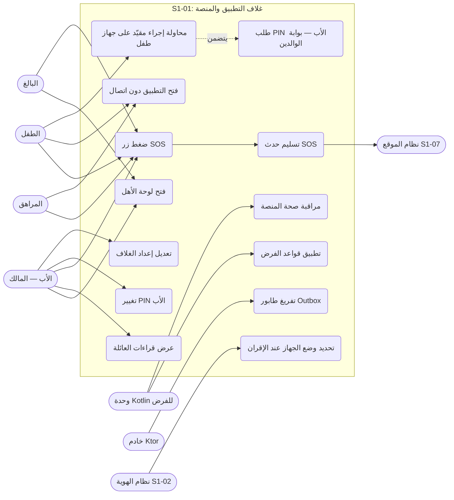
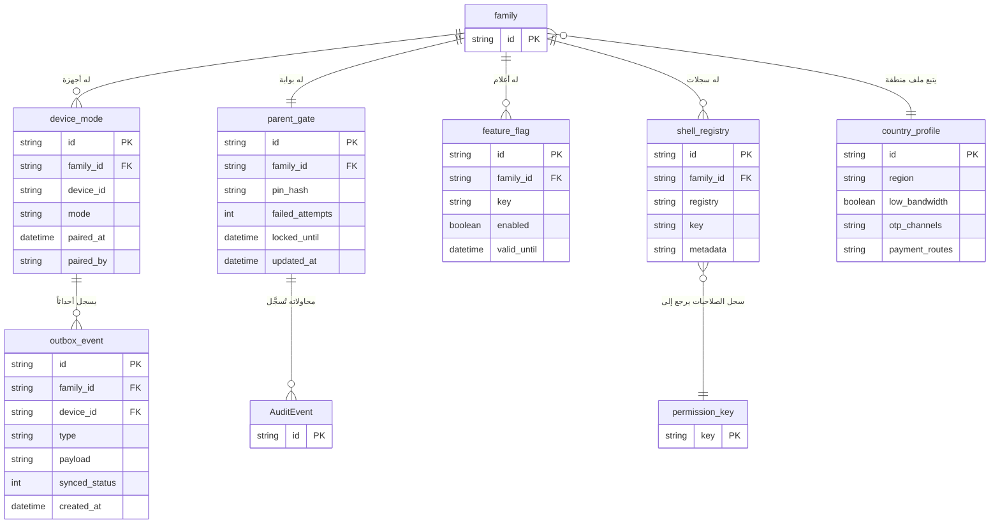
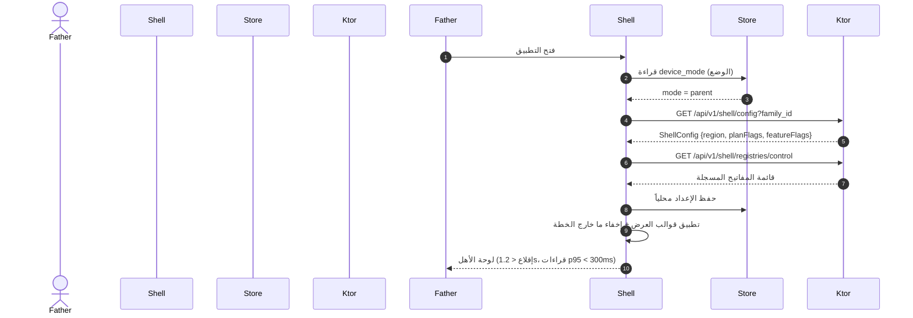
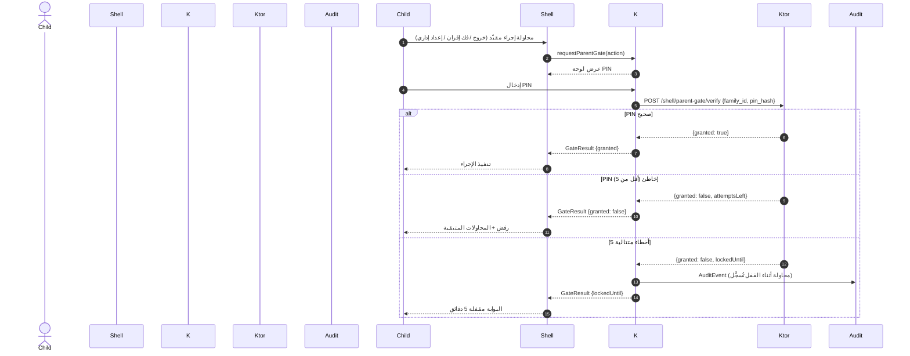
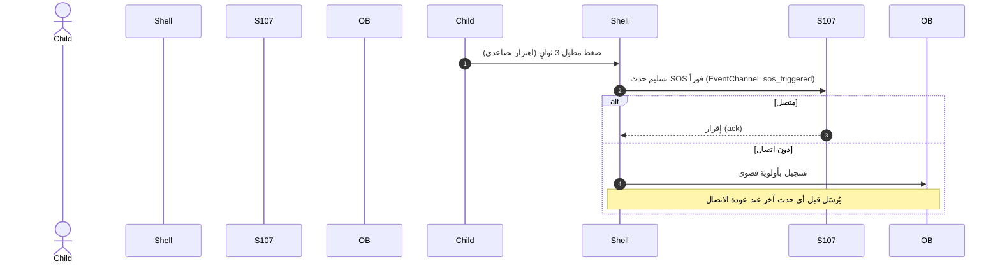
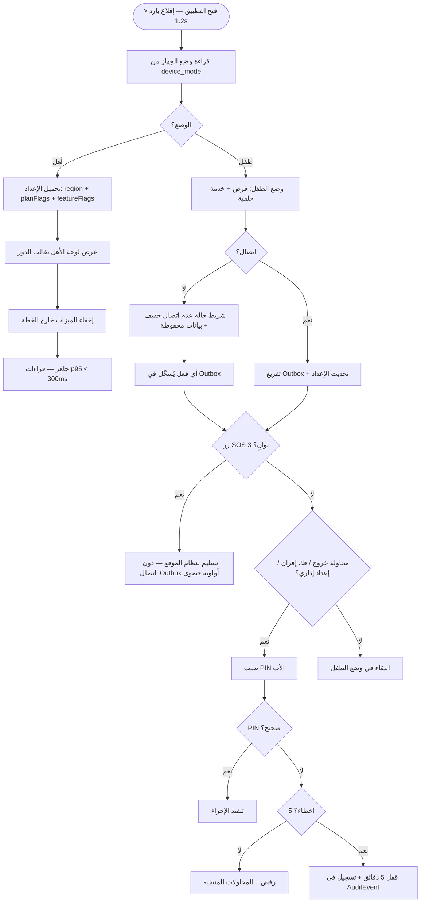
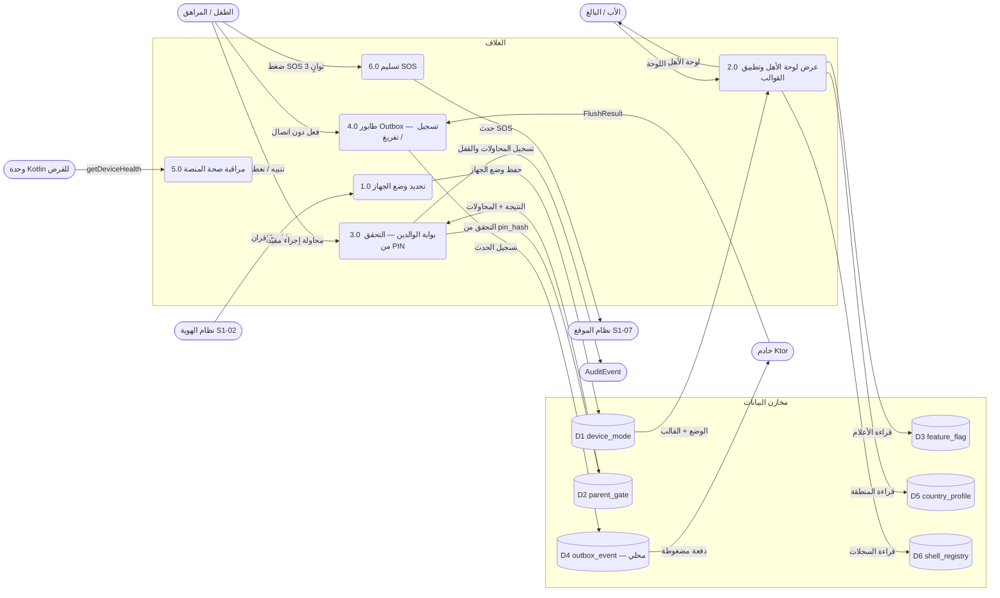
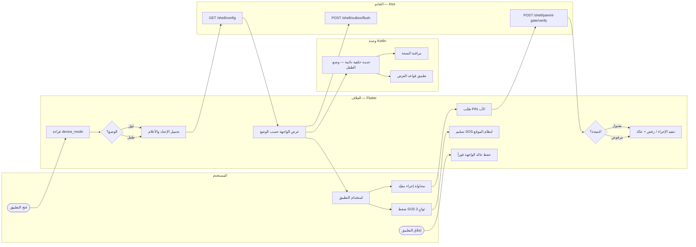

# S1-01: مخططات هندسة البرمجيات (DIAGRAMS)

- **الحالة:** معتمدة — الأنواع الستة معتمدة (حكم المالك 2026-11-06) · المراجعة النهائية على GitHub
- **المواصفة:** `SPEC.md` (§§1–8 + §10 معتمدة بالكامل في التخطيط)
- **القرارات الحاكمة:** Q-134 (هيكل الملف) · Q-062 · Q-063 · Q-065 · Q-067 · Q-068 · Q-070
- **الأنواع الستة:** 1. حالات الاستخدام · 2. ERD · 3. التسلسل · 4. تدفق المستخدم · 5. DFD · 6. النشاط

## 1. حالات الاستخدام

12 حالة استخدام من السيناريوهات الأربعة والمتطلبات (§2/§3): الأب والبالغ يفتحان اللوحة، كل الأدوار تضغط SOS، الطفل والمراهق يعملان دون اتصال، وأي إجراء مقيّد على جهاز طفل يتضمن بوابة PIN. والتسليم لنظام الموقع (S1-07) والإقران (S1-02) ممثلان كجهات خارجية.

## 2. مخطط قاعدة البيانات (ERD)

الجداول الستة من §5 كما هي، مع ثلاثة مراجع خارجية: العائلة (S1-02)، ومفتاح الصلاحية (S1-03)، و`AuditEvent` (النواة المشتركة). ملاحظتان: `outbox_event` محلي على الجهاز (SQLite) وليس جدول خادم، و`pin_hash` مشفر فقط — لا يُحفظ PIN نصاً أبداً. كل جدول يحمل `family_id` + عزل RLS (D-021).

## 3. التسلسل (Sequence) — من عقود §4

أربعة مخططات، كل واحد لتدفق واحد:

### 3-أ. الإقلاع وتحديد الوضع (REQ-002/012/017)

### 3-ب. بوابة الوالدين (REQ-005/006 — §4.1 + §4.2)

- التحقق من PIN يتم عبر الخادم (§4.2)؛ وحدة Kotlin تعرض اللوحة وتجمع PIN (§4.1). ولا سؤال حسابي في أي مسار (Q-065).

### 3-ج. تفريغ طابور Outbox (REQ-009 — §4.2)

### 3-د. زر SOS (REQ-007 — §4.1/§4.3)

## 4. تدفق المستخدم (User Flow) — من السيناريوهات الأربعة (§2)

- ملاحظة: تسجيل دخول الأب على جهاز طفل **لا** يبدّل الوضع — الوضع يتحدد بالإقران (REQ-002).

## 5. مخطط تدفق البيانات (DFD — المستوى 1) — من §4/§5

العمليات مرقمة 1.0–6.0، والمخازن D1–D6. المخزن D4 محلي على الجهاز (SQLite)؛ بقية المخازن جداول خادم (PostgreSQL) مع نسخة محفوظة محلياً للإعداد.

## 6. مخطط النشاط (Activity) — دورة حياة الإقلاع والاستخدام

المسارات الأربعة (المستخدم / الغلاف / وحدة Kotlin / الخادم) كمسارات متوازية. والأنشطة الخلفية (خدمة Kotlin + مراقبة الصحة + تفريغ Outbox) تعمل **بالتوازي** مع استخدام التطبيق.

- عند إعادة الفتح بعد الإغلاق القسري، يعود المستخدم لنفس الشاشة والمدخلات (§7).
