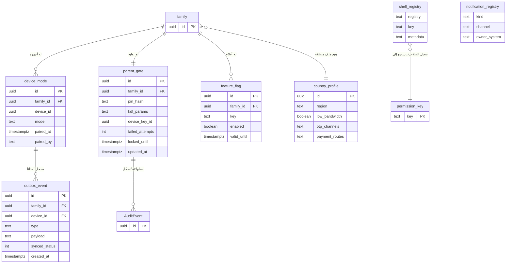
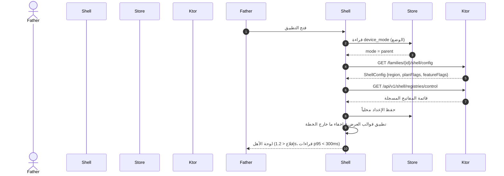
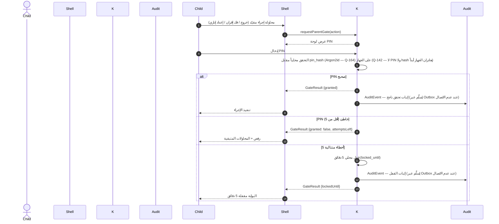
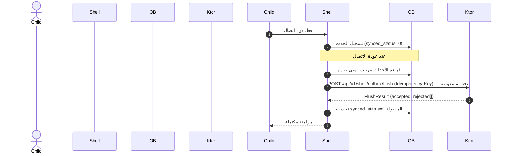
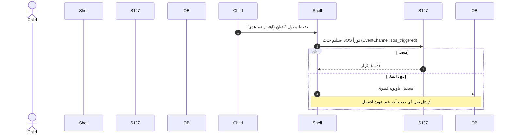
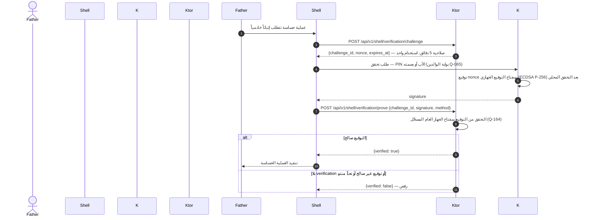
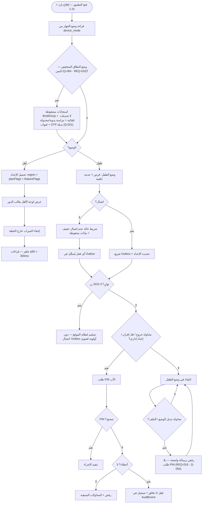
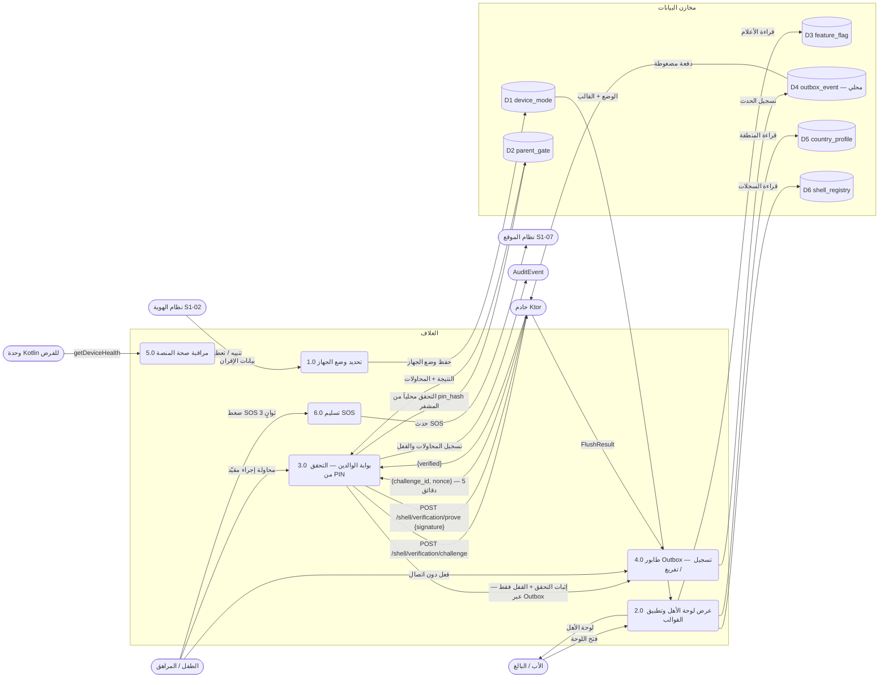
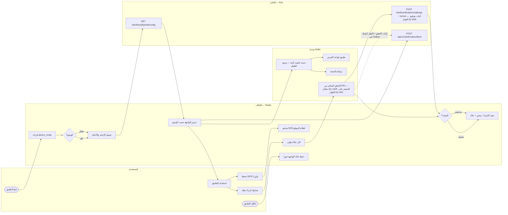

# S1-01: مخططات هندسة البرمجيات (DIAGRAMS)

- **الحالة:** معتمدة — المخططات الستة معتمدة (حكم المالك 2026-11-06)؛ والمواصفة معتمدة بالكامل في التخطيط
- **المواصفة:** `SPEC.md` (§§1–8 + §10 معتمدة بالكامل في التخطيط)
- **السياق المحدد (Bounded Context):** بلا سياق خاص — عنصر عابر يعبر كل السياقات (الغلاف، `CONTEXT-MAP.md` §2-أ)
- **القرارات الحاكمة:** Q-134 (هيكل الملف) · Q-062 · Q-063 · Q-065 · Q-067 · Q-068 · Q-070
- **الأنواع الستة:** 1. حالات الاستخدام · 2. ERD · 3. التسلسل · 4. تدفق المستخدم · 5. DFD · 6. النشاط
- **الأشكال الموحدة:** مستطيل = جهة خارجية · مستطيل مستدير = عملية · معين = قرار · أسطوانة = مخزن بيانات · خط متقطع = يتضمن / اختياري

## 1. حالات الاستخدام

13 حالة استخدام من السيناريوهات الأربعة والمتطلبات (§2/§3): الأب والبالغ يفتحان اللوحة، كل الأدوار تضغط SOS، الطفل والمراهق يعملان دون اتصال، وأي إجراء مقيّد على جهاز طفل يتضمن بوابة PIN. والتسليم لنظام الموقع (S1-07) والإقران (S1-02) ممثلان كجهات خارجية.

## 2. مخطط قاعدة البيانات (ERD)

الجداول السبعة من §5 كما هي، مع ثلاثة مراجع خارجية: العائلة (S1-02)، ومفتاح الصلاحية (S1-03)، و`AuditEvent` (النواة المشتركة). ملاحظتان: `outbox_event` محلي على الجهاز (SQLite) وليس جدول خادم، و`pin_hash` هو **Argon2id (m=64MiB، t=3، p=1) مع ملح عشوائي (Q-164)** — لا يُحفظ PIN نصاً أبداً. و`parent_gate` **مخزن محلي على الجهاز** (Q-142): hash الـ PIN محفوظ في مخزن آمن مدعوم بالعتاد والتحقق يتم محلياً، والخادم لا يستلم PIN ولا hashه أبداً — يسجل إثبات التحقق + القفل فقط في التدقيق عبر Outbox. جداول العائلة تحمل `family_id` + عزل RLS (D-021)؛ أما السجلات العالمية (`shell_registry` كعرض قراءة، و`notification_registry`) وملف المنطقة (`country_profile`) فبلا `family_id`.

## 3. التسلسل (Sequence) — من عقود §4

خمسة مخططات، كل واحد لتدفق واحد:

### 3-أ. الإقلاع وتحديد الوضع (REQ-002/012/017)

### 3-ب. بوابة الوالدين (REQ-005/006 — §4.1 + §4.2)

- التحقق من PIN **محلي فقط** (Q-142): hash الـ PIN محفوظ مشفراً على الجهاز وتتحقق منه وحدة Kotlin محلياً؛ والخادم يسجل إثبات التحقق + القفل فقط في التدقيق (عبر Outbox عند عدم الاتصال) ولا يستلم PIN ولا hashه أبداً. ونقطة التحقق الخادمي من PIN **محذوفة** — لا مكالمة Ktor في هذا التدفق. ولا سؤال حسابي في أي مسار (Q-065).

### 3-ج. تفريغ طابور Outbox (REQ-009 — §4.2)

### 3-د. زر SOS (REQ-007 — §4.1/§4.3)

### 3-هـ. إثبات التحقق بتحدٍّ من الخادم (REQ-023 — §4.2 · Q-164)

- الإثبات القابل للتحقق **ليس** تحقق PIN خادمياً (Q-142 يبقى: لا نقطة PIN خادمية، ولا PIN ولا hash يغادران الجهاز أبداً) — بل إثبات توقيع: الخادم يتحقق من توقيع التحدي بمفتاح الجهاز العام المسجَّل قبل تنفيذ أي عملية حساسة. والمفتاح وُلد عند الإقران (S1-02 3-د) ومعرّفه `device_key_id` في `parent_gate` (§5).

## 4. تدفق المستخدم (User Flow) — من السيناريوهات الأربعة (§2)

- ملاحظة: تسجيل دخول الأب على جهاز طفل **لا** يبدّل الوضع — الوضع يتحدد بالإقران (REQ-002).
- ملاحظة: أي محاولة لتبديل الوضع أو الملف في المرحلة 1 تُرفض برسالة واضحة **بلا طلب PIN** (REQ-018 · Q-063) — الوضع ثابت لكل جهاز ولا تبديل ملفات في المرحلة 1. ووضع النطاق المنخفض (Q-064 · REQ-010) إلزامي لليمن: ضغط Brotli/Gzip، ولا تحديثات تلقائية، والمزامنة يدوية أو مجدولة، وقنوات OTP بديلة (Q-021).

## 5. مخطط تدفق البيانات (DFD — المستوى 1) — من §4/§5

العمليات مرقمة 1.0–6.0، والمخازن D1–D6. المخزن D4 محلي على الجهاز (SQLite)؛ بقية المخازن جداول خادم (PostgreSQL) مع نسخة محفوظة محلياً للإعداد — **عدا D2 (`parent_gate`) فهو مخزن محلي على الجهاز (Q-142)**: hash الـ PIN مشفر على الجهاز ولا يغادر الجهاز أبداً، والخادم يسجل إثبات التحقق + القفل فقط عبر Outbox. ووضع النطاق المنخفض (Q-064 · REQ-010): الاستجابات مضغوطة Brotli/Gzip، ولا تحديثات تلقائية، والمزامنة يدوية/مجدولة (P4).

- **تغطية نقاط §4:** التسلسلات في §3 تغطي التدفقات الأساسية فقط؛ وكل نقطة §4 تظهر هنا على الأقل: `GET /families/{id}/shell/config` (3-أ) · `GET /api/v1/shell/registries/{registry}` (3-أ) · `POST /api/v1/shell/outbox/flush` (3-ج) · `POST /api/v1/shell/verification/challenge` (3-هـ) · `POST /api/v1/shell/verification/prove` (3-هـ). ونقطة التحقق الخادمي من PIN **محذوفة** per Q-142 — التحقق من PIN محلي فقط (P3 ← D2).

## 6. مخطط النشاط (Activity) — دورة حياة الإقلاع والاستخدام

المسارات الأربعة (المستخدم / الغلاف / وحدة Kotlin / الخادم) كمسارات متوازية. والأنشطة الخلفية (خدمة Kotlin + مراقبة الصحة + تفريغ Outbox) تعمل **بالتوازي** مع استخدام التطبيق.

- عند إعادة الفتح بعد الإغلاق القسري، يعود المستخدم لنفس الشاشة والمدخلات (§7).
