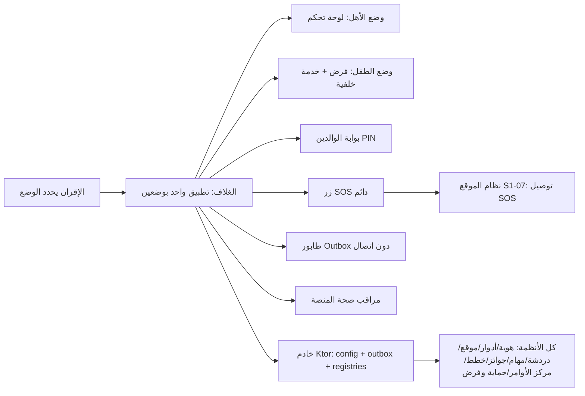
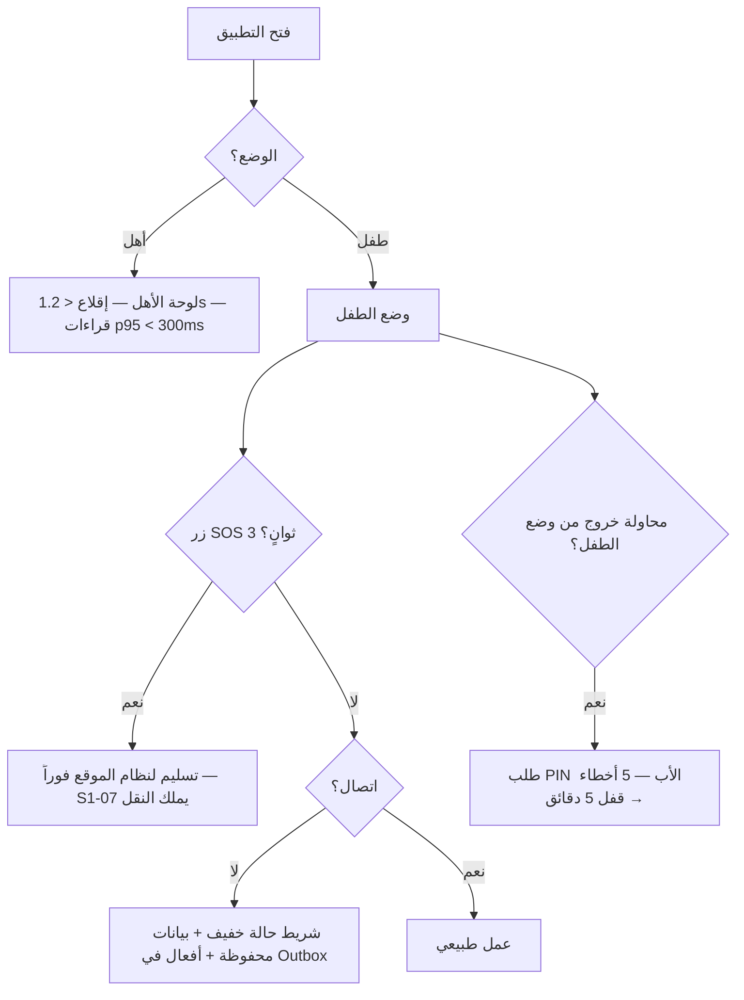
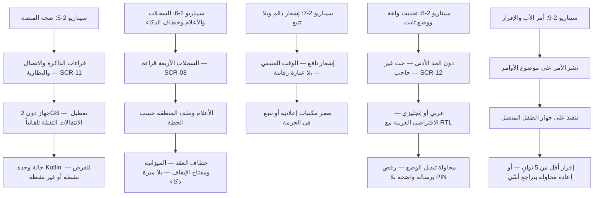

# S1-01: هيكل التطبيق والمنصة (App Shell & Platform)

- **الحالة:** approved | **المرحلة:** 1 (نواة الحماية) · **آخر تحديث:** 2026-11-16 (إغلاق التصميم المعتمد Q-397؛ قبله 2026-11-05) · **أُغلق النظام بأمر المالك وانتقل العمل إلى S1-02 (Q-399)**
- **القرارات الحاكمة:** Q-001 · Q-002 · Q-003 · Q-005 · Q-006 · Q-007 · Q-008 · Q-011 · Q-020 · Q-022 · Q-031 · Q-054 · Q-055 · Q-056 · Q-057 · Q-061 · Q-062 · Q-063 · Q-064 · Q-065 · Q-066 · Q-067 · Q-068 · Q-069 · Q-070 · Q-141 · Q-142 · Q-164 · Q-167 · Q-195 · Q-234 · Q-236 · Q-244 · G-006 · G-007 · G-009 · G-010 · D-023 · D-024 · D-038 · Q-168 · Q-343 · Q-356 · Q-392 · Q-396 · Q-397 · Q-398
- **حالة المراجعة:** الأقسام 1–8 + §10 معتمدة بالكامل في التخطيط — حكم المالك 2026-11-06 · **§9 في مرحلة التصميم (Q-091)**. **إغلاق التصميم:** نُفّذت بنود هذا النظام في التصميم الأساسي `phases/phase-1/prototype/` واعتمدها المالك من الشاشة في 2026-11-16 (Q-397)؛ خلاصتها في §9-8، ويسود نص التحديثات المؤرخة «Q-397» على ما يخالفه في هذا الملف. الباقي في التصميم: اللوحي والقابل للطي (Q-392) والترجمة الإنجليزية الكاملة (REQ-021).
- **الأدلة المرجعية:** المواصفة القديمة S1-01 (مرجع فقط، G-009) · Deep-dives: Telegram (NotificationCenter, single-activity shell) · Bark (shell FSM) · FamilyWall (profile switcher) · Quizlet (offline queue) · Life360 (devicehealth) · نظام التصميم (15 ملف Markdown — بلا Dart) · `ARCHITECTURE.md` §5 · `CONTEXT-MAP.md`

## 1. الهدف والتحليل والنطاق

يوفر هذا النظام الهيكل العظمي لتطبيق Family OS الواحد بوضعين (Dual Mode): الغلاف التكيفي الذي يستضيف كل الأنظمة، وقوالب العرض حسب الدور، وبوابة الوالدين، والقدرات المشتركة (السجلات، أعلام الميزات، المزامنة دون اتصال، مراقب الصحة، ملفات المناطق)، وخطاف عقد بوابة الذكاء — بلا ميزة ذكاء فعلية.

**مخطط سياق النظام (§1 — بصري):**

**داخل النطاق:**
- تطبيق واحد (Flutter + وحدة Kotlin أصلية للفرض) بوضعين: وضع الأهل (لوحة تحكم) ووضع الطفل (فرض + خدمة خلفية دائمة)؛ الوضع يتحدد بالإقران/الدور، وثابت لكل جهاز في المرحلة 1.
- الغلاف التكيفي: شريط تنقل سفلي يتكيف مع الدور والصلاحيات الممنوحة، قوالب عرض (مالك/بالغ/مراهق/طفل)، شريط حالة عدم الاتصال، زر SOS دائم.
- بوابة الوالدين: رقم سري (PIN) يضعه الأب وحده.
- القدرات المشتركة: السجلات الأربعة، أعلام الميزات والإعداد عن بُعد، طابور مزامنة دون اتصال، مراقب صحة المنصة، ملفات المناطق (وضع النطاق المنخفض لليمن).
- خطاف عقد بوابة الذكاء (هيكل العقد فقط).

**خارج النطاق:**
- الهوية والتسجيل وOTP وربط الأجهزة (نظام الهوية).
- إدارة العائلة والأعضاء وتفويض الصلاحيات (نظام الأدوار والصلاحيات).
- محرك الفرض (الحظر/الجداول/مقاومة الإزالة) وشاشات الحظر (نظام الحماية والفرض S1-10 — Q-141، المواصفة معتمدة (Q-146)).
- الموقع والأسوار وتوصيل SOS (نظام الموقع).
- الخطط والدفع (نظام الفوترة).
- تبديل الملفات على جهاز مشترك (مؤجل للمرحلة 2 — أولوية ملزمة، Q-063).
- المحادثة/التعليم/الدين/التنسيق (مراحلها).

### جدول اختلافات الوضعين (Q-062 — ملزم)

| القدرة | وضع الأهل | وضع الطفل |
|---|---|---|
| لوحة التحكم وشاشات الإدارة | نعم (حسب الدور والصلاحيات) | لا — مخفية تماماً |
| محرك الفرض (حظر/جداول/VPN/Accessibility) | لا — غير موجود | نعم — وحدة Kotlin للتنفيذ، خدمة خلفية دائمة (تقييم القواعد/الجداول ملك S1-10 — Q-141) |
| زر SOS الدائم | نعم | نعم |
| بوابة الوالدين (PIN) | لا تُطلب لفتح اللوحة (المستخدم مصادق عليه كأب)؛ وتُطلب للعمليات الحساسة حين تُنفَّذ من لوحة الأهل (فك إقران جهاز، إنهاء كل الجلسات، إزالة عضو — S1-02)، وPIN يفتح البوابة والبصمة تفتح مفتاح التوقيع بعدها (Q-244) | تُطلب لإيقاف القواعد مؤقتاً (هذا معنى «الخروج من وضع الطفل» — REQ-006) / فك الإقران / إلغاء التثبيت / فتح أي إعداد إداري | [Q-418: على هاتف الأهل يكفي التأكيد بالبصمة إن اختاره صاحبه؛ وعلى جهاز الطفل الرقم السري وحده — تفصيله في REQ-005.]
| خدمة الخلفية | دفع فقط (FCM/HMS/APNs — §4.4) | دائمة (MQTT + فرض) |
| الإشعار الدائم | معلومات نافعة (حالة العائلة) | معلومات نافعة (الوقت المتبقي) — لا عبارة رقابية (G-006) |
| تبديل الملفات | لا (مؤجل للمرحلة 2 — أولوية، Q-063) | لا (مؤجل للمرحلة 2 — أولوية، Q-063) |
| الوصول لإعدادات النظام | نعم (للأب) | لا — يتطلب PIN الأب |

[تحديث 2026-11-16 (Q-397 — ب-04 وب-02): كان صف «بوابة الوالدين» يقول في وضع الأهل «لا تُطلب (المستخدم مصادق عليه كأب)» وفي وضع الطفل «تُطلب للخروج من وضع الطفل / فك الإقران / فتح أي إعداد إداري». صُحّحت الصياغة لأنها تعارض S1-02 REQ-015 (فك الإقران من لوحة الأهل يطلب PIN)، ولأن «الخروج من وضع الطفل» كان بلا معنى معرَّف مع ثبات الوضع (REQ-018). الحكم Q-062 نفسه قائم؛ التصحيح في صياغة هذا الصف فقط.]

## 2. سيناريوهات المستخدم

### سيناريو 2-1: الأب يفتح لوحة التحكم لأول مرة
- **الممثل:** الأب (المالك، `is_owner`).
- **السياق:** جهاز الأهل بعد الإقران؛ التطبيق مغلق.
- **التدفق:**
  1. يفتح الأب التطبيق؛ الإقلاع البارد يكتمل خلال 1.2 ثانية (REQ-017).
  2. الغلاف يقرأ وضع الجهاز (`parent`) من `device_mode` ويعرض لوحة الأهل بقالب المالك (REQ-002/REQ-004).
  3. يُحمَّل ملف المنطقة والخطط (Q-005/Q-055)؛ الميزات خارج الخطة مخفية.
  4. تظهر قراءات العائلة (الحالة، آخر مزامنة) في أقل من 300ms p95 (Q-061).
- **النتيجة:** لوحة أهل كاملة بلا أي عنصر من وضع الطفل؛ لا يُطلب PIN (المستخدم مصادق عليه كأب).

### سيناريو 2-2: الطفل يضغط زر SOS
- **الممثل:** طفل (وضع الطفل).
- **السياق:** جهاز الطفل، اتصال ضعيف.
- **التدفق:**
  1. يضغط الطفل زر SOS الظاهر دائماً ضغطاً مطولاً 3 ثوانٍ مع اهتزاز تصاعدي (REQ-007).
  2. S1-07 يملك النقل؛ الغلاف يسلّم `sos_triggered` إلى S1-07 فوراً (Q-234/D-6).
  3. دون اتصال: التسليم إلى S1-07 فوري داخل الجهاز أيضاً؛ وS1-07 يقرر وسيلة التوصيل؛ وOutbox ليس نقلاً بديلاً لـ SOS.
- **النتيجة:** تنبيه SOS يصل الأهل في أقل من 10 ثوانٍ عند الاتصال الطبيعي (Q-061).

### سيناريو 2-3: مراهق في اليمن يفتح التطبيق دون اتصال
- **الممثل:** مراهق (وضع الطفل).
- **السياق:** اليمن، لا اتصال، بيانات محفوظة محلياً.
- **التدفق:**
  1. يفتح المراهق التطبيق؛ يظهر شريط حالة عدم اتصال خفيف — بلا شاشة خطأ (REQ-008).
  2. تُعرض البيانات المحفوظة محلياً (الوقت المتبقي، الجدول).
  3. أي فعل يُنفَّذ يُسجَّل في Outbox مع `synced_status=0` (REQ-009).
  4. عند عودة الاتصال تُفرَّغ الدفعة مضغوطة بترتيب زمني صارم (Q-064).
- **النتيجة:** التطبيق يعمل كاملاً دون اتصال؛ لا بيانات تُفقد.

### سيناريو 2-4: طفل يحاول الخروج من وضع الطفل
- **الممثل:** طفل يحاول فك الإقران أو فتح إعداد إداري.
- **السياق:** جهاز الطفل.
- **التدفق:**
  1. يطلب الطفل فتح إعداد إداري؛ الغلاف يطلب PIN الأب (REQ-006).
  2. يدخل PIN خاطئاً 5 مرات متتالية → يُقفل الباب 5 دقائق (معتمد؛ التحقق محلي — Q-142).
  3. أثناء القفل أي محاولة جديدة تُرفض وتُسجَّل في `AuditEvent`.
- **النتيجة:** لا خروج من وضع الطفل ولا فك إقران دون PIN الأب؛ لا سؤال حسابي في أي مسار (Q-065). [تحديث 2026-11-16 (Q-397 — ب-02): «الخروج من وضع الطفل» يعني في المرحلة 1 «أوقف القواعد مؤقتاً»: تشغيل الوضع الحر (S1-10 REQ-018 · Q-143) من جهاز الطفل نفسه بعد PIN الأب، بمدة يختارها الأب، وينتهي وحده وتعود القواعد؛ ووضع الجهاز لا يتغير (REQ-018). لا عملية ثالثة بهذا الاسم.]

### سيناريو 2-5: أب يعاين صحة المنصة ووحدة الفرض
- **الممثل:** الأب (المالك).
- **السياق:** جهاز طفل بذاكرة أقل من 2GB.
- **التدفق:**
  1. يفتح الأب لوحة صحة المنصة (SCR-11)؛ تظهر قراءات الذاكرة والاتصال والبطارية (REQ-013).
  2. على جهاز دون 2GB RAM تُعطَّل الانتقالات الثقيلة (Lottie/Blur) تلقائياً للحفاظ على 60 إطاراً/ثانية (REQ-013).
  3. تظهر حالة وحدة Kotlin للفرض (`isEnforcementActive()` — نشطة/غير نشطة)؛ والتقييم نفسه ملك S1-10 (REQ-003).
- **النتيجة:** صحة المنصة مقروءة؛ والأداء محفوظ على الأجهزة الضعيفة.

### سيناريو 2-6: أب يعاين السجلات والأعلام وخطاف الذكاء
- **الممثل:** الأب (المالك).
- **السياق:** لوحة الأهل بعد الإقلاع.
- **التدفق:**
  1. يفتح الأب الإعدادات الإدارية (SCR-08)؛ تُعرض السجلات الأربعة قراءةً — ولا مفتاح تحكم يعمل دون تسجيل (REQ-011).
  2. تُحمَّل ملفات المنطقة والأعلام عند الإقلاع وتُحفظ محلياً؛ والميزات خارج الخطة مخفية (REQ-012).
  3. يعرض خطاف بوابة الذكاء هيكل العقد والميزانية ومفتاح الإيقاف (Q-054 · Q-167) — بلا أي ميزة ذكاء فعلية (REQ-014).
- **النتيجة:** الإعداد والأعلام والخطاف مقروءة؛ ومفتاح غير مسجل لا يعمل.

### سيناريو 2-7: طفل يرى إشعاراً دائماً نافعاً بلا تتبع
- **الممثل:** طفل (وضع الطفل).
- **السياق:** جهاز الطفل يعرض الإشعار الدائم.
- **التدفق:**
  1. يعرض الإشعار الدائم الوقت المتبقي فقط — بلا عبارة رقابية (REQ-015).
  2. الموافقة على المراقبة تمت مرة واحدة في إعداد مشترك (أب + طفل)؛ والشفافية عن الفئات لا عن المحتوى (REQ-015).
  3. الحزمة بلا أي مكتبة إعلانية أو أداة تتبع (مسح الاعتماديات في CI)؛ ولا حدث تحليلي واحد لحساب الطفل قبل حسم Q-046 (REQ-016).
- **النتيجة:** إشعار نافع بلا رقابة لفظية وبلا تتبع.

### سيناريو 2-8: أب يحدّث التطبيق ويبدّل اللغة على جهاز دون الحد الأدنى
- **الممثل:** الأب.
- **السياق:** إصدار التطبيق دون الحد الأدنى للإصدار المدعوم.
- **التدفق:**
  1. عند الإقلاع بإصدار دون الحد الأدنى يُحث الأب على التحديث بشريط غير حاجب عند كل فتح (SCR-12)؛ والشاشة الحاجبة للتحديث الأمني الحرج وحده؛ والتحديث العادي عبر المتجر (REQ-020). [تحديث 2026-11-16 (Q-397 — ب-03): كان النص «تُعرض شاشة التحديث الإلزامي (SCR-12)»؛ يسود Q-069 وREQ-020 وACC-021: دون الحد الأدنى يُحث ولا يُحجب.]
  2. يبدّل الأب اللغة عربي/إنجليزي؛ والافتراضي العربية مع RTL؛ وكل نص من ملفات ترجمة (REQ-021).
  3. يحاول طفل تبديل الوضع/الملف فتُرفض المحاولة برسالة واضحة بلا طلب PIN (REQ-018).
  4. على iOS يعرض الغلاف التوفر الصادق: وحدة الفرض غير متاحة (`unavailable_on_device`) والواجهة مشتركة (REQ-019).
- **النتيجة:** التحديث واللغة والوضع الثابت يعملون كما هو محكوم.

### سيناريو 2-9: أب يصدر أمراً لجهاز طفل متصل فيُقَرّ به
- **الممثل:** الأب + طفل (وضع الطفل).
- **السياق:** جهاز الطفل متصل.
- **التدفق:**
  1. يصدر الأب أمراً؛ يُنشر على موضوع الأوامر (§4.3) فيصل جهاز الطفل.
  2. ينفذ الجهاز الأمر ويُقرّ باستلامه (ack) على موضوع الإقرارات في أقل من 5 ثوانٍ (REQ-022).
  3. دون اتصال يُصفّ الأمر في Outbox بلا وعد زمني؛ وعند انقضاء 5 ثوانٍ بلا إقرار تُعاد المحاولة بتراجع أسّي.
- **النتيجة:** حلقة الأمر–الإقرار مغلقة وقابلة للقياس.

**تغطية السيناريوهات:** كل REQ من REQ-001 إلى REQ-023 مغطى بسيناريو واحد على الأقل (2-1…2-9)؛ بلا REQ بلا سيناريو.

**مخطط السيناريوهات (§2 — بصري):**

**مخطط السيناريوهات 2-5…2-9 (§2 — بصري):**

## 3. المتطلبات الوظيفية

- **REQ-001:** التطبيق تطبيق واحد (حزمة واحدة) يعمل بوضعين (Dual Mode)؛ لا حزمتين منفصلتين. [Q-062 · DERIVED]
- **REQ-002:** يُحدد الوضع عند الإقران: جهاز يُقترن كطفل يعمل بوضع الطفل دائماً؛ جهاز الأهل يعمل بوضع الأهل؛ ولا يتبدل الوضع بتسجيل الدخول وحده. [Q-062/Q-063 · DERIVED]
- **REQ-003:** الواجهة Flutter للوضعين؛ الفرض (DeviceAdmin/Accessibility/VPN/خدمة الخلفية) وحدة Kotlin أصلية داخل التطبيق عبر قنوات المنصة (MethodChannel/EventChannel)؛ هذه الوحدة تستضيف التنفيذ فقط — تقييم القواعد والجداول الأسبوعية ملك نظام الحماية والفرض S1-10 (Q-141، المواصفة معتمدة (Q-146)). [Q-068/Q-031 · DERIVED]
- **REQ-004:** شريط التنقل السفلي وقوالب العرض تتكيف مع الدور (`owner`/`adult`/`teen`/`child`) والصلاحيات الممنوحة فعلاً: تبويب إداري لا يظهر لمن لم يُفوَّض به. [Q-006/Q-007/Q-010 · DERIVED] [تحديث 2026-11-16 (Q-397 — أ-04): تبويبات البالغ المفوَّض تُشتق من منحه الفعلية: «الرئيسية» تحتاج `hub.dashboard.view`، و«التحكم» يحتاج `hub.settings.view`، وبقية التبويبات لكل بالغ عضو. من بلا المفتاحين يبدأ من «العائلة». وإن سُحبت صلاحية والمستخدم داخل تبويبها أُعيد إلى أقرب تبويب مسموح مع رسالة «لم يعد هذا القسم ضمن صلاحياتك».] [تحديث 2026-11-17 (Q-406 — ملاحظة F-04 المنقولة): `owner` في القوس أعلاه ليس دوراً: الأدوار `adult` / `teen` / `child`، والمالك بالغ عليه الصفة `is_owner` (Q-006 · D-038 · Q-394).] [تحديث 2026-11-18 (Q-417 · Q-425 — كُتب هنا ما اعتُمد في التصميم): قالب المراهق معتمد كما في النموذج: رئيسيته `t-home` (الوقت الباقي رقماً واحداً، ثم يومه مرتباً بالوقت وفيه سطر «الآن»، ثم تطبيقاته، ثم ما يراه أهله)، وصفحة «أنا» `t-me`، وتبويب «تعلّم». قالبا الطفل (7–12) ودون 7 مبنيان ومفحوصان، وأجزاؤهما من الأنظمة معتمدة مع أنظمتها، ولم يصدر فيهما حكم صريح قالباً كاملاً (Q-090).] [تحديث 2026-11-18 (Q-426): **قالبان للأبناء فقط:** قالب الطفل لكل ابن دون 13، وقالب المراهق من 13 إلى 17. قالب دون 7 (`minimal`) حُذف من المرحلة 1 بأمر المالك وأُجّل إلى مرحلة لاحقة؛ ومن هو دون 7 يُقبل ويستعمل قالب الطفل كما هو. واعتمد المالك قالب الطفل كما في النموذج، فأُغلق Q-090.]
- **REQ-005:** بوابة الوالدين رقم سري (PIN) يضعه الأب وحده؛ لا سؤال حسابي؛ لا يفتحها إلا الأب. **معيار PIN (Q-164): 6 أرقام حداً أدنى** مع منع الأنماط الشائعة (123456، أرقام مكررة، سنوات الميلاد)؛ والتجزئة **Argon2id (m=64MiB، t=3، p=1)** مع ملح عشوائي؛ والتخزين في مخزن آمن مدعوم بالعتاد (Android Keystore/StrongBox)؛ ولا يُحفظ PIN نصاً أبداً. PIN فقط يفتح Parent Gate؛ البصمة تفتح مفتاح التوقيع بعدها (Q-244). [Q-065 · Q-164 · Q-244 · DERIVED] [تحديث 2026-11-16 (Q-397 — أ-05/أ-06/ب-01/ب-15): **إنشاء الرقم ووصوله إلى الأجهزة.** (1) ينشئ الأب رقمه على هاتفه (إدخال ثم تأكيد) من قائمة الإعداد الأولي أو من «الأمان»؛ ولا يُعرض رمز إقران جهاز طفل قبل إنشائه. (2) الرقم محلي على كل جهاز ولا يغادره (Q-142)، فعند إقران جهاز طفل يكتب الأب رقمه على ذلك الجهاز داخل خطوة الموافقة المشتركة (إدخال ثم تأكيد) فيُحفظ هناك. (3) تغيير الرقم على جهاز لا يغيّره على غيره: الواجهة تقول ذلك صراحة بعد كل تغيير وتدل على موضع التغيير في جهاز الطفل («ملفي» ← «إعدادات هذا الجهاز» ← «تغيير الرقم السري»، خلف البوابة). (4) الأنماط المرفوضة مع سببها: رقم واحد مكرر، أرقام متتالية صعوداً أو نزولاً، نمط متكرر، وما يبدأ أو ينتهي بسنة ميلاد. (5) لا تراجع بعد الحفظ (GAP-S1-01-09).] [تحديث 2026-11-17 (Q-411): الرقم السري **ستة أرقام بالضبط**. الإعدادات الإدارية تُقفل من جديد فور مغادرتها أو انتقال التطبيق إلى الخلفية، وبعد دقيقتين بلا لمس. نسيان الرقم على جهاز الطفل: يفك الأب الإقران من لوحته ثم يعيد الإقران برقم جديد، بلا آلية أخرى.] [تعديل المالك 2026-11-17 (Q-418 — يسود على «PIN فقط يفتح Parent Gate» في هذا الموضع): **على هاتف الأهل** يبقى التأكيد بالرقم السري افتراضياً، ولصاحب الهاتف أن يجعله بالبصمة أو الوجه بمفتاح «أكّد الأفعال الحساسة بالبصمة» في «الأمان»، فتظهر شاشة البصمة بدل لوحة الأرقام. **يبقى الرقم السري مطلوباً في أربع حالات:** (1) على أجهزة الأبناء دائماً؛ (2) لتشغيل البصمة ولتغيير الرقم السري ولاختيار من يساعد على العودة؛ (3) بعد ثلاث محاولات فاشلة بالبصمة، أو إذا تغيّرت بصمات الهاتف حتى يُعاد توثيقه؛ (4) مرة كل 30 يوماً حتى لا يُنسى. وتغيير الرقم السري يطفئ التأكيد بالبصمة على ذلك الهاتف.]
- **REQ-006:** يُطلب PIN الأب لـ: الخروج من وضع الطفل، فك إقران الجهاز، إلغاء تثبيت الوكيل، فتح أي إعداد إداري من جهاز بوضع الطفل. **تعداد العمليات الحساسة (مغلق — لا عملية حساسة خارج هذا التعداد):** (أ) الخروج من وضع الطفل — تحدٍّ خادمي (REQ-023)؛ (ب) فك إقران الجهاز — تحدٍّ خادمي؛ (ج) إلغاء تثبيت الوكيل — تحدٍّ خادمي؛ (د) فتح إعداد إداري — PIN محلي فقط للعرض؛ وأي كتابة خادمية داخل الإعداد تُثبَت بتحدٍّ خادمي كمفتاح العملية نفسها. والعمليات (أ)–(ج) تغيّر حالة خادمية فلا تُنفَّذ بلا إثبات قابل للتحقق. [Q-065 · DERIVED] [تحديث 2026-11-16 (Q-397 — ب-02/ب-08): العملية (أ) «الخروج من وضع الطفل» معرَّفة: إيقاف القواعد مؤقتاً بالوضع الحر (S1-10 REQ-018) من جهاز الطفل، بمدة تنتهي وحدها، ولا يتغير وضع الجهاز. وإدخال واحد للرقم يفتح البوابة ويوقّع التحدي: لا يُطلب الرقم مرتين في عملية واحدة، وتغيير الرقم يطلب الرقم الحالي مرة واحدة. ودون اتصال: العمليات (أ)–(ج) تعرض «يحتاج اتصالاً» ولا تُنفَّذ ولا تُصفّ.]
- **REQ-007:** زر SOS ظاهر دائماً في كل شاشة في الوضعين؛ التفعيل بضغط مطول 3 ثوانٍ مع اهتزاز تصاعدي؛ عند التفعيل يُسلَّم الحدث فوراً لنظام الموقع للتوصيل. [Q-067/Q-056 · DERIVED] [تحديث 2026-11-16 (Q-397 — أ-01/أ-02/أ-03/ب-11): **النطاق:** كل شاشة بعد وجود عضوية، ومنها الأوراق السفلية ونوافذ التأكيد وشاشتا الرقم السري وشاشتا التحديث والصيانة. **الاستثناء الوحيد:** لا زر قبل وجود عضوية (شاشات التسجيل والانضمام والإقران، وشاشة «أول فتح بلا اتصال»)، لأن `SosEvent` يشترط `family_id` و`membership_id`؛ ولا يظهر الزر فوق مسار الاستغاثة نفسه. **الطبقة العليا:** إن غطّت الزرَّ ورقةٌ أو نافذة ظهرت نسخته فوقها في موضعه؛ وإن خرج من الشاشة بالتمرير ظهر شريط علوي مطويّ يحمل عنوان الشاشة والزر. **البديل:** «استغاثة بنقرة ثم تأكيد» إعداد شخصي في «اللغة والعرض»، ومن لوحة المفاتيح يُفتح التأكيد دائماً. **المؤشر:** تقدّم الثواني الثلاث لا يُلغى بتقليل الحركة ولا بتوفير البيانات.] [تحديث 2026-11-17 (Q-416): الزر في **وضع الطفل فقط** (الطفل والمراهق ودون 7)، في كل شاشة. لا يظهر في وضع الأهل: لا للمالك ولا لأي بالغ. البالغ يستقبل الاستغاثة ولا يرسلها من التطبيق.] [تحديث 2026-11-18 (Q-424 — كُتب هنا ما اعتُمد في التصميم): ومع زر الاستغاثة، للطفل والمراهق مدخل هادئ «أحتاج مساعدة» (`kid-help`) في آخر الرئيسية وفي الملف: يكلّم أباه أو أمه، أو يقول إن شيئاً أزعجه، أو يذهب إلى الاستغاثة. ليس بديلاً عن زر الاستغاثة ولا يؤخّره. قالب دون 7 بلا هذه الورقة النصية: له بلاطة «شيء أزعجني».] [تحديث 2026-11-18 (Q-426): سقط ذكر «دون 7» وبلاطته: الأبناء صنفان، طفل ومراهق، وكلاهما له الزر وورقة «أحتاج مساعدة».]
- **REQ-008:** يعرض الغلاف شريط حالة عدم اتصال خفيف (بلا شاشة خطأ)؛ ويفتح التطبيق ويعرض كل البيانات المحفوظة محلياً دون اتصال. [VERIFIED: Quizlet offline queue · DERIVED]
- **REQ-009:** طابور مزامنة دون اتصال (Offline Outbox): كل فعل يُنفذ دون اتصال يُسجَّل محلياً مع `synced_status=0` ويُفرَّغ دفعة واحدة مضغوطة عند عودة الاتصال، بترتيب زمني صارم. [VERIFIED: Quizlet offline queue · DERIVED] [تحديث 2026-11-16 (Q-397 — أ-09/ب-14): اسم الشاشة للمستخدم «البيانات والمزامنة» لا «الصندوق الصادر». تعرض ما ينتظر الإرسال باسم مفهوم لكل عملية (كل نظام يسجّل اسماً عربياً وإنجليزياً لكل نوع حدث يضعه في الطابور — GAP-S1-01-06)، و«زامن الآن»، ونتيجة آخر مزامنة، وبطاقة لكل تعارض بخيارين (أبقِ الأحدث / أعد تطبيق تعديلي). الطفل والمراهق يريان الحالة وعدد العمليات فقط.]
- **REQ-010:** وضع النطاق الترددي المنخفض لليمن إلزامي: ضغط الاستجابات (Brotli/Gzip)، لا تحديثات تلقائية، مزامنة يدوية أو مجدولة، قنوات OTP بديلة (Q-021). [Q-064/Q-005 · DERIVED] [تحديث 2026-11-16 (Q-397 — أ-10/ب-15): الاسم للمستخدم «توفير البيانات» لا «وضع النطاق المنخفض»؛ والسلوك كما في DS-ST-13 (Q-356). ثلاث قيم: تلقائي (الافتراضي — يتفعّل عند ضعف الاتصال ويعود وحده) / دائماً / متوقف. الإعداد شخصي لكل بالغ على جهازه (كان في §9-3 للمالك وحده)، وأجهزة الأطفال تلقائية بلا تحكم. وجدولة المزامنة عند التوفير: كل ساعة (الافتراضي — GAP-S1-01-05) / يومياً / يدوياً فقط، و«زامن الآن» متاح دائماً. والاستغاثة والفرض لا يتأثران بهذا الإعداد.]
- **REQ-011:** السجلات المركزية الأربعة (`ControlRegistry`، `PermissionRegistry`، `WidgetRegistry`، `NotificationRegistry`) تسجَّل فيها مفاتيح التحكم والصلاحيات والودجات وقنوات التنبيه؛ لا مفتاح تحكم يعمل دون تسجيل. **قابل للاختبار:** أي مفتاح تحكم غير مسجل يُرفض عند الاستدعاء برمز `UNREGISTERED_CONTROL` ولا يُنفَّذ؛ وفحص الإقلاع يتحقق من تسجيل كل مفتاح مستخدم قبل عرضه في الواجهة. [DERIVED من المواصفة القديمة S1-01 — هيكل فقط] [تحديث 2026-11-16 (Q-397 — أ-11): السجلات الأربعة شرط بناء قائم كما هو، ولا تُعرض في إعدادات المستخدم: موضع عرضها الوحيد صفحة «معلومات تشخيصية» (SCR-11) للدعم الفني.]
- **REQ-012:** أعلام الميزات والإعداد عن بُعد: تُحمَّل ملفات المنطقة (`region`) والخطط (Q-055) عند الإقلاع وتُحفظ محلياً؛ الغلاف يُظهر/يُخفي الميزات حسب خطة العائلة. [Q-005/Q-055 · DERIVED] [تحديث 2026-11-16 (Q-397 — أ-11): أعلام الميزات وملف المنطقة شرط بناء قائم، وموضع عرضهما للمستخدم صفحة «معلومات تشخيصية» (SCR-11) فقط؛ والمستخدم يرى أثرهما (ظهور الميزة أو غيابها) لا أسماءهما.]
- **REQ-013:** مراقب صحة المنصة: يرصد الذاكرة والاتصال والبطارية بقيم مقروءة في SCR-11؛ على الأجهزة < 2GB RAM يعطّل الانتقالات الثقيلة تلقائياً (Lottie/Blur) للحفاظ على 60 إطاراً/ثانية. **قياس 60 إطاراً/ثانية:** زمن الإطار p95 ≤ 16.7ms في جلسة 60 ثانية على الجهاز المرجعي المتوسط في مختبر Q-027. وعتبات تنبيه الذاكرة/البطارية الرقمية تُحدَّد في التصميم (GAP-S1-01-07 — بلا رقم هنا). [VERIFIED: Life360 devicehealth · DERIVED] [تحديث 2026-11-16 (Q-397 — أ-13/ب-10): القراءات تُعرض في صفحة «معلومات تشخيصية» (SCR-11) بلغة الدعم الفني، وهي قراءات هذا الجهاز نفسه (`getDeviceHealth()` محلية). حالة جهاز كل طفل تظهر في بطاقته (البطارية، الاتصال، حالة الحماية) مما تحمله `state` فعلاً. عتبة البطارية 15% (GAP-S1-01-07)؛ ولا تنبيه ذاكرة غير قاعدة 2GB.]
- **REQ-014:** خطاف عقد بوابة الذكاء فقط: هيكل العقد والميزانية ومفتاح الإيقاف (Q-054)؛ لا ميزة ذكاء فعلية في هذا النظام. ويستشهد الخطاف بعقد تحقق الذكاء الملزم (Q-167): فحص قابل للملاحظة يثبت وجود العقد (`AI-VERIFICATION-CONTRACT.md`)، وأن الميزانية ومفتاح الإيقاف مقروءان من الخطاف (SCR-08)، وأن هذا النظام يعلن صفر مفاتيح `agent.*` (بلا ميزة ذكاء)؛ وأي ميزة ذكاء قادمة هنا لا تُشحن دون الاستشهاد بالعقد + إعلان مفاتيحها + بيان أدلة تحققها + مسار التراجع. [Q-054 · Q-167 · DERIVED]
- **REQ-015:** الإشعار الدائم يعرض معلومات نافعة (مثال: الوقت المتبقي) لا عبارة رقابية؛ الموافقة على المراقبة مرة واحدة في إعداد مشترك (أب + طفل)؛ الشفافية عن الفئات لا المحتوى. [G-006/D-023 · DERIVED] [تحديث 2026-11-16 (Q-397 — أ-14/ب-12): لا تحكم لإخفاء الإشعار الدائم في المرحلة 1 (الخدمة الخلفية تحتاجه). يُطلب إذن الإشعارات بشاشة تمهيد (SCR-13) مرة واحدة: بعد إنشاء العائلة أو الانضمام، وبعد إقران جهاز الطفل. إن رُفض الإذن أو أُوقف من إعدادات الهاتف أو أُزيح الإشعار: تبقى الخدمة والفرض يعملان، ويظهر شريط صريح أعلى الشاشة (للبالغ مع زر «فعّلها»، وللطفل «أخبر بابا»).]
- **REQ-016:** خلو تام من أي مكتبات إعلانية أو أدوات تتبع تنتهك خصوصية الطفل — **(أ) قاعدة بناء قابلة للاختبار:** شجرة اعتماديات التطبيق بلا أي مكتبة إعلانية أو أداة تتبع؛ تُفحص بمسح الاعتماديات في CI مقابل قائمة سماح فارغة للإعلانات/التتبع (أي اعتماد إعلاني أو تتبع يُرفض في البناء). **(ب) قاعدة تحليلات مشروطة بـ Q-046:** لا أحداث تحليلية لحسابات الأطفال إطلاقاً قبل حسم Q-046؛ وبعد حسمه تُطبَّق سياسته حرفياً. [D-024 · DERIVED]
- **REQ-017:** الإقلاع البارد < 1.2 ثانية على الأجهزة المتوسطة (هدف اختبار، Q-066). [Q-066 · DERIVED]
- **REQ-018:** الوضع ثابت لكل جهاز في المرحلة 1: لا تبديل ملفات ولا تبديل وضع؛ أي محاولة تبديل تُرفض برسالة واضحة. [Q-063 · DERIVED] [تحديث 2026-11-16 (Q-397 — أ-08): رسالة ثبات الوضع تُعرض من صف «وضع الجهاز» في ملف الطفل بلا طلب رقم سري: «هذا الجهاز يعمل بوضع الطفل/المراهق»، مع طريق التحويل الوحيد (فك الإقران ثم تسجيل الدخول). وهي نفسها ما يراه أب يحاول الدخول بحسابه على جهاز طفل.]
- **REQ-019:** طريق iOS محفوظ: واجهة Flutter مشتركة؛ وحدة الفرض Kotlin أندرويد فقط (التحكم العميق أندرويد فقط لقيد Apple، Q-005). [Q-005/Q-068 · DERIVED]
- **REQ-020:** تحديث التطبيق عبر المتجر للتحديثات العادية؛ تحديث إجباري داخل التطبيق للإصدارات الأمنية الحرجة فقط؛ حد أدنى لإصدار مدعوم (الأجهزة دونه تُحث على التحديث). [Q-069 · DERIVED] [تحديث 2026-11-16 (Q-397 — أ-12/ب-03): ثلاث درجات على الشاشة: **متاح** (صف في «عن التطبيق» بلا شريط) · **قديم** أي دون الحد الأدنى (شريط غير حاجب عند كل فتح للبالغ + الصف نفسه) · **إجباري** للإصدار الأمني الحرج (شاشة حاجبة بزر المتجر، والاستغاثة تبقى).]
- **REQ-021:** التطبيق عربي وإنجليزي في هذه النسخة؛ **الافتراضي العربية**؛ RTL للعربية؛ كل نصوص الواجهة في ملفات ترجمة (لا نصوص مثبتة في الكود). [Q-070 · DERIVED] [تحديث 2026-11-16 (Q-397 — أ-16/أ-17): شكل الأرقام إعداد في «اللغة والعرض»: لاتينية (الافتراضي) أو عربية-هندية، ويُطبَّق على كل العرض عدا المعرّفات والرموز (typography §6 · DS-TY-06). والترجمة الإنجليزية الكاملة مطلوبة كما هي وتُنجز بعد اعتماد النص العربي النهائي؛ التصميم الحالي يثبت سلامة LTR في الغلاف.]
- **REQ-022:** توصيل أمر الأب إلى جهاز طفل متصل + إقرار الاستلام (ack) في أقل من 5 ثوانٍ (Q-061). والتسليم = نشر الأمر على موضوع الأوامر (§4.3)؛ والإقرار = وصول ack على موضوع الإقرارات؛ وعند انقضاء 5 ثوانٍ بلا إقرار تُعاد المحاولة بتراجع أسّي (3-ح)؛ ودون اتصال يُصفّ الأمر في Outbox بلا وعد زمني — والوعد الزمني للمتصل فقط. [Q-061 · DIRECT]
- **REQ-023:** مفتاح توقيع جهازي + إثبات تحقق بتحدٍّ من الخادم: عند الإقران يولّد الجهاز مفتاح توقيع (ECDSA P-256) مربوطاً بالعتاد ويُسجَّل مفتاحه العام على الخادم؛ وعند كل عملية حساسة يصدر الخادم تحدياً (nonce أحادي الاستخدام، صلاحية 5 دقائق) فيوقّعه الجهاز بعد فتح البوابة بـ PIN؛ والبصمة تفتح مفتاح التوقيع بعدها (Q-244)، ويتحقق الخادم من التوقيع قبل التنفيذ — ولا يُرسَل PIN ولا hashه إلى الخادم أبداً (Q-142). PIN فقط يفتح Parent Gate؛ البصمة تفتح مفتاح التوقيع بعدها (Q-244). [Q-164 · Q-244 · DIRECT]

## 4. الواجهات والعقود

### 4.1 قنوات المنصة (Flutter ↔ Kotlin Enforcement Module)

- `MethodChannel("familyos/enforcement")`:
  - `isEnforcementActive() -> bool`
  - `applyAppRules(rules: List<AppRule>) -> void`
  - `getDeviceHealth() -> DeviceHealth {memoryMb, batteryPct, connectivity}`
  - `requestParentGate(action: String) -> GateResult {granted, attemptsLeft, lockedUntil}`
  - التحقق من PIN محلي بالكامل (Q-142): يُقارَن الـ PIN المدخل مع الـ hash المخزن على الجهاز — **Argon2id (m=64MiB، t=3، p=1) مع ملح عشوائي، في مخزن آمن مدعوم بالعتاد (Q-164)**؛ لا يُرسَل PIN ولا hash إلى الخادم أبداً؛ إثبات التحقق + القفل فقط يُرسَلان إلى الخادم عبر Outbox. **والعمليات الحساسة تُثبَت بتحدٍّ من الخادم:** توقيع nonce الخادم بمفتاح الجهاز (REQ-023) — لا ادّعاء عميل.
- `EventChannel("familyos/enforcement/events")` — البثوث الثلاثة (الحمولات أدناه؛ وS1-10 يضيف `rule_blocked` و`tamper_detected` و`free_mode_changed` على القناة نفسها — S1-10 §4-1):

| البث | الحمولة | متى يُبث |
|---|---|---|
| `enforcement_state` | `{active: boolean, mode: parent\|child, updated_at: timestamptz}` | عند تغيّر حالة الفرض (تفعيل/تعطيل) |
| `sos_triggered` | `{event_id: uuid, family_id: uuid, device_id: uuid, membership_id: uuid, triggered_at: timestamptz, idempotency_key: uuid}` (= `event_id` — مخطط حدث SOS §4.3) | عند الضغط المطول 3 ثوانٍ على زر SOS |
| `connectivity_changed` | `{connected: boolean, transport: wifi\|cellular\|none, low_bandwidth: boolean, changed_at: timestamptz}` | عند تغيّر الاتصال |

وقناة EventChannel تحمل التسليم داخل الجهاز (الغلاف → S1-07)؛ وتوصيل SOS إلى الخادم/الأهل ملك S1-07 عبر MQTT/SMS — لا ازدواج: القناة تسليم محلي، وMQTT نقل خادمي (Q-234).

### 4.2 عقود الخادم (Ktor REST — `/api/v1/shell/`)

- `GET /api/v1/families/{id}/shell/config` → `ShellConfig {region: string (تعداد S1-02 §5), time_zone: string (IANA — `family.time_zone` في S1-02 §5), planFlags: object (خطة → bool — Q-055), featureFlags: object (مفتاح → bool), countryProfile: object {region, low_bandwidth, otp_channels, payment_routes} (§5), update: {minimum_version: string (semver), latest_version: string (semver), forced_update: boolean}}` (200؛ أخطاء: 401 غير مصادق، 403 خارج العائلة؛ المفتاح: `shell.config.view`؛ المصادقة: جلسة صالحة + سياق عائلة). **وسلوك العميل لحقول التحديث:** `forced_update=true` → شاشة التحديث الإلزامي (SCR-12) بلا مسار تجاوز؛ وإصدار الجهاز < `minimum_version` → حث على التحديث (SCR-12)؛ وإلا تحديث عادي عبر المتجر. ودون اتصال: يُؤجَّل الفحص؛ ويبقى التطبيق يعمل ومسار SOS يعمل — ولا تحجب بوابة تحديثٍ ميزة سلامة. [تحديث 2026-11-19 (Q-439): أُضيف الحقل `time_zone` إلى `ShellConfig` ليقرأ جهاز الابن توقيت العائلة عند كل مزامنة؛ وتغييره يصل بإشارة `rules-updated` (S1-02 REQ-030 · S1-10 REQ-005).]
- `POST /api/v1/shell/outbox/flush` — body: `OutboxBatch {events: OutboxEvent[]}` — عنصر الحدث: `{id: uuid, family_id: uuid, device_id: uuid, type: string, payload: object, priority: critical|high|normal, idempotency_key: uuid, retry_count: int, next_retry_at: timestamptz, created_at: timestamptz}` (§5) → `FlushResult {accepted: string[] (ids), rejected: [{id, code, message_ar}]}`؛ وترويسة `Idempotency-Key` إلزامية لمستوى الدفعة + مفتاح عدم تكرار لكل حدث (§5 — إزالة التكرار لكل حدث)؛ أخطاء: 400 طلب غير صالح، 401، 403، 409 تعارض نسخة؛ المفتاح: `shell.view` (جهاز مقترن بجلسة صالحة؛ والأحداث نفسها صُدّق عليها عند إنشائها).
- لا نقطة تحقق PIN خادمية — التحقق محلي بالكامل (Q-142)؛ الخادم يستقبل إثبات التحقق + القفل عبر Outbox فقط. **لكن الإثبات القابل للتحقق له نقطتان (Q-164):** `POST /api/v1/shell/verification/challenge` ← `{operation: string (الإجراء الحساس — من تعداد REQ-006)}` → `{challenge_id: uuid, nonce: string, expires_at: timestamptz}` (صلاحية 5 دقائق، استخدام واحد؛ أخطاء: 400/401/403؛ المفتاح: `shell.admin.access`)؛ و`POST /api/v1/shell/verification/prove` ← `{challenge_id: uuid, signature: string, method: pin|biometric}` → `{verified: boolean}` (أخطاء: 400 تحدٍّ منتهٍ أو مستخدم، 401، 403؛ المفتاح: `shell.admin.access`) — الخادم يتحقق من التوقيع بمفتاح الجهاز العام المسجَّل قبل تنفيذ أي عملية حساسة؛ ولا يُرسَل PIN ولا hashه في أيٍّ منهما.
- `GET /api/v1/shell/registries/{registry}` — و`{registry}` ∈ {`control`, `permission`, `widget`, `notification`} → `{registry: string, keys: [{key: string, title_ar: string, description_ar: string}]}` (أخطاء: 400 سجل غير معروف، 401، 403؛ المفتاح: `shell.config.view`؛ قراءة سجل عالمي — بلا نطاق عائلة).
- الأخطاء: صيغة موحدة `{code, message_ar, trace_id}`؛ كل طلب يحمل سياق `family_id`؛ رفض أي طلب خارج العائلة (403).

### 4.3 أحداث MQTT (وكيل الطفل — وضع الطفل فقط)

- الاشتراك: `family/{family_id}/devices/{device_id}/commands`؛ النشر: `family/{family_id}/device/{device_id}/state` (الحالة الدورية)؛ والإقرار على `family/{family_id}/devices/{device_id}/acks` (Q-195).
- كل أمر يحمل `command_id` (idempotency)؛ الإقرار (ack) إلزامي؛ إعادة المحاولة بتراجع أسّي.
- توصيل الأمر + الإقرار < 5 ثوانٍ (REQ-022 — Q-061) — للمتصل فقط؛ ودون اتصال يُصفّ الأمر في Outbox بلا وعد زمني.
- **حمولة `state`:** `{device_id: uuid, family_id: uuid, mode: parent|child, battery_pct: int, connectivity: online|offline, enforcement_active: boolean, app_version: string, updated_at: timestamptz}` — وتُستهلك مرآةً في S1-10 (`enforcement_state` — S1-10 §5). **الإيقاع:** عند كل تغيّر حالة فوراً + نبضة دورية كل 5 دقائق في وضع الطفل النشط (معامل تقني مثبت هنا).
- **حمولة الأوامر:** كل أمر `{command_id: uuid (مفتاح عدم التكرار)، command_type: string (من التعداد أدناه)، family_id: uuid, device_id: uuid, issued_by: uuid (عضوية المصدر)، issued_at: timestamptz, expires_at: timestamptz (nullable — وأمر منتهٍ يُرفض ولا يُنفَّذ)، payload: object}` — وحمولة كل نوع يملكها نظامه المالك (S1-10 §5 / S1-05 §5)؛ ولا أمر بلا `command_type`. **تعداد `command_type`:** `enforcement.rule.apply` (S1-10: تطبيق قاعدة حظر/سماح/حد) · `enforcement.schedule.apply` (S1-10: دفع الجدول الأسبوعي) · `enforcement.free_mode.set` (S1-10: ضبط الوضع الحر) · `rewards.time.grant` (S1-05: منح وقت يصل للفرض عبر S1-10). والتعداد مفتوح بأنظمة مالكة فقط — لا نوع جديد دون نظام مالك.
- **مخطط حدث SOS (التعريف الوحيد):** `SosEvent {event_id: uuid (= مفتاح عدم التكرار)، family_id: uuid, device_id: uuid, membership_id: uuid, triggered_at: timestamptz}` — والتسليم داخل الجهاز عبر EventChannel (`sos_triggered` — §4.1)؛ والموقع (`lat`/`lng`) يلحقه S1-07 عند `POST /api/v1/families/{id}/sos` (S1-07 §4-1: `{lat, lng, at}` + ترويسة `Idempotency-Key` = `event_id`)؛ وS1-07 يستهلك هذا المخطط كما هو ولا يعيد تعريفه (ويقابله `sos_alert.member_id` = `membership_id` في S1-07 §5-3). **متصلاً/دون اتصال:** الصيغة واحدة؛ ومتصلاً يُرسل فوراً؛ ودون اتصال يسلَّم لـ S1-07 فوراً داخل الجهاز ويقرر S1-07 الوسيلة (Q-234) — وOutbox مخزن تأجيل لا نقل بديل.
- الأوامر تصل عبر MQTT أولاً، والاسترجاع REST عند إعادة الاتصال؛ والاستخدام الأصلي لـ MQTT هو الأوامر الفورية. ومقاومة الأوامر الصادرة دون اتصال تُدار بالسجل الموحد (Q-192). وكل الأوامر عبر TLS وموضوعات تحمل `family_id` (Q-199). وخدمة الفرض الخلفية تتطلب `shell.config.view` قبل بدء أي جولة دفع أوامر.

### 4.4 الدفع الخلفي (Push) — لوحة الأهل فقط

- **المزود:** FCM حيث خدمات Google Play موجودة؛ HMS حيث HMS فقط (بلا Play)؛ APNs على iOS — خلف واجهة `PushChannel` موحدة (ARCH §5 — قناة إشعارات موحدة)؛ ولا اختيار مزود في التطبيق — المزود يتبع المنصة.
- **التسجيل:** العميل يسجل رمز الدفع عند تسجيل الدخول/الإقران: `POST /api/v1/shell/push/register` ← `{device_id: uuid, provider: fcm|hms|apns, token: string}` → `{registered: boolean}` (أخطاء: 400/401/403؛ المفتاح: `shell.view`)؛ ويُخزَّن الرمز لكل جهاز في `device_mode` (§5: `push_token` + `push_provider`)؛ ويُستبدل الرمز عند تجديده ويمسح عند فك الإقران.
- **حمولة الإشعار:** `{event_type: string, family_id: uuid, ref_id: uuid?, title_ar: string, body_ar: string, deep_link: string?}` — إشعار عرض فقط: بلا محتوى رسائل وبلا موقع دقيق في الحمولة؛ وفتح الإشعار يفتح التطبيق على شاشته (deep_link) فيسحب التفاصيل عبر MQTT/REST. [تحديث 2026-11-16 (Q-397 — ب-09): التطبيق بلغتين (REQ-021)، فالحمولة تحمل أيضاً `msg_key: string` و`msg_args: object` ويعرض التطبيق النص بلغة صاحب الجهاز من ملفات الترجمة؛ و`title_ar`/`body_ar` يبقيان احتياطاً لإصدار لا يعرف المفتاح. والقاعدة نفسها لرسائل الرفض `message_ar` في §4.2.]
- **الاحتياط عند تعذر الدفع:** الدفع غير متاح (بلا Play/HMS، رمز غير صالح، شبكة يمنية متقطعة) → قناة تنبيهات MQTT `family/{family_id}/alerts/new` (Q-210) بديلاً للنقل + سحب عند فتح التطبيق. والدفع إشعار فقط — لا يحمل أمراً ولا يغني عن MQTT؛ والأوامر عبر MQTT دائماً (§4.3).

### 4.5 تعيين مفاتيح الصلاحيات للعمليات (كل عملية في §4)

| العملية | المفتاح المطلوب |
|---|---|
| `MethodChannel.isEnforcementActive()` | بلا مفتاح — قراءة حالة محلية داخل الجهاز |
| `MethodChannel.applyAppRules(rules)` | بلا مفتاح مستقل — القواعد نفسها صُدّق عليها في S1-10 عند إصدارها؛ والمنفذ المحلي لا يعيد التقييم |
| `MethodChannel.getDeviceHealth()` | `shell.config.view` |
| `MethodChannel.requestParentGate(action)` | مفتاح العملية المطلوبة نفسها — يُفحص بعد فتح البوابة بـ PIN؛ والبوابة نفسها بلا مفتاح (الـ PIN هو الاعتماد) |
| `EventChannel` البثوث الثلاثة (`enforcement_state`، `sos_triggered`، `connectivity_changed`) | بلا مفتاح — أحداث محلية داخل الجهاز؛ و`sos_triggered` مفتاحه `location.sos.trigger` في S1-07 |
| `GET …/shell/config` | `shell.config.view` |
| `POST …/outbox/flush` | `shell.view` — جهاز مقترن؛ والأحداث نفسها صُدّق عليها عند إنشائها |
| `POST …/verification/challenge` | `shell.admin.access` |
| `POST …/verification/prove` | `shell.admin.access` |
| `GET …/registries/{registry}` | `shell.config.view` |
| `POST …/push/register` | `shell.view` |
| MQTT اشتراك `…/commands` | مصادقة الجهاز (شهادة mTLS — Q-168)؛ ومفتاح الأمر نفسه يُفحص عند إصداره خادمياً |
| MQTT نشر `…/state` و`…/acks` | مصادقة الجهاز (شهادة mTLS — Q-168) |

## 5. البيانات — النموذج

| الجدول | الحقول الرئيسية | ملاحظة |
|---|---|---|
| `device_mode` | `id`, `family_id`, `device_id` (فريد — UK؛ جهاز واحد = صف وضع واحد), `mode` (`parent`/`child`), `paired_at`, `paired_by` (uuid — معرّف شخص `person` الذي أقرن الجهاز), `push_token` (رمز الدفع — nullable)، `push_provider` (`fcm`/`hms`/`apns` — nullable) | وضع واحد ثابت لكل جهاز في المرحلة 1 (Q-063)؛ ورمز الدفع يُسجَّل عند تسجيل الدخول/الإقران (§4.4) ويُستبدل عند تجديده ويمسح عند فك الإقران |
| `parent_gate` | `id`, `family_id`, `pin_hash`, `kdf_params`, `device_key_id`, `failed_attempts`, `locked_until`, `updated_at` | مخزن محلي فقط (SQLite على الجهاز) — ليس جدول خادم؛ `pin_hash` **Argon2id (m=64MiB، t=3، p=1) مع ملح عشوائي** في مخزن آمن مدعوم بالعتاد (Q-164)؛ و`kdf_params` معاملات التجزئة؛ و`device_key_id` معرّف مفتاح التوقيع الجهازي (REQ-023)؛ ولا يُحفظ PIN نصاً أبداً، ولا يُزامَن ولا يُرسَل إلى الخادم أبداً (Q-142)؛ **قاعدة الساعة (Q-236/D-18):** كل الطوابع UTC مخزنة؛ و`locked_until` انتهاء صادر من الخادم عند الاتصال، ومنقضٍ رتيب (monotonic) دون اتصال؛ وتُعاد تثبيت المرساة عند كل اتصال. و`family.time_zone` معرَّف في S1-02 §5 (سجل العائلة) — مرساة «منتصف الليل المحلي للعائلة» (Q-183) دون مسّ دلالتها |
| `feature_flag` | `id`, `family_id`, `key`, `enabled`, `valid_until` | تُحمَّل عند الإقلاع وتُحفظ محلياً |
| `outbox_event` | `id`, `family_id`, `device_id`, `type`, `payload`, `priority` (`critical`/`high`/`normal` — SOS = `critical` دائماً ويُفرَّغ أولاً)، `idempotency_key` (uuid لكل حدث — إزالة التكرار لكل حدث)، `retry_count`, `next_retry_at`, `version` (int — نسخة أحادية رتيبة؛ يرفعها الكاتب عند كل كتابة)، `synced_status`, `created_at` | محلي (SQLite) على الجهاز؛ يُفرَّغ دفعة واحدة؛ **آلية عدم التكرار لكل حدث:** كل حدث يحمل `idempotency_key` (uuid يولده العميل ويثبت عبر إعادات المحاولة)؛ والخادم يزيل التكرار على (`family_id`, `idempotency_key`) ويعيد نتيجة الإرسال الأصلية عند إعادة التشغيل — وتُطبَّق الآلية نفسها على كل الأنظمة (ومنها صرف المكافآت `queueRedeem` في S1-05)؛ و**الاحتفاظ:** لا يسقط حدث قبل إقرار الخادم أبداً — بلا TTL زمني يسقط حدثاً غير مُقر؛ وإعادة المحاولة بتراجع أسّي (`retry_count` + `next_retry_at`)؛ وأحداث SOS (`critical`) لا تُسقط أبداً قبل الإقرار |
| `country_profile` | `id`, `region`, `low_bandwidth`, `otp_channels`, `payment_routes` | ملف المنطقة (Q-005)؛ والـ `region` من تعداد S1-02 §5 (`YE`/`SA`/`AE`/`QA`/`KW`/`BH`/`OM`) |
| `shell_registry` | `registry` (`control`/`permission`/`widget`/`notification`), `key`, `metadata` | عرض قراءة (READ VIEW) فوق السجلات العالمية — بلا `family_id`؛ للقراءة فقط (REQ-011)؛ والمفتاح المركب (`registry`, `key`) |
| `notification_registry` | `kind`, `channel`, `owner_system` | سجل عالمي لقنوات التنبيه — بلا `family_id` (REQ-011)؛ والمفتاح المركب (`kind`, `channel`, `owner_system`) |

**قاعدة ملزمة:** جداول العائلة تحمل `family_id` + عزل RLS (D-021)؛ أما جداول السجل العالمية (`shell_registry` كعرض قراءة، و`notification_registry`) فبلا `family_id`؛ كل حدث رقابي/إداري في `AuditEvent`.

**سجل التدقيق `AuditEvent` (النواة المشتركة):** التعريف القانوني الوحيد في S1-03 §5-6: `{actor, target_member, action, permission_key?, at, result}` — وأحداث هذا النظام تستخدم الصيغة نفسها بنطاق `domain = "shell"` وأفعال: `parent_gate.open` / `parent_gate.failed` / `parent_gate.locked` / `parent_gate.pin_changed` / `shell.config.changed` / `shell.mode.refused`؛ وكل فعل يُسجَّل بفاعله ونتيجته ووقته UTC. (لا مخطط ثانٍ هنا.)

**حقل `version`:** تحمله `outbox_event` (محلياً) وسجلات الخادم المزامنة؛ ويرفعه الكاتب عند كل كتابة؛ وقاعدة §7 تشير إليه.

## 6. القواعد والصلاحيات

| المفتاح (`domain.action`) | من يملكه | ملاحظة |
|---|---|---|
| `shell.view` | كل الأدوار (بقالب عرض كل دور) | العرض يتكيف مع الدور |
| `shell.admin.access` | `adult` (بصفة `is_owner` أو بتفويض) | يُمنح صراحة كمفتاح ذري من المالك (Q-010) — المنح نفسه هو الذي يخوّل؛ والمالك يملكه بصفة `is_owner` (Q-006)؛ والفحص: المنح + Parent Gate على جهاز الطفل |
| `shell.parent_gate.manage` | المالك (`is_owner`) فقط | تغيير PIN الأب |
| `shell.mode.exit_child` | المالك فقط + PIN | الخروج من وضع الطفل / فك الإقران |
| `shell.config.view` | `adult` | قراءة الإعداد |
| `shell.config.edit` | المالك فقط | تعديل الإعداد [تحديث 2026-11-18 (Q-401 · Q-425): ومعه البالغ صاحب «الصلاحية الكاملة». وبهذا المفتاح نفسه يُعدَّل اسم العائلة وبلدها وتوقيتها بعد الإنشاء (S1-02 REQ-030).] |

مفتاح SOS الوحيد هو `location.sos.trigger` (نظام الموقع S1-07) — لا مفتاح SOS في هذا النظام.

**تعيين كل عملية في §4 إلى مفتاحها في §4.5.**

**ثوابت صلبة:** deny-override (Q-007)؛ لا صلاحيات إشرافية للأطفال/المراهقين (D-038)؛ الغموض يُفسَّر لصالح حماية الطفل؛ `scope` و`valid_until` إلزاميان في كل منح.

**قاعدة الساعة (Q-236/D-18):** كل الطوابع الزمنية UTC مخزنة؛ و`locked_until` انتهاء صادر من الخادم عند الاتصال، ومنقضٍ رتيب (monotonic) دون اتصال، وتُعاد تثبيت المرساة عند كل اتصال؛ و`expires_at` للتحدي (REQ-023/§4.2) انتهاء صادر من الخادم (UTC، صلاحية 5 دقائق، استخدام واحد). و`family.time_zone` معرَّف في S1-02 §5 (سجل العائلة) — مرساة «منتصف الليل المحلي للعائلة» (Q-183) دون مسّ دلالتها.

## 7. الحالات الحدية والأخطاء

- **بلا اتصال عند الإقلاع:** يفتح التطبيق ويعرض البيانات المحفوظة + شريط حالة؛ لا شاشة خطأ؛ الأفعال تُسجَّل في Outbox (REQ-008/REQ-009).
- **SOS دون اتصال:** S1-07 يملك النقل؛ الغلاف يسلّم `sos_triggered` إلى S1-07 فوراً (Q-234/D-6)؛ ووسيلة النقل — ومنها SMS — يقررها S1-07 وحده؛ وOutbox ليس نقلاً بديلاً لـ SOS؛ ومخطط حدث SOS §4.3.
- **قتل التطبيق قسراً:** تُحفظ حالة الواجهة فوراً (SharedPreferences/MMKV)؛ عند إعادة الفتح يعود المستخدم لنفس الشاشة والمدخلات — **باستثناء ما لا يُستعاد أبداً:** أرقام PIN المدخلة، رموز OTP، رموز TOTP، الرموز (access/refresh)، مفاتيح التحدي (nonces)، والتوقيعات — فلا تُحفظ في حالة الاستعادة إطلاقاً. **وما يُستعاد:** المدخلات الحميدة فقط (مسودة اسم عائلة، مسودة اسم مستعار لطفل، حالة التنقل، نص نماذج غير حساس). **والتشفير أثناء السكون:** حالة الاستعادة المحفوظة مشفرة (MMKV مشفر / EncryptedSharedPreferences بمفتاح مدعوم بالعتاد؛ وiOS مدعوم بـ Keychain) — فلا حالة استعادة نصاً أبداً.
- **جهاز < 2GB RAM:** تعطيل الانتقالات الثقيلة تلقائياً (REQ-013).
- **PIN خاطئ 5 مرات:** قفل 5 دقائق (معتمد؛ التحقق محلي — Q-142)؛ **تغيير PIN** يتطلب PIN الحالي ويعيد اشتقاق مفتاح الاسترداد وإعادة تغليف نسخة مفاتيح قناة الوالدين (Q-164)؛ **لا إعادة تعيين PIN محلياً عند النسيان أبداً** — الاسترداد فقط عبر جهة الاسترداد الموثوقة + انتظار 7 أيام (Q-077) من لوحة أهل مصادق عليها، وإن تعذرت المصادقة القديمة فالسجل القديم غير قابل للاسترداد (حد صادق).
- **قاعدة الساعة (Q-236/D-18):** كل الطوابع UTC مخزنة؛ `locked_until` انتهاء صادر من الخادم عند الاتصال، ومنقضٍ رتيب (monotonic) دون اتصال، وتُعاد تثبيت المرساة عند كل اتصال؛ و`expires_at` للتحدي انتهاء صادر من الخادم (UTC، صلاحية 5 دقائق، استخدام واحد).
- **تضارب مزامنة بين أجهزة:** إصدارات أحادية الاتجاه (Monotonic Versioning) على حقل `version` (§5)؛ يُعتمد الأحدث (`version` الأكبر) مع إشعار المستخدم عند الدمج؛ ونسخة أقدم لا تكتب فوق نسخة أحدث أبداً.
- **محاولة تبديل الوضع/الملف:** تُرفض برسالة واضحة (Q-063).
- **وضع غير متطابق (جهاز طفل يسجّل فيه أب):** يبقى الوضع وضع الطفل؛ الوضع يتحدد بالإقران لا بتسجيل الدخول (REQ-002). 
- **أول فتح بلا اتصال وبلا بيانات محفوظة (Q-397 — أ-19 · GAP-S1-01-01):** شاشة واحدة صادقة «نحتاج اتصالاً لأول مرة» مع «حاول مجدداً»؛ بلا زر استغاثة لأن لا عضوية بعد (REQ-007).
- **إذن الإشعارات مرفوض أو موقوف (Q-397 — ب-12):** لا يتوقف شيء من الفرض ولا من الخدمة الخلفية؛ يظهر شريط صريح أعلى الشاشة حتى يُفعَّل الإذن (REQ-015).
- **عملية حساسة بلا اتصال (Q-397 — ب-08):** إيقاف القواعد مؤقتاً وفك الإقران وإلغاء التثبيت تعرض «يحتاج اتصالاً» ولا تُنفَّذ ولا تدخل الطابور (REQ-006/REQ-023).
- **رقم سري مختلف بين الأجهزة (Q-397 — ب-01):** تغيير الرقم على جهاز لا يصل إلى غيره (Q-142)؛ يبقى كل جهاز على رقمه حتى يُغيَّر عليه، والواجهة تقول ذلك عند كل تغيير (REQ-005).
- **قفل البوابة (Q-397 — أ-07):** كل إدخال خاطئ وكل قفل وكل محاولة أثناء القفل تُسجَّل في `AuditEvent`، والقفل يرفع تنبيهاً للأب في لوحته.
- **سحب صلاحية تبويب والمستخدم داخله (Q-397 — أ-04):** يُعاد إلى أقرب تبويب مسموح مع رسالة (REQ-004).

## 8. معايير القبول

- **ACC-001:** حزمة واحدة تُثبَّت على جهاز أهل وجهاز طفل؛ كل جهاز يعمل بوضعه الصحيح بعد الإقران. [REQ-001/REQ-002]
- **ACC-002:** جهاز الطفل لا يعرض أي شاشة إدارية؛ كل محاولة وصول تُرفض وتُسجَّل. [REQ-004/REQ-006]
- **ACC-003:** PIN الأب (6 أرقام حداً أدنى، بلا أنماط شائعة) يفتح البوابة؛ PIN خاطئ 5 مرات يقفل 5 دقائق؛ لا سؤال حسابي في أي مسار؛ ومفتاح التوقيع الجهازي يثبت العمليات الحساسة بتحدٍّ من الخادم. [REQ-005/REQ-006/REQ-023] [تحديث 2026-11-16 (Q-397 — أ-05/أ-07): ويُختبر أيضاً: رفض الأنماط الأربعة مع سببها؛ إنشاء الرقم على جهاز الطفل عند الإقران بإدخال ثم تأكيد؛ رسالة «أجهزة أطفالك ما زالت على الرقم القديم» بعد التغيير؛ وتسجيل كل إدخال خاطئ وكل قفل مع تنبيه للأب.]
- **ACC-004:** زر SOS ظاهر في كل شاشة في الوضعين؛ الضغط المطول 3 ثوانٍ يطلق الحدث مع اهتزاز. [REQ-007] [تحديث 2026-11-16 (Q-397 — أ-01/أ-03/ب-11): «كل شاشة» = كل شاشة بعد وجود عضوية؛ يُختبر الزر قابلاً للضغط فوق الأوراق ونوافذ التأكيد وشاشتي الرقم السري وبعد التمرير إلى آخر كل شاشة؛ وبديل «نقرة ثم تأكيد» يطلق الحدث نفسه.] [تحديث 2026-11-17 (Q-416): يُختبر الزر في كل شاشة من وضع الطفل؛ ويُختبر غيابه في كل شاشة وورقة من وضع الأهل.] [تحديث 2026-11-18 (Q-424): وللطفل والمراهق مدخل «أحتاج مساعدة» في الرئيسية والملف، يفضي إلى الوالدين أو إلى الاستغاثة، وزر الاستغاثة باقٍ ظاهراً معه. ← REQ-007]
- **ACC-005:** دون اتصال: التطبيق يفتح ويعرض البيانات المحفوظة + شريط حالة؛ فعلان دون اتصال يُسجَّلان ويُفرَّغان دفعة واحدة عند عودة الاتصال. [REQ-008/REQ-009]
- **ACC-006:** وضع اليمن المنخفض: الاستجابات مضغوطة؛ لا تحديثات تلقائية؛ المزامنة يدوية/مجدولة. [REQ-010]
- **ACC-007:** الإقلاع البارد < 1.2 ثانية على جهاز متوسط (يُقاس في المختبر Q-027). [REQ-017]
- **ACC-008:** قراءات لوحة الأهل p95 < 300ms (Q-061)؛ الغلاف لا يضيف زمناً فوق العقد.
- **ACC-009:** الإشعار الدائم يعرض معلومات نافعة؛ لا عبارة "نحن نراقبك"؛ لا مكتبات إعلانية في الحزمة. [REQ-015/REQ-016]
- **ACC-010:** جدول اختلافات الوضعين (Q-062) يُتحقق منه بنداً بنداً في الاختبار.
- **ACC-011:** أمر الأب يصل جهاز طفل متصل ويُقِرّ به في أقل من 5 ثوانٍ (Q-061)؛ وانقضاء 5 ثوانٍ بلا إقرار يعيد المحاولة بتراجع أسّي؛ ودون اتصال يُصفّ الأمر في Outbox بلا وعد زمني. [REQ-022]
- **ACC-012:** خطاف بوابة الذكاء يستشهد بعقد التحقق الملزم (Q-167)؛ وفحص الخطاف يثبت وجود العقد وقراءة الميزانية ومفتاح الإيقاف؛ ولا مفتاح `agent.*` في هذا النظام. [REQ-014]
- **ACC-013:** مفتاح تحكم غير مسجل يُرفض عند الاستدعاء برمز `UNREGISTERED_CONTROL` ولا يُنفَّذ؛ وفحص الإقلاع يرفض عرض تحكم غير مسجل. [REQ-011]
- **ACC-014:** على جهاز دون 2GB RAM تُعطَّل الانتقالات الثقيلة تلقائياً؛ وزمن الإطار p95 ≤ 16.7ms في جلسة 60 ثانية في مختبر Q-027 (60 إطاراً/ثانية)؛ وقراءات الذاكرة والاتصال والبطارية ظاهرة في SCR-11. [REQ-013]
- **ACC-015:** مسح الاعتماديات في CI يجد صفر مكتبات إعلانية أو أدوات تتبع في الحزمة؛ ولا حدث تحليلي واحد لحساب طفل قبل حسم Q-046. [REQ-016]
- **ACC-016:** تعارض مزامنة بين جهازين: يُعتمد السجل ذو `version` الأكبر؛ والنسخة الأقدم لا تكتب فوق الأحدث؛ ويُشعر المستخدم عند الدمج. [REQ-009] [تحديث 2026-11-16 (Q-397 — أ-09): الإشعار عند الدمج = بطاقة تعارض في «البيانات والمزامنة» تعرض القيمتين وصاحب التعديل الأحدث مع الخيارين.]
- **ACC-017:** وحدة Kotlin للفرض (DeviceAdmin/Accessibility/VPN/خدمة خلفية) تستضيف التنفيذ عبر قنوات المنصة؛ وفحص الإقلاع يرفض العمل بلا الوحدة؛ وتقييم القواعد ملك S1-10 لا الوحدة. [REQ-003]
- **ACC-018:** أعلام الميزات وملفات المنطقة تُحمَّل عند الإقلاع وتُحفظ محلياً؛ وعلم معطل يخفي الميزة؛ وميزة خارج خطة العائلة لا تظهر. [REQ-012]
- **ACC-019:** محاولة تبديل الوضع/الملف تُرفض برسالة واضحة بلا طلب PIN؛ والوضع ثابت لكل جهاز في المرحلة 1. [REQ-018] [تحديث 2026-11-16 (Q-397 — أ-08): تُختبر رسالة ثبات الوضع من صف «وضع الجهاز» بلا ظهور شاشة الرقم السري.]
- **ACC-020:** البناء ينتج حزمة Flutter واحدة؛ ووحدة الفرض Kotlin أندرويد فقط — بلا فرض عميق على iOS؛ وطريق iOS محفوظ بلا كسر. [REQ-019]
- **ACC-021:** تحديث عادي عبر المتجر؛ وتحديث أمني حرج إجباري داخل التطبيق بلا مسار تجاوز؛ وجهاز دون الحد الأدنى يُحث على التحديث؛ ودون اتصال يُؤجَّل الفحص ويبقى SOS يعمل. [REQ-020] [تحديث 2026-11-16 (Q-397 — ب-03): الحث لمن دون الحد الأدنى شريط غير حاجب يتكرر عند كل فتح؛ والحجب للإصدار الأمني الحرج وحده.]
- **ACC-022:** كل نصوص الواجهة في ملفات ترجمة (لا نصوص مثبتة في الكود)؛ والافتراضي العربية مع RTL؛ وتبديل اللغة يعيد عرض الواجهة كاملة. [REQ-021]

## 9. قائمة الشاشات

**الحالة:** مسودة (drafted) — للمراجعة الصباحية؛ لا اعتماد ليلاً. [تحديث 2026-11-16 (Q-397 — إغلاق التصميم): نُفّذ هذا القسم في التصميم الأساسي `phases/phase-1/prototype/` واعتمده المالك من الشاشة. كل مقطع شاشة أدناه يبدأ ببند «إغلاق التصميم (Q-397)» ويسود على ما يخالفه في المقطع نفسه؛ والخلاصة في §9-8. الوايرفريمات النصية أدناه تبقى مرجعاً للبنية، والشكل المعتمد هو ما في التصميم.]

### قيود صريحة (من قائمة قبول المسودات)

- **Q-201 — لا ينطبق على هذا النظام:** لا شاشة حذف أو تصدير في S1-01؛ لا افتراض 30 يوماً في أي شاشة هنا.
- **Q-042/Q-044:** بلا خط عربي نهائي وبلا درجات ألوان 50–950 نهائية — المسودات البصرية على الرموز الحالية فقط (ألوان الشعار الخمسة بأرقامها من DS-BR)، والقيد مسجل (انظر الفجوات).
- **Q-043:** لا شعار SVG ولا شخصية مرشد مخترعة — علامة نصية «عائلتي» بألوان DS-BR فقط كبديل مؤقت، والفجوة مسجلة (B-001/B-002). [تحديث 2026-11-16 (Q-398): أمر المالك بتصميم الشعار وأيقونة التطبيق؛ صُمّما وحُفظا في `client/assets/brand/logo/` وظهرا في التصميم الأساسي (الإقلاع، الترحيب، «عن التطبيق»). شخصية المرشد (B-002) ما زالت مفتوحة.]
- **Q-045:** التصميم للهاتف أولاً؛ والحد الأدنى على اللوحي «عدم الكسر» (S-001) — النطاق الكامل للوحي/الطيّ بطاقة صباحية. [تحديث 2026-11-16: Q-392 جعل اللوحي والقابل للطي أساسياً في المرحلة 1؛ لم يُنفَّذ في التصميم بعد وهو البند التالي لهذا النظام (أ-18).]
- **Q-046:** بلا سياسة تحليلات للأطفال — لا أحداث تحليلية في شاشات الأطفال في هذا النظام.
- **Q-157:** لا هدف «24 ساعة» في أي شاشة — قائمة الإعداد الأولي (DS-CC-10) بلا هدف زمني حتى يُحسم.
- **CH-003:** حدود تنبيه الأهل عند إشارات الضيق — لا تُصمَّم هنا؛ فجوة مراجعة سلامة طفل وقانونية، لا تخمين.
- **Q-159:** لا ينطبق على S1-01 (شاشات تصفية المحتوى عبر VPN تخص S1-10).
- **حزمة `fos_design_system`:** مولَّدة لاحقاً (بعد التصميم، G-012) — تُسجَّل فقط ولا تُبنى هنا.

### عناصر الغلاف الدائمة (فوق كل شاشة)

زر SOS الدائم (REQ-007) وشريط حالة عدم الاتصال (REQ-008) وشريط التحديث الإلزامي عند الحاجة (REQ-020) طبقات فوق كل شاشة في الوضعين (DS-SP-07: عنصر SOS يظهر فوق كل الطبقات؛ DS-NV §2: الغلاف = SafeArea + طبقة SOS العليا + بانر الحالة). لا تُعاد تفاصيلها في كل شاشة أدناه إلا حيث يختلف سلوكها. [تحديث 2026-11-16 (Q-397 — عناصر الغلاف): الأشرطة المعتمدة فوق المحتوى بهذا الترتيب: بلا اتصال · توفير البيانات · تحديث قديم (للبالغ) · إذن الإشعارات متوقف · الوضع الحر. شريط «بلا اتصال» عند الطفل نص فقط بلا زر. وطبقة الاستغاثة العليا كما في REQ-007: نسخة الزر فوق الأوراق والنوافذ، وشريط علوي مطويّ إن خرج الزر بالتمرير.]

### 9-1. فهرس الشاشات
الفهرس: 15 شاشة داخل التطبيق + عنصر محتوى إشعار واحد (SCR-06 — محتوى الإشعار الدائم، لا شاشة داخل التطبيق). [تحديث 2026-11-16 (Q-397 — الفهرس): كان العدد 11؛ أُضيفت SCR-13 إلى SCR-16 من التصميم المعتمد.]

| المعرف | الاسم | الوضع | الأدوار المستهدفة | الغرض | REQ | معايير DS |
|---|---|---|---|---|---|---|
| SCR-01 | الإقلاع وتحديد الوضع | أهل + طفل | كل الأدوار | فتح التطبيق، قراءة وضع الجهاز من `device_mode`، تحميل الإعداد والأعلام، عرض الواجهة حسب الوضع | REQ-001، REQ-002، REQ-008، REQ-012، REQ-017، REQ-018 | DS-CC-08، DS-CC-11، DS-NV-01، DS-RT-02، DS-ST-01، DS-ST-05 |
| SCR-02 | غلاف الأهل (لوحة الأهل) | أهل | `owner` / `adult` | الشاشة الرئيسية لوضع الأهل: شريط تنقل سفلي يتكيف مع الدور والصلاحيات، وقراءة العائلة | REQ-001، REQ-004، REQ-008، REQ-012 | DS-CC-01، DS-CC-02، DS-CC-05، DS-CC-08، DS-NV-01، DS-NV-02، DS-ST-01 |
| SCR-03 | شاشة الطفل | طفل | `teen` / `child` | الشاشة الرئيسية لوضع الطفل بقوالب العرض الثلاثة، بلا أي عنصر إداري | REQ-001، REQ-004، REQ-008، REQ-018 | DS-CH-01، DS-CH-02، DS-CH-03، DS-CH-09، DS-NV-05، DS-ST-01 |
| SCR-04 | بوابة الوالدين (PIN) | طفل (تُطلب على جهاز الطفل) | الأب (المالك) يدخل PIN؛ الطفل/المراهق يراها كحاجز | طلب PIN الأب لأي إجراء مقيّد على جهاز الطفل، مع القفل بعد 5 محاولات خاطئة | REQ-005، REQ-006، REQ-023 | DS-CM-05، DS-CM-07، DS-MC-03، DS-RT-04، DS-ST-02، DS-ST-08 |
| SCR-05 | إعداد بوابة الوالدين وتغيير PIN | أهل | المالك (`is_owner`) فقط | تعيين PIN الأب وتغييره؛ بلا إعادة تعيين محلية عند النسيان أبداً | REQ-005 | DS-CM-05، DS-MC-03، DS-SE-05، DS-ST-02 |
| SCR-06 | الإشعار الدائم | أهل + طفل | كل الأدوار | إشعار دائم واحد لكل وضع يعرض معلومات نافعة فقط، بلا عبارة رقابية | REQ-015 | DS-CM-11، DS-CH-07، DS-MC-08، DS-ST-03 |
| SCR-07 | زر SOS الدائم وشاشة حالة SOS | أهل + طفل | كل الأدوار | زر SOS ظاهر دائماً بضغط مطول 3 ثوانٍ، وشاشة حالة بعد التفعيل | REQ-007 | DS-CM-04، DS-MT-06، DS-SP-07، DS-ST-10 |
| SCR-08 | الإعدادات الإدارية والسجلات | أهل | `adult` (قراءة) / المالك (تعديل) | عرض إعداد الغلاف والسجلات الأربعة وأعلام الميزات وملف المنطقة وخطاف عقد بوابة الذكاء — قراءة فقط حيث ينص §6 | REQ-011، REQ-012، REQ-014 | DS-SE-01، DS-SE-02، DS-SE-03، DS-CM-02، DS-CM-03، DS-ST-03 |
| SCR-09 | المزامنة وطابور Outbox | أهل + طفل (بتفاوت القالب) | الأب/البالغ (تفصيل)؛ المراهق (حالة فقط) | عرض حالة المزامنة والأحداث المعلقة في Outbox وتفريغها يدوياً عند عودة الاتصال | REQ-009، REQ-010 | DS-ST-05، DS-ST-11، DS-CC-04، DS-MC-03 |
| SCR-10 | وضع النطاق المنخفض | أهل + طفل (بتفاوت القالب) | المالك (ضبط)؛ كل الأدوار (شارة وحالة) | تفعيل وضع النطاق المنخفض وضبط جدولة المزامنة وبيان غياب التحديثات التلقائية | REQ-010 | DS-ST-11، DS-SE-01، DS-ST-05 |
| SCR-11 | صحة المنصة | أهل | `adult` (قراءة) / المالك | عرض صحة المنصة (ذاكرة، اتصال، بطارية) وحالة وحدة الفرض والتوفر الصادق على iOS | REQ-003، REQ-013، REQ-019 | DS-SE-09، DS-CH-08، DS-ST-03، DS-ST-06، DS-MT-03 |
| SCR-12 | التحديث | أهل + طفل | كل الأدوار (بتفاوت: التحديث العادي للأب؛ الإلزامي للجميع) | التحديث عبر المتجر للتحديثات العادية، وتحديث إجباري داخل التطبيق للإصدارات الأمنية الحرجة فقط، وحث من هم دون الحد الأدنى للإصدار المدعوم | REQ-020 | DS-ST-01، DS-NV-09 (جدول الحالات الخاصة: إصدار أقدم من الحد الأدنى)، DS-MC-03 |
| SCR-13 | إذن الإشعارات (شاشة تمهيد) | أهل + طفل | كل الأدوار (على جهاز الطفل يقرؤها الأب مع صاحب الجهاز) | شرح فائدة الإشعارات قبل نافذة إذن النظام، مرة واحدة بعد إنشاء العائلة أو الانضمام وبعد إقران جهاز الطفل | REQ-015 | DS-CM-11، DS-MC-03، DS-ST-03 |
| SCR-14 | أول فتح بلا اتصال | أهل + طفل | قبل العضوية | شاشة صادقة حين لا بيانات محفوظة ولا اتصال، مع «حاول مجدداً» | REQ-008 | DS-ST-05، DS-ST-01 |
| SCR-15 | الشروط والخصوصية والتراخيص | أهل + طفل | كل الأدوار | موضع شروط الاستخدام وسياسة الخصوصية وخصوصية الأطفال وتراخيص المصادر المفتوحة داخل التطبيق (لازمة إطلاق ومتاجر) | — (لازمة إطلاق بلا متطلب مرقَّم؛ Q-397 ب-13) | DS-SE-01، DS-MC-03 |
| SCR-16 | المساعدة والدعم | أهل | `adult` | أسئلة شائعة ومراسلة الدعم والوصول إلى «معلومات تشخيصية» (لازمة إطلاق) | — (لازمة إطلاق بلا متطلب مرقَّم؛ Q-397 ب-13) | DS-SE-01، DS-MC-03 |

[تحديث 2026-11-16 (Q-397 — أسماء الواجهة): المعرّفات ثابتة، والاسم الذي يراه المستخدم تغيّر في أربع شاشات: SCR-09 «البيانات والمزامنة» · SCR-10 صار قسم «توفير البيانات» داخل SCR-09 لا صفحة مستقلة · SCR-11 «معلومات تشخيصية» (تُفتح من «عن التطبيق») · SCR-08 توزّع محتواها: قائمة الأنظمة في «الخدمات»، والسجلات والأعلام وملف المنطقة في SCR-11.]

### 9-2. تفصيل الشاشات

#### SCR-01 — الإقلاع وتحديد الوضع

- **إغلاق التصميم (Q-397 — يسود على ما يخالفه في هذا المقطع):** يُعرض المحفوظ محلياً أولاً ثم تُحدَّث البيانات في الخلفية (DIAGRAMS 3-أ المعدَّل)، فلا تنتظر اللوحة طلبات الشبكة. دون الحد الأدنى للإصدار: حث غير حاجب لا شاشة إلزامية (REQ-020). وأول فتح بلا اتصال وبلا محفوظ: SCR-14. والشعار في شاشة الإقلاع هو الرمز المعتمد (Q-398).

- **الوضع:** أهل + طفل. **الأدوار:** كل الأدوار. **الغرض:** فتح التطبيق وقراءة وضع الجهاز من `device_mode` وتحميل الإعداد والأعلام وعرض الواجهة حسب الوضع (سيناريو 2-1؛ DIAGRAMS 3-أ و4). **المصدر:** REQ-001/REQ-002/REQ-008/REQ-012/REQ-017/REQ-018 + DS-CC-08/DS-CC-11/DS-NV-01/DS-RT-02/DS-ST-01/DS-ST-05.
- **الحقول الرئيسية:** علامة نصية «عائلتي» بألوان DS-BR (بديل مؤقت، Q-043)؛ مؤشر إقلاع؛ شريط حالة عدم اتصال خفيف عند غياب الاتصال (REQ-008)؛ شارة «وضع منخفض» عند تفعيل وضع النطاق المنخفض (DS-ST-11).
- **التنقل:** من: فتح التطبيق (أيقونة النظام) / إعادة الفتح بعد إغلاق قسري (يعود المستخدم لنفس الشاشة والمدخلات، SPEC §7 — باستثناء ما لا يُستعاد أبداً: PIN ورموز OTP/TOTP والرموز والتحديات والتوقيعات). إلى: SCR-02 (وضع الأهل) أو SCR-03 (وضع الطفل)؛ وعند إصدار دون الحد الأدنى للإصدار المدعوم إلى SCR-12 (شاشة التحديث الإلزامي).
- **الحالات (DS-ST):** تحميل: شاشة إقلاع (Splash) بخلفية كريمية/كحلية بلا تحريك طويل (DS-BR §4)، والإقلاع البارد هدف اختبار أقل من 1.2 ثانية (REQ-017). فارغة: لا ينطبق (لا قائمة محتوى). خطأ: لا شاشة خطأ عند غياب الاتصال (REQ-008)؛ فشل تحميل الإعداد مع وجود نسخة محفوظة يعرض النسخة المحفوظة مع شريط حالة. بلا اتصال: يفتح التطبيق ويعرض البيانات المحفوظة + شريط حالة (REQ-008؛ DS-ST-05). نجاح: عرض الواجهة حسب الوضع بقراءات لوحة الأهل p95 أقل من 300ms (Q-061؛ DS-CC-11).
- **وايرفريم:** حُذف الرسم القديم في تنظيف المراجعة الأخيرة (Q-425 — 2026-11-18). الشكل المعتمد هو سطح التصميم في النموذج `phases/phase-1/prototype/`، والربط في قسم إغلاق التصميم من هذا الملف.
- **رموز DS المستخدمة:** `FosStatusBanner`، `FosProgress`، `FosSkeleton` (لقراءات اللوحة بعد الإقلاع).
- **النصوص (مصدر الترجمة):**

| المفتاح | النص العربي |
|---|---|
| `screens.boot.title` | عائلتي |
| `screens.boot.offline_banner` | أنت دون اتصال — تُعرض البيانات المحفوظة |
| `screens.boot.loading` | جارٍ فتح التطبيق… |
| `screens.boot.mode_mismatch_note` | هذا الجهاز يعمل بوضع الطفل — الوضع يتحدد بالإقران |
| `screens.boot.switch_refused` | لا يمكن تبديل الوضع أو الملف في هذه المرحلة |

#### SCR-02 — غلاف الأهل (لوحة الأهل)

- **إغلاق التصميم (Q-397 — يسود على ما يخالفه في هذا المقطع):** تبويبات المفوَّض من منحه الفعلية كما في REQ-004 (المراقب بلا «التحكم»، ومن بلا صلاحيات يبدأ من «العائلة»)، مع الإعادة عند سحب الصلاحية. وقائمة الإعداد الأولي فيها بند «أنشئ رقمك السري» قبل «اقرن جهازه».

- **الوضع:** أهل. **الأدوار:** `owner` / `adult` (حسب الدور والصلاحيات الممنوحة فعلاً، REQ-004). **الغرض:** الشاشة الرئيسية لوضع الأهل: شريط تنقل سفلي يتكيف مع الدور والصلاحيات، وقراءات العائلة (الحالة، آخر مزامنة)؛ تبويب إداري لا يظهر لمن لم يُفوَّض به (REQ-004؛ سيناريو 2-1؛ DIAGRAMS UC1/UC2). **المصدر:** REQ-001/REQ-004/REQ-008/REQ-012 + DS-CC-01/DS-CC-02/DS-CC-05/DS-CC-08/DS-NV-01/DS-NV-02/DS-ST-01.
- **الحقول الرئيسية:** رأس بعلامة «عائلتي» النصية؛ شريط حالة سياقية (دون اتصال / تحديث مطلوب) تحت AppBar (DS-NV §5.1)؛ قراءات العائلة (حالة، آخر مزامنة)؛ شريط تنقل سفلي بعناصر لا تتجاوز 5 عناصر، ولا عنصر بلا صلاحية (DS-NV-02)؛ زر SOS الدائم فوق كل الطبقات (SCR-07).
- **التنقل:** من: SCR-01. إلى: تبويبات الأنظمة المسجلة (تُركَّب من السجلات و`can()`، DS-NV-01 — محتوى كل تبويب ملك نظامه)؛ إلى SCR-08 (الإعدادات الإدارية، من «التحكم»)؛ إلى SCR-09/SCR-10/SCR-12 (من شريط الحالة عند الحاجة).
- **الحالات (DS-ST):** تحميل: Skeleton بشكل المحتوى ويُعرض الكاش المحلي فوراً ثم يُحدَّث (DS-ST §3). فارغة: أول تشغيل للعائلة يعرض قائمة إعداد بدل شاشات فارغة متفرقة (DS-ST §2.2؛ DS-CC-10 بلا هدف زمني — Q-157). خطأ: فشل قسم واحد لا يعطّل بقية الشاشة (DS-ST-06)؛ بطاقة خطأ داخل الشاشة مع إعادة محاولة. بلا اتصال: بانر هادئ + قراءة من الكاش + الكتابات تتجمع في Outbox (DS-ST-05). نجاح: قراءات p95 أقل من 300ms (Q-061).
- **وايرفريم:** حُذف الرسم القديم في تنظيف المراجعة الأخيرة (Q-425 — 2026-11-18). الشكل المعتمد هو سطح التصميم في النموذج `phases/phase-1/prototype/`، والربط في قسم إغلاق التصميم من هذا الملف.
- **رموز DS المستخدمة:** `FosWidgetCard`، `FosMemberCard`، `FosStatusStrip`، `FosQuickActions`، `FosStatusBanner`، `FosSkeleton`، `FosEmptyState`، `FosSosButton`.
- **النصوص (مصدر الترجمة):**

| المفتاح | النص العربي |
|---|---|
| `screens.parent_shell.title` | عائلتي |
| `screens.parent_shell.last_sync` | آخر مزامنة قبل |
| `screens.parent_shell.offline_banner` | أنت دون اتصال — تُعرض البيانات المحفوظة |
| `screens.parent_shell.empty_checklist_title` | لنبدأ بإعداد عائلتك |
| `screens.parent_shell.section_error_retry` | تعذّر تحميل هذا القسم — إعادة المحاولة |

#### SCR-03 — شاشة الطفل

- **إغلاق التصميم (Q-397 — يسود على ما يخالفه في هذا المقطع):** تبويب «العب وتعلّم» (والمراهق «تعلّم») يعرض في المرحلة 1 التطبيقات التي سمح بها الأب فقط: الدراسة أولاً ثم اللعب بوقته المتبقي، بلا بلاطات «قريباً». بلاطات قالب دون 7 في المرحلة 1: «مهامي»، «نجومي»، «كلّم بابا»، «أفلامي»، «شيء أزعجني» (محتوى GAP-S1-01-11 لهذا القالب). وملف الطفل يحمل صف «وضع الجهاز» (REQ-018) وقسم «للأهل» خلف البوابة: «أوقف القواعد مؤقتاً»، «تغيير الرقم السري»، «فكّ إقران هذا الجهاز»، «إلغاء تثبيت التطبيق». [تحديث 2026-11-18 (Q-426): لا قالب لمن هم دون 7 في المرحلة 1؛ ما يخصه في هذا السطر ملغى، والابن دون 7 يستعمل قالب الطفل.]

- **الوضع:** طفل. **الأدوار:** `teen` / `child`. **الغرض:** الشاشة الرئيسية لوضع الطفل بقوالب العرض الثلاثة (Q-090)؛ بلا أي عنصر إداري، وبلا شاشة دفع أو ترقية أو سعر أو رابط خارجي أو إعلان (DS-CH-02)؛ وبلا أحداث تحليلية (Q-046). **المصدر:** REQ-004/REQ-008/REQ-018 + DS-CH-01/DS-CH-02/DS-CH-03/DS-CH-09/DS-NV-05/DS-ST-01.
- **الحقول الرئيسية (تعيين القوالب فقط — انظر خريطة القوالب §9-4):** قالب `minimal` دون 7 سنوات، وقالب `standard` للطفل 7–12 سنة، وقالب `standard` للمراهق 13–17 سنة — حسب REQ-013 في S1-02؛ ومحتوى كل قالب فجوة تصميم (Q-090 — GAP-S1-01-11). الوقت المتبقي يعرض بصور بسيطة لا أرقام تضغط (child-mode-ui §7)؛ الإشعار الدائم يعرض الوقت المتبقي (SCR-06). [تحديث 2026-11-18 (Q-426): لا قالب لمن هم دون 7 في المرحلة 1؛ ما يخصه في هذا السطر ملغى، والابن دون 7 يستعمل قالب الطفل.]
- **التنقل:** من: SCR-01. إلى: شاشات الأنظمة المصرح بها للطفل (مهام، مكافآت، محادثات مع جهات معتمدة — محتواها ملك أنظمتها)؛ الخروج من وضع الطفل أو فتح أي إعداد إداري يمر عبر SCR-04 فقط (DS-CH-01؛ DS-NV-05)؛ محاولة تبديل الوضع/الملف تُرفض برسالة واضحة بلا طلب PIN (REQ-018).
- **الحالات (DS-ST):** تحميل: Skeleton بشكل البلاطات/البطاقات؛ يعمل على جهاز 2GB واتصال ضعيف ضمن ميزانيات الأداء (DS-CH-09). فارغة: «أنهيت مهامك اليوم!» بنبرة الطفل (DS-ST §2.2). خطأ: رسائل بلا لوم ولا تخويف (DS-CH-07؛ DS-ST-08)؛ الأخطاء الحرجة للطفل تُنشئ إشعاراً للأب (DS-ST-10). بلا اتصال: شريط حالة خفيف + بيانات محفوظة + أفعال في Outbox (سيناريو 2-3؛ DS-ST-05). نجاح: عرض المحتوى المحفوظ كاملاً دون اتصال (REQ-008).
- **وايرفريم:** حُذف الرسم القديم في تنظيف المراجعة الأخيرة (Q-425 — 2026-11-18). الشكل المعتمد هو سطح التصميم في النموذج `phases/phase-1/prototype/`، والربط في قسم إغلاق التصميم من هذا الملف.
- **رموز DS المستخدمة:** `FosCard`، `FosButton.primary`، `FosAvatar`، `FosSosButton`، `FosEmptyState`، `FosStatusBanner`، `FosSkeleton`.
- **النصوص (مصدر الترجمة):**

| المفتاح | النص العربي |
|---|---|
| `screens.child_home.title` | الرئيسية |
| `screens.child_home.ask_parent` | اطلب من بابا |
| `screens.child_home.tasks_today` | مهام اليوم |
| `screens.child_home.my_rewards` | مكافآتي |
| `screens.child_home.all_done` | أنهيت مهامك اليوم! |
| `screens.child_home.error_friendly` | لم ينجح هذا، جرّب مرة أخرى أو اطلب من بابا |
| `screens.child_home.switch_refused` | لا يمكن تبديل الوضع أو الملف في هذه المرحلة |
| `screens.child_home.transparency` | ماذا تراقب عائلتي؟ |

#### SCR-04 — بوابة الوالدين (PIN)

- **إغلاق التصميم (Q-397 — يسود على ما يخالفه في هذا المقطع):** زر الاستغاثة في رأس الشاشة. كل إدخال خاطئ وكل قفل وكل محاولة أثناء القفل تُسجَّل، والقفل يرفع تنبيهاً للأب. «نسيت الرقم؟» يظهر للمالك ويقود إلى جهة الاسترداد. وتُطلب البوابة أيضاً في وضع الأهل للعمليات الحساسة (جدول Q-062 المصحَّح).

- **الوضع:** طفل (تُطلب على جهاز الطفل). **الأدوار:** الأب (المالك) يدخل PIN؛ الطفل/المراهق يراها كحاجز. **الغرض:** طلب PIN الأب للخروج من وضع الطفل، وفك إقران الجهاز، وإلغاء تثبيت الوكيل، وفتح أي إعداد إداري من جهاز بوضع الطفل (REQ-006؛ سيناريو 2-4؛ DIAGRAMS 3-ب). **المصدر:** REQ-005/REQ-006/REQ-023 + DS-CM-05/DS-CM-07/DS-MC-03/DS-RT-04/DS-ST-02/DS-ST-08.
- **الحقول الرئيسية:** مكوّن `FosParentGate` + لوحة `FosPinPad` (لوحة أرقام كبيرة، تعتيم الأرقام، لا تُعكس — DS-RT §2: لوحة أرقام PIN لا تُعكس)؛ عدّاد المحاولات المتبقية؛ حالة القفل مع الوقت المتبقي؛ زر إلغاء يعيد للإجراء السابق دون تنفيذه. PIN 6 أرقام حداً أدنى (REQ-005)؛ التحقق محلي بالكامل (Q-142): لا PIN ولا hash يغادران الجهاز أبداً؛ لا سؤال حسابي في أي مسار (Q-065)؛ العمليات الحساسة تُثبَت بتحدٍّ من الخادم (nonce صلاحيته 5 دقائق، استخدام واحد) يوقّعه الجهاز بعد فتح البوابة بـ PIN (REQ-023)؛ PIN فقط يفتح Parent Gate؛ البصمة تفتح مفتاح التوقيع بعدها (Q-244). **إدخال PIN لا يُستعاد أبداً:** عند إعادة فتح التطبيق بعد إغلاق قسري تظهر لوحة PIN فارغة — بلا أرقام مدخلة محفوظة (§7). [تعديل 2026-11-17 (Q-418): على هاتف الأهل، إن شغّل صاحبه «أكّد الأفعال الحساسة بالبصمة»، تُعرض شاشة البصمة بدل اللوحة: اسم الفعل الذي يؤكَّد، حساس البصمة، «استعمل الرقم السري»، وإغلاق لا ينفّذ شيئاً. ثلاث محاولات فاشلة تعيد اللوحة. وحين تظهر اللوحة مع أن البصمة مختارة تكتب السبب في سطر: مرّ 30 يوماً، أو تغيّرت بصمات الهاتف، أو ثلاث محاولات لم تنجح. على جهاز الطفل لا شاشة بصمة أبداً.]
- **التنقل:** من: أي إجراء مقيّد على جهاز طفل (SCR-03 أو شاشات الأنظمة)؛ ومن SCR-05 عند تغيير PIN (يتطلب PIN الحالي، SPEC §7). إلى: تنفيذ الإجراء المطلوب عند القبول؛ أو العودة للشاشة السابقة عند الإلغاء أو الرفض. القفل: 5 محاولات خاطئة متتالية → قفل 5 دقائق؛ أثناء القفل أي محاولة جديدة تُرفض وتُسجَّل في `AuditEvent` (سيناريو 2-4).
- **الحالات (DS-ST):** تحميل: لا ينطبق (التحقق محلي فوري؛ تحدي الخادم للعمليات الحساسة فقط، وله حالة انتظار قصيرة). فارغة: لا ينطبق. خطأ: PIN خاطئ يعرض المحاولات المتبقية بصيغة (ما حدث/ما تفعله) بلا رموز تقنية وبلا لوم (DS-MC-03؛ DS-ST-08)؛ القفل يعرض شارة قفل وسبباً ومن يفكّه (DS-ST §4.2 `LOCKED`). بلا اتصال: يعمل التحقق محلياً دون اتصال؛ إثبات التحقق + القفل يُرسَلان إلى الخادم عبر Outbox (SPEC §4.1). نجاح: تنفيذ الإجراء + تسجيل إثبات التحقق في التدقيق.
- **وايرفريم:** حُذف الرسم القديم في تنظيف المراجعة الأخيرة (Q-425 — 2026-11-18). الشكل المعتمد هو سطح التصميم في النموذج `phases/phase-1/prototype/`، والربط في قسم إغلاق التصميم من هذا الملف.
- **رموز DS المستخدمة:** `FosParentGate`، `FosPinPad`، `FosButton.secondary`، `FosDialog` (للقفل)، `FosSnackbar`.
- **النصوص (مصدر الترجمة):**

| المفتاح | النص العربي |
|---|---|
| `screens.parent_gate.title` | أدخل رقم الأب السري |
| `screens.parent_gate.subtitle` | لإتمام هذا الإجراء |
| `screens.parent_gate.attempts_left` | المحاولات المتبقية |
| `screens.parent_gate.wrong_pin` | الرقم غير صحيح — حاول مرة أخرى |
| `screens.parent_gate.locked` | البوابة مقفلة — حاول بعد 5 دقائق |
| `screens.parent_gate.cancel` | إلغاء |

#### SCR-05 — إعداد بوابة الوالدين وتغيير PIN

- **إغلاق التصميم (Q-397 — يسود على ما يخالفه في هذا المقطع):** الشاشة ثلاث خطوات: الرقم الجديد ← أعد كتابته ← تم، بلوحة الأرقام نفسها؛ والرقم الحالي يُطلب قبلها مرة واحدة عبر SCR-04. تعمل في ثلاث حالات: إنشاء أول مرة على هاتف الأب، تغيير (على هاتف الأب أو على جهاز الطفل خلف البوابة)، وكتابة الأب رقمه على جهاز الطفل عند الإقران. شاشة «تم» تقول صراحة أين يعمل الرقم الجديد وأن الأجهزة الأخرى ما زالت على رقمها. لا زر تراجع (GAP-S1-01-09). الأنماط المرفوضة كما في REQ-005.

- **الوضع:** أهل. **الأدوار:** المالك (`is_owner`) فقط (`shell.parent_gate.manage`، SPEC §6). **الغرض:** تعيين PIN الأب وتغييره (DIAGRAMS UC7)؛ تغيير PIN يتطلب PIN الحالي ويعيد اشتقاق مفتاح الاسترداد وإعادة تغليف نسخة مفاتيح قناة الوالدين (SPEC §7)؛ لا إعادة تعيين PIN محلياً عند النسيان أبداً — الاسترداد فقط عبر جهة الاسترداد الموثوقة + انتظار 7 أيام (Q-077) من لوحة أهل مصادق عليها. **المصدر:** REQ-005 + DS-CM-05/DS-MC-03/DS-SE-05/DS-ST-02.
- **الحقول الرئيسية:** حقل PIN الحالي (عند التغيير)؛ حقل PIN الجديد (6 أرقام حداً أدنى)؛ حقل تأكيد PIN الجديد؛ قائمة الأنماط الممنوعة المعروضة للتحقق (أرقام مكررة، سنوات الميلاد، والنمط 123456 كمثال على نمط شائع ممنوع — REQ-005)؛ صف «نسيت الرقم السري» يشرح مسار الاسترداد بلا زر إعادة تعيين محلي.
- **التنقل:** من: SCR-08 (الإعدادات الإدارية) أو لوحة الأهل المصادق عليها. إلى: SCR-08 بعد الحفظ الناجح؛ إلى مسار الاسترداد الموثوق (شاشاته ملك S1-02) عند اختيار «نسيت الرقم السري» — لا شاشة إعادة تعيين هنا.
- **الحالات (DS-ST):** تحميل: مؤشر داخل زر الحفظ مع منع النقر المزدوج. فارغة: لا ينطبق. خطأ: `VALIDATION_FAILED` خطأ مضمَّن بجانب الحقل (DS-ST §4.2)؛ نمط ممنوع يشرح السبب بلا رمز تقني. بلا اتصال: التغيير محلي بالكامل (التحقق والتخزين محليان، Q-142) ويعمل دون اتصال؛ إثبات التغيير يُرسَل عبر Outbox. نجاح: Snackbar قصير + تراجع فوري (DS-MT-07: التراجع الفوري 10 ثوانٍ لتغييرات الإعدادات البسيطة — التراجع هنا يعيد PIN السابق حيث يسمح التخزين الآمن بذلك، وإلا فلا زر تراجع ويُذكر ذلك صراحةً في الشاشة؛ انظر الفجوة GAP-S1-01-09).
- **وايرفريم:** حُذف الرسم القديم في تنظيف المراجعة الأخيرة (Q-425 — 2026-11-18). الشكل المعتمد هو سطح التصميم في النموذج `phases/phase-1/prototype/`، والربط في قسم إغلاق التصميم من هذا الملف.
- **رموز DS المستخدمة:** `FosPinPad`، `FosTextField`، `FosButton.primary`، `FosSnackbar`، `FosInlineError`.
- **النصوص (مصدر الترجمة):**

| المفتاح | النص العربي |
|---|---|
| `screens.pin_setup.title` | بوابة الوالدين |
| `screens.pin_setup.current_pin` | الرقم الحالي |
| `screens.pin_setup.new_pin` | الرقم الجديد (6 أرقام على الأقل) |
| `screens.pin_setup.confirm_pin` | تأكيد الرقم الجديد |
| `screens.pin_setup.save` | حفظ الرقم الجديد |
| `screens.pin_setup.weak_pattern` | هذا النمط سهل التخمين — اختر رقماً آخر |
| `screens.pin_setup.forgot` | نسيت الرقم السري؟ |
| `screens.pin_setup.forgot_note` | الاسترداد عبر جهة الاسترداد الموثوقة فقط — لا إعادة تعيين من هذا الجهاز |

#### SCR-06 — الإشعار الدائم

- **إغلاق التصميم (Q-397 — يسود على ما يخالفه في هذا المقطع):** لا تحكم لإخفائه في المرحلة 1؛ كانت «الحالات» أدناه تقول «أو يُخفى بإعداد الأب — انظر §9-3» ولا تحكم بهذا المعنى في §9-3. الإذن يُطلب عبر SCR-13، وحال الرفض والإزاحة في REQ-015.

- **الوضع:** أهل + طفل. **الأدوار:** كل الأدوار. **الغرض:** إشعار دائم واحد لكل وضع (أهل/طفل) يعرض معلومات نافعة فقط — مثال: الوقت المتبقي — بلا عبارة رقابية ولا «نحن نراقبك» (REQ-015؛ DS-CM-11)؛ والموافقة على المراقبة مرة واحدة في إعداد مشترك (أب + طفل)؛ والشفافية عن الفئات لا المحتوى (G-006). **المصدر:** REQ-015 + DS-CM-11/DS-CH-07/DS-MC-08/DS-ST-03.
- **الحقول الرئيسية (محتوى الإشعار، لا شاشة داخل التطبيق):** سطر عنوان قصير؛ سطر معلومات نافعة يتحدث مع كل حالة (وضع الأهل: حالة العائلة؛ وضع الطفل: الوقت المتبقي — SPEC §1 جدول اختلافات الوضعين)؛ أيقونة صغيرة أحادية؛ وجهة الضغط: الشاشة ذات الصلة (وضع الأهل: لوحة الأهل SCR-02؛ وضع الطفل: شاشة الطفل SCR-03). لا محتوى رسائل ولا مواقع دقيقة في الإشعار (components §5.10). يُشرح الإشعار مرة واحدة في الإعداد المشترك (أب + طفل) — شاشة الإعداد المشترك نفسها ملك S1-02 (الموافقة المشتركة موثقة في التدقيق، S1-02 REQ-017).
- **التنقل:** من: نظام التشغيل (إشعار دائم في ظل الإشعارات). إلى: SCR-02 (وضع الأهل) أو SCR-03 (وضع الطفل) عند الضغط. لا تنقل داخلي آخر.
- **الحالات (DS-ST):** تحميل: لا ينطبق (نص ثابت قصير). فارغة: لا ينطبق (يعرض دائماً معلومات نافعة أو يُخفى بإعداد الأب — الإخفاء الكامل قرار أب، انظر سطح التحكم §9-3). خطأ: لا ينطبق كنص؛ غياب إذن الإشعارات على الجهاز يعرض بانراً صادقاً في الغلاف مع إرشاد لإعدادات النظام (DS-NV §9: جهاز بلا صلاحيات حرجة). بلا اتصال: يعرض آخر معلومات محفوظة (الوقت المتبقي محلي) بلا عبارة رقابية. نجاح: نص قصير محدَّث مع كل حالة.
- **وايرفريم:** حُذف الرسم القديم في تنظيف المراجعة الأخيرة (Q-425 — 2026-11-18). الشكل المعتمد هو سطح التصميم في النموذج `phases/phase-1/prototype/`، والربط في قسم إغلاق التصميم من هذا الملف.
- **رموز DS المستخدمة:** `FosPersistentNotification`، `FosAvatar` (حلقة حالة حيث تنطبق).
- **النصوص (مصدر الترجمة):**

| المفتاح | النص العربي |
|---|---|
| `screens.persistent_notification.title` | عائلتي |
| `screens.persistent_notification.child_body` | متبقٍّ من وقت الشاشة اليوم |
| `screens.persistent_notification.parent_body` | حالة العائلة: كل شيء على ما يرام |
| `screens.persistent_notification.tap_hint` | اضغط لفتح التطبيق |
| `screens.persistent_notification.explained_once` | هذا الإشعار يعرض معلومات نافعة فقط — الوقت المتبقي وحالة العائلة |

#### SCR-07 — زر SOS الدائم وشاشة حالة SOS

- **تعديل المالك (Q-416 — 2026-11-17 — يسود على ما يخالفه في هذا المقطع وعلى بند Q-397 تحته):** الزر لا يظهر في وضع الأهل إطلاقاً، لا في الرئيسية ولا في شريط العنوان ولا في الطبقة العليا. «أهل + طفل» و«كل الأدوار» في هذا المقطع صارت: وضع الطفل فقط. شاشة حالة الاستغاثة عند الأهل (S1-07) باقية كما هي.
- **إغلاق التصميم (Q-397 — يسود على ما يخالفه في هذا المقطع):** الزر في شريط العنوان لا عائماً فوق المحتوى، وله طبقة عليا تظهر عند التغطية أو التمرير (REQ-007). «استغاثة بنقرة ثم تأكيد» إعداد شخصي في «اللغة والعرض». لا زر قبل العضوية.

- **الوضع:** أهل + طفل. **الأدوار:** كل الأدوار. **الغرض:** زر SOS ظاهر دائماً في كل شاشة في الوضعين (REQ-007)؛ التفعيل بضغط مطول 3 ثوانٍ مع اهتزاز تصاعدي؛ عند التفعيل يُسلَّم الحدث فوراً لنظام الموقع للتوصيل (S1-07)؛ S1-07 يملك النقل؛ الغلاف يسلّم `sos_triggered` إلى S1-07 فوراً (Q-234/D-6)؛ وOutbox ليس نقلاً بديلاً لـ SOS (سيناريو 2-2؛ DIAGRAMS 3-د). **المصدر:** REQ-007 + DS-CM-04/DS-MT-06/DS-SP-07/DS-ST-10.
- **الحقول الرئيسية:** زر `FosSosButton` العائم فوق كل الطبقات (DS-SP-07)؛ حلقة تقدم الضغط المطول + اهتزاز + صوت اختياري (DS-MT-06)؛ بديل وصول: تأكيد من خطوتين (زر ثم «تأكيد») لذوي الإعاقة (components §5.5)؛ شاشة حالة بعد التفعيل تعرض: أُرسل، ووصل، وأُقرّ من فلان، مع إمكانية الإلغاء الخاطئ بنافذة قصيرة 10 ثوانٍ وسبب (components §5.5 — تفاصيل الوصول والإقرار مصدرها نظام الموقع S1-07). تنبيه SOS يصل الأهل في أقل من 10 ثوانٍ عند الاتصال الطبيعي (Q-061).
- **التنقل:** من: أي شاشة (الزر فوق كل الطبقات). إلى: شاشة حالة SOS بعد التفعيل؛ ومنها عودة للشاشة السابقة بعد الإقرار أو الإلغاء. لا يمنع التفعيل العرضي (في الجيب) دون تأخير مؤذٍ في الطوارئ (DS-CM-04: لا يتأخر عن 3 ثوانٍ كحد).
- **الحالات (DS-ST):** تحميل: حلقة تقدم الضغط 3 ثوانٍ (لا تُكتم بتقليل الحركة — تُبسَّط ولا تُلغى، DS-MT-06). فارغة: لا ينطبق. خطأ: فشل التسليم دون اتصال ليس خطأً معروضاً — الحدث مُسلَّم إلى S1-07 فوراً داخل الجهاز وS1-07 يملك النقل ويقرر وسيلة التوصيل (Q-234/D-6)؛ فشل الإرسال مع اتصال يعرض حالة «أُرسل — بانتظار الإقرار» مع إعادة محاولة. بلا اتصال: التسليم إلى S1-07 فوري؛ وOutbox ليس نقلاً بديلاً لـ SOS (سيناريو 2-2). نجاح: شاشة حالة «أُرسل» + الإقرار.
- **وايرفريم:** حُذف الرسم القديم في تنظيف المراجعة الأخيرة (Q-425 — 2026-11-18). الشكل المعتمد هو سطح التصميم في النموذج `phases/phase-1/prototype/`، والربط في قسم إغلاق التصميم من هذا الملف.
- **رموز DS المستخدمة:** `FosSosButton`، `FosProgress`، `FosDialog`، `FosSnackbar`.
- **النصوص (مصدر الترجمة):**

| المفتاح | النص العربي |
|---|---|
| `screens.sos.button_label` | SOS |
| `screens.sos.press_hold_hint` | اضغط مطولاً 3 ثوانٍ |
| `screens.sos.sent` | تم إرسال تنبيه SOS |
| `screens.sos.waiting_ack` | أُرسل — بانتظار الإقرار |
| `screens.sos.cancel_false_alarm` | إلغاء — تنبيه خاطئ |
| `screens.sos.offline_queued` | سيُرسل فور عودة الاتصال — بأولوية قصوى |

#### SCR-08 — الإعدادات الإدارية والسجلات

- **إغلاق التصميم (Q-397 — يسود على ما يخالفه في هذا المقطع):** لا صفحة واحدة بهذا الاسم للمستخدم. «الخدمات» تعرض قائمة الأنظمة بمفاتيحها فقط؛ والسجلات الأربعة وأعلام الميزات وملف المنطقة وحالة وحدة الفرض ومفتاح التوقيع انتقلت إلى SCR-11. المحتوى كله شرط بناء قائم؛ الذي تغيّر موضع عرضه.

- **الوضع:** أهل. **الأدوار:** `adult` قراءة (`shell.config.view`) / المالك تعديل (`shell.config.edit`)؛ ولا تظهر أي صفحة إدارية لتجربة child بقالبيه (DS-SE-10). **الغرض:** صفحة إعدادات الغلاف داخل مركز الإعدادات (تحت «التحكم»، DS-NV §6): عرض إعداد الغلاف، والسجلات المركزية الأربعة (REQ-011)، وأعلام الميزات وملفات المناطق (REQ-012)، وخطاف عقد بوابة الذكاء — هيكل فقط بلا ميزة ذكاء فعلية (REQ-014). **المصدر:** REQ-011/REQ-012/REQ-014 + DS-SE-01/DS-SE-02/DS-SE-03/DS-CM-02/DS-CM-03/DS-ST-03.
- **الحقول الرئيسية:** قسم إعداد الغلاف (القيم الفعالة + شارة المصدر + زر «لماذا؟» — DS-SE-03)؛ قسم السجلات الأربعة (عرض قراءة فوق السجلات العالمية: `control` / `permission` / `widget` / `notification` — SPEC §5؛ لا مفتاح تحكم يعمل دون تسجيل، REQ-011)؛ قسم أعلام الميزات (كل علم: المفتاح، مفعّل/متوقف، `valid_until` — تُحمَّل عند الإقلاع وتُحفظ محلياً، REQ-012)؛ قسم ملف المنطقة (المنطقة، وضع النطاق المنخفض، قنوات OTP، مسارات الدفع — `country_profile`، SPEC §5)؛ قسم خطاف بوابة الذكاء: «هيكل العقد موجود» + الميزانية + مفتاح الإيقاف (Q-054 · Q-167) — بلا أي إجراء ذكاء (DIAGRAMS 3-و).
- **التنقل:** من: مركز الإعدادات (تحت «التحكم»، DS-NV §6) أو SCR-02. إلى: SCR-05 (تغيير PIN)؛ SCR-09 (المزامنة)؛ SCR-10 (النطاق المنخفض)؛ SCR-11 (الصحة)؛ وعودة لمركز الإعدادات. البحث الشامل في مركز الإعدادات يفتح التحكم المقصود ويبرزه (DS-NV-09؛ DS-SE-08).
- **الحالات (DS-ST):** تحميل: Skeleton لأقسام الصفحة؛ فشل قسم واحد لا يعطّل البقية (DS-ST-06). فارغة: سجل بلا مفاتيح يعرض حالة فارغة بإجراء مناسب أو شرح عند غياب الإجراء (DS-ST-07). خطأ: `PERMISSION_DENIED` يعرض حالة `not_delegated` لا «خطأ» (DS-ST §4.2)؛ `PLAN_LIMIT` يعرض `requires_upgrade` (مالك: ترقية، غيره: «اطلب من الأب»). بلا اتصال: قراءة من النسخة المحفوظة محلياً + شارة «ستُرسل عند الاتصال» للكتابات (DS-ST-05). نجاح: كل تغيير ينتج `AuditEntry` وإشعاراً حيث ينبغي (DS-SE-12).
- **وايرفريم:** حُذف الرسم القديم في تنظيف المراجعة الأخيرة (Q-425 — 2026-11-18). الشكل المعتمد هو سطح التصميم في النموذج `phases/phase-1/prototype/`، والربط في قسم إغلاق التصميم من هذا الملف.
- **رموز DS المستخدمة:** `FosSettingRow`، `FosProvenanceChip`، `FosLockIndicator`، `FosAvailabilityBadge`، `FosEffectiveValueSheet`، `FosAuditTimeline`، `FosSearchField`.
- **النصوص (مصدر الترجمة):**

| المفتاح | النص العربي |
|---|---|
| `screens.admin_settings.title` | إعدادات الغلاف |
| `screens.admin_settings.registries` | السجلات الأربعة (قراءة) |
| `screens.admin_settings.feature_flags` | أعلام الميزات |
| `screens.admin_settings.region_profile` | ملف المنطقة |
| `screens.admin_settings.ai_hook` | بوابة الذكاء (هيكل فقط — بلا ميزة) |
| `screens.admin_settings.why` | لماذا؟ |
| `screens.admin_settings.not_delegated` | لم يُفوَّض لك هذا |
| `screens.admin_settings.ask_father` | اطلب من الأب |

#### SCR-09 — المزامنة وطابور Outbox

- **إغلاق التصميم (Q-397 — يسود على ما يخالفه في هذا المقطع):** الاسم «البيانات والمزامنة»، وتُفتح من «المزيد». بطاقة حالة، «زامن الآن» (يرفض بلا اتصال برسالة)، بطاقة تعارض بخيارين، قائمة ما ينتظر الإرسال بأسماء مفهومة بلا رموز أنظمة، ثم قسم «توفير البيانات» (SCR-10). الطفل والمراهق: بطاقة الحالة والعدد فقط.

- **الوضع:** أهل + طفل (بتفاوت القالب — انظر §9-4). **الأدوار:** الأب/البالغ (تفصيل الأحداث)؛ المراهق (حالة فقط). **الغرض:** عرض حالة المزامنة والأحداث المعلقة في طابور Outbox (`synced_status=0`) وتفريغها دفعة واحدة مضغوطة عند عودة الاتصال بترتيب زمني صارم (REQ-009؛ DIAGRAMS 3-ج)؛ وكل فعل يُنفَّذ دون اتصال يُسجَّل محلياً (سيناريو 2-3). **المصدر:** REQ-009/REQ-010 + DS-ST-05/DS-ST-11/DS-CC-04/DS-MC-03.
- **الحقول الرئيسية:** حالة الاتصال؛ زر «مزامنة الآن» (مزامنة يدوية — DS-ST-13)؛ قائمة الأحداث المعلقة (رمز نوع الحدث كما هو مخزّن + وقت الإنشاء + `synced_status`)؛ نتيجة آخر تفريغ (مقبول/مرفوض — `FlushResult {accepted, rejected[]}`، SPEC §4.2)؛ شارة «ستُرسل عند الاتصال» للكتابات المعلقة (DS-ST-05). أحداث SOS دون اتصال تُسجَّل بأولوية قصوى وتُرسَل قبل أي حدث آخر (REQ-007) — وتظهر أولاً في القائمة.
- **التنقل:** من: SCR-02 (لوحة الأهل) أو SCR-08 أو شريط حالة عدم الاتصال. إلى: SCR-08 (عودة)؛ ولا تنقل لشاشات الأنظمة من هنا (الأحداث مصدرها أنظمتها).
- **الحالات (DS-ST):** تحميل: مؤشر مزامنة صغير «يتم الحفظ/تم/خطأ مزامنة» لا يحجب العمل (DS-ST §3). فارغة: لا أحداث معلقة — «كل شيء على ما يرام» بلا إجراء (DS-ST §2.2). خطأ: حدث مرفوض في التفريغ يعرض سببه مع إعادة محاولة (DS-ST §4.2)؛ تعارض نسخة يعرض الفرق ولا يفقد تعديلاً صامتاً (DS-ST-04). بلا اتصال: القراءة تعمل، والكتابات تتجمع وتُسوّى، والبيانات القديمة تحمل عمرها (DS-ST-05). نجاح: «مزامنة مكتملة» + تحديث `synced_status` للمقبولة.
- **وايرفريم:** حُذف الرسم القديم في تنظيف المراجعة الأخيرة (Q-425 — 2026-11-18). الشكل المعتمد هو سطح التصميم في النموذج `phases/phase-1/prototype/`، والربط في قسم إغلاق التصميم من هذا الملف.
- **رموز DS المستخدمة:** `FosButton.primary`، `FosListTile`، `FosBadge`، `FosStatusBanner`، `FosEmptyState`، `FosSnackbar`.
- **النصوص (مصدر الترجمة):**

| المفتاح | النص العربي |
|---|---|
| `screens.sync_outbox.title` | المزامنة |
| `screens.sync_outbox.sync_now` | مزامنة الآن |
| `screens.sync_outbox.pending` | أحداث معلقة |
| `screens.sync_outbox.will_send` | ستُرسل عند الاتصال |
| `screens.sync_outbox.empty` | كل شيء على ما يرام |
| `screens.sync_outbox.complete` | مزامنة مكتملة |
| `screens.sync_outbox.rejected` | تعذّر إرسال هذا الحدث — إعادة المحاولة |

#### SCR-10 — وضع النطاق المنخفض

- **إغلاق التصميم (Q-397 — يسود على ما يخالفه في هذا المقطع):** صار قسماً داخل SCR-09 باسم «توفير البيانات»: تلقائي / دائماً / متوقف، وتحته جدولة المزامنة عند التوفير (كل ساعة افتراضاً / يومياً / يدوياً فقط). إعداد شخصي لكل بالغ على جهازه. والشريط أعلى الشاشة نصه «توفير البيانات · الصور والخرائط عند الطلب».

- **الوضع:** أهل + طفل (بتفاوت القالب — انظر §9-4). **الأدوار:** المالك (ضبط)؛ كل الأدوار (شارة وحالة). **الغرض:** وضع النطاق الترددي المنخفض لليمن إلزامي (REQ-010؛ Q-064): ضغط الاستجابات (Brotli/Gzip)، لا تحديثات تلقائية، مزامنة يدوية أو مجدولة، قنوات OTP بديلة (Q-021 — قنوات OTP نفسها ملك S1-02). **المصدر:** REQ-010 + DS-ST-11/DS-SE-01/DS-ST-05.
- **الحقول الرئيسية:** شارة «وضع منخفض» في الغلاف (DS-ST-11)؛ مفتاح التفعيل: تلقائي عند ضعف الاتصال أو يدوي من الإعدادات (DS-ST-13)؛ جدولة المزامنة: كل ساعة / يومياً / يدوي فقط (DS-ST-13)؛ بيان «بلا تحديثات تلقائية» وأن التحديثات بموافقة صريحة وعلى Wi-Fi فقط (DS-ST-13)؛ حالة «بانتظار المزامنة» لأي محتوى لم يُحمَّل بعد مع زر تحديث، ولا يُعرض قديم كأنه حي (DS-ST-13).
- **التنقل:** من: SCR-08 أو شارة «وضع منخفض» في الغلاف. إلى: SCR-08 (عودة)؛ SCR-09 (مزامنة يدوية).
- **الحالات (DS-ST):** تحميل: لا ينطبق (إعداد لا محتوى). فارغة: لا ينطبق. خطأ: لا ينطبق كخطأ شبكة (الوضع نفسه استجابة لضعف الاتصال). بلا اتصال: هذه حالة الوضع الطبيعية — شارة واضحة + مزامنة يدوية/مجدولة + بلا تحديثات تلقائية (DS-ST-11). نجاح: تطبيق الوضع مع شارة ظاهرة.
- **وايرفريم:** حُذف الرسم القديم في تنظيف المراجعة الأخيرة (Q-425 — 2026-11-18). الشكل المعتمد هو سطح التصميم في النموذج `phases/phase-1/prototype/`، والربط في قسم إغلاق التصميم من هذا الملف.
- **رموز DS المستخدمة:** `FosSettingRow`، `FosSegmented`، `FosSwitch`، `FosStatusBanner`، `FosBadge`.
- **النصوص (مصدر الترجمة):**

| المفتاح | النص العربي |
|---|---|
| `screens.low_bandwidth.title` | وضع النطاق المنخفض |
| `screens.low_bandwidth.badge` | وضع منخفض |
| `screens.low_bandwidth.activation` | التفعيل |
| `screens.low_bandwidth.auto` | تلقائي |
| `screens.low_bandwidth.schedule` | جدولة المزامنة |
| `screens.low_bandwidth.manual_only` | يدوي فقط |
| `screens.low_bandwidth.no_auto_updates` | بلا تحديثات تلقائية |
| `screens.low_bandwidth.pending_sync` | بانتظار المزامنة |

#### SCR-11 — صحة المنصة

- **إغلاق التصميم (Q-397 — يسود على ما يخالفه في هذا المقطع):** الاسم «معلومات تشخيصية»، تُفتح من «عن التطبيق» ومن «المساعدة والدعم»، للبالغين، وتُقدَّم بوصفها صفحة للدعم الفني. فيها قراءات هذا الجهاز، وحالة الانتقالات الثقيلة، ووحدة الفرض، ومفتاح توقيع الجهاز، والمنصة، والسجلات الأربعة، وأعلام الميزات، وملف المنطقة.

- **الوضع:** أهل. **الأدوار:** `adult` قراءة (`shell.config.view`) / المالك. **الغرض:** عرض صحة المنصة (ذاكرة، اتصال، بطارية — `getDeviceHealth()`، SPEC §4.1)؛ وعلى الأجهزة دون 2GB RAM يعطّل الانتقالات الثقيلة تلقائياً (Lottie/Blur) للحفاظ على 60 إطاراً/ثانية (REQ-013)؛ وحالة وحدة الفرض (`isEnforcementActive()`)؛ والتوفر الصادق: إن لم يتوفر القفل الكامل على المنصة يعرض للأب ذلك صراحةً (DS-CH-08). **المصدر:** REQ-003/REQ-013/REQ-019 + DS-SE-09/DS-CH-08/DS-ST-03/DS-ST-06/DS-MT-03.
- **الحقول الرئيسية:** قراءات الصحة (الذاكرة، الاتصال، البطارية)؛ حالة الانتقالات الثقيلة (مفعّلة/معطّلة تلقائياً)؛ حالة وحدة الفرض (نشطة/غير نشطة)؛ حالة التوفر على المنصة (`available` / `unavailable_on_device` مع شرح البديل — DS-ST §5)؛ اقتراحات دون تطبيق آلي على تحكمات الحماية (DS-SE-09).
- **التنقل:** من: SCR-08. إلى: SCR-08 (عودة). لا إجراءات تنفيذية من هنا (لوحة كشف فقط).
- **الحالات (DS-ST):** تحميل: Skeleton للقراءات. فارغة: لا ينطبق (القراءات دائمة). خطأ: فشل قراءة واحدة لا يعطّل بقية اللوحة (DS-ST-06). بلا اتصال: قراءة الاتصال نفسها هي الحالة؛ باقي القراءات محلية وتعمل. نجاح: قراءات حديثة مع عمرها.
- **وايرفريم:** حُذف الرسم القديم في تنظيف المراجعة الأخيرة (Q-425 — 2026-11-18). الشكل المعتمد هو سطح التصميم في النموذج `phases/phase-1/prototype/`، والربط في قسم إغلاق التصميم من هذا الملف.
- **رموز DS المستخدمة:** `FosCard`، `FosListTile`، `FosAvailabilityBadge`، `FosSkeleton`، `FosStatusBanner`.
- **النصوص (مصدر الترجمة):**

| المفتاح | النص العربي |
|---|---|
| `screens.health.title` | صحة المنصة |
| `screens.health.memory` | الذاكرة |
| `screens.health.connectivity` | الاتصال |
| `screens.health.battery` | البطارية |
| `screens.health.heavy_transitions_off` | الانتقالات الثقيلة معطّلة تلقائياً |
| `screens.health.enforcement_active` | وحدة الفرض نشطة |
| `screens.health.unavailable_on_device` | لا يتوفر على هذا الجهاز |

#### SCR-12 — التحديث

- **إغلاق التصميم (Q-397 — يسود على ما يخالفه في هذا المقطع):** ثلاث درجات كما في REQ-020: صف «تحديث متاح» في «عن التطبيق» · شريط غير حاجب للإصدار القديم · شاشة حاجبة للأمني الحرج وللصيانة مع بقاء الاستغاثة. «تحقق من التحديثات» بلا اتصال يقول «نتحقق عند عودته».

- **الوضع:** أهل + طفل (بتفاوت: التحديث العادي للأب؛ الإلزامي للجميع). **الأدوار:** كل الأدوار. **الغرض:** التحديث عبر المتجر للتحديثات العادية؛ تحديث إجباري داخل التطبيق للإصدارات الأمنية الحرجة فقط؛ حد أدنى لإصدار مدعوم — والأجهزة دونه تُحث على التحديث (REQ-020؛ Q-069؛ DIAGRAMS 3-ز). **المصدر:** REQ-020 + DS-ST-01/DS-NV-09 (جدول الحالات الخاصة)/DS-MC-03.
- **الحقول الرئيسية:** الإصدار الحالي (قيمة من التطبيق)؛ حالة التحديث (لا تحديث / تحديث عادي متاح / تحديث أمني حرج / دون الحد الأدنى)؛ زر المتجر؛ شاشة التحديث الإلزامي الصادقة بزر المتجر بلا إغلاق مفاجئ (DS-ST §6)؛ وفي وضع النطاق المنخفض: التحديثات بموافقة صريحة وعلى Wi-Fi فقط (DS-ST-13).
- **التنقل:** من: SCR-01 (عند الإقلاع بإصدار دون الحد الأدنى) أو SCR-02/SCR-08 (من شريط الحالة) أو المتجر. إلى: المتجر (خارج التطبيق)؛ أو عودة للشاشة السابقة عند التحديث العادي؛ شاشة التحديث الإلزامي بلا مسار تجاوز.
- **الحالات (DS-ST):** تحميل: فحص الإصدار (مؤشر قصير). فارغة: لا ينطبق. خطأ: فشل فحص الإصدار يعرض إعادة محاولة ويبقي التطبيق يعمل ما لم يكن تحديثاً إلزامياً معروفاً. بلا اتصال: يُؤجَّل الفحص؛ بانر هادئ؛ ويبقى مسار SOS يعمل (DS-ST §6: صيانة/توقف — مسار SOS يبقى). نجاح: «التطبيق محدَّث».
- **وايرفريم:** حُذف الرسم القديم في تنظيف المراجعة الأخيرة (Q-425 — 2026-11-18). الشكل المعتمد هو سطح التصميم في النموذج `phases/phase-1/prototype/`، والربط في قسم إغلاق التصميم من هذا الملف.
- **رموز DS المستخدمة:** `FosButton.primary`، `FosDialog`، `FosStatusBanner`، `FosProgress`.
- **النصوص (مصدر الترجمة):**

| المفتاح | النص العربي |
|---|---|
| `screens.update.title` | التحديث |
| `screens.update.critical` | تحديث أمني مهم |
| `screens.update.critical_note` | حدّث التطبيق للمتابعة |
| `screens.update.store_button` | تحديث من المتجر |
| `screens.update.up_to_date` | التطبيق محدَّث |
| `screens.update.check_failed` | تعذّر فحص التحديث — إعادة المحاولة |

#### SCR-13 — إذن الإشعارات (شاشة تمهيد)

- **المصدر:** Q-397 (أ-14/ب-12) · REQ-015. **الوضع:** أهل + طفل. **الغرض:** أندرويد 13 فأعلى يطلب إذن الإشعارات وقت التشغيل؛ هذه الشاشة تشرح الفائدة قبل نافذة النظام.
- **متى:** مرة واحدة بعد إنشاء العائلة أو الانضمام إليها، ومرة بعد إقران جهاز الطفل.
- **المحتوى:** ثلاث فوائد بحسب الجهاز (البالغ: استغاثة أفراد العائلة، طلبات الأطفال، تعطل الحماية — جهاز الطفل: الوقت المتبقي، رسائل العائلة، تنبيهات الاستغاثة)، وسطر صادق عمّا يحدث عند الرفض، وزرّان: «اسمح بالإشعارات» و«ليس الآن».
- **الحالات:** الرفض لا يوقف شيئاً؛ يبقى شريط أعلى الشاشة حتى التفعيل (REQ-015). زر الاستغاثة حاضر.

#### SCR-14 — أول فتح بلا اتصال

- **المصدر:** Q-397 (أ-19) · GAP-S1-01-01 · REQ-008. **الغرض:** لا بيانات محفوظة ولا اتصال: رسالة «نحتاج اتصالاً لأول مرة» وزر «حاول مجدداً». بلا زر استغاثة (لا عضوية بعد).

#### SCR-15 — الشروط والخصوصية والتراخيص

- **المصدر:** Q-397 (ب-13). **الوضع:** أهل + طفل. **المداخل:** «عن التطبيق»، وملف الطفل.
- **المحتوى:** شروط الاستخدام · سياسة الخصوصية · خصوصية الأطفال (للبالغ: «الخصوصية والبيانات»؛ للطفل: «ما اتفقنا عليه أنا وبابا») · تراخيص المصادر المفتوحة (تولَّد عند البناء).
- **فجوة:** النص القانوني يسلّمه المالك بعد المراجعة القانونية وقبل الإطلاق؛ لا يُختلق. الشاشة تثبّت الموضع والبنية.

#### SCR-16 — المساعدة والدعم

- **المصدر:** Q-397 (ب-13). **الوضع:** أهل (`adult`). **المداخل:** «المزيد»، «عن التطبيق».
- **المحتوى:** أسئلة شائعة تُفتح في مكانها، «راسل الدعم»، ورابط «معلومات تشخيصية» (SCR-11). الطفل لا يرى هذه الصفحة: طريقه «شيء ما أزعجني» إلى والده.
- **فجوة:** عنوان الدعم وساعات الرد يسلّمهما المالك قبل الإطلاق.

### 9-3. سطح التحكم (Q-092)

#### (أ) جرد التحكمات

| `control_key` | النوع | القيمة الافتراضية | القيم المتاحة | من يتحكم |
|---|---|---|---|---|
| `shell.parent_gate.pin` | إجراء (تعيين/تغيير PIN) | غير معيّن حتى يضعه الأب وحده (REQ-005) | PIN 6 أرقام حداً أدنى، بلا أنماط شائعة (REQ-005) | المالك فقط (`shell.parent_gate.manage`) |
| `shell.parent_gate.lock` | قاعدة ثابتة | 5 محاولات خاطئة → قفل 5 دقائق (SPEC §7) | ثابتة — بلا قيم | النظام (بلا تحكم مستخدم) |
| `shell.mode.fixed` | قاعدة ثابتة | وضع ثابت لكل جهاز في المرحلة 1؛ بلا تبديل ملفات ولا تبديل وضع (REQ-018) | ثابتة — بلا قيم | النظام (بلا تحكم مستخدم) |
| `shell.low_bandwidth.mode` | اختيار | تلقائي (يتفعّل عند ضعف الاتصال — DS-ST-13) | تلقائي / دائماً / متوقف | كل بالغ على جهازه (إعداد شخصي للجهاز)؛ أجهزة الأطفال تلقائية بلا تحكم |
| `shell.sync.schedule` | اختيار | كل ساعة (Q-397 — أغلق GAP-S1-01-05) | كل ساعة / يومياً / يدوي فقط (DS-ST-13) | كل بالغ على جهازه، ويظهر حين يكون توفير البيانات غير متوقف |
| `shell.feature_flags.<key>` | علم عن بُعد | حسب ملف الخطة (REQ-012) | مفعّل / متوقف حسب الخطة | الخادم/الخطة (S1-04)؛ الأب عرض فقط |
| `shell.region.country_profile` | ملف | حسب منطقة العائلة (REQ-012) | ملفات المناطق — اليمن والخليج (Q-005) | الخادم؛ الأب عرض فقط |
| `shell.registries.view` | عرض قراءة | السجلات الأربعة مسجلة (REQ-011) | قراءة فقط | `adult` قراءة (`shell.config.view`) / المالك |
| `shell.persistent_notification.content` | عرض | معلومات نافعة حسب الوضع (REQ-015) | أنواع ثابتة حسب الوضع (حالة العائلة / الوقت المتبقي) | النظام؛ والموافقة مرة واحدة في إعداد مشترك (أب + طفل) |
| `shell.sos_button` | إجراء ثابت | ظاهر دائماً في كل شاشة في الوضعين (REQ-007) | ظاهر دائماً — بلا إيقاف | النظام (بلا تحكم مستخدم) |
| `shell.health.heavy_transitions` | قاعدة تلقائية | تعطيل تلقائي للانتقالات الثقيلة دون 2GB RAM (REQ-013) | تلقائي فقط — بلا تبديل يدوي في المصدر | النظام (بلا تحكم مستخدم) |
| `shell.enforcement.active` | حالة | نشطة على أجهزة الأطفال (أندرويد) | نشطة / غير نشطة | النظام (بلا تحكم مستخدم) |
| `shell.update.policy` | سياسة ثابتة | عبر المتجر (REQ-020) | عبر المتجر / إجباري داخل التطبيق (للإصدارات الأمنية الحرجة فقط) | النظام + المتجر |
| `shell.ai_gateway.contract` | خطاف هيكلي | هيكل العقد موجود (الميزانية + مفتاح الإيقاف — Q-054) | بلا تحكم مستخدم — بلا ميزة ذكاء فعلية (REQ-014) | لا أحد |
| `shell.sos.two_step` | اختيار | متوقف (الضغط المطوّل 3 ثوانٍ) | متوقف / مفعّل (نقرة ثم تأكيد) | كل مستخدم على جهازه (بديل وصول — REQ-007) |
| `shell.display.numerals` | اختيار | لاتينية | لاتينية / عربية-هندية | كل مستخدم على جهازه (REQ-021 · DS-TY-06) |

[تحديث 2026-11-16 (Q-397 — سطح التحكم): كان `shell.low_bandwidth.mode` بقيمتين (تلقائي/يدوي) و`shell.sync.schedule` بلا افتراضي، وكلاهما للمالك (`shell.config.edit`)؛ صارا إعدادين شخصيين للجهاز لأن أثرهما على بيانات صاحب الجهاز وحده، ولا يمسان الاستغاثة ولا الفرض. وأُضيف صفّا `shell.sos.two_step` و`shell.display.numerals` (إعدادان شخصيان محليان، بلا مفتاح صلاحية). ولا تحكم لإخفاء الإشعار الدائم. والصفوف `shell.feature_flags.<key>` و`shell.region.country_profile` و`shell.registries.view` و`shell.health.heavy_transitions` و`shell.enforcement.active` تُعرض في SCR-11 فقط.]

#### (ب) العرض المزدوج

- **سريع (بطاقات بنقرة واحدة):** في لوحة الأهل (SCR-02) وفي شريط الحالة: بطاقة SOS، وزر «مزامنة الآن» (SCR-09)، وشارة «وضع منخفض» مع التفعيل اليدوي (SCR-10)، وحالة البوابة (مقفلة/مفتوحة). البطاقات السريعة هنا بطاقات غلاف، لا بطاقات قوالب Q-089 (قوالب Q-089 قوالب صلاحيات ملك S1-03).
- **متقدم:** صفحة الإعدادات الإدارية (SCR-08: السجلات + الأعلام + ملف المنطقة + خطاف بوابة الذكاء) + لوحة الصحة (SCR-11) + سجل التدقيق (`FosAuditTimeline` — كل تغيير ينتج `AuditEntry`، DS-SE-12). شجرة الصلاحيات وسجل التضارب ملك S1-03 ومركز الأوامر S1-09، لا ملك S1-01؛ والعرض المتقدم هنا يعرض السجلات والأعلام والصحة بدلاً منهما.

#### (ج) من يتحكم بماذا

| الطرف | يتحكم في | لا يتحكم في |
|---|---|---|
| المالك (`is_owner`) | PIN الأب (`shell.parent_gate.pin`)؛ تعديل إعداد الغلاف (`shell.config.edit`)؛ وضع النطاق المنخفض وجدولة المزامنة | لا شيء خارج صلاحياته — كل تحكمات الغلاف له أو للنظام |
| البالغ (`adult` بتفويض) | قراءة الإعداد (`shell.config.view`)؛ الوصول الإداري حيث يُفوَّض (`shell.admin.access`) | تغيير PIN؛ تعديل الإعداد |
| المراهق (`teen`) / الطفل (`child`) | لا شيء — SOS فقط + عرض الوقت المتبقي الخاص به | كل الإعدادات الإدارية والسجلات والأعلام والصحة (مخفية تماماً، REQ-004؛ DS-SE-10) |
| النظام/الخادم | القفل (5 محاولات/5 دقائق)؛ ثبات الوضع؛ زر SOS؛ أعلام الميزات وملف المنطقة حسب الخطة؛ تعطيل الانتقالات الثقيلة دون 2GB RAM | — |

#### (د) مصفوفة التوفر الصادقة — Android مقابل iOS (Q-005)

| التحكم | Android | iOS |
|---|---|---|
| `shell.parent_gate.pin` (تحقق محلي + تخزين آمن) | نعم (Android Keystore/StrongBox — Q-164) | نعم؛ آلية المخزن الآمن باسم المنصة غير مسماة في المصدر (GAP-S1-01-08) |
| `shell.parent_gate.lock` | نعم | نعم |
| `shell.mode.fixed` | نعم | نعم |
| `shell.low_bandwidth.mode` | نعم | نعم |
| `shell.sync.schedule` | نعم | نعم |
| `shell.feature_flags.<key>` | نعم | نعم |
| `shell.region.country_profile` | نعم | نعم |
| `shell.registries.view` | نعم | نعم |
| `shell.persistent_notification.content` | نعم | نعم — سلوك الإشعار الدائم على iOS (حدود النظام) غير محدد في المصدر (GAP-S1-01-02) |
| `shell.sos_button` | نعم | نعم |
| `shell.health.heavy_transitions` | نعم (وحدة Kotlin — `getDeviceHealth()`) | مصدر قياس الصحة على iOS غير محدد في المصدر (GAP-S1-01-03) |
| `shell.enforcement.active` | نعم (وحدة Kotlin للفرض) | غير متاح — التحكم العميق أندرويد فقط لقيد Apple (Q-005؛ REQ-019)؛ يعرض حالة `unavailable_on_device` الصادقة (DS-CH-08) |
| `shell.update.policy` | نعم (عبر المتجر) | نعم (عبر المتجر) |
| `shell.ai_gateway.contract` | هيكل فقط — قسم عرض في SCR-08 بلا إجراء؛ بلا ميزة | هيكل فقط — قسم عرض في SCR-08 بلا إجراء؛ بلا ميزة |
| `shell.sos.two_step` | نعم | نعم |
| `shell.display.numerals` | نعم | نعم |

### 9-4. خريطة قوالب العرض (Q-090 — لبنة S1-01)

القالب الكامل يُبنى تراكمياً مع §9 لكل نظام؛ هذه لبنة S1-01 فقط. حدود الأعمار ثابتة (Q-080): دون 7 → `minimal`؛ 7–12 → `standard` للطفل؛ 13–17 → `standard` للمراهق (13 = حد قانوني COPPA؛ 7 = قرار تصميم). [تحديث 2026-11-18 (Q-426): لا قالب لمن هم دون 7 في المرحلة 1؛ ما يخصه في هذا السطر ملغى، والابن دون 7 يستعمل قالب الطفل.]

> [تحديث 2026-11-18 (Q-426): حُذف عمود قالب دون 7 من هذه الخريطة. لا قالب `minimal` في المرحلة 1: كل ابن دون 13، ومنهم من هو دون 7، يرى ما في عمود قالب الطفل. وما بقي في عمود «ما يُخفى» عن `minimal` ملغى معه.]

| الشاشة | `standard` للطفل (حتى 12) | `standard` للمراهق (13–17) | ما يُخفى عن كل قالب |
|---|---|---|---|
| SCR-01 الإقلاع | يراها | يراها | `minimal`: شريط الحالة النصي؛ وكل القوالب: لا تفاصيل إعداد في الإقلاع |
| SCR-02 غلاف الأهل | لا يراها | لا يراها | الشاشة كلها — لوحة الأهل ليست تجربة طفل (REQ-004) |
| SCR-03 شاشة الطفل | يراها — قالب `standard` للطفل (7–12) | يراها — قالب `standard` للمراهق (13–17) | محتوى كل قالب فجوة تصميم (Q-090 — GAP-S1-01-11)؛ `minimal`: شريط التنقل والقوائم والنص المقروء؛ `standard` طفل: صفحة الشفافية المفصلة (للمراهق فقط)؛ المراهق: المرشد الطفولي |
| SCR-04 بوابة الوالدين | يراها كحاجز | يراها كحاجز | كل القوالب: لا يعرف الطفل/المراهق الـ PIN ولا يراه؛ ولا سؤال حسابي في أي قالب (Q-065) |
| SCR-05 إعداد PIN | لا يراها | لا يراها | الشاشة كلها — المالك فقط |
| SCR-06 الإشعار الدائم | يراه (الوقت المتبقي نصاً قصيراً) | يراه (الوقت المتبقي + آخر مزامنة) | كل القوالب: لا محتوى رسائل ولا مواقع دقيقة؛ ولا عبارة رقابية في أي قالب |
| SCR-07 زر SOS | يراه | يراه — شاشة حالة كاملة | `minimal`: تفاصيل الوصول والإقرار النصية؛ وكل القوالب: لا شيء يُخفى من الزر نفسه |
| SCR-08 الإعدادات الإدارية | لا يراها | لا يراها | الشاشة كلها — لا صفحة إدارية لتجربة child بقالبيه (DS-SE-10)؛ والمراهق يرى الشفافية وطلب التعديل في نظامه (S1-09)، لا هذه الصفحة |
| SCR-09 المزامنة | يراها حالةً فقط (معلّق/سيُرسل) بلا قائمة أحداث | يراها حالةً فقط (معلّق/سيُرسل) بلا قائمة أحداث | `minimal`: الصفحة كلها؛ الطفل والمراهق: قائمة الأحداث التفصيلية (إدارية) |
| SCR-10 النطاق المنخفض | يراها شارةً وحالةً | يراها شارةً وحالةً | كل قوالب الأطفال: ضبط التفعيل والجدولة (للمالك فقط) |
| SCR-11 صحة المنصة | لا يراها | لا يراها | الشاشة كلها — إدارية؛ والتوفر الصادق على الجهاز يعرض للأب فقط (DS-CH-08) |
| SCR-12 التحديث | يراها عند الإلزام فقط | يراها عند الإلزام فقط | كل قوالب الأطفال: التحديث العادي (للأب)؛ ولا مسار تجاوز للإلزامي في أي قالب |
| SCR-13 إذن الإشعارات | تظهر على جهازه ويقرؤها الأب معه | يراها | لا شيء |
| SCR-14 أول فتح بلا اتصال | يراها | يراها | لا شيء |
| SCR-15 الشروط والخصوصية | يراها (من ملفه) | يراها (من ملفه) | `minimal`: الصفحة كلها؛ قوالب الأطفال: «الخصوصية والبيانات» للبالغ |
| SCR-16 المساعدة والدعم | لا يراها | لا يراها | الصفحة كلها — طريق الطفل «شيء ما أزعجني» |

[تحديث 2026-11-16 (Q-397 — خريطة القوالب): صف SCR-05 «لا يراها» قائم بمعناه: الطفل لا يرى شاشة تغيير الرقم إلا خلف البوابة التي لا يفتحها إلا الأب. وصف SCR-10: القسم داخل SCR-09 لا يظهر للطفل والمراهق. وصف SCR-12: الطفل يرى الشاشة الحاجبة فقط، ولا يرى شريط «إصدار قديم».]

### 9-5. جدول تغطية REQ

| REQ | الشاشة/الشاشات | ملاحظة |
|---|---|---|
| REQ-001 | SCR-01، SCR-02، SCR-03 | تطبيق واحد بوضعين — يتجلى في الإقلاع والغلافين |
| REQ-002 | SCR-01 | الوضع يُقرأ من `device_mode` عند الإقلاع؛ ورسالة عدم تطابق الوضع في SCR-01 |
| REQ-003 | SCR-11 (صف حالة فقط) | الوحدة Kotlin بلا شاشة مستقلة؛ حالتها تظهر عبر `isEnforcementActive()` في لوحة الصحة |
| REQ-004 | SCR-02، SCR-03 | التنقل التكيفي والقوالب — لوحة الأهل وشاشة الطفل |
| REQ-005 | SCR-04، SCR-05 | إدخال PIN وتعيينه/تغييره |
| REQ-006 | SCR-04 | كل إجراء مقيّد على جهاز طفل يمر بالبوابة |
| REQ-007 | SCR-07 | زر SOS + شاشة الحالة |
| REQ-008 | SCR-01، SCR-02، SCR-03، SCR-14 | شريط حالة عدم الاتصال + البيانات المحفوظة — عنصر غلاف على الشاشات الثلاث؛ وSCR-14 لأول فتح بلا محفوظ |
| REQ-009 | SCR-09 | قائمة Outbox وتفريغها |
| REQ-010 | SCR-10، SCR-09 | وضع النطاق المنخفض + المزامنة اليدوية/المجدولة |
| REQ-011 | SCR-08 | عرض السجلات الأربعة قراءةً |
| REQ-012 | SCR-08، SCR-01، SCR-02 | الأعلام وملف المنطقة: تُحمَّل عند الإقلاع (SCR-01) وتُعرض في الإعدادات (SCR-08)؛ وتسري أعلامها على غلاف الأهل (SCR-02) |
| REQ-013 | SCR-11 | لوحة صحة المنصة |
| REQ-014 | SCR-08 | يعرض الخطاف فقط (هيكل العقد والميزانية ومفتاح الإيقاف)؛ بلا أي إجراء ذكاء |
| REQ-015 | SCR-06 (محتوى إشعار، لا شاشة داخل التطبيق)، SCR-13 | الإشعار الدائم + شاشة تمهيد الإذن |
| REQ-016 | بلا واجهة | قيد بناء (خلو تام من مكتبات إعلانية وتتبع)؛ يُفرض في الحزمة لا في شاشة، ويتجلى كغياب لا كعنصر |
| REQ-017 | SCR-01 | الإقلاع البارد هدف اختبار (أقل من 1.2 ثانية) يتجلى في شاشة الإقلاع؛ بلا شاشة مستقلة؛ يُقاس في المختبر (Q-027) |
| REQ-018 | SCR-01، SCR-03 | رسالة رفض تبديل الوضع/الملف — في الإقلاع وعلى شاشة الطفل |
| REQ-019 | SCR-11 + مصفوفة §9-3 (د) | طريق iOS محفوظ — يتجلى كحالة `unavailable_on_device` الصادقة لوحدة الفرض على iOS؛ بلا شاشة مستقلة |
| REQ-020 | SCR-12 | التحديث |
| REQ-021 | كل الشاشات (قاعدة عابرة) | العربية أولاً RTL + كل نص من ملفات ترجمة — ينطبق على كل شاشة، لا شاشة لغة مستقلة في S1-01 |
| REQ-022 | بلا واجهة | الإقرار يُستلم عبر MQTT (Q-195)؛ ولا شاشة مخصصة تعرضه — يُسجَّل كفجوة عرض (Q-231) |
| REQ-023 | SCR-04 | PIN فقط يفتح Parent Gate؛ البصمة تفتح مفتاح التوقيع بعدها (Q-244)؛ نقطتا التحدي والإثبات (§4.2) خلف البوابة بلا شاشة مستقلة. [Q-418: على هاتف الأهل تفتح البصمة مفتاح التوقيع مباشرة إن اختارها صاحبه؛ وعلى جهاز الطفل الرقم السري وحده] |

**خلاصة التغطية:** 15 شاشة (كانت 11 قبل Q-397: أُضيفت SCR-13 إلى SCR-16) + عنصر محتوى إشعار واحد (SCR-06)؛ 21 REQ مغطاة؛ 2 بلا واجهة (REQ-016، REQ-022)؛ المجموع 23 REQ.

### 9-6. فجوات مسجلة (بمالك + بوابة) — ما بلا مصدر لا يُملأ تخميناً

| المعرف | الفجوة | المالك | البوابة |
|---|---|---|---|
| GAP-S1-01-01 | سلوك الإقلاع الأول دون اتصال وبلا بيانات محفوظة (بلا نسخة محفوظة يعرضها) — SPEC §7 يصف الإقلاع دون اتصال مع بيانات محفوظة فقط | تصميم | مرحلة التصميم | **أُغلقت (Q-397):** SCR-14. |
| GAP-S1-01-02 | سلوك الإشعار الدائم على iOS (حدود النظام للإشعار الدائم) — غير محدد في أي مصدر | بنية | مرحلة التصميم |
| GAP-S1-01-03 | مصدر قياس صحة المنصة على iOS (`getDeviceHealth()` عبر وحدة Kotlin أندرويد فقط) — غير محدد في المصدر | بنية | مرحلة التصميم |
| GAP-S1-01-04 | هل يستطيع الأب إيقاف وضع النطاق المنخفض يدوياً في اليمن رغم إلزاميته (REQ-010)؟ | حوكمة | مرحلة التصميم | **أُغلقت (Q-397):** نعم، وللبالغ إيقافه على جهازه؛ الافتراضي «تلقائي». |
| GAP-S1-01-05 | القيمة الافتراضية لجدولة المزامنة (كل ساعة / يومياً / يدوي فقط — الخيارات من DS-ST-13، والافتراضي بلا مصدر) | تصميم | مرحلة التصميم | **أُغلقت (Q-397):** كل ساعة. |
| GAP-S1-01-06 | التسميات الودية لأنواع أحداث Outbox في SCR-09 (المصدر يعطي `type`/`payload` فقط) — تُعرض رموز الأنواع كما هي حتى يُسمّى كل نوع من نظامه | تصميم | مرحلة التصميم | **أُغلقت في التصميم (Q-397):** أسماء مفهومة بلا رموز؛ وكل نظام يسجّل اسم كل نوع حدث بالعربية والإنجليزية. |
| GAP-S1-01-07 | عتبات تنبيه الصحة (ذاكرة/بطارية) — REQ-013 يذكر الرصد فقط؛ العتبة الوحيدة المصدرية هي دون 2GB RAM | تصميم | مرحلة التصميم | **أُغلقت (Q-397):** البطارية 15%، ولا تنبيه ذاكرة غير قاعدة 2GB. |
| GAP-S1-01-08 | آلية المخزن الآمن باسم المنصة على iOS لـ PIN hash (Q-164 يسمّي Android Keystore/StrongBox فقط) | بنية | مرحلة التصميم |
| GAP-S1-01-09 | التراجع الفوري 10 ثوانٍ (DS-MT-07) بعد تغيير PIN — تغيير PIN يعيد اشتقاق مفتاح الاسترداد (SPEC §7)؛ هل التراجع ممكن تقنياً أم تُحذف زر التراجع في SCR-05؟ | تصميم | مرحلة التصميم | **أُغلقت (Q-397):** لا تراجع؛ يُحذف زر التراجع من SCR-05. |
| GAP-S1-01-10 | NV-001: مدى الاعتماد على Navigator متداخل مقابل مسارات مسطحة في go_router (يُقرَّر في S1-01) | بنية | مرحلة التصميم |
| GAP-S1-01-11 | Q-090: الخريطة الكاملة لقوالب العرض تتراكم عبر §9 للأنظمة العشرة — لبنة S1-01 هنا فقط؛ ومحتوى كل قالب (ما داخل `minimal`/`standard` — كان في SCR-03 §9-2) يُحدَّد في التصميم | تصميم | مرحلة التصميم | **جزء S1-01 أُغلق (Q-397):** بلاطات `minimal` وتبويب «العب وتعلّم» كما في SCR-03؛ والباقي يتراكم مع الأنظمة. [تحديث 2026-11-18 (Q-426): لا قالب لمن هم دون 7 في المرحلة 1؛ ما يخصه في هذا السطر ملغى، والابن دون 7 يستعمل قالب الطفل.] |
| GAP-S1-01-12 | الصياغة الإنجليزية المقابلة لنصوص هذه المسودة (العربية مصدر الترجمة هنا؛ الإنجليزية في ملفات الترجمة؛ Q-041: اللغات الثانية ومزوّد TMS مفتوح) | توطين | مرحلة التصميم | **قائمة (Q-397):** الإنجليزية الكاملة بعد اعتماد النص العربي النهائي. |
| GAP-S1-01-13 | فجوة عرض: الإقرار (ack) يُستلم عبر MQTT (Q-195) ولا شاشة مخصصة تعرضه في S1-01 (REQ-022 — Q-231) | تصميم | مرحلة التصميم |
| Q-042 | تثبيت الخط العربي النهائي للهوية (AL-003) — مسجل في قائمة القبول | تصميم | نظام التصميم |
| Q-043 (B-001/B-002) | أصول الشعار (SVG) وشخصية المرشد — من المالك، لا تُخترع | المستخدم | قبل التنفيذ البصري | **تحديث (Q-398):** الشعار والأيقونة صُمّما بأمر المالك؛ المرشد (B-002) مفتوح. |
| Q-044 | قيم درجات الألوان النهائية (C-001/C-002) — مسجل في قائمة القبول | تصميم | نظام التصميم |
| Q-046 | سياسة التحليلات لحسابات الأطفال — بلا أحداث تحليلية في شاشات الأطفال حتى الحسم | تحليلات/قانوني | قبل التنفيذ (المرحلة 1) |
| Q-157 | هدف «أول فرد خلال 24 ساعة» (DS-CC-10) بلا مصدر — لا هدف زمني في أي شاشة هنا | حوكمة | مرحلة التصميم |
| Q-158 | المسرد الكامل لمصطلحات الواجهة (DS-MC-02) — مصطلحات §9 الجديدة أدناه للمسرد | حوكمة | مرحلة التصميم |
| CH-003 | حدود تنبيه الأهل عند إشارات الضيق — مراجعة سلامة طفل وقانونية؛ لا تُصمَّم هنا | سلامة طفل + قانوني | غير محددة في المصدر — تُحدَّد صباحاً [تحديث 2026-11-17 (Q-413): حُسمت لسياق مصنّف المحادثة — S1-08 §6-4؛ لا تصميم لها في الغلاف.] |
| GAP-S1-01-14 | عنوان الدعم وساعات الرد (SCR-16) — من المالك، لا يُختلق | المستخدم | قبل الإطلاق **[أُغلقت 2026-11-17 — Q-412: بريد `alqaedibassam@gmail.com`، والرد من 7 صباحاً إلى 8 مساءً. أيام الأسبوع والمنطقة الزمنية لم تُذكرا.]** |
| GAP-S1-01-15 | نص شروط الاستخدام وسياسة الخصوصية (SCR-15) — بعد المراجعة القانونية | المستخدم + قانوني | قبل الإطلاق [تحديث 2026-11-17 (Q-412): لا توقف التصميم؛ يُكتب النص بصياغة عادية مرنة ويعتمده المحامي على مسؤولية المالك قبل الإطلاق.] |
| GAP-S1-01-16 | عرض اللوحي والقابل للطي (Q-392) — لم يُنفَّذ في التصميم بعد | تصميم | مرحلة التصميم [تحديث 2026-11-17 (Q-411): مؤجَّل صراحةً بأمر المالك مع الإنجليزية الكاملة — دفعة واحدة بعد تصميم النظام العاشر.] |
| GAP-S1-01-17 | الصوت في قالب الطفل دون 7: `child-mode-ui.md` §3.1 يطلب نطق اسم البلاطة عند لمسها وترحيباً صوتياً، ولا نظام صوت في المرحلة 1 (Q-048 للمرحلة 3). التوصية المنقولة: مقاطع مسجّلة ثابتة لأسماء البلاطات والعبارات الثابتة فقط، بالعربية والإنجليزية، بلا نطق آلي؛ ونص يكتبه الأب لا يُقرأ. البديل: لا صوت في المرحلة 1. التصميم الحالي بلا صوت [نُقلت 2026-11-17 — §9-9] | المالك | قبل التنفيذ **[أُغلقت 2026-11-17 — Q-411: مقاطع مسجّلة ثابتة لأسماء البلاطات فقط، بلا نطق آلي. التسجيل نفسه لم يُنفَّذ.]** [تحديث 2026-11-18 (Q-426): سقطت مع القالب: لا مقاطع صوتية تُسجَّل في المرحلة 1.] |
| GAP-S1-01-18 | سجل وجهات التنقل: `navigation-patterns.md` §3 يسمّي المصدر `nav_eligibility` «من كل وحدة» ولا مواصفة تعرّف قيمه. التوصية المنقولة: كل نظام يسجّل وجهاته وقت النشر `{destination_id, system, profiles, slot, group, order, icon, title_key, required_key}` والغلاف يبني التنقل من المسجَّل فقط، فيدخل نظام جديد بلا تعديل الغلاف. البديل: جدول ثابت في الغلاف يُعدَّل مع كل نظام [نُقلت 2026-11-17 — §9-9] | بنية | قبل التنفيذ |
| GAP-S1-01-19 | الرقم السري: (أ) الحد الأقصى لطوله غير منصوص — REQ-005 يقول «6 حداً أدنى» والتصميم المعتمد يأخذ 6 أرقام بالضبط؛ التوصية المنقولة كانت 6 إلى 12. (ب) نسيان الرقم على جهاز الطفل وحده غير منصوص؛ التوصية المنقولة: يفك الأب الإقران من لوحته ثم يعيد الإقران برقم جديد، بلا آلية جديدة [نُقلت 2026-11-17 — §9-9] | المالك + أمان | قبل التنفيذ **[أُغلقت 2026-11-17 — Q-411: ستة أرقام بالضبط؛ والنسيان على جهاز الطفل بفك الإقران وإعادته.]** |
| GAP-S1-01-20 | متى تُقفل الإعدادات الإدارية من جديد بعد فتحها بالرقم السري؟ غير منصوص. التوصية المنقولة: فور مغادرتها أو انتقال التطبيق إلى الخلفية، وبعد دقيقتين بلا لمس [نُقلت 2026-11-17 — §9-9] | المالك + أمان | قبل التنفيذ **[أُغلقت 2026-11-17 — Q-411: فور المغادرة أو الخلفية، وبعد دقيقتين بلا لمس.]** |
| GAP-S1-01-21 | من يغيّر لغة جهاز الطفل؟ غير منصوص. التوصية المنقولة: يختارها الأب عند الإقران (الافتراضي لغة العائلة) وتُغيَّر بعد بوابة الوالدين؛ والمراهق يغيّر لغته بنفسه [نُقلت 2026-11-17 — §9-9] | المالك | مرحلة التصميم (مع الترجمة الإنجليزية) **[أُغلقت 2026-11-17 — Q-411: الأب عند الإقران ثم بعد بوابة الوالدين؛ والمراهق يغيّر لغته بنفسه.]** |

### 9-7. مصطلحات واجهة جديدة في §9 (للمسرد — Q-158)

المصطلحات التالية ظهرت في §9 هذا وتُضاف إلى مسودة المسرد قبل استخدامها (DS-MC-02): الغلاف؛ وضع الأهل؛ وضع الطفل؛ بوابة الوالدين؛ زر SOS؛ الإشعار الدائم؛ طابور Outbox؛ وضع النطاق المنخفض؛ السجلات الأربعة؛ أعلام الميزات؛ ملف المنطقة؛ صحة المنصة؛ تحديث إجباري؛ شاشة الإقلاع؛ قائمة الإعداد الأولي. [تحديث 2026-11-16 (Q-397 — أسماء الواجهة): مصطلحات يراها المستخدم بدل أسماء هندسية: «البيانات والمزامنة» (بدل «طابور Outbox»)، «توفير البيانات» (بدل «وضع النطاق المنخفض»)، «معلومات تشخيصية» (بدل «صحة المنصة»)، «أوقف القواعد مؤقتاً» (بدل «الخروج من وضع الطفل»)، «إعدادات هذا الجهاز»، «وضع الجهاز»، «زامن الآن». الأسماء الهندسية تبقى في الشيفرة والعقود.]

### 9-8. إغلاق التصميم المعتمد (Q-397)

اعتمد المالك في 2026-11-16 كل بنود هذا النظام كما نُفّذت في التصميم الأساسي `phases/phase-1/prototype/`. المنهج: Q-396 (تجربة المستخدم في التصميم هي المسطرة، ثم تُحدَّث الحوكمة بما قُبل). لم يُنقض حكم سابق في السجل؛ صُحّحت صياغة صف واحد في جدول Q-062 وذُكر القديم بجانبه.

| الفرز | ما اعتُمد | موضعه في هذا الملف | سطح التصميم |
|---|---|---|---|
| خط أحمر بقي | الاستغاثة في كل شاشة بعد العضوية، فوق الأوراق والنوافذ، وبعد التمرير؛ بديل «نقرة ثم تأكيد»؛ مؤشر لا يُلغى | REQ-007 · ACC-004 · SCR-07 | طبقة `sosL` · `display` |
| خط أحمر بقي | الرقم السري: إنشاء وتغيير ورفض الأنماط؛ محلي لكل جهاز مع قول ذلك صراحة؛ يُكتب على جهاز الطفل عند الإقران | REQ-005 · §7 · SCR-05 | `pin-set` · `pair-code` · `ob-consent` |
| خط أحمر بقي | تدقيق كل إدخال خاطئ وكل قفل، وتنبيه الأب عند القفل | §7 · ACC-003 · SCR-04 | `pin` |
| حكم المالك (Q-418) | التأكيد بالبصمة بدل الرقم السري على هاتف الأهل، باختيار صاحبه؛ والرقم السري باقٍ في أربع حالات | REQ-005 · REQ-023 · SCR-04 | `bio-confirm` · `pin` · `security` |
| إيجابي أُخذ | تبويبات المفوَّض من منحه | REQ-004 · SCR-02 | شريط التنقل |
| إيجابي أُخذ | رسالة ثبات الوضع بلا رقم سري | REQ-018 · ACC-019 | `mode-fixed` |
| إيجابي أُخذ | التحديث بثلاث درجات | REQ-020 · ACC-021 · SCR-12 | `about` · `sys-update` |
| إيجابي أُخذ | تمهيد إذن الإشعارات وشريط الرفض؛ لا إخفاء للإشعار الدائم | REQ-015 · SCR-13 · SCR-06 | `perm-notif` · `persist` |
| إيجابي أُخذ | شكل الأرقام؛ أول فتح بلا اتصال | REQ-021 · SCR-14 | `display` · `sys-first` |
| سلبي عُدّل | «الصندوق الصادر» و«النطاق المنخفض» صارا صفحة واحدة بلغة المستخدم | REQ-009 · REQ-010 · SCR-09 · SCR-10 | `outbox` |
| سلبي عُدّل | «الخروج من وضع الطفل» صار «أوقف القواعد مؤقتاً» | REQ-006 · سيناريو 2-4 · SCR-03 | `kid-admin` · `kid-free` |
| سلبي عُدّل | محتوى «العب وتعلّم» من المرحلة 1 فقط [تحديث 2026-11-18 (Q-426): سقطت بلاطات القالب الملغى وسطحه] | SCR-03 | `learn` |
| سلبي عُدّل | صفحات لوازم الإطلاق | SCR-15 · SCR-16 | `legal` · `help` · `licenses` |
| أُخفي عن الواجهة وبقي شرط بناء | السجلات الأربعة، الأعلام، ملف المنطقة، وحدة الفرض، مفتاح التوقيع، قراءات الجهاز | REQ-011 · REQ-012 · REQ-013 · SCR-08 · SCR-11 | `health` |
| نص حوكمة بلا أثر على الشاشة | صياغة الرقم السري في وضع الأهل؛ ترتيب الإقلاع؛ لغة الإشعارات | جدول Q-062 · DIAGRAMS 3-أ · §4.4 | — |
| أُضيف في المراجعة الأخيرة (Q-424) | «أحتاج مساعدة» للطفل والمراهق: ورقة هادئة بأربعة أبواب (الأب، الأم، شيء أزعجني، أنا في خطر)، في آخر الرئيسية وفي الملف؛ دون 7 سنوات تبقى بلاطتاه | REQ-002 · REQ-007 · SCR-03 · `child-mode-ui.md` §10 | `kid-help` · `c-home` · `t-home` · `c-me` · `t-me` [تحديث 2026-11-18 (Q-426): لا قالب لدون 7 ولا بلاطتاه: ورقة «أحتاج مساعدة» لكل ابن.] |
| أُضيف في المراجعة الأخيرة (Q-425) | تسمية أسطح كانت في التصميم بلا ذكر هنا: «القوالب» (قوالب العرض الثلاثة وقوالب الصلاحيات، وكل قالب عرض يفتح معاينة «ما يراه» — S1-09 `view-as`)؛ حالة «صيانة» (حالة نظام من `design-system/states-empty-loading-error.md`: القواعد تبقى مفروضة محلياً والاستغاثة عبر SMS تعمل)؛ «قائمة الإعداد الأولي» (DS-CC-10 · Q-424) | REQ-004 · REQ-007 · REQ-009 · SCR-02 | `templates` · `sys-maint` · `checklist` |

**الباقي في هذا النظام:** GAP-S1-01-14 وGAP-S1-01-15 (من المالك)، وGAP-S1-01-16 (اللوحي والقابل للطي)، والترجمة الإنجليزية الكاملة. [تحديث 2026-11-17 (Q-406): ومعها GAP-S1-01-17…21 المنقولة من مسودات ما قبل الإغلاق — §9-9.] [تحديث 2026-11-17 (Q-411 · Q-412): أُغلقت GAP-S1-01-14 و-17 و-19 و-20 و-21؛ وGAP-S1-01-16 والإنجليزية مؤجَّلان صراحةً؛ وGAP-S1-01-15 مع المحامي؛ والشعار (Q-398) مؤجَّل بأمر المالك؛ وGAP-S1-01-18 (سجل وجهات التنقل) لم يُعرض بنداً وباقٍ.]

**المخططات (Q-403 — 2026-11-16):** أُعيد رسم `DIAGRAMS.md` على هذا التصميم: حالات الاستخدام (20 حالة على لوحتين)، التسلسلات 3-أ و3-ب و3-ز، تدفق المستخدم، النشاط؛ و3-ط كان مرسوماً عند الإغلاق. الملاحظات المؤرخة التي كانت «تسود على الرسم» أُزيلت لأن الرسم نفسه صار صحيحاً. تأكيد المالك بكلمة (Q-289) لم يصدر بعد.

### 9-9. ما نُقل من مسودات التصميم السابقة (Q-406 — 2026-11-17)

حُذف مجلد `design-work/` بأمر المالك بعد نقل ما فيه. كان فيه لهذا النظام ثلاث مجموعات مسودات كُتبت قبل اعتماد التصميم (Q-397)، وكلها كانت موسومة «غير معتمدة»:

| المجموعة | ما كان فيها | مآلها |
|---|---|---|
| `design-work/phase-1/S1-01-app-shell-and-platform/` (6 ملفات، 2026-11-11) | مخطط الشاشات، وايرفريمات، تدفقات، مصفوفة المكونات، بنود مفتوحة | حلّ محلها §9 هذا والتصميم المعتمد. بنودها المفتوحة هي GAP-S1-01-01…13 في §9-6 وأسئلة السجل Q-043 · Q-045 · Q-046 · Q-090 · Q-157 · CH-003، وكلها قائمة في مواضعها. |
| `design-work/S1-01/` (8 ملفات، 2026-11-11 و12) | تدقيق أولي، مواصفة SCR-02 عالية الدقة ومراجعتها، «أساس تجربة المنصة»، مواصفة أندرويد مفصلة، نموذجان HTML | اتجاه بصري لم يُعتمد؛ حلّ محله `phases/phase-1/prototype/`. لا حكم فيها ولا بند مفتوح غير ما في الصف الأعلى. |
| `design-work/phase-1-redo/S1-01-app-shell/` (26 ملفاً، 2026-11-15) | نموذج غلاف مستقل، خطة اشتقاق، مصفوفة تتبع، ورقة إغلاق بـ 34 توصية (C-01…C-34) وثماني ملاحظات على الحوكمة (F-01…F-08) | حكم المالك أنه ليس مرجعاً للغلاف (Q-395). خطوطه وأيقوناته نسخة مما في النموذج المعتمد. توصياته ومآل كل واحدة في الجدول أدناه. |

النصوص الكاملة محفوظة في تاريخ الفرع عند الالتزام `fc99803`.

**مآل توصيات ورقة الإغلاق.** «حُكم» = صدر فيه حكم المالك في Q-397 وهو مكتوب في موضعه؛ والحكم يسود حيث خالف التوصية.

| البند | موضوعه | مآله |
|---|---|---|
| C-01 | قالب الطفل دون 7 يبقى أم يُدمج | حُكم: يبقى؛ بلاطات المرحلة 1 في SCR-03 و`child-mode-ui.md` §3.1 (ب-05) [تحديث 2026-11-18 (Q-426): **نُقض:** القالب حُذف من المرحلة 1 وأُجّل؛ من هو دون 7 يستعمل قالب الطفل.] |
| C-02 | الصوت في قالب دون 7 | **حُكم (2026-11-17 — Q-411):** مقاطع مسجّلة ثابتة لأسماء البلاطات فقط — GAP-S1-01-17 مغلقة [تحديث 2026-11-18 (Q-426): سقط مع القالب.] |
| C-03 | أول وضع للرقم السري ودورة حياته | حُكم: REQ-005 (أ-05/أ-06). نسيانه على جهاز الطفل **لم يُحكم** — GAP-S1-01-19 (ب) |
| C-04 | ما بعد «الخروج من وضع الطفل» | حُكم: «أوقف القواعد مؤقتاً» (ب-02) |
| C-05 | إصدار دون الحد الأدنى | حُكم: شريط غير حاجب عند كل فتح، والحجب للإصدار الأمني الحرج وحده (ب-03) — لا زر «لاحقاً» مرة في اليوم كما أوصت الورقة |
| C-06 | شكل الأرقام الافتراضي | حُكم: لاتينية افتراضياً، والعربية-الهندية إعداد (أ-16) — عكس توصية الورقة |
| C-07 | سجل وجهات التنقل | **لم يُحكم** — GAP-S1-01-18 |
| C-08 | تعريف «السجلات الأربعة» في المسرد يخالف REQ-011 | صُحّح المسرد في 2026-11-17 بملاحظة مؤرخة؛ المصدر الحاكم REQ-011 وQ-397 (أ-11) |
| C-09 | الاستغاثة «في كل شاشة» | حُكم (ب-11)؛ وصُحّحت `components.md` §5.5 |
| C-10 | REQ-004 يسرد `owner` دوراً | صُحّحت بملاحظة مؤرخة في REQ-004 (Q-006 · Q-394) |
| C-11 | «تعلّم» و«العب وتعلّم» بلا نظام مالك | حُكم: تبويب «العب وتعلّم» بمحتوى المرحلة 1 فقط (SCR-03) — لا إخفاء كما أوصت الورقة |
| C-12 | Q-045 مفتوح مع أن Q-392 حسم | أُضيفت ملاحظة مؤرخة في `OPEN-QUESTIONS.md`؛ التنفيذ GAP-S1-01-16 وشق الويب مفتوح |
| C-13 | من يملك تبويب «العائلة» | S1-03، وأُغلق تصميمه (Q-402) |
| C-14 | بالغ بلا `hub.dashboard.view` | حُكم: يبدأ من «العائلة» (أ-04) |
| C-15 | Q-090 للمراهق والطفل | جزء S1-01 أُغلق (GAP-S1-01-11)؛ والباقي يتراكم مع الأنظمة |
| C-16 | بديل الوصول للاستغاثة | حُكم: إعداد شخصي «تأكيد من خطوتين» في «اللغة والعرض» (ب-11) — بلا تفعيل تلقائي مع قارئ الشاشة |
| C-17 | جدولة المزامنة | حُكم: إعداد شخصي للجهاز، والافتراضي كل ساعة (أ-10) — لا للمالك وحده |
| C-18 | إيقاف توفير البيانات يدوياً | حُكم: نعم، لكل بالغ على جهازه (أ-10) |
| C-19 | حقول `shell.config.edit` | حُكم في §9-3: الإعدادان صارا شخصيين للجهاز |
| C-20 | الحد الأقصى لطول الرقم السري | **لم يُحكم** — GAP-S1-01-19 (أ) |
| C-21 | معنى «سنوات الميلاد» | حُكم: ما يبدأ أو ينتهي بسنة ميلاد (REQ-005، البند 4) |
| C-22 | متى تُقفل الإعدادات الإدارية | **لم يُحكم** — GAP-S1-01-20 |
| C-23 | التراجع بعد تغيير الرقم | حُكم: لا تراجع (GAP-S1-01-09) |
| C-24 | عتبات تنبيه الصحة | حُكم: البطارية 15%، ولا تنبيه ذاكرة غير قاعدة 2GB (GAP-S1-01-07) |
| C-25 | هل تعرض الصحة أجهزة الأبناء | حُكم: هذا الجهاز فقط؛ وحالة جهاز الطفل في بطاقته (أ-13) |
| C-26 | من يغيّر لغة جهاز الطفل | **لم يُحكم** — GAP-S1-01-21 |
| C-27 | مصدر محاولة تبديل الوضع | حُكم: رسالة ثبات الوضع من صف «وضع الجهاز» (أ-08) |
| C-28 | أول إقلاع بلا اتصال | حُكم: SCR-14 (GAP-S1-01-01) |
| C-29 | أسماء أحداث قائمة الانتظار | حُكم: كل نظام يسجّل اسماً مفهوماً (GAP-S1-01-06) |
| C-30 | أين يُعرض إقرار الأمر | **لم يُحكم** — GAP-S1-01-13 قائمة؛ التوصية المنقولة: شريط الحالة لا شاشة مستقلة |
| C-31 | بنية التنقل التقنية | **لم يُحكم** — GAP-S1-01-10 قائمة؛ التوصية المنقولة: مسار مستقل لكل تبويب يحفظ موضعه، وكل نظام يسجّل مساراته تحت وجهته |
| C-32 | فجوات iOS الثلاث | **لم يُحكم** — GAP-S1-01-02/03/08 قائمة؛ التوصية المنقولة: خارج إطلاق أندرويد، ببوابة «قبل بناء iOS» |
| C-33 | النص الإنجليزي | قائمة (GAP-S1-01-12): بعد اعتماد النص العربي النهائي؛ ومراجعة محرر لغوي قبل الإطلاق توصية منقولة |
| C-34 | الشعار والمرشد | حلّ محلها Q-398: الشعار والأيقونة صُمّما وينتظران حكم المالك؛ المرشد مفتوح (B-002) |

**حذف قالب دون 7 من المرحلة 1 (Q-426 — 2026-11-18):** بأمر المالك حُذف القالب `minimal` وكل ما يخصه من هذا النظام: أسطحه في النموذج، وعموده في خريطة القوالب، وصياغاته الخاصة. من هو دون 7 يُقبل ويستعمل قالب الطفل كما هو. القالب مؤجَّل إلى مرحلة لاحقة (`ROADMAP.md`). وكل سطر أعلاه يخالف هذا يحمل ملاحظة Q-426، وهي تسود.

## 10. خطة التنفيذ

- **ترتيب البناء:** هيكل Flutter + تحديد الوضع (REQ-001/002) ← قوالب العرض والتنقل التكيفي (REQ-004) ← بوابة الوالدين PIN + القفل 5 محاولات/5 دقائق (REQ-005/006) ← وحدة Kotlin للفرض (استضافة/تنفيذ عبر قنوات المنصة — REQ-003/§4.1)؛ تقييم القواعد/الجداول ملك S1-10 (Q-141) ← خدمة الخلفية + MQTT (REQ-003/§4.3) ← طابور Outbox + وضع النطاق المنخفض (REQ-008/009/010) ← السجلات الأربعة + أعلام الميزات وملفات المناطق (REQ-011/012) ← مراقب صحة المنصة (REQ-013) ← خطاف عقد بوابة الذكاء — هيكل فقط (REQ-014) ← زر SOS الدائم (REQ-007) ← الترجمة عربي/إنجليزي + RTL (REQ-021) ← آلية التحديث (REQ-020) ← الشاشات بعد مرحلة التصميم.
- **بذرة المفاتيح:** مفاتيح S1-01 الستة (§6 — بعد حذف `shell.sos.trigger`) تُزرع في سجل `permission_key` المركزي (S1-03 §10-1 — القائمة الموحدة 94 مفتاحاً). [Q-343 — 2026-11-08: كانت «93 مفتاحاً» قبل إضافة `protection.filter.view` و`protection.filter.edit`.] [Q-421 — 2026-11-18: كانت «95 مفتاحاً» قبل حذف مفتاح القسيمة.]
- **الوحدات:** وحدة Flutter باسم `shell` (وضعان + قوالب + بوابة + زر SOS + شريط عدم الاتصال)؛ ووحدة Kotlin باسم `enforcement` (DeviceAdmin + Accessibility + VPN + خدمة خلفية + صحة)؛ ووحدة Ktor باسم `shell` (config + outbox flush + registries + نقطتا التحدي والإثبات — بلا نقطة تحقق PIN خادمية، Q-142 · Q-164).
- **الاعتماديات:** S1-02 (الإقران يحدد الوضع) · S1-03 (الأدوار والقوالب والصلاحيات) · S1-07 (توصيل SOS) · S1-04 (أعلام الخطط) · S1-10 (تقييم القواعد/الجداول — Q-141، المواصفة معتمدة (Q-146)) · Q-022 (MQTT) · Q-054 (هيكل بوابة الذكاء) · مختبر Q-027.
- **الاختبارات:** وحدة (تحديد الوضع/قفل البوابة/ترتيب Outbox/عتبات الصحة) · تكامل (إقران ← وضع؛ وفرض عبر القنوات؛ تفريغ Outbox idempotent) · قبول ACC-001…022 · أداء (إقلاع بارد < 1.2s؛ قراءات لوحة الأهل p95 < 300ms؛ توصيل الأمر + الإقرار < 5 ثوانٍ — REQ-022 — في مختبر Q-027).

## أسئلة مفتوحة (من هذه المواصفة)

- **Q-046 (موجود):** سياسة التحليلات لحسابات الأطفال — لا أحداث تحليلية للأطفال قبل حسمه.

## ملحق أ: الاستخلاص من الهندسة العكسية (RE) — ما نُعيد استخدامه فعلاً

> قاعدة عمل (بأمر المالك 2026-11-05): كل مواصفة تحمل جدول استخلاص صريحاً — المصدر المفكك → الآلية المستخلصة → أين تُستخدم. لا يكفي ذكر اسم التطبيق كمرجع.

| المصدر المفكك | الآلية المستخلصة | أين تُستخدم في S1-01 |
|---|---|---|
| Telegram | `NotificationCenter` — حافلة أحداث داخلية مركزية لتحديث الواجهة | قناة الأحداث الداخلية للغلاف (§4.1 EventChannel) + تحديث قوالب العرض (REQ-004) |
| Telegram | المزامنة المتسلسلة (Sequential Packets) — ترتيب صارم للأحداث | طابور Outbox بترتيب زمني صارم (REQ-009) |
| Bark Kids | مقاومة الإزالة برمز الأب (آلية الإقران نفسها مملوكة لـ S1-02 — REQ-014، Q-071) | فك الإقران وإلغاء التثبيت يتطلبان PIN الأب (REQ-006) |
| FamilyWall | محوّل الملفات (Avatar Switcher) — **مؤجل إلى المرحلة 2 (Q-063: لا تبديل ملفات في المرحلة 1)** | نموذج الملفات وقوالب العرض حسب الدور فقط — تعيين ثابت حسب الدور (REQ-004) |
| FamilyWall | `FWPermission` — نموذج تسجيل الصلاحيات | السجلات المركزية، وتحديداً `PermissionRegistry` (REQ-011) |
| Quizlet | Offline Action Queue + WorkManager + LRU cache | طابور Outbox + التخزين المؤقت وعرض البيانات دون اتصال (REQ-008/REQ-009) |
| Life360 | `devicehealth` — مراقبة صحة الجهاز والخدمات الصامتة | مراقب صحة المنصة (REQ-013) |
| FamiSafe (parent) | عرض قائمة الجدول الأسبوعي فقط — الترميز (`ScreenTimeTool`) مملوك لـ S1-10 (انظر ملحق S1-10) | يُعرض عبر الغلاف (عرض فقط)؛ الترميز والتقييم مملوكان لنظام الحماية والفرض (S1-10 — Q-141) |
| Qustodio Kids | DeviceAdmin + Accessibility + VPN + مقاومة الإزالة عبر Accessibility | حدود واجهة وحدة Kotlin للفرض (§4.1) — بنية الوكيل المرجعية |
