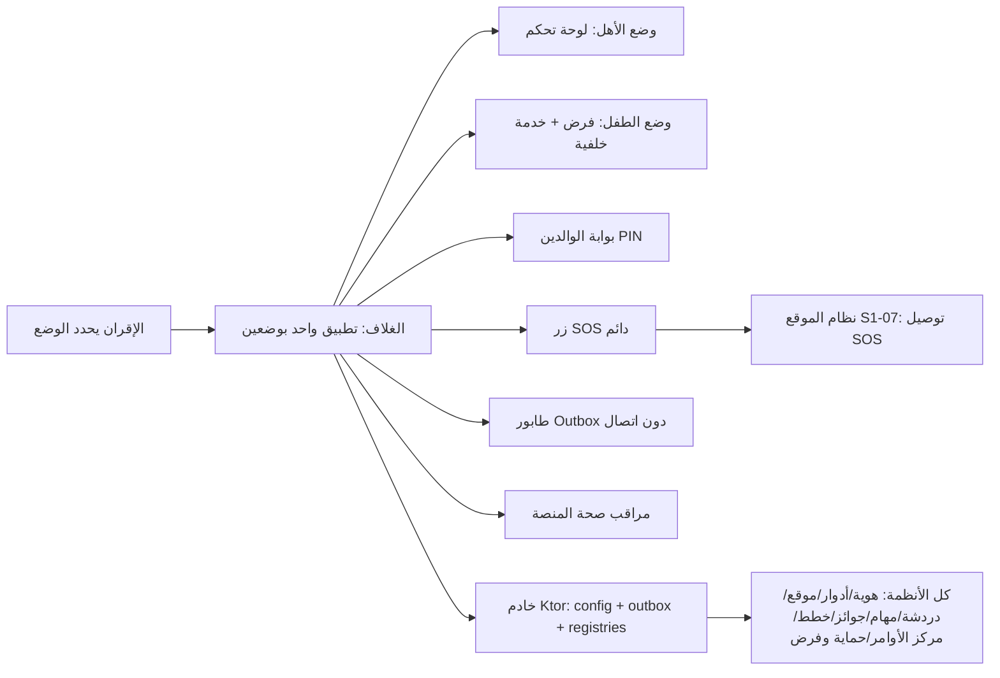

# S1-01: هيكل التطبيق والمنصة (App Shell & Platform)

- **الحالة:** approved | **المرحلة:** 1 (نواة الحماية) · **آخر تحديث:** 2026-11-05
- **القرارات الحاكمة:** Q-001 · Q-002 · Q-003 · Q-005 · Q-006 · Q-007 · Q-008 · Q-011 · Q-022 · Q-031 · Q-054 · Q-055 · Q-056 · Q-061 · Q-062 · Q-063 · Q-064 · Q-065 · Q-066 · Q-067 · Q-068 · Q-069 · Q-070 · Q-141 · Q-142 · G-006 · G-007 · D-023 · D-024 · D-038
- **حالة المراجعة:** الأقسام 1–8 + §10 معتمدة بالكامل في التخطيط — حكم المالك 2026-11-06 · **§9 في مرحلة التصميم (Q-091)**.
- **الأدلة المرجعية:** المواصفة القديمة S1-01 (مرجع فقط، G-009) · Deep-dives: Telegram (NotificationCenter, single-activity shell) · Bark (shell FSM) · FamilyWall (profile switcher) · Quizlet (offline queue) · Life360 (devicehealth) · نظام التصميم (14 ملف Flutter) · `ARCHITECTURE.md` §5 · `CONTEXT-MAP.md`

## 1. الهدف والتحليل والنطاق

يوفر هذا النظام الهيكل العظمي لتطبيق Family OS الواحد بوضعين (Dual Mode): الغلاف التكيفي الذي يستضيف كل الأنظمة، وقوالب العرض حسب الدور، وبوابة الوالدين، والقدرات المشتركة (السجلات، أعلام الميزات، المزامنة دون اتصال، مراقب الصحة، ملفات المناطق)، وخطاف عقد بوابة الذكاء — بلا ميزة ذكاء فعلية.

**مخطط سياق النظام (§1 — بصري):**

**داخل النطاق:**
- تطبيق واحد (Flutter + وحدة Kotlin أصلية للفرض) بوضعين: وضع الأهل (لوحة تحكم) ووضع الطفل (فرض + خدمة خلفية دائمة)؛ الوضع يتحدد بالإقران/الدور، وثابت لكل جهاز في المرحلة 1.
- الغلاف التكيفي: شريط تنقل سفلي يتكيف مع الدور والصلاحيات الممنوحة، قوالب عرض (مالك/بالغ/مراهق/طفل)، شريط حالة عدم الاتصال، زر SOS دائم.
- بوابة الوالدين: رقم سري (PIN) يضعه الأب وحده.
- القدرات المشتركة: السجلات الأربعة، أعلام الميزات والإعداد عن بُعد، طابور مزامنة دون اتصال، مراقب صحة المنصة، ملفات المناطق (وضع النطاق المنخفض لليمن).
- خطاف عقد بوابة الذكاء (هيكل العقد فقط).

**خارج النطاق:**
- الهوية والتسجيل وOTP وربط الأجهزة (نظام الهوية).
- إدارة العائلة والأعضاء وتفويض الصلاحيات (نظام الأدوار والصلاحيات).
- محرك الفرض (الحظر/الجداول/مقاومة الإزالة) وشاشات الحظر (نظام الحماية والفرض S1-10 — Q-141، المواصفة قيد الإعداد).
- الموقع والأسوار وتوصيل SOS (نظام الموقع).
- الخطط والدفع (نظام الفوترة).
- تبديل الملفات على جهاز مشترك (مؤجل للمرحلة 2 — أولوية ملزمة، Q-063).
- المحادثة/التعليم/الدين/التنسيق (مراحلها).

### جدول اختلافات الوضعين (Q-062 — ملزم)

| القدرة | وضع الأهل | وضع الطفل |
|---|---|---|
| لوحة التحكم وشاشات الإدارة | نعم (حسب الدور والصلاحيات) | لا — مخفية تماماً |
| محرك الفرض (حظر/جداول/VPN/Accessibility) | لا — غير موجود | نعم — وحدة Kotlin للتنفيذ، خدمة خلفية دائمة (تقييم القواعد/الجداول ملك S1-10 — Q-141) |
| زر SOS الدائم | نعم | نعم |
| بوابة الوالدين (PIN) | لا تُطلب (المستخدم مصادق عليه كأب) | تُطلب للخروج من وضع الطفل / فك الإقران / فتح أي إعداد إداري |
| خدمة الخلفية | دفع فقط (FCM/HMS) | دائمة (MQTT + فرض) |
| الإشعار الدائم | معلومات نافعة (حالة العائلة) | معلومات نافعة (الوقت المتبقي) — لا عبارة رقابية (G-006) |
| تبديل الملفات | لا (مؤجل للمرحلة 2 — أولوية، Q-063) | لا (مؤجل للمرحلة 2 — أولوية، Q-063) |
| الوصول لإعدادات النظام | نعم (للأب) | لا — يتطلب PIN الأب |

## 2. سيناريوهات المستخدم

### سيناريو 2-1: الأب يفتح لوحة التحكم لأول مرة
- **الممثل:** الأب (المالك، `is_owner`).
- **السياق:** جهاز الأهل بعد الإقران؛ التطبيق مغلق.
- **التدفق:**
  1. يفتح الأب التطبيق؛ الإقلاع البارد يكتمل خلال 1.2 ثانية (REQ-017).
  2. الغلاف يقرأ وضع الجهاز (`parent`) من `device_mode` ويعرض لوحة الأهل بقالب المالك (REQ-002/REQ-004).
  3. يُحمَّل ملف المنطقة والخطط (Q-005/Q-055)؛ الميزات خارج الخطة مخفية.
  4. تظهر قراءات العائلة (الحالة، آخر مزامنة) في أقل من 300ms p95 (Q-061).
- **النتيجة:** لوحة أهل كاملة بلا أي عنصر من وضع الطفل؛ لا يُطلب PIN (المستخدم مصادق عليه كأب).

### سيناريو 2-2: الطفل يضغط زر SOS
- **الممثل:** طفل (وضع الطفل).
- **السياق:** جهاز الطفل، اتصال ضعيف.
- **التدفق:**
  1. يضغط الطفل زر SOS الظاهر دائماً ضغطاً مطولاً 3 ثوانٍ مع اهتزاز تصاعدي (REQ-007).
  2. الغلاف يسلّم الحدث فوراً لنظام الموقع؛ إن كان دون اتصال يُسجَّل الحدث محلياً بأولوية قصوى في Outbox (REQ-009).
  3. عند عودة أي اتصال يُرسَل الحدث قبل أي حدث آخر.
- **النتيجة:** تنبيه SOS يصل الأهل في أقل من 10 ثوانٍ عند الاتصال الطبيعي (Q-061).

### سيناريو 2-3: مراهق في اليمن يفتح التطبيق دون اتصال
- **الممثل:** مراهق (وضع الطفل).
- **السياق:** اليمن، لا اتصال، بيانات محفوظة محلياً.
- **التدفق:**
  1. يفتح المراهق التطبيق؛ يظهر شريط حالة عدم اتصال خفيف — بلا شاشة خطأ (REQ-008).
  2. تُعرض البيانات المحفوظة محلياً (الوقت المتبقي، الجدول).
  3. أي فعل يُنفَّذ يُسجَّل في Outbox مع `synced_status=0` (REQ-009).
  4. عند عودة الاتصال تُفرَّغ الدفعة مضغوطة بترتيب زمني صارم (Q-064).
- **النتيجة:** التطبيق يعمل كاملاً دون اتصال؛ لا بيانات تُفقد.

### سيناريو 2-4: طفل يحاول الخروج من وضع الطفل
- **الممثل:** طفل يحاول فك الإقران أو فتح إعداد إداري.
- **السياق:** جهاز الطفل.
- **التدفق:**
  1. يطلب الطفل فتح إعداد إداري؛ الغلاف يطلب PIN الأب (REQ-006).
  2. يدخل PIN خاطئاً 5 مرات متتالية → يُقفل الباب 5 دقائق (معتمد؛ التحقق محلي — Q-142).
  3. أثناء القفل أي محاولة جديدة تُرفض وتُسجَّل في `AuditEvent`.
- **النتيجة:** لا خروج من وضع الطفل ولا فك إقران دون PIN الأب؛ لا سؤال حسابي في أي مسار (Q-065).

**مخطط السيناريوهات (§2 — بصري):**

## 3. المتطلبات الوظيفية

- **REQ-001:** التطبيق تطبيق واحد (حزمة واحدة) يعمل بوضعين (Dual Mode)؛ لا حزمتين منفصلتين. [Q-062 · DERIVED]
- **REQ-002:** يُحدد الوضع عند الإقران: جهاز يُقترن كطفل يعمل بوضع الطفل دائماً؛ جهاز الأهل يعمل بوضع الأهل؛ ولا يتبدل الوضع بتسجيل الدخول وحده. [Q-062/Q-063 · DERIVED]
- **REQ-003:** الواجهة Flutter للوضعين؛ الفرض (DeviceAdmin/Accessibility/VPN/خدمة الخلفية) وحدة Kotlin أصلية داخل التطبيق عبر قنوات المنصة (MethodChannel/EventChannel)؛ هذه الوحدة تستضيف التنفيذ فقط — تقييم القواعد والجداول الأسبوعية ملك نظام الحماية والفرض S1-10 (Q-141، المواصفة قيد الإعداد). [Q-068/Q-031 · DERIVED]
- **REQ-004:** شريط التنقل السفلي وقوالب العرض تتكيف مع الدور (`owner`/`adult`/`teen`/`child`) والصلاحيات الممنوحة فعلاً: تبويب إداري لا يظهر لمن لم يُفوَّض به. [Q-006/Q-007/Q-010 · DERIVED]
- **REQ-005:** بوابة الوالدين رقم سري (PIN) يضعه الأب وحده؛ لا سؤال حسابي؛ لا يفتحها إلا الأب. **معيار PIN (Q-164): 6 أرقام حداً أدنى** مع منع الأنماط الشائعة (123456، أرقام مكررة، سنوات الميلاد)؛ والتجزئة **Argon2id (m=64MiB، t=3، p=1)** مع ملح عشوائي؛ والتخزين في مخزن آمن مدعوم بالعتاد (Android Keystore/StrongBox)؛ ولا يُحفظ PIN نصاً أبداً. [Q-065 · Q-164 · DERIVED]
- **REQ-006:** يُطلب PIN الأب لـ: الخروج من وضع الطفل، فك إقران الجهاز، إلغاء تثبيت الوكيل، فتح أي إعداد إداري من جهاز بوضع الطفل. [Q-065 · DERIVED]
- **REQ-007:** زر SOS ظاهر دائماً في كل شاشة في الوضعين؛ التفعيل بضغط مطول 3 ثوانٍ مع اهتزاز تصاعدي؛ عند التفعيل يُسلَّم الحدث فوراً لنظام الموقع للتوصيل. [Q-067/Q-056 · DERIVED]
- **REQ-008:** يعرض الغلاف شريط حالة عدم اتصال خفيف (بلا شاشة خطأ)؛ ويفتح التطبيق ويعرض كل البيانات المحفوظة محلياً دون اتصال. [VERIFIED: Quizlet offline queue · DERIVED]
- **REQ-009:** طابور مزامنة دون اتصال (Offline Outbox): كل فعل يُنفذ دون اتصال يُسجَّل محلياً مع `synced_status=0` ويُفرَّغ دفعة واحدة مضغوطة عند عودة الاتصال، بترتيب زمني صارم. [VERIFIED: Quizlet offline queue · DERIVED]
- **REQ-010:** وضع النطاق الترددي المنخفض لليمن إلزامي: ضغط الاستجابات (Brotli/Gzip)، لا تحديثات تلقائية، مزامنة يدوية أو مجدولة، قنوات OTP بديلة (Q-021). [Q-064/Q-005 · DERIVED]
- **REQ-011:** السجلات المركزية الأربعة (`ControlRegistry`، `PermissionRegistry`، `WidgetRegistry`، `NotificationRegistry`) تسجَّل فيها مفاتيح التحكم والصلاحيات والودجات وقنوات التنبيه؛ لا مفتاح تحكم يعمل دون تسجيل. [DERIVED من المواصفة القديمة S1-01 — هيكل فقط]
- **REQ-012:** أعلام الميزات والإعداد عن بُعد: تُحمَّل ملفات المنطقة (`region`) والخطط (Q-055) عند الإقلاع وتُحفظ محلياً؛ الغلاف يُظهر/يُخفي الميزات حسب خطة العائلة. [Q-005/Q-055 · DERIVED]
- **REQ-013:** مراقب صحة المنصة: يرصد الذاكرة والاتصال والبطارية؛ على الأجهزة < 2GB RAM يعطّل الانتقالات الثقيلة تلقائياً (Lottie/Blur) للحفاظ على 60 إطاراً/ثانية. [VERIFIED: Life360 devicehealth · DERIVED]
- **REQ-014:** خطاف عقد بوابة الذكاء فقط: هيكل العقد والميزانية ومفتاح الإيقاف (Q-054)؛ لا ميزة ذكاء فعلية في هذا النظام. [Q-054 · DERIVED]
- **REQ-015:** الإشعار الدائم يعرض معلومات نافعة (مثال: الوقت المتبقي) لا عبارة رقابية؛ الموافقة على المراقبة مرة واحدة في إعداد مشترك (أب + طفل)؛ الشفافية عن الفئات لا المحتوى. [G-006/D-023 · DERIVED]
- **REQ-016:** خلو تام من أي مكتبات إعلانية أو أدوات تتبع تنتهك خصوصية الطفل؛ لا أحداث تحليلية لحسابات الأطفال قبل حسم Q-046. [D-024 · DERIVED]
- **REQ-017:** الإقلاع البارد < 1.2 ثانية على الأجهزة المتوسطة (هدف اختبار، Q-066). [Q-066 · DERIVED]
- **REQ-018:** الوضع ثابت لكل جهاز في المرحلة 1: لا تبديل ملفات ولا تبديل وضع؛ أي محاولة تبديل تُرفض برسالة واضحة. [Q-063 · DERIVED]
- **REQ-019:** طريق iOS محفوظ: واجهة Flutter مشتركة؛ وحدة الفرض Kotlin أندرويد فقط (التحكم العميق أندرويد فقط لقيد Apple، Q-005). [Q-005/Q-068 · DERIVED]
- **REQ-020:** تحديث التطبيق عبر المتجر للتحديثات العادية؛ تحديث إجباري داخل التطبيق للإصدارات الأمنية الحرجة فقط؛ حد أدنى لإصدار مدعوم (الأجهزة دونه تُحث على التحديث). [Q-069 · DERIVED]
- **REQ-021:** التطبيق عربي وإنجليزي في هذه النسخة؛ **الافتراضي العربية**؛ RTL للعربية؛ كل نصوص الواجهة في ملفات ترجمة (لا نصوص مثبتة في الكود). [Q-070 · DERIVED]
- **REQ-022:** توصيل أمر الأب إلى جهاز الطفل + إقرار الاستلام (ack) في أقل من 5 ثوانٍ. [Q-061 · DIRECT]
- **REQ-023:** مفتاح توقيع جهازي + إثبات تحقق بتحدٍّ من الخادم: عند الإقران يولّد الجهاز مفتاح توقيع (ECDSA P-256) مربوطاً بالعتاد ويُسجَّل مفتاحه العام على الخادم؛ وعند كل عملية حساسة يصدر الخادم تحدياً (nonce أحادي الاستخدام، صلاحية 5 دقائق) فيوقّعه الجهاز بعد فتحه بـ PIN أو بصمة، ويتحقق الخادم من التوقيع قبل التنفيذ — ولا يُرسَل PIN ولا hashه إلى الخادم أبداً (Q-142). [Q-164 · DIRECT]

## 4. الواجهات والعقود

### 4.1 قنوات المنصة (Flutter ↔ Kotlin Enforcement Module)

- `MethodChannel("familyos/enforcement")`:
  - `isEnforcementActive() -> bool`
  - `applyAppRules(rules: List<AppRule>) -> void`
  - `getDeviceHealth() -> DeviceHealth {memoryMb, batteryPct, connectivity}`
  - `requestParentGate(action: String) -> GateResult {granted, attemptsLeft, lockedUntil}`
  - التحقق من PIN محلي بالكامل (Q-142): يُقارَن الـ PIN المدخل مع الـ hash المخزن على الجهاز — **Argon2id (m=64MiB، t=3، p=1) مع ملح عشوائي، في مخزن آمن مدعوم بالعتاد (Q-164)**؛ لا يُرسَل PIN ولا hash إلى الخادم أبداً؛ إثبات التحقق + القفل فقط يُرسَلان إلى الخادم عبر Outbox. **والعمليات الحساسة تُثبَت بتحدٍّ من الخادم:** توقيع nonce الخادم بمفتاح الجهاز (REQ-023) — لا ادّعاء عميل.
- `EventChannel("familyos/enforcement/events")`: streams `enforcement_state`, `sos_triggered`, `connectivity_changed`.

### 4.2 عقود الخادم (Ktor REST — `/api/v1/shell/`)

- `GET /families/{id}/shell/config` → `ShellConfig {region, planFlags, featureFlags, countryProfile}` (200; 403 خارج العائلة).
- `POST /api/v1/shell/outbox/flush` — body: `OutboxBatch {events: [...]}` → `FlushResult {accepted, rejected[]}`; idempotency key إلزامي في الترويسة `Idempotency-Key`.
- لا نقطة تحقق PIN خادمية — التحقق محلي بالكامل (Q-142)؛ الخادم يستقبل إثبات التحقق + القفل عبر Outbox فقط. **لكن الإثبات القابل للتحقق له نقطتان (Q-164):** `POST /api/v1/shell/verification/challenge` → `{challenge_id, nonce, expires_at}` (صلاحية 5 دقائق، استخدام واحد)؛ و`POST /api/v1/shell/verification/prove` ← `{challenge_id, signature, method}` → `{verified}` — الخادم يتحقق من التوقيع بمفتاح الجهاز العام المسجَّل قبل تنفيذ أي عملية حساسة؛ ولا يُرسَل PIN ولا hashه في أيٍّ منهما.
- `GET /api/v1/shell/registries/{registry}` → قائمة المفاتيح المسجلة (قراءة سجل عالمي — بلا نطاق عائلة).
- الأخطاء: صيغة موحدة `{code, message_ar, trace_id}`؛ كل طلب يحمل سياق `family_id`؛ رفض أي طلب خارج العائلة (403).

### 4.3 أحداث MQTT (وكيل الطفل — وضع الطفل فقط)

- الاشتراك: `family/{family_id}/device/{device_id}/commands`؛ النشر: `family/{family_id}/device/{device_id}/state`.
- كل أمر يحمل `command_id` (idempotency)؛ الإقرار (ack) إلزامي؛ إعادة المحاولة بتراجع أسّي.
- توصيل الأمر + الإقرار < 5 ثوانٍ (REQ-022 — Q-061).

## 5. البيانات — النموذج

| الجدول | الحقول الرئيسية | ملاحظة |
|---|---|---|
| `device_mode` | `id`, `family_id`, `device_id`, `mode` (`parent`/`child`), `paired_at`, `paired_by` | وضع واحد ثابت لكل جهاز في المرحلة 1 (Q-063) |
| `parent_gate` | `id`, `family_id`, `pin_hash`, `kdf_params`, `device_key_id`, `failed_attempts`, `locked_until`, `updated_at` | مخزن محلي فقط (SQLite على الجهاز) — ليس جدول خادم؛ `pin_hash` **Argon2id (m=64MiB، t=3، p=1) مع ملح عشوائي** في مخزن آمن مدعوم بالعتاد (Q-164)؛ و`kdf_params` معاملات التجزئة؛ و`device_key_id` معرّف مفتاح التوقيع الجهازي (REQ-023)؛ ولا يُحفظ PIN نصاً أبداً، ولا يُزامَن ولا يُرسَل إلى الخادم أبداً (Q-142) |
| `feature_flag` | `id`, `family_id`, `key`, `enabled`, `valid_until` | تُحمَّل عند الإقلاع وتُحفظ محلياً |
| `outbox_event` | `id`, `family_id`, `device_id`, `type`, `payload`, `synced_status`, `created_at` | محلي (SQLite) على الجهاز؛ يُفرَّغ دفعة واحدة |
| `country_profile` | `id`, `region`, `low_bandwidth`, `otp_channels`, `payment_routes` | ملف المنطقة (Q-005) |
| `shell_registry` | `registry` (`control`/`permission`/`widget`/`notification`), `key`, `metadata` | عرض قراءة (READ VIEW) فوق السجلات العالمية — بلا `family_id`؛ للقراءة فقط (REQ-011) |
| `notification_registry` | `kind`, `channel`, `owner_system` | سجل عالمي لقنوات التنبيه — بلا `family_id` (REQ-011) |

**قاعدة ملزمة:** جداول العائلة تحمل `family_id` + عزل RLS (D-021)؛ أما جداول السجل العالمية (`shell_registry` كعرض قراءة، و`notification_registry`) فبلا `family_id`؛ كل حدث رقابي/إداري في `AuditEvent`.

## 6. القواعد والصلاحيات

| المفتاح (`domain.action`) | من يملكه | ملاحظة |
|---|---|---|
| `shell.view` | كل الأدوار (بقالب عرض كل دور) | العرض يتكيف مع الدور |
| `shell.admin.access` | `adult` (بصفة `is_owner` أو بتفويض) | يخضع لـ Parent Gate على جهاز الطفل |
| `shell.parent_gate.manage` | المالك (`is_owner`) فقط | تغيير PIN الأب |
| `shell.mode.exit_child` | المالك فقط + PIN | الخروج من وضع الطفل / فك الإقران |
| `shell.config.view` | `adult` | قراءة الإعداد |
| `shell.config.edit` | المالك فقط | تعديل الإعداد |

مفتاح SOS الوحيد هو `location.sos.trigger` (نظام الموقع S1-07) — لا مفتاح SOS في هذا النظام.

**ثوابت صلبة:** deny-override (Q-007)؛ لا صلاحيات إشرافية للأطفال/المراهقين (D-038)؛ الغموض يُفسَّر لصالح حماية الطفل؛ `scope` و`valid_until` إلزاميان في كل منح.

## 7. الحالات الحدية والأخطاء

- **بلا اتصال عند الإقلاع:** يفتح التطبيق ويعرض البيانات المحفوظة + شريط حالة؛ لا شاشة خطأ؛ الأفعال تُسجَّل في Outbox (REQ-008/REQ-009).
- **SOS دون اتصال:** يُسجَّل الحدث محلياً بأولوية قصوى ويُرسَل فور عودة أي اتصال؛ التوصيل مسؤولية نظام الموقع.
- **قتل التطبيق قسراً:** تُحفظ حالة الواجهة فوراً (SharedPreferences/MMKV)؛ عند إعادة الفتح يعود المستخدم لنفس الشاشة والمدخلات.
- **جهاز < 2GB RAM:** تعطيل الانتقالات الثقيلة تلقائياً (REQ-013).
- **PIN خاطئ 5 مرات:** قفل 5 دقائق (معتمد؛ التحقق محلي — Q-142)؛ **تغيير PIN** يتطلب PIN الحالي ويعيد اشتقاق مفتاح الاسترداد وإعادة تغليف نسخة مفاتيح قناة الوالدين (Q-164)؛ **لا إعادة تعيين PIN محلياً عند النسيان أبداً** — الاسترداد فقط عبر جهة الاسترداد الموثوقة + انتظار 7 أيام (Q-077) من لوحة أهل مصادق عليها، وإن تعذرت المصادقة القديمة فالسجل القديم غير قابل للاسترداد (حد صادق).
- **تضارب مزامنة بين أجهزة:** إصدارات أحادية الاتجاه (Monotonic Versioning)؛ يُعتمد الأحدث مع إشعار المستخدم عند الدمج.
- **محاولة تبديل الوضع/الملف:** تُرفض برسالة واضحة (Q-063).
- **وضع غير متطابق (جهاز طفل يسجّل فيه أب):** يبقى الوضع وضع الطفل؛ الوضع يتحدد بالإقران لا بتسجيل الدخول (REQ-002).

## 8. معايير القبول

- **ACC-001:** حزمة واحدة تُثبَّت على جهاز أهل وجهاز طفل؛ كل جهاز يعمل بوضعه الصحيح بعد الإقران. [REQ-001/REQ-002]
- **ACC-002:** جهاز الطفل لا يعرض أي شاشة إدارية؛ كل محاولة وصول تُرفض وتُسجَّل. [REQ-004/REQ-006]
- **ACC-003:** PIN الأب (6 أرقام حداً أدنى، بلا أنماط شائعة) يفتح البوابة؛ PIN خاطئ 5 مرات يقفل 5 دقائق؛ لا سؤال حسابي في أي مسار؛ ومفتاح التوقيع الجهازي يثبت العمليات الحساسة بتحدٍّ من الخادم. [REQ-005/REQ-006/REQ-023]
- **ACC-004:** زر SOS ظاهر في كل شاشة في الوضعين؛ الضغط المطول 3 ثوانٍ يطلق الحدث مع اهتزاز. [REQ-007]
- **ACC-005:** دون اتصال: التطبيق يفتح ويعرض البيانات المحفوظة + شريط حالة؛ فعلان دون اتصال يُسجَّلان ويُفرَّغان دفعة واحدة عند عودة الاتصال. [REQ-008/REQ-009]
- **ACC-006:** وضع اليمن المنخفض: الاستجابات مضغوطة؛ لا تحديثات تلقائية؛ المزامنة يدوية/مجدولة. [REQ-010]
- **ACC-007:** الإقلاع البارد < 1.2 ثانية على جهاز متوسط (يُقاس في المختبر Q-027). [REQ-017]
- **ACC-008:** قراءات لوحة الأهل p95 < 300ms (Q-061)؛ الغلاف لا يضيف زمناً فوق العقد.
- **ACC-009:** الإشعار الدائم يعرض معلومات نافعة؛ لا عبارة "نحن نراقبك"؛ لا مكتبات إعلانية في الحزمة. [REQ-015/REQ-016]
- **ACC-010:** جدول اختلافات الوضعين (Q-062) يُتحقق منه بنداً بنداً في الاختبار.
- **ACC-011:** أمر الأب يصل جهاز الطفل ويُقِرّ به في أقل من 5 ثوانٍ (Q-061). [REQ-022]

## 9. قائمة الشاشات

في مرحلة التصميم.

## 10. خطة التنفيذ

- **ترتيب البناء:** هيكل Flutter + تحديد الوضع (REQ-001/002) ← قوالب العرض والتنقل التكيفي (REQ-004) ← بوابة الوالدين PIN + القفل 5 محاولات/5 دقائق (REQ-005/006) ← وحدة Kotlin للفرض (استضافة/تنفيذ عبر قنوات المنصة — REQ-003/§4.1)؛ تقييم القواعد/الجداول ملك S1-10 (Q-141) ← خدمة الخلفية + MQTT (REQ-003/§4.3) ← طابور Outbox + وضع النطاق المنخفض (REQ-008/009/010) ← السجلات الأربعة + أعلام الميزات وملفات المناطق (REQ-011/012) ← مراقب صحة المنصة (REQ-013) ← خطاف عقد بوابة الذكاء — هيكل فقط (REQ-014) ← زر SOS الدائم (REQ-007) ← الترجمة عربي/إنجليزي + RTL (REQ-021) ← آلية التحديث (REQ-020) ← الشاشات بعد مرحلة التصميم.
- **بذرة المفاتيح:** مفاتيح S1-01 الستة (§6 — بعد حذف `shell.sos.trigger`) تُزرع في سجل `permission_key` المركزي (S1-03 §10-1 — القائمة الموحدة 82 مفتاحاً).
- **الوحدات:** وحدة Flutter باسم `shell` (وضعان + قوالب + بوابة + زر SOS + شريط عدم الاتصال)؛ ووحدة Kotlin باسم `enforcement` (DeviceAdmin + Accessibility + VPN + خدمة خلفية + صحة)؛ ووحدة Ktor باسم `shell` (config + outbox flush + registries + نقطتا التحدي والإثبات — بلا نقطة تحقق PIN خادمية، Q-142 · Q-164).
- **الاعتماديات:** S1-02 (الإقران يحدد الوضع) · S1-03 (الأدوار والقوالب والصلاحيات) · S1-07 (توصيل SOS) · S1-04 (أعلام الخطط) · S1-10 (تقييم القواعد/الجداول — Q-141، المواصفة قيد الإعداد) · Q-022 (MQTT) · Q-054 (هيكل بوابة الذكاء) · مختبر Q-027.
- **الاختبارات:** وحدة (تحديد الوضع/قفل البوابة/ترتيب Outbox/عتبات الصحة) · تكامل (إقران ← وضع؛ وفرض عبر القنوات؛ تفريغ Outbox idempotent) · قبول ACC-001…011 · أداء (إقلاع بارد < 1.2s؛ قراءات لوحة الأهل p95 < 300ms؛ توصيل الأمر + الإقرار < 5 ثوانٍ — REQ-022 — في مختبر Q-027).

## أسئلة مفتوحة (من هذه المواصفة)

- **Q-046 (موجود):** سياسة التحليلات لحسابات الأطفال — لا أحداث تحليلية للأطفال قبل حسمه.

## ملحق أ: الاستخلاص من الهندسة العكسية (RE) — ما نُعيد استخدامه فعلاً

> قاعدة عمل (بأمر المالك 2026-11-05): كل مواصفة تحمل جدول استخلاص صريحاً — المصدر المفكك → الآلية المستخلصة → أين تُستخدم. لا يكفي ذكر اسم التطبيق كمرجع.

| المصدر المفكك | الآلية المستخلصة | أين تُستخدم في S1-01 |
|---|---|---|
| Telegram | `NotificationCenter` — حافلة أحداث داخلية مركزية لتحديث الواجهة | قناة الأحداث الداخلية للغلاف (§4.1 EventChannel) + تحديث قوالب العرض (REQ-004) |
| Telegram | المزامنة المتسلسلة (Sequential Packets) — ترتيب صارم للأحداث | طابور Outbox بترتيب زمني صارم (REQ-009) |
| Bark Kids | الإقران برمز جهاز يصدره الأب + مقاومة الإزالة برمز الأب | فك الإقران وإلغاء التثبيت يتطلبان PIN الأب (REQ-006) |
| FamilyWall | محوّل الملفات (Avatar Switcher) | نموذج الملفات وقوالب العرض حسب الدور (REQ-004) |
| FamilyWall | `FWPermission` — نموذج تسجيل الصلاحيات | السجلات المركزية، وتحديداً `PermissionRegistry` (REQ-011) |
| Quizlet | Offline Action Queue + WorkManager + LRU cache | طابور Outbox + التخزين المؤقت وعرض البيانات دون اتصال (REQ-008/REQ-009) |
| Life360 | `devicehealth` — مراقبة صحة الجهاز والخدمات الصامتة | مراقب صحة المنصة (REQ-013) |
| FamiSafe (parent) | ترميز قائمة جدول أسبوعي `ScreenTimeTool` — قوائم أعداد صحيحة لـ 7 أيام (`allow_time`/`start_time`/`end_time`)؛ بلا عمليات bitmask موثقة | ترميز قائمة الجدول الأسبوعي — يُحفظ ويُعرض عبر الغلاف؛ محرك تقييمه في نظام الحماية والفرض (S1-10 — Q-141) |
| Qustodio Kids | DeviceAdmin + Accessibility + VPN + مقاومة الإزالة عبر Accessibility | حدود واجهة وحدة Kotlin للفرض (§4.1) — بنية الوكيل المرجعية |
