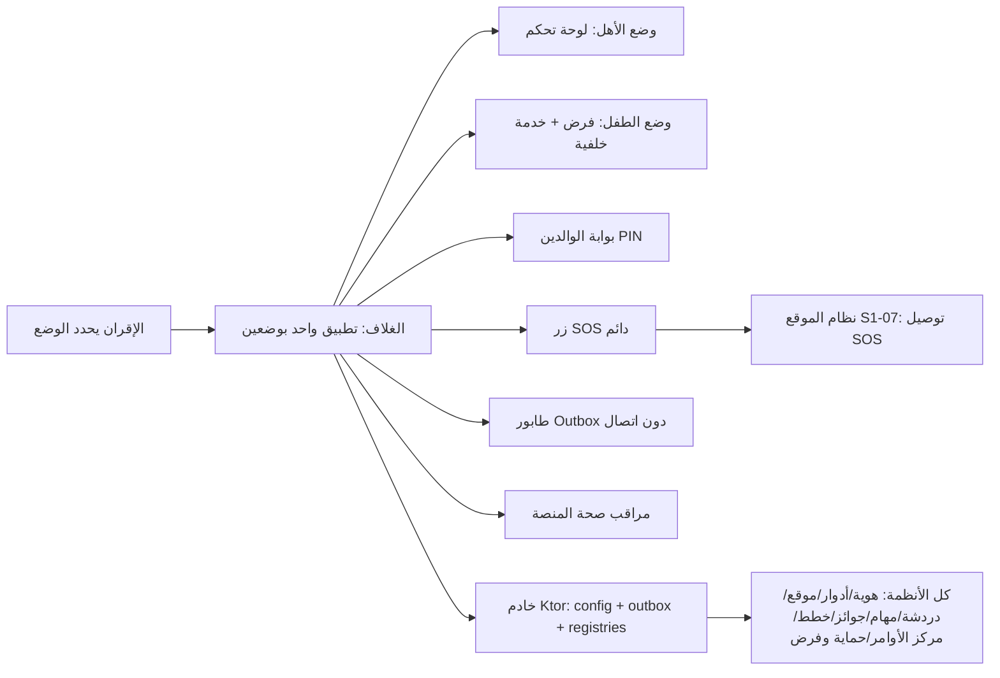
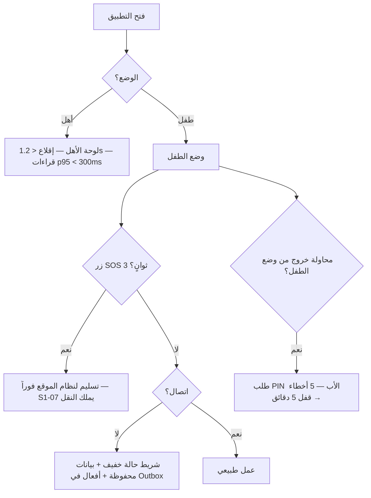

# S1-01: هيكل التطبيق والمنصة (App Shell & Platform)

- **الحالة:** approved | **المرحلة:** 1 (نواة الحماية) · **آخر تحديث:** 2026-11-05
- **القرارات الحاكمة:** Q-001 · Q-002 · Q-003 · Q-005 · Q-006 · Q-007 · Q-008 · Q-011 · Q-020 · Q-022 · Q-031 · Q-054 · Q-055 · Q-056 · Q-057 · Q-061 · Q-062 · Q-063 · Q-064 · Q-065 · Q-066 · Q-067 · Q-068 · Q-069 · Q-070 · Q-141 · Q-142 · Q-164 · Q-195 · Q-234 · Q-236 · Q-244 · G-006 · G-007 · G-009 · G-010 · D-023 · D-024 · D-038
- **حالة المراجعة:** الأقسام 1–8 + §10 معتمدة بالكامل في التخطيط — حكم المالك 2026-11-06 · **§9 في مرحلة التصميم (Q-091)**.
- **الأدلة المرجعية:** المواصفة القديمة S1-01 (مرجع فقط، G-009) · Deep-dives: Telegram (NotificationCenter, single-activity shell) · Bark (shell FSM) · FamilyWall (profile switcher) · Quizlet (offline queue) · Life360 (devicehealth) · نظام التصميم (15 ملف Markdown — بلا Dart) · `ARCHITECTURE.md` §5 · `CONTEXT-MAP.md`

## 1. الهدف والتحليل والنطاق

يوفر هذا النظام الهيكل العظمي لتطبيق Family OS الواحد بوضعين (Dual Mode): الغلاف التكيفي الذي يستضيف كل الأنظمة، وقوالب العرض حسب الدور، وبوابة الوالدين، والقدرات المشتركة (السجلات، أعلام الميزات، المزامنة دون اتصال، مراقب الصحة، ملفات المناطق)، وخطاف عقد بوابة الذكاء — بلا ميزة ذكاء فعلية.

**مخطط سياق النظام (§1 — بصري):**



**داخل النطاق:**
- تطبيق واحد (Flutter + وحدة Kotlin أصلية للفرض) بوضعين: وضع الأهل (لوحة تحكم) ووضع الطفل (فرض + خدمة خلفية دائمة)؛ الوضع يتحدد بالإقران/الدور، وثابت لكل جهاز في المرحلة 1.
- الغلاف التكيفي: شريط تنقل سفلي يتكيف مع الدور والصلاحيات الممنوحة، قوالب عرض (مالك/بالغ/مراهق/طفل)، شريط حالة عدم الاتصال، زر SOS دائم.
- بوابة الوالدين: رقم سري (PIN) يضعه الأب وحده.
- القدرات المشتركة: السجلات الأربعة، أعلام الميزات والإعداد عن بُعد، طابور مزامنة دون اتصال، مراقب صحة المنصة، ملفات المناطق (وضع النطاق المنخفض لليمن).
- خطاف عقد بوابة الذكاء (هيكل العقد فقط).

**خارج النطاق:**
- الهوية والتسجيل وOTP وربط الأجهزة (نظام الهوية).
- إدارة العائلة والأعضاء وتفويض الصلاحيات (نظام الأدوار والصلاحيات).
- محرك الفرض (الحظر/الجداول/مقاومة الإزالة) وشاشات الحظر (نظام الحماية والفرض S1-10 — Q-141، المواصفة معتمدة (Q-146)).
- الموقع والأسوار وتوصيل SOS (نظام الموقع).
- الخطط والدفع (نظام الفوترة).
- تبديل الملفات على جهاز مشترك (مؤجل للمرحلة 2 — أولوية ملزمة، Q-063).
- المحادثة/التعليم/الدين/التنسيق (مراحلها).

### جدول اختلافات الوضعين (Q-062 — ملزم)

| القدرة | وضع الأهل | وضع الطفل |
|---|---|---|
| لوحة التحكم وشاشات الإدارة | نعم (حسب الدور والصلاحيات) | لا — مخفية تماماً |
| محرك الفرض (حظر/جداول/VPN/Accessibility) | لا — غير موجود | نعم — وحدة Kotlin للتنفيذ، خدمة خلفية دائمة (تقييم القواعد/الجداول ملك S1-10 — Q-141) |
| زر SOS الدائم | نعم | نعم |
| بوابة الوالدين (PIN) | لا تُطلب (المستخدم مصادق عليه كأب) | تُطلب للخروج من وضع الطفل / فك الإقران / فتح أي إعداد إداري |
| خدمة الخلفية | دفع فقط (FCM/HMS) | دائمة (MQTT + فرض) |
| الإشعار الدائم | معلومات نافعة (حالة العائلة) | معلومات نافعة (الوقت المتبقي) — لا عبارة رقابية (G-006) |
| تبديل الملفات | لا (مؤجل للمرحلة 2 — أولوية، Q-063) | لا (مؤجل للمرحلة 2 — أولوية، Q-063) |
| الوصول لإعدادات النظام | نعم (للأب) | لا — يتطلب PIN الأب |

## 2. سيناريوهات المستخدم

### سيناريو 2-1: الأب يفتح لوحة التحكم لأول مرة
- **الممثل:** الأب (المالك، `is_owner`).
- **السياق:** جهاز الأهل بعد الإقران؛ التطبيق مغلق.
- **التدفق:**
  1. يفتح الأب التطبيق؛ الإقلاع البارد يكتمل خلال 1.2 ثانية (REQ-017).
  2. الغلاف يقرأ وضع الجهاز (`parent`) من `device_mode` ويعرض لوحة الأهل بقالب المالك (REQ-002/REQ-004).
  3. يُحمَّل ملف المنطقة والخطط (Q-005/Q-055)؛ الميزات خارج الخطة مخفية.
  4. تظهر قراءات العائلة (الحالة، آخر مزامنة) في أقل من 300ms p95 (Q-061).
- **النتيجة:** لوحة أهل كاملة بلا أي عنصر من وضع الطفل؛ لا يُطلب PIN (المستخدم مصادق عليه كأب).

### سيناريو 2-2: الطفل يضغط زر SOS
- **الممثل:** طفل (وضع الطفل).
- **السياق:** جهاز الطفل، اتصال ضعيف.
- **التدفق:**
  1. يضغط الطفل زر SOS الظاهر دائماً ضغطاً مطولاً 3 ثوانٍ مع اهتزاز تصاعدي (REQ-007).
  2. S1-07 يملك النقل؛ الغلاف يسلّم `sos_triggered` إلى S1-07 فوراً (Q-234/D-6).
  3. دون اتصال: التسليم إلى S1-07 فوري داخل الجهاز أيضاً؛ وS1-07 يقرر وسيلة التوصيل؛ وOutbox ليس نقلاً بديلاً لـ SOS.
- **النتيجة:** تنبيه SOS يصل الأهل في أقل من 10 ثوانٍ عند الاتصال الطبيعي (Q-061).

### سيناريو 2-3: مراهق في اليمن يفتح التطبيق دون اتصال
- **الممثل:** مراهق (وضع الطفل).
- **السياق:** اليمن، لا اتصال، بيانات محفوظة محلياً.
- **التدفق:**
  1. يفتح المراهق التطبيق؛ يظهر شريط حالة عدم اتصال خفيف — بلا شاشة خطأ (REQ-008).
  2. تُعرض البيانات المحفوظة محلياً (الوقت المتبقي، الجدول).
  3. أي فعل يُنفَّذ يُسجَّل في Outbox مع `synced_status=0` (REQ-009).
  4. عند عودة الاتصال تُفرَّغ الدفعة مضغوطة بترتيب زمني صارم (Q-064).
- **النتيجة:** التطبيق يعمل كاملاً دون اتصال؛ لا بيانات تُفقد.

### سيناريو 2-4: طفل يحاول الخروج من وضع الطفل
- **الممثل:** طفل يحاول فك الإقران أو فتح إعداد إداري.
- **السياق:** جهاز الطفل.
- **التدفق:**
  1. يطلب الطفل فتح إعداد إداري؛ الغلاف يطلب PIN الأب (REQ-006).
  2. يدخل PIN خاطئاً 5 مرات متتالية → يُقفل الباب 5 دقائق (معتمد؛ التحقق محلي — Q-142).
  3. أثناء القفل أي محاولة جديدة تُرفض وتُسجَّل في `AuditEvent`.
- **النتيجة:** لا خروج من وضع الطفل ولا فك إقران دون PIN الأب؛ لا سؤال حسابي في أي مسار (Q-065).

**مخطط السيناريوهات (§2 — بصري):**



## 3. المتطلبات الوظيفية

- **REQ-001:** التطبيق تطبيق واحد (حزمة واحدة) يعمل بوضعين (Dual Mode)؛ لا حزمتين منفصلتين. [Q-062 · DERIVED]
- **REQ-002:** يُحدد الوضع عند الإقران: جهاز يُقترن كطفل يعمل بوضع الطفل دائماً؛ جهاز الأهل يعمل بوضع الأهل؛ ولا يتبدل الوضع بتسجيل الدخول وحده. [Q-062/Q-063 · DERIVED]
- **REQ-003:** الواجهة Flutter للوضعين؛ الفرض (DeviceAdmin/Accessibility/VPN/خدمة الخلفية) وحدة Kotlin أصلية داخل التطبيق عبر قنوات المنصة (MethodChannel/EventChannel)؛ هذه الوحدة تستضيف التنفيذ فقط — تقييم القواعد والجداول الأسبوعية ملك نظام الحماية والفرض S1-10 (Q-141، المواصفة معتمدة (Q-146)). [Q-068/Q-031 · DERIVED]
- **REQ-004:** شريط التنقل السفلي وقوالب العرض تتكيف مع الدور (`owner`/`adult`/`teen`/`child`) والصلاحيات الممنوحة فعلاً: تبويب إداري لا يظهر لمن لم يُفوَّض به. [Q-006/Q-007/Q-010 · DERIVED]
- **REQ-005:** بوابة الوالدين رقم سري (PIN) يضعه الأب وحده؛ لا سؤال حسابي؛ لا يفتحها إلا الأب. **معيار PIN (Q-164): 6 أرقام حداً أدنى** مع منع الأنماط الشائعة (123456، أرقام مكررة، سنوات الميلاد)؛ والتجزئة **Argon2id (m=64MiB، t=3، p=1)** مع ملح عشوائي؛ والتخزين في مخزن آمن مدعوم بالعتاد (Android Keystore/StrongBox)؛ ولا يُحفظ PIN نصاً أبداً. PIN فقط يفتح Parent Gate؛ البصمة تفتح مفتاح التوقيع بعدها (Q-244). [Q-065 · Q-164 · Q-244 · DERIVED]
- **REQ-006:** يُطلب PIN الأب لـ: الخروج من وضع الطفل، فك إقران الجهاز، إلغاء تثبيت الوكيل، فتح أي إعداد إداري من جهاز بوضع الطفل. [Q-065 · DERIVED]
- **REQ-007:** زر SOS ظاهر دائماً في كل شاشة في الوضعين؛ التفعيل بضغط مطول 3 ثوانٍ مع اهتزاز تصاعدي؛ عند التفعيل يُسلَّم الحدث فوراً لنظام الموقع للتوصيل. [Q-067/Q-056 · DERIVED]
- **REQ-008:** يعرض الغلاف شريط حالة عدم اتصال خفيف (بلا شاشة خطأ)؛ ويفتح التطبيق ويعرض كل البيانات المحفوظة محلياً دون اتصال. [VERIFIED: Quizlet offline queue · DERIVED]
- **REQ-009:** طابور مزامنة دون اتصال (Offline Outbox): كل فعل يُنفذ دون اتصال يُسجَّل محلياً مع `synced_status=0` ويُفرَّغ دفعة واحدة مضغوطة عند عودة الاتصال، بترتيب زمني صارم. [VERIFIED: Quizlet offline queue · DERIVED]
- **REQ-010:** وضع النطاق الترددي المنخفض لليمن إلزامي: ضغط الاستجابات (Brotli/Gzip)، لا تحديثات تلقائية، مزامنة يدوية أو مجدولة، قنوات OTP بديلة (Q-021). [Q-064/Q-005 · DERIVED]
- **REQ-011:** السجلات المركزية الأربعة (`ControlRegistry`، `PermissionRegistry`، `WidgetRegistry`، `NotificationRegistry`) تسجَّل فيها مفاتيح التحكم والصلاحيات والودجات وقنوات التنبيه؛ لا مفتاح تحكم يعمل دون تسجيل. [DERIVED من المواصفة القديمة S1-01 — هيكل فقط]
- **REQ-012:** أعلام الميزات والإعداد عن بُعد: تُحمَّل ملفات المنطقة (`region`) والخطط (Q-055) عند الإقلاع وتُحفظ محلياً؛ الغلاف يُظهر/يُخفي الميزات حسب خطة العائلة. [Q-005/Q-055 · DERIVED]
- **REQ-013:** مراقب صحة المنصة: يرصد الذاكرة والاتصال والبطارية؛ على الأجهزة < 2GB RAM يعطّل الانتقالات الثقيلة تلقائياً (Lottie/Blur) للحفاظ على 60 إطاراً/ثانية. [VERIFIED: Life360 devicehealth · DERIVED]
- **REQ-014:** خطاف عقد بوابة الذكاء فقط: هيكل العقد والميزانية ومفتاح الإيقاف (Q-054)؛ لا ميزة ذكاء فعلية في هذا النظام. [Q-054 · DERIVED]
- **REQ-015:** الإشعار الدائم يعرض معلومات نافعة (مثال: الوقت المتبقي) لا عبارة رقابية؛ الموافقة على المراقبة مرة واحدة في إعداد مشترك (أب + طفل)؛ الشفافية عن الفئات لا المحتوى. [G-006/D-023 · DERIVED]
- **REQ-016:** خلو تام من أي مكتبات إعلانية أو أدوات تتبع تنتهك خصوصية الطفل؛ لا أحداث تحليلية لحسابات الأطفال قبل حسم Q-046. [D-024 · DERIVED]
- **REQ-017:** الإقلاع البارد < 1.2 ثانية على الأجهزة المتوسطة (هدف اختبار، Q-066). [Q-066 · DERIVED]
- **REQ-018:** الوضع ثابت لكل جهاز في المرحلة 1: لا تبديل ملفات ولا تبديل وضع؛ أي محاولة تبديل تُرفض برسالة واضحة. [Q-063 · DERIVED]
- **REQ-019:** طريق iOS محفوظ: واجهة Flutter مشتركة؛ وحدة الفرض Kotlin أندرويد فقط (التحكم العميق أندرويد فقط لقيد Apple، Q-005). [Q-005/Q-068 · DERIVED]
- **REQ-020:** تحديث التطبيق عبر المتجر للتحديثات العادية؛ تحديث إجباري داخل التطبيق للإصدارات الأمنية الحرجة فقط؛ حد أدنى لإصدار مدعوم (الأجهزة دونه تُحث على التحديث). [Q-069 · DERIVED]
- **REQ-021:** التطبيق عربي وإنجليزي في هذه النسخة؛ **الافتراضي العربية**؛ RTL للعربية؛ كل نصوص الواجهة في ملفات ترجمة (لا نصوص مثبتة في الكود). [Q-070 · DERIVED]
- **REQ-022:** توصيل أمر الأب إلى جهاز الطفل + إقرار الاستلام (ack) في أقل من 5 ثوانٍ. [Q-061 · DIRECT]
- **REQ-023:** مفتاح توقيع جهازي + إثبات تحقق بتحدٍّ من الخادم: عند الإقران يولّد الجهاز مفتاح توقيع (ECDSA P-256) مربوطاً بالعتاد ويُسجَّل مفتاحه العام على الخادم؛ وعند كل عملية حساسة يصدر الخادم تحدياً (nonce أحادي الاستخدام، صلاحية 5 دقائق) فيوقّعه الجهاز بعد فتح البوابة بـ PIN؛ والبصمة تفتح مفتاح التوقيع بعدها (Q-244)، ويتحقق الخادم من التوقيع قبل التنفيذ — ولا يُرسَل PIN ولا hashه إلى الخادم أبداً (Q-142). PIN فقط يفتح Parent Gate؛ البصمة تفتح مفتاح التوقيع بعدها (Q-244). [Q-164 · Q-244 · DIRECT]

## 4. الواجهات والعقود

### 4.1 قنوات المنصة (Flutter ↔ Kotlin Enforcement Module)

- `MethodChannel("familyos/enforcement")`:
  - `isEnforcementActive() -> bool`
  - `applyAppRules(rules: List<AppRule>) -> void`
  - `getDeviceHealth() -> DeviceHealth {memoryMb, batteryPct, connectivity}`
  - `requestParentGate(action: String) -> GateResult {granted, attemptsLeft, lockedUntil}`
  - التحقق من PIN محلي بالكامل (Q-142): يُقارَن الـ PIN المدخل مع الـ hash المخزن على الجهاز — **Argon2id (m=64MiB، t=3، p=1) مع ملح عشوائي، في مخزن آمن مدعوم بالعتاد (Q-164)**؛ لا يُرسَل PIN ولا hash إلى الخادم أبداً؛ إثبات التحقق + القفل فقط يُرسَلان إلى الخادم عبر Outbox. **والعمليات الحساسة تُثبَت بتحدٍّ من الخادم:** توقيع nonce الخادم بمفتاح الجهاز (REQ-023) — لا ادّعاء عميل.
- `EventChannel("familyos/enforcement/events")`: streams `enforcement_state`, `sos_triggered`, `connectivity_changed`.

### 4.2 عقود الخادم (Ktor REST — `/api/v1/shell/`)

- `GET /api/v1/families/{id}/shell/config` → `ShellConfig {region, planFlags, featureFlags, countryProfile}` (200; 403 خارج العائلة).
- `POST /api/v1/shell/outbox/flush` — body: `OutboxBatch {events: [...]}` → `FlushResult {accepted, rejected[]}`; idempotency key إلزامي في الترويسة `Idempotency-Key`.
- لا نقطة تحقق PIN خادمية — التحقق محلي بالكامل (Q-142)؛ الخادم يستقبل إثبات التحقق + القفل عبر Outbox فقط. **لكن الإثبات القابل للتحقق له نقطتان (Q-164):** `POST /api/v1/shell/verification/challenge` → `{challenge_id, nonce, expires_at}` (صلاحية 5 دقائق، استخدام واحد)؛ و`POST /api/v1/shell/verification/prove` ← `{challenge_id, signature, method}` → `{verified}` — الخادم يتحقق من التوقيع بمفتاح الجهاز العام المسجَّل قبل تنفيذ أي عملية حساسة؛ ولا يُرسَل PIN ولا hashه في أيٍّ منهما.
- `GET /api/v1/shell/registries/{registry}` → قائمة المفاتيح المسجلة (قراءة سجل عالمي — بلا نطاق عائلة).
- الأخطاء: صيغة موحدة `{code, message_ar, trace_id}`؛ كل طلب يحمل سياق `family_id`؛ رفض أي طلب خارج العائلة (403).

### 4.3 أحداث MQTT (وكيل الطفل — وضع الطفل فقط)

- الاشتراك: `family/{family_id}/devices/{device_id}/commands`؛ النشر: `family/{family_id}/device/{device_id}/state` (الحالة الدورية)؛ والإقرار على `family/{family_id}/devices/{device_id}/acks` (Q-195).
- كل أمر يحمل `command_id` (idempotency)؛ الإقرار (ack) إلزامي؛ إعادة المحاولة بتراجع أسّي.
- توصيل الأمر + الإقرار < 5 ثوانٍ (REQ-022 — Q-061).

## 5. البيانات — النموذج

| الجدول | الحقول الرئيسية | ملاحظة |
|---|---|---|
| `device_mode` | `id`, `family_id`, `device_id`, `mode` (`parent`/`child`), `paired_at`, `paired_by` | وضع واحد ثابت لكل جهاز في المرحلة 1 (Q-063) |
| `parent_gate` | `id`, `family_id`, `pin_hash`, `kdf_params`, `device_key_id`, `failed_attempts`, `locked_until`, `updated_at` | مخزن محلي فقط (SQLite على الجهاز) — ليس جدول خادم؛ `pin_hash` **Argon2id (m=64MiB، t=3، p=1) مع ملح عشوائي** في مخزن آمن مدعوم بالعتاد (Q-164)؛ و`kdf_params` معاملات التجزئة؛ و`device_key_id` معرّف مفتاح التوقيع الجهازي (REQ-023)؛ ولا يُحفظ PIN نصاً أبداً، ولا يُزامَن ولا يُرسَل إلى الخادم أبداً (Q-142)؛ **قاعدة الساعة (Q-236/D-18):** كل الطوابع UTC مخزنة؛ و`locked_until` انتهاء صادر من الخادم عند الاتصال، ومنقضٍ رتيب (monotonic) دون اتصال؛ وتُعاد تثبيت المرساة عند كل اتصال. و`family.time_zone` معرَّف في S1-02 §5 (سجل العائلة) — مرساة «منتصف الليل المحلي للعائلة» (Q-183) دون مسّ دلالتها |
| `feature_flag` | `id`, `family_id`, `key`, `enabled`, `valid_until` | تُحمَّل عند الإقلاع وتُحفظ محلياً |
| `outbox_event` | `id`, `family_id`, `device_id`, `type`, `payload`, `synced_status`, `created_at` | محلي (SQLite) على الجهاز؛ يُفرَّغ دفعة واحدة |
| `country_profile` | `id`, `region`, `low_bandwidth`, `otp_channels`, `payment_routes` | ملف المنطقة (Q-005) |
| `shell_registry` | `registry` (`control`/`permission`/`widget`/`notification`), `key`, `metadata` | عرض قراءة (READ VIEW) فوق السجلات العالمية — بلا `family_id`؛ للقراءة فقط (REQ-011) |
| `notification_registry` | `kind`, `channel`, `owner_system` | سجل عالمي لقنوات التنبيه — بلا `family_id` (REQ-011) |

**قاعدة ملزمة:** جداول العائلة تحمل `family_id` + عزل RLS (D-021)؛ أما جداول السجل العالمية (`shell_registry` كعرض قراءة، و`notification_registry`) فبلا `family_id`؛ كل حدث رقابي/إداري في `AuditEvent`.

## 6. القواعد والصلاحيات

| المفتاح (`domain.action`) | من يملكه | ملاحظة |
|---|---|---|
| `shell.view` | كل الأدوار (بقالب عرض كل دور) | العرض يتكيف مع الدور |
| `shell.admin.access` | `adult` (بصفة `is_owner` أو بتفويض) | يخضع لـ Parent Gate على جهاز الطفل |
| `shell.parent_gate.manage` | المالك (`is_owner`) فقط | تغيير PIN الأب |
| `shell.mode.exit_child` | المالك فقط + PIN | الخروج من وضع الطفل / فك الإقران |
| `shell.config.view` | `adult` | قراءة الإعداد |
| `shell.config.edit` | المالك فقط | تعديل الإعداد |

مفتاح SOS الوحيد هو `location.sos.trigger` (نظام الموقع S1-07) — لا مفتاح SOS في هذا النظام.

**ثوابت صلبة:** deny-override (Q-007)؛ لا صلاحيات إشرافية للأطفال/المراهقين (D-038)؛ الغموض يُفسَّر لصالح حماية الطفل؛ `scope` و`valid_until` إلزاميان في كل منح.

**قاعدة الساعة (Q-236/D-18):** كل الطوابع الزمنية UTC مخزنة؛ و`locked_until` انتهاء صادر من الخادم عند الاتصال، ومنقضٍ رتيب (monotonic) دون اتصال، وتُعاد تثبيت المرساة عند كل اتصال؛ و`expires_at` للتحدي (REQ-023/§4.2) انتهاء صادر من الخادم (UTC، صلاحية 5 دقائق، استخدام واحد). و`family.time_zone` معرَّف في S1-02 §5 (سجل العائلة) — مرساة «منتصف الليل المحلي للعائلة» (Q-183) دون مسّ دلالتها.

## 7. الحالات الحدية والأخطاء

- **بلا اتصال عند الإقلاع:** يفتح التطبيق ويعرض البيانات المحفوظة + شريط حالة؛ لا شاشة خطأ؛ الأفعال تُسجَّل في Outbox (REQ-008/REQ-009).
- **SOS دون اتصال:** S1-07 يملك النقل؛ الغلاف يسلّم `sos_triggered` إلى S1-07 فوراً (Q-234/D-6)؛ ووسيلة النقل — ومنها SMS — يقررها S1-07 وحده؛ وOutbox ليس نقلاً بديلاً لـ SOS.
- **قتل التطبيق قسراً:** تُحفظ حالة الواجهة فوراً (SharedPreferences/MMKV)؛ عند إعادة الفتح يعود المستخدم لنفس الشاشة والمدخلات.
- **جهاز < 2GB RAM:** تعطيل الانتقالات الثقيلة تلقائياً (REQ-013).
- **PIN خاطئ 5 مرات:** قفل 5 دقائق (معتمد؛ التحقق محلي — Q-142)؛ **تغيير PIN** يتطلب PIN الحالي ويعيد اشتقاق مفتاح الاسترداد وإعادة تغليف نسخة مفاتيح قناة الوالدين (Q-164)؛ **لا إعادة تعيين PIN محلياً عند النسيان أبداً** — الاسترداد فقط عبر جهة الاسترداد الموثوقة + انتظار 7 أيام (Q-077) من لوحة أهل مصادق عليها، وإن تعذرت المصادقة القديمة فالسجل القديم غير قابل للاسترداد (حد صادق).
- **قاعدة الساعة (Q-236/D-18):** كل الطوابع UTC مخزنة؛ `locked_until` انتهاء صادر من الخادم عند الاتصال، ومنقضٍ رتيب (monotonic) دون اتصال، وتُعاد تثبيت المرساة عند كل اتصال؛ و`expires_at` للتحدي انتهاء صادر من الخادم (UTC، صلاحية 5 دقائق، استخدام واحد).
- **تضارب مزامنة بين أجهزة:** إصدارات أحادية الاتجاه (Monotonic Versioning)؛ يُعتمد الأحدث مع إشعار المستخدم عند الدمج.
- **محاولة تبديل الوضع/الملف:** تُرفض برسالة واضحة (Q-063).
- **وضع غير متطابق (جهاز طفل يسجّل فيه أب):** يبقى الوضع وضع الطفل؛ الوضع يتحدد بالإقران لا بتسجيل الدخول (REQ-002).

## 8. معايير القبول

- **ACC-001:** حزمة واحدة تُثبَّت على جهاز أهل وجهاز طفل؛ كل جهاز يعمل بوضعه الصحيح بعد الإقران. [REQ-001/REQ-002]
- **ACC-002:** جهاز الطفل لا يعرض أي شاشة إدارية؛ كل محاولة وصول تُرفض وتُسجَّل. [REQ-004/REQ-006]
- **ACC-003:** PIN الأب (6 أرقام حداً أدنى، بلا أنماط شائعة) يفتح البوابة؛ PIN خاطئ 5 مرات يقفل 5 دقائق؛ لا سؤال حسابي في أي مسار؛ ومفتاح التوقيع الجهازي يثبت العمليات الحساسة بتحدٍّ من الخادم. [REQ-005/REQ-006/REQ-023]
- **ACC-004:** زر SOS ظاهر في كل شاشة في الوضعين؛ الضغط المطول 3 ثوانٍ يطلق الحدث مع اهتزاز. [REQ-007]
- **ACC-005:** دون اتصال: التطبيق يفتح ويعرض البيانات المحفوظة + شريط حالة؛ فعلان دون اتصال يُسجَّلان ويُفرَّغان دفعة واحدة عند عودة الاتصال. [REQ-008/REQ-009]
- **ACC-006:** وضع اليمن المنخفض: الاستجابات مضغوطة؛ لا تحديثات تلقائية؛ المزامنة يدوية/مجدولة. [REQ-010]
- **ACC-007:** الإقلاع البارد < 1.2 ثانية على جهاز متوسط (يُقاس في المختبر Q-027). [REQ-017]
- **ACC-008:** قراءات لوحة الأهل p95 < 300ms (Q-061)؛ الغلاف لا يضيف زمناً فوق العقد.
- **ACC-009:** الإشعار الدائم يعرض معلومات نافعة؛ لا عبارة "نحن نراقبك"؛ لا مكتبات إعلانية في الحزمة. [REQ-015/REQ-016]
- **ACC-010:** جدول اختلافات الوضعين (Q-062) يُتحقق منه بنداً بنداً في الاختبار.
- **ACC-011:** أمر الأب يصل جهاز الطفل ويُقِرّ به في أقل من 5 ثوانٍ (Q-061). [REQ-022]

## 9. قائمة الشاشات

**الحالة:** مسودة (drafted) — للمراجعة الصباحية؛ لا اعتماد ليلاً.


### قيود صريحة (من قائمة قبول المسودات)

- **Q-201 — لا ينطبق على هذا النظام:** لا شاشة حذف أو تصدير في S1-01؛ لا افتراض 30 يوماً في أي شاشة هنا.
- **Q-042/Q-044:** بلا خط عربي نهائي وبلا درجات ألوان 50–950 نهائية — المسودات البصرية على الرموز الحالية فقط (ألوان الشعار الخمسة بأرقامها من DS-BR)، والقيد مسجل (انظر الفجوات).
- **Q-043:** لا شعار SVG ولا شخصية مرشد مخترعة — علامة نصية «عائلتي» بألوان DS-BR فقط كبديل مؤقت، والفجوة مسجلة (B-001/B-002).
- **Q-045:** التصميم للهاتف أولاً؛ والحد الأدنى على اللوحي «عدم الكسر» (S-001) — النطاق الكامل للوحي/الطيّ بطاقة صباحية.
- **Q-046:** بلا سياسة تحليلات للأطفال — لا أحداث تحليلية في شاشات الأطفال في هذا النظام.
- **Q-157:** لا هدف «24 ساعة» في أي شاشة — قائمة الإعداد الأولي (DS-CC-10) بلا هدف زمني حتى يُحسم.
- **CH-003:** حدود تنبيه الأهل عند إشارات الضيق — لا تُصمَّم هنا؛ فجوة مراجعة سلامة طفل وقانونية، لا تخمين.
- **Q-159:** لا ينطبق على S1-01 (شاشات تصفية المحتوى عبر VPN تخص S1-10).
- **حزمة `fos_design_system`:** مولَّدة لاحقاً (بعد التصميم، G-012) — تُسجَّل فقط ولا تُبنى هنا.

### عناصر الغلاف الدائمة (فوق كل شاشة)

زر SOS الدائم (REQ-007) وشريط حالة عدم الاتصال (REQ-008) وشريط التحديث الإلزامي عند الحاجة (REQ-020) طبقات فوق كل شاشة في الوضعين (DS-SP-07: عنصر SOS يظهر فوق كل الطبقات؛ DS-NV §2: الغلاف = SafeArea + طبقة SOS العليا + بانر الحالة). لا تُعاد تفاصيلها في كل شاشة أدناه إلا حيث يختلف سلوكها.

### 9-1. فهرس الشاشات
الفهرس: 11 شاشة داخل التطبيق + عنصر محتوى إشعار واحد (SCR-06 — محتوى الإشعار الدائم، لا شاشة داخل التطبيق).

| المعرف | الاسم | الوضع | الأدوار المستهدفة | الغرض | REQ | معايير DS |
|---|---|---|---|---|---|---|
| SCR-01 | الإقلاع وتحديد الوضع | أهل + طفل | كل الأدوار | فتح التطبيق، قراءة وضع الجهاز من `device_mode`، تحميل الإعداد والأعلام، عرض الواجهة حسب الوضع | REQ-001، REQ-002، REQ-008، REQ-012، REQ-017، REQ-018 | DS-CC-08، DS-CC-11، DS-NV-01، DS-RT-02، DS-ST-01، DS-ST-05 |
| SCR-02 | غلاف الأهل (لوحة الأهل) | أهل | `owner` / `adult` | الشاشة الرئيسية لوضع الأهل: شريط تنقل سفلي يتكيف مع الدور والصلاحيات، وقراءة العائلة | REQ-001، REQ-004، REQ-008، REQ-012 | DS-CC-01، DS-CC-02، DS-CC-05، DS-CC-08، DS-NV-01، DS-NV-02، DS-ST-01 |
| SCR-03 | شاشة الطفل | طفل | `teen` / `child` | الشاشة الرئيسية لوضع الطفل بقوالب العرض الثلاثة، بلا أي عنصر إداري | REQ-001، REQ-004، REQ-008، REQ-018 | DS-CH-01، DS-CH-02، DS-CH-03، DS-CH-09، DS-NV-05، DS-ST-01 |
| SCR-04 | بوابة الوالدين (PIN) | طفل (تُطلب على جهاز الطفل) | الأب (المالك) يدخل PIN؛ الطفل/المراهق يراها كحاجز | طلب PIN الأب لأي إجراء مقيّد على جهاز الطفل، مع القفل بعد 5 محاولات خاطئة | REQ-005، REQ-006، REQ-023 | DS-CM-05، DS-CM-07، DS-MC-03، DS-RT-04، DS-ST-02، DS-ST-08 |
| SCR-05 | إعداد بوابة الوالدين وتغيير PIN | أهل | المالك (`is_owner`) فقط | تعيين PIN الأب وتغييره؛ بلا إعادة تعيين محلية عند النسيان أبداً | REQ-005 | DS-CM-05، DS-MC-03، DS-SE-05، DS-ST-02 |
| SCR-06 | الإشعار الدائم | أهل + طفل | كل الأدوار | إشعار دائم واحد لكل وضع يعرض معلومات نافعة فقط، بلا عبارة رقابية | REQ-015 | DS-CM-11، DS-CH-07، DS-MC-08، DS-ST-03 |
| SCR-07 | زر SOS الدائم وشاشة حالة SOS | أهل + طفل | كل الأدوار | زر SOS ظاهر دائماً بضغط مطول 3 ثوانٍ، وشاشة حالة بعد التفعيل | REQ-007 | DS-CM-04، DS-MT-06، DS-SP-07، DS-ST-10 |
| SCR-08 | الإعدادات الإدارية والسجلات | أهل | `adult` (قراءة) / المالك (تعديل) | عرض إعداد الغلاف والسجلات الأربعة وأعلام الميزات وملف المنطقة وخطاف عقد بوابة الذكاء — قراءة فقط حيث ينص §6 | REQ-011، REQ-012، REQ-014 | DS-SE-01، DS-SE-02، DS-SE-03، DS-CM-02، DS-CM-03، DS-ST-03 |
| SCR-09 | المزامنة وطابور Outbox | أهل + طفل (بتفاوت القالب) | الأب/البالغ (تفصيل)؛ المراهق (حالة فقط) | عرض حالة المزامنة والأحداث المعلقة في Outbox وتفريغها يدوياً عند عودة الاتصال | REQ-009، REQ-010 | DS-ST-05، DS-ST-11، DS-CC-04، DS-MC-03 |
| SCR-10 | وضع النطاق المنخفض | أهل + طفل (بتفاوت القالب) | المالك (ضبط)؛ كل الأدوار (شارة وحالة) | تفعيل وضع النطاق المنخفض وضبط جدولة المزامنة وبيان غياب التحديثات التلقائية | REQ-010 | DS-ST-11، DS-SE-01، DS-ST-05 |
| SCR-11 | صحة المنصة | أهل | `adult` (قراءة) / المالك | عرض صحة المنصة (ذاكرة، اتصال، بطارية) وحالة وحدة الفرض والتوفر الصادق على iOS | REQ-003، REQ-013، REQ-019 | DS-SE-09، DS-CH-08، DS-ST-03، DS-ST-06، DS-MT-03 |
| SCR-12 | التحديث | أهل + طفل | كل الأدوار (بتفاوت: التحديث العادي للأب؛ الإلزامي للجميع) | التحديث عبر المتجر للتحديثات العادية، وتحديث إجباري داخل التطبيق للإصدارات الأمنية الحرجة فقط، وحث من هم دون الحد الأدنى للإصدار المدعوم | REQ-020 | DS-ST-01، DS-NV-09 (جدول الحالات الخاصة: إصدار أقدم من الحد الأدنى)، DS-MC-03 |

### 9-2. تفصيل الشاشات

#### SCR-01 — الإقلاع وتحديد الوضع

- **الوضع:** أهل + طفل. **الأدوار:** كل الأدوار. **الغرض:** فتح التطبيق وقراءة وضع الجهاز من `device_mode` وتحميل الإعداد والأعلام وعرض الواجهة حسب الوضع (سيناريو 2-1؛ DIAGRAMS 3-أ و4). **المصدر:** REQ-001/REQ-002/REQ-008/REQ-012/REQ-017/REQ-018 + DS-CC-08/DS-CC-11/DS-NV-01/DS-RT-02/DS-ST-01/DS-ST-05.
- **الحقول الرئيسية:** علامة نصية «عائلتي» بألوان DS-BR (بديل مؤقت، Q-043)؛ مؤشر إقلاع؛ شريط حالة عدم اتصال خفيف عند غياب الاتصال (REQ-008)؛ شارة «وضع منخفض» عند تفعيل وضع النطاق المنخفض (DS-ST-11).
- **التنقل:** من: فتح التطبيق (أيقونة النظام) / إعادة الفتح بعد إغلاق قسري (يعود المستخدم لنفس الشاشة والمدخلات، SPEC §7). إلى: SCR-02 (وضع الأهل) أو SCR-03 (وضع الطفل)؛ وعند إصدار دون الحد الأدنى للإصدار المدعوم إلى SCR-12 (شاشة التحديث الإلزامي).
- **الحالات (DS-ST):** تحميل: شاشة إقلاع (Splash) بخلفية كريمية/كحلية بلا تحريك طويل (DS-BR §4)، والإقلاع البارد هدف اختبار أقل من 1.2 ثانية (REQ-017). فارغة: لا ينطبق (لا قائمة محتوى). خطأ: لا شاشة خطأ عند غياب الاتصال (REQ-008)؛ فشل تحميل الإعداد مع وجود نسخة محفوظة يعرض النسخة المحفوظة مع شريط حالة. بلا اتصال: يفتح التطبيق ويعرض البيانات المحفوظة + شريط حالة (REQ-008؛ DS-ST-05). نجاح: عرض الواجهة حسب الوضع بقراءات لوحة الأهل p95 أقل من 300ms (Q-061؛ DS-CC-11).
- **الوايرفريم:**
```
+------------------------------------------+
|                                          |
|              عائلتي (نص)                 |
|                                          |
|        [ مؤشر إقلاع ]                    |
|                                          |
|  [شريط حالة: دون اتصال — يظهر عند الحاجة]  |
+------------------------------------------+
```
- **رموز DS المستخدمة:** `FosStatusBanner`، `FosProgress`، `FosSkeleton` (لقراءات اللوحة بعد الإقلاع).
- **النصوص (مصدر الترجمة):**

| المفتاح | النص العربي |
|---|---|
| `screens.boot.title` | عائلتي |
| `screens.boot.offline_banner` | أنت دون اتصال — تُعرض البيانات المحفوظة |
| `screens.boot.loading` | جارٍ فتح التطبيق… |
| `screens.boot.mode_mismatch_note` | هذا الجهاز يعمل بوضع الطفل — الوضع يتحدد بالإقران |
| `screens.boot.switch_refused` | لا يمكن تبديل الوضع أو الملف في هذه المرحلة |

#### SCR-02 — غلاف الأهل (لوحة الأهل)

- **الوضع:** أهل. **الأدوار:** `owner` / `adult` (حسب الدور والصلاحيات الممنوحة فعلاً، REQ-004). **الغرض:** الشاشة الرئيسية لوضع الأهل: شريط تنقل سفلي يتكيف مع الدور والصلاحيات، وقراءات العائلة (الحالة، آخر مزامنة)؛ تبويب إداري لا يظهر لمن لم يُفوَّض به (REQ-004؛ سيناريو 2-1؛ DIAGRAMS UC1/UC2). **المصدر:** REQ-001/REQ-004/REQ-008/REQ-012 + DS-CC-01/DS-CC-02/DS-CC-05/DS-CC-08/DS-NV-01/DS-NV-02/DS-ST-01.
- **الحقول الرئيسية:** رأس بعلامة «عائلتي» النصية؛ شريط حالة سياقية (دون اتصال / تحديث مطلوب) تحت AppBar (DS-NV §5.1)؛ قراءات العائلة (حالة، آخر مزامنة)؛ شريط تنقل سفلي بعناصر لا تتجاوز 5 عناصر، ولا عنصر بلا صلاحية (DS-NV-02)؛ زر SOS الدائم فوق كل الطبقات (SCR-07).
- **التنقل:** من: SCR-01. إلى: تبويبات الأنظمة المسجلة (تُركَّب من السجلات و`can()`، DS-NV-01 — محتوى كل تبويب ملك نظامه)؛ إلى SCR-08 (الإعدادات الإدارية، من «التحكم»)؛ إلى SCR-09/SCR-10/SCR-12 (من شريط الحالة عند الحاجة).
- **الحالات (DS-ST):** تحميل: Skeleton بشكل المحتوى ويُعرض الكاش المحلي فوراً ثم يُحدَّث (DS-ST §3). فارغة: أول تشغيل للعائلة يعرض قائمة إعداد بدل شاشات فارغة متفرقة (DS-ST §2.2؛ DS-CC-10 بلا هدف زمني — Q-157). خطأ: فشل قسم واحد لا يعطّل بقية الشاشة (DS-ST-06)؛ بطاقة خطأ داخل الشاشة مع إعادة محاولة. بلا اتصال: بانر هادئ + قراءة من الكاش + الكتابات تتجمع في Outbox (DS-ST-05). نجاح: قراءات p95 أقل من 300ms (Q-061).
- **الوايرفريم:**
```
+------------------------------------------+
| عائلتي                    [حالة: متصل]    |
| [شريط حالة سياقية — يظهر عند الحاجة]       |
+------------------------------------------+
|                                          |
|   قراءات العائلة (من الكاش فوراً)         |
|   آخر مزامنة: [عمر البيانات]              |
|                                          |
|   [بطاقات الأنظمة المسجلة — حسب الصلاحية] |
|                                          |
+------------------------------------------+
| الرئيسية | ... | التحكم | المزيد          |
|                          [زر SOS دائم]    |
+------------------------------------------+
```
- **رموز DS المستخدمة:** `FosWidgetCard`، `FosMemberCard`، `FosStatusStrip`، `FosQuickActions`، `FosStatusBanner`، `FosSkeleton`، `FosEmptyState`، `FosSosButton`.
- **النصوص (مصدر الترجمة):**

| المفتاح | النص العربي |
|---|---|
| `screens.parent_shell.title` | عائلتي |
| `screens.parent_shell.last_sync` | آخر مزامنة قبل |
| `screens.parent_shell.offline_banner` | أنت دون اتصال — تُعرض البيانات المحفوظة |
| `screens.parent_shell.empty_checklist_title` | لنبدأ بإعداد عائلتك |
| `screens.parent_shell.section_error_retry` | تعذّر تحميل هذا القسم — إعادة المحاولة |

#### SCR-03 — شاشة الطفل

- **الوضع:** طفل. **الأدوار:** `teen` / `child`. **الغرض:** الشاشة الرئيسية لوضع الطفل بقوالب العرض الثلاثة (Q-090)؛ بلا أي عنصر إداري، وبلا شاشة دفع أو ترقية أو سعر أو رابط خارجي أو إعلان (DS-CH-02)؛ وبلا أحداث تحليلية (Q-046). **المصدر:** REQ-004/REQ-008/REQ-018 + DS-CH-01/DS-CH-02/DS-CH-03/DS-CH-09/DS-NV-05/DS-ST-01.
- **الحقول الرئيسية (تعيين القوالب فقط — انظر خريطة القوالب §9-4):** قالب `minimal` دون 7 سنوات، وقالب `standard` للطفل 7–12 سنة، وقالب `standard` للمراهق 13–17 سنة — حسب REQ-013 في S1-02؛ ومحتوى كل قالب فجوة تصميم (Q-090 — GAP-S1-01-11). الوقت المتبقي يعرض بصور بسيطة لا أرقام تضغط (child-mode-ui §7)؛ الإشعار الدائم يعرض الوقت المتبقي (SCR-06).
- **التنقل:** من: SCR-01. إلى: شاشات الأنظمة المصرح بها للطفل (مهام، مكافآت، محادثات مع جهات معتمدة — محتواها ملك أنظمتها)؛ الخروج من وضع الطفل أو فتح أي إعداد إداري يمر عبر SCR-04 فقط (DS-CH-01؛ DS-NV-05)؛ محاولة تبديل الوضع/الملف تُرفض برسالة واضحة بلا طلب PIN (REQ-018).
- **الحالات (DS-ST):** تحميل: Skeleton بشكل البلاطات/البطاقات؛ يعمل على جهاز 2GB واتصال ضعيف ضمن ميزانيات الأداء (DS-CH-09). فارغة: «أنهيت مهامك اليوم!» بنبرة الطفل (DS-ST §2.2). خطأ: رسائل بلا لوم ولا تخويف (DS-CH-07؛ DS-ST-08)؛ الأخطاء الحرجة للطفل تُنشئ إشعاراً للأب (DS-ST-10). بلا اتصال: شريط حالة خفيف + بيانات محفوظة + أفعال في Outbox (سيناريو 2-3؛ DS-ST-05). نجاح: عرض المحتوى المحفوظ كاملاً دون اتصال (REQ-008).
- **الوايرفريم (قالب `standard` للطفل؛ قالب `minimal` بلا شريط تنقل وبلا نص تقريباً):**
```
+------------------------------------------+
| [الاسم]              [الوقت المتبقي]      |
+------------------------------------------+
|                                          |
|   [ بطاقة مهمة اليوم ]                    |
|   [ مكافآتي ]   [ رسائل جديدة ]           |
|                                          |
|   [ اطلب من بابا ]                        |
|                                          |
+------------------------------------------+
| الرئيسية | المحادثات | العب وتعلّم | مكافآتي |
|                          [زر SOS دائم]    |
+------------------------------------------+
```
- **رموز DS المستخدمة:** `FosCard`، `FosButton.primary`، `FosAvatar`، `FosSosButton`، `FosEmptyState`، `FosStatusBanner`، `FosSkeleton`.
- **النصوص (مصدر الترجمة):**

| المفتاح | النص العربي |
|---|---|
| `screens.child_home.title` | الرئيسية |
| `screens.child_home.ask_parent` | اطلب من بابا |
| `screens.child_home.tasks_today` | مهام اليوم |
| `screens.child_home.my_rewards` | مكافآتي |
| `screens.child_home.all_done` | أنهيت مهامك اليوم! |
| `screens.child_home.error_friendly` | لم ينجح هذا، جرّب مرة أخرى أو اطلب من بابا |
| `screens.child_home.switch_refused` | لا يمكن تبديل الوضع أو الملف في هذه المرحلة |
| `screens.child_home.transparency` | ماذا تراقب عائلتي؟ |

#### SCR-04 — بوابة الوالدين (PIN)

- **الوضع:** طفل (تُطلب على جهاز الطفل). **الأدوار:** الأب (المالك) يدخل PIN؛ الطفل/المراهق يراها كحاجز. **الغرض:** طلب PIN الأب للخروج من وضع الطفل، وفك إقران الجهاز، وإلغاء تثبيت الوكيل، وفتح أي إعداد إداري من جهاز بوضع الطفل (REQ-006؛ سيناريو 2-4؛ DIAGRAMS 3-ب). **المصدر:** REQ-005/REQ-006/REQ-023 + DS-CM-05/DS-CM-07/DS-MC-03/DS-RT-04/DS-ST-02/DS-ST-08.
- **الحقول الرئيسية:** مكوّن `FosParentGate` + لوحة `FosPinPad` (لوحة أرقام كبيرة، تعتيم الأرقام، لا تُعكس — DS-RT §2: لوحة أرقام PIN لا تُعكس)؛ عدّاد المحاولات المتبقية؛ حالة القفل مع الوقت المتبقي؛ زر إلغاء يعيد للإجراء السابق دون تنفيذه. PIN 6 أرقام حداً أدنى (REQ-005)؛ التحقق محلي بالكامل (Q-142): لا PIN ولا hash يغادران الجهاز أبداً؛ لا سؤال حسابي في أي مسار (Q-065)؛ العمليات الحساسة تُثبَت بتحدٍّ من الخادم (nonce صلاحيته 5 دقائق، استخدام واحد) يوقّعه الجهاز بعد فتح البوابة بـ PIN (REQ-023)؛ PIN فقط يفتح Parent Gate؛ البصمة تفتح مفتاح التوقيع بعدها (Q-244).
- **التنقل:** من: أي إجراء مقيّد على جهاز طفل (SCR-03 أو شاشات الأنظمة)؛ ومن SCR-05 عند تغيير PIN (يتطلب PIN الحالي، SPEC §7). إلى: تنفيذ الإجراء المطلوب عند القبول؛ أو العودة للشاشة السابقة عند الإلغاء أو الرفض. القفل: 5 محاولات خاطئة متتالية → قفل 5 دقائق؛ أثناء القفل أي محاولة جديدة تُرفض وتُسجَّل في `AuditEvent` (سيناريو 2-4).
- **الحالات (DS-ST):** تحميل: لا ينطبق (التحقق محلي فوري؛ تحدي الخادم للعمليات الحساسة فقط، وله حالة انتظار قصيرة). فارغة: لا ينطبق. خطأ: PIN خاطئ يعرض المحاولات المتبقية بصيغة (ما حدث/ما تفعله) بلا رموز تقنية وبلا لوم (DS-MC-03؛ DS-ST-08)؛ القفل يعرض شارة قفل وسبباً ومن يفكّه (DS-ST §4.2 `LOCKED`). بلا اتصال: يعمل التحقق محلياً دون اتصال؛ إثبات التحقق + القفل يُرسَلان إلى الخادم عبر Outbox (SPEC §4.1). نجاح: تنفيذ الإجراء + تسجيل إثبات التحقق في التدقيق.
- **الوايرفريم:**
```
+------------------------------------------+
|                                          |
|        [ أيقونة قفل ]                     |
|        أدخل رقم الأب السري                |
|        لإتمام هذا الإجراء                  |
|                                          |
|        [ • • • • • • ]                   |
|        المحاولات المتبقية: [عدد]           |
|                                          |
|        [ 1 ] [ 2 ] [ 3 ]                  |
|        [ 4 ] [ 5 ] [ 6 ]                  |
|        [ 7 ] [ 8 ] [ 9 ]                  |
|              [ 0 ]                        |
|                                          |
|        [ إلغاء ]                          |
+------------------------------------------+
```
- **رموز DS المستخدمة:** `FosParentGate`، `FosPinPad`، `FosButton.secondary`، `FosDialog` (للقفل)، `FosSnackbar`.
- **النصوص (مصدر الترجمة):**

| المفتاح | النص العربي |
|---|---|
| `screens.parent_gate.title` | أدخل رقم الأب السري |
| `screens.parent_gate.subtitle` | لإتمام هذا الإجراء |
| `screens.parent_gate.attempts_left` | المحاولات المتبقية |
| `screens.parent_gate.wrong_pin` | الرقم غير صحيح — حاول مرة أخرى |
| `screens.parent_gate.locked` | البوابة مقفلة — حاول بعد 5 دقائق |
| `screens.parent_gate.cancel` | إلغاء |

#### SCR-05 — إعداد بوابة الوالدين وتغيير PIN

- **الوضع:** أهل. **الأدوار:** المالك (`is_owner`) فقط (`shell.parent_gate.manage`، SPEC §6). **الغرض:** تعيين PIN الأب وتغييره (DIAGRAMS UC7)؛ تغيير PIN يتطلب PIN الحالي ويعيد اشتقاق مفتاح الاسترداد وإعادة تغليف نسخة مفاتيح قناة الوالدين (SPEC §7)؛ لا إعادة تعيين PIN محلياً عند النسيان أبداً — الاسترداد فقط عبر جهة الاسترداد الموثوقة + انتظار 7 أيام (Q-077) من لوحة أهل مصادق عليها. **المصدر:** REQ-005 + DS-CM-05/DS-MC-03/DS-SE-05/DS-ST-02.
- **الحقول الرئيسية:** حقل PIN الحالي (عند التغيير)؛ حقل PIN الجديد (6 أرقام حداً أدنى)؛ حقل تأكيد PIN الجديد؛ قائمة الأنماط الممنوعة المعروضة للتحقق (أرقام مكررة، سنوات الميلاد، والنمط 123456 كمثال على نمط شائع ممنوع — REQ-005)؛ صف «نسيت الرقم السري» يشرح مسار الاسترداد بلا زر إعادة تعيين محلي.
- **التنقل:** من: SCR-08 (الإعدادات الإدارية) أو لوحة الأهل المصادق عليها. إلى: SCR-08 بعد الحفظ الناجح؛ إلى مسار الاسترداد الموثوق (شاشاته ملك S1-02) عند اختيار «نسيت الرقم السري» — لا شاشة إعادة تعيين هنا.
- **الحالات (DS-ST):** تحميل: مؤشر داخل زر الحفظ مع منع النقر المزدوج. فارغة: لا ينطبق. خطأ: `VALIDATION_FAILED` خطأ مضمَّن بجانب الحقل (DS-ST §4.2)؛ نمط ممنوع يشرح السبب بلا رمز تقني. بلا اتصال: التغيير محلي بالكامل (التحقق والتخزين محليان، Q-142) ويعمل دون اتصال؛ إثبات التغيير يُرسَل عبر Outbox. نجاح: Snackbar قصير + تراجع فوري (DS-MT-07: التراجع الفوري 10 ثوانٍ لتغييرات الإعدادات البسيطة — التراجع هنا يعيد PIN السابق حيث يسمح التخزين الآمن بذلك، وإلا فلا زر تراجع ويُذكر ذلك صراحةً في الشاشة؛ انظر الفجوة GAP-S1-01-09).
- **الوايرفريم:**
```
+------------------------------------------+
| < بوابة الوالدين                          |
+------------------------------------------+
|  الرقم الحالي                             |
|  [ • • • • • • ]                          |
|                                          |
|  الرقم الجديد (6 أرقام على الأقل)          |
|  [ • • • • • • ]                          |
|  تأكيد الرقم الجديد                       |
|  [ • • • • • • ]                          |
|                                          |
|  [ حفظ الرقم الجديد ]                      |
|                                          |
|  نسيت الرقم السري؟                        |
|  الاسترداد عبر جهة الاسترداد الموثوقة     |
|  فقط — لا إعادة تعيين من هذا الجهاز        |
+------------------------------------------+
```
- **رموز DS المستخدمة:** `FosPinPad`، `FosTextField`، `FosButton.primary`، `FosSnackbar`، `FosInlineError`.
- **النصوص (مصدر الترجمة):**

| المفتاح | النص العربي |
|---|---|
| `screens.pin_setup.title` | بوابة الوالدين |
| `screens.pin_setup.current_pin` | الرقم الحالي |
| `screens.pin_setup.new_pin` | الرقم الجديد (6 أرقام على الأقل) |
| `screens.pin_setup.confirm_pin` | تأكيد الرقم الجديد |
| `screens.pin_setup.save` | حفظ الرقم الجديد |
| `screens.pin_setup.weak_pattern` | هذا النمط سهل التخمين — اختر رقماً آخر |
| `screens.pin_setup.forgot` | نسيت الرقم السري؟ |
| `screens.pin_setup.forgot_note` | الاسترداد عبر جهة الاسترداد الموثوقة فقط — لا إعادة تعيين من هذا الجهاز |

#### SCR-06 — الإشعار الدائم

- **الوضع:** أهل + طفل. **الأدوار:** كل الأدوار. **الغرض:** إشعار دائم واحد لكل وضع (أهل/طفل) يعرض معلومات نافعة فقط — مثال: الوقت المتبقي — بلا عبارة رقابية ولا «نحن نراقبك» (REQ-015؛ DS-CM-11)؛ والموافقة على المراقبة مرة واحدة في إعداد مشترك (أب + طفل)؛ والشفافية عن الفئات لا المحتوى (G-006). **المصدر:** REQ-015 + DS-CM-11/DS-CH-07/DS-MC-08/DS-ST-03.
- **الحقول الرئيسية (محتوى الإشعار، لا شاشة داخل التطبيق):** سطر عنوان قصير؛ سطر معلومات نافعة يتحدث مع كل حالة (وضع الأهل: حالة العائلة؛ وضع الطفل: الوقت المتبقي — SPEC §1 جدول اختلافات الوضعين)؛ أيقونة صغيرة أحادية؛ وجهة الضغط: الشاشة ذات الصلة (وضع الأهل: لوحة الأهل SCR-02؛ وضع الطفل: شاشة الطفل SCR-03). لا محتوى رسائل ولا مواقع دقيقة في الإشعار (components §5.10). يُشرح الإشعار مرة واحدة في الإعداد المشترك (أب + طفل) — شاشة الإعداد المشترك نفسها ملك S1-02 (الموافقة المشتركة موثقة في التدقيق، S1-02 REQ-017).
- **التنقل:** من: نظام التشغيل (إشعار دائم في ظل الإشعارات). إلى: SCR-02 (وضع الأهل) أو SCR-03 (وضع الطفل) عند الضغط. لا تنقل داخلي آخر.
- **الحالات (DS-ST):** تحميل: لا ينطبق (نص ثابت قصير). فارغة: لا ينطبق (يعرض دائماً معلومات نافعة أو يُخفى بإعداد الأب — الإخفاء الكامل قرار أب، انظر سطح التحكم §9-3). خطأ: لا ينطبق كنص؛ غياب إذن الإشعارات على الجهاز يعرض بانراً صادقاً في الغلاف مع إرشاد لإعدادات النظام (DS-NV §9: جهاز بلا صلاحيات حرجة). بلا اتصال: يعرض آخر معلومات محفوظة (الوقت المتبقي محلي) بلا عبارة رقابية. نجاح: نص قصير محدَّث مع كل حالة.
- **الوايرفريم (تمثيل نصي لمحتوى الإشعار):**
```
+------------------------------------------+
| [أيقونة] عائلتي                           |
| متبقٍّ من وقت الشاشة اليوم: [الوقت]       |
| اضغط لفتح التطبيق                         |
+------------------------------------------+
```
- **رموز DS المستخدمة:** `FosPersistentNotification`، `FosAvatar` (حلقة حالة حيث تنطبق).
- **النصوص (مصدر الترجمة):**

| المفتاح | النص العربي |
|---|---|
| `screens.persistent_notification.title` | عائلتي |
| `screens.persistent_notification.child_body` | متبقٍّ من وقت الشاشة اليوم |
| `screens.persistent_notification.parent_body` | حالة العائلة: كل شيء على ما يرام |
| `screens.persistent_notification.tap_hint` | اضغط لفتح التطبيق |
| `screens.persistent_notification.explained_once` | هذا الإشعار يعرض معلومات نافعة فقط — الوقت المتبقي وحالة العائلة |

#### SCR-07 — زر SOS الدائم وشاشة حالة SOS

- **الوضع:** أهل + طفل. **الأدوار:** كل الأدوار. **الغرض:** زر SOS ظاهر دائماً في كل شاشة في الوضعين (REQ-007)؛ التفعيل بضغط مطول 3 ثوانٍ مع اهتزاز تصاعدي؛ عند التفعيل يُسلَّم الحدث فوراً لنظام الموقع للتوصيل (S1-07)؛ S1-07 يملك النقل؛ الغلاف يسلّم `sos_triggered` إلى S1-07 فوراً (Q-234/D-6)؛ وOutbox ليس نقلاً بديلاً لـ SOS (سيناريو 2-2؛ DIAGRAMS 3-د). **المصدر:** REQ-007 + DS-CM-04/DS-MT-06/DS-SP-07/DS-ST-10.
- **الحقول الرئيسية:** زر `FosSosButton` العائم فوق كل الطبقات (DS-SP-07)؛ حلقة تقدم الضغط المطول + اهتزاز + صوت اختياري (DS-MT-06)؛ بديل وصول: تأكيد من خطوتين (زر ثم «تأكيد») لذوي الإعاقة (components §5.5)؛ شاشة حالة بعد التفعيل تعرض: أُرسل، ووصل، وأُقرّ من فلان، مع إمكانية الإلغاء الخاطئ بنافذة قصيرة 10 ثوانٍ وسبب (components §5.5 — تفاصيل الوصول والإقرار مصدرها نظام الموقع S1-07). تنبيه SOS يصل الأهل في أقل من 10 ثوانٍ عند الاتصال الطبيعي (Q-061).
- **التنقل:** من: أي شاشة (الزر فوق كل الطبقات). إلى: شاشة حالة SOS بعد التفعيل؛ ومنها عودة للشاشة السابقة بعد الإقرار أو الإلغاء. لا يمنع التفعيل العرضي (في الجيب) دون تأخير مؤذٍ في الطوارئ (DS-CM-04: لا يتأخر عن 3 ثوانٍ كحد).
- **الحالات (DS-ST):** تحميل: حلقة تقدم الضغط 3 ثوانٍ (لا تُكتم بتقليل الحركة — تُبسَّط ولا تُلغى، DS-MT-06). فارغة: لا ينطبق. خطأ: فشل التسليم دون اتصال ليس خطأً معروضاً — الحدث مُسلَّم إلى S1-07 فوراً داخل الجهاز وS1-07 يملك النقل ويقرر وسيلة التوصيل (Q-234/D-6)؛ فشل الإرسال مع اتصال يعرض حالة «أُرسل — بانتظار الإقرار» مع إعادة محاولة. بلا اتصال: التسليم إلى S1-07 فوري؛ وOutbox ليس نقلاً بديلاً لـ SOS (سيناريو 2-2). نجاح: شاشة حالة «أُرسل» + الإقرار.
- **الوايرفريم:**
```
+------------------------------------------+
|                                          |
|   [ محتوى أي شاشة ]                       |
|                                          |
|                              [ SOS ]      |
|                              (عائم)       |
+------------------------------------------+
| بعد التفعيل:                              |
|  تم إرسال تنبيه SOS                       |
|  الحالة: أُرسل — بانتظار الإقرار           |
|  [ إلغاء — تنبيه خاطئ ] (10 ثوانٍ)        |
+------------------------------------------+
```
- **رموز DS المستخدمة:** `FosSosButton`، `FosProgress`، `FosDialog`، `FosSnackbar`.
- **النصوص (مصدر الترجمة):**

| المفتاح | النص العربي |
|---|---|
| `screens.sos.button_label` | SOS |
| `screens.sos.press_hold_hint` | اضغط مطولاً 3 ثوانٍ |
| `screens.sos.sent` | تم إرسال تنبيه SOS |
| `screens.sos.waiting_ack` | أُرسل — بانتظار الإقرار |
| `screens.sos.cancel_false_alarm` | إلغاء — تنبيه خاطئ |
| `screens.sos.offline_queued` | سيُرسل فور عودة الاتصال — بأولوية قصوى |

#### SCR-08 — الإعدادات الإدارية والسجلات

- **الوضع:** أهل. **الأدوار:** `adult` قراءة (`shell.config.view`) / المالك تعديل (`shell.config.edit`)؛ ولا تظهر أي صفحة إدارية لتجربة child بقالبيه (DS-SE-10). **الغرض:** صفحة إعدادات الغلاف داخل مركز الإعدادات (تحت «التحكم»، DS-NV §6): عرض إعداد الغلاف، والسجلات المركزية الأربعة (REQ-011)، وأعلام الميزات وملفات المناطق (REQ-012)، وخطاف عقد بوابة الذكاء — هيكل فقط بلا ميزة ذكاء فعلية (REQ-014). **المصدر:** REQ-011/REQ-012/REQ-014 + DS-SE-01/DS-SE-02/DS-SE-03/DS-CM-02/DS-CM-03/DS-ST-03.
- **الحقول الرئيسية:** قسم إعداد الغلاف (القيم الفعالة + شارة المصدر + زر «لماذا؟» — DS-SE-03)؛ قسم السجلات الأربعة (عرض قراءة فوق السجلات العالمية: `control` / `permission` / `widget` / `notification` — SPEC §5؛ لا مفتاح تحكم يعمل دون تسجيل، REQ-011)؛ قسم أعلام الميزات (كل علم: المفتاح، مفعّل/متوقف، `valid_until` — تُحمَّل عند الإقلاع وتُحفظ محلياً، REQ-012)؛ قسم ملف المنطقة (المنطقة، وضع النطاق المنخفض، قنوات OTP، مسارات الدفع — `country_profile`، SPEC §5)؛ قسم خطاف بوابة الذكاء: «هيكل العقد موجود» + الميزانية + مفتاح الإيقاف (Q-054) — بلا أي إجراء ذكاء (DIAGRAMS 3-و).
- **التنقل:** من: مركز الإعدادات (تحت «التحكم»، DS-NV §6) أو SCR-02. إلى: SCR-05 (تغيير PIN)؛ SCR-09 (المزامنة)؛ SCR-10 (النطاق المنخفض)؛ SCR-11 (الصحة)؛ وعودة لمركز الإعدادات. البحث الشامل في مركز الإعدادات يفتح التحكم المقصود ويبرزه (DS-NV-09؛ DS-SE-08).
- **الحالات (DS-ST):** تحميل: Skeleton لأقسام الصفحة؛ فشل قسم واحد لا يعطّل البقية (DS-ST-06). فارغة: سجل بلا مفاتيح يعرض حالة فارغة بإجراء مناسب أو شرح عند غياب الإجراء (DS-ST-07). خطأ: `PERMISSION_DENIED` يعرض حالة `not_delegated` لا «خطأ» (DS-ST §4.2)؛ `PLAN_LIMIT` يعرض `requires_upgrade` (مالك: ترقية، غيره: «اطلب من الأب»). بلا اتصال: قراءة من النسخة المحفوظة محلياً + شارة «ستُرسل عند الاتصال» للكتابات (DS-ST-05). نجاح: كل تغيير ينتج `AuditEntry` وإشعاراً حيث ينبغي (DS-SE-12).
- **الوايرفريم:**
```
+------------------------------------------+
| < إعدادات الغلاف            [بحث]         |
+------------------------------------------+
|  إعداد الغلاف                             |
|  [صف إعداد: القيمة الفعالة | شارة المصدر]  |
|                                          |
|  السجلات الأربعة (قراءة)                   |
|  [ تحكم ] [ صلاحيات ] [ ودجات ] [ تنبيهات ]|
|                                          |
|  أعلام الميزات                            |
|  [ مفتاح: مفعّل | حتى: (تاريخ) ]          |
|                                          |
|  ملف المنطقة                              |
|  [ المنطقة ] [ النطاق المنخفض ]            |
|                                          |
|  بوابة الذكاء (هيكل فقط — بلا ميزة)        |
+------------------------------------------+
```
- **رموز DS المستخدمة:** `FosSettingRow`، `FosProvenanceChip`، `FosLockIndicator`، `FosAvailabilityBadge`، `FosEffectiveValueSheet`، `FosAuditTimeline`، `FosSearchField`.
- **النصوص (مصدر الترجمة):**

| المفتاح | النص العربي |
|---|---|
| `screens.admin_settings.title` | إعدادات الغلاف |
| `screens.admin_settings.registries` | السجلات الأربعة (قراءة) |
| `screens.admin_settings.feature_flags` | أعلام الميزات |
| `screens.admin_settings.region_profile` | ملف المنطقة |
| `screens.admin_settings.ai_hook` | بوابة الذكاء (هيكل فقط — بلا ميزة) |
| `screens.admin_settings.why` | لماذا؟ |
| `screens.admin_settings.not_delegated` | لم يُفوَّض لك هذا |
| `screens.admin_settings.ask_father` | اطلب من الأب |

#### SCR-09 — المزامنة وطابور Outbox

- **الوضع:** أهل + طفل (بتفاوت القالب — انظر §9-4). **الأدوار:** الأب/البالغ (تفصيل الأحداث)؛ المراهق (حالة فقط). **الغرض:** عرض حالة المزامنة والأحداث المعلقة في طابور Outbox (`synced_status=0`) وتفريغها دفعة واحدة مضغوطة عند عودة الاتصال بترتيب زمني صارم (REQ-009؛ DIAGRAMS 3-ج)؛ وكل فعل يُنفَّذ دون اتصال يُسجَّل محلياً (سيناريو 2-3). **المصدر:** REQ-009/REQ-010 + DS-ST-05/DS-ST-11/DS-CC-04/DS-MC-03.
- **الحقول الرئيسية:** حالة الاتصال؛ زر «مزامنة الآن» (مزامنة يدوية — DS-ST-13)؛ قائمة الأحداث المعلقة (رمز نوع الحدث كما هو مخزّن + وقت الإنشاء + `synced_status`)؛ نتيجة آخر تفريغ (مقبول/مرفوض — `FlushResult {accepted, rejected[]}`، SPEC §4.2)؛ شارة «ستُرسل عند الاتصال» للكتابات المعلقة (DS-ST-05). أحداث SOS دون اتصال تُسجَّل بأولوية قصوى وتُرسَل قبل أي حدث آخر (REQ-007) — وتظهر أولاً في القائمة.
- **التنقل:** من: SCR-02 (لوحة الأهل) أو SCR-08 أو شريط حالة عدم الاتصال. إلى: SCR-08 (عودة)؛ ولا تنقل لشاشات الأنظمة من هنا (الأحداث مصدرها أنظمتها).
- **الحالات (DS-ST):** تحميل: مؤشر مزامنة صغير «يتم الحفظ/تم/خطأ مزامنة» لا يحجب العمل (DS-ST §3). فارغة: لا أحداث معلقة — «كل شيء على ما يرام» بلا إجراء (DS-ST §2.2). خطأ: حدث مرفوض في التفريغ يعرض سببه مع إعادة محاولة (DS-ST §4.2)؛ تعارض نسخة يعرض الفرق ولا يفقد تعديلاً صامتاً (DS-ST-04). بلا اتصال: القراءة تعمل، والكتابات تتجمع وتُسوّى، والبيانات القديمة تحمل عمرها (DS-ST-05). نجاح: «مزامنة مكتملة» + تحديث `synced_status` للمقبولة.
- **الوايرفريم:**
```
+------------------------------------------+
| < المزامنة                                |
+------------------------------------------+
|  الحالة: [متصل / دون اتصال]               |
|  [ مزامنة الآن ]                           |
|                                          |
|  أحداث معلقة:                             |
|  [ نوع الحدث | وقت الإنشاء | بانتظار ]     |
|  [ حدث SOS — أولوية قصوى ]                |
|                                          |
|  آخر تفريغ: [مقبول / مرفوض]               |
+------------------------------------------+
```
- **رموز DS المستخدمة:** `FosButton.primary`، `FosListTile`، `FosBadge`، `FosStatusBanner`، `FosEmptyState`، `FosSnackbar`.
- **النصوص (مصدر الترجمة):**

| المفتاح | النص العربي |
|---|---|
| `screens.sync_outbox.title` | المزامنة |
| `screens.sync_outbox.sync_now` | مزامنة الآن |
| `screens.sync_outbox.pending` | أحداث معلقة |
| `screens.sync_outbox.will_send` | ستُرسل عند الاتصال |
| `screens.sync_outbox.empty` | كل شيء على ما يرام |
| `screens.sync_outbox.complete` | مزامنة مكتملة |
| `screens.sync_outbox.rejected` | تعذّر إرسال هذا الحدث — إعادة المحاولة |

#### SCR-10 — وضع النطاق المنخفض

- **الوضع:** أهل + طفل (بتفاوت القالب — انظر §9-4). **الأدوار:** المالك (ضبط)؛ كل الأدوار (شارة وحالة). **الغرض:** وضع النطاق الترددي المنخفض لليمن إلزامي (REQ-010؛ Q-064): ضغط الاستجابات (Brotli/Gzip)، لا تحديثات تلقائية، مزامنة يدوية أو مجدولة، قنوات OTP بديلة (Q-021 — قنوات OTP نفسها ملك S1-02). **المصدر:** REQ-010 + DS-ST-11/DS-SE-01/DS-ST-05.
- **الحقول الرئيسية:** شارة «وضع منخفض» في الغلاف (DS-ST-11)؛ مفتاح التفعيل: تلقائي عند ضعف الاتصال أو يدوي من الإعدادات (DS-ST-13)؛ جدولة المزامنة: كل ساعة / يومياً / يدوي فقط (DS-ST-13)؛ بيان «بلا تحديثات تلقائية» وأن التحديثات بموافقة صريحة وعلى Wi-Fi فقط (DS-ST-13)؛ حالة «بانتظار المزامنة» لأي محتوى لم يُحمَّل بعد مع زر تحديث، ولا يُعرض قديم كأنه حي (DS-ST-13).
- **التنقل:** من: SCR-08 أو شارة «وضع منخفض» في الغلاف. إلى: SCR-08 (عودة)؛ SCR-09 (مزامنة يدوية).
- **الحالات (DS-ST):** تحميل: لا ينطبق (إعداد لا محتوى). فارغة: لا ينطبق. خطأ: لا ينطبق كخطأ شبكة (الوضع نفسه استجابة لضعف الاتصال). بلا اتصال: هذه حالة الوضع الطبيعية — شارة واضحة + مزامنة يدوية/مجدولة + بلا تحديثات تلقائية (DS-ST-11). نجاح: تطبيق الوضع مع شارة ظاهرة.
- **الوايرفريم:**
```
+------------------------------------------+
| < وضع النطاق المنخفض          [شارة]      |
+------------------------------------------+
|  التفعيل: [ تلقائي ]                       |
|  جدولة المزامنة: [ يدوي فقط ]              |
|                                          |
|  بلا تحديثات تلقائية                       |
|  التحديثات بموافقة صريحة وعلى Wi-Fi فقط    |
|                                          |
|  محتوى بانتظار المزامنة: [ تحديث ]         |
+------------------------------------------+
```
- **رموز DS المستخدمة:** `FosSettingRow`، `FosSegmented`، `FosSwitch`، `FosStatusBanner`، `FosBadge`.
- **النصوص (مصدر الترجمة):**

| المفتاح | النص العربي |
|---|---|
| `screens.low_bandwidth.title` | وضع النطاق المنخفض |
| `screens.low_bandwidth.badge` | وضع منخفض |
| `screens.low_bandwidth.activation` | التفعيل |
| `screens.low_bandwidth.auto` | تلقائي |
| `screens.low_bandwidth.schedule` | جدولة المزامنة |
| `screens.low_bandwidth.manual_only` | يدوي فقط |
| `screens.low_bandwidth.no_auto_updates` | بلا تحديثات تلقائية |
| `screens.low_bandwidth.pending_sync` | بانتظار المزامنة |

#### SCR-11 — صحة المنصة

- **الوضع:** أهل. **الأدوار:** `adult` قراءة (`shell.config.view`) / المالك. **الغرض:** عرض صحة المنصة (ذاكرة، اتصال، بطارية — `getDeviceHealth()`، SPEC §4.1)؛ وعلى الأجهزة دون 2GB RAM يعطّل الانتقالات الثقيلة تلقائياً (Lottie/Blur) للحفاظ على 60 إطاراً/ثانية (REQ-013)؛ وحالة وحدة الفرض (`isEnforcementActive()`)؛ والتوفر الصادق: إن لم يتوفر القفل الكامل على المنصة يعرض للأب ذلك صراحةً (DS-CH-08). **المصدر:** REQ-003/REQ-013/REQ-019 + DS-SE-09/DS-CH-08/DS-ST-03/DS-ST-06/DS-MT-03.
- **الحقول الرئيسية:** قراءات الصحة (الذاكرة، الاتصال، البطارية)؛ حالة الانتقالات الثقيلة (مفعّلة/معطّلة تلقائياً)؛ حالة وحدة الفرض (نشطة/غير نشطة)؛ حالة التوفر على المنصة (`available` / `unavailable_on_device` مع شرح البديل — DS-ST §5)؛ اقتراحات دون تطبيق آلي على تحكمات الحماية (DS-SE-09).
- **التنقل:** من: SCR-08. إلى: SCR-08 (عودة). لا إجراءات تنفيذية من هنا (لوحة كشف فقط).
- **الحالات (DS-ST):** تحميل: Skeleton للقراءات. فارغة: لا ينطبق (القراءات دائمة). خطأ: فشل قراءة واحدة لا يعطّل بقية اللوحة (DS-ST-06). بلا اتصال: قراءة الاتصال نفسها هي الحالة؛ باقي القراءات محلية وتعمل. نجاح: قراءات حديثة مع عمرها.
- **الوايرفريم:**
```
+------------------------------------------+
| < صحة المنصة                              |
+------------------------------------------+
|  الذاكرة: [قراءة]                         |
|  الاتصال: [قراءة]                         |
|  البطارية: [قراءة]                        |
|                                          |
|  الانتقالات الثقيلة: [معطّلة تلقائياً]     |
|  وحدة الفرض: [نشطة]                       |
|  التوفر على هذا الجهاز: [متاح]             |
+------------------------------------------+
```
- **رموز DS المستخدمة:** `FosCard`، `FosListTile`، `FosAvailabilityBadge`، `FosSkeleton`، `FosStatusBanner`.
- **النصوص (مصدر الترجمة):**

| المفتاح | النص العربي |
|---|---|
| `screens.health.title` | صحة المنصة |
| `screens.health.memory` | الذاكرة |
| `screens.health.connectivity` | الاتصال |
| `screens.health.battery` | البطارية |
| `screens.health.heavy_transitions_off` | الانتقالات الثقيلة معطّلة تلقائياً |
| `screens.health.enforcement_active` | وحدة الفرض نشطة |
| `screens.health.unavailable_on_device` | لا يتوفر على هذا الجهاز |

#### SCR-12 — التحديث

- **الوضع:** أهل + طفل (بتفاوت: التحديث العادي للأب؛ الإلزامي للجميع). **الأدوار:** كل الأدوار. **الغرض:** التحديث عبر المتجر للتحديثات العادية؛ تحديث إجباري داخل التطبيق للإصدارات الأمنية الحرجة فقط؛ حد أدنى لإصدار مدعوم — والأجهزة دونه تُحث على التحديث (REQ-020؛ Q-069؛ DIAGRAMS 3-ز). **المصدر:** REQ-020 + DS-ST-01/DS-NV-09 (جدول الحالات الخاصة)/DS-MC-03.
- **الحقول الرئيسية:** الإصدار الحالي (قيمة من التطبيق)؛ حالة التحديث (لا تحديث / تحديث عادي متاح / تحديث أمني حرج / دون الحد الأدنى)؛ زر المتجر؛ شاشة التحديث الإلزامي الصادقة بزر المتجر بلا إغلاق مفاجئ (DS-ST §6)؛ وفي وضع النطاق المنخفض: التحديثات بموافقة صريحة وعلى Wi-Fi فقط (DS-ST-13).
- **التنقل:** من: SCR-01 (عند الإقلاع بإصدار دون الحد الأدنى) أو SCR-02/SCR-08 (من شريط الحالة) أو المتجر. إلى: المتجر (خارج التطبيق)؛ أو عودة للشاشة السابقة عند التحديث العادي؛ شاشة التحديث الإلزامي بلا مسار تجاوز.
- **الحالات (DS-ST):** تحميل: فحص الإصدار (مؤشر قصير). فارغة: لا ينطبق. خطأ: فشل فحص الإصدار يعرض إعادة محاولة ويبقي التطبيق يعمل ما لم يكن تحديثاً إلزامياً معروفاً. بلا اتصال: يُؤجَّل الفحص؛ بانر هادئ؛ ويبقى مسار SOS يعمل (DS-ST §6: صيانة/توقف — مسار SOS يبقى). نجاح: «التطبيق محدَّث».
- **الوايرفريم:**
```
+------------------------------------------+
|                                          |
|        [ أيقونة تحديث ]                   |
|        تحديث أمني مهم                      |
|        حدّث التطبيق للمتابعة               |
|                                          |
|        [ تحديث من المتجر ]                |
|                                          |
+------------------------------------------+
```
- **رموز DS المستخدمة:** `FosButton.primary`، `FosDialog`، `FosStatusBanner`، `FosProgress`.
- **النصوص (مصدر الترجمة):**

| المفتاح | النص العربي |
|---|---|
| `screens.update.title` | التحديث |
| `screens.update.critical` | تحديث أمني مهم |
| `screens.update.critical_note` | حدّث التطبيق للمتابعة |
| `screens.update.store_button` | تحديث من المتجر |
| `screens.update.up_to_date` | التطبيق محدَّث |
| `screens.update.check_failed` | تعذّر فحص التحديث — إعادة المحاولة |

### 9-3. سطح التحكم (Q-092)

#### (أ) جرد التحكمات

| `control_key` | النوع | القيمة الافتراضية | القيم المتاحة | من يتحكم |
|---|---|---|---|---|
| `shell.parent_gate.pin` | إجراء (تعيين/تغيير PIN) | غير معيّن حتى يضعه الأب وحده (REQ-005) | PIN 6 أرقام حداً أدنى، بلا أنماط شائعة (REQ-005) | المالك فقط (`shell.parent_gate.manage`) |
| `shell.parent_gate.lock` | قاعدة ثابتة | 5 محاولات خاطئة → قفل 5 دقائق (SPEC §7) | ثابتة — بلا قيم | النظام (بلا تحكم مستخدم) |
| `shell.mode.fixed` | قاعدة ثابتة | وضع ثابت لكل جهاز في المرحلة 1؛ بلا تبديل ملفات ولا تبديل وضع (REQ-018) | ثابتة — بلا قيم | النظام (بلا تحكم مستخدم) |
| `shell.low_bandwidth.mode` | اختيار | تلقائي (يتفعّل عند ضعف الاتصال — DS-ST-13) | تلقائي / يدوي | المالك (`shell.config.edit`) |
| `shell.sync.schedule` | اختيار | بلا مصدر — انظر الفجوة GAP-S1-01-05 | كل ساعة / يومياً / يدوي فقط (DS-ST-13) | المالك (`shell.config.edit`) |
| `shell.feature_flags.<key>` | علم عن بُعد | حسب ملف الخطة (REQ-012) | مفعّل / متوقف حسب الخطة | الخادم/الخطة (S1-04)؛ الأب عرض فقط |
| `shell.region.country_profile` | ملف | حسب منطقة العائلة (REQ-012) | ملفات المناطق — اليمن والخليج (Q-005) | الخادم؛ الأب عرض فقط |
| `shell.registries.view` | عرض قراءة | السجلات الأربعة مسجلة (REQ-011) | قراءة فقط | `adult` قراءة (`shell.config.view`) / المالك |
| `shell.persistent_notification.content` | عرض | معلومات نافعة حسب الوضع (REQ-015) | أنواع ثابتة حسب الوضع (حالة العائلة / الوقت المتبقي) | النظام؛ والموافقة مرة واحدة في إعداد مشترك (أب + طفل) |
| `shell.sos_button` | إجراء ثابت | ظاهر دائماً في كل شاشة في الوضعين (REQ-007) | ظاهر دائماً — بلا إيقاف | النظام (بلا تحكم مستخدم) |
| `shell.health.heavy_transitions` | قاعدة تلقائية | تعطيل تلقائي للانتقالات الثقيلة دون 2GB RAM (REQ-013) | تلقائي فقط — بلا تبديل يدوي في المصدر | النظام (بلا تحكم مستخدم) |
| `shell.enforcement.active` | حالة | نشطة على أجهزة الأطفال (أندرويد) | نشطة / غير نشطة | النظام (بلا تحكم مستخدم) |
| `shell.update.policy` | سياسة ثابتة | عبر المتجر (REQ-020) | عبر المتجر / إجباري داخل التطبيق (للإصدارات الأمنية الحرجة فقط) | النظام + المتجر |
| `shell.ai_gateway.contract` | خطاف هيكلي | هيكل العقد موجود (الميزانية + مفتاح الإيقاف — Q-054) | بلا تحكم مستخدم — بلا ميزة ذكاء فعلية (REQ-014) | لا أحد |

#### (ب) العرض المزدوج

- **سريع (بطاقات بنقرة واحدة):** في لوحة الأهل (SCR-02) وفي شريط الحالة: بطاقة SOS، وزر «مزامنة الآن» (SCR-09)، وشارة «وضع منخفض» مع التفعيل اليدوي (SCR-10)، وحالة البوابة (مقفلة/مفتوحة). البطاقات السريعة هنا بطاقات غلاف، لا بطاقات قوالب Q-089 (قوالب Q-089 قوالب صلاحيات ملك S1-03).
- **متقدم:** صفحة الإعدادات الإدارية (SCR-08: السجلات + الأعلام + ملف المنطقة + خطاف بوابة الذكاء) + لوحة الصحة (SCR-11) + سجل التدقيق (`FosAuditTimeline` — كل تغيير ينتج `AuditEntry`، DS-SE-12). شجرة الصلاحيات وسجل التضارب ملك S1-03 ومركز الأوامر S1-09، لا ملك S1-01؛ والعرض المتقدم هنا يعرض السجلات والأعلام والصحة بدلاً منهما.

#### (ج) من يتحكم بماذا

| الطرف | يتحكم في | لا يتحكم في |
|---|---|---|
| المالك (`is_owner`) | PIN الأب (`shell.parent_gate.pin`)؛ تعديل إعداد الغلاف (`shell.config.edit`)؛ وضع النطاق المنخفض وجدولة المزامنة | لا شيء خارج صلاحياته — كل تحكمات الغلاف له أو للنظام |
| البالغ (`adult` بتفويض) | قراءة الإعداد (`shell.config.view`)؛ الوصول الإداري حيث يُفوَّض (`shell.admin.access`) | تغيير PIN؛ تعديل الإعداد |
| المراهق (`teen`) / الطفل (`child`) | لا شيء — SOS فقط + عرض الوقت المتبقي الخاص به | كل الإعدادات الإدارية والسجلات والأعلام والصحة (مخفية تماماً، REQ-004؛ DS-SE-10) |
| النظام/الخادم | القفل (5 محاولات/5 دقائق)؛ ثبات الوضع؛ زر SOS؛ أعلام الميزات وملف المنطقة حسب الخطة؛ تعطيل الانتقالات الثقيلة دون 2GB RAM | — |

#### (د) مصفوفة التوفر الصادقة — Android مقابل iOS (Q-005)

| التحكم | Android | iOS |
|---|---|---|
| `shell.parent_gate.pin` (تحقق محلي + تخزين آمن) | نعم (Android Keystore/StrongBox — Q-164) | نعم؛ آلية المخزن الآمن باسم المنصة غير مسماة في المصدر (GAP-S1-01-08) |
| `shell.parent_gate.lock` | نعم | نعم |
| `shell.mode.fixed` | نعم | نعم |
| `shell.low_bandwidth.mode` | نعم | نعم |
| `shell.sync.schedule` | نعم | نعم |
| `shell.feature_flags.<key>` | نعم | نعم |
| `shell.region.country_profile` | نعم | نعم |
| `shell.registries.view` | نعم | نعم |
| `shell.persistent_notification.content` | نعم | نعم — سلوك الإشعار الدائم على iOS (حدود النظام) غير محدد في المصدر (GAP-S1-01-02) |
| `shell.sos_button` | نعم | نعم |
| `shell.health.heavy_transitions` | نعم (وحدة Kotlin — `getDeviceHealth()`) | مصدر قياس الصحة على iOS غير محدد في المصدر (GAP-S1-01-03) |
| `shell.enforcement.active` | نعم (وحدة Kotlin للفرض) | غير متاح — التحكم العميق أندرويد فقط لقيد Apple (Q-005؛ REQ-019)؛ يعرض حالة `unavailable_on_device` الصادقة (DS-CH-08) |
| `shell.update.policy` | نعم (عبر المتجر) | نعم (عبر المتجر) |
| `shell.ai_gateway.contract` | هيكل فقط — قسم عرض في SCR-08 بلا إجراء؛ بلا ميزة | هيكل فقط — قسم عرض في SCR-08 بلا إجراء؛ بلا ميزة |

### 9-4. خريطة قوالب العرض (Q-090 — لبنة S1-01)

القالب الكامل يُبنى تراكمياً مع §9 لكل نظام؛ هذه لبنة S1-01 فقط. حدود الأعمار ثابتة (Q-080): دون 7 → `minimal`؛ 7–12 → `standard` للطفل؛ 13–17 → `standard` للمراهق (13 = حد قانوني COPPA؛ 7 = قرار تصميم).

| الشاشة | `minimal` (دون 7) | `standard` للطفل (7–12) | `standard` للمراهق (13–17) | ما يُخفى عن كل قالب |
|---|---|---|---|---|
| SCR-01 الإقلاع | يراها (علامة نصية + مؤشر فقط، بلا نص تقريباً) | يراها | يراها | `minimal`: شريط الحالة النصي؛ وكل القوالب: لا تفاصيل إعداد في الإقلاع |
| SCR-02 غلاف الأهل | لا يراها | لا يراها | لا يراها | الشاشة كلها — لوحة الأهل ليست تجربة طفل (REQ-004) |
| SCR-03 شاشة الطفل | يراها — قالب `minimal` (دون 7) | يراها — قالب `standard` للطفل (7–12) | يراها — قالب `standard` للمراهق (13–17) | محتوى كل قالب فجوة تصميم (Q-090 — GAP-S1-01-11)؛ `minimal`: شريط التنقل والقوائم والنص المقروء؛ `standard` طفل: صفحة الشفافية المفصلة (للمراهق فقط)؛ المراهق: المرشد الطفولي |
| SCR-04 بوابة الوالدين | يراها كحاجز (لوحة أرقام كبيرة، بلا نص تقريباً) | يراها كحاجز | يراها كحاجز | كل القوالب: لا يعرف الطفل/المراهق الـ PIN ولا يراه؛ ولا سؤال حسابي في أي قالب (Q-065) |
| SCR-05 إعداد PIN | لا يراها | لا يراها | لا يراها | الشاشة كلها — المالك فقط |
| SCR-06 الإشعار الدائم | يراه (الوقت المتبقي بصيغة مبسطة) | يراه (الوقت المتبقي نصاً قصيراً) | يراه (الوقت المتبقي + آخر مزامنة) | كل القوالب: لا محتوى رسائل ولا مواقع دقيقة؛ ولا عبارة رقابية في أي قالب |
| SCR-07 زر SOS | يراه — زر كبير مبسط + شاشة حالة مبسطة | يراه | يراه — شاشة حالة كاملة | `minimal`: تفاصيل الوصول والإقرار النصية؛ وكل القوالب: لا شيء يُخفى من الزر نفسه |
| SCR-08 الإعدادات الإدارية | لا يراها | لا يراها | لا يراها | الشاشة كلها — لا صفحة إدارية لتجربة child بقالبيه (DS-SE-10)؛ والمراهق يرى الشفافية وطلب التعديل في نظامه (S1-09)، لا هذه الصفحة |
| SCR-09 المزامنة | لا يراها (بانر دون اتصال على الرئيسية فقط) | يراها حالةً فقط (معلّق/سيُرسل) بلا قائمة أحداث | يراها حالةً فقط (معلّق/سيُرسل) بلا قائمة أحداث | `minimal`: الصفحة كلها؛ الطفل والمراهق: قائمة الأحداث التفصيلية (إدارية) |
| SCR-10 النطاق المنخفض | لا يراها (شارة فقط على الرئيسية) | يراها شارةً وحالةً | يراها شارةً وحالةً | كل قوالب الأطفال: ضبط التفعيل والجدولة (للمالك فقط) |
| SCR-11 صحة المنصة | لا يراها | لا يراها | لا يراها | الشاشة كلها — إدارية؛ والتوفر الصادق على الجهاز يعرض للأب فقط (DS-CH-08) |
| SCR-12 التحديث | يراها عند الإلزام فقط (أيقونة + زر متجر واحد، بلا نص تقريباً) | يراها عند الإلزام فقط | يراها عند الإلزام فقط | كل قوالب الأطفال: التحديث العادي (للأب)؛ ولا مسار تجاوز للإلزامي في أي قالب |

### 9-5. جدول تغطية REQ

| REQ | الشاشة/الشاشات | ملاحظة |
|---|---|---|
| REQ-001 | SCR-01، SCR-02، SCR-03 | تطبيق واحد بوضعين — يتجلى في الإقلاع والغلافين |
| REQ-002 | SCR-01 | الوضع يُقرأ من `device_mode` عند الإقلاع؛ ورسالة عدم تطابق الوضع في SCR-01 |
| REQ-003 | SCR-11 (صف حالة فقط) | الوحدة Kotlin بلا شاشة مستقلة؛ حالتها تظهر عبر `isEnforcementActive()` في لوحة الصحة |
| REQ-004 | SCR-02، SCR-03 | التنقل التكيفي والقوالب — لوحة الأهل وشاشة الطفل |
| REQ-005 | SCR-04، SCR-05 | إدخال PIN وتعيينه/تغييره |
| REQ-006 | SCR-04 | كل إجراء مقيّد على جهاز طفل يمر بالبوابة |
| REQ-007 | SCR-07 | زر SOS + شاشة الحالة |
| REQ-008 | SCR-01، SCR-02، SCR-03 | شريط حالة عدم الاتصال + البيانات المحفوظة — عنصر غلاف على الشاشات الثلاث |
| REQ-009 | SCR-09 | قائمة Outbox وتفريغها |
| REQ-010 | SCR-10، SCR-09 | وضع النطاق المنخفض + المزامنة اليدوية/المجدولة |
| REQ-011 | SCR-08 | عرض السجلات الأربعة قراءةً |
| REQ-012 | SCR-08، SCR-01، SCR-02 | الأعلام وملف المنطقة: تُحمَّل عند الإقلاع (SCR-01) وتُعرض في الإعدادات (SCR-08)؛ وتسري أعلامها على غلاف الأهل (SCR-02) |
| REQ-013 | SCR-11 | لوحة صحة المنصة |
| REQ-014 | SCR-08 | يعرض الخطاف فقط (هيكل العقد والميزانية ومفتاح الإيقاف)؛ بلا أي إجراء ذكاء |
| REQ-015 | SCR-06 (محتوى إشعار، لا شاشة داخل التطبيق) | الإشعار الدائم |
| REQ-016 | بلا واجهة | قيد بناء (خلو تام من مكتبات إعلانية وتتبع)؛ يُفرض في الحزمة لا في شاشة، ويتجلى كغياب لا كعنصر |
| REQ-017 | SCR-01 | الإقلاع البارد هدف اختبار (أقل من 1.2 ثانية) يتجلى في شاشة الإقلاع؛ بلا شاشة مستقلة؛ يُقاس في المختبر (Q-027) |
| REQ-018 | SCR-01، SCR-03 | رسالة رفض تبديل الوضع/الملف — في الإقلاع وعلى شاشة الطفل |
| REQ-019 | SCR-11 + مصفوفة §9-3 (د) | طريق iOS محفوظ — يتجلى كحالة `unavailable_on_device` الصادقة لوحدة الفرض على iOS؛ بلا شاشة مستقلة |
| REQ-020 | SCR-12 | التحديث |
| REQ-021 | كل الشاشات (قاعدة عابرة) | العربية أولاً RTL + كل نص من ملفات ترجمة — ينطبق على كل شاشة، لا شاشة لغة مستقلة في S1-01 |
| REQ-022 | بلا واجهة | الإقرار يُستلم عبر MQTT (Q-195)؛ ولا شاشة مخصصة تعرضه — يُسجَّل كفجوة عرض (Q-231) |
| REQ-023 | SCR-04 | PIN فقط يفتح Parent Gate؛ البصمة تفتح مفتاح التوقيع بعدها (Q-244)؛ نقطتا التحدي والإثبات (§4.2) خلف البوابة بلا شاشة مستقلة |

**خلاصة التغطية:** 11 شاشة + عنصر محتوى إشعار واحد (SCR-06)؛ 21 REQ مغطاة؛ 2 بلا واجهة (REQ-016، REQ-022)؛ المجموع 23 REQ.

### 9-6. فجوات مسجلة (بمالك + بوابة) — ما بلا مصدر لا يُملأ تخميناً

| المعرف | الفجوة | المالك | البوابة |
|---|---|---|---|
| GAP-S1-01-01 | سلوك الإقلاع الأول دون اتصال وبلا بيانات محفوظة (بلا نسخة محفوظة يعرضها) — SPEC §7 يصف الإقلاع دون اتصال مع بيانات محفوظة فقط | تصميم | مرحلة التصميم |
| GAP-S1-01-02 | سلوك الإشعار الدائم على iOS (حدود النظام للإشعار الدائم) — غير محدد في أي مصدر | بنية | مرحلة التصميم |
| GAP-S1-01-03 | مصدر قياس صحة المنصة على iOS (`getDeviceHealth()` عبر وحدة Kotlin أندرويد فقط) — غير محدد في المصدر | بنية | مرحلة التصميم |
| GAP-S1-01-04 | هل يستطيع الأب إيقاف وضع النطاق المنخفض يدوياً في اليمن رغم إلزاميته (REQ-010)؟ | حوكمة | مرحلة التصميم |
| GAP-S1-01-05 | القيمة الافتراضية لجدولة المزامنة (كل ساعة / يومياً / يدوي فقط — الخيارات من DS-ST-13، والافتراضي بلا مصدر) | تصميم | مرحلة التصميم |
| GAP-S1-01-06 | التسميات الودية لأنواع أحداث Outbox في SCR-09 (المصدر يعطي `type`/`payload` فقط) — تُعرض رموز الأنواع كما هي حتى يُسمّى كل نوع من نظامه | تصميم | مرحلة التصميم |
| GAP-S1-01-07 | عتبات تنبيه الصحة (ذاكرة/بطارية) — REQ-013 يذكر الرصد فقط؛ العتبة الوحيدة المصدرية هي دون 2GB RAM | تصميم | مرحلة التصميم |
| GAP-S1-01-08 | آلية المخزن الآمن باسم المنصة على iOS لـ PIN hash (Q-164 يسمّي Android Keystore/StrongBox فقط) | بنية | مرحلة التصميم |
| GAP-S1-01-09 | التراجع الفوري 10 ثوانٍ (DS-MT-07) بعد تغيير PIN — تغيير PIN يعيد اشتقاق مفتاح الاسترداد (SPEC §7)؛ هل التراجع ممكن تقنياً أم تُحذف زر التراجع في SCR-05؟ | تصميم | مرحلة التصميم |
| GAP-S1-01-10 | NV-001: مدى الاعتماد على Navigator متداخل مقابل مسارات مسطحة في go_router (يُقرَّر في S1-01) | بنية | مرحلة التصميم |
| GAP-S1-01-11 | Q-090: الخريطة الكاملة لقوالب العرض تتراكم عبر §9 للأنظمة العشرة — لبنة S1-01 هنا فقط؛ ومحتوى كل قالب (ما داخل `minimal`/`standard` — كان في SCR-03 §9-2) يُحدَّد في التصميم | تصميم | مرحلة التصميم |
| GAP-S1-01-12 | الصياغة الإنجليزية المقابلة لنصوص هذه المسودة (العربية مصدر الترجمة هنا؛ الإنجليزية في ملفات الترجمة؛ Q-041: اللغات الثانية ومزوّد TMS مفتوح) | توطين | مرحلة التصميم |
| GAP-S1-01-13 | فجوة عرض: الإقرار (ack) يُستلم عبر MQTT (Q-195) ولا شاشة مخصصة تعرضه في S1-01 (REQ-022 — Q-231) | تصميم | مرحلة التصميم |
| Q-042 | تثبيت الخط العربي النهائي للهوية (AL-003) — مسجل في قائمة القبول | تصميم | نظام التصميم |
| Q-043 (B-001/B-002) | أصول الشعار (SVG) وشخصية المرشد — من المالك، لا تُخترع | المستخدم | قبل التنفيذ البصري |
| Q-044 | قيم درجات الألوان النهائية (C-001/C-002) — مسجل في قائمة القبول | تصميم | نظام التصميم |
| Q-046 | سياسة التحليلات لحسابات الأطفال — بلا أحداث تحليلية في شاشات الأطفال حتى الحسم | تحليلات/قانوني | قبل التنفيذ (المرحلة 1) |
| Q-157 | هدف «أول فرد خلال 24 ساعة» (DS-CC-10) بلا مصدر — لا هدف زمني في أي شاشة هنا | حوكمة | مرحلة التصميم |
| Q-158 | المسرد الكامل لمصطلحات الواجهة (DS-MC-02) — مصطلحات §9 الجديدة أدناه للمسرد | حوكمة | مرحلة التصميم |
| CH-003 | حدود تنبيه الأهل عند إشارات الضيق — مراجعة سلامة طفل وقانونية؛ لا تُصمَّم هنا | سلامة طفل + قانوني | غير محددة في المصدر — تُحدَّد صباحاً |

### 9-7. مصطلحات واجهة جديدة في §9 (للمسرد — Q-158)

المصطلحات التالية ظهرت في §9 هذا وتُضاف إلى مسودة المسرد قبل استخدامها (DS-MC-02): الغلاف؛ وضع الأهل؛ وضع الطفل؛ بوابة الوالدين؛ زر SOS؛ الإشعار الدائم؛ طابور Outbox؛ وضع النطاق المنخفض؛ السجلات الأربعة؛ أعلام الميزات؛ ملف المنطقة؛ صحة المنصة؛ تحديث إجباري؛ شاشة الإقلاع؛ قائمة الإعداد الأولي.

## 10. خطة التنفيذ

- **ترتيب البناء:** هيكل Flutter + تحديد الوضع (REQ-001/002) ← قوالب العرض والتنقل التكيفي (REQ-004) ← بوابة الوالدين PIN + القفل 5 محاولات/5 دقائق (REQ-005/006) ← وحدة Kotlin للفرض (استضافة/تنفيذ عبر قنوات المنصة — REQ-003/§4.1)؛ تقييم القواعد/الجداول ملك S1-10 (Q-141) ← خدمة الخلفية + MQTT (REQ-003/§4.3) ← طابور Outbox + وضع النطاق المنخفض (REQ-008/009/010) ← السجلات الأربعة + أعلام الميزات وملفات المناطق (REQ-011/012) ← مراقب صحة المنصة (REQ-013) ← خطاف عقد بوابة الذكاء — هيكل فقط (REQ-014) ← زر SOS الدائم (REQ-007) ← الترجمة عربي/إنجليزي + RTL (REQ-021) ← آلية التحديث (REQ-020) ← الشاشات بعد مرحلة التصميم.
- **بذرة المفاتيح:** مفاتيح S1-01 الستة (§6 — بعد حذف `shell.sos.trigger`) تُزرع في سجل `permission_key` المركزي (S1-03 §10-1 — القائمة الموحدة 82 مفتاحاً).
- **الوحدات:** وحدة Flutter باسم `shell` (وضعان + قوالب + بوابة + زر SOS + شريط عدم الاتصال)؛ ووحدة Kotlin باسم `enforcement` (DeviceAdmin + Accessibility + VPN + خدمة خلفية + صحة)؛ ووحدة Ktor باسم `shell` (config + outbox flush + registries + نقطتا التحدي والإثبات — بلا نقطة تحقق PIN خادمية، Q-142 · Q-164).
- **الاعتماديات:** S1-02 (الإقران يحدد الوضع) · S1-03 (الأدوار والقوالب والصلاحيات) · S1-07 (توصيل SOS) · S1-04 (أعلام الخطط) · S1-10 (تقييم القواعد/الجداول — Q-141، المواصفة معتمدة (Q-146)) · Q-022 (MQTT) · Q-054 (هيكل بوابة الذكاء) · مختبر Q-027.
- **الاختبارات:** وحدة (تحديد الوضع/قفل البوابة/ترتيب Outbox/عتبات الصحة) · تكامل (إقران ← وضع؛ وفرض عبر القنوات؛ تفريغ Outbox idempotent) · قبول ACC-001…011 · أداء (إقلاع بارد < 1.2s؛ قراءات لوحة الأهل p95 < 300ms؛ توصيل الأمر + الإقرار < 5 ثوانٍ — REQ-022 — في مختبر Q-027).

## أسئلة مفتوحة (من هذه المواصفة)

- **Q-046 (موجود):** سياسة التحليلات لحسابات الأطفال — لا أحداث تحليلية للأطفال قبل حسمه.

## ملحق أ: الاستخلاص من الهندسة العكسية (RE) — ما نُعيد استخدامه فعلاً

> قاعدة عمل (بأمر المالك 2026-11-05): كل مواصفة تحمل جدول استخلاص صريحاً — المصدر المفكك → الآلية المستخلصة → أين تُستخدم. لا يكفي ذكر اسم التطبيق كمرجع.

| المصدر المفكك | الآلية المستخلصة | أين تُستخدم في S1-01 |
|---|---|---|
| Telegram | `NotificationCenter` — حافلة أحداث داخلية مركزية لتحديث الواجهة | قناة الأحداث الداخلية للغلاف (§4.1 EventChannel) + تحديث قوالب العرض (REQ-004) |
| Telegram | المزامنة المتسلسلة (Sequential Packets) — ترتيب صارم للأحداث | طابور Outbox بترتيب زمني صارم (REQ-009) |
| Bark Kids | مقاومة الإزالة برمز الأب (آلية الإقران نفسها مملوكة لـ S1-02 — REQ-014، Q-071) | فك الإقران وإلغاء التثبيت يتطلبان PIN الأب (REQ-006) |
| FamilyWall | محوّل الملفات (Avatar Switcher) — **مؤجل إلى المرحلة 2 (Q-063: لا تبديل ملفات في المرحلة 1)** | نموذج الملفات وقوالب العرض حسب الدور فقط — تعيين ثابت حسب الدور (REQ-004) |
| FamilyWall | `FWPermission` — نموذج تسجيل الصلاحيات | السجلات المركزية، وتحديداً `PermissionRegistry` (REQ-011) |
| Quizlet | Offline Action Queue + WorkManager + LRU cache | طابور Outbox + التخزين المؤقت وعرض البيانات دون اتصال (REQ-008/REQ-009) |
| Life360 | `devicehealth` — مراقبة صحة الجهاز والخدمات الصامتة | مراقب صحة المنصة (REQ-013) |
| FamiSafe (parent) | عرض قائمة الجدول الأسبوعي فقط — الترميز (`ScreenTimeTool`) مملوك لـ S1-10 (انظر ملحق S1-10) | يُعرض عبر الغلاف (عرض فقط)؛ الترميز والتقييم مملوكان لنظام الحماية والفرض (S1-10 — Q-141) |
| Qustodio Kids | DeviceAdmin + Accessibility + VPN + مقاومة الإزالة عبر Accessibility | حدود واجهة وحدة Kotlin للفرض (§4.1) — بنية الوكيل المرجعية |
