# S1-02: مخططات هندسة البرمجيات (DIAGRAMS)

- **الحالة:** معتمدة — المخططات الستة معتمدة (حكم المالك 2026-11-08 — D-2، بعد موجة الإصلاح 0e4a3e2..f7da470)؛ والمواصفة معتمدة بالكامل في التخطيط (حكم المالك 2026-11-06)؛ **وأُعيد رسم ما تغيّر 2026-11-16 على التصميم المعتمد (Q-400 · Q-401 · Q-402) — تأكيد المالك للرسم الجديد بكلمة (Q-289) لم يصدر بعد**
- **المواصفة:** `SPEC.md` (§§1–8 + §10 معتمدة بالكامل في التخطيط — حكم المالك 2026-11-06 · §9 في مرحلة التصميم Q-091)
- **تحديث 2026-11-16 (Q-400 · Q-401 · Q-402) — إعادة رسم:** أُعيد رسم كل مخطط مسّه التصميم المعتمد (SPEC §9.8)، فالرسم والنص متطابقان ولا ملاحظة تسود على رسم. ما تغيّر: (1) الهاتف والبريد طريقان متساويان للتسجيل والدخول والانضمام؛ (2) الخطوة الثانية يسجّلها التطبيق وحده ويولّد رمزها على الهاتف الموثوق، بلا تطبيق خارجي ولا QR؛ (3) قفل رمز التحقق لا تفكّه إعادة الإرسال؛ (4) الطفل الذي يقول «ليس الآن» يتوقف إقرانه؛ (5) الاسترداد يُعرَّف بالرقم القديم، ويوقفه صاحب الحساب من هاتفه القديم؛ (6) المالك يحذف حسابه فقط والصلاحية الكاملة عند بالغ آخر، فيصير ذلك البالغ مالكاً بعد 30 يوماً. المرسوم من جديد: حالات الاستخدام، التسلسلات 3-أ و3-ب و3-ج و3-د و3-و و3-ز، تدفق المستخدم، DFD، النشاط. ERD بلا تغيير.
- **تنبيه 2026-11-18 (Q-425):** أُضيف بعد إعادة الرسم متطلبان لم يُرسما بعد: طريق دخول ثانٍ لحساب قائم (REQ-029) وتعديل العائلة بعد إنشائها (REQ-030)؛ ومعهما قائمة مفاتيح الدول وصيغ الموافقة الثلاث. نصّهما وعقودهما في `SPEC.md` (§3 · §4.1 · S102-28 · S102-29)، ويُرسمان مع دفعة المخططات (Q-412). المواصفة تسود حتى ذلك.
- **إعادة رسم 2026-11-19 (Q-434 — Q-425 · Q-426 · Q-427):** رُسم المتطلبان الجديدان (REQ-029 طريق دخول ثانٍ في 3-ك و4-د و5-أ/5-ب و6-ج، REQ-030 تعديل العائلة في 3-ل و4-د و5-ج و6-ج)؛ وحُذف قالب `minimal` وحدث بلوغ 7 من كل المخططات؛ ورُوجع «الصلاحية الكاملة» فبقي كما هو مرسوماً؛ وقُسّمت المخططات الطويلة إلى لوحات؛ وقُصّرت التسميات. وتصحيحان نصيان: نماذج الموافقة اثنان لا ثلاثة (Q-426)؛ وملاحظة بلوغ 7 في الملاحظة الختامية لـ§1 لا في «ملاحظة UC5».
- **السياق المحدد (Bounded Context):** #1 الهوية والعائلة (Identity & Family) — `CONTEXT-MAP.md` §2 صف 1
- **القرارات الحاكمة:** Q-001 · Q-002 · Q-005 · Q-006 · Q-007 · Q-008 · Q-021 · Q-022 · Q-062 · Q-063 · Q-065 · Q-068 · Q-070 · Q-071 · Q-072 · Q-073 · Q-074 · Q-075 · Q-076 · Q-077 · Q-079 · Q-080 · Q-084 · Q-106 · Q-137 · Q-189 · Q-235 · Q-245 · Q-246 · Q-247 · Q-248 · D-006 · D-007 · D-023 · D-038 · G-006 · G-011 · Q-168 · Q-164 · Q-166 · Q-291 · Q-344 · Q-397 · Q-400 · Q-401 · Q-402 · Q-425 · Q-426 · Q-427
- **الأنواع الستة:** 1. حالات الاستخدام · 2. ERD · 3. التسلسل · 4. تدفق المستخدم · 5. DFD · 6. النشاط
- **الأشكال الموحدة:** مستطيل بطرفين مستديرين = طرف خارج العملية المرسومة (مستخدم، نظام مجاور، خدمة، أو الخادم) · مستطيل = شاشة أو خطوة، وفي مخطط تدفق البيانات عملية مرسومة في لوحة أخرى · مستطيل مستدير الزوايا = عملية · معين = قرار · أسطوانة = مخزن بيانات · خط متقطع = يتضمن / اختياري

## 1. حالات الاستخدام

21 حالة استخدام من السيناريوهات الستة عشر والمتطلبات (§2/§3): الأب ينشئ العائلة وملفات الأطفال ويصدر رموز الإقران، البالغ ينضم بدعوة، الطفل يشارك في الإقران والموافقة المشتركة فقط (لا حساب له ولا بيانات اتصال — D-006)، والبصمة للأهل فقط. والبالغ (غير المالك) يحذف حسابه ويغادر العائلة ويصدّر بياناته بمفتاحين حقٌّ أصيل لا يملك الأب سحبهما (Q-291 · Q-166)؛ والمالك لا يحذف حسابه إلا والصلاحية الكاملة عند بالغ آخر [تعديل 2026-11-16 — Q-401 · Q-402: كان «بنقل الملكية أولاً»] أو بتأكيد حذف العائلة كاملة (بروتوكول الحذف والتصدير — `DELETION-EXPORT-PROTOCOL.md` §6). والإقران يحدد وضع جهاز الغلاف (S1-01)، والأدوار يحكمها نظام S1-03.

### 1-أ. الدخول والجلسة (REQ-001/002/003/004/005/006/016 — §4.1)

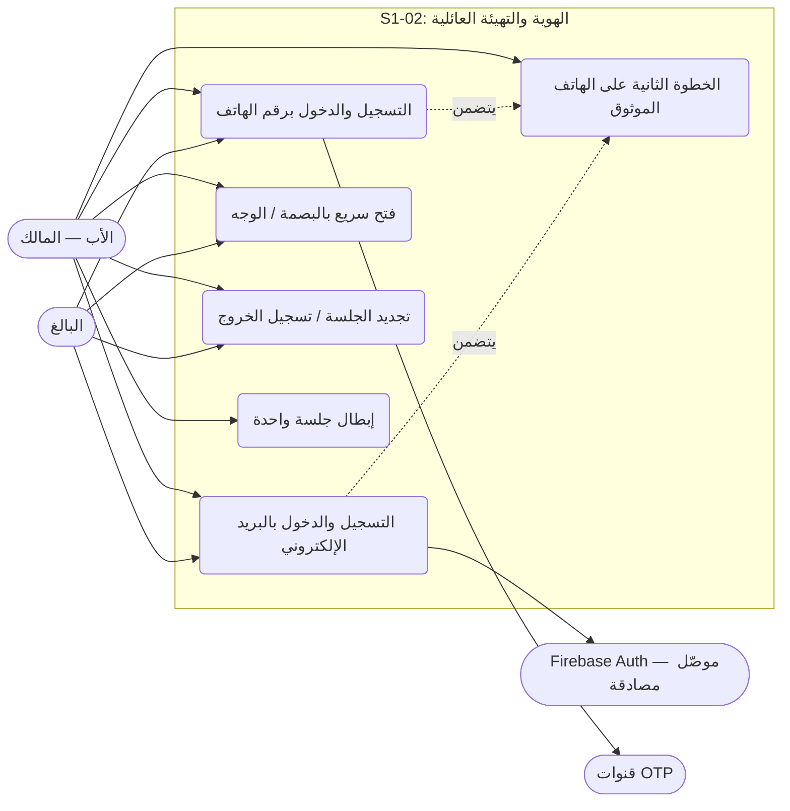

- ما يُقرأ منه: كيف يدخل البالغ (هاتف أو بريد — طريقان متساويان) ويدير جلسته. قنوات OTP هي WhatsApp ثم SMS ثم مكالمة؛ والخطوة الثانية (UC10) يسجّلها التطبيق وحده على الهاتف الموثوق (REQ-005) — بلا تطبيق خارجي ولا رمز QR.

### 1-ب. العائلة والإقران (REQ-007/008/009/010/011/012/013/014/017 — §4.1)

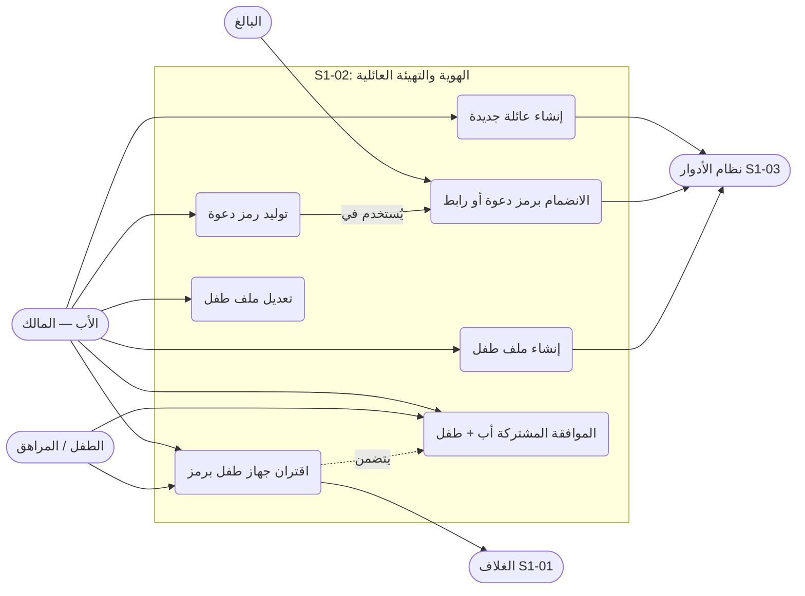

- ما يُقرأ منه: إنشاء العائلة والدعوة والانضمام وملفات الأطفال والإقران والموافقة المشتركة. رمز الدعوة عشوائي (استخدام واحد، 7 أيام)؛ ورمز الجهاز 6 أحرف (صالح 15 دقيقة).

### 1-ج. الإدارة والحذف (REQ-015/020/025/026/027/028/029/030 — §4.1)

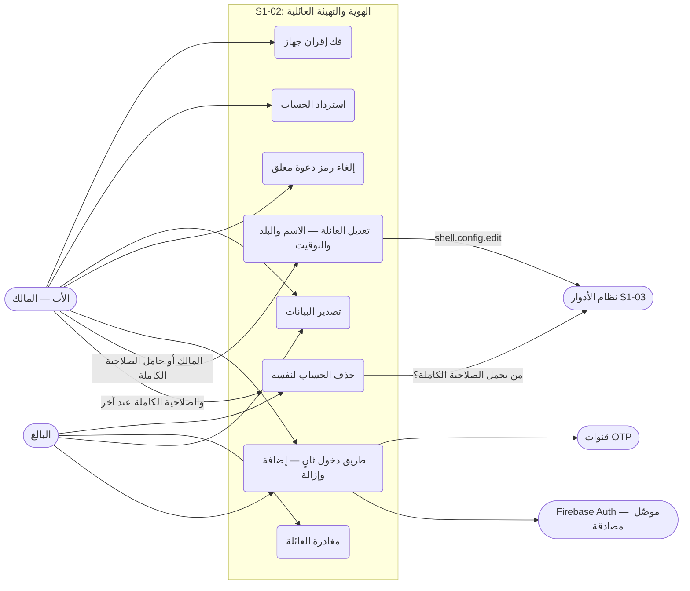

- ما يُقرأ منه: إدارة الحساب والعائلة بعد التهيئة: فك الإقران والاسترداد والحذف والمغادرة والتصدير، وطريق الدخول الثاني (UC20) وتعديل العائلة (UC21). UC20 للبالغين فقط، بلا مفتاح صلاحية جديد (فعل على حساب صاحبه)، ولا يُزال آخر طريق دخول. UC21 للمالك أو لمن عنده الصلاحية الكاملة وحدهما؛ والبالغ بلا الصلاحية الكاملة لا يرى التعديل.

- ملاحظتان: فك الإقران (UC12) للمالك فقط + PIN الأب (REQ-015/Q-065)؛ والبصمة (UC9) وضع الأهل فقط ولا تتجاوز بوابة الوالدين ولا تفتح وضع الطفل (REQ-016/Q-072).
- ملاحظة: حذف الحساب (UC14) ومغادرته (UC15) بمفتاحين (`identity.account.delete_self` / `identity.family.leave` — الافتراضي ممنوح عند الانضمام، حق أصيل للبالغ لا يملك الأب سحبه — Q-291؛ ومحاولة السحب تُرفض: «حق الخروج لا يُسلب»)؛ والمالك لا يغادر عائلته ولا يحذف حسابه إلا والصلاحية الكاملة عند بالغ آخر [تعديل 2026-11-16 — Q-401 · Q-402] أو بحذف العائلة كاملة (REQ-025/026 · Q-166 · Q-291) — الصلاحية الكاملة: S1-03 REQ-016؛ وحذف العائلة: S1-03 REQ-020 (SPEC §4.3). [تصحيح 2026-11-08 (Q-291): أُلغيت عبارة «والأب يلغيهما فردياً» و«الرفض 403».]
- ملاحظة: UC5 يشمل استئناف الانضمام المنقطع عبر الرابط العميق (سيناريو 2-16)؛ وUC7 يشمل إقران جهاز ثانٍ لطفل لديه جهاز مقترن (سيناريو 2-10 — حدث `device.paired-new`)؛ وبلوغ 13 سيناريو فقط (2-9) بلا حالة استخدام — مهمة خادمية مجدولة لا هدف مستخدم (مرسومة في تسلسل 3-ي). لا قالب لدون 7 في المرحلة 1 ولا مهمة لبلوغ 7 (Q-426).
- ملاحظة (Q-400 · Q-402): UC1 وUC2 طريقان متساويان في إنشاء العائلة والانضمام والدخول، ومن سجّل بالبريد لا يُطلب منه رقم هاتف؛ UC10 بلا تطبيق خارجي ولا رمز QR؛ UC13 للمالك — وبالغ غير المالك فقد هاتفه ورقمه يدعوه المالك من جديد (UC4/UC5)؛ UC14 للمالك حين تكون الصلاحية الكاملة عند بالغ آخر، فيصير ذلك البالغ مالكاً بعد 30 يوماً (3-ز · S1-03 3-ك).

- أُعيد رسمه 2026-11-19 (Q-434 — Q-425 · Q-426 · Q-427): قُسّم المخطط الواحد (26 عقدة) إلى ثلاث لوحات (1-أ: 10 عقد/14 سهماً، 1-ب: 12 عقدة/15 سهماً، 1-ج: 13 عقدة/15 سهماً)؛ وأُضيفت UC20 وUC21؛ وقُصّرت التسميات إلى ≤5 كلمات؛ وصار `UC4 --> UC5` سهماً مصمتاً («يُستخدم في» ليست تضميناً)؛ وحُذفت جملة بلوغ 7 من الملاحظة الختامية.


## 2. مخطط قاعدة البيانات (ERD)

الجداول الأحد عشر من §5 كما هي، مع مرجع خارجي واحد: `AuditEvent` (النواة المشتركة — كل حدث هوية/إقران يُسجَّل فيه). ملاحظات: `code_hash` و`pairing_code_hash` و`refresh_token_hash` مشفرة فقط — لا يُحفظ أي رمز نصاً أبداً؛ `person` بلا هاتف ولا بريد للطفل إطلاقاً (D-006)؛ `child_profile` بلا بيانات اتصال وسنة ميلاد فقط (Q-073). جداول العائلة تحمل `family_id` + عزل RLS (D-021)؛ أما `person` و`phone_verification` و`session` فبلا `family_id`. و`family.time_zone` المنطقة الزمنية للعائلة (IANA) — مرساة «منتصف الليل المحلي للعائلة» (Q-183)؛ وتُضبط عند إنشاء العائلة (REQ-007 · Q-236/D-18). والقالب يُحدَّد من سنة الميلاد (REQ-013) — لا عمود قالب في أي جدول هنا.

```mermaid
erDiagram
    person ||--o{ membership : "عضو في"
    person ||--o{ session : "له جلسات"
    person ||--o{ phone_verification : "يتحقق برقمه"
    person ||--o{ family : "ينشئ"
    family ||--o{ membership : "لها أعضاء"
    family ||--o{ invite_code : "لها رموز دعوة"
    family ||--o{ child_profile : "لها ملفات أطفال"
    family ||--o{ device_pairing : "لها أجهزة مقترنة"
    family ||--o{ consent_record : "لها سجلات موافقة"
    family ||--o{ deletion_request : "لها طلبات حذف"
    family ||--o{ recovery_request : "لها طلبات استرداد"
    membership ||--o{ deletion_request : "طلبات حذف عضو"
    membership ||--o{ recovery_request : "طلبات استرداد عضو"
    consent_record }o--|| membership : "تأكيد الطفل"
    membership ||--|| child_profile : "يرجع إلى عضوية"
    invite_code }o--|| person : "أنشأه"
    device_pairing }o--|| person : "أقرانه"
    consent_record }o--|| person : "منحه"
    device_pairing ||--o{ AuditEvent : "تُسجَّل"
    membership ||--o{ AuditEvent : "تُسجَّل"
    consent_record ||--o{ AuditEvent : "تُسجَّل"

    person {
        uuid id PK
        text phone
        text email
        text display_name
        timestamptz created_at
        timestamptz deleted_at
        timestamptz scheduled_purge_at
    }
    phone_verification {
        uuid id PK
        text phone
        text channel
        text code_hash
        int attempts
        timestamptz expires_at
        timestamptz verified_at
    }
    session {
        uuid id PK
        uuid person_id FK
        uuid device_id
        text device_label
        text refresh_token_hash
        timestamptz expires_at
        timestamptz revoked_at
        timestamptz last_active_at
    }
    family {
        uuid id PK
        uuid trusted_recovery_contact_id FK
        uuid created_by FK
        text name
        text region
        text time_zone
        timestamptz created_at
        timestamptz deleted_at
        timestamptz scheduled_purge_at
    }
    membership {
        uuid id PK
        uuid family_id FK
        uuid person_id FK
        %% person_id فارغ للطفل — صف عضوية بالملف فقط بلا حساب person (Q-137)
        text role
        boolean is_owner
    }
    invite_code {
        uuid id PK
        uuid family_id FK
        text created_by FK
        text code_hash
        int uses
        text status
        timestamptz expires_at
        timestamptz revoked_at
    }
    child_profile {
        uuid id PK
        uuid family_id FK
        uuid membership_id FK
        text nickname
        text avatar
        text color
        int birth_year
    }
    device_pairing {
        uuid id PK
        uuid family_id FK
        uuid paired_by FK
        uuid device_id
        text pairing_code_hash
        text device_cert
        text device_public_key
        text device_hmac_key_id
        text mode
        timestamptz paired_at
    }
    consent_record {
        uuid id PK
        uuid family_id FK
        text granted_by FK
        uuid child_membership_id FK
        text type
        text assent_method
        timestamptz granted_at
        timestamptz child_assented_at
    }
    recovery_request {
        uuid id PK
        uuid family_id FK
        uuid person_id FK
        uuid trusted_contact_membership_id FK
        text new_phone
        text status
        timestamptz requested_at
        timestamptz confirmed_at
        timestamptz wait_until
        timestamptz completed_at
    }
    deletion_request {
        uuid id PK
        uuid family_id FK
        uuid membership_id FK
        text requested_by FK
        text type
        text status
        timestamptz requested_at
        timestamptz purge_at
    }
    AuditEvent {
        uuid id PK
    }
```

- ملاحظة: `membership.person_id` فارغ للطفل — صف عضوية بالملف فقط بلا حساب `person` (D-006 · Q-137)؛ والعلاقة مرسومة كما نصّ عليها §5 (`child_profile.membership_id`).

- أُعيد رسمه 2026-11-19 (Q-434): الجداول والحقول والعلاقات نفسها (12 جدولاً، 21 علاقة)؛ وأُعيد ترتيب الحقول في ستة جداول (المفتاح الأساسي أولاً، ثم المفاتيح الأجنبية، ثم الحقول، ثم التواريخ في الآخر)؛ وصُحّح نوع `family.created_by` إلى `uuid`؛ وقُصّرت تسمية «ملف الطفل يرجع إلى عضوية»؛ ووُحّدت تسميات التدقيق الثلاث إلى «تُسجَّل». لا أثر لـ `minimal` ولا `turned-seven` هنا (Q-426).


## 3. التسلسل (Sequence) — من عقود §4

اثنا عشر تدفقاً في ثماني عشرة لوحة؛ التدفق الطويل لوحتان أو ثلاث (3-أ، 3-د، 3-ز، 3-ط، 3-ك)، والتدفقان الجديدان 3-ك (REQ-029) و3-ل (REQ-030). ترتيب المشاركين في كل مخطط: المستخدم، ثم التطبيق بمكوناته المحلية بعد الغلاف، ثم الخادم، ثم قاعدة البيانات، ثم الخدمات الخارجية.

### 3-أ. تسجيل الدخول بالهاتف + OTP — اللوحة 1 من 2: طلب الرمز وتوجيهه (REQ-001/002/003 — §4.1)

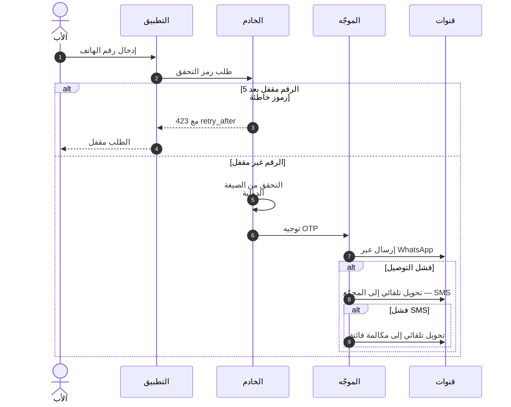

- الرسالة 2: `POST /api/v1/identity/otp/request {phone, region}`.

- يتبع في اللوحة 2: وصول الرمز والتحقق منه والخطوة الثانية. والبريد طريق مساوٍ (3-ب). والتوجيه: WhatsApp أولاً.

### 3-أ. تسجيل الدخول بالهاتف + OTP — اللوحة 2 من 2: التحقق والخطوة الثانية (REQ-003/004/005 — §4.1)

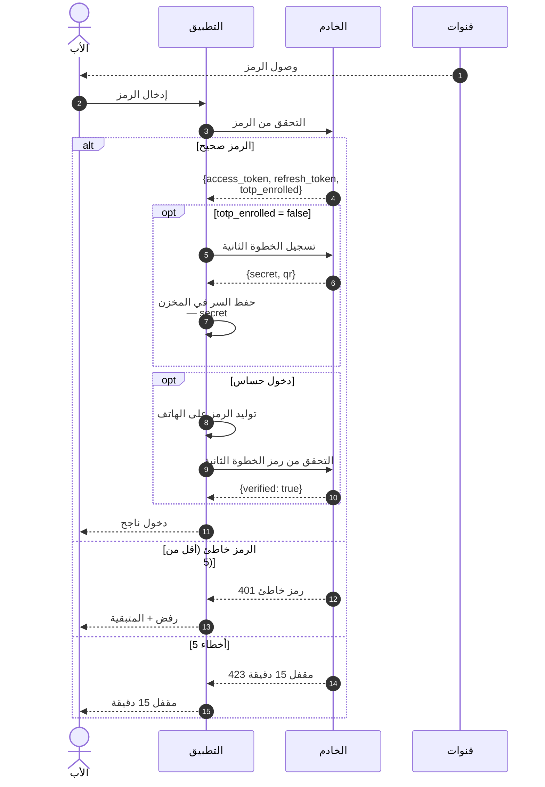

- الرسالة 3: `POST /api/v1/identity/otp/verify {phone, code}`.
- الرسالة 5: `POST /api/v1/identity/totp/enroll {}`.
- الرسالة 9: `POST /api/v1/identity/totp/verify {code}`.

- إعادة الإرسال بعد 60 ثانية؛ بعد 5 طلبات فاشلة 429 (§4.1)؛ وإعادة الإرسال تُحسب طلباً وتُصدر رمزاً جديداً يُبطل السابق (جدول العدّادات — SPEC §3)؛ عند فشل كل القنوات: رسالة واضحة «تعذر الإرسال — حاول لاحقاً» ولا يُعرض الرمز على الشاشة أبداً (§7/سيناريو 2-5)؛ ورسائل SMS الاحتياطية عبر الموجّه تُحسب من حصة SMS لخطة العائلة (Q-106 · REQ-002)؛ وعند صفر حصة يُرفض OTP SMS وينتقل الموجّه إلى مكالمة فائتة مع إعلام المستخدم بالسبب؛ وOTP لا يستهلك رسائل الطوارئ أبداً — تجاوز Q-106 SOS فقط (Q-247). والتحقق من الصيغة الدولية E.164 عبر libphonenumber (REQ-019)؛ ولا يصفّر عدّاد الأخطاء إلا تحقق ناجح أو انتهاء القفل. الرمز صالح 5 دقائق؛ وإدخاله أو قراءته تلقائياً من SMS حيث يدعم الجهاز. `totp/enroll` يستدعيه العميل وحده بعد أول تحقق (Q-246)؛ ويُحفظ `secret` في مخزن الهاتف الآمن ولا يُعرض هو ولا `qr` — الهاتف صار موثوقاً. والخطوة الثانية (REQ-005) بلا تطبيق خارجي؛ والدخول الناجح جلسة 30 يوماً.

- أُعيد رسمه 2026-11-16 (Q-400 — س1/س3): التسجيل برقم الهاتف أو بالبريد طريقان متساويان، وهذا وجه الهاتف؛ والخطوة الثانية يسجّلها العميل وحده بعد أول تحقق — لا رسالة «سجّل TOTP» تظهر للأب، ورمزها يولّده التطبيق على الهاتف الموثوق؛ وأثناء القفل تُرفض إعادة الإرسال بـ 423 ولا تصفّر عدّاد الأخطاء.

- أُعيد رسمه 2026-11-19 (Q-434): قُسّم إلى لوحتين (اللوحة 1: 9 رسائل، اللوحة 2: 15 رسالة)؛ وقُصّرت تسميات الرسائل إلى ≤4 كلمات ونُقل التفصيل إلى الملاحظة تحت المخطط.

### 3-ب. تسجيل الدخول بالبريد الإلكتروني (REQ-022/023/024 — §4.1/§4.2)

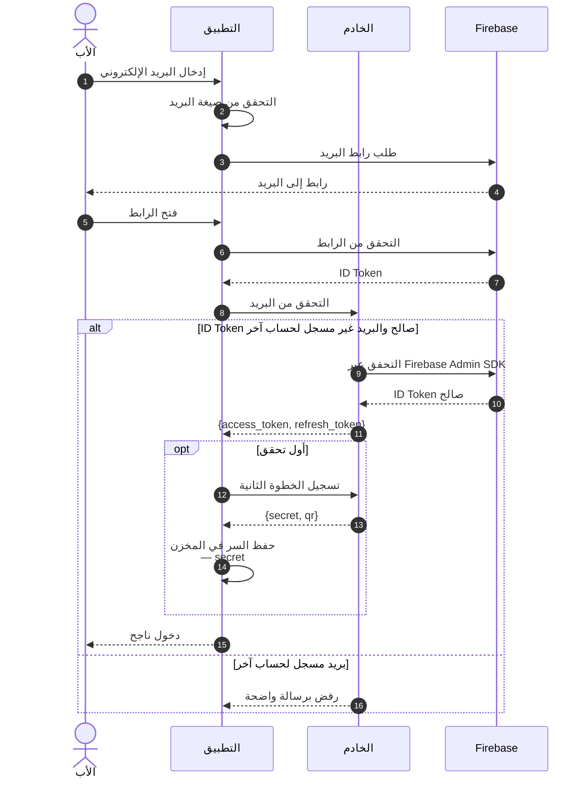

- الرسالة 8: `POST /api/v1/identity/email/verify {firebase_id_token}`.
- الرسالة 12: `POST /api/v1/identity/totp/enroll {}`.

- البريد للبالغين فقط؛ لا يُطلب من الطفل إطلاقاً (D-006). عند تعذر الوصول إلى Firebase يُعرض خيار الهاتف وOTP تلقائياً دون انقطاع (REQ-024)؛ Firebase موصّل مصادقة لا سلطة — بيانات العائلة لا تعيش فيه (REQ-023). والطريق مساوٍ للهاتف (3-أ)؛ ولا يُطلب رقم هاتف بعد البريد (Q-400)؛ وبعد أول تحقق بالبريد يُسجَّل الهاتف موثوقاً كما في 3-أ؛ والدخول الناجح جلسة 30 يوماً بدوران. ورفض البريد المسجل لحساب آخر برسالة واضحة لا يُكشف فيها لمن ينتمي البريد. و`totp/enroll` يستدعيه العميل وحده.

- أُعيد رسمه 2026-11-16 (Q-400 — التسجيل): هذا التسلسل مساوٍ لـ3-أ في إنشاء العائلة والانضمام والدخول، ولا يُطلب بعده رقم هاتف؛ وبعد أول تحقق بالبريد يُسجَّل الهاتف موثوقاً كما في 3-أ.

- أُعيد رسمه 2026-11-19 (Q-434): أُعيد ترتيب المشاركين (Ktor قبل Firebase — الترتيب المعتمد: التطبيق ثم الخادم ثم الخارجية)؛ وقُصّرت التسميات إلى ≤4 كلمات. الرسائل والمشاركون أنفسهم: 16 رسالة، 4 مشاركين.

### 3-ج. إنشاء العائلة + الدعوة والانضمام (REQ-007/008/009/010 — §4.1)

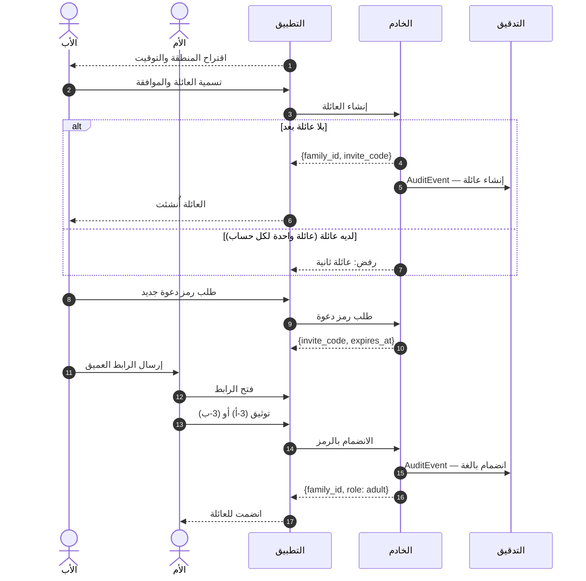

- الرسالة 3: `POST /api/v1/identity/families {name, region, time_zone}`.
- الرسالة 9: `POST /api/v1/identity/families/{id}/invite`.
- الرسالة 14: `POST /api/v1/identity/families/join {invite_code}`.

- المالك يلغي أي رمز دعوة معلق في أي وقت (REQ-010) — النقطة: `POST /api/v1/identity/families/{id}/invites/{inviteId}/revoke`؛ رمز منتهٍ/غير صالح يُرفض دون كشف إن كان موجوداً أصلاً (§7). والرمز عشوائي، استخدام واحد، 7 أيام. والمنشئ مالك is_owner؛ والمنضمّة بلا صلاحيات إشرافية حتى يفوّضها الأب (Q-007). والموافقة على region و time_zone المقترحين من الهاتف؛ وعائلة ثانية غير مسموحة (Q-008).

- أُعيد رسمه 2026-11-16 (Q-400 — س9/أ-13): الانضمام يسبقه توثيق رقم الهاتف **أو** البريد، و`families/join` يقبل جلسة أيٍّ منهما؛ وفي إنشاء العائلة يرسل العميل `region` و`time_zone` المقترحين من الهاتف بعد موافقة الأب.

- أُعيد رسمه 2026-11-19 (Q-434): قُصّرت تسميات الرسائل إلى ≤4 كلمات ونُقل التفصيل إلى الملاحظة تحت المخطط. الرسائل والمشاركون أنفسهم: 17 رسالة، 5 مشاركين.

### 3-د. ملف طفل + اقتران جهاز + موافقة مشتركة — اللوحة 1 من 2: الملف ورمز الجهاز (REQ-011/012/013/014/021 — §4.1)

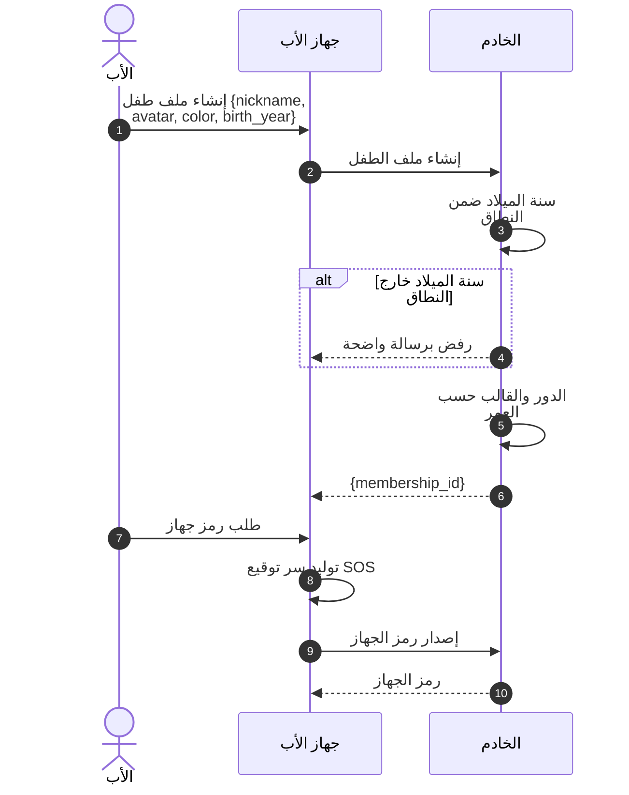

- الرسالة 2: `POST /api/v1/identity/children {nickname, avatar, color, birth_year}`.
- الرسالة 9: `POST /api/v1/identity/devices/pairing-code {membership_id, device_hmac_secret, device_hmac_key_id}`.

- سنة الميلاد ضمن النطاق: السنة الحالية − 99 … السنة الحالية (REQ-021). الدور والقالب: دون 13 child/standard، 13–17 teen/standard — لا حد أدنى للعمر ولا قالب لدون 7 (Q-426). رمز الجهاز 6 أحرف، صالح 15 دقيقة؛ وسر توقيع SOS (HMAC — 256 بت) مع معرّف device_hmac_key_id (UUID).

- بعد إنشاء الملف: الطفل عضو يشغل مقعداً، وحالته بلا جهاز بعد حتى يكتمل الإقران — حالة مشتقة لا تُخزَّن.

- رُسم 2026-11-19 (Q-440): أُضيف سطر حالة «بلا جهاز بعد» تحت اللوحة 1 (REQ-011)؛ الرسائل 10 والمشاركون 3 بلا تغيير.

### 3-د. ملف طفل + اقتران جهاز + موافقة مشتركة — اللوحة 2 من 2: الإقران والموافقة (REQ-014/017 — §4.1)

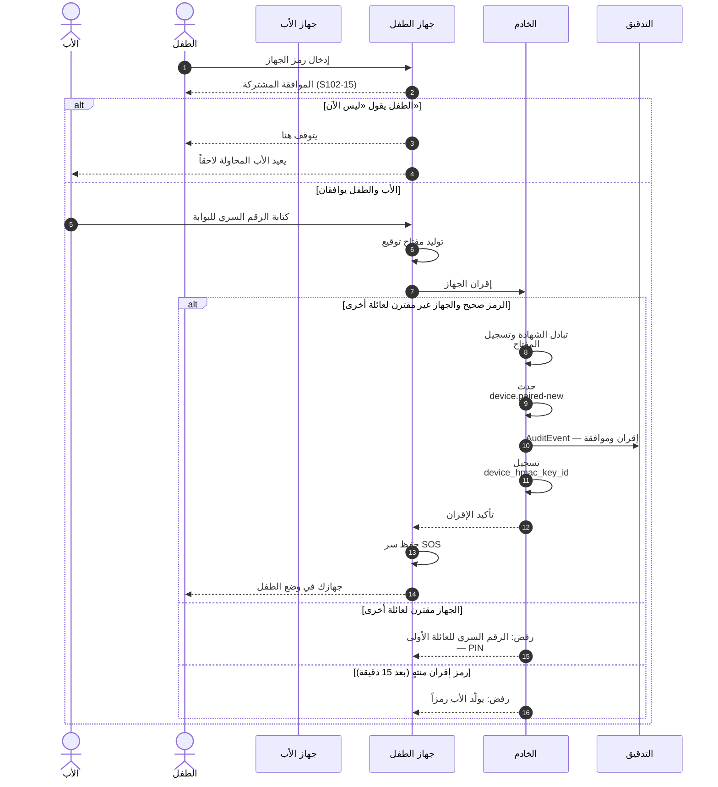

- الرسالة 7: `POST /api/v1/identity/devices/pair {pairing_code, device_cert, device_public_key}`.
- الرسالة 12: `{device_id, mode: child, device_hmac_key_id, device_hmac_secret}`.

- الإقران ذري: إما يكتمل كاملاً (شهادة + مفتاح توقيع + سر توقيع SOS + وضع + عضوية) أو لا شيء (§7)؛ وسر توقيع SOS لا يمر عبر MQTT أبداً (MQTT-BROKER-SPEC:18)؛ والخادم يحفظه عابراً مربوطاً برمز الإقران (15 دقيقة كحد أقصى) ثم يتلفه؛ ويُخزَّن دائماً في `device_pairing` معرّف المفتاح فقط (S1-02 §5). الوضع يتحدد بالإقران ويُسلَّم للغلاف S1-01؛ وتبديل الملفات مؤجل للمرحلة 2 (Q-063) فلا تبديل للوضع في المرحلة 1؛ وشهادة الجهاز هي اعتماد MQTT (mTLS — Q-168 · REQ-014)؛ والموافقة شفافية عن الفئات المراقَبة لا عن المحتوى (REQ-017). والموافقة المشتركة: ما نجمعه ولماذا ومن يراه (S102-15) — «أوافق» و«ليس الآن» متساويان؛ و«ليس الآن» يوقف الإقران بلا سجل موافقة (Q-400). كتابة الرقم السري على جهاز الطفل (S1-01 3-ط — Q-397 · Q-142). مفتاح التوقيع (ECDSA P-256) مربوط بالعتاد (Q-164). تبادل الشهادة وتسجيل المفتاح العام (Q-181) + تحديد الوضع (طفل) نهائياً (Q-062). ورفض فك الإقران يتطلب PIN أب العائلة الأولى (REQ-015).

- أُعيد رسمه 2026-11-16 (Q-400 — س7 · Q-397): الموافقة المشتركة تسبق الإقران؛ إن قال الطفل «ليس الآن» يتوقف التسلسل بلا إقران ولا سجل موافقة؛ وإن وافقا يكتب الأب الرقم السري لبوابة الوالدين على جهاز الطفل داخل الخطوة نفسها (Q-142 — محلي لكل جهاز).

- أُعيد رسمه 2026-11-19 (Q-434): قُسّم إلى لوحتين (اللوحة 1: 10 رسائل، اللوحة 2: 16 رسالة)؛ وسطر القالب صار بقالبين (Q-426)؛ وقُصّرت التسميات إلى ≤4 كلمات ونُقل التفصيل إلى الملاحظات تحت اللوحتين.

### 3-هـ. الجلسة: تجديد ودوران وتسجيل خروج (REQ-006 — §4.1)

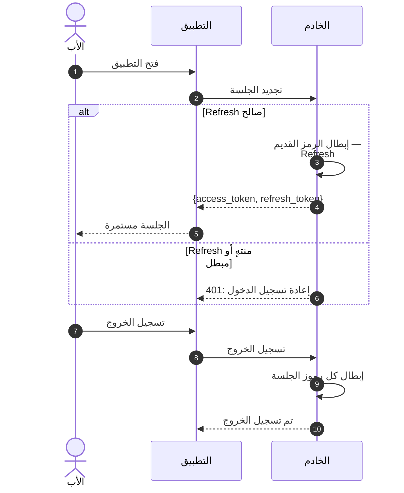

- الرسالة 2: `POST /api/v1/identity/sessions/refresh {refresh_token}`.
- الرسالة 8: `POST /api/v1/identity/sessions/logout`.

- الجلسة مستمرة حتى سقف 30 يوماً من تسجيل الدخول (REQ-006)؛ وفتح التطبيق بـ Access Token منتهٍ؛ وتسجيل الخروج يبطل كل الرموز فوراً.

- أُعيد رسمه 2026-11-19 (Q-434): قُصّرت التسميات إلى ≤4 كلمات. الرسائل والمشاركون أنفسهم: 10 رسائل، 3 مشاركين.

### 3-و. استرداد الحساب بعد فقدان الهاتف والرقم (REQ-020 — §4.1/§7)

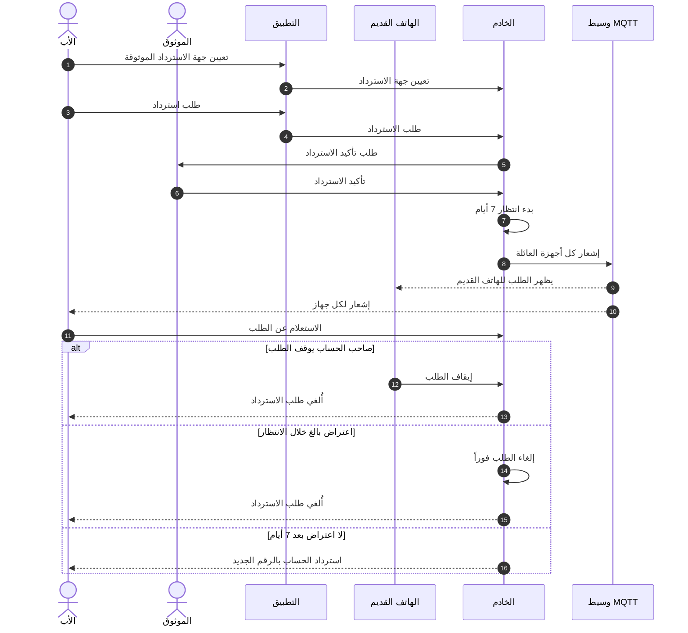

- الرسالة 2: `POST /api/v1/identity/recovery/trusted-contact`.
- الرسالة 4: `POST /api/v1/identity/recovery/request {old_phone, new_phone}`.
- الرسالة 6: `POST /api/v1/identity/recovery/{id}/confirm`.
- الرسالة 11: `GET /api/v1/identity/recovery/{id}`.
- الرسالة 12: `POST /api/v1/identity/recovery/{id}/object`.

- لا استيلاء صامت على الحساب: الانتظار + الإشعار + الاعتراض هي الضمانات الثلاث (سيناريو 2-7). والتسلسل نفسه يغطي الحالات الثلاث: فقدان الهاتف والرقم، أو فقدان الهاتف الموثوق، أو نسيان الرقم السري (Q-400). تعيين الجهة الموثوقة مسبقاً للمالك فقط. والطالب يكتب رقمه القديم والجديد ولا يختار الجهة ولا يُكشف له اسمها؛ وتأكيد الجهة بعد أن تسمع صوت صاحب الطلب؛ وحالة الطلب والأيام المتبقية في عداد S102-22. والإلغاء عبر POST …/recovery/{id}/object، والاكتمال عبر POST …/recovery/{id}/complete. والإشعار عبر family/{family_id}/alerts/new (Q-022 · Q-210).

- أُعيد رسمه 2026-11-16 (Q-400 — س2/س4/س5/س6): الطلب يحمل الرقم القديم مع الجديد ولا يختار الطالب الجهة؛ صاحب الحساب يوقفه من هاتفه القديم في أي مرحلة ولو قبل تأكيد الجهة؛ والتسلسل نفسه لفقدان الهاتف الموثوق ولنسيان الرقم السري. خارج هذا التسلسل: بالغ غير المالك يدعوه المالك من جديد؛ ومن سجّل بالبريد ولم يفقده يدخل ببريده؛ وإن غادرت الجهة العائلة يسقط التعيين ويُنبَّه المالك.

- أُعيد رسمه 2026-11-19 (Q-434): أول رسالة صارت عبر العميل (بدل الأب إلى الخادم مباشرة)؛ وحُذفت الملاحظة النصية الطويلة ونُقل محتواها إلى الملاحظة تحت المخطط؛ وقُصّرت التسميات إلى ≤4 كلمات. الرسائل: 16 رسالة، 6 مشاركين.


### 3-ز. حذف الحساب / المغادرة / التصدير — اللوحة 1 من 3: حذف الحساب (REQ-025/028 — §4.1)

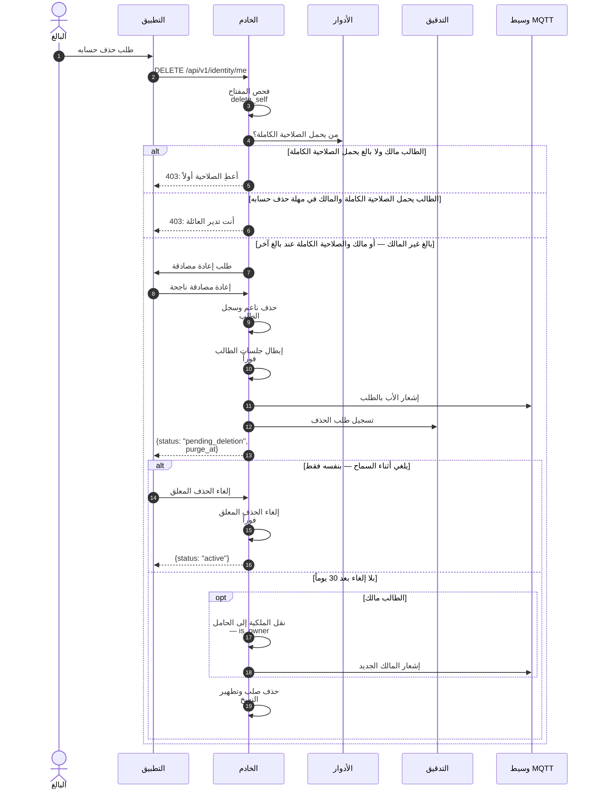

- الرسالة 4: `GET /api/v1/families/{id}/full-authority`.
- الرسالة 14: `POST /api/v1/identity/me/deletion/cancel`.
- موضوع MQTT: `family/{family_id}/alerts/new` (Q-210).

- فحص المفتاح identity.account.delete_self (deny-override) — حق أصيل ممنوح عند الانضمام دائماً، لا يملك الأب سحبه (Q-291)؛ ومحاولة سحبه تُرفض: «حق الخروج لا يُسلب». الحذف الناعم: deleted_at + scheduled_purge_at (+30 يوماً) + سجل deletion_request (type: account) — REQ-028. إبطال الجلسات مرسوم رسالة ذاتية للخادم (الجلسات مخزن S102 في §5). إشعار الأب: وإن كان الطالب مالكاً فإشعار الحامل أنه يدير العائلة (Q-210 · Q-402).

### 3-ز. حذف الحساب / المغادرة / التصدير — اللوحة 2 من 3: المغادرة (REQ-026 — §4.1)

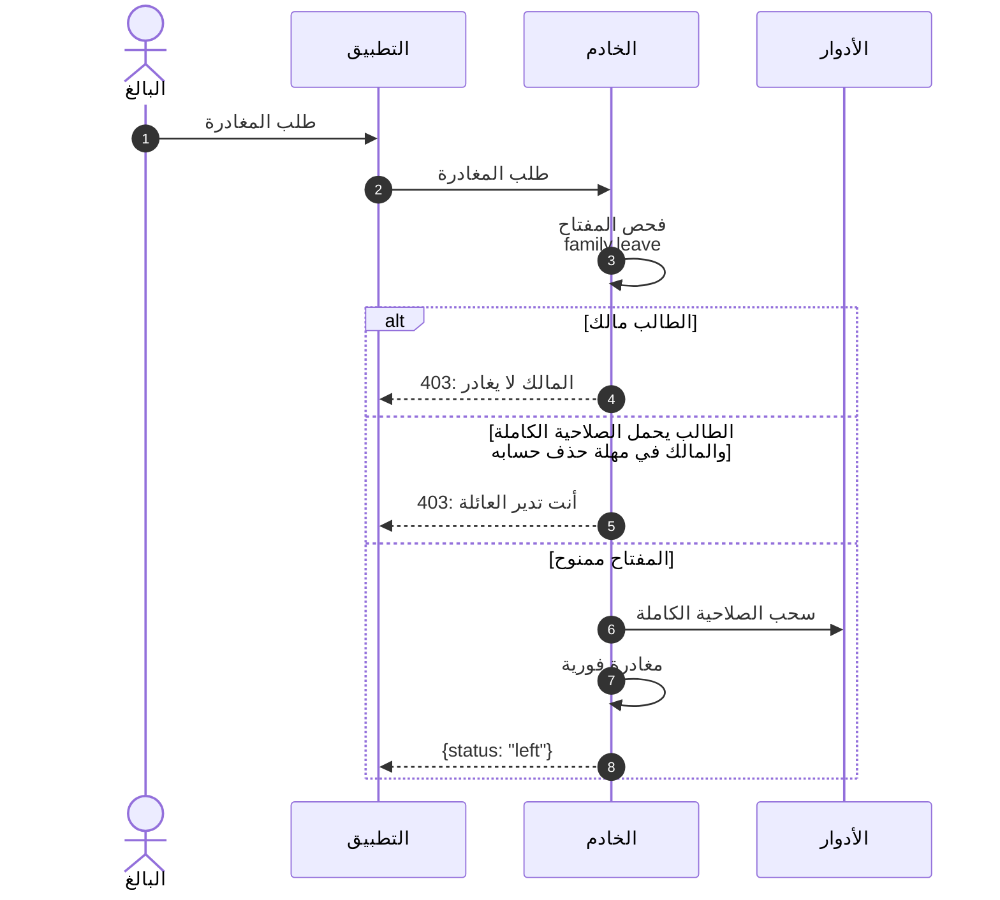

- الرسالة 2: `POST /api/v1/identity/me/leave`.

- فحص المفتاح identity.family.leave — حق أصيل ممنوح عند الانضمام دائماً (Q-291). سحب الصلاحية الكاملة إن كان يحملها (S1-03 §7-15). المغادرة الفورية: حذف العضوية + تجهيل الرسائل.

### 3-ز. حذف الحساب / المغادرة / التصدير — اللوحة 3 من 3: التصدير (REQ-027 — §4.1)

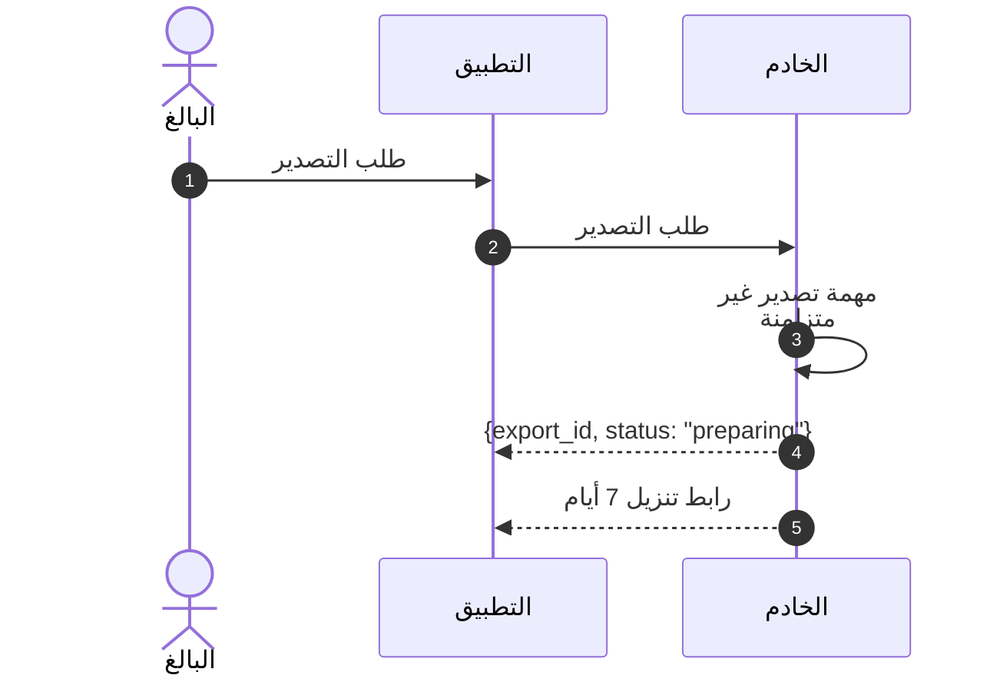

- الرسالة 2: `POST /api/v1/identity/me/export`.

- أو تصدير بيانات قاصر عبر POST /api/v1/identity/families/{id}/members/{memberId}/export. الصيغة JSON + وسائط؛ والرابط عند الجاهزية.

- حذف حساب مالك: يُنقَل is_owner تلقائياً إلى حامل الصلاحية الكاملة إن وُجد، فإن لم يوجد تُرفض العملية بـ 403 «أعطِ الصلاحية الكاملة لبالغ آخر أولاً»؛ وإن كان المالك في مهلة 30 يوماً فبالغ الحامل يتصرف على العائلة كما لو كان المالك (Q-402). وإن كان الطالب بالغاً غير مالك: يُسحب منه مفتاحا حذف الحساب والمغادرة فور الإرسال، وإن ألغى طلب حذف حسابه يعيد الأب منحهما؛ ويُنبَّه المالك فوراً برسالة «اسمك» طلب حذف حسابه (Q-210). والمغادرة: يعارضها فوراً بالغٌ غير مالك؛ ولا يغادر بالغ يحمل الصلاحية الكاملة إن كان المالك في مهلة حذفه (Q-402). والتصدير: يبلغ الأب عند الجاهزية. والحذف الصلب يبدل `author_id` في الملفات المشتركة إلى `deleted_user`، ويلغي جلسات صاحب الحساب فوراً، ولا يحذف الرسائل أو العضوية قبلها. وحذف حساب بالغٍ ما هو إلا مفتاحا identity.account.delete_self وidentity.family.leave — والعضوية والجلسات تتبع الحذف الصلب بعد 30 يوماً (Q-166). والحذف الناعم: deleted_at + scheduled_purge_at (+30 يوماً) + سجل deletion_request (type: account) — REQ-028. وتصدير بيانات قاصر عبر POST /api/v1/identity/families/{id}/members/{memberId}/export. والتصدير JSON + وسائط؛ والرابط عند الجاهزية.

- المالك لا يغادر أبداً. وتُجهَّل الرسائل في الحذف الصلب: «عضو محذوف» (Q-166).

- أُعيد رسمه 2026-11-16 (Q-401/Q-402 — Q-166): حذف حساب مالك ينقل is_owner إلى حامل الصلاحية الكاملة؛ أو يُرفض 403 إن لم يوجد حامل؛ وأثناء مهلة حذف المالك لا يغادر الحامل ولا يحذف حسابه؛ وإن كان الطالب بالغاً غير مالك، يُسحب منه مفتاحا حذف الحساب والمغادرة فور الإرسال ويُعيد الأب منحهما إن ألغى الطلب؛ ويُنبَّه المالك فوراً برسالة «اسمك» طلب حذف حسابه؛ والمغادرة بلا مهلة.

- أُعيد رسمه 2026-11-19 (Q-434): قُسّم إلى ثلاث لوحات (حذف: 19 رسالة، مغادرة: 8، تصدير: 5)؛ والمشارك `App` صار `Client` توحيداً مع باقي التسلسلات؛ وإبطال الجلسات صار رسالة ذاتية للخادم بدل مشارك S102 مستقل؛ ونُقلت ملاحظة Q-291 إلى الملاحظة تحت اللوحة 1. المشاركون: 6/4/3.

### 3-ح. إعادة تسجيل مفتاح التوقيع بعد تغيير بصمة الأب (REQ-016 — §4.1)

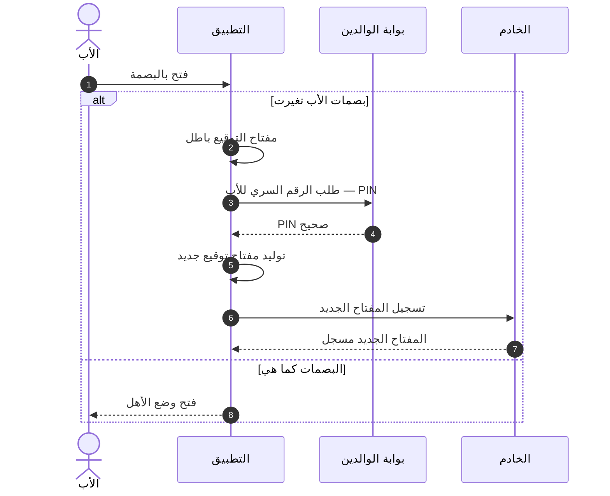

- الرسالة 6: `POST /api/v1/identity/devices/{deviceId}/public-key`.

- تغيير بصمة الأب يُبطل مفتاح توقيع الجهاز (REQ-016)؛ وإعادة التسجيل بـ PIN قبل أي عملية حساسة (Q-164). والبصمة لا تفتح وضع الطفل أبداً ولا تتجاوز بوابة الوالدين. (البوابة هنا هي بوابة الوالدين في S1-01؛ وسُمّيت Gate لئلا يلتبس معرّف S101 مع الغلاف.)

- فتح بالبصمة في وضع الأهل فقط (Q-072). مفتاح التوقيع باطل: لا عمليات حساسة حتى إعادة التسجيل. PIN صحيح محلياً (Q-142). المفتاح الجديد (ECDSA P-256) مربوط بالعتاد؛ وتسجيله عبر {device_public_key} (Q-225).

- أُعيد رسمه 2026-11-19 (Q-434): المشارك `S101` صار `Gate` (معرّف واحد بمعنيين)؛ وقُصّرت التسميات إلى ≤4 كلمات. الرسائل والمشاركون أنفسهم: 8 رسائل، 4 مشاركين.

### 3-ط. عمليات الإدارة — اللوحة 1 من 2: الجلسات (REQ-006 — §4.1)

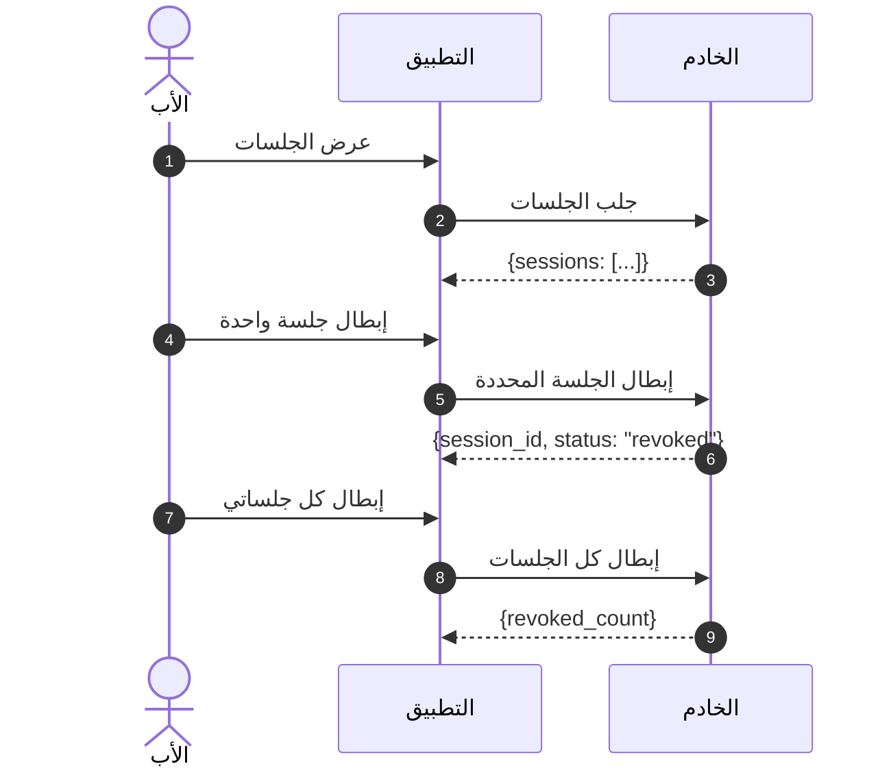

- الرسالة 2: `GET /api/v1/identity/sessions`.
- الرسالة 5: `POST /api/v1/identity/sessions/{sessionId}/revoke`.
- الرسالة 8: `POST /api/v1/identity/sessions/revoke-all`.

- إبطال كل جلساتي فعل منفصل ببوابة الأب (PIN — Q-065). الإبطال الصريح يبطل رموز تلك الجلسة فقط؛ وبلا تتالٍ صامت إلى المنح — إلغاء منح لا يبطل أي جلسة (Q-257). إبطال الكل يبطل جلسات الشخص نفسه فقط على كل أجهزته؛ وبلا أثر على جلسات أي عضو آخر ولا على المنح (Q-257). حقول الجلسة: {session_id, device_id, device_label, last_active_at, expires_at, is_current}.

### 3-ط. عمليات الإدارة — اللوحة 2 من 2: الدعوات والملفات والإقران والموافقة (NEW-S102-08 — §4.1)

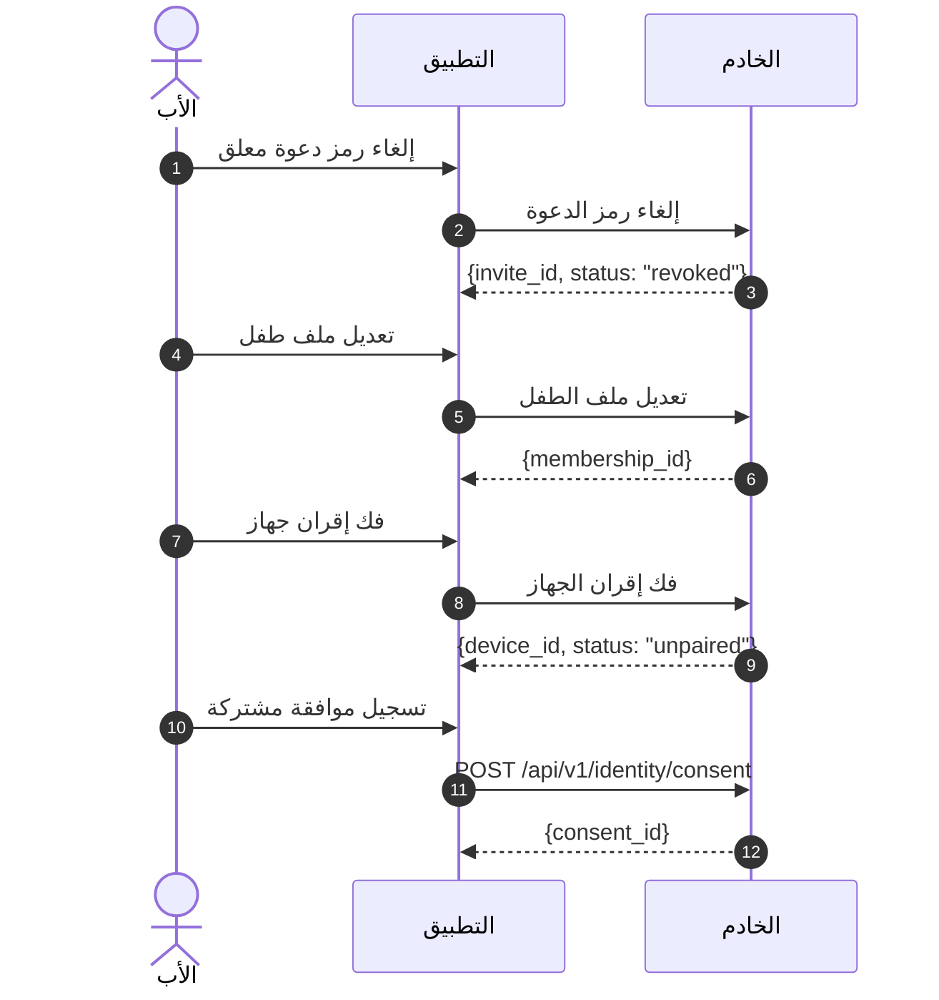

- الرسالة 2: `POST /api/v1/identity/families/{id}/invites/{inviteId}/revoke`.
- الرسالة 5: `PATCH /api/v1/identity/children/{membershipId}`.
- الرسالة 8: `POST /api/v1/identity/devices/{deviceId}/unpair`.

- فك الإقران بـ PIN. إلغاء الإقران يبطل كل جلسات ذلك الجهاز فوراً؛ وبلا أثر على جلسات أجهزة أخرى (Q-257).

- طلب الابن لوني وصورتي يصل عبر S1-09 (3-ك) ويُغلق عند هذا الحفظ.

- رُسم 2026-11-19 (Q-440): أُضيف سطر طلب «لوني وصورتي» تحت اللوحة 2 (REQ-012)؛ الرسائل 12 والمشاركون 3 بلا تغيير.

- عمليات الإدارة الست في لوحتين؛ وكل منها يظهر أيضاً في شاشته (§9: S102-18 للجلسات، S102-09 للدعوات، S102-12 للملفات، S102-27 لفك الإقران، S102-15 للموافقة).

- أُعيد رسمه 2026-11-19 (Q-434): قُسّم إلى لوحتين (الجلسات: 9 رسائل، والباقي: 12 رسالة)؛ والملاحظات النصية الثلاث نُقلت إلى الملاحظات تحت اللوحتين؛ وحمولة {sessions: [...]} اختُصرت. الرسائل: 21 رسالة قبل التقسيم.

### 3-ي. المهمة اليومية لبلوغ 13 (سيناريو 2-9 — Q-189 · Q-235 · Q-183 · Q-426)

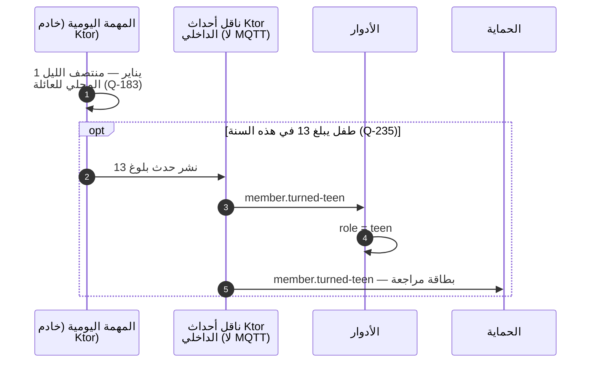

- الرسالة 2: `member.turned-teen — family_id + membership_id + birth_year (Q-189)`.

- بلوغ 7 لا يُطلق شيئاً في المرحلة 1: قالب `minimal` وحدثه `member.turned-seven` معلّقان (Q-426)، والطفل دون 7 يرى قالب الطفل نفسه. بطاقة المراجعة في S1-10 (REQ-027). ومراجعة المنح غير الإشرافية + إشعار الأب مع تحويل الدور إلى teen.

- المهمة اليومية نفسها تُطلق التحول عند بلوغ 18 كما في سن 13 (Q-235)، لكن اسم الحدث الداخلي للتحول عند 18 يُعرَّف مع S1-03 ولم يُرسم هنا (ليس جزءاً من عقد §4.4).

- أُعيد رسمه 2026-11-19 (Q-434): حُذف فرع بلوغ 7 كاملاً، وصار `alt` ذو الفرع الواحد `opt`، وحُذف المشارك S101. المشاركون: 4، الرسائل: 5.

### 3-ك. طريق دخول ثانٍ لحساب قائم — اللوحة 1 من 2: الإضافة (REQ-029 — §4.1 — Q-425 · Q-427)

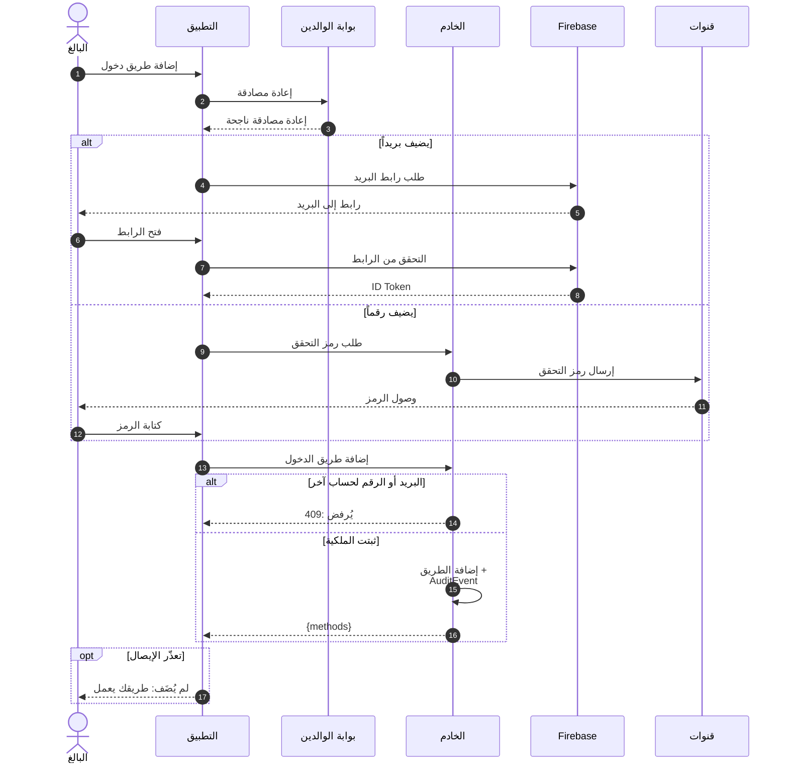

- الرسالة 9: `POST /api/v1/identity/otp/request {phone}`.
- الرسالة 13: `POST /api/v1/identity/me/login-methods {type, …}`.

- إعادة المصادقة: الرقم السري، أو البصمة لمن اختارها (Q-418). جسم POST: {type: email, firebase_id_token} أو {type: phone, phone, code}. خمس محاولات خاطئة للرمز ثم انتظار 15 دقيقة (Q-427). يدخل بعد الإضافة بأيهما. عند تعذّر إيصال الرمز أو الرابط لا يُضاف شيء، ويُقال إن طريق الدخول الحالي يعمل (REQ-024).

### 3-ك. طريق دخول ثانٍ لحساب قائم — اللوحة 2 من 2: الإزالة (REQ-029 — §4.1 — Q-425)

```mermaid
%%{init: {"sequence": {"wrap": true}}}%%
sequenceDiagram
    autonumber
    actor Adult as البالغ
    participant App as التطبيق
    participant Gate as بوابة الوالدين
    participant Ktor as الخادم
    Adult->>App: أزل طريقاً
    App->>Gate: إعادة مصادقة
    Gate-->>App: إعادة مصادقة ناجحة
    App->>Ktor: إزالة طريق الدخول
    Ktor->>Ktor: إزالة الطريق + AuditEvent
    Ktor-->>App: {methods}
```

- الرسالة 4: `DELETE /api/v1/identity/me/login-methods/{type}`.

- الإزالة بالرقم السري؛ ولا يُزال آخر طريق دخول (409). الإضافة والإزالة تُسجَّلان في التدقيق (REQ-029(5)). للبالغين فقط (REQ-022). لا يظهر الطريق الجديد في الحساب قبل إثبات ملكيته.

- رُسم 2026-11-19 (Q-434 — Q-425 · Q-427): تسلسل جديد من عقود §4.1؛ والتحقق عبر الخادم (OTP) وFirebase (رابط البريد) لا مباشرة من التطبيق إلى القناة؛ وAuditEvent في الإضافة والإزالة معاً. اللوحتان: الإضافة 17 رسالة، الإزالة 6 رسائل.

### 3-ل. تعديل العائلة بعد إنشائها (REQ-030 — §4.1 — Q-264 · Q-425)

```mermaid
%%{init: {"sequence": {"wrap": true}}}%%
sequenceDiagram
    autonumber
    actor Owner as المالك أو حامل الصلاحية الكاملة
    participant App as التطبيق
    participant Gate as بوابة الوالدين
    participant Ktor as الخادم
    participant MQTT as وسيط MQTT
    participant K as وحدة Kotlin
    Owner->>App: «العائلة» — تعديل
    opt الاسم — من حرفين إلى 30
        App->>Ktor: تعديل الاسم
        Ktor->>Ktor: AuditEvent بالقيمتين
        Ktor-->>App: حُفظ مع تراجع
    end
    opt البلد
        App->>Gate: إعادة مصادقة
        App->>Ktor: تعديل البلد
        Ktor->>Ktor: AuditEvent بالقيمتين
        Ktor-->>App: حُفظ: الأسعار لما بعده
    end
    opt المنطقة الزمنية
        App->>Gate: إعادة مصادقة
        App->>Ktor: تعديل المنطقة الزمنية
        Ktor->>Ktor: AuditEvent بالقيمتين
        Ktor-->>App: يسري فوراً
        Ktor->>MQTT: نشر تحديث القواعد
        MQTT->>K: تحديث القواعد إلى الجهاز
        K->>K: مزامنة وإعادة حساب النوافذ
    end
    opt بلا اتصال
        App-->>Owner: الحفظ معطَّل بلا اتصال
    end
```

- الرسالة 2: `PATCH /api/v1/identity/families/{id} {name}`.
- الرسالة 6: `PATCH /api/v1/identity/families/{id} {region}`.
- الرسالة 10: `PATCH /api/v1/identity/families/{id} {time_zone}`.
- الرسالة 13: `family/{family_id}/protection/rules-updated` — والتوقيت يُقرأ من ShellConfig.time_zone (S1-01 §4.2)؛ والجهاز المنقطع يأخذه عند أول مزامنة.

- تغيير البلد لا يغيّر المنطقة الزمنية ولا العكس (Q-264). بمفتاح `shell.config.edit` القائم. البلد يغيّر الأسعار وطرق الدفع وقناة رمز التحقق لما يأتي بعده، ولا يمس اشتراكاً قائماً حتى نهاية فترته. التوقيت يسري فوراً على كل أجهزة الأبناء فتُحسب بها نوافذ النوم والمدرسة ونهاية اليوم، والقواعد نفسها لا تتغير.

- رُسم 2026-11-19 (Q-434 — Q-425): تسلسل جديد من عقود §4.1؛ والتعديلات الثلاث `opt` متتابعة (ليست `alt` — قد تُعدَّل معاً في جلسة واحدة)؛ وAuditEvent مع كل تعديل؛ وبعد نجاح حفظ التوقيت ينشر الخادم تحديث القواعد إلى وسيط MQTT فيوصله إلى جهاز الطفل فيعيد المزامنة ويعيد حساب النوافذ (Q-439). الرسائل: 16 رسالة، 6 مشاركين.


## 4. تدفق المستخدم (User Flow) — من السيناريوهات الستة عشر (§2)

أربع لوحات (4-أ…4-د)؛ وكل لوحة ≤20 عقدة؛ والخروج من لوحة إلى التالية بعقدة تشير إلى رقم اللوحة.

### 4-أ. الدخول بالهاتف + OTP (REQ-001…005)

- اقرأ من هذه اللوحة: مسار الدخول بالهاتف من أول تثبيت إلى الخطوة الثانية، بما فيه تحويل القنوات والقفل بعد 5 أخطاء.

```mermaid
flowchart TD
    Start([مستخدم جديد — أول تثبيت]) --> Login{طريقة الدخول؟}
    Login -->|برقم الهاتف| Phone[إدخال رقم الهاتف]
    Login -->|بالبريد — طريق مساوٍ| EmailX[الدخول بالبريد — 4-ب]
    Phone --> Fmt{صيغة دولية صالحة؟ — E.164}
    Fmt -->|لا — صيغة خاطئة| BadPhone[رفض فوراً برسالة واضحة]
    BadPhone --> Phone
    Fmt -->|نعم — صيغة صالحة| OTP[طلب رمز التحقق — WhatsApp]
    OTP --> Chan{القناة نجحت؟}
    Chan -->|لا — WhatsApp| SMS[تحويل تلقائي إلى SMS]
    SMS --> Chan2{نجح الإرسال؟ — SMS}
    Chan2 -->|لا — فشل SMS| Call[تحويل تلقائي إلى مكالمة فائتة]
    Call --> Chan3{نجحت المكالمة؟}
    Chan3 -->|لا — فشلت المكالمة| FailAll[تعذّر الإرسال — حاول لاحقاً]
    FailAll -->|إعادة بعد فاصل| OTP
    Chan -->|نعم — نجحت القناة| Code[إدخال الرمز أو قراءته تلقائياً]
    Chan2 -->|نعم — نجح SMS| Code
    Chan3 -->|نعم — نجحت المكالمة| Code
    Code --> CodeOK{الرمز صحيح؟}
    CodeOK -->|أقل من 5| Wrong[رفض + المحاولات المتبقية]
    Wrong --> Code
    CodeOK -->|لا — 5 أخطاء| Lock[قفل 15 دقيقة]
    CodeOK -->|نعم — الرمز صحيح| TOTP[الخطوة الثانية تُسجَّل وحدها]
```

- «تعذّر الإرسال» يعيد المحاولة بعد فاصل إلى طلب OTP. والقناة الأولى WhatsApp. والقفل 15 دقيقة لا تفكّه إعادة الإرسال. والخطوة الثانية تُسجَّل وحدها — الهاتف صار موثوقاً. وقراءة الرمز تلقائياً من SMS حيث يدعم الجهاز. وتابع في 4-ج بعد الخطوة الثانية.

### 4-ب. الدخول بالبريد (REQ-022…024)

- اقرأ من هذه اللوحة: مسار الدخول بالبريد، وسقوط Firebase إلى الهاتف وOTP.

```mermaid
flowchart TD
    Login{طريقة الدخول؟}
    Login -->|بالبريد| Email[إدخال البريد الإلكتروني]
    Login -->|برقم الهاتف| PhoneX[الدخول بالهاتف — 4-أ]
    Email --> EmailFmt{صيغة بريد صالحة؟}
    EmailFmt -->|لا — صيغة خاطئة| BadEmail[رفض برسالة واضحة]
    BadEmail --> Email
    EmailFmt -->|نعم — صيغة صالحة| FB[Firebase Auth — رابط البريد]
    FB --> FBDown{Firebase متاح؟}
    FBDown -->|لا — الخدمة متعذرة| FBFail[عرض خيار الهاتف تلقائياً — OTP]
    FBFail --> PhoneX
    FBDown -->|نعم — الخدمة متاحة| EmailLink[فتح رابط البريد]
    EmailLink --> TOTP[الخطوة الثانية تُسجَّل وحدها]
```

- فتح رابط البريد (deep link) — يتحقق الخادم من ID Token. وتابع في 4-ج بعد الخطوة الثانية.

### 4-ج. العائلة والطفل والإقران (REQ-007…017)

- اقرأ من هذه اللوحة: إنشاء العائلة أو الانضمام إليها، ثم ملف الطفل والإقران والموافقة المشتركة. يبدأ بعد الخطوة الثانية (4-أ/4-ب).

```mermaid
flowchart TD
    Fam{لديه عائلة؟}
    Fam -->|لا — إنشاء| Create[تسمية العائلة والموافقة]
    Create --> Owner[المنشئ مالك تلقائياً]
    Fam -->|لا — انضمام| Join[رمز دعوة أو رابط عميق]
    Owner --> Bio[فتح سريع بالبصمة]
    Join --> Bio
    Bio --> ChildQ{إنشاء ملف طفل؟}
    ChildQ -->|نعم — إنشاء ملف| ChildProf[ملف طفل]
    ChildProf --> Template[القالب حسب سنة الميلاد]
    Template --> NoDev[بلا جهاز بعد]
    NoDev --> Pair[إصدار رمز جهاز]
    Pair -->|أجّل الإقران| Defer[بطاقة بقي إقران جهازه — S1-09]
    Pair --> Consent{الموافقة المشتركة؟}
    Consent -->|ليس الآن| NotNow[يتوقف — لا إقران]
    Consent -->|أوافق| GatePin[كتابة الرقم السري للبوابة]
    GatePin --> PairOK{الإقران نجح؟}
    PairOK -->|جهاز لعائلة أخرى| PairNo[رفض: الرقم السري للعائلة الأولى — PIN]
    PairOK -->|رمز منتهٍ| PairExp[يولّد الأب رمزاً جديداً]
    PairOK -->|نعم — نجح الإقران| Mode[وضع الطفل نهائي]
    ChildQ -->|لا — بلا ملف| ReadyX[جاهز — 4-د]
    Mode --> Rules[بطاقة اضبط قواعده — S1-10]
    Rules --> ReadyX
```

- تسمية العائلة والموافقة على المنطقة والمنطقة الزمنية المقترحتين؛ والمنشئ مالك تلقائياً — عائلة واحدة للحساب؛ والانضمام برمز دعوة أو رابط عميق ودخول بدور adult؛ والفتح السريع بالبصمة في وضع الأهل فقط. وملف الطفل: اسم مستعار + صورة + لون + سنة ميلاد فقط؛ والقالب حسب سنة الميلاد (دون 13 child، 13–17 teen — لا قالب لدون 7 — Q-426)؛ ورمز الجهاز 6 أحرف يُدخَل على جهاز الطفل؛ و«يتوقف» بلا سجل موافقة — يعيد الأب لاحقاً؛ وكتابة الرقم السري للبوابة على جهاز الطفل؛ ورفض الإقران لجهاز عائلة أخرى: فك الإقران يتطلب PIN أب العائلة الأولى؛ ووضع الطفل نهائي مع تسجيل الموافقة مرة واحدة — تسليم للغلاف S1-01.

- ملاحظة: تسجيل دخول الأب على جهاز طفل **لا** يبدّل الوضع — الوضع يتحدد بالإقران (REQ-014/Q-062)؛ وتبديل الملفات مؤجل للمرحلة 2 (Q-063).
- ملاحظة: تغيير بصمة الأب يُبطل مفتاح توقيع الجهاز ويتطلب إعادة تسجيله بـ PIN قبل أي عملية حساسة (REQ-016 · Q-164).

- رُسم 2026-11-19 (Q-440): أُضيفت عقدة «بلا جهاز بعد» بين الإنشاء والإقران، وفرع «أجّل الإقران» إلى بطاقة «بقي إقران جهازه» (S1-09 REQ-017)، وبطاقة «اضبط قواعده» (S1-10 REQ-027) بعد نجاح الإقران؛ العقد 17 ← 20.

### 4-د. الإدارة من الإعدادات (REQ-025…030)

- اقرأ من هذه اللوحة: كل ما يُدار من الإعدادات — الحذف والمغادرة والتصدير وطريق الدخول الثاني وتعديل العائلة.

```mermaid
flowchart TD
    Ready[جاهز — جلسة 30 يوماً] --> Settings[الإعدادات]
    Settings --> DelKey{المفتاح ممنوح؟}
    Settings --> AddM[إضافة طريق دخول ثانٍ]
    Settings --> FamEdit[تعديل العائلة]
    DelKey -->|نعم — حذف| OwnQ{الطالب مالك؟}
    DelKey -->|نعم — مغادرة| Leave[مغادرة فورية — بلا سماح]
    DelKey -->|نعم — تصدير| Export[تصدير غير متزامن]
    OwnQ -->|لا| ReAuth[إعادة مصادقة: بصمة / PIN]
    OwnQ -->|نعم| FAQ{الصلاحية الكاملة عند بالغ آخر؟}
    FAQ -->|لا| OwnNo[يُرفض: أعطِها أولاً]
    FAQ -->|نعم: يديرها البالغ| ReAuth
    ReAuth --> Soft[حذف ناعم + سماح]
    Soft --> CancelQ{البالغ يلغي بنفسه أثناء السماح؟}
    CancelQ -->|نعم| CancelDel[يُلغى الحذف المعلق]
    CancelDel --> Settings
    CancelQ -->|لا| Hard[حذف صلب بعد 30 يوماً]
    Hard --> Purge[تطهير النسخ خلال 30 يوماً]
    Hard -->|إن كان مالكاً| NewOwner[الحامل يصير مالكاً]
```

- الإعدادات: حذف الحساب / مغادرة / تصدير. والمفتاح حق أصيل ممنوح عند الانضمام دائماً (Q-291). و«يُرفض: أعطِها أولاً» أو احذف العائلة. والحذف الناعم + سماح 30 يوماً (REQ-028). و«يُلغى الحذف المعلق» عبر POST /api/v1/identity/me/deletion/cancel. والمغادرة الفورية بلا سماح — والمالك لا يغادر، ولا من يدير العائلة في مهلة حذف حساب المالك. والتصدير غير متزامن — JSON + وسائط — رابط 7 أيام. وإضافة طريق دخول ثانٍ من «حسابي» — التفصيل في 3-ك (REQ-029). وتعديل العائلة: الاسم / البلد / التوقيت — التفصيل في 3-ل (REQ-030).

- ملاحظة: فرع الحذف/المغادرة/التصدير مرآة لمخطط SPEC §2 «الحذف والمغادرة» (سيناريو 2-8 · REQ-025/026/027)؛ والقاصر لا يحذف نفسه أبداً — إزالته بيد الأب في S1-03.
- ملاحظة (إعادة رسم 2026-11-16 — Q-400 · Q-402): الموافقة المشتركة تسبق الإقران، و«ليس الآن» يوقفه؛ والخطوة الثانية تُسجَّل وحدها بعد أول تحقق بالهاتف أو بالبريد؛ وحذف حساب المالك يمر بسؤال «الصلاحية الكاملة عند بالغ آخر؟».

- أُعيد رسمه 2026-11-19 (Q-434): قُسّم إلى أربع لوحات (4-أ: 18 عقدة، 4-ب: 10، 4-ج: 17 (صارت 20 بـ Q-440)، 4-د: 17)؛ وأُضيف في 4-د فرع الإدارة الجديد (طريق دخول ثانٍ + تعديل العائلة — REQ-029/030)؛ وقُصّرت تسميات العقد إلى ≤5 كلمات والأسهم إلى ≤4 ونُقل التفصيل إلى الملاحظات تحت اللوحات.


## 5. مخطط تدفق البيانات (DFD — المستوى 1) — من §4/§5

العمليات مرقمة 1.0–8.0، والمخازن D1–D11 هي الجداول الأحد عشر من §5. المخزن D2 يحفظ `code_hash` فقط، وD8 يحفظ `pairing_code_hash` فقط — لا رمز نصاً أبداً. سبع لوحات (5-أ…5-ز)؛ وكل لوحة عملية واحدة أو عمليتان مترابطتان (P1 وحده، P2+P3، P4 وحده، P5 وحده، P6 وحده، P7 وحده، P8 وحده)؛ والسهم المزدوج `<-->` بين العملية والخادم يجمع عقد الطلب والرد في حافة واحدة — تفصيل الرد في الملاحظة تحت اللوحة؛ وبلا صناديق تجميع — الشكل يميّز العملية (مستطيل مستدير) عن المخزن (أسطوانة) وعن الجهة الخارجية (ملعب)، كما في S1-01.

- **تغطية نقاط §4:** كل نقاط §4.1 الأربع والثلاثون مرسومة في §3 (otp request/verify، totp/enroll، totp/verify، sessions refresh/logout، GET sessions، sessions/{id}/revoke، recovery request/confirm/object/complete/trusted-contact + GET recovery/{id}، families، invite، invites/{inviteId}/revoke، join، children، PATCH children، consent، devices/pairing-code، devices/pair، devices/{deviceId}/unpair، devices/{deviceId}/public-key، email/verify، DELETE /api/v1/identity/me، POST /api/v1/identity/me/leave، POST /api/v1/identity/me/deletion/cancel، POST /api/v1/identity/me/export، POST /api/v1/identity/families/{id}/members/{memberId}/export، POST /api/v1/identity/me/login-methods، DELETE /api/v1/identity/me/login-methods/{type}، PATCH /api/v1/identity/families/{id})؛ والتسلسلات تغطي التدفقات الأساسية فقط.

### 5-أ. الدخول بالهاتف (P1 — REQ-001…005 · REQ-029)

- اقرأ من هذه اللوحة: تدفق بيانات الدخول بالهاتف — طلب الرمز والتحقق والجلسة.

```mermaid
flowchart LR
    Father([الأب / البالغ])
    OTPCh([قنوات OTP])
    P1(1.0 التسجيل والدخول بالهاتف + موجّه OTP)
    D1[(D1 person)]
    D2[(D2 phone_verification)]
    Ktor([خادم Ktor])

    Father -->|رقم الهاتف| P1
    P1 -->|طلب OTP| OTPCh
    OTPCh -->|نجاح / فشل القناة| P1
    P1 -->|حفظ بصمة الرمز والمحاولات — code_hash| D2
    D2 -->|التحقق من الرمز| P1
    P1 -->|إنشاء / تحديث الشخص| D1
    P1 -->|إضافة رقم دخول ثانٍ| D1
    P1 <-->|"عقود (3-أ/3-ك)"| Ktor
```

- إضافة رقم دخول ثانٍ تُحفظ في D1 (REQ-029). عقود Ktor هنا: otp request/verify، totp/enroll، totp/verify؛ وردود Ktor: رموز الجلسة، و{methods}.

### 5-ب. الدخول بالبريد والجلسات (P2/P3 — REQ-022…024 · REQ-006 · REQ-029)

- اقرأ من هذه اللوحة: تدفق بيانات الدخول بالبريد وإدارة الجلسات.

```mermaid
flowchart LR
    Father([الأب / البالغ])
    Firebase([Firebase Auth])
    P2(2.0 التسجيل والدخول بالبريد عبر Firebase)
    P3(3.0 إدارة الجلسات)
    D1[(D1 person)]
    D3[(D3 session)]
    Ktor([خادم Ktor])

    Father -->|البريد الإلكتروني| P2
    P2 -->|رابط + ID Token| Firebase
    Firebase -->|ID Token صالح| P2
    P2 -->|إنشاء / تحديث الشخص| D1
    P2 -->|إضافة بريد دخول ثانٍ| D1
    P2 -->|إصدار رموز الجلسة| P3
    P3 -->|حفظ refresh_token_hash| D3
    D3 -->|دوران الرمز وإبطاله — Refresh| P3
    P2 <-->|"عقود (3-ب/3-ك)"| Ktor
    P3 <-->|"عقود (3-هـ/3-ط)"| Ktor
```

- إضافة بريد دخول ثانٍ تُحفظ في D1 (REQ-029). عقود Ktor هنا: email/verify، sessions refresh/logout، GET sessions، sessions/{id}/revoke، me/login-methods (إضافة/إزالة)؛ وردود Ktor: رموز الجلسة، و{methods}، ورموز مدوَّرة أو تأكيد الإبطال/الخروج.

### 5-ج. العائلة والدعوات (P4 — REQ-007…010 · REQ-030)

- اقرأ من هذه اللوحة: تدفق بيانات العائلة والدعوات وتعديل العائلة.

```mermaid
flowchart LR
    Father([الأب / البالغ])
    P4(4.0 إنشاء العائلة والدعوات)
    D4[(D4 family)]
    D5[(D5 membership)]
    D6[(D6 invite_code)]
    S103([نظام الأدوار S1-03])
    Ktor([خادم Ktor])
    Audit([AuditEvent])

    Father -->|اسم العائلة + المنطقة| P4
    Father -->|رمز دعوة أو رابط| P4
    P4 -->|إنشاء العائلة| D4
    P4 -->|تعديل الاسم والبلد والتوقيت| D4
    P4 -->|عضوية مالك is_owner| D5
    P4 -->|عضوية adult| D5
    P4 -->|توليد رمز دعوة عشوائي| D6
    D6 -->|الرمز + 7 أيام| P4
    P4 -->|تسجيل الانضمام| Audit
    P4 -->|تسجيل التعديل بالقيمتين| Audit
    P4 -->|الدور is_owner / adult| S103
    P4 <-->|"عقود (3-ج/3-ط/3-ل)"| Ktor
```

- عقود Ktor هنا: families، invite، invites/{inviteId}/revoke، join، PATCH families/{id}؛ وردود Ktor: family_id + invite_code، وrole: adult، وتأكيد إلغاء الرمز، وحُفظ التعديل.

### 5-د. ملفات الأطفال (P5 — REQ-011…013)

- اقرأ من هذه اللوحة: تدفق بيانات ملفات الأطفال.

```mermaid
flowchart LR
    Father([الأب / البالغ])
    P5(5.0 ملفات الأطفال)
    D7[(D7 child_profile)]
    D5[(D5 membership)]
    S103([نظام الأدوار S1-03])
    Ktor([خادم Ktor])

    Father -->|بيانات ملف الطفل| P5
    P5 -->|حفظ الملف| D7
    D7 -->|الملف والقالب| P5
    P5 -->|عضوية الطفل| D5
    P5 -->|الدور والقالب| S103
    P5 <-->|"عقود (3-د/3-ط)"| Ktor
```

- حفظ الملف: سنة ميلاد فقط؛ والملف والقالب حسب العمر. عقود Ktor هنا: children، PATCH children؛ وردود Ktor: membership_id.

### 5-هـ. الإقران والموافقة (P6 — REQ-014…017)

- اقرأ من هذه اللوحة: تدفق بيانات الإقران والموافقة وتسليم الوضع للغلاف.

```mermaid
flowchart LR
    Father([الأب / البالغ])
    Child([الطفل / المراهق])
    P6(6.0 اقتران الأجهزة والموافقة)
    D8[(D8 device_pairing)]
    D9[(D9 consent_record)]
    S101([الغلاف S1-01])
    Ktor([خادم Ktor])
    Audit([AuditEvent])

    Father -->|إصدار رمز جهاز| P6
    Child -->|إدخال رمز الجهاز| P6
    P6 -->|حفظ الرمز والشهادة والمفتاح| D8
    D8 -->|"الوضع (طفل) نهائي"| S101
    Child -->|«أوافق» أو «ليس الآن»| P6
    P6 -->|تسجيل الموافقة المشتركة| D9
    P6 -->|تسجيل الإقران والموافقة| Audit
    P6 <-->|"عقود (3-د/3-ح/3-ط)"| Ktor
```

- حفظ الرمز والشهادة والمفتاح: pairing_code_hash + شهادة + مفتاح عام + وضع. و«ليس الآن» توقف الإقران. عقود Ktor هنا: devices/pairing-code، devices/pair، devices/{deviceId}/public-key، devices/{deviceId}/unpair، consent؛ وردود Ktor: device_id + mode: child، وتأكيد فك الإقران، وconsent_id.

### 5-و. استرداد الحساب (P7 — REQ-020)

- اقرأ من هذه اللوحة: تدفق بيانات الاسترداد.

```mermaid
flowchart LR
    Father([الأب / البالغ])
    P7(7.0 استرداد الحساب)
    D11[(D11 recovery_request)]
    D4[(D4 family)]
    MQTT(["MQTT — إشعار الأجهزة — family/{family_id}/alerts/new (Q-210)"])
    Ktor([خادم Ktor])
    Audit([AuditEvent])

    Father -->|طلب استرداد| P7
    Father -->|إيقاف طلب ليس منه| P7
    P7 -->|حفظ طلب الاسترداد| D11
    P7 -->|تحديد جهة الاسترداد| D4
    D4 -->|قراءة جهة الاسترداد| P7
    P7 -->|إشعار كل أجهزة العائلة| MQTT
    P7 -->|تسجيل طلب الاسترداد| Audit
    P7 <-->|"عقود (3-و)"| Ktor
```

- طلب الاسترداد: الرقم القديم والجديد؛ وإيقاف طلب ليس منه من هاتفه القديم. عقود Ktor هنا: recovery request/confirm/object/complete/trusted-contact + GET recovery/{id}؛ والرد بعد 7 أيام بلا اعتراض. جهة الاسترداد الموثوقة حقل في جدول العائلة (D4)؛ والتأكيد والانتظار يُحفظان في طلب الاسترداد (D11)؛ وعند الإتمام يصير الرقم الجديد رقم الدخول (REQ-020).

### 5-ز. الحذف والمغادرة والتصدير (P8 — REQ-025…028)

- اقرأ من هذه اللوحة: تدفق بيانات الحذف والمغادرة والتصدير.

```mermaid
flowchart LR
    Father([الأب / البالغ])
    P8(8.0 الحذف والمغادرة والتصدير)
    D1[(D1 person)]
    D3[(D3 session)]
    D4[(D4 family)]
    D10[(D10 deletion_request)]
    D5[(D5 membership)]
    S103([نظام الأدوار S1-03])
    MQTT(["MQTT — إشعار الأجهزة — family/{family_id}/alerts/new (Q-210)"])
    Ktor([خادم Ktor])
    Audit([AuditEvent])

    Father -->|تصدير بيانات قاصر| P8
    P8 -->|فحص المفتاح| S103
    P8 -->|من يحمل الصلاحية الكاملة؟| S103
    S103 -->|الحامل — أو الرفض| P8
    P8 -->|is_owner إلى الحامل| D5
    P8 -->|حذف ناعم| D1
    P8 -->|حذف ناعم للعائلة| D4
    P8 -->|تسجيل طلب الحذف| D10
    P8 -->|إبطال الجلسات فوراً| D3
    P8 -->|إشعار الأب بالطلب| MQTT
    P8 -->|تسجيل الحذف / الإلغاء| Audit
    P8 <-->|"عقود (3-ز)"| Ktor
```

- فحص المفتاح: delete_self / family.leave. والحذف الناعم: deleted_at + scheduled_purge_at (REQ-028)؛ وis_owner إلى الحامل عند اكتمال المهلة. عقود Ktor هنا: DELETE /api/v1/identity/me، POST /api/v1/identity/me/leave، POST /api/v1/identity/me/deletion/cancel، POST /api/v1/identity/me/export، POST /api/v1/identity/families/{id}/members/{memberId}/export؛ وردود Ktor: pending_deletion + purge_at، وleft، وexport_id.

- [تصحيح 2026-11-08 (D-2): حُذفت حافة `Adult --> P8` من DFD §5 لأن `Adult` غير معلنة؛ وعقدة `Father([الأب / البالغ])` تغطي البالغ (طلب الحذف/المغادرة/التصدير من P8 نفسه).]

- أُعيد رسمه 2026-11-19 (Q-434): قُسّم إلى سبع لوحات — لوحة لكل عملية (5-أ: 6 عقد، 5-ب: 7، 5-ج: 8، 5-د: 6، 5-هـ: 8، 5-و: 7، 5-ز: 11) بعد أن أثبت فحص العين أن لوحتي العمليات المتعددة تتشابكان (ملصقات متداخلة في 5-أ/5-ب)؛ وأُضيفت حواف REQ-029/030 (طريق دخول ثانٍ في 5-أ/5-ب، تعديل العائلة في 5-ج)؛ وصُحّحت حافة الاسترداد إلى جدول العائلة: تحديد جهة الاسترداد وقراءتها؛ والسهم المزدوج بين العملية والخادم يجمع الطلب والرد في حافة واحدة؛ وقُصّرت تسميات الحواف إلى ≤4 كلمات؛ وبلا صناديق تجميع — الشكل يميّز العملية عن المخزن، كما في S1-01.


## 6. مخطط النشاط (Activity) — دورة حياة التهيئة من أول تثبيت إلى وضع الطفل

المسارات الخمسة (الأب/البالغ / الطفل / العميل / الخادم / الخدمات الخارجية) كمسارات متوازية. والأنشطة الخلفية (دوران Refresh، إشعار الأجهزة عبر MQTT (`family/{family_id}/alerts/new` — Q-210) في الاسترداد) تعمل **بالتوازي** مع استخدام التطبيق. ثلاث لوحات (6-أ…6-ج)؛ وكل لوحة ≤20 عقدة؛ والاتجاه TD (من الأعلى إلى الأسفل)؛ وبلا صناديق مسارات — محرك الرسم يبعثر المسارات المتوازية في TD بأسهم طويلة عابرة (أثبته فحص العين في 6-أ/6-ب: مسار الخارجية بين العميل والخادم، ومسارات مبعثرة)؛ والبادئة في معرّف العقدة تحدد مسارها: F الأب/البالغ، C الطفل، CL العميل، V الخادم، E خارجية — كما في S1-01.

### 6-أ. الدخول وإنشاء العائلة (REQ-001…010 · REQ-022…024)

- اقرأ من هذه اللوحة: مسار الدخول بالهاتف أو البريد حتى إنشاء العائلة والجلسة.

```mermaid
flowchart TD
    F1([فتح التطبيق أول مرة])
    F2[إدخال الهاتف أو البريد]
    CL4[عرض الشاشات عربي / إنجليزي]
    CL1[التحقق من الصيغة]
    V1[موجّه OTP]
    E1[WhatsApp / SMS / مكالمة]
    CL2[قراءة الرمز تلقائياً — OTP]
    F3[إدخال رمز التحقق]
    V2[التحقق من OTP]
    CL3[تسجيل الخطوة الثانية وحده]
    E2[Firebase Auth]
    V3[التحقق من ID Token]
    F4[تسمية العائلة والموافقة]
    V4[إنشاء العائلة]
    V5[رموز دعوة عشوائية]
    V8[جلسة 30 يوماً]

    F1 --> CL1
    F1 --> CL4
    CL4 --> CL1
    F2 --> CL1
    CL1 --> V1
    V1 --> E1
    E1 --> CL2
    CL2 --> F3
    F3 --> V2
    V2 --> CL3
    F2 --> E2
    E2 --> V3
    V3 --> CL3
    CL3 --> F4
    F4 --> V4
    V4 --> V5
    V4 --> V8
```

- تسمية العائلة والموافقة على المنطقة والمنطقة الزمنية المقترحتين. والتحقق من الصيغة: الهاتف / البريد. وقراءة OTP تلقائياً من SMS حيث يدعم الجهاز. وتسجيل الخطوة الثانية وحده بعد أول تحقق — بلا QR. وعرض الشاشات عربي / إنجليزي — الافتراضي العربية (REQ-018). وموجّه OTP: WhatsApp ← SMS ← مكالمة. والتحقق من OTP: 5 دقائق / 5 أخطاء ← قفل 15 دقيقة لا تفكّه إعادة الإرسال. والتحقق من ID Token عبر Firebase Admin SDK. وإنشاء العائلة: المنشئ مالك، عائلة واحدة للحساب. ورموز الدعوة عشوائية — استخدام واحد، 7 أيام. وجلسة 30 يوماً — دوران Refresh (تابع: الفتح اللاحق في 6-ب).

### 6-ب. الطفل والإقران والفتح بالبصمة (REQ-011…017)

- اقرأ من هذه اللوحة: مسار ملف الطفل والإقران والموافقة، والفتح اللاحق بالبصمة.

```mermaid
flowchart TD
    F5[إنشاء ملف طفل]
    V6[الدور والقالب حسب العمر]
    C6([بلا جهاز بعد])
    F6[إصدار رمز جهاز 6 أحرف]
    C1([استلام جهاز جديد])
    C2[إدخال رمز الجهاز]
    C3{الموافقة المشتركة؟}
    C5([يتوقف — لا إقران])
    F7[الموافقة + الرقم السري]
    V7[إقران ذري]
    C4([الجهاز في وضع الطفل])
    F8[فتح لاحق بالبصمة]
    CL5[فتح بالبصمة]
    CL6[بعد 3 بصمات فاشلة: PIN/OTP]
    CL7[تغيير البصمة يُبطل المفتاح]

    F5 --> V6
    V6 --> C6
    C6 --> F6
    F6 --> C2
    C1 --> C2
    C2 --> C3
    C3 -->|ليس الآن| C5
    C3 -->|أوافق| F7
    F7 --> V7
    V7 --> C4
    F8 --> CL5
    CL5 --> CL6
    CL5 --> CL7
```

- الموافقة + الرقم السري: الموافقة المشتركة وكتابة الرقم السري للبوابة على جهاز الطفل. والفتح اللاحق بالبصمة في وضع الأهل فقط — بعد جلسة 6-أ. وتغيير البصمة يُبطل المفتاح: إعادة تسجيل بـ PIN قبل أي عملية حساسة (REQ-016). والإقران ذري: شهادة + مفتاح توقيع + وضع + عضوية.

- رُسم 2026-11-19 (Q-440): أُضيفت عقدة «بلا جهاز بعد» بين القالب ورمز الجهاز (REQ-011)؛ العقد 14 ← 15.

### 6-ج. الاسترداد والحذف والمغادرة والتصدير والإدارة (REQ-020 · REQ-025…030)

- اقرأ من هذه اللوحة: مسارات الاسترداد والحذف والمغادرة والتصدير، وطريق الدخول الثاني وتعديل العائلة.

```mermaid
flowchart TD
    F9[طلب حذف / مغادرة / تصدير]
    V10[فحص مفتاح الحذف/المغادرة]
    V15{مالك؟}
    V16[رفض: أعطِها أولاً]
    V11[حذف ناعم + سماح]
    V14[حذف صلب بعد 30 يوماً]
    V17[is_owner إلى حامل الصلاحية الكاملة]
    V12[مغادرة فورية]
    V13[تصدير غير متزامن]
    V9[استرداد بالرقم القديم]
    E3[MQTT — إشعار الأجهزة]
    F10[إضافة طريق دخول ثانٍ]
    V18[إثبات ملكية الطريق الجديد]
    F11[تعديل العائلة]
    V19[حفظ تعديل العائلة]

    V9 -->|"family/{family_id}/alerts/new"| E3
    F9 --> V10
    V10 -->|حذف — مفتاح ممنوح| V15
    V15 -->|مالك ولا أحد يحملها| V16
    V15 -->|غير مالك أو يحملها| V11
    V11 -->|إلغاء خلال السماح| F9
    V11 -->|بلا إلغاء| V14
    V14 -->|إن كان مالكاً| V17
    V10 -->|مغادرة — مفتاح ممنوح| V12
    V10 -->|تصدير| V13
    V11 -->|"family/{family_id}/alerts/new"| E3
    F10 --> V18
    F11 --> V19
```

- طلب حذف / مغادرة / تصدير من الإعدادات (4-د). والاسترداد بالرقم القديم: تأكيد موثوق + انتظار 7 أيام + إشعار كل الأجهزة — يوقفه صاحبه من هاتفه القديم. وفحص مفتاح الحذف/المغادرة: حق أصيل ممنوح عند الانضمام دائماً (Q-291). والحذف الناعم + سماح 30 يوماً + إبطال الجلسات + إشعار الأب. والمغادرة الفورية بلا سماح؛ والمالك لا يغادر. والتصدير غير متزامن — JSON + وسائط — رابط 7 أيام. والحذف الصلب بعد 30 يوماً + تطهير النسخ خلال 30 يوماً. و«مالك؟»: الصلاحية الكاملة عند بالغ آخر؟ و«رفض: أعطِها أولاً» أو احذف العائلة. و«غير مالك أو يحملها» ثم بصمة/PIN. و«إلغاء خلال السماح»: البالغ نفسه فقط. وإثبات ملكية الطريق الجديد + AuditEvent (3-ك). وحفظ تعديل العائلة + AuditEvent بالقيمتين (3-ل). وإشعار الأجهزة عبر family/{family_id}/alerts/new (Q-210).

- أُعيد رسمه 2026-11-19 (Q-434): قُسّم إلى ثلاث لوحات (6-أ: 16 عقدة، 6-ب: 14 (صارت 15 بـ Q-440)، 6-ج: 15)؛ والاتجاه صار TD بدل LR؛ وأُزيلت صناديق المسارات — فحص العين أثبت أن محرك الرسم يبعثرها في TD (مسار الخارجية بين العميل والخادم في 6-أ، ومسارات مبعثرة في 6-ب)؛ والبادئة في معرّف العقدة (F/CL/V/E) تحدد المسار؛ وأُضيفت F10/F11/V18/V19 (REQ-029/030)؛ وقُصّرت تسميات الأنشطة إلى ≤5 كلمات والأسهم إلى ≤4 ونُقل التفصيل إلى الملاحظات تحت اللوحات.

- عند إعادة الفتح بعد الإغلاق القسري، يعود المستخدم لنفس الشاشة والمدخلات (نمط الغلاف S1-01)؛ وكل حدث هوية/إقران يُسجَّل في `AuditEvent` (§5).
- [تصحيح 2026-11-08 (D-2 — Q-291): حُذفت حافة «مفتاح غائب» من V10 في §6 — مفتاحا الحذف/المغادرة حق أصيل لا يُسحب ولا يغيب؛ والإلغاء خلال السماح من البالغ نفسه فقط (كما في §3-ز س470 و§4 س610).]
