# S1-02: مخططات هندسة البرمجيات (DIAGRAMS)

- **الحالة:** معتمدة — المخططات الستة معتمدة (حكم المالك 2026-11-08 — D-2، بعد موجة الإصلاح 0e4a3e2..f7da470)؛ والمواصفة معتمدة بالكامل في التخطيط (حكم المالك 2026-11-06)
- **المواصفة:** `SPEC.md` (§§1–8 + §10 معتمدة بالكامل في التخطيط — حكم المالك 2026-11-06 · §9 في مرحلة التصميم Q-091)
- **السياق المحدد (Bounded Context):** #1 الهوية والعائلة (Identity & Family) — `CONTEXT-MAP.md` §2 صف 1
- **القرارات الحاكمة:** Q-001 · Q-002 · Q-005 · Q-006 · Q-007 · Q-008 · Q-021 · Q-022 · Q-062 · Q-063 · Q-065 · Q-068 · Q-070 · Q-071 · Q-072 · Q-073 · Q-074 · Q-075 · Q-076 · Q-077 · Q-079 · Q-080 · Q-084 · Q-106 · Q-137 · Q-189 · Q-235 · Q-245 · Q-246 · Q-247 · Q-248 · D-006 · D-007 · D-023 · D-038 · G-006 · G-011 · Q-168
- **الأنواع الستة:** 1. حالات الاستخدام · 2. ERD · 3. التسلسل · 4. تدفق المستخدم · 5. DFD · 6. النشاط
- **الأشكال الموحدة:** مستطيل = جهة خارجية · مستطيل مستدير = عملية · معين = قرار · أسطوانة = مخزن بيانات · خط متقطع = يتضمن / اختياري

## 1. حالات الاستخدام

19 حالة استخدام من السيناريوهات الستة عشر والمتطلبات (§2/§3): الأب ينشئ العائلة وملفات الأطفال ويصدر رموز الإقران، البالغ ينضم بدعوة، الطفل يشارك في الإقران والموافقة المشتركة فقط (لا حساب له ولا بيانات اتصال — D-006)، والبصمة للأهل فقط. والبالغ (غير المالك) يحذف حسابه ويغادر العائلة ويصدّر بياناته بمفتاحين بيد الأب (Q-166)؛ والمالك لا يحذف حسابه إلا بنقل الملكية أولاً أو تأكيد حذف العائلة كاملة (بروتوكول الحذف والتصدير — `DELETION-EXPORT-PROTOCOL.md` §6). والإقران يحدد وضع جهاز الغلاف (S1-01)، والأدوار يحكمها نظام S1-03.

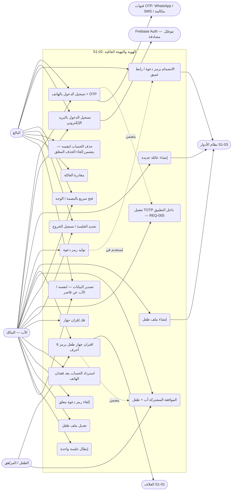

- ملاحظتان: فك الإقران (UC12) للمالك فقط + PIN الأب (REQ-015/Q-065)؛ والبصمة (UC9) وضع الأهل فقط ولا تتجاوز بوابة الوالدين ولا تفتح وضع الطفل (REQ-016/Q-072).
- ملاحظة: حذف الحساب (UC14) ومغادرته (UC15) بمفتاحين (`identity.account.delete_self` / `identity.family.leave` — الافتراضي ممنوح عند الانضمام، حق أصيل للبالغ لا يملك الأب سحبه — Q-291؛ ومحاولة السحب تُرفض: «حق الخروج لا يُسلب»)؛ والمالك لا يغادر عائلته ولا يحذف حسابه إلا بنقل الملكية أو حذف العائلة كاملة (REQ-025/026 · Q-166 · Q-291) — نقل الملكية: S1-03 REQ-016؛ وحذف العائلة: S1-03 REQ-020 (SPEC §4.3). [تصحيح 2026-11-08 (Q-291): أُلغيت عبارة «والأب يلغيهما فردياً» و«الرفض 403».]
- ملاحظة: UC5 يشمل استئناف الانضمام المنقطع عبر الرابط العميق (سيناريو 2-16)؛ وUC7 يشمل إقران جهاز ثانٍ لطفل لديه جهاز مقترن (سيناريو 2-10 — حدث `device.paired-new`)؛ وبلوغ 13 سيناريو فقط (2-9) بلا حالة استخدام — مهمة خادمية مجدولة لا هدف مستخدم (مرسومة في تسلسل 3-ي)؛ وبلوغ 7 سيناريو فقط (2-9-أ) كذلك — المهمة اليومية نفسها تُطلق القلب `minimal` ← `standard` في 1 يناير من سنة بلوغ 7 (Q-256 — مرسوم في 3-ي).

## 2. مخطط قاعدة البيانات (ERD)

الجداول الأحد عشر من §5 كما هي، مع مرجع خارجي واحد: `AuditEvent` (النواة المشتركة — كل حدث هوية/إقران يُسجَّل فيه). ملاحظات: `code_hash` و`pairing_code_hash` و`refresh_token_hash` مشفرة فقط — لا يُحفظ أي رمز نصاً أبداً؛ `person` بلا هاتف ولا بريد للطفل إطلاقاً (D-006)؛ `child_profile` بلا بيانات اتصال وسنة ميلاد فقط (Q-073). جداول العائلة تحمل `family_id` + عزل RLS (D-021)؛ أما `person` و`phone_verification` و`session` فبلا `family_id`. و`family.time_zone` المنطقة الزمنية للعائلة (IANA) — مرساة «منتصف الليل المحلي للعائلة» (Q-183)؛ وتُضبط عند إنشاء العائلة (REQ-007 · Q-236/D-18).

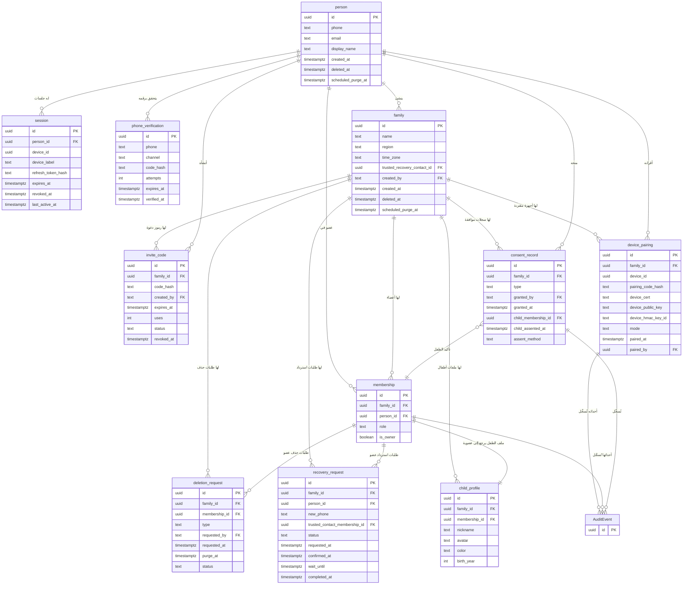

- ملاحظة: `membership.person_id` فارغ للطفل — صف عضوية بالملف فقط بلا حساب `person` (D-006 · Q-137)؛ والعلاقة مرسومة كما نصّ عليها §5 (`child_profile.membership_id`).

## 3. التسلسل (Sequence) — من عقود §4

تسعة مخططات، كل واحد لتدفق واحد — وتاسعها (3-ط) لعمليات الإدارة (NEW-S102-08):

### 3-أ. تسجيل الدخول بالهاتف + OTP (REQ-001/002/003/004/005 — §4.1)

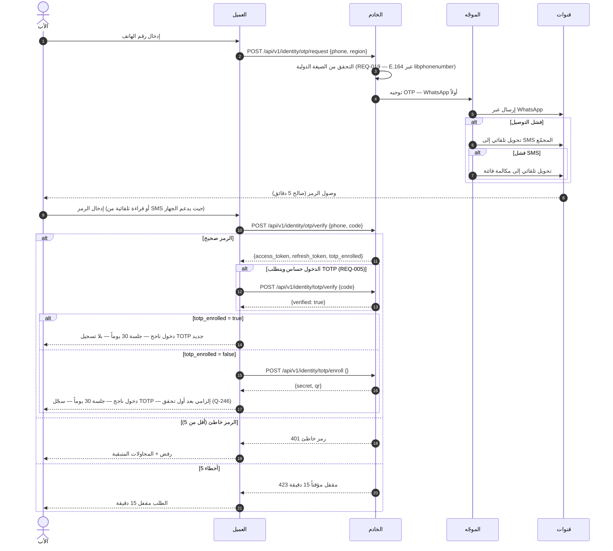

- إعادة الإرسال بعد 60 ثانية؛ بعد 5 طلبات فاشلة 429 (§4.1)؛ وإعادة الإرسال تُحسب طلباً وتُصدر رمزاً جديداً يُبطل السابق (جدول العدّادات — SPEC §3)؛ عند فشل كل القنوات: رسالة واضحة «تعذر الإرسال — حاول لاحقاً» ولا يُعرض الرمز على الشاشة أبداً (§7/سيناريو 2-5)؛ ورسائل SMS الاحتياطية عبر الموجّه تُحسب من حصة SMS لخطة العائلة (Q-106 · REQ-002)؛ وعند صفر حصة يُرفض OTP SMS وينتقل الموجّه إلى مكالمة فائتة مع إعلام المستخدم بالسبب؛ وOTP لا يستهلك رسائل الطوارئ أبداً — تجاوز Q-106 SOS فقط (Q-247).

### 3-ب. تسجيل الدخول بالبريد الإلكتروني (REQ-022/023/024 — §4.1/§4.2)

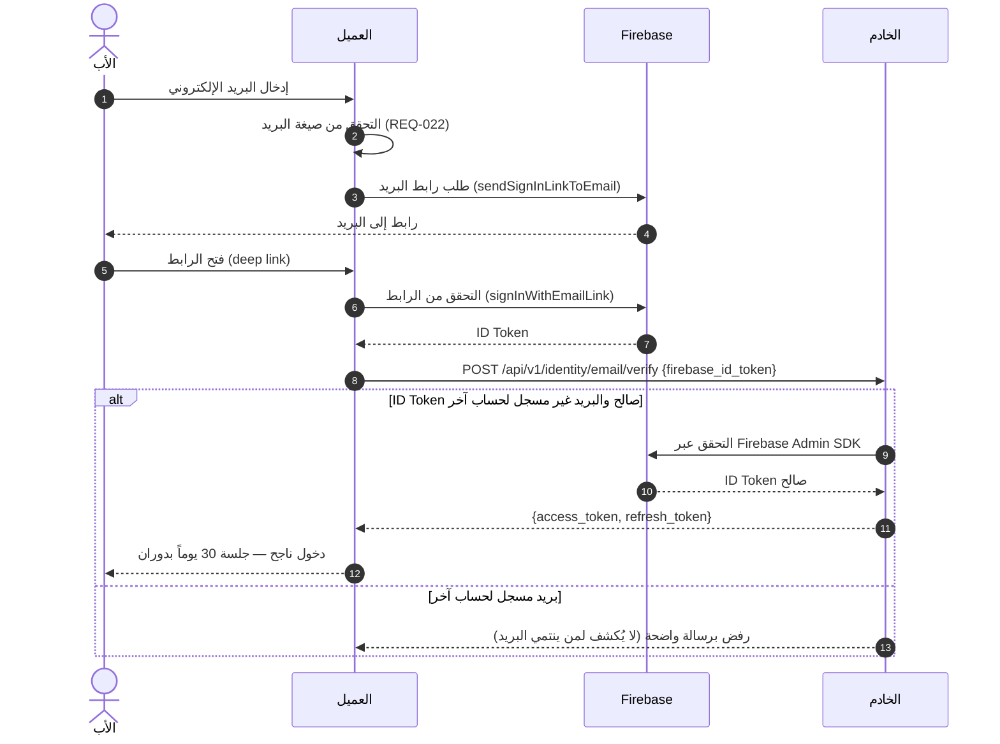

- البريد للبالغين فقط؛ لا يُطلب من الطفل إطلاقاً (D-006). عند تعذر الوصول إلى Firebase يُعرض خيار الهاتف وOTP تلقائياً دون انقطاع (REQ-024)؛ Firebase موصّل مصادقة لا سلطة — بيانات العائلة لا تعيش فيه (REQ-023).

### 3-ج. إنشاء العائلة + الدعوة والانضمام (REQ-007/008/009/010 — §4.1)

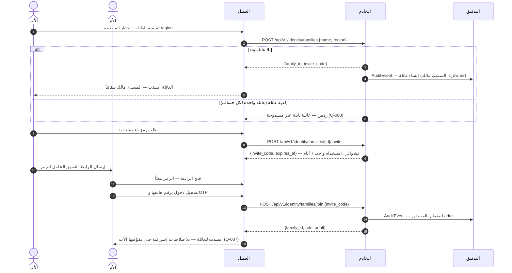

- المالك يلغي أي رمز دعوة معلق في أي وقت (REQ-010) — النقطة: `POST /api/v1/identity/families/{id}/invites/{inviteId}/revoke`؛ رمز منتهٍ/غير صالح يُرفض دون كشف إن كان موجوداً أصلاً (§7).

### 3-د. ملف طفل + اقتران جهاز + موافقة مشتركة (REQ-011/012/013/014/017 — §4.1)

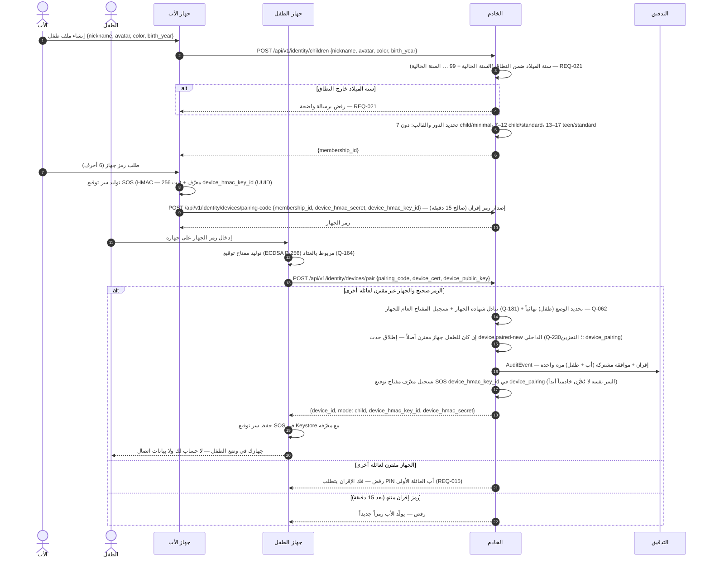

- الإقران ذري: إما يكتمل كاملاً (شهادة + مفتاح توقيع + سر توقيع SOS + وضع + عضوية) أو لا شيء (§7)؛ وسر توقيع SOS لا يمر عبر MQTT أبداً (MQTT-BROKER-SPEC:18)؛ والخادم يحفظه عابراً مربوطاً برمز الإقران (15 دقيقة كحد أقصى) ثم يتلفه؛ ويُخزَّن دائماً في `device_pairing` معرّف المفتاح فقط (S1-02 §5). الوضع يتحدد بالإقران ويُسلَّم للغلاف S1-01؛ وتبديل الملفات مؤجل للمرحلة 2 (Q-063) فلا تبديل للوضع في المرحلة 1؛ وشهادة الجهاز هي اعتماد MQTT (mTLS — Q-168 · REQ-014)؛ والموافقة شفافية عن الفئات المراقَبة لا عن المحتوى (REQ-017).

### 3-هـ. الجلسة: تجديد ودوران وتسجيل خروج (REQ-006 — §4.1)

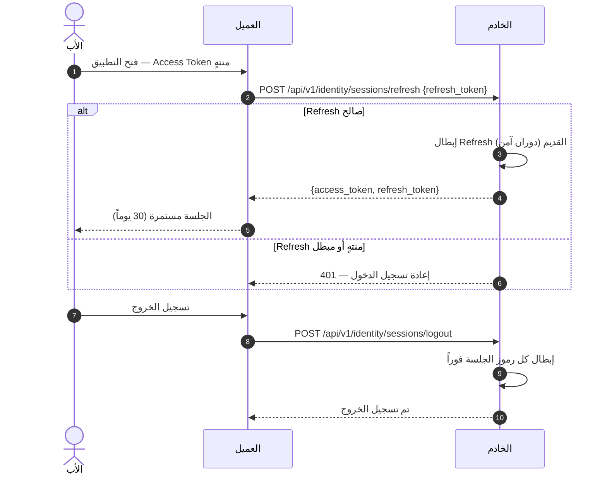

### 3-و. استرداد الحساب بعد فقدان الهاتف والرقم (REQ-020 — §4.1/§7)

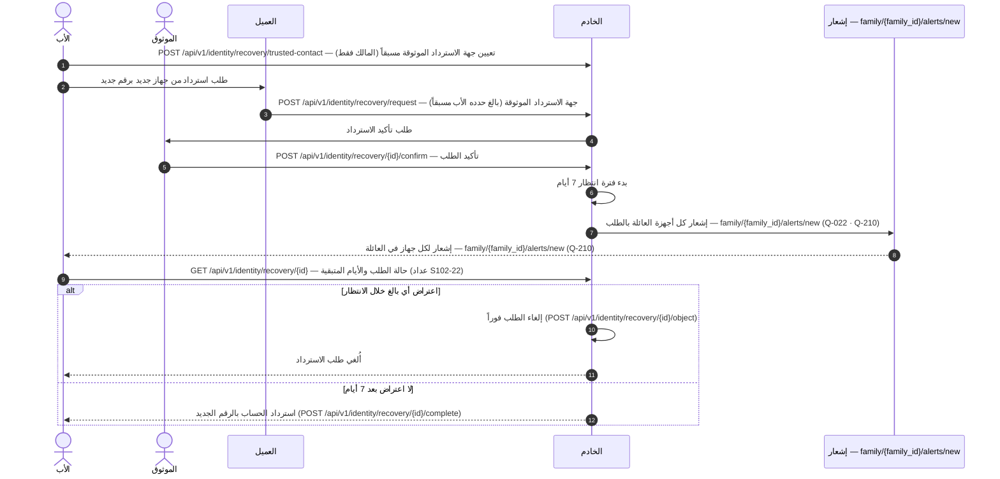

- لا استيلاء صامت على الحساب: الانتظار + الإشعار + الاعتراض هي الضمانات الثلاث (سيناريو 2-7).

### 3-ز. حذف الحساب / المغادرة / التصدير (REQ-025/026/027 — §4.1)

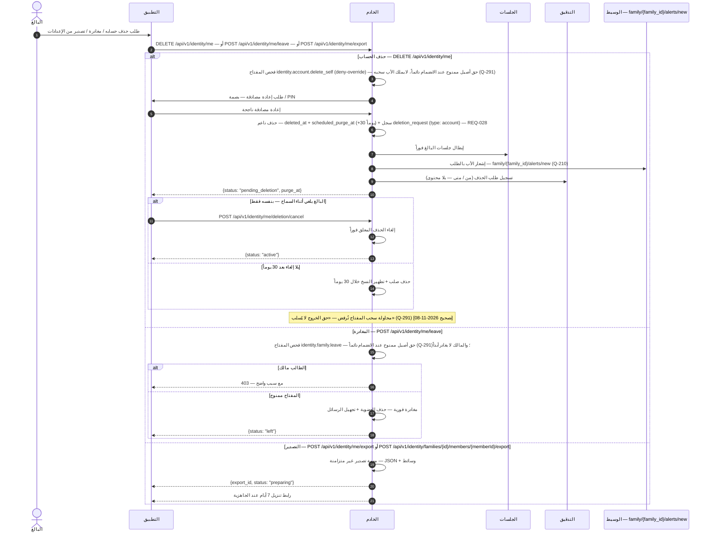

- ملاحظة: المالك لا يحذف حسابه إلا بنقل الملكية أولاً (Q-139) أو تأكيد حذف العائلة كاملة (بروتوكول الحذف والتصدير — `DELETION-EXPORT-PROTOCOL.md` §6)؛ وطلب حذف دون اتصال يُحفظ في الصندوق الصادر ويُنفَّذ عند الاتصال — ولا حذف محلي نهائي قبل تأكيد الخادم (بروتوكول الحذف والتصدير — `DELETION-EXPORT-PROTOCOL.md` §6؛ SPEC §4.3).

### 3-ح. فتح بالبصمة + إبطال المفتاح عند تغيير البصمة (REQ-016 — §4.2 · Q-164)

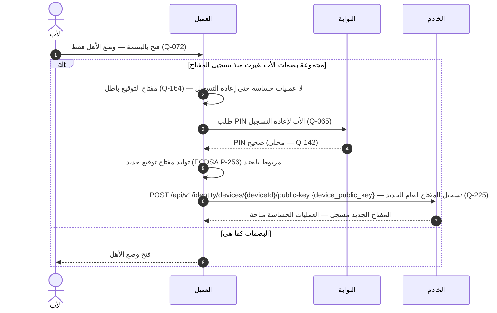

- تغيير بصمة الأب يُبطل مفتاح توقيع الجهاز (REQ-016)؛ وإعادة التسجيل بـ PIN قبل أي عملية حساسة (Q-164). والبصمة لا تفتح وضع الطفل أبداً ولا تتجاوز بوابة الوالدين. (S101 = بوابة الوالدين في S1-01 — نفس تسمية S1-03.)

### 3-ط. عمليات الإدارة: جلسات ودعوات وملفات وفك إقران وموافقة (NEW-S102-08 — §4.1)

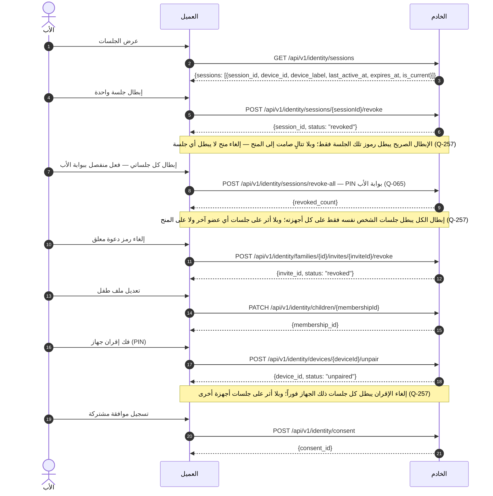

- عمليات الإدارة الست في مخطط واحد؛ وكل منها يظهر أيضاً في شاشته (§9: S102-18 للجلسات، S102-09 للدعوات، S102-12 للملفات، S102-27 لفك الإقران، S102-15 للموافقة).

### 3-ي. المهمة اليومية لبلوغ 13 و7 (سيناريو 2-9/2-9-أ — Q-189 · Q-235 · Q-256 · Q-183)

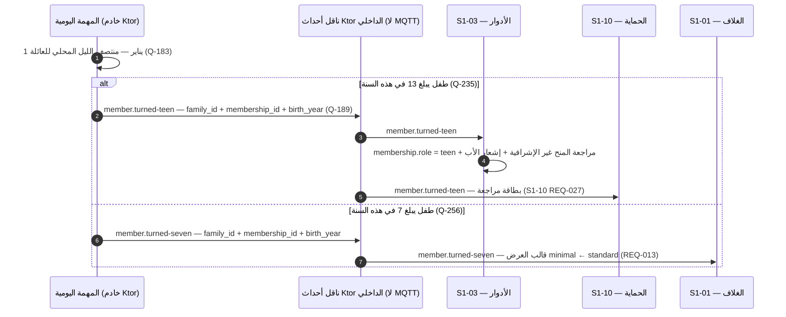

- المهمة اليومية نفسها تُطلق التحول عند بلوغ 18 كما في سن 13 (Q-235)، لكن اسم الحدث الداخلي للتحول عند 18 يُعرَّف مع S1-03 ولم يُرسم هنا (ليس جزءاً من عقد §4.4).

## 4. تدفق المستخدم (User Flow) — من السيناريوهات الستة عشر (§2)

```mermaid
flowchart TD
    Start([مستخدم جديد — أول تثبيت]) --> Login{طريقة الدخول؟}
    Login -->|هاتف| Phone[إدخال رقم الهاتف]
    Phone --> Fmt{صيغة دولية صالحة؟ — E.164}
    Fmt -->|لا| BadPhone[رفض فوراً برسالة واضحة]
    BadPhone --> Phone
    Fmt -->|نعم| OTP[طلب OTP — WhatsApp أولاً]
    OTP --> Chan{القناة نجحت؟}
    Chan -->|لا — WhatsApp| SMS[تحويل تلقائي إلى SMS]
    SMS --> Chan2{نجح SMS؟}
    Chan2 -->|لا| Call[تحويل تلقائي إلى مكالمة فائتة]
    Call --> Chan3{نجحت المكالمة؟}
    Chan3 -->|لا| FailAll[رسالة: تعذر الإرسال — حاول لاحقاً]
    FailAll --> Retry{إعادة المحاولة بعد فاصل؟}
    Retry -->|نعم| OTP
    Chan -->|نعم| Code[إدخال الرمز أو قراءته تلقائياً من SMS]
    Chan2 -->|نعم| Code
    Chan3 -->|نعم| Code
    Code --> CodeOK{الرمز صحيح؟}
    CodeOK -->|لا — أقل من 5| Wrong[رفض + المحاولات المتبقية]
    Wrong --> Code
    CodeOK -->|لا — 5 أخطاء| Lock[قفل الطلب 15 دقيقة]
    CodeOK -->|نعم| TOTP[تفعيل TOTP داخل التطبيق]
    Login -->|بريد — بالغ فقط| Email[إدخال البريد الإلكتروني]
    Email --> EmailFmt{صيغة بريد صالحة؟}
    EmailFmt -->|لا| BadEmail[رفض برسالة واضحة]
    BadEmail --> Email
    EmailFmt -->|نعم| FB[Firebase Auth — رابط إلى البريد]
    FB --> FBDown{Firebase متاح؟}
    FBDown -->|لا| FBFail[عرض خيار الهاتف وOTP تلقائياً]
    FBFail --> Phone
    FBDown -->|نعم| EmailLink["فتح رابط البريد (deep link) — تحقق الخادم من ID Token"]
    EmailLink --> TOTP
    TOTP --> Fam{لديه عائلة؟}
    Fam -->|لا — إنشاء| Create[تسمية العائلة + اختيار المنطقة]
    Create --> Owner[المنشئ مالك تلقائياً — عائلة واحدة للحساب]
    Fam -->|لا — انضمام| Join[رمز دعوة أو رابط عميق + دخول بدور adult]
    Owner --> Bio[فتح سريع بالبصمة — وضع الأهل فقط]
    Join --> Bio
    Bio --> ChildQ{إنشاء ملف طفل؟}
    ChildQ -->|نعم| ChildProf[ملف طفل: اسم مستعار + صورة + لون + سنة ميلاد فقط]
    ChildProf --> Template[تحديد القالب تلقائياً حسب سنة الميلاد]
    Template --> Pair[إصدار رمز جهاز 6 أحرف — إدخاله على جهاز الطفل]
    Pair --> PairOK{الإقران نجح؟}
    PairOK -->|لا — جهاز لعائلة أخرى| PairNo[رفض — فك الإقران يتطلب PIN أب العائلة الأولى]
    PairOK -->|لا — رمز منتهٍ بعد 15 دقيقة| PairExp[يولّد الأب رمزاً جديداً]
    PairOK -->|نعم| Consent[موافقة مشتركة أب + طفل — مرة واحدة]
    Consent --> Mode[وضع الطفل نهائي على الجهاز — تسليم للغلاف S1-01]
    ChildQ -->|لا| Ready[جاهز — جلسة 30 يوماً بدوران]
    Mode --> Ready
    Ready --> Settings[الإعدادات — حذف الحساب / مغادرة / تصدير]
    Settings --> DelKey{المفتاح ممنوح؟ — حق أصيل ممنوح عند الانضمام دائماً — Q-291}
    DelKey -->|نعم — حذف| ReAuth[إعادة مصادقة: بصمة / PIN]
    ReAuth --> Soft["حذف ناعم + سماح 30 يوماً (REQ-028)"]
    Soft --> CancelQ{البالغ يلغي بنفسه أثناء السماح؟}
    CancelQ -->|نعم| CancelDel[يُلغى الحذف المعلق — POST /api/v1/identity/me/deletion/cancel]
    CancelDel --> Settings
    CancelQ -->|لا| Hard[حذف صلب بعد 30 يوماً]
    Hard --> Purge[تطهير النسخ خلال 30 يوماً]
    %% [تصحيح 2026-11-08 (Q-291): أُلغي فرع «رفض 403 — معطَّل من المالك» وفرع «الأب يسحب المفتاح أثناء السماح»؛ المفتاح حق أصيل لا يُسلب، والإلغاء من البالغ نفسه فقط.]
    DelKey -->|نعم — مغادرة| Leave[مغادرة فورية — بلا سماح؛ والمالك لا يغادر]
    DelKey -->|نعم — تصدير| Export[مهمة غير متزامنة — JSON + وسائط — رابط 7 أيام]
```

- ملاحظة: تسجيل دخول الأب على جهاز طفل **لا** يبدّل الوضع — الوضع يتحدد بالإقران (REQ-014/Q-062)؛ وتبديل الملفات مؤجل للمرحلة 2 (Q-063).
- ملاحظة: فرع الحذف/المغادرة/التصدير مرآة لمخطط SPEC §2 «الحذف والمغادرة» (سيناريو 2-8 · REQ-025/026/027)؛ والقاصر لا يحذف نفسه أبداً — إزالته بيد الأب في S1-03.
- ملاحظة: تغيير بصمة الأب يُبطل مفتاح توقيع الجهاز ويتطلب إعادة تسجيله بـ PIN قبل أي عملية حساسة (REQ-016 · Q-164).

## 5. مخطط تدفق البيانات (DFD — المستوى 1) — من §4/§5

العمليات مرقمة 1.0–8.0، والمخازن D1–D11 هي الجداول الأحد عشر من §5. المخزن D2 يحفظ `code_hash` فقط، وD8 يحفظ `pairing_code_hash` فقط — لا رمز نصاً أبداً.

- **تغطية نقاط §4:** كل نقاط §4.1 الواحدة والثلاثون مرسومة في §3 (otp request/verify، totp/enroll، totp/verify، sessions refresh/logout، GET sessions، sessions/{id}/revoke، recovery request/confirm/object/complete/trusted-contact + GET recovery/{id}، families، invite، invites/{inviteId}/revoke، join، children، PATCH children، consent، devices/pairing-code، devices/pair، devices/{deviceId}/unpair، devices/{deviceId}/public-key، email/verify، DELETE /api/v1/identity/me، POST /api/v1/identity/me/leave، POST /api/v1/identity/me/deletion/cancel، POST /api/v1/identity/me/export، POST /api/v1/identity/families/{id}/members/{memberId}/export)؛ والتسلسلات تغطي التدفقات الأساسية فقط.

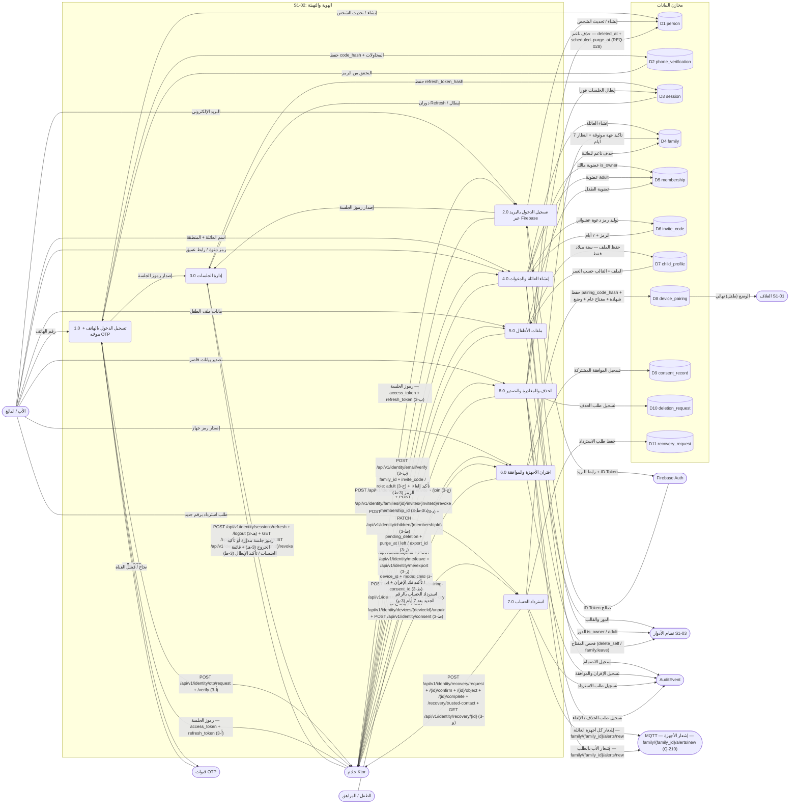

- [تصحيح 2026-11-08 (D-2): حُذفت حافة `Adult --> P8` من DFD §5 لأن `Adult` غير معلنة؛ وعقدة `Father([الأب / البالغ])` تغطي البالغ (طلب الحذف/المغادرة/التصدير من P8 نفسه).]

## 6. مخطط النشاط (Activity) — دورة حياة التهيئة من أول تثبيت إلى وضع الطفل

المسارات الخمسة (الأب/البالغ / الطفل / العميل / الخادم / الخدمات الخارجية) كمسارات متوازية. والأنشطة الخلفية (دوران Refresh، إشعار الأجهزة عبر MQTT (`family/{family_id}/alerts/new` — Q-210) في الاسترداد) تعمل **بالتوازي** مع استخدام التطبيق.

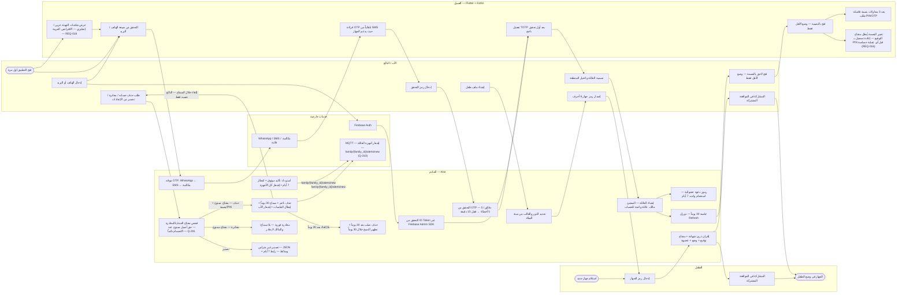

- عند إعادة الفتح بعد الإغلاق القسري، يعود المستخدم لنفس الشاشة والمدخلات (نمط الغلاف S1-01)؛ وكل حدث هوية/إقران يُسجَّل في `AuditEvent` (§5).
- [تصحيح 2026-11-08 (D-2 — Q-291): حُذفت حافة «مفتاح غائب» من V10 في §6 — مفتاحا الحذف/المغادرة حق أصيل لا يُسحب ولا يغيب؛ والإلغاء خلال السماح من البالغ نفسه فقط (كما في §3-ز س470 و§4 س610).]
