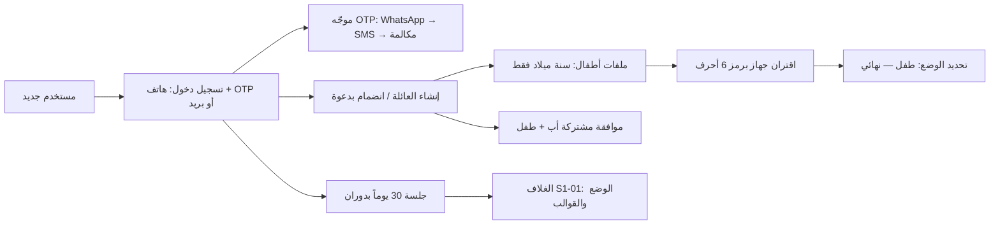
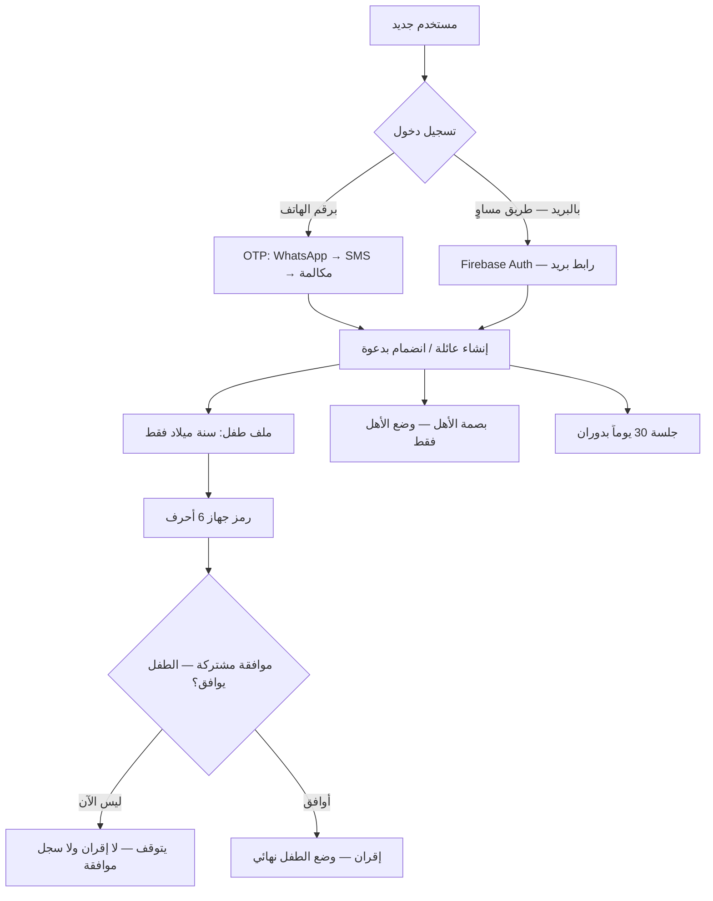
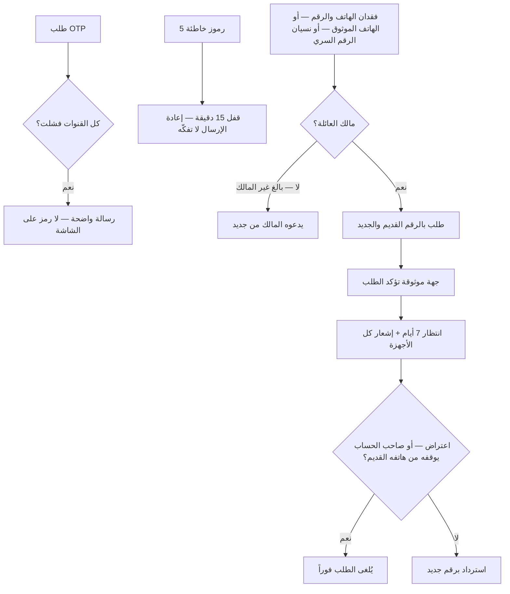
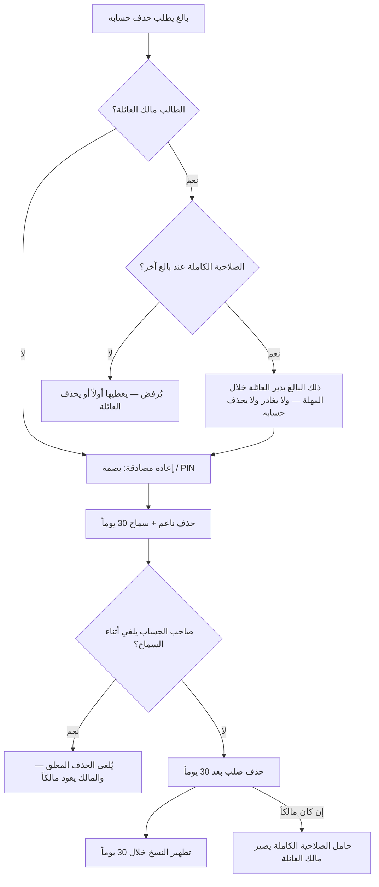
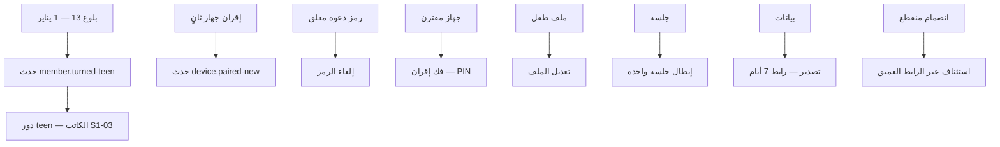

# S1-02: الهوية والتهيئة العائلية (Identity & Onboarding)

- **الحالة:** approved | **المرحلة:** 1 (نواة الحماية) · **آخر تحديث:** 2026-11-16 (إغلاق التصميم المعتمد Q-400؛ قبله 2026-11-07)
- **القرارات الحاكمة:** Q-001 · Q-002 · Q-005 · Q-006 · Q-007 · Q-008 · Q-021 · Q-022 · Q-062 · Q-063 · Q-065 · Q-068 · Q-070 · Q-071 · Q-072 · Q-073 · Q-074 · Q-075 · Q-076 · Q-077 · Q-079 · Q-080 · Q-084 · Q-106 · Q-137 · Q-189 · Q-235 · Q-245 · Q-246 · Q-247 · Q-248 · D-006 · D-007 · D-023 · D-038 · G-006 · G-011 · Q-168 · Q-344 · Q-219 · Q-257 · Q-264 · Q-291 · Q-396 · Q-400
- **حالة المراجعة:** الأقسام 1–8 معتمدة بالكامل في التخطيط — حكم المالك 2026-11-05 (الدفعة 19، e1d8611)؛ و§10 معتمدة — حكم المالك 2026-11-06 (الدفعة 43، c29d2e5) · **§9 في مرحلة التصميم (Q-091)**. **إغلاق التصميم:** نُفّذت بنود هذا النظام في التصميم الأساسي `phases/phase-1/prototype/` واعتمدها المالك من الشاشة في 2026-11-16 مع تصحيح واحد: الحساب يُسجَّل برقم الهاتف أو بالبريد الإلكتروني وهما متساويان (Q-400)؛ خلاصتها في §9.8، ويسود نص التحديثات المؤرخة «Q-400» على ما يخالفه في هذا الملف. الباقي في التصميم: اللوحي والقابل للطي (Q-392) والترجمة الإنجليزية الكاملة (REQ-018)، ويُنفَّذان مرة واحدة بعد إغلاق كل الأنظمة (Q-399).
- **الأدلة المرجعية:** المواصفة القديمة S1-02 (مرجع فقط، G-009) · Deep-dives: Telegram (phone verification + SmsRetriever) · FamilyWall (family creation + child accounts w/o contact data) · Bark Kids (device-code pairing) · Qustodio (parent/child account model) · S1-01 (معتمد — الوضع يتحدد بالإقران)

## 1. الهدف والتحليل والنطاق

يمثل هذا النظام نقطة البداية الحقيقية لكل مستخدم: تسجيل الدخول برقم الهاتف أو بالبريد الإلكتروني، إنشاء العائلة وتسميتها، انضمام البالغين بدعوة، إنشاء ملفات الأطفال (بلا بيانات اتصال)، واقتران أجهزة الأطفال — مع موافقة مشتركة (أب + طفل) مرة واحدة.

**مخطط سياق النظام (§1 — بصري):**

**داخل النطاق:**
- تسجيل الدخول: رقم هاتف + OTP عبر الموجّه (WhatsApp أولاً → SMS مجمّع → مكالمة فائتة) **أو بريد إلكتروني للبالغين** (التحقق عبر Firebase Auth: رابط يُرسل بالبريد؛ الخادم يتحقق من ID Token ويصدر رموز الجلسة) + TOTP داخل التطبيق بعد أول تحقق. [تصحيح 2026-11-08 (Q-027): كان «رمز يُرسل بالبريد»؛ رمز البريد غير موجود في Firebase Auth أصلاً (REQ-023) — التدفق المثبت رابط البريد.]
- الجلسات: Access Token + Refresh Token بدوران آمن؛ مدة الجلسة 30 يوماً.
- إنشاء العائلة: التسمية + اختيار المنطقة (`region`)؛ رموز الدعوة تتولد عشوائياً لكل طلب انضمام (Q-076).
- انضمام البالغين: رمز دعوة + روابط عميقة (Deep Links).
- ملفات الأطفال: ينشئها الأب/المفوَّض فقط؛ بلا بيانات اتصال؛ اسم مستعار + صورة رمزية + لون + سنة ميلاد.
- اقتران أجهزة الأطفال: رمز جهاز (6 أحرف)؛ شهادة جهاز؛ تحديد الوضع عند الإقران.
- الموافقة المشتركة: إعداد مشترك (أب + طفل) مرة واحدة.
- فتح سريع بالبصمة/الوجه للأهل (وضع الأهل فقط).

**خارج النطاق:**
- محرك تقييم الصلاحيات وتفويضها (نظام الأدوار والصلاحيات).
- محرك الفرض وشاشات الحظر (نظام الحماية).
- الخطط والدفع (نظام الفوترة).
- تبديل الملفات (مؤجل للمرحلة 2 — أولوية، Q-063).

## 2. سيناريوهات المستخدم

### سيناريو 2-1: أب ينشئ عائلة جديدة لأول مرة
- **الممثل:** أب بلا حساب.
- **السياق:** أول تثبيت للتطبيق على جهاز الأهل.
- **التدفق:**
  1. يدخل الأب رقم هاتفه؛ التطبيق يتحقق من الصيغة الدولية (REQ-019). [تحديث 2026-11-16 (Q-400 — التسجيل): شاشة الترحيب تعرض «أنشئ عائلة جديدة»، «انضم بدعوة»، «هذا جهاز طفل»، و«لديّ حساب — دخول». وبعدها يسجّل الأب حسابه برقم هاتفه **أو** ببريده الإلكتروني (REQ-022/023)، والطريقان متساويان في أعلى شاشة التسجيل؛ ومن سجّل بالبريد لا يُطلب منه رقم هاتف، ويتابع من الخطوة 4 مباشرة.]
  2. يصل OTP عبر WhatsApp أولاً؛ إن فشل التوصيل يتحول تلقائياً لـ SMS ثم مكالمة فائتة (REQ-002).
  3. يُدخل الرمز (أو يُقرأ تلقائياً من SMS حيث يدعم الجهاز)؛ بعد أول تحقق ناجح يُفعَّل TOTP داخل التطبيق (REQ-004/REQ-005). [تحديث 2026-11-16 (Q-400 — س1): تفعيل الخطوة الثانية يحدث وحده عند أول تحقق ناجح، بلا شاشة وبلا تطبيق خارجي وبلا رمز QR؛ الهاتف الذي دخل منه الأب يصير «هاتفاً موثوقاً» يولّد الرمز عند الحاجة (REQ-005).]
  4. يسمّي العائلة ويختار المنطقة (`region`)؛ يُنشئ الحساب ويصبح المالك تلقائياً (`is_owner`)؛ رموز الدعوة تتولد عشوائياً لكل طلب انضمام (REQ-009/REQ-010). [تحديث 2026-11-16 (Q-400 — أ-13): حقل واحد يُكتب هو اسم العائلة. البلد يُقترح من مفتاح رقم الهاتف (أو من إعداد الهاتف لمن سجّل بالبريد)، والتوقيت يُقترح من ساعة الهاتف، وكلاهما يُغيَّر بنقرة (REQ-007 · Q-264).]
- **النتيجة:** عائلة واحدة للحساب؛ المنشئ مالك؛ جلسة 30 يوماً بدوران Refresh (REQ-006/REQ-008).

### سيناريو 2-2: أم تنضم إلى العائلة برابط عميق
- **الممثل:** أم (بالغة).
- **السياق:** الأب أرسل لها رابط دعوة.
- **التدفق:**
  1. تضغط الأم الرابط؛ التطبيق يفتح على شاشة الانضمام مع رمز الدعوة معبّأً (REQ-009).
  2. تسجّل الدخول برقم هاتفها وOTP (REQ-001/REQ-002).
  3. تُقبل الدعوة وتدخل العائلة بدور `adult` بلا صلاحيات إشرافية حتى يفوّضها الأب (Q-007).
- **النتيجة:** عضوية بالغة في العائلة؛ الانضمام مسجَّل في `AuditEvent`.

### سيناريو 2-3: أب ينشئ ملف طفل ويقترن جهازه برمز
- **الممثل:** الأب + الطفل.
- **السياق:** جهاز الطفل جديد؛ الأب يجهزه.
- **التدفق:**
  1. ينشئ الأب ملف الطفل: اسم مستعار + صورة رمزية + لون + سنة ميلاد فقط — بلا هاتف أو بريد (REQ-011/REQ-012).
  2. يحدد سنة الميلاد قالب العرض تلقائياً (REQ-013).
  3. يصدر الأب رمز جهاز (6 أحرف) — ويولّد تطبيق الوالد عند الإصدار سر توقيع SOS ومعرّفه —؛ يدخله الطفل على جهازه فيُقترن الجهاز وتُتبادل شهادة الجهاز ويستلم الطفل السر في رد الإقران فيحفظه في Keystore، ويُحدد الوضع (طفل) نهائياً (REQ-014).
  4. يتم الإعداد المشترك (أب + طفل) مرة واحدة وتُسجَّل الموافقة المشتركة (REQ-017). [تحديث 2026-11-16 (Q-397 — ب-01/ب-12): داخل هذه الخطوة يكتب الأب رقمه السري على جهاز الطفل (إدخال ثم تأكيد) فيُحفظ هناك محلياً (S1-01 REQ-005 · DIAGRAMS 3-ط)، ولا يُصدر رمز الإقران في الخطوة 3 قبل أن ينشئ الأب رقمه على هاتفه. وبعد الإقران تظهر شاشة تمهيد إذن الإشعارات (S1-01 SCR-13).]
- **النتيجة:** جهاز الطفل في وضع الطفل؛ لا حساب للطفل ولا بيانات اتصال له.

### سيناريو 2-4: أب يفتح التطبيق بالبصمة
- **الممثل:** الأب (وضع الأهل).
- **السياق:** جلسة سارية؛ التطبيق مغلق.
- **التدفق:**
  1. يفتح الأب التطبيق ويضع بصمته؛ يُفتح وضع الأهل مباشرة (REQ-016).
  2. البصمة لا تفتح وضع الطفل أبداً ولا تتجاوز بوابة الوالدين.
  3. بعد 3 محاولات بصمة فاشلة يُطلب PIN/OTP.
- **النتيجة:** فتح سريع للأهل فقط؛ أمان البوابة محفوظ (Q-065/Q-072).

### سيناريو 2-5: فشل كل قنوات OTP
- **الممثل:** أب يحاول تسجيل الدخول.
- **السياق:** شبكة ضعيفة؛ WhatsApp وSMS والمكالمة الفائتة كلها فشلت.
- **التدفق:**
  1. يفشل WhatsApp → يتحول تلقائياً لـ SMS → يفشل → مكالمة فائتة → تفشل (REQ-002).
  2. تظهر رسالة واضحة: "تعذر الإرسال — حاول لاحقاً"؛ لا يُعرض الرمز على الشاشة أبداً.
  3. يُسجَّل الفشل للمراقبة؛ إعادة المحاولة متاحة بعد فاصل.
- **النتيجة:** لا تسجيل دخول دون تحقق؛ لا تسريب للرمز.

### سيناريو 2-6: أب يسجل دخوله بالبريد الإلكتروني
- **الممثل:** الأب (بالغ).
- **السياق:** يفضل البريد على الهاتف، أو هاتفه بلا تغطية.
- **التدفق:**
  1. يدخل الأب بريده الإلكتروني؛ يتحقق التطبيق من صيغته (REQ-022).
  2. يرسل Firebase Auth رابطاً إلى البريد؛ يضغطه الأب فيفتح التطبيق عبر deep link؛ وFirebase يصدر ID Token (REQ-023). [تصحيح 2026-11-08 (D-2 — Q-027): كان «يرسل Firebase Auth رمزاً إلى البريد؛ يدخله الأب في التطبيق» — رمز البريد غير موجود في Firebase Auth أصلاً؛ والتدفق المثبت رابط البريد.]
  3. يتحقق الخادم من ID Token عبر Firebase Admin SDK ويصدر رموز الجلسة (30 يوماً بدوران) (REQ-023/Q-075).
  4. إن تعذر Firebase يعرض التطبيق خيار الهاتف وOTP دون انقطاع (REQ-024).
- **النتيجة:** دخول بالبريد كبديل كامل للهاتف؛ البريد للبالغين فقط.

### سيناريو 2-7: أب يسترد حسابه بعد فقدان هاتفه ورقمه (جديد — من حكم Q-077)
- **الممثل:** الأب + جهة الاسترداد الموثوقة (بالغ في العائلة حدده الأب مسبقاً).
- **السياق:** فقد الأب هاتفه ورقم هاتفه معاً.
- **التدفق:**
  1. يطلب الأب الاسترداد من جهاز جديد برقم جديد؛ يحدد جهة الاسترداد الموثوقة (REQ-020). [تحديث 2026-11-16 (Q-400 — س4): يكتب رقمه القديم (به يُعرف الحساب) ورقمه الجديد. واسم جهة الاسترداد لا يُعرض في شاشة الطلب ولا يختاره الطالب؛ الخادم يعرف الجهة المحددة مسبقاً ويرسل إليها الطلب.]
  2. تؤكد جهة الاسترداد الطلب؛ تبدأ فترة انتظار 7 أيام، ويُشعَر كل جهاز في العائلة بالطلب (REQ-020).
  3. إن اعترض أي بالغ خلال الانتظار يُلغى الطلب فوراً؛ وإلا يُسترد الحساب بالرقم الجديد بعد 7 أيام. [تحديث 2026-11-16 (Q-400 — س2/ب-09): صاحب الحساب نفسه، إن كان هاتفه القديم ما زال معه، يرى الطلب عليه ويوقفه في أي مرحلة ولو قبل تأكيد الجهة. والطريق نفسه (تأكيد الجهة + 7 أيام) يُستعمل لمن فقد هاتفه الموثوق الذي يولّد رمز الخطوة الثانية، ولمن نسي الرقم السري لبوابة الوالدين. ومن لم يحدد جهة استرداد: الشاشة تقول صراحة أن لا طريق، ولا تعد بما لا يكون.]
- **النتيجة:** استرداد آمن بلا فريق دعم؛ لا استيلاء صامت على الحساب.

### سيناريو 2-8: بالغ يغادر العائلة — محاولة سحب الأب إذن الخروج تُرفض [تصحيح 2026-11-08 (Q-291): السيناريو الأصلي (من حكم Q-166) كان يصوّر سحب الأب المفتاح؛ Q-291 حكم أن الخروج حق أصيل لا يُسلب — أُعيدت كتابة السيناريو كاملاً]
- **الممثل:** أم (بالغة) + الأب (المالك).
- **السياق:** الأم تريد حذف حسابها؛ الأب يحاول سحب مفتاح `identity.account.delete_self` منها.
- **التدفق:**
  1. الأب يحاول سحب المفتاح؛ الخادم يرفض السحب (حق أصيل — Q-291) مع رسالة واضحة: «حق الخروج لا يُسلب».
  2. الأم تطلب حذف حسابها من الإعدادات مع بصمتها.
  3. يُقبل الطلب: حذف ناعم + فترة سماح 30 يوماً؛ تُبطل جلساتها فوراً وتُشعَر العائلة؛ وخلال السماح تستطيع الأم إلغاء الحذف بنفسها.
  4. إلغاء الحذف المعلق يكون من الأم نفسها فقط (`POST /api/v1/identity/me/deletion/cancel`)؛ ولا يملك الأب إلغاءه بسحب المفتاح.
- **النتيجة:** حق الخروج للبالغ أصيل لا يُسلب؛ والافتراضي السماح، والتشديد صارم وحقيقي.

### سيناريو 2-9: مهمة بلوغ 13 (1 يناير — `member.turned-teen`)
- **الممثل:** مهمة خادمية يومية (بلا ممثل بشري).
- **السياق:** طفل يبلغ 13 في سنة ما.
- **التدفق:**
  1. تُطلق المهمة 1 يناير من سنة بلوغ 13 عند منتصف الليل المحلي للعائلة (Q-235 · Q-183).
  2. تُصدر المهمة حدث `member.turned-teen` الداخلي إلى S1-03 وS1-10 (عقد الحدث §4.4).
  3. يكتب S1-03 الدور `teen` (هو الكاتب الوحيد لـ `membership.role`) ويراجع المنح غير الإشرافية ويُشعر الأب.
- **النتيجة:** تحول تلقائي في الموعد المحكوم؛ بلا كتابة مزدوجة للدور.

### سيناريو 2-9-أ: مهمة بلوغ 7 (1 يناير — `member.turned-seven`) — **معلّق: لا يُبنى في المرحلة 1 (Q-426)**
- **الممثل:** مهمة خادمية يومية (بلا ممثل بشري).
- **السياق:** طفل يبلغ 7 في سنة ما.
- **التدفق:**
  1. تُطلق المهمة 1 يناير من سنة بلوغ 7 عند منتصف الليل المحلي للعائلة (Q-256 · Q-183).
  2. تُصدر المهمة حدث `member.turned-seven` الداخلي (عقد الحدث §4.5).
  3. ينقلب قالب عرض الطفل من `minimal` إلى `standard` (REQ-013)؛ بلا تغيير دور ولا منح — القلب قالب عرض فقط. [تحديث 2026-11-18 (Q-426): لا قالب لمن هم دون 7 في المرحلة 1؛ ما يخصه في هذا السطر ملغى، والابن دون 7 يستعمل قالب الطفل.]
- **النتيجة:** قلب تلقائي في الموعد المحكوم؛ ومبكر حتى 11 شهراً عن عيد الميلاد الفعلي كما في سن 13 (Q-256 — نفس محذور Q-235 ومقبول به).

### سيناريو 2-10: إقران جهاز ثانٍ لطفل لديه جهاز مقترن
- **الممثل:** الأب + الطفل.
- **السياق:** الطفل يحصل على جهاز ثانٍ.
- **التدفق:**
  1. يصدر الأب رمز جهاز جديداً (`POST …/devices/pairing-code`)؛ ويدخله الطفل على الجهاز الثاني.
  2. يكتمل الإقران ذرياً كسيناريو 2-3؛ وإن كان للطفل جهاز مقترن أصلاً يُطلق حدث `device.paired-new` الداخلي (Q-230).
- **النتيجة:** جهاز ثانٍ في وضع الطفل؛ والحدث الداخلي مسجَّل في `device_pairing`.

### سيناريو 2-11: المالك يلغي رمز دعوة معلقاً
- **الممثل:** المالك.
- **السياق:** رمز دعوة أُرسل لشخص لم ينضم بعد.
- **التدفق:**
  1. يفتح المالك إدارة الدعوات (S102-09)؛ ويضغط «إلغاء» على الرمز المعلق.
  2. يُلغى الرمز (`POST …/families/{id}/invites/{inviteId}/revoke`)؛ وأي محاولة انضمام به تُرفض.
- **النتيجة:** رمز ملغى لا يعمل؛ بلا أثر على رموز أخرى.

### سيناريو 2-12: فك إقران جهاز
- **الممثل:** المالك.
- **السياق:** جهاز طفل يُراد فك إقرانه (بيع/استبدال).
- **التدفق:**
  1. يفتح المالك فك الإقران (S102-27)؛ ويدخل PIN الأب.
  2. يُفك الإقران (`POST …/devices/{deviceId}/unpair`)؛ ويمسح رمز الدفع للجهاز؛ **وتُبطل كل جلسات الجهاز فوراً (Q-257)**؛ ويُتاح إقرانه لعائلة أخرى.
- **النتيجة:** الجهاز بلا وضع طفل وبلا حماية؛ وإقرانه الجديد ممكن.

### سيناريو 2-13: تعديل ملف طفل
- **الممثل:** الأب/المفوَّض.
- **السياق:** تغيير الاسم المستعار أو الصورة أو اللون أو سنة الميلاد.
- **التدفق:**
  1. يفتح الأب ملفات الأطفال (S102-12)؛ وينقر بطاقة الطفل؛ ويعدّل الحقول.
  2. يُحفظ التعديل (`PATCH …/children/{membershipId}`)؛ وإن تغيرت سنة الميلاد أعيد تحديد الدور والقالب (REQ-013).
- **النتيجة:** ملف محدَّث؛ والقالب يتبع سنة الميلاد الجديدة.

### سيناريو 2-14: إبطال جلسة واحدة
- **الممثل:** صاحب الجلسة أو المالك.
- **السياق:** جلسة على جهاز قديم/مسروق.
- **التدفق:**
  1. يفتح المستخدم الجلسات (S102-18)؛ ويضغط «إبطال» على الجلسة.
  2. تُبطل رموز تلك الجلسة فقط (`POST …/sessions/{sessionId}/revoke`)؛ وبقية الجلسات تعمل.
- **النتيجة:** جلسة مبطلة فوراً؛ بلا أثر على جلسات أخرى. (النطاق محكوم Q-257: الإبطال الصريح يبطل تلك الجلسة فقط؛ وإلغاء منح لا يبطل أي جلسة.)

### سيناريو 2-15: تصدير بيانات (بالغ يصدّر بياناته؛ أب يصدّر بيانات قاصر)
- **الممثل:** بالغ / الأب.
- **السياق:** طلب نسخة من البيانات.
- **التدفق:**
  1. يطلب البالغ تصدير بياناته (S102-25) أو الأب تصدير بيانات قاصر (S102-26).
  2. تُجهَّز مهمة غير متزامنة (JSON + وسائط)؛ ويصل رابط تنزيل صالح 7 أيام.
- **النتيجة:** أرشيف كامل برابط ينتهي بعد 7 أيام.

### سيناريو 2-16: استئناف انضمام منقطع عبر رابط عميق
- **الممثل:** بالغ مدعو.
- **السياق:** انقطع الانضمام بعد فتح الرابط (إغلاق التطبيق/انقطاع).
- **التدفق:**
  1. يعيد المدعو فتح الرابط العميق الحامل للرمز؛ ويُستأنف الانضمام من حيث توقف (UC5 — يشمل استئناف الانضمام المنقطع).
  2. يُكمل المدعو تسجيل الدخول بالهاتف وOTP ثم الانضمام بدور `adult`.
- **النتيجة:** انضمام مكتمل بلا إعادة إرسال دعوة.

- **خارج نطاق §2:** فقدان جهاز TOTP بلا سيناريو — لا مسار محكوم للاسترداد (GAP-11)؛ وشاشة S102-07 تعرض «تواصل مع مالك العائلة» فقط. [تحديث 2026-11-16 (Q-400): لم يعد خارج النطاق — من فقد الهاتف الموثوق يسلك طريق الاسترداد نفسه (تأكيد فرد موثوق + 7 أيام — REQ-020)، وأُغلقت GAP-11؛ ولا جهاز رمز خارجي أصلاً.]

**مخطط رحلة التهيئة (§2 — بصري):**

[تصحيح 2026-11-08 (Q-027): كانت عقدة المخطط «Firebase Auth — رمز بريد»؛ مختبر Q-027 حسم أن رمز البريد غير موجود في Firebase Auth أصلاً، والتدفق المثبت رابط البريد (REQ-023).]

**مخطط الفشل والاسترداد (§2 — بصري):**

[إعادة رسم 2026-11-16 (Q-400): أُضيف قفل الرمز، والأسباب الثلاثة للاسترداد، وتعريف الطلب بالرقم القديم، وإيقاف صاحب الحساب، وطريق البالغ غير المالك.]

**مخطط الحذف والمغادرة (§2 — بصري):**

[إعادة رسم 2026-11-16 (Q-401 · Q-402): فرع المالك مرسوم كاملاً — لا نقل ملكية؛ التسليم لحامل الصلاحية الكاملة (S1-03 REQ-016 · تسلسل 3-ك).]

[تصحيح 2026-11-16 (Q-291 · Q-400 — ب-04): كان المخطط يبدأ بـ«المفتاح ممنوح؟ ← لا: رفض 403 — معطَّل من المالك» وفيه فرع «الأب يسحب المفتاح أثناء السماح؟ ← نعم: يُلغى الحذف المعلق». كلاهما يخالف Q-291 (حق الحذف والمغادرة أصيل لا يسحبه الأب، وإلغاء الحذف المعلق من صاحب الحساب وحده) وقد صُحّح نص REQ-025 في 2026-11-08 وبقي المخطط. الرفض الوحيد الباقي: المالك قبل نقل الملكية.]

**مخطط عمليات الإدارة (§2 — بصري):**

## 3. المتطلبات الوظيفية

- **REQ-001:** تسجيل الدخول برقم هاتف دولي (رمز الدولة حسب المنطقة) أو بريد إلكتروني؛ الهاتف هو وسيلة المصادقة الأساسية، والبريد بديل موازٍ للبالغين. [D-007 · DERIVED] [تحديث 2026-11-16 (Q-400 — التسجيل — تصحيح المالك): الحساب يُسجَّل ويُدخل إليه برقم الهاتف **أو** بالبريد الإلكتروني، والطريقان متساويان من أول خطوة: اختيار بينهما في أعلى شاشة التسجيل، في إنشاء عائلة وفي الانضمام بدعوة وفي دخول من له حساب. من سجّل بالبريد لا يُطلب منه رقم هاتف في أي خطوة. عبارة «الهاتف هو وسيلة المصادقة الأساسية» تبقى بمعناها التشغيلي فقط: الهاتف هو الطريق الذي يبقى يعمل إن تعذّرت خدمة البريد (REQ-024)، ولا تعني تقديمه على الشاشة. البريد للبالغين فقط كما هو (REQ-022).] [تحديث 2026-11-18 (Q-425 — مفتاح الدولة): مفتاح الدولة في حقل الرقم قائمة يختار منها المستخدم: بلدان الخدمة (تعداد `region` في §5) أولاً، ثم بقية الدول لمن رقمه من خارجها (قريب يُدعى، أب مغترب). يُتحقق من صيغة الرقم بحسب الدولة المختارة. اختيار دولة من بلدان الخدمة يقترح بلد العائلة (REQ-007)، واختيار غيرها لا يقترح بلداً فيُقترح من إعداد الهاتف. سطح التصميم `cc-pick`.]
- **REQ-002:** OTP عبر الموجّه بالترتيب: WhatsApp أولاً → SMS مجمّع → مكالمة فائتة؛ التحويل التلقائي عند فشل التوصيل؛ رسائل SMS الاحتياطية عبر الموجّه تُحسب من حصة SMS لخطة العائلة (Q-106). وعند صفر حصة SMS يُرفض OTP SMS؛ والموجّه ينتقل إلى مكالمة فائتة، ويُعلم المستخدم بالسبب (Q-247)؛ وتجاوز Q-106 يبقى SOS فقط — OTP لا يستهلك رسائل الطوارئ أبداً (Q-247). [Q-021 · DERIVED]
- **REQ-003:** رمز OTP صالح 5 دقائق؛ إعادة الإرسال بعد 60 ثانية؛ بعد 5 رموز خاطئة يُقفل الطلب 15 دقيقة. والعدادات الثلاثة (طلب/رمز خاطئ/إعادة إرسال) في جدول العدّادات أدناه (§3)؛ وإعادة الإرسال تُحسب طلباً وتُصدر رمزاً جديداً يُبطل السابق وتعيد ضبط مهلة 5 دقائق. [Q-021/Q-079 · DERIVED] [تحديث 2026-11-16 (Q-400 — س3): **القفل لا تفكّه إعادة الإرسال.** بعد 5 رموز خاطئة يُقفل الرقم 15 دقيقة كاملة، وخلالها لا إعادة إرسال ولا تغيير قناة، والشاشة تقول متى ينتهي القفل. إعادة الإرسال قبل القفل تبقى كما هي (رمز جديد يُبطل السابق ويعيد ضبط مهلة 5 دقائق)، لكنها لا تصفّر عدّاد الرموز الخاطئة؛ يصفّره التحقق الناجح أو انتهاء القفل. كان النص وجدول العدّادات يجعلان إعادة الإرسال تصفّر العدّاد، فيحصل المخمّن على 5 محاولات كل 60 ثانية.]
- **REQ-004:** قراءة OTP تلقائياً من SMS عند توفرها (دون أن يكتبه المستخدم) — حيث يدعم الجهاز ذلك. [VERIFIED: Telegram SmsRetriever · DERIVED]
- **REQ-005:** التسجيل في TOTP إلزامي بعد أول تحقق ناجح (Q-246): يُفعَّل TOTP داخل التطبيق لعمليات الدخول اللاحقة الحساسة؛ وعند تسجيل دخول لاحق يُتخطى التسجيل إن كان `totp_enrolled=true`؛ ومسار فقدان جهاز TOTP مسار مقترن (R2-S102-19/GAP-11) — يُشار إليه هنا دون تعريفه. **عمليات الدخول التي تتطلب TOTP (قائمة مغلقة — أي توسيع لها يؤكده المالك):** (1) تسجيل دخول يسبق عملية حساسة من تعداد S1-01 REQ-006 (الخروج من وضع الطفل، فك الإقران، إلغاء تثبيت الوكيل، فتح إعداد إداري)؛ (2) تسجيل دخول بعد تغيير البصمة/إبطال مفتاح التوقيع (REQ-016)؛ (3) تسجيل دخول لإتمام استرداد الحساب (REQ-020). والدخول اليومي العادي من جهاز موثوق بلا TOTP. [Q-021 · Q-246 · DERIVED] [تحديث 2026-11-16 (Q-400 — س1/س2): **الخطوة الثانية من التطبيق نفسه.** (1) عند أول تحقق ناجح يُسجَّل الهاتف الذي دخل منه البالغ «هاتفاً موثوقاً» تلقائياً: التسجيل إلزامي بلا تخطٍّ (Q-246) لكنه بلا شاشة، بلا تطبيق خارجي، بلا رمز QR وبلا مفتاح يُنسخ. (2) الرمز يولّده التطبيق على الهاتف الموثوق ويُعرض في «الأمان ← رمز الدخول لجهاز جديد»، ويُطلب في الحالات الثلاث المغلقة أعلاه فقط. (3) **من فقد الهاتف الموثوق** يسلك طريق الاسترداد نفسه (REQ-020: تأكيد الجهة + 7 أيام)، وإلى ذلك الحين يعمل التطبيق وتتوقف الأفعال الحساسة؛ بهذا يُغلق GAP-11. (4) كلمة «TOTP» وما يتبعها لا تظهر على الشاشة؛ الاسم للمستخدم «رمز الدخول لجهاز جديد».] [تحديث 2026-11-18 (Q-427): البند (2) من القائمة المغلقة: على الهاتف الموثوق يكفي الرقم السري مرة واحدة بعد تغيّر البصمات (GAP-20 أُغلقت).]
- **REQ-006:** الجلسة منزلقة بسقف مطلق 30 يوماً من تسجيل الدخول (Q-245): Access Token قصير — **15 دقيقة** (معامل تقني مثبت هنا)؛ وRefresh Token بدوران آمن؛ كل تحديث يمدد الجلسة، ولا تتجاوز أبداً 30 يوماً من تسجيل الدخول؛ تسجيل الخروج يبطل كل الرموز فوراً. [Q-075 · Q-245 · DERIVED]
- **REQ-007:** إنشاء العائلة: التسمية + اختيار المنطقة (`region` — من تعداد §5) + اختيار المنطقة الزمنية (`time_zone` — IANA؛ تُختار عند الإنشاء من جهاز المالك، والمنشئ هو الأب/المالك فاختياره هو الموافقة — Q-264؛ ولا تُشتق من `region` أبداً)؛ المنشئ يصبح المالك (`is_owner` على دور `adult`) تلقائياً. [Q-005/Q-006/Q-008 · Q-264 · DERIVED] [تحديث 2026-11-16 (Q-400 — أ-13): على الشاشة حقل واحد يُكتب: اسم العائلة. البلد (`region`) يُقترح من مفتاح رقم الهاتف، أو من إعداد الهاتف لمن سجّل بالبريد؛ والتوقيت (`time_zone`) يُقترح من ساعة الهاتف ولا يتغير بتغيير البلد (Q-264 قائم)؛ وكلاهما يُغيَّر بنقرة قبل الإنشاء، وضغط «أنشئ العائلة» هو الموافقة. الكلمتان للمستخدم «البلد» و«التوقيت».]
- **REQ-008:** عائلة واحدة لكل حساب في MVP؛ محاولة إنشاء عائلة ثانية تُرفض برسالة واضحة. [Q-008 · DERIVED]
- **REQ-009:** انضمام البالغين برمز دعوة عشوائي يتولد لكل طلب (REQ-010) أو رابط عميق يحمل الرمز. [Q-074/Q-076 · DERIVED]
- **REQ-010:** رمز الدعوة عشوائي يتولد لكل طلب انضمام؛ استخدام واحد؛ صالح 7 أيام؛ المالك يلغي أي رمز معلق في أي وقت؛ كل انضمام يتطلب تحقق الهاتف/OTP ويُسجَّل في التدقيق. [Q-076 · DERIVED] [تحديث 2026-11-16 (Q-400 — س9 — تصحيح المالك): «كل انضمام يتطلب تحقق الهاتف/OTP» تُقرأ: كل انضمام يتطلب أن يوثّق المنضم **رقم هاتفه أو بريده الإلكتروني** أولاً. الانضمام بالبريد وحده مقبول ولا يُشترط رقم. والدعوة لشخص واحد باسمه، وقائمة الدعوات المعلقة تُلغى كل واحدة وحدها، ورسالة الدعوة فيها الرابط والرمز معاً.]
- **REQ-011:** ملفات الأطفال ينشئها الأب/المفوَّض فقط؛ لا يُطلب من الطفل رقم هاتف أو بريد أو بيانات مصرفية إطلاقاً. [D-006 · DERIVED] [تحديث 2026-11-19 (Q-440 — من Q-435): ملف الطفل عضو حقيقي من لحظة إنشائه (`POST /api/v1/identity/children`): يشغل مقعداً في حد الأفراد (S1-04)، ويظهر في العائلة والرئيسية بحالة «بلا جهاز بعد» حتى يُقرن جهازه (REQ-014)، بلا موقع ولا بطارية ولا حالة فرض. الحالة مشتقة — طفل بلا صف في `device_pairing` — ولا تُخزَّن. بعد الإنشاء يُفتح رمز الإقران مباشرة؛ ومن أجّله تبقى له بطاقة «بقي إقران جهاز [الاسم]» (S1-09 REQ-017). وعند أول إقران تُفتح بطاقة «اضبط قواعده» (S1-10 REQ-027).]
- **REQ-012:** ملف الطفل: اسم مستعار + صورة رمزية + لون + سنة ميلاد فقط (لا تاريخ ميلاد كامل). [Q-073 · DERIVED] [تحديث 2026-11-19 (Q-440 — من Q-435): الابن لا يغيّر لونه وصورته بنفسه: صف «لوني وصورتي» في ملفه يرسل طلباً إلى أهله (`POST /api/v1/families/{id}/child-requests` بنوع `profile_change` — S1-09 §4-1). التنبيه يفتح ملف الابن عند من يملك `identity.child.profile.edit`، ويُغلق عند الحفظ فيرى الابن لونه الجديد. طلب واحد مفتوح لكل ابن.]
- **REQ-013:** سنة الميلاد تحدد الدور والقالب تلقائياً: دون 7 سنوات → `child` بقالب `minimal`؛ 7–12 → `child` بقالب `standard`؛ 13–17 → `teen` بقالب `standard`. الحد 13 حد قانوني (معيار COPPA؛ بوابة «دون السن» في Quizlet)؛ حد 7 قرار تصميم خاص بنا (D-038). ويُطلق التحولَ عند بلوغ 13 مهمةٌ خادمية يومية عند منتصف الليل المحلي للعائلة (Q-183) تُصدر حدث `member.turned-teen` الداخلي إلى S1-03 وS1-10 (Q-189) — وعقد الحدث §4.4. **ويُطلق القلبَ عند بلوغ 7 المهمةُ اليومية نفسها: تُطلق 1 يناير من سنة بلوغ 7 عند منتصف الليل المحلي للعائلة (Q-183) وتُصدر حدث `member.turned-seven` الداخلي (Q-256) — وعقد الحدث §4.5؛ والقلب قالب عرض فقط (`minimal` ← `standard`) بلا تغيير دور ولا منح.** و18 فأكثر → `adult` تلقائياً (Q-250)؛ وتُلغى منح المراهق ما لم يجددها الأب صراحة؛ وتُطلق المهمة اليومية نفسها التحول عند بلوغ 18 كما في سن 13 (Q-235). [Q-080 · Q-189 · Q-235 · Q-250 · Q-256 · DERIVED] [تحديث 2026-11-16 (Q-400 — س8): **من يبلغ 18** لا يتحول حسابه تلقائياً على جهازه: ملفه بلا رقم ولا بريد وجهازه ثابت على وضع الطفل. الطريق: يُذكَّر المالك قبل شهر، فيفك إقران جهازه (REQ-015)، ثم يدعوه بالغاً فيسجّل برقمه أو ببريده (REQ-009/010).] [تحديث 2026-11-18 (Q-426): **في المرحلة 1 قالبان فقط:** دون 13 → `child` بقالب `standard`؛ 13–17 → `teen` بقالب `standard`. قالب `minimal` لمن هم دون 7 حُذف من المرحلة 1 وأُجّل. من هو دون 7 يُقبل ويُنشأ ملفه كأي طفل، بقالب الطفل. فلا قلب قالب عند بلوغ 7، ولا مهمة ولا حدث `member.turned-seven` في المرحلة 1. حقل القالب في البيانات يبقى كما هو ليعود القالب لاحقاً بلا ترحيل.] [تصحيح 2026-11-19 (Q-439): لا حقل قالب في البيانات (§5): القالب يُشتق عند العرض من `birth_year` والدور. فجملة «حقل القالب في البيانات يبقى» في التحديث السابق خطأ صياغة؛ والمقصود منها باقٍ: عودة قالب دون 7 لاحقاً لا تحتاج ترحيل بيانات.]
- **REQ-014:** اقتران جهاز الطفل برمز جهاز (6 أحرف) يصدره الأب؛ عند الإقران تُتبادل شهادة الجهاز ويُتبادل مفتاح توقيع SOS (HMAC — توليد تطبيق الوالد عند إصدار الرمز؛ تسليم للطفل في رد الإقران — §5) ويُحدد الوضع (طفل) نهائياً للجهاز في المرحلة 1؛ وشهادة الجهاز هي اعتماد MQTT (mTLS — Q-168)؛ وعند إقران جهاز لطفل لديه جهاز مقترن أصلاً يُطلق الخادم حدث `device.paired-new` الداخلي (Q-230؛ التخزين: جدول `device_pairing`). [Q-071/Q-062 · Q-163 · Q-168 · Q-230 · DERIVED]
- **REQ-015:** جهاز مُقترن لعائلة لا يُقترن لعائلة أخرى دون فك إقران صريح من الأب (يتطلب PIN الأب، Q-065). [Q-062/Q-065 · DERIVED]
- **REQ-016:** فتح سريع بالبصمة/الوجه للأهل في وضع الأهل فقط؛ لا يتجاوز بوابة الوالدين أبداً ولا يفتح وضع الطفل. **تغيير بصمة الأب يُبطل مفتاح توقيع الجهاز** (REQ-023 في S1-01) ويتطلب إعادة تسجيله بـ PIN قبل أي عملية حساسة (Q-164). [Q-072/Q-065 · Q-164 · DERIVED] [تحديث 2026-11-16 (Q-400 — أ-12/أ-04): الفتح بالبصمة مطفأ افتراضاً حتى يشغّله صاحب الحساب برقمه السري (Q-219). ثلاث محاولات فاشلة ثم يُطلب الرقم السري، وزر «استعمل الرقم السري» ظاهر دائماً. وعند تغيّر بصمات الهاتف تعرض الشاشة ما حدث وما المتوقف وما يعمل، وتطلب الرقم السري مرة واحدة.] [تعديل المالك 2026-11-17 (Q-418): «لا يتجاوز بوابة الوالدين أبداً» يبقى على أجهزة الأبناء. على هاتف الأهل صار للبصمة مفتاحان مستقلان في «الأمان»، كلاهما مطفأ حتى يُشغَّل بالرقم السري: «افتح التطبيق بالبصمة» (هذا المتطلب) و«أكّد الأفعال الحساسة بالبصمة» (يجعل تأكيد الأفعال الحساسة بالبصمة بدل الرقم السري — تفصيله وحالاته الأربع في S1-01 REQ-005). وعند تغيّر بصمات الهاتف يعود التأكيد إلى الرقم السري حتى يُعاد توثيق الهاتف.]
- **REQ-017:** الموافقة المشتركة: إعداد مشترك (أب + طفل) مرة واحدة عند أول اقتران؛ شفافية عن الفئات المراقَبة لا عن المحتوى؛ تُسجَّل الموافقة في التدقيق. [G-006/D-023 · DERIVED] [تحديث 2026-11-16 (Q-400 — س7): للطفل «ليس الآن» مساوٍ لـ«أوافق» في الحجم والموضع. إن قاله الطفل يتوقف الإقران ولا يُفرض، والجهاز لا يُقرن، والشاشة بلا لوم. ويعاد المحاولة متى شاءت العائلة برمز إقران جديد. وزر الإتمام لا يعمل حتى يؤكد الطرفان.] [تحديث 2026-11-18 (Q-425 — الصيغ الثلاث): الموافقة تُعرض بصيغة قالب صاحب الجهاز، والفئات المعروضة واحدة في الثلاث. **القياسي (7–12):** جمل قصيرة يقرآنها معاً. **المراهق (13–17):** لكل فئة ما يعرفه والده وما لا يعرفه، ومعها حقّاه: أن يرى ما يُتابَع من صفحته، وأن يطلب مراجعة أي إعداد. **المبسّط (دون 7):** الصغير لا يقرأ؛ ثلاث صور يشرحها الأب بكلماته، ثم يضغط الصغير وجهاً، و«ليس الآن» بحجم «طيّب» وبجواره، ويؤكد الأب أنه شرح. في الصيغ الثلاث لا يكتمل الإقران بطرف واحد، والرفض بلا لوم. رمز الإقران يعرّف صاحب الجهاز فتُختار الصيغة تلقائياً.] [تحديث 2026-11-18 (Q-426): **صيغتان:** القياسية (الطفل، وهي لكل من هم دون 13) وصيغة المراهق. صيغة «المبسّط (دون 7)» حُذفت؛ ومن لا يقرأ بعدُ يقرأ له والده الصيغة القياسية.]
- **REQ-018:** كل شاشات التهيئة عربي وإنجليزي؛ الافتراضي العربية. [Q-070 · DERIVED]
- **REQ-019:** رقم الهاتف يُتحقق من صيغته الدولية قبل إرسال OTP — بمعيار E.164 عبر libphonenumber؛ والتطبيع: الأرقام العربية تُحوَّل إلى لاتينية قبل التحقق؛ وأرقام اختبار الصيغة: `+9665XXXXXXXX` (السعودية) و`+9677XXXXXXXX` (اليمن) — صيغ أمثلة لا أرقام حقيقية؛ ورقم غير صالح يُرفض فوراً برسالة واضحة. [Q-005/Q-021 · DERIVED]
- **REQ-020:** استرداد الحساب عند فقدان الهاتف والرقم: الأب يحدد جهة استرداد موثوقة مسبقاً (بالغ في العائلة)؛ عند الطلب تؤكد الجهة، وتبدأ فترة انتظار 7 أيام مع إشعار كل أجهزة العائلة؛ الاعتراض خلال الانتظار يلغي الطلب؛ بعدها يُسترد الحساب برقم جديد. [Q-077 · DERIVED] [تحديث 2026-11-16 (Q-400 — س2/س4/س5/س6): (1) الطلب يُعرَّف بالرقم القديم مع الرقم الجديد، واسم الجهة لا يُكشف في شاشة الطلب. من سجّل بالبريد ولم يفقده يدخل ببريده من الهاتف الجديد ولا يحتاج هذا المسار. (2) من يؤكد يُطلب منه أن يسمع صوت صاحب الطلب قبل التأكيد. (3) صاحب الحساب نفسه يوقف طلباً ليس منه من هاتفه القديم في أي مرحلة. (4) الطريق نفسه لمن فقد الهاتف الموثوق (REQ-005) ولمن نسي الرقم السري لبوابة الوالدين (S1-01 REQ-005: لا يُنشأ رقم جديد على الهاتف نفسه). (5) **بالغ غير المالك** فقد هاتفه ورقمه: يدعوه المالك من جديد (REQ-009/010)، والشاشة تقول له ذلك. (6) **إن غادرت جهة الاسترداد العائلة أو أُزيلت** تُنبَّه قبل المغادرة ويسقط تعيينها، ويصل المالك تنبيه ليختار غيرها؛ بهذا يُغلق GAP-10. (7) من لم يحدد جهة: تحذير صريح في «الأمان»، وعند الفقدان الشاشة تقول أن لا طريق.]
- **REQ-021:** سنة الميلاد تُقبل فقط ضمن نطاق معقول: السنة الحالية ناقص 99 إلى السنة الحالية؛ خارج النطاق تُرفض برسالة واضحة. [VERIFIED: Qustodio Kids `newKid` validation · Q-080 · DERIVED]
- **REQ-022:** تسجيل الدخول بالبريد الإلكتروني بديل موازٍ للهاتف للبالغين فقط؛ البريد لا يُطلب من الطفل إطلاقاً (D-006)؛ صيغة البريد تُتحقق قبل إرسال الرمز. [Q-084 · DERIVED]
- **REQ-023:** التحقق بالبريد عبر Firebase Auth: رابط تحقق يُرسل إلى بريد الأب (email link — التدفق المثبت في Firebase Auth)؛ الأب يضغط الرابط فيفتح التطبيق (deep link)؛ العميل يحصل على ID Token من Firebase؛ الخادم يتحقق من الـ ID Token عبر Firebase Admin SDK ثم يصدر رموز الجلسة الخاصة بنا (Q-075). Firebase موصّل مصادقة لا سلطة — بيانات العائلة لا تعيش فيه. **[مختبر Q-027 — 2026-11-08 (اعتماد المالك):** آلية «رمز بريد» من 6 أرقام غير موجودة في Firebase Auth أصلاً (وثائقه توثق: بريد+كلمة مرور، رابط بريد، OTP هاتفي فقط) — فأُعيدت كتابة REQ-023 إلى التدفق المثبت (رابط البريد)؛ النص الأصلي: «رمز يُرسل إلى بريد الأب»؛ والبديل المؤجل: رمز مخصص من 6 أرقام يولّده خادمنا ويُرسل عبر موصّل بريد مسمى — خيار مستقبلي لا تدفق حالي. ملاحظة التحقق (2026-11-08) مغلقة بهذه النتيجة.] [Q-084 · DERIVED]
- **REQ-024:** عند تعذر الوصول إلى Firebase (انقطاع أو حجب) يبقى تسجيل الدخول بالهاتف وOTP يعمل؛ لا يعتمد النظام على Firebase وحدها. [Q-084 · DERIVED]
- **REQ-025:** حذف الحساب للبالغ نفسه: عبر `DELETE /api/v1/identity/me` بشرط مفتاح `identity.account.delete_self` (يُمنح تلقائياً عند الانضمام — الافتراضي السماح — حق أصيل لا يملك الأب سحبه — Q-291) + إعادة مصادقة (بصمة/PIN)؛ حذف ناعم + فترة سماح 30 يوماً ثم حذف صلب؛ وإلغاء الحذف المعلق يكون من العضو نفسه فقط عبر `POST /api/v1/identity/me/deletion/cancel`. [Q-166 · Q-291 · DIRECT] [تصحيح 2026-11-08 (Q-291): أُلغيت عبارة «والأب يلغيه فردياً» و«إلغاء المفتاح أثناء السماح يُلغي الحذف المعلق».] [تعديل 2026-11-16 (Q-401 · Q-402): لا نقل ملكية. المالك يحذف حسابه فقط إن كانت «الصلاحية الكاملة» عند بالغ آخر (S1-03 REQ-016): يدير ذلك البالغ العائلة خلال مهلة الـ30 يوماً ولا يغادر ولا يحذف حسابه، وإن تراجع المالك عاد مالكاً، وإن اكتملت المهلة صار ذلك البالغ مالك العائلة. وإن لم تكن عند أحد يُرفض الحذف: يعطيها أولاً أو يحذف العائلة.]
- **REQ-026:** مغادرة العائلة للبالغ نفسه: عبر `POST /api/v1/identity/me/leave` بشرط مفتاح `identity.family.leave` (الافتراضي ممنوح عند الانضمام — حق أصيل لا يملك الأب سحبه — Q-291)؛ فورية؛ والمالك لا يغادر. [Q-166 · Q-291 · DIRECT] [تعديل 2026-11-16 (Q-401 · Q-402): المالك لا يغادر ولا طريق «نقل ملكية ثم مغادرة»؛ وحامل الصلاحية الكاملة لا يغادر أثناء مهلة حذف حساب المالك.]
- **REQ-027:** التصدير: البالغ يصدّر بياناته عبر `POST /api/v1/identity/me/export`؛ والأب يصدّر بيانات قاصر عبر `POST /api/v1/identity/families/{id}/members/{memberId}/export`؛ الصيغة JSON + وسائط؛ مهمة غير متزامنة؛ رابط التنزيل 7 أيام. [Q-166 · DIRECT]
- **REQ-028:** الحذف الناعم: `person` و`family` تحملان `deleted_at` + `scheduled_purge_at`؛ وكل طلب حذف يُسجَّل في `deletion_request` (العضوية/النوع/الطالب/الوقت/موعد التطهير/الحالة — و`membership_id` بدل `person_id` Q-169). [Q-166 · Q-169 · DIRECT]
- **REQ-029:** طريق دخول ثانٍ لحساب قائم: البالغ الذي سجّل برقم هاتفه يضيف بريداً إلكترونياً للدخول، والذي سجّل ببريده يضيف رقم هاتف، من «حسابي». (1) لا يُضاف الطريق قبل إثبات ملكيته: البريد برابط التحقق نفسه (REQ-023)، والرقم برمز التحقق نفسه (REQ-002 · REQ-003). (2) بدء الإضافة يتطلب إعادة مصادقة على الجهاز (الرقم السري، أو البصمة لمن اختارها — Q-418)، لأن من يملك طريق الدخول يملك الحساب. (3) بريد أو رقم مسجَّل لحساب آخر يُرفض. (4) الإزالة بإعادة مصادقة، ولا يُزال آخر طريق دخول. (5) الإضافة والإزالة تُسجَّلان في التدقيق. (6) تعذر خدمة البريد لا يمس الدخول بالهاتف (REQ-024). للبالغين فقط (REQ-022). بلا مفتاح صلاحية جديد: فعل على حساب صاحبه. [GAP-18 · Q-425 · DERIVED] [تحديث 2026-11-18 (Q-427): **الاتجاهان مبنيان.** من سجّل ببريده يضيف رقماً من الصف نفسه في «حسابي»: يكتب الرقم ببلد العائلة، ثم رقمه السري، ثم رمز التحقق الذي يصله؛ لا يُضاف الرقم قبل كتابة الرمز؛ خمس محاولات خاطئة ثم انتظار 15 دقيقة؛ رقم لحساب آخر يُرفض؛ وتعذّر إيصال الرمز يقول إن الدخول بالبريد يعمل. الإزالة بالرقم السري.]
- **REQ-030:** تعديل العائلة بعد إنشائها: الاسم والبلد (`region`) والمنطقة الزمنية (`time_zone`) تُعدَّل من «العائلة»، للمالك أو لمن عنده الصلاحية الكاملة (Q-401) وحدهما، بمفتاح `shell.config.edit` القائم. (1) الاسم: من حرفين إلى 30 حرفاً، يُحفظ مباشرة مع تراجع. (2) البلد: بإعادة مصادقة؛ يغيّر الأسعار وطرق الدفع وقناة رمز التحقق لما يأتي بعده، ولا يمس اشتراكاً قائماً حتى نهاية فترته، ولا يغيّر المنطقة الزمنية (Q-264). (3) المنطقة الزمنية: بإعادة مصادقة؛ تسري فوراً على كل أجهزة الأبناء فتُحسب بها نوافذ النوم والمدرسة ونهاية اليوم، والقواعد نفسها لا تتغير. (4) كل تغيير يُسجَّل في التدقيق بالقيمة قبله وبعده. (5) يتطلب اتصالاً ولا يُحفظ في صندوق الصادر. [GAP-19 · Q-264 · Q-425 · DERIVED] [تحديث 2026-11-19 (Q-439): **طريق وصول التوقيت الجديد إلى أجهزة الأبناء — بلا قناة جديدة.** بعد نجاح الحفظ ينشر الخادم على موضوع تحديث القواعد القائم `family/{family_id}/protection/rules-updated` (S1-10 §4-3) إلى أجهزة أبناء العائلة؛ فيعيد الجهاز المزامنة، ويقرأ `time_zone` من إعداد الغلاف (`ShellConfig` — S1-01 §4.2)، ويعيد تثبيت مرساة منتصف الليل وحساب نوافذ النوم والمدرسة ونهاية اليوم (S1-10 REQ-005). الجهاز المنقطع يأخذ التوقيت عند أول مزامنة ناجحة، كأي قاعدة. وليس عبر `family/{family_id}/alerts/new`: ذاك إشعار يقرؤه إنسان، وهذه إشارة مزامنة للجهاز.]

**جدول عدّادات OTP (Q-079 — REQ-003):**

| العدّاد | ما يحسبه | الحد | ما يفعله عند الحد | ما يعيد ضبطه |
|---|---|---|---|---|
| عدّاد طلبات الإرسال | استدعاءات `otp/request` — بما فيها إعادة الإرسال | 5 طلبات فاشلة متتالية → 429 | يرفض الطلب برمز 429 مع `retry_after` | إرسال ناجح واحد يعيد ضبطه إلى صفر |
| عدّاد الرموز الخاطئة | رموز `otp/verify` خاطئة لنفس الطلب | 5 → قفل الطلب 15 دقيقة (423) | يرفض التحقق برمز 423 | إصدار رمز جديد (إعادة إرسال) أو تحقق ناجح |
| عدّاد إعادة الإرسال | مرات إعادة إرسال نفس الطلب | إعادة الإرسال مسموحة بعد 60 ثانية فقط | طلب قبل 60 ثانية يُرفض 429 مع `retry_after`؛ وكل إعادة إرسال تُحسب طلباً (في عدّاد الطلبات) وتُصدر رمزاً جديداً يُبطل السابق وتعيد ضبط مهلة 5 دقائق وعدّاد الرموز الخاطئة | — (بلا حد عددي مستقل beyond عدّاد الطلبات) |

«طلب فاشل» = طلب مرفوض (صيغة غير صالحة، أو قبل 60 ثانية من السابق، أو فشل كل القنوات).

[تحديث 2026-11-16 (Q-400 — س3): صف «عدّاد الرموز الخاطئة» في الجدول أعلاه يُقرأ: يعيد ضبطه **تحقق ناجح أو انتهاء القفل** فقط، لا «إصدار رمز جديد (إعادة إرسال)». وصف «عدّاد إعادة الإرسال»: إعادة الإرسال لا تعيد ضبط عدّاد الرموز الخاطئة، وأثناء القفل (423) تُرفض إعادة الإرسال بالرمز 423 نفسه مع `retry_after`. الباقي في الجدول كما هو.]

## 4. الواجهات والعقود

### 4.1 عقود الخادم (Ktor REST — `/api/v1/identity/`)

- `POST /api/v1/identity/otp/request` — body: `{phone, region}` (الـ `region` من تعداد §5) → `{channel, expires_in}` (200؛ 400 رقم غير صالح — فشل E.164 أو التطبيع؛ 429 بعد 5 طلبات فاشلة متتالية — انظر جدول العدّادات §3؛ وطلب قبل 60 ثانية من السابق يُرفض 429).
- `POST /api/v1/identity/otp/verify` — body: `{phone, code, device_id?, device_label?}` → `{access_token, refresh_token, totp_enrolled, expires_in: 900}` (200؛ 401 رمز خاطئ؛ 423 مقفل مؤقتاً 15 دقيقة بعد 5 رموز خاطئة).
- `POST /api/v1/identity/totp/enroll` — body: `{}` → `{secret, qr}` (بعد أول تحقق ناجح).
- `POST /api/v1/identity/totp/verify` — body: `{code}` → `{verified: boolean}` (200؛ 401 رمز خاطئ؛ 423 مقفل مؤقتاً 15 دقيقة بعد 5 رموز خاطئة — Q-079؛ وعمليات الدخول التي تتطلبه في REQ-005).
- `POST /api/v1/identity/sessions/refresh` — body: `{refresh_token}` → `{access_token, refresh_token, expires_in: 900}` (دوران: القديم يُبطل؛ ويُحدَّث `last_active_at` عند كل تحديث ناجح — §5).
- `POST /api/v1/identity/sessions/logout` — يبطل كل رموز **الجلسة الحالية فقط** (تسجيل خروج هذا الجهاز — Q-257).
- `GET /api/v1/identity/sessions` — قائمة جلساتي → `{sessions: [{session_id, device_id, device_label, last_active_at, expires_at, is_current}]}` (S102-18).
- `POST /api/v1/identity/sessions/{sessionId}/revoke` — إبطال جلسة واحدة → `{session_id, status: "revoked"}` (صاحب الجلسة أو المالك — S102-18). **النطاق (Q-257):** يبطل رموز تلك الجلسة فقط؛ وبلا أثر على أي جلسة أخرى وبلا تتالٍ صامت إلى المنح (إلغاء منح لا يبطل أي جلسة — S1-03 REQ-017).
- `POST /api/v1/identity/sessions/revoke-all` — إبطال كل جلساتي (فعل منفصل صريح — Q-257): يبطل كل جلسات الشخص المصدَّق عليه على كل أجهزته → `{revoked_count}`؛ ويتطلب بوابة الأب (PIN — Q-065)؛ وبلا تتالٍ صامت إلى جلسات أي عضو آخر ولا إلى المنح (S102-18 — زر «تسجيل الخروج من كل الأجهزة»).
- `POST /api/v1/identity/recovery/request` — body: `{new_phone, trusted_contact_id?}` → `{recovery_id, status: "pending_confirmation"}` (من جهاز جديد برقم جديد؛ والجهة الموثوقة المحددة مسبقاً — S102-19).
- `POST /api/v1/identity/recovery/{recoveryId}/confirm` — تأكيد جهة الاسترداد الموثوقة → `{recovery_id, status: "waiting", wait_until}` (يبدأ انتظار 7 أيام + إشعار كل الأجهزة).
- `POST /api/v1/identity/recovery/{recoveryId}/object` — اعتراض أي بالغ → `{recovery_id, status: "cancelled"}` (يلغي الطلب فوراً).
- `POST /api/v1/identity/recovery/{recoveryId}/complete` — بعد 7 أيام بلا اعتراض → `{access_token, refresh_token, expires_in: 900}` (الاسترداد برقم جديد).
- `POST /api/v1/identity/recovery/trusted-contact` — body: `{trusted_contact_membership_id}` → `{trusted_contact_membership_id}` (تحديد/تغيير جهة الاسترداد — S102-19؛ والمالك فقط).
- `GET /api/v1/identity/recovery/{recoveryId}` — حالة الطلب (للعداد في S102-22) → `{recovery_id, status, wait_until, days_remaining}`.
- `POST /api/v1/identity/families` — body: `{name, region, time_zone}` (الـ `region` من تعداد §5؛ والـ `time_zone` معرّف IANA إلزامي — يُختار عند الإنشاء من جهاز المالك بموافقة الأب (Q-264)؛ ولا يُشتق من `region` أبداً) → `{family_id, invite_code}` (المنشئ مالك تلقائياً؛ الرمز المعاد هو أول رمز دعوة لكل طلب — استخدام واحد، 7 أيام، Q-076؛ REQ-009/REQ-010). **والرمز المعاد رمز دعوة عادي كأي رمز من `POST …/invite` (استخدام واحد، 7 أيام، قابل للإلغاء، يُخزن `code_hash` فقط — §5)؛ ولا يُعرض أبداً كـ «رمز العائلة» ولا يُعاد عرضه بعد استهلاكه؛ وإعادة استخدامه بعد استهلاكه تُرفض كأي رمز مستهلك.**
- `POST /api/v1/identity/families/{id}/invite` — يولّد رمز دعوة عشوائياً جديداً (استخدام واحد، 7 أيام) → `{invite_code, expires_at}` (للمالك/المفوَّض).
- `POST /api/v1/identity/families/{id}/invites/{inviteId}/revoke` — إلغاء رمز دعوة معلق → `{invite_id, status: "revoked"}` (المالك/المفوَّض — S102-09؛ وانظر NEW-S102-04 للتخزين بـ `code_hash`).
- `POST /api/v1/identity/families/join` — body: `{invite_code}` → `{family_id, role: adult}` (يُتحقق بتجزئة الرمز المقدم ومقارنته بـ `code_hash` بمقارنة ثابتة الزمن — §5).
- `POST /api/v1/identity/children` — body: `{nickname, avatar, color, birth_year}` → `{membership_id}` (الأب/المفوَّض فقط؛ بلا بيانات اتصال).
- `PATCH /api/v1/identity/children/{membershipId}` — تحديث ملف طفل — body: `{nickname?, avatar?, color?, birth_year?}` → `{membership_id}` (الأب/المفوَّض — S102-12).
- `POST /api/v1/identity/consent` — body: `{type: "joint_onboarding", family_id, father_person_id, child_membership_id, father_granted_at, child_assented_at}` → `{consent_id}` (تسجيل الموافقة المشتركة — S102-15؛ وانظر R2-S102-04 لحقلي الطرفين).
- `POST /api/v1/identity/devices/pairing-code` — body: `{membership_id, device_hmac_secret, device_hmac_key_id}` → `{pairing_code, expires_at}` (يصدر الأب/المفوَّض رمز جهاز 6 أحرف؛ صالح 15 دقيقة — S102-13؛ ويولّد تطبيق الوالد عند الإصدار سر توقيع SOS (256 بت) ومعرّفه `device_hmac_key_id` ويرسلهما مع الطلب (TLS)؛ ويحفظ الخادم السر عابراً مربوطاً بالرمز ولا يُخزِّنه دائماً أبداً — التعريف الكامل في §5).
- `POST /api/v1/identity/devices/pair` — body: `{pairing_code, device_cert, device_public_key}` → `{device_id, mode: child, device_hmac_key_id, device_hmac_secret}` (ويستلم الطفل السر في الرد (TLS) فيحفظه في Keystore مع معرّفه؛ والسر لا يمر عبر MQTT أبداً — التعريف الكامل في §5).
- `POST /api/v1/identity/devices/{deviceId}/unpair` — فك إقران جهاز (المالك فقط + PIN — REQ-015؛ S102-27) → `{device_id, status: "unpaired"}`. **النطاق (Q-257):** إلغاء الإقران يبطل كل جلسات ذلك الجهاز فوراً؛ وبلا أثر على جلسات أجهزة أخرى وبلا تتالٍ صامت إلى المنح.
- `POST /api/v1/identity/devices/{deviceId}/public-key` — body: `{device_public_key}` → المفتاح العام الجديد مسجَّل؛ تتطلب فتح PIN/بصمة + توقيع تحدٍّ خادم (Q-164) — إعادة التسجيل بعد تغيير البصمة (Q-225).
- `POST /api/v1/identity/email/verify` — body: `{firebase_id_token, device_id?, device_label?}` → `{access_token, refresh_token, expires_in: 900}` (الخادم يتحقق من الـ ID Token عبر Firebase Admin SDK؛ البريد للبالغين فقط؛ بريد مسجل لحساب آخر يُرفض).
- `DELETE /api/v1/identity/me` — حذف الحساب لنفسه (بالغ فقط؛ يتطلب `identity.account.delete_self` + إعادة مصادقة ببصمة/PIN) → `{status: "pending_deletion", purge_at}` — حذف ناعم + سماح 30 يوماً (Q-166).
- `POST /api/v1/identity/me/leave` — مغادرة العائلة (بالغ فقط؛ يتطلب `identity.family.leave`) → `{status: "left"}` — فورية؛ والمالك لا يغادر (Q-166).
- `POST /api/v1/identity/me/deletion/cancel` — إلغاء حذف حساب معلَّق خلال السماح → `{status: "active"}` (Q-166).
- `POST /api/v1/identity/me/export` — تصدير بياناتي (JSON + وسائط؛ مهمة غير متزامنة؛ رابط 7 أيام) → `{export_id, status: "preparing"}` (Q-166).
- `POST /api/v1/identity/families/{id}/members/{memberId}/export` — الأب يصدّر بيانات قاصر (Q-166).
- `POST /api/v1/identity/me/login-methods` — إضافة طريق دخول ثانٍ (REQ-029) — body: `{type: "email", firebase_id_token}` أو `{type: "phone", phone, code}` → `{methods: [{type, masked}]}` (يتطلب إعادة مصادقة؛ 409 إن كان البريد أو الرقم لحساب آخر؛ البالغون فقط). [Q-425]
- `DELETE /api/v1/identity/me/login-methods/{type}` — إزالة طريق دخول (REQ-029) → `{methods: [...]}` (يتطلب إعادة مصادقة؛ 409 إن كان آخر طريق دخول). [Q-425]
- `PATCH /api/v1/identity/families/{id}` — تعديل العائلة (REQ-030) — body: `{name?, region?, time_zone?}` → `{family_id, name, region, time_zone}` (المالك أو صاحب الصلاحية الكاملة؛ `region` و`time_zone` يتطلبان إعادة مصادقة؛ `region` من تعداد §5 و`time_zone` معرّف IANA؛ تغيير أحدهما لا يغيّر الآخر — Q-264). [Q-425] [تحديث 2026-11-19 (Q-439): بعد نجاح تغيير `time_zone` ينشر الخادم `family/{family_id}/protection/rules-updated` إلى أجهزة الأبناء — REQ-030.]
- الأخطاء: صيغة موحدة `{code, message_ar, trace_id}`؛ كل طلب يحمل سياق `family_id` حيث ينطبق؛ رفض أي طلب خارج العائلة (403).
- [تحديث 2026-11-16 (Q-400 — أثر التصميم المعتمد على العقود أعلاه): (1) `otp/request` أثناء قفل الرقم يُرفض 423 مع `retry_after` ولا يصفّر عدّاد الرموز الخاطئة (REQ-003). (2) `totp/enroll` يستدعيه العميل وحده بعد أول تحقق ناجح بالهاتف أو بالبريد؛ يُحفظ `secret` في مخزن الهاتف الآمن ولا يُعرض هو ولا `qr` على الشاشة (REQ-005). (3) `recovery/request` يحمل الرقم القديم `old_phone` مع `new_phone`، ولا يرسل العميل `trusted_contact_id` (REQ-020). (4) `families/join` يقبل جلسة صادرة عن `otp/verify` أو عن `email/verify` على السواء (REQ-010). (5) `families` يستقبل `region` و`time_zone` المقترحين من الهاتف بعد موافقة الأب عليهما (REQ-007).]

### 4.2 عقود العميل

- `MethodChannel("familyos/identity")`: `readOtpSms() -> String?` (قراءة تلقائية حيث يدعم الجهاز)؛ `biometricUnlock() -> bool` (وضع الأهل فقط).
- Firebase Auth SDK (العميل): طلب رابط البريد؛ يفتحه الأب في التطبيق عبر deep link فيُصدر Firebase الـ ID Token؛ لا يعتمد على خدمات Google Play (يعمل عبر الشبكة فقط) — حسم مختبر Q-027 (2026-11-08) أن «رمز البريد» غير موجود في Firebase Auth أصلاً (انظر REQ-023). [تصحيح 2026-11-08 (Q-027): كان «طلب رمز البريد والتحقق منه … (ملاحظة التحقق 2026-11-08: التدفق «رمز بريد» بانتظار مختبر Q-027 — انظر REQ-023)».]

### 4.3 عمليات تملكها أنظمة أخرى — مؤشرات (R2-S102-14)

بلا endpoint في S1-02 لأيٍّ منها؛ وشاشتا الصلاحية الكاملة (كانت «نقل الملكية» — نُقضت بـ Q-401) وحذف العائلة تعيشان في §9 لـ S1-03/S1-09 (GAP-16).

| العملية | النظام المالك | REQ | endpoint |
|---|---|---|---|
| الصلاحية الكاملة — إعطاء وسحب (Q-401: حلّت محل نقل الملكية) | S1-03 | REQ-016 | `POST /api/v1/families/{id}/full-authority` · `DELETE …/full-authority/{memberId}` |
| حذف العائلة كاملة | S1-03 | REQ-020 | `DELETE /api/v1/families/{id}` (+ الإلغاء) |
| حذف دون اتصال (التنفيذ) | بروتوكول الحذف والتصدير §6 | — | طلب الحذف يُحفظ في Outbox ويُنفَّذ عند الاتصال — ولا حذف محلي نهائي قبل تأكيد الخادم |

### 4.4 عقد حدث بلوغ 13 الداخلي (`member.turned-teen` — Q-189)

التعريف الوحيد للعقد هنا؛ وS1-03 يستهلكه حرفياً (NEW-S103-07) ولا يعيد تعريفه.

- **الاسم:** `member.turned-teen` — حدث داخلي خادمي (لا MQTT — ناقل أحداث Ktor الداخلي).
- **الناشر:** مهمة S1-02 الخادمية اليومية (Q-235: تُطلق 1 يناير من سنة بلوغ 13، عند منتصف الليل المحلي للعائلة — Q-183).
- **الحمولة:** `{family_id: uuid, membership_id: uuid, birth_year: int, turned_teen_at: timestamptz, effective_date: date (1 يناير من سنة بلوغ 13)}` — والطفل بلا `person_id` (Q-137) فلا حقل شخص في الحمولة.
- **المشتركون:** S1-03 (يكتب `membership.role` من `child` إلى `teen` + يراجع المنح غير الإشرافية ويُشعر الأب — S1-03 REQ-003)؛ وS1-10 (بطاقة مراجعة — S1-10 REQ-027).
- **ملكية الكتابة:** **S1-03 هو الكاتب الوحيد لـ `membership.role` عند الاستلام**؛ ومهمة S1-02 لا تكتب الدور أبداً — فلا كتابة مزدوجة ولا سباق.
- **بلوغ 18:** تُطلق المهمة اليومية نفسها التحول عند بلوغ 18 كما في سن 13 (Q-235)؛ وS1-03 هو الكاتب الوحيد للدور أيضاً؛ واسم الحدث الداخلي للتحول عند 18 يُعرَّف مع S1-03 (ليس جزءاً من هذا العقد).

### 4.5 عقد حدث بلوغ 7 الداخلي (`member.turned-seven` — Q-256) — **معلّق: لا يُبنى في المرحلة 1 (Q-426)**

نفس آلية سن 13 (Q-235/Q-189) — مهمة يومية + حدث داخلي؛ والفرق الوحيد أن الأثر قالب عرض فقط.

- **الاسم:** `member.turned-seven` — حدث داخلي خادمي (لا MQTT — ناقل أحداث Ktor الداخلي، كما في `member.turned-teen`).
- **الناشر:** مهمة S1-02 الخادمية اليومية نفسها (Q-256: تُطلق 1 يناير من سنة بلوغ 7، عند منتصف الليل المحلي للعائلة — Q-183).
- **الحمولة:** `{family_id: uuid, membership_id: uuid, birth_year: int, turned_seven_at: timestamptz, effective_date: date (1 يناير من سنة بلوغ 7)}` — والطفل بلا `person_id` (Q-137) فلا حقل شخص في الحمولة.
- **المشتركون:** S1-01 (قالب العرض الفعال — يُقرأ عند تحميل الغلاف)؛ وS1-05 (رؤية `minimal`/`standard` — S1-05 §9.4). [تحديث 2026-11-18 (Q-426): لا قالب لمن هم دون 7 في المرحلة 1؛ ما يخصه في هذا السطر ملغى، والابن دون 7 يستعمل قالب الطفل.]
- **الأثر:** قلب قالب العرض فقط (`minimal` ← `standard`)؛ بلا تغيير دور (`membership.role` يبقى `child`) وبلا مراجعة منح وبلا كتابة دور — فلا كاتب دور هنا أصلاً. [تحديث 2026-11-18 (Q-426): لا قالب لمن هم دون 7 في المرحلة 1؛ ما يخصه في هذا السطر ملغى، والابن دون 7 يستعمل قالب الطفل.]
- **المحذور المقبول:** يُطلق 1 يناير من سنة بلوغ 7 — مبكراً حتى 11 شهراً عن عيد الميلاد الفعلي؛ مقبول بموجب Q-256 (نفس محذور Q-235 لسن 13).

## 5. البيانات — النموذج

| الجدول | الحقول الرئيسية | ملاحظة |
|---|---|---|
| `person` | `id`, `phone` (للبالغين فقط)، `email` (للبالغين فقط، فريد، قابل لأن يكون فارغاً)، `display_name`, `created_at`, `deleted_at`, `scheduled_purge_at` | لا هاتف ولا بريد للطفل إطلاقاً (D-006)؛ حذف ناعم + سماح 30 يوماً (Q-166) |
| `phone_verification` | `id`, `phone`, `channel`, `code_hash`, `attempts`, `expires_at`, `verified_at` | `code_hash` فقط — لا يُحفظ الرمز نصاً |
| `session` | `id`, `person_id`, `device_id` (معرّف الجهاز — UUID يولده العميل عند أول تثبيت ويُثبَّت لكل جلسات الجهاز)، `device_label` (تسمية الجهاز المعروضة)، `refresh_token_hash`, `expires_at`, `revoked_at`, `last_active_at` | دوران Refresh منزلق بسقف مطلق 30 يوماً من تسجيل الدخول — `expires_at` لا يتجاوز أبداً لحظة الدخول + 30 يوماً (Q-245)؛ الإبطال فوري؛ و`last_active_at` يُحدَّث عند كل تحديث Refresh ناجح؛ والجلسة تُعرض في S102-18 من هذه الأعمدة |
| `family` | `id`, `name`, `region`, `time_zone`, `trusted_recovery_contact_id` (membership_id لبالغ موثوق — nullable؛ يحدده المالك مسبقاً للاسترداد — REQ-020)، `created_by`, `created_at`, `deleted_at`, `scheduled_purge_at` | عائلة واحدة لكل حساب (Q-008)؛ حذف ناعم + سماح 30 يوماً (Q-166)؛ `time_zone` المنطقة الزمنية للعائلة (IANA) — مرساة «منتصف الليل المحلي للعائلة» (Q-183)؛ وتُضبط عند إنشاء العائلة (REQ-007)؛ **ومصدرها المحكوم (Q-264): تُختار عند الإنشاء من جهاز المالك بموافقة الأب؛ ولا تُشتق من `region` أبداً**؛ وقيم `region` من التعداد أدناه |

**تعداد `region` (Q-005 — R2-S102-10):** المنطقة دولة (سوق = دولة)؛ وكل قيمة تطابق صف `country_profile` بذات `region` (S1-01 §5).

| الكود | الدولة | ملف المنطقة |
|---|---|---|
| `YE` | اليمن | صف `country_profile` بذات `region`؛ والنطاق المنخفض إلزامي (Q-064) |
| `SA` | السعودية | صف `country_profile` بذات `region` |
| `AE` | الإمارات | صف `country_profile` بذات `region` |
| `QA` | قطر | صف `country_profile` بذات `region` |
| `KW` | الكويت | صف `country_profile` بذات `region` |
| `BH` | البحرين | صف `country_profile` بذات `region` |
| `OM` | عُمان | صف `country_profile` بذات `region` |
| `membership` | `id`, `family_id`, `person_id`, `role`, `is_owner` | (من النواة المشتركة)؛ `person_id` قابل لأن يكون فارغاً — للطفل يُترك فارغاً: صف عضوية بالملف فقط بلا حساب `person` (D-006 · Q-137) |
| `invite_code` | `id`, `family_id`, `code_hash`, `created_by`, `expires_at`, `uses`, `status` (`active`\|`revoked`\|`used`\|`expired`), `revoked_at` | عشوائي لكل طلب؛ استخدام واحد؛ 7 أيام (Q-076)؛ ويُحفظ `code_hash` فقط — لا رمز نصاً أبداً؛ والتحقق عند الانضمام بتجزئة الرمز المقدم ومقارنته بـ `code_hash` بمقارنة ثابتة الزمن؛ والإلغاء عبر `POST …/families/{id}/invites/{inviteId}/revoke` (B4 — NEW-S102-08)؛ والترحيل: أي رموز نصية موجودة (بيانات اختبار فقط) تصبح غير صالحة وتُعاد إصدارها — لا ترحيل للتجزئات |
| `child_profile` | `id`, `family_id`, `membership_id`, `nickname`, `avatar`, `color`, `birth_year` | بلا هاتف/بريد (D-006)؛ سنة فقط (Q-073)؛ `membership_id` يشير إلى صف عضوية الطفل — و`person_id` في ذلك الصف فارغ (Q-137) |
| `device_pairing` | `id`, `family_id`, `device_id`, `pairing_code_hash`, `device_cert`, `device_public_key`, `device_hmac_key_id`, `mode`, `paired_at`, `paired_by` | الوضع يُحدد عند الإقران (Q-062)؛ وشهادة الجهاز هي اعتماد MQTT (mTLS — Q-168)؛ ودورة حياة الشهادة (إصدار/تدوير/إبطال) ملك مواصفة الوسيط MQTT (Q-168) — لا تُعرف هنا؛ والمفتاح العام للتوقيع (ECDSA P-256) يُسجَّل مع الإقران (Q-164 · Q-181)؛ وحدث `device.paired-new` الداخلي يُسجَّل هنا عند إقران جهاز إضافي لطفل لديه جهاز مقترن أصلاً (Q-230)؛ و`paired_by` معرّف شخص (uuid — FK إلى `person`)؛ ومعرّف مفتاح توقيع SOS `device_hmac_key_id` (نص — يُسجَّل عند الإقران؛ والسر المتماثل نفسه لا يُخزَّن في هذا الجدول أبداً — يُحفظ على جهاز الطفل في Keystore وعند الأب في تطبيق الوالد فقط — S1-07 §5-5؛ وتبادله عند الإقران معرَّف في §5-أدناه) |
| `consent_record` | `id`, `family_id`, `type` (`joint_onboarding`), `granted_by` (الأب — person FK), `granted_at` (وقت موافقة الأب), `child_membership_id` (عضوية الطفل), `child_assented_at` (وقت تأكيد الطفل), `assent_method` (`tap`) | الموافقة المشتركة (G-006) — طرفان: موافقة الأب + تأكيد الطفل؛ و`granted_by` وحده لا يكفي |
| `recovery_request` | `id`, `family_id`, `person_id` (الطالب), `new_phone`, `trusted_contact_membership_id`, `status` (`pending_confirmation`\|`waiting`\|`objected`\|`cancelled`\|`completed`), `requested_at`, `confirmed_at`, `wait_until`, `completed_at` | الاسترداد برقم جديد (REQ-020) — 7 أيام انتظار بعد التأكيد؛ والاعتراض يلغي الطلب فوراً |
| `deletion_request` | `id`, `family_id`, `membership_id` (nullable — فارغ لحذف العائلة), `type` (`family`\|`member`\|`account`), `requested_by`, `requested_at`, `purge_at`, `status` (`pending`\|`completed`\|`cancelled`) | فترة السماح 30 يوماً (Q-166)؛ و`membership_id` بدل `person_id` (Q-169 — فالطفل بلا `person`) |

**مهمة بلوغ 13 (Q-235):** المهمة اليومية لبلوغ 13 تُطلق 1 يناير من سنة بلوغ 13 — مبكراً حتى 11 شهراً عن عيد الميلاد الفعلي؛ مقبول بموجب Q-235؛ وتُصدر حدث `member.turned-teen` عند منتصف الليل المحلي للعائلة (Q-183) إلى S1-03 وS1-10 (REQ-013 · Q-189) — وعقد الحدث §4.4.

**مهمة بلوغ 7 (Q-256):** المهمة اليومية نفسها تُطلق قلب قالب العرض 1 يناير من سنة بلوغ 7 — مبكراً حتى 11 شهراً عن عيد الميلاد الفعلي؛ مقبول بموجب Q-256؛ وتُصدر حدث `member.turned-seven` عند منتصف الليل المحلي للعائلة (Q-183) (REQ-013) — وعقد الحدث §4.5؛ والقلب قالب عرض فقط (`minimal` ← `standard`) بلا تغيير دور ولا منح. [تحديث 2026-11-18 (Q-426): معلّقة: لا قالب يُقلب في المرحلة 1، فلا تُبنى هذه المهمة ولا حدثها حتى يعود قالب دون 7.]

**قاعدة ملزمة:** جداول العائلة تحمل `family_id` + عزل RLS (D-021)؛ أما جداول السجل العالمية فبلا `family_id` (صياغة S1-03 §5)؛ كل حدث هوية/إقران في `AuditEvent`.

**مفتاح توقيع SOS (HMAC-SHA256 — Q-163) — التوليد والتبادل والتخزين (AUD-009):**
- **التوليد:** عند إصدار رمز الإقران يولّد تطبيق الوالد سراً متماثلاً 256 بت (مستوى الأمان 256 بت نفسه لمفتاح التوقيع P-256 في Q-164) من مولّد الأرقام العشوائية الآمن للمنصة، ومعرّفاً `device_hmac_key_id` (UUID يولّده العميل — النمط نفسه لمفاتيح عدم التكرار).
- **لماذا يولّده تطبيق الوالد لا جهاز الطفل:** السر يجب أن يصل إلى ثلاثة أطراف (الطفل يوقّع، والأب يتحقق، والخادم يمرّر) ولا قناة مباشرة بين جهاز الطفل وتطبيق الوالد؛ وMQTT محظور للمفتاح (MQTT-BROKER-SPEC:18)؛ ولا نقطة نهاية لجلب الأب للسر بعد الإقران — ولو أُنشئت لاحتاجت مفتاح إذن جديداً؛ فالتوليد عند الطرف الذي يبدأ الإقران ويمتلك قناة TLS إلى الخادم هو الآلية الوحيدة التي لا تستحدث نقطة نهاية ولا مفتاحاً ولا موضع تخزين ثالثاً. ونمط Q-164 (توليد الجهاز) يخص مفتاح التوقيع الخاص تحديداً لأنه يجب ألا يغادر الجهاز أبداً؛ والسر المتماثل يجب أن يغادر منشأه ليصل إلى الموقّع والمتحقق، فلا ينطبق عليه ذلك النمط. ومفتاح التوقيع ECDSA P-256 (Q-164) لا يُستخدم أبداً لـ HMAC؛ والسر المتماثل مستقل عنه تماماً.
- **النقل:** يُرسل السر ومعرّفه في طلب إصدار الرمز `POST /devices/pairing-code` (TLS)؛ ويربطهما الخادم بالرمز عابراً (15 دقيقة كحد أقصى)؛ وعند نجاح الإقران يُسجَّل المعرّف في `device_pairing` ويُتلف السر العابر؛ وعند انتهاء صلاحية الرمز دون إقران يُتلف السر ومعرّفه؛ ويسلّم الخادم السر للطفل في رد الإقران `POST /devices/pair` (TLS)؛ ولا يمر السر عبر MQTT أبداً ولا يُخزَّن في الوسيط ولا في أي حمولة.
- **التخزين:** جهاز الطفل في Keystore + تطبيق الوالد (S1-07 §5-5)؛ والخادم يُخزِّن دائماً معرّف المفتاح `device_hmac_key_id` فقط في `device_pairing`، ولا يُخزِّن السر نفسه أبداً. والاقتطاع معرَّف في S1-07 REQ-017 (أول 10 أحرف من الترميز السداسي عشري الصغير — الأبجدية [0-9a-f]، الإنتروبيا 40 بت).
- **دورة الحياة:** تدوير عند إعادة الإقران (سر جديد + معرّف جديد)؛ وإبطال عند إلغاء إقران الجهاز أو إزالة العضو (الخادم يعلّم المعرّف مبطلاً؛ وتطبيق الوالد يحذف نسخته؛ وجهاز الطفل يحذف السر من Keystore ضمن مسح حالة الإقران)؛ وتبديل الجهاز (Q-230) لا ينقل المفتاح القديم؛ وفقدان نسخة الأب (إعادة تثبيت أو جهاز والد ثانٍ) يُعالج بإعادة الإقران (تدوير) إذ لا نسخة خادمية للسر.

## 6. القواعد والصلاحيات

| المفتاح (`domain.action`) | من يملكه | ملاحظة |
|---|---|---|
| `identity.login` | أي مستخدم (قبل المصادقة) | OTP فقط |
| `identity.email.login` | أي مستخدم (قبل المصادقة، بالبريد) | طريقة موازية للهاتف؛ البالغون فقط |
| `identity.family.create` | أي بالغ مصادق عليه (بلا عائلة بعد) | يصبح مالكاً تلقائياً |
| `identity.family.invite` | المالك أو بالغ مفوَّض | توليد/عرض رمز الدعوة |
| `identity.family.join` | أي بالغ مصادق عليه (برمز صحيح) | |
| `identity.child.create` | الأب/المفوَّض فقط | D-006 |
| `identity.child.profile.edit` | الأب/المفوَّض فقط | |
| `identity.device.pair` | الأب/المفوَّض فقط (يصدر الرمز) | Q-071 |
| `identity.device.unpair` | المالك فقط + PIN | Q-065 |
| `identity.session.revoke` | صاحب الجلسة أو المالك | |
| `identity.biometric.enable` | الأب (وضع الأهل فقط) | لا يتجاوز البوابة (Q-072) |
| `identity.member.remove` | المالك فقط + PIN | إزالة أي عضو (Q-166) — التنفيذ في S1-03: REQ-020 + `DELETE /api/v1/families/{id}/members/{memberId}` + شاشة R03-15؛ بلا endpoint هنا (مؤشر فقط) |
| `identity.account.delete_self` | البالغ نفسه — حق أصيل، يُمنح تلقائياً عند الانضمام (Q-166) ولا يملك الأب سحبه (Q-291) | حذف الحساب لنفسه؛ حساس |
| `identity.family.leave` | البالغ نفسه — حق أصيل، يُمنح تلقائياً عند الانضمام (Q-166) ولا يملك الأب سحبه (Q-291) | مغادرة العائلة؛ حساس |

**ثوابت صلبة:** deny-override (Q-007)؛ الأطفال لا ينشئون حسابات ولا يملكون صلاحيات إشرافية (D-006/D-038)؛ الغموض يُفسَّر لصالح حماية الطفل؛ `scope` و`valid_until` إلزاميان في كل منح — باستثناء منح بذرة Q-166 المعفاة صراحة من `valid_until` (Q-248).

**بذرة الانضمام (Q-166):** مفتاحا `identity.account.delete_self` و`identity.family.leave` يُمنحان تلقائياً لكل بالغ عند الانضمام (الافتراضي: السماح) — لا عبر القوالب؛ **ولا يملك الأب سحبهما أبداً (حق أصيل — Q-291)**؛ وإلغاء الحذف المعلق يكون من العضو نفسه فقط؛ والمفتاحان مصنَّفان «حساس» في السجل المركزي — البذرة التلقائية لا تحتاج تحققاً (ليست منحاً بمبادرة الأب). والمالك لا يُمنح `identity.family.leave` أبداً. منح بذرة Q-166 معفاة صراحة من `valid_until` (Q-248)؛ التقييم يعامل غياب `valid_until` فيها كمنح سارٍ مربوط بالعضوية. [تصحيح 2026-11-08 (Q-291): حُذفت عبارات الإلغاء الفردي وإعادة المنح بعد الإلغاء.]

## 7. الحالات الحدية والأخطاء

- **فشل كل قنوات OTP:** بعد فشل WhatsApp ثم SMS ثم المكالمة الفائتة → رسالة واضحة + إعادة المحاولة لاحقاً؛ لا يُعرض الرمز على الشاشة أبداً. [تحديث 2026-11-16 (Q-400 — أ-15): الشاشة تعرض طريقين للخروج: «حاول مرة أخرى» و«سجّل بالبريد»، فلا طريق مسدود.]
- **رمز OTP خاطئ 5 مرات:** قفل الطلب 15 دقيقة (Q-079)؛ وإعادة الإرسال بعد 60 ثانية تُصدر رمزاً جديداً يُبطل السابق وتعيد ضبط مهلة 5 دقائق وعدّاد الأخطاء (جدول العدّادات §3). [تحديث 2026-11-16 (Q-400 — س3): إعادة الإرسال لا تعيد ضبط عدّاد الأخطاء، وأثناء القفل لا إعادة إرسال؛ القفل 15 دقيقة كاملة (REQ-003).]
- **رمز TOTP خاطئ 5 مرات:** قفل الطلب 15 دقيقة (Q-079 — كعدادات OTP §3).
- **رمز دعوة منتهٍ/غير صالح:** رفض برسالة واضحة؛ لا يُكشف إن كان الرمز موجوداً أصلاً.
- **رمز إقران منتهٍ:** رموز الإقران صالحة 15 دقيقة (Q-079)؛ بعدها يولّد الأب رمزاً جديداً.
- **جهاز مُقترن لعائلة أخرى:** يُرفض الإقران؛ فك الإقران يتطلب PIN أب العائلة الأولى.
- **فقدان الهاتف/الشريحة:** مسار الاسترداد عبر جهة موثوقة + انتظار 7 أيام + إشعار كل الأجهزة (Q-077)؛ الاعتراض خلال الانتظار يلغي الطلب. [تحديث 2026-11-16 (Q-400 — س2/س5/س6): التفصيل في REQ-020: الرقم القديم يعرّف الطلب؛ الطريق نفسه لفقدان الهاتف الموثوق ونسيان الرقم السري؛ بالغ غير المالك يدعوه المالك من جديد؛ وجهة الاسترداد التي تغادر يُنبَّه المالك ليختار غيرها.]
- **بصمة تفشل repeatedly:** بعد 3 محاولات فاشلة يُطلب PIN/OTP؛ البصمة لا تفتح وضع الطفل أبداً.
- **انقطاع أثناء الإقران:** العملية ذرية — إما يكتمل الإقران كاملاً (شهادة + سر توقيع SOS + وضع + عضوية) أو لا شيء؛ وإن انتهت صلاحية الرمز (15 دقيقة) دون إقران يُتلف السر العابر عند الخادم ويتخلص منه تطبيق الوالد؛ وإن فشل الإقران لا يُحفظ السر في أي موضع.
- **البريد لم يصل:** إعادة الإرسال بعد 60 ثانية (Q-079)؛ تذكير بفحص البريد غير المرغوب فيه؛ بعد 5 محاولات خاطئة يُقفل الطلب 15 دقيقة.
- **Firebase غير متاح:** يُعرض خيار الهاتف وOTP تلقائياً؛ لا يتوقف تسجيل الدخول (REQ-024).
- **بريد مسجل لحساب آخر:** يُرفض الربط برسالة واضحة؛ لا يُكشف لمن ينتمي البريد.
- **نفاد حصة SMS لـ OTP (Q-247):** عند صفر حصة يُرفض إرسال OTP عبر SMS؛ والموجّه ينتقل إلى مكالمة فائتة ويُعلم المستخدم بالسبب؛ ولا يستهلك OTP رسائل الطوارئ أبداً — تجاوز Q-106 SOS فقط.
- **سقف الجلسة المطلق (Q-245):** كل تحديث (Refresh) يمدد الجلسة، لكن `expires_at` لا يتجاوز أبداً 30 يوماً من تسجيل الدخول؛ وتحديث بعد بلوغ السقف يُرفض ويتطلب تسجيل دخول جديد.
- **مهمة بلوغ 13 اليومية (Q-235):** تُطلق 1 يناير من سنة بلوغ 13 — مبكراً حتى 11 شهراً عن عيد الميلاد الفعلي؛ مقبول بموجب Q-235؛ وتُصدر `member.turned-teen` (REQ-013 · Q-183/Q-189).
- **مهمة بلوغ 7 اليومية (Q-256):** تُطلق 1 يناير من سنة بلوغ 7 — مبكراً حتى 11 شهراً عن عيد الميلاد الفعلي؛ مقبول بموجب Q-256؛ وتُصدر `member.turned-seven`؛ والقلب قالب عرض فقط (`minimal` ← `standard`) بلا تغيير دور ولا منح (REQ-013 · Q-183). [تحديث 2026-11-18 (Q-426): معلّقة مع القالب؛ لا تُبنى في المرحلة 1.]

## 8. معايير القبول

- **ACC-001:** تسجيل الدخول برقم الهاتف يعمل عبر WhatsApp أولاً؛ عند فشلها يتحول تلقائياً لـ SMS ثم مكالمة فائتة؛ وعند صفر حصة SMS يُرفض OTP SMS وينتقل الموجّه إلى مكالمة فائتة مع إعلام المستخدم بالسبب (Q-247). [REQ-002] [تحديث 2026-11-16 (Q-400 — التسجيل): والتسجيل بالبريد طريق مساوٍ من أول شاشة (ACC-011)، ولا يُطلب رقم هاتف ممن سجّل بالبريد.]
- **ACC-002:** رمز OTP صالح 5 دقائق؛ إعادة الإرسال بعد 60 ثانية؛ 5 أخطاء تقفل 15 دقيقة؛ وإعادة الإرسال تُحسب طلباً وتُبطل الرمز السابق وتعيد ضبط المهلة؛ وطلب قبل 60 ثانية يُرفض 429. [REQ-003] [تحديث 2026-11-16 (Q-400 — س3): وأثناء القفل تُرفض إعادة الإرسال، وإعادة الإرسال قبله لا تصفّر عدّاد الرموز الخاطئة.]
- **ACC-003:** بعد أول تحقق ناجح يُفعَّل TOTP داخل التطبيق؛ والتسجيل إلزامي (Q-246) ويُتخطى عند `totp_enrolled=true`. [REQ-005] [تحديث 2026-11-16 (Q-400 — س1): التفعيل يحدث بلا شاشة ولا تطبيق خارجي؛ والرمز يُعرض من «الأمان ← رمز الدخول لجهاز جديد» على الهاتف الموثوق.]
- **ACC-004:** إنشاء عائلة يجعل المنشئ مالكاً تلقائياً؛ عائلة ثانية تُرفض؛ والرمز المعاد عند الإنشاء رمز دعوة عادي (استخدام واحد، 7 أيام) لا رمز عائلي ثابت — إعادة استخدامه بعد استهلاكه تُرفض. [REQ-007/REQ-008] [تحديث 2026-11-16 (Q-400 — أ-13): وحقل واحد يُكتب (اسم العائلة)؛ البلد والتوقيت مقترحان من الهاتف ويُغيَّران بنقرة.]
- **ACC-005:** بالغ ينضم برمز الدعوة أو رابط عميق ويدخل بدور `adult`. [REQ-009] [تحديث 2026-11-16 (Q-400 — س9): بعد توثيق رقم هاتفه أو بريده؛ والانضمام بالبريد وحده مقبول.]
- **ACC-006:** ملف طفل يُنشأ بلا أي بيانات اتصال؛ سنة الميلاد فقط؛ القالب يُحدد تلقائياً (دون 7 → minimal)؛ والقلب `minimal` ← `standard` عند بلوغ 7 يُطلق 1 يناير من سنة بلوغ 7 بمهمة يومية + حدث `member.turned-seven` (Q-256) — بلا تغيير دور ولا منح. [REQ-011/REQ-012/REQ-013] [تحديث 2026-11-18 (Q-426): القالب لكل من هم دون 13 هو `standard` الطفل؛ ولا قلب عند بلوغ 7 ولا حدث `member.turned-seven` في المرحلة 1.]
- **ACC-007:** اقتران جهاز برمز (6 أحرف) يحدد وضع الطفل؛ جهاز مُقترن لعائلة أخرى يُرفض. [REQ-014/REQ-015]
- **ACC-008:** البصمة/الوجه تفتح وضع الأهل فقط؛ لا تفتح وضع الطفل ولا تتجاوز بوابة الوالدين. [REQ-016]
- **ACC-009:** الموافقة المشتركة تُسجَّل مرة واحدة عند أول اقتران — بطرفيها (موافقة الأب + تأكيد الطفل) ووقتيهما. [REQ-017] [تحديث 2026-11-16 (Q-400 — س7): وإن قال الطفل «ليس الآن» لا يُقرن الجهاز ولا تُسجَّل موافقة.] [تحديث 2026-11-18 (Q-425): والموافقة تُعرض بصيغة قالب صاحب الجهاز (قياسي، مراهق، مبسّط)، وفي الثلاث لا يعمل زر الإتمام حتى يؤكد الطرفان. ← REQ-017]
- **ACC-010:** كل شاشات التهيئة عربي وإنجليزي؛ الافتراضي العربية. [REQ-018]
- **ACC-011:** أب يسجل دخوله بالبريد: يصله رابط التحقق، يضغطه فيفتح التطبيق عبر deep link، ويُصدر Firebase الـ ID Token وتُصدر الجلسة (30 يوماً بدوران)؛ واختبار قبول الدوران يغطي حد السقف المطلق: تحديث قرب نهاية الـ 30 يوماً يمدد حتى السقف فقط ولا يتجاوزه أبداً (Q-245). [REQ-022/REQ-023] [تصحيح 2026-11-08 (Q-027): كان «يصله الرمز، يدخله، وتُصدر الجلسة» — «رمز البريد» غير موجود في Firebase Auth أصلاً؛ التدفق المثبت رابط البريد (REQ-023).]
- **ACC-012:** عند تعذر Firebase يعمل تسجيل الدخول بالهاتف وOTP دون انقطاع. [REQ-024]
- **ACC-013:** استرداد الحساب يعمل: جهة موثوقة تؤكد، انتظار 7 أيام مع إشعار كل الأجهزة، ثم الاسترداد برقم جديد — عبر `POST …/recovery/request` + `…/confirm` + `…/object` + `…/complete`؛ والاعتراض يلغي الطلب فوراً. [REQ-020] [تحديث 2026-11-16 (Q-400 — س4): والطلب يُعرَّف بالرقم القديم؛ وصاحب الحساب يوقفه من هاتفه القديم في أي مرحلة.]
- **ACC-014:** بالغ يطلب حذف حسابه: يُقبل دائماً (المفتاح حق أصيل لا يُسحب — Q-291) بعد إعادة مصادقته (بصمة/PIN): حذف ناعم + سماح 30 يوماً؛ وإلغاء الحذف المعلق يكون من العضو نفسه فقط؛ ومحاولة سحب المفتاح تُرفض. [REQ-025 · Q-291] [تصحيح 2026-11-08 (Q-291): أُعيدت كتابة المعيار — السيناريو القديم (رفض 403 بلا مفتاح) صار مستحيلاً.]
- **ACC-015:** تصدير بيانات قاصر: الأب يطلبه فيحصل على أرشيف JSON + وسائط برابط 7 أيام؛ وبعد 7 أيام ينتهي الرابط. [REQ-027]
- **ACC-016:** قراءة OTP تلقائياً من SMS حيث يدعم الجهاز (Android SmsRetriever)؛ وعلى iOS إدخال يدوي فقط بلا وعد بالقراءة التلقائية. [REQ-004]
- **ACC-017:** تحديث Refresh يمدد الجلسة حتى السقف المطلق فقط؛ وتحديث بعد بلوغ 30 يوماً يُرفض 401؛ وتسجيل الخروج يبطل كل الرموز فوراً. [REQ-006]
- **ACC-018:** رمز دعوة يُستخدم مرة واحدة فقط؛ وإعادة استخدامه تُرفض؛ ورمز منتهٍ بعد 7 أيام يُرفض؛ والمالك يلغي أي رمز معلق في أي وقت. [REQ-010]
- **ACC-019:** أرقام اختبار الصيغة `+9665XXXXXXXX` و`+9677XXXXXXXX` تُقبل؛ ورقم غير صالح E.164 يُرفض فوراً برسالة واضحة؛ والأرقام العربية تُطبَّع إلى لاتينية قبل التحقق. [REQ-019]
- **ACC-020:** سنة ميلاد ضمن السنة الحالية ناقص 99 إلى السنة الحالية تُقبل؛ وخارج النطاق تُرفض برسالة واضحة. [REQ-021]
- **ACC-021:** مغادرة بالغ غير مالك فورية؛ ومحاولة مغادرة المالك تُرفض. [REQ-026]
- **ACC-022:** حذف ناعم: `person` و`family` تحملان `deleted_at` + `scheduled_purge_at`؛ وكل طلب حذف يُسجَّل في `deletion_request` بحقولها. [REQ-028]
- **ACC-023:** بالغ سجّل برقمه يضيف بريداً للدخول: يُطلب رقمه السري قبل الإرسال؛ لا يظهر البريد في حسابه قبل ضغط الرابط؛ بريد لحساب آخر يُرفض؛ بعد الإضافة يدخل بأيهما؛ والإزالة برقمه السري ويبقى الرقم؛ ومحاولة إزالة آخر طريق دخول تُرفض؛ وكل ذلك في التدقيق. [REQ-029] [تحديث 2026-11-18 (Q-427): والاتجاه الآخر مثله: بالغ سجّل ببريده يضيف رقماً؛ لا يظهر الرقم في حسابه قبل كتابة رمز التحقق؛ الرمز الخاطئ يُعدّ وبعد الخامس انتظار؛ رقم لحساب آخر يُرفض؛ والإزالة برقمه السري ويبقى البريد.]
- **ACC-024:** المالك يعدّل اسم العائلة فيظهر في كل الشاشات فوراً مع تراجع؛ ويعدّل البلد برقمه السري فتتغير أسعار ما يُشترى بعده ويبقى الاشتراك القائم والتوقيت كما هما؛ ويعدّل التوقيت برقمه السري فيسري عند كل الأبناء ويبقى البلد كما هو؛ والبالغ بلا الصلاحية الكاملة لا يرى التعديل؛ وبلا اتصال لا يُحفظ. [REQ-030]
- **ACC-025:** مفتاح الدولة يفتح قائمة: بلدان الخدمة أولاً؛ رقم لا يطابق صيغة الدولة المختارة يُرفض برسالة واضحة. [REQ-001 · REQ-019]

## 9. قائمة الشاشات

**الحالة:** مسودة (drafted) — للمراجعة الصباحية؛ لا اعتماد ليلاً. [تحديث 2026-11-16 (Q-400): نُفّذت الشاشات السبع والعشرون في التصميم الأساسي واعتمدها المالك من الشاشة مع تصحيح التسجيل؛ الخلاصة والخريطة في §9.8. الوايرفريمات وجداول النصوص أدناه مسودة سابقة للتصميم المعتمد: حيث تخالف تحديثاً مؤرخاً «Q-400» يسود التحديث.]

**مصادر هذه المسودة:** S1-02 SPEC §§1–8 + §10 (28 REQ في §3)؛ DIAGRAMS.md §1 (16 حالة استخدام UC1–UC16)؛ قالب المواصفة `templates/system-spec.md` السطر 37 (Q-091)؛ قائمة قبول المسودات `design-draft-acceptance.md`؛ تقرير نطاق التصميم `report_design_scope.md` (§1 Q-090، §5 نظام التصميم)؛ مرجع معايير DS (128 معياراً) وملفات نظام التصميم: `child-mode-ui.md`، `navigation-patterns.md`، `rtl-and-localization-ui.md`، `states-empty-loading-error.md`، `components.md`، `microcopy-and-tone.md`، `command-center-and-dashboards.md`. [تحديث 2026-11-18 (Q-425): المتطلبات صارت 30 بإضافة REQ-029 وREQ-030؛ والعدّ أعلاه عدّ المسودة يوم كُتبت.]

## قيود صريحة (تُقرأ قبل أي شاشة)

| القيد | نصه في هذه المسودة |
|---|---|
| Q-201 (بوابة «قبل التصميم» مغلقة — Q-344، 2026-11-08) | كل شاشة حذف/تصدير/مغادرة في هذا النظام تقوم على افتراض 30 يوماً (فترة سماح الحذف + تطهير النسخ) — **«قابل للتغيير بقرار لاحق (Q-344)»**. يُكتب هذا الوسم على كل شاشة من S102-23 وS102-24 وS102-25 وS102-26، وعلى أي موضع يذكر 30 يوماً. [تصحيح 2026-11-08 (Q-344): كانت البوابة «مفتوحة» والوسم «قابل للتغيير بعد استشارة PDPL (Q-201)»؛ أُغلقت استشارة PDPL بأمر المالك (Q-344، 2026-11-08) ومدد الحذف/التطهير 30 يوماً تبقى افتراض تخطيط قابلاً للتغيير بقرار لاحق.] |
| Q-042 / Q-044 | بلا خط عربي نهائي وبلا درجات ألوان 50–950 نهائية — المسودات البصرية على الرموز الحالية فقط (DS-TY، DS-CL)، والقيد مسجل لا قرار ضمني. |
| Q-043 | لا شعار SVG ولا شخصية مرشد مخترعة — علامة نصية «عائلتي» بألوان الشعار فقط (DS-BR: كحلي 1F3A6B، أخضر 1F6B3B، برتقالي CF5B2C، ذهبي C8A24A، كريمي FCFAED) كبديل مؤقت، والفجوة مسجلة (GAP-04). |
| Q-045 | التصميم للهاتف أولاً؛ والحد الأدنى على اللوحي «لا ينكسر» (S-001) — النطاق الكامل للوحي/الطيّ بطاقة صباحية. |
| Q-046 | بلا سياسة تحليلات للأطفال — لا أحداث تحليلية في شاشات الأطفال إطلاقاً (GAP-08). |
| Q-157 | قائمة الإعداد الأولي (DS-CC-10) بلا أي هدف زمني «24 ساعة» — الهدف بلا مصدر محكوم؛ انظر §9.4. |
| Q-063 | تبديل الملفات مؤجل للمرحلة 2 — وضع واحد ثابت لكل جهاز في المرحلة 1؛ لا شاشة تبديل ملفات هنا. |
| Q-065 | Parent Gate = PIN الأب فقط، بلا سؤال حسابي؛ 5 محاولات خاطئة ← قفل 5 دقائق (S1-01 SPEC §7). |
| Q-070 | كل شاشات التهيئة عربي وإنجليزي؛ الافتراضي العربية. |

## 9.1 فهرس الشاشات

29 شاشة (27 + شاشتان أُضيفتا بـ Q-425). «الوضع» أهل/طفل بحسب الجهاز الذي تُعرض عليه؛ «قبل المصادقة» = بلا وضع بعد (لم يُحدد الجهاز).

| المعرف | الاسم | الوضع | الأدوار المستهدفة | الغرض | REQ | معايير DS |
|---|---|---|---|---|---|---|
| S102-01 | الترحيب واختيار طريقة الدخول | قبل المصادقة | بالغ بلا حساب | نقطة دخول التهيئة؛ اختيار هاتف أو بريد | REQ-001، REQ-018 | DS-RT-01، DS-MC-01، DS-NV-02 |
| S102-02 | تسجيل الدخول برقم الهاتف | قبل المصادقة | بالغ | إدخال رقم دولي والتحقق من صيغته | REQ-001، REQ-019 | DS-RT-04، DS-MC-03، DS-ST-02 |
| S102-03 | إدخال رمز OTP | قبل المصادقة | بالغ | رمز الموجّه WhatsApp ← SMS ← مكالمة فائتة؛ قراءة تلقائية؛ إعادة إرسال؛ قفل | REQ-002، REQ-003، REQ-004 | DS-RT-04، DS-MC-03، DS-ST-02، DS-ST-11 |
| S102-04 | تسجيل الدخول بالبريد الإلكتروني | قبل المصادقة | بالغ فقط | إدخال بريد والتحقق من صيغته | REQ-001، REQ-022 | DS-RT-04، DS-MC-03، DS-ST-02 |
| S102-05 | رابط البريد (بانتظار فتح الرابط) | قبل المصادقة | بالغ فقط | رابط Firebase Auth؛ احتياطي الهاتف عند تعذر Firebase | REQ-023، REQ-024 | DS-MC-03، DS-ST-02، DS-ST-06 |
| S102-06 | تفعيل TOTP داخل التطبيق | أهل | بالغ مصادق عليه | تفعيل TOTP بعد أول تحقق ناجح | REQ-005 | DS-MC-01، DS-ST-01 |
| S102-07 | إدخال رمز TOTP | أهل | بالغ | رمز TOTP للدخول اللاحق الحساس | REQ-005 | DS-RT-04، DS-MC-03، DS-ST-02 |
| S102-08 | إنشاء العائلة | أهل | بالغ بلا عائلة | تسمية العائلة + اختيار المنطقة + اختيار المنطقة الزمنية؛ المنشئ مالك | REQ-007، REQ-008 | DS-MC-01، DS-ST-02، DS-NV-03 |
| S102-09 | إدارة الدعوات | أهل | المالك أو بالغ مفوَّض | توليد رمز دعوة عشوائي؛ مشاركة رابط عميق؛ إلغاء رمز معلق | REQ-009، REQ-010 | DS-MC-01، DS-ST-01، DS-NV-08 |
| S102-10 | الانضمام برمز دعوة / رابط عميق | قبل المصادقة | بالغ مدعو | رمز معبّأ من الرابط؛ قبول الدعوة بدور adult | REQ-009، REQ-010 | DS-NV-03، DS-NV-08، DS-MC-03 |
| S102-11 | إنشاء ملف طفل | أهل | الأب / المفوَّض | اسم مستعار + صورة رمزية + لون + سنة ميلاد فقط | REQ-011، REQ-012، REQ-013، REQ-021 | DS-CH-03، DS-CL-06، DS-MC-05، DS-ST-02 |
| S102-12 | ملفات الأطفال (قائمة وتعديل) | أهل | الأب / المفوَّض | عرض ملفات الأطفال؛ تعديل الملف؛ القالب المعروض لكل ملف | REQ-011، REQ-012، REQ-013 | DS-CH-03، DS-ST-01، DS-ST-07 |
| S102-13 | عرض رمز الإقران (جهاز الأب) | أهل | الأب / المفوَّض | إصدار رمز جهاز (6 أحرف) وعرضه؛ صالح 15 دقيقة | REQ-014 | DS-RT-04، DS-MC-01، DS-ST-01 |
| S102-14 | إدخال رمز الإقران (جهاز الطفل) | طفل | الطفل / المراهق | إدخال رمز الجهاز على جهاز الطفل؛ الإقران يحدد الوضع نهائياً | REQ-014، REQ-015 | DS-CH-01، DS-CH-03، DS-CH-07، DS-RT-04 |
| S102-15 | الموافقة المشتركة (أب + طفل) | أهل + طفل | الأب + الطفل | إعداد مشترك مرة واحدة؛ شفافية عن الفئات المراقَبة لا عن المحتوى | REQ-017 | DS-MC-07، DS-CH-06، DS-ST-01 |
| S102-16 | الفتح السريع بالبصمة / الوجه | أهل | الأب (وضع الأهل فقط) | فتح وضع الأهل بالبصمة؛ لا يفتح وضع الطفل ولا يتجاوز Parent Gate | REQ-016 | DS-CM-05، DS-MC-01، DS-ST-02 |
| S102-17 | إعادة تسجيل مفتاح التوقيع بعد تغيير البصمة | أهل | الأب | PIN الأب لإعادة التسجيل قبل أي عملية حساسة | REQ-016 | DS-CM-05، DS-MC-03، DS-ST-02 |
| S102-18 | الجلسات وتسجيل الخروج | أهل | صاحب الجلسة أو المالك | عرض الجلسات؛ إبطال جلسة؛ تسجيل خروج يبطل كل الرموز فوراً | REQ-006 | DS-SE-01، DS-ST-01، DS-ST-05 |
| S102-19 | تحديد جهة الاسترداد الموثوقة | أهل | الأب (المالك) | اختيار بالغ في العائلة جهة استرداد موثوقة مسبقاً | REQ-020 | DS-MC-01، DS-ST-07 |
| S102-20 | طلب استرداد الحساب | قبل المصادقة | بالغ فقد هاتفه ورقمه | طلب من جهاز جديد برقم جديد؛ تحديد جهة الاسترداد | REQ-019، REQ-020 | DS-MC-03، DS-ST-02 |
| S102-21 | تأكيد جهة الاسترداد الموثوقة | أهل | جهة الاسترداد الموثوقة (بالغ) | تأكيد طلب الاسترداد أو رفضه | REQ-020 | DS-MC-01، DS-ST-01 |
| S102-22 | انتظار الاسترداد والاعتراض (7 أيام) | أهل | الأب الطالب + كل بالغ في العائلة | عدّاد انتظار 7 أيام؛ إشعار كل الأجهزة؛ اعتراض أي بالغ يلغي الطلب | REQ-020 | DS-MC-01، DS-ST-01، DS-CC-04 |
| S102-23 | حذف الحساب لنفسه | أهل | بالغ (بمفتاح) | طلب حذف؛ إعادة مصادقة؛ حذف ناعم + سماح 30 يوماً؛ إلغاء الحذف المعلق | REQ-025، REQ-028 | DS-MC-04، DS-SE-05، DS-ST-01 |
| S102-24 | مغادرة العائلة | أهل | بالغ غير مالك (بمفتاح) | مغادرة فورية؛ المالك لا يغادر | REQ-026 | DS-MC-04، DS-SE-05، DS-ST-01 |
| S102-25 | تصدير بياناتي | أهل | بالغ | مهمة غير متزامنة؛ JSON + وسائط؛ رابط تنزيل 7 أيام | REQ-027 | DS-MC-01، DS-ST-01 |
| S102-26 | تصدير بيانات قاصر (الأب) | أهل | الأب | الأب يصدّر بيانات قاصر؛ مهمة غير متزامنة؛ رابط 7 أيام | REQ-027 | DS-MC-01، DS-ST-01 |
| S102-27 | فك إقران جهاز | أهل | المالك فقط + PIN | فك إقران جهاز مقترن؛ يتيح إقرانه لعائلة أخرى | REQ-015 | DS-CM-05، DS-SE-05، DS-ST-02 |
| S102-28 | طريق دخول ثانٍ | أهل | كل بالغ على حسابه | إضافة بريد (أو رقم) للدخول إلى حساب قائم، وإزالته | REQ-029 | DS-SE-05، DS-MC-03، DS-ST-05 |
| S102-29 | تعديل العائلة | أهل | المالك أو صاحب الصلاحية الكاملة | تعديل اسم العائلة وبلدها وتوقيتها بعد الإنشاء | REQ-030، REQ-007 | DS-SE-05، DS-SE-12، DS-ST-05 |

> REQ-018 (عربي وإنجليزي، الافتراضي العربية) ينطبق على كل شاشات الجدول؛ يُذكر في كل شاشة عبر DS-RT-03 (تغيير اللغة يغيّر الاتجاه فوراً بلا إعادة تشغيل).

> [تحديث 2026-11-16 (Q-400 — الفهرس): S102-01 صارت «الترحيب»: أنشئ عائلة، انضم بدعوة، جهاز طفل، لديّ حساب؛ واختيار الهاتف أو البريد انتقل إلى أعلى S102-02/S102-04 وهما وجهان متساويان لشاشة التسجيل. S102-06 بلا شاشة (التفعيل تلقائي) ويُعرض الرمز في «رمز الدخول لجهاز جديد». S102-08 حقل واحد. وسطحان مضافان بلا معرّف في الفهرس: «نسيت الرقم السري» (يقود إلى مسار الاسترداد) و«اقترب من 18» (فك إقران ثم دعوة بالغاً). عدد الفهرس يبقى 27.]

## 9.2 تفصيل الشاشات

> اصطلاح: «الحالات» في كل شاشة تتبع DS-ST (تحميل / فارغة / خطأ / بلا اتصال / نجاح)؛ وما لا ينطبق يُذكر صراحة. «التنقل» يذكر الشاشة السابقة والتالية. الوايرفريم نصي ASCII. رموز DS أسماء فقط.

### S102-01 — الترحيب واختيار طريقة الدخول

- **الوضع:** قبل المصادقة · **الأدوار:** بالغ بلا حساب · **الغرض:** نقطة دخول التهيئة؛ يختار المستخدم الهاتف أو البريد.
- **REQ:** REQ-001 (هاتف أو بريد؛ الهاتف أساسي والبريد بديل موازٍ للبالغين)، REQ-018 · **DS:** DS-RT-01، DS-RT-03، DS-MC-01، DS-NV-02، DS-TY-02، DS-SP-03
- **الحقول الرئيسية:** علامة نصية «عائلتي» (DS-BR)؛ عنوان ترحيب؛ زر «الدخول برقم الهاتف» (أساسي)؛ زر «الدخول بالبريد الإلكتروني» (ثانوي)؛ رابط تبديل اللغة (عربي / English). [تحديث 2026-11-16 (Q-400 — التسجيل): الأزرار على الشاشة: «أنشئ عائلة جديدة»، «انضم بدعوة»، «هذا جهاز طفل — أدخل رمز الإقران»، و«لديّ حساب — دخول». زرّا «الدخول برقم الهاتف» و«الدخول بالبريد الإلكتروني» انتقلا إلى الشاشة التالية اختياراً من خانتين متساويتين في أعلاها، فلا أساسي ولا ثانوي بينهما. والعلامة هي الشعار المصمَّم (Q-398، ينتظر حكم المالك) لا العلامة النصية.]
- **التنقل:** من: أول تثبيت (فتح التطبيق أول مرة) · إلى: S102-02 (هاتف) أو S102-04 (بريد) · رجوع: لا رجوع (شاشة جذر قبل المصادقة).
- **الحالات (DS-ST):** تحميل: لا تحميل (شاشة ثابتة) · فارغة: لا تنطبق · خطأ: لا ينطبق · بلا اتصال: بانر هادئ «أنت دون اتصال» ولا يمنع الاختيار (DS-ST-05) · نجاح: لا تنطبق (بلا إرسال).
- **وايرفريم:** حُذف الرسم القديم في تنظيف المراجعة الأخيرة (Q-425 — 2026-11-18). الشكل المعتمد هو سطح التصميم في النموذج `phases/phase-1/prototype/`، والربط في قسم إغلاق التصميم من هذا الملف.
- **النصوص (مفاتيح `screens.s102-01.*`):**

| المفتاح | النص العربي |
|---|---|
| `screens.s102-01.title` | أهلاً بك في عائلتي |
| `screens.s102-01.subtitle` | منصة واحدة لعائلتك |
| `screens.s102-01.phone_button` | الدخول برقم الهاتف |
| `screens.s102-01.email_button` | الدخول بالبريد الإلكتروني |
| `screens.s102-01.language_switch` | العربية \| English |
| `screens.s102-01.offline_banner` | أنت دون اتصال |

### S102-02 — تسجيل الدخول برقم الهاتف

- **الوضع:** قبل المصادقة · **الأدوار:** بالغ · **الغرض:** إدخال رقم هاتف دولي والتحقق من صيغته قبل إرسال OTP.
- **REQ:** REQ-001، REQ-019 (صيغة دولية؛ رقم غير صالح يُرفض فوراً برسالة واضحة) · **DS:** DS-RT-04 (رقم الهاتف معزول LTR داخل جملة RTL)، DS-MC-03، DS-ST-02، DS-SP-06 (لوحة المفاتيح لا تحجب الحقل أو الزر)
- **الحقول الرئيسية:** `FosPhoneField` (رمز الدولة حسب المنطقة + رقم الهاتف؛ أرقام عربية/لاتينية — التطبيع: عربية ← لاتينية؛ والتحقق E.164 — REQ-019)؛ زر «أرسل رمز التحقق» (معطَّل حتى صيغة صالحة)؛ رابط «الدخول بالبريد بدلاً من ذلك». [تحديث 2026-11-16 (Q-400 — التسجيل): في أعلى الشاشة اختيار من خانتين متساويتين «رقم الهاتف | البريد الإلكتروني»، والعنوان بحسب ما جاء منه المستخدم: «أنشئ حسابك»، «أنشئ حسابك لتنضم»، «ادخل إلى حسابك». رابط «فقدت هاتفك ورقمك؟» أسفل الزر يفتح S102-20.]
- **التنقل:** من: S102-01 · إلى: S102-03 (عند إرسال OTP) · رجوع: إلى S102-01.
- **الحالات (DS-ST):** تحميل: مؤشر داخل الزر عند طلب OTP (DS-MT-08: بلا تحميل يتجاوز 2s بلا نص) · فارغة: لا تنطبق · خطأ: خطأ مضمَّن بجانب الحقل عند صيغة غير صالحة («رقم الهاتف غير صالح. تحقق من الرقم ورمز الدولة وحاول مجدداً.»)؛ خطأ شبكة/خادم برسالة + إعادة محاولة · بلا اتصال: زر الإرسال معطَّل بشرح صادق + بانر (DS-ST-05) · نجاح: انتقال إلى S102-03.
- **وايرفريم:** حُذف الرسم القديم في تنظيف المراجعة الأخيرة (Q-425 — 2026-11-18). الشكل المعتمد هو سطح التصميم في النموذج `phases/phase-1/prototype/`، والربط في قسم إغلاق التصميم من هذا الملف.
- **النصوص:**

| المفتاح | النص العربي |
|---|---|
| `screens.s102-02.title` | تسجيل الدخول |
| `screens.s102-02.label` | أدخل رقم هاتفك |
| `screens.s102-02.hint` | سنرسل إليك رمز تحقق |
| `screens.s102-02.phone_label` | رقم الهاتف |
| `screens.s102-02.invalid_error` | رقم الهاتف غير صالح. تحقق من الرقم ورمز الدولة وحاول مجدداً. |
| `screens.s102-02.submit` | أرسل رمز التحقق |
| `screens.s102-02.email_alt` | الدخول بالبريد بدلاً من ذلك |
| `screens.s102-02.offline_error` | لا اتصال. تحقق من اتصالك وحاول مجدداً. |

### S102-03 — إدخال رمز OTP

- **الوضع:** قبل المصادقة · **الأدوار:** بالغ · **الغرض:** إدخال رمز OTP الواصل عبر الموجّه؛ قراءة تلقائية من SMS حيث يدعم الجهاز؛ إعادة إرسال؛ قفل بعد الأخطاء.
- **REQ:** REQ-002 (الموجّه: WhatsApp أولاً ← SMS مجمّع ← مكالمة فائتة؛ تحويل تلقائي؛ SMS الاحتياطية تُحسب من حصة SMS لخطة العائلة Q-106)، REQ-003 (صالح 5 دقائق؛ إعادة إرسال بعد 60 ثانية؛ 5 رموز خاطئة ← قفل 15 دقيقة)، REQ-004 (قراءة تلقائية من SMS حيث يدعم الجهاز) · **DS:** DS-RT-04 (الرمز معزول LTR)، DS-MC-03، DS-ST-02، DS-ST-11 (شارة وضع النطاق المنخفض Q-064)، DS-TY-06 (الأرقام بحسب `locale.numerals`)
- **الحقول الرئيسية:** `FosOtpField` (6 خانات؛ لصق تلقائي من SMS بموافقة النظام)؛ سطر حالة القناة («أُرسل الرمز عبر WhatsApp» / «تحوّلنا إلى SMS» / «تحوّلنا إلى مكالمة فائتة»)؛ عدّاد صلاحية الرمز (5 دقائق)؛ زر «إعادة الإرسال» (معطَّل حتى 60 ثانية مع عدّاد)؛ عدّاد المحاولات المتبقية؛ رابط «تغيير رقم الهاتف».
- **التنقل:** من: S102-02 · إلى: S102-06 (أول تحقق ناجح: تفعيل TOTP) أو S102-08/S102-10 (لديه عائلة/انضمام — بحسب الحالة بعد الدخول) · رجوع: إلى S102-02 (تغيير الرقم).
- **الحالات (DS-ST):** تحميل: مؤشر داخل الحقل عند التحقق من الرمز · فارغة: لا تنطبق · خطأ: رمز خاطئ («الرمز غير صحيح. بقيت لك N محاولات.»)؛ 5 أخطاء ← حالة قفل 15 دقيقة مع عدّاد («الطلب مقفل 15 دقيقة. حاول لاحقاً.»)؛ فشل كل القنوات ← «تعذّر الإرسال — حاول لاحقاً» ولا يُعرض الرمز على الشاشة أبداً · بلا اتصال: بانر + زر إعادة الإرسال معطَّل بشرح (DS-ST-05) · نجاح: انتقال تلقائي؛ Snackbar قصير «تم التحقق».
- **وايرفريم:** حُذف الرسم القديم في تنظيف المراجعة الأخيرة (Q-425 — 2026-11-18). الشكل المعتمد هو سطح التصميم في النموذج `phases/phase-1/prototype/`، والربط في قسم إغلاق التصميم من هذا الملف.
- **النصوص:**

| المفتاح | النص العربي |
|---|---|
| `screens.s102-03.title` | رمز التحقق |
| `screens.s102-03.label` | أدخل الرمز المرسل إلى |
| `screens.s102-03.channel_whatsapp` | أُرسل الرمز عبر WhatsApp |
| `screens.s102-03.channel_sms` | تحوّلنا إلى SMS |
| `screens.s102-03.channel_call` | تحوّلنا إلى مكالمة فائتة |
| `screens.s102-03.validity` | صالح لمدة 5 دقائق |
| `screens.s102-03.resend` | إعادة الإرسال |
| `screens.s102-03.resend_wait` | إعادة الإرسال بعد 60 ثانية |
| `screens.s102-03.wrong_code` | الرمز غير صحيح. بقيت لك {count} محاولات. |
| `screens.s102-03.locked` | الطلب مقفل 15 دقيقة. حاول لاحقاً. |
| `screens.s102-03.all_channels_failed` | تعذّر الإرسال — حاول لاحقاً |
| `screens.s102-03.change_phone` | تغيير رقم الهاتف |
| `screens.s102-03.success` | تم التحقق |

### S102-04 — تسجيل الدخول بالبريد الإلكتروني

- **الوضع:** قبل المصادقة · **الأدوار:** بالغ فقط (البريد لا يُطلب من الطفل إطلاقاً، D-006) · **الغرض:** إدخال بريد إلكتروني والتحقق من صيغته قبل إرسال الرابط.
- **REQ:** REQ-022 (بديل موازٍ للهاتف للبالغين فقط؛ صيغة البريد تُتحقق قبل إرسال الرابط) · **DS:** DS-RT-04 (البريد معزول LTR)، DS-MC-03، DS-ST-02، DS-SP-06
- **الحقول الرئيسية:** `FosTextField` بريد إلكتروني (لوحة مفاتيح لاتينية)؛ زر «أرسل رابط التحقق»؛ رابط «الدخول برقم الهاتف بدلاً من ذلك». [تحديث 2026-11-16 (Q-400 — التسجيل): الوجه الثاني لشاشة التسجيل نفسها: الاختيار نفسه في أعلاها، والعنوان نفسه. يصلح لإنشاء عائلة وللانضمام وللدخول، ولا يُطلب بعده رقم هاتف.]
- **التنقل:** من: S102-01 أو S102-05 (احتياطي الهاتف ← هنا؟ لا: الاحتياطي من S102-05 إلى S102-02) · إلى: S102-05 · رجوع: إلى S102-01.
- **الحالات (DS-ST):** تحميل: مؤشر داخل الزر · فارغة: لا تنطبق · خطأ: صيغة بريد غير صالحة («البريد الإلكتروني غير صالح. تحقق منه وحاول مجدداً.») · بلا اتصال: زر معطَّل بشرح (DS-ST-05) · نجاح: انتقال إلى S102-05.
- **وايرفريم:** حُذف الرسم القديم في تنظيف المراجعة الأخيرة (Q-425 — 2026-11-18). الشكل المعتمد هو سطح التصميم في النموذج `phases/phase-1/prototype/`، والربط في قسم إغلاق التصميم من هذا الملف.
- **النصوص:**

| المفتاح | النص العربي |
|---|---|
| `screens.s102-04.title` | الدخول بالبريد |
| `screens.s102-04.label` | أدخل بريدك الإلكتروني |
| `screens.s102-04.hint` | سنرسل إليك رابط تحقق |
| `screens.s102-04.email_label` | البريد الإلكتروني |
| `screens.s102-04.invalid_error` | البريد الإلكتروني غير صالح. تحقق منه وحاول مجدداً. |
| `screens.s102-04.submit` | أرسل رابط التحقق |
| `screens.s102-04.phone_alt` | الدخول برقم الهاتف بدلاً من ذلك |
[تصحيح 2026-11-08 (Q-027): كانت هذه الشاشة شاشة «إدخال رمز البريد» — «قبل إرسال الرمز» / زر «أرسل رمز التحقق» / «سنرسل إليك رمز تحقق»؛ مختبر Q-027 حسم أن رمز البريد غير موجود في Firebase Auth أصلاً، والتدفق المثبت رابط البريد (REQ-023) — فأُعيدت صياغة الشاشة إلى إرسال رابط التحقق.]

### S102-05 — رابط البريد (بانتظار فتح الرابط)

- **الوضع:** قبل المصادقة · **الأدوار:** بالغ فقط · **الغرض:** انتظار فتح رابط البريد؛ التحقق عبر Firebase Auth عند فتح الرابط؛ عرض خيار الهاتف عند تعذر Firebase.
- **REQ:** REQ-023 (رابط إلى بريد الأب؛ فتح الرابط عبر deep link يصدر ID Token؛ الخادم يتحقق عبر Firebase Admin SDK ثم يصدر رموز الجلسة؛ Firebase موصّل مصادقة لا سلطة — بيانات العائلة لا تعيش فيه)، REQ-024 (عند تعذر Firebase يبقى الهاتف وOTP يعملان) · **DS:** DS-MC-03، DS-ST-02، DS-ST-06 (فشل مكوّن واحد لا يعطّل بقية الشاشة)، DS-RT-04
- **الحقول الرئيسية:** عرض البريد المُرسل إليه؛ زر «أعد إرسال الرابط»؛ تذكير «تحقق من البريد غير المرغوب فيه»؛ بطاقة احتياطي عند تعذر Firebase: «تعذّر الوصول إلى خدمة البريد. يمكنك الدخول برقم هاتفك.» + زر «الدخول برقم الهاتف».
- **التنقل:** من: S102-04 · إلى: S102-06 (أول تحقق ناجح) أو S102-08/S102-10 · احتياطي: إلى S102-02 (هاتف) · رجوع: إلى S102-04.
- **الحالات (DS-ST):** تحميل: مؤشر عند إرسال الرابط · انتظار: «افتح الرابط المرسل إلى بريدك» · خطأ: الرابط غير صالح أو منتهي — «انتهت صلاحية الرابط. أعد إرساله.»؛ بريد مسجل لحساب آخر ← «هذا البريد مرتبط بحساب آخر. استخدم بريداً آخر أو ادخل برقم هاتفك.» (بلا كشف لمن ينتمي البريد) · بلا اتصال: بانر (DS-ST-05) · نجاح: انتقال تلقائي عند فتح الرابط.
- **وايرفريم:** حُذف الرسم القديم في تنظيف المراجعة الأخيرة (Q-425 — 2026-11-18). الشكل المعتمد هو سطح التصميم في النموذج `phases/phase-1/prototype/`، والربط في قسم إغلاق التصميم من هذا الملف.
- **النصوص:**

| المفتاح | النص العربي |
|---|---|
| `screens.s102-05.title` | رابط البريد |
| `screens.s102-05.label` | افتح الرابط المرسل إلى بريدك |
| `screens.s102-05.spam_hint` | تحقق من البريد غير المرغوب فيه |
| `screens.s102-05.resend_wait` | إعادة الإرسال بعد 60 ثانية |
| `screens.s102-05.submit` | أعد إرسال الرابط |
| `screens.s102-05.wrong_code` | الرابط غير صالح أو منتهي. أعد إرساله. |
| `screens.s102-05.locked` | الطلب مقفل 15 دقيقة. حاول لاحقاً. |
| `screens.s102-05.email_taken` | هذا البريد مرتبط بحساب آخر. استخدم بريداً آخر أو ادخل برقم هاتفك. |
| `screens.s102-05.firebase_down` | تعذّر الوصول إلى خدمة البريد. يمكنك الدخول برقم هاتفك. |
| `screens.s102-05.phone_fallback` | الدخول برقم الهاتف |
[تصحيح 2026-11-08 (Q-027): أُعيدت صياغة هذه الشاشة كاملة من «إدخال رمز البريد» إلى «رابط البريد (بانتظار فتح الرابط)»؛ كان العنوان «### S102-05 — إدخال رمز البريد»، والغرض «إدخال رمز البريد؛ التحقق عبر Firebase Auth»، والحقل `FosOtpField` (6 خانات) مع زر «تحقق»، والنص «أدخل الرمز المرسل إلى بريدك» و`wrong_code`: «الرمز غير صحيح. بقيت لك {count} محاولات.» — مختبر Q-027 حسم أن رمز البريد غير موجود في Firebase Auth أصلاً، والتدفق المثبت رابط البريد (REQ-023). الشاشة لم تُحذف وعدد الشاشات لم يتغيّر (S102-05 نفسها، وإعادة تسمية سطر الفهرس :509 مشمولة بهذا التصحيح)؛ مفتاح `wrong_code` بقي اسمه مع نص جديد؛ ومفتاح `locked` («الطلب مقفل 15 دقيقة. حاول لاحقاً.») بقي نصه بلا محفز في تدفق الرابط (قاعدة قفل OTP القديمة بلا تطبيق هنا).]

### S102-06 — تفعيل TOTP داخل التطبيق

- **الوضع:** أهل · **الأدوار:** بالغ مصادق عليه (بعد أول تحقق ناجح) · **الغرض:** تفعيل TOTP داخل التطبيق لعمليات الدخول اللاحقة الحساسة.
- **REQ:** REQ-005 · **DS:** DS-MC-01، DS-ST-01، DS-MC-07 (التفعيل إلزامي بعد أول تحقق — Q-246؛ بلا رابط تخطٍّ)
- **الحقول الرئيسية:** شرح مبسط («رمز إضافي داخل التطبيق لعمليات الدخول اللاحقة الحساسة»)؛ عرض رمز QR/المفتاح السري من الخادم (`POST /api/v1/identity/totp/enroll`)؛ زر «فعّلت الرمز»؛ بلا رابط تخطٍّ — التفعيل إلزامي بعد أول تحقق (Q-246)؛ زر نسخ المفتاح السري. [تحديث 2026-11-16 (Q-400 — س1): **لا شاشة.** التفعيل يحدث وحده بعد أول تحقق ناجح. أُزيل عرض رمز QR والمفتاح السري وزر النسخ وزر «فعّلت الرمز». الرمز يُعرض عند الحاجة في «الأمان ← رمز الدخول لجهاز جديد» على الهاتف الموثوق. النصوص والوايرفريم أدناه غير سارية.]
- **التنقل:** من: S102-03 أو S102-05 (أول تحقق ناجح) · إلى: S102-08 (بلا عائلة) أو S102-10 (انضمام) أو الرئيسية (لديه عائلة) · رجوع: لا رجوع (خطوة إعداد لمرة واحدة بعد التحقق).
- **الحالات (DS-ST):** تحميل: Skeleton لعرض QR حتى وصول الاستجابة · فارغة: لا تنطبق · خطأ: فشل التفعيل («لم نتمكن من تفعيل الرمز الإضافي. حاول مجدداً.») مع إعادة محاولة · بلا اتصال: بانر + زر معطَّل (DS-ST-05) · نجاح: Snackbar «تم تفعيل الرمز الإضافي».
- **وايرفريم:** حُذف الرسم القديم في تنظيف المراجعة الأخيرة (Q-425 — 2026-11-18). الشكل المعتمد هو سطح التصميم في النموذج `phases/phase-1/prototype/`، والربط في قسم إغلاق التصميم من هذا الملف.
- **النصوص:**

| المفتاح | النص العربي |
|---|---|
| `screens.s102-06.title` | رمز إضافي داخل التطبيق |
| `screens.s102-06.body` | رمز إضافي لعمليات الدخول اللاحقة الحساسة |
| `screens.s102-06.copy_secret` | نسخ المفتاح السري |
| `screens.s102-06.confirm` | فعّلت الرمز |
| `screens.s102-06.error` | لم نتمكن من تفعيل الرمز الإضافي. حاول مجدداً. |
| `screens.s102-06.success` | تم تفعيل الرمز الإضافي |

### S102-07 — إدخال رمز TOTP

- **الوضع:** أهل · **الأدوار:** بالغ · **الغرض:** إدخال رمز TOTP للدخول اللاحق الحساس.
- **REQ:** REQ-005 (النقطة: `POST /api/v1/identity/totp/verify`) · **DS:** DS-RT-04، DS-MC-03، DS-ST-02
- **الحقول الرئيسية:** `FosOtpField` (6 خانات)؛ زر «تحقق»؛ رابط «فقدت جهاز الرمز الإضافي؟» — بلا مسار محكوم (GAP-11: لا يُملأ تخميناً؛ الرابط يعرض رسالة «تواصل مع مالك العائلة» فقط في المسودة، والمسار الكامل فجوة). [تحديث 2026-11-16 (Q-400 — س1/س2): النص «أدخل الرمز من جهازك الآخر» مع أين يجده («الأمان ← رمز الدخول لجهاز جديد»). الرابط صار «ليس معي جهاز آخر» ويفتح مسار الاسترداد (REQ-020)، لا رسالة «تواصل مع مالك العائلة». GAP-11 مغلق.]
- **التنقل:** من: مسار الدخول الحساس (بعد S102-03 عند طلب TOTP) · إلى: الوجهة المطلوبة بعد التحقق · رجوع: إلى شاشة الدخول.
- **الحالات (DS-ST):** تحميل: مؤشر عند التحقق · فارغة: لا تنطبق · خطأ: رمز خاطئ («الرمز غير صحيح. حاول مجدداً.») · بلا اتصال: بانر (DS-ST-05) · نجاح: انتقال تلقائي.
- **وايرفريم:** حُذف الرسم القديم في تنظيف المراجعة الأخيرة (Q-425 — 2026-11-18). الشكل المعتمد هو سطح التصميم في النموذج `phases/phase-1/prototype/`، والربط في قسم إغلاق التصميم من هذا الملف.
- **النصوص:**

| المفتاح | النص العربي |
|---|---|
| `screens.s102-07.title` | الرمز الإضافي |
| `screens.s102-07.label` | أدخل الرمز من تطبيقك |
| `screens.s102-07.submit` | تحقق |
| `screens.s102-07.wrong_code` | الرمز غير صحيح. حاول مجدداً. |
| `screens.s102-07.lost_device` | فقدت جهاز الرمز الإضافي؟ |

### S102-08 — إنشاء العائلة

- **الوضع:** أهل · **الأدوار:** بالغ بلا عائلة · **الغرض:** تسمية العائلة واختيار المنطقة والمنطقة الزمنية؛ المنشئ يصبح المالك تلقائياً.
- **REQ:** REQ-007 (التسمية + المنطقة + المنطقة الزمنية `time_zone` — تُختار عند الإنشاء من جهاز المالك بموافقة الأب، Q-264؛ المنشئ مالك `is_owner` على دور `adult`)، REQ-008 (عائلة واحدة لكل حساب؛ محاولة ثانية تُرفض برسالة واضحة) · **DS:** DS-MC-01، DS-ST-02، DS-NV-03، DS-SP-06
- **الحقول الرئيسية:** `FosTextField` اسم العائلة؛ `FosDropdown` اختيار المنطقة (`region` — قيم التعداد §5: `YE`/`SA`/`AE`/`QA`/`KW`/`BH`/`OM`)؛ `FosDropdown` اختيار المنطقة الزمنية (`time_zone` — معرّف IANA؛ ولا تُشتق من `region` أبداً — Q-264)؛ زر «أنشئ العائلة»؛ ملاحظة «ستصبح مالك العائلة تلقائياً». [تحديث 2026-11-16 (Q-400 — أ-13): حقل نصي واحد لاسم العائلة. القائمتان المنسدلتان صارتا صفّين «البلد» و«التوقيت» بقيمة مقترحة من الهاتف، يُفتح كل منهما بنقرة لمن أراد التغيير. قبلها شاشة اختيار «أنشئ عائلة» أو «انضم بدعوة» لمن دخل برقم أو بريد جديد من «لديّ حساب»، وبعدها شاشة «عائلتك جاهزة».]
- **التنقل:** من: S102-03/S102-05/S102-06 (بعد الدخول بلا عائلة) · إلى: S102-11 (إنشاء ملف طفل) أو S102-09 (دعوة) أو الرئيسية · رجوع: لا رجوع (لا خروج من المعالج قبل إنشاء عائلة أو انضمام — البديل S102-10).
- **الحالات (DS-ST):** تحميل: مؤشر داخل الزر · فارغة: لا تنطبق · خطأ: اسم فارغ («اكتب اسماً لعائلتك.»)؛ عائلة ثانية ← «لديك عائلة بالفعل. الحساب الواحد له عائلة واحدة.» (REQ-008) · بلا اتصال: زر معطَّل بشرح (DS-ST-05) · نجاح: Snackbar «أُنشئت العائلة. أنت مالكها.».
- **وايرفريم:** حُذف الرسم القديم في تنظيف المراجعة الأخيرة (Q-425 — 2026-11-18). الشكل المعتمد هو سطح التصميم في النموذج `phases/phase-1/prototype/`، والربط في قسم إغلاق التصميم من هذا الملف.
- **النصوص:**

| المفتاح | النص العربي |
|---|---|
| `screens.s102-08.title` | أنشئ عائلتك |
| `screens.s102-08.name_label` | اسم العائلة |
| `screens.s102-08.name_hint` | عائلة أحمد |
| `screens.s102-08.region_label` | المنطقة |
| `screens.s102-08.region_hint` | اختر المنطقة |
| `screens.s102-08.owner_note` | ستصبح مالك العائلة تلقائياً |
| `screens.s102-08.submit` | أنشئ العائلة |
| `screens.s102-08.empty_name` | اكتب اسماً لعائلتك. |
| `screens.s102-08.second_family` | لديك عائلة بالفعل. الحساب الواحد له عائلة واحدة. |
| `screens.s102-08.join_alt` | لديك رمز دعوة؟ انضم لعائلة |
| `screens.s102-08.success` | أُنشئت العائلة. أنت مالكها. |

### S102-09 — إدارة الدعوات

- **الوضع:** أهل · **الأدوار:** المالك أو بالغ مفوَّض (`identity.family.invite`) · **الغرض:** توليد رمز دعوة عشوائي لكل طلب؛ مشاركة رابط عميق؛ إلغاء أي رمز معلق.
- **REQ:** REQ-009 (انضمام برمز أو رابط عميق يحمل الرمز)، REQ-010 (عشوائي لكل طلب؛ استخدام واحد؛ صالح 7 أيام؛ المالك يلغي أي رمز معلق — الإلغاء: `POST /api/v1/identity/families/{id}/invites/{inviteId}/revoke`؛ كل انضمام يتطلب تحقق الهاتف/OTP ويُسجَّل في التدقيق) · **DS:** DS-MC-01، DS-ST-01، DS-ST-07 (فارغ بإجراء)، DS-NV-08 (روابط الدعوة تعمل قبل التسجيل وتُستأنف بعده)
- **الحقول الرئيسية:** زر «توليد رمز دعوة جديد»؛ بطاقة الرمز الحالي (الرمز معزول LTR + «صالح 7 أيام» + «استخدام واحد»)؛ زر «مشاركة الرابط» (رابط عميق `fos://invite/{token}`)؛ زر «نسخ الرمز»؛ قائمة الرموز المعلقة مع زر «إلغاء» لكل رمز؛ سطر «كل انضمام يتطلب تحقق الهاتف ويُسجَّل». [تحديث 2026-11-16 (Q-400 — أ-16): دعوة لكل شخص باسمه، وقائمة بالدعوات المعلقة تُلغى كل واحدة وحدها، ونص الرسالة فيه الرابط والرمز معاً. نطاق الرابط لم يحدده المالك بعد (GAP-17).]
- **التنقل:** من: الرئيسية / S102-08 (بعد الإنشاء) / قائمة الإعداد الأولي DS-CC-10 (بند «ادعُ الشريك») · إلى: مشاركة خارجية (نظام المشاركة) · رجوع: إلى الرئيسية.
- **الحالات (DS-ST):** تحميل: Skeleton لبطاقة الرمز · فارغة: «لا رموز دعوة معلقة» + زر توليد (DS-ST-07) · خطأ: فشل التوليد («لم نتمكن من توليد رمز دعوة. حاول مجدداً.») · بلا اتصال: زر التوليد معطَّل بشرح؛ الرموز المحفوظة تُقرأ من الكاش (DS-ST-05) · نجاح: Snackbar «تم توليد رمز الدعوة».
- **وايرفريم:** حُذف الرسم القديم في تنظيف المراجعة الأخيرة (Q-425 — 2026-11-18). الشكل المعتمد هو سطح التصميم في النموذج `phases/phase-1/prototype/`، والربط في قسم إغلاق التصميم من هذا الملف.
- **النصوص:**

| المفتاح | النص العربي |
|---|---|
| `screens.s102-09.title` | دعوة أفراد عائلتك |
| `screens.s102-09.generate` | توليد رمز دعوة جديد |
| `screens.s102-09.code_label` | الرمز |
| `screens.s102-09.validity` | صالح 7 أيام · استخدام واحد |
| `screens.s102-09.share` | مشاركة الرابط |
| `screens.s102-09.copy` | نسخ |
| `screens.s102-09.pending_title` | رموز معلقة |
| `screens.s102-09.revoke` | إلغاء |
| `screens.s102-09.empty` | لا رموز دعوة معلقة |
| `screens.s102-09.audit_note` | كل انضمام يتطلب تحقق الهاتف |
| `screens.s102-09.error` | لم نتمكن من توليد رمز دعوة. حاول مجدداً. |
| `screens.s102-09.success` | تم توليد رمز الدعوة |

### S102-10 — الانضمام برمز دعوة / رابط عميق

- **الوضع:** قبل المصادقة (الرابط يعمل قبل التسجيل ويُستأنف بعده) · **الأدوار:** بالغ مدعو · **الغرض:** قبول دعوة برمز أو رابط عميق معبّأ؛ الدخول بدور `adult` بلا صلاحيات إشرافية حتى يفوّض الأب.
- **REQ:** REQ-009، REQ-010 · **DS:** DS-NV-03 (الرابط يمر بحراسة الصلاحية ويصل لأقرب شاشة مسموحة برسالة صادقة)، DS-NV-08، DS-MC-03، DS-ST-02
- **الحقول الرئيسية:** حقل رمز الدعوة (معبّأ تلقائياً من الرابط العميق)؛ اسم العائلة الداعية (يعرض بعد التحقق من الرمز — بلا كشف زائد)؛ زر «انضم إلى العائلة»؛ ملاحظة «ستدخل بدور بالغ، بلا صلاحيات إشرافية حتى يفوّضك الأب». [تحديث 2026-11-16 (Q-400 — س9): يصل المنضم إلى هذه الشاشة بعد توثيق رقم هاتفه أو بريده. لا يُطلب رقم ممن وثّق بريده.]
- **التنقل:** من: رابط عميق خارجي / S102-08 (رابط «انضم لعائلة») · إلى: S102-02 (تسجيل دخول بالهاتف وOTP أولاً إن لم يكن مسجلاً — REQ-010: كل انضمام يتطلب تحقق الهاتف/OTP) ثم الرئيسية بدور `adult` · رجوع: إلى S102-01.
- **الحالات (DS-ST):** تحميل: تحقق من الرمز · فارغة: لا تنطبق · خطأ: رمز منتهٍ/غير صالح («رمز الدعوة غير صالح أو منتهٍ. اطلب رمزاً جديداً من مالك العائلة.») — بلا كشف إن كان الرمز موجوداً أصلاً (§7) · بلا اتصال: زر معطَّل بشرح (DS-ST-05) · نجاح: «انضممت إلى العائلة».
- **وايرفريم:** حُذف الرسم القديم في تنظيف المراجعة الأخيرة (Q-425 — 2026-11-18). الشكل المعتمد هو سطح التصميم في النموذج `phases/phase-1/prototype/`، والربط في قسم إغلاق التصميم من هذا الملف.
- **النصوص:**

| المفتاح | النص العربي |
|---|---|
| `screens.s102-10.title` | الانضمام إلى عائلة |
| `screens.s102-10.code_label` | رمز الدعوة |
| `screens.s102-10.role_note` | ستدخل بدور بالغ، بلا صلاحيات إشرافية حتى يفوّضك الأب |
| `screens.s102-10.submit` | انضم إلى العائلة |
| `screens.s102-10.invalid_code` | رمز الدعوة غير صالح أو منتهٍ. اطلب رمزاً جديداً من مالك العائلة. |
| `screens.s102-10.success` | انضممت إلى العائلة |

### S102-11 — إنشاء ملف طفل

- **الوضع:** أهل · **الأدوار:** الأب / المفوَّض (`identity.child.create`) · **الغرض:** إنشاء ملف طفل بلا أي بيانات اتصال؛ سنة ميلاد فقط؛ القالب يُحدد تلقائياً.
- **REQ:** REQ-011 (ينشئها الأب/المفوَّض فقط؛ لا يُطلب من الطفل هاتف أو بريد أو بيانات مصرفية إطلاقاً)، REQ-012 (اسم مستعار + صورة رمزية + لون + سنة ميلاد فقط)، REQ-013 (سنة الميلاد تحدد الدور والقالب تلقائياً)، REQ-021 (سنة الميلاد ضمن السنة الحالية ناقص 99 إلى السنة الحالية؛ خارج النطاق تُرفض برسالة واضحة) · **DS:** DS-CH-03 (أهداف لمس ≥ الحد لكل ملف)، DS-CL-06 (لوحة ألوان الأفراد مختبرة لعمى الألوان)، DS-MC-05 (نصوص الأطفال بلا لوم)، DS-ST-02، DS-SP-03
- **الحقول الرئيسية:** `FosTextField` الاسم المستعار؛ منتقي الصورة الرمزية (من مجموعة نظام التصميم — بلا اختراع شخصية مرشد، Q-043)؛ منتقي اللون (لوحة ألوان الأفراد DS-CL-06)؛ حقل سنة الميلاد (سنة فقط، لا تاريخ ميلاد كامل)؛ بطاقة «القالب الذي سيراه طفلك» تظهر تلقائياً بعد إدخال السنة (دون 7 ← `minimal`؛ 7–12 ← `standard`؛ 13–17 ← `standard` للمراهق)؛ زر «أنشئ الملف». [تحديث 2026-11-18 (Q-426): لا قالب لمن هم دون 7 في المرحلة 1؛ ما يخصه في هذا السطر ملغى، والابن دون 7 يستعمل قالب الطفل.]
- **التنقل:** من: S102-08 / S102-12 / قائمة الإعداد الأولي DS-CC-10 (بند «أضف أول فرد») · إلى: S102-13 (إصدار رمز إقران) · رجوع: إلى S102-12.
- **الحالات (DS-ST):** تحميل: مؤشر داخل الزر · فارغة: لا تنطبق · خطأ: سنة ميلاد خارج النطاق («سنة الميلاد غير صالحة. أدخل سنة بين السنة الحالية ناقص 99 والسنة الحالية.»)؛ اسم فارغ («اكتب اسماً مستعاراً لطفلك.») · بلا اتصال: زر معطَّل بشرح (DS-ST-05) · نجاح: «أُنشئ ملف الطفل».
- **وايرفريم:** حُذف الرسم القديم في تنظيف المراجعة الأخيرة (Q-425 — 2026-11-18). الشكل المعتمد هو سطح التصميم في النموذج `phases/phase-1/prototype/`، والربط في قسم إغلاق التصميم من هذا الملف.
- **النصوص:**

| المفتاح | النص العربي |
|---|---|
| `screens.s102-11.title` | ملف طفل جديد |
| `screens.s102-11.nickname_label` | الاسم المستعار |
| `screens.s102-11.avatar_label` | الصورة الرمزية |
| `screens.s102-11.color_label` | اللون |
| `screens.s102-11.birth_year_label` | سنة الميلاد |
| `screens.s102-11.template_label` | القالب |
| `screens.s102-11.template_minimal` | minimal — دون 7 سنوات [تحديث 2026-11-18 (Q-426): لا قالب لمن هم دون 7 في المرحلة 1؛ ما يخصه في هذا السطر ملغى، والابن دون 7 يستعمل قالب الطفل.] |
| `screens.s102-11.template_child` | standard — طفل |
| `screens.s102-11.template_teen` | standard — مراهق |
| `screens.s102-11.submit` | أنشئ الملف |
| `screens.s102-11.invalid_year` | سنة الميلاد غير صالحة. أدخل سنة بين السنة الحالية ناقص 99 والسنة الحالية. |
| `screens.s102-11.empty_nickname` | اكتب اسماً مستعاراً لطفلك. |
| `screens.s102-11.success` | أُنشئ ملف الطفل |

### S102-12 — ملفات الأطفال (قائمة وتعديل)

- **الوضع:** أهل · **الأدوار:** الأب / المفوَّض (`identity.child.profile.edit`) · **الغرض:** عرض ملفات الأطفال؛ تعديل الاسم المستعار/الصورة/اللون/سنة الميلاد؛ عرض القالب والدور لكل ملف.
- **REQ:** REQ-011، REQ-012، REQ-013 (التعديل: `PATCH /api/v1/identity/children/{membershipId}`) · **DS:** DS-CH-03، DS-ST-01، DS-ST-07 (فارغ بإجراء)، DS-SE-02 (ما يراه كل ملف يطابق `can()`)
- **الحقول الرئيسية:** قائمة بطاقات (`FosMemberCard` مبسطة): الصورة الرمزية + الاسم المستعار + الدور (`child`/`teen`) + القالب (`minimal`/`standard`)؛ زر «أضف طفلاً»؛ نقر البطاقة ← ورقة تعديل الملف (الحقول نفسها في S102-11)؛ زر «إقران جهاز» في كل بطاقة ← S102-13. [تحديث 2026-11-18 (Q-426): لا قالب لمن هم دون 7 في المرحلة 1؛ ما يخصه في هذا السطر ملغى، والابن دون 7 يستعمل قالب الطفل.]
- **التنقل:** من: الرئيسية / العائلة · إلى: S102-11 (إضافة)؛ S102-13 (إقران)؛ ورقة التعديل (داخل الشاشة) · رجوع: إلى الرئيسية.
- **الحالات (DS-ST):** تحميل: Skeleton للبطاقات · فارغة: «لم تضف أحداً من العائلة بعد» + زر «أضف طفلاً» (DS-ST-07) · خطأ: فشل التحميل («لم نتمكن من تحميل ملفات الأطفال. حاول مجدداً.») مع إعادة محاولة · بلا اتصال: قراءة من الكاش + بانر (DS-ST-05) · نجاح: لا تنطبق (بلا إرسال).
- **وايرفريم:** حُذف الرسم القديم في تنظيف المراجعة الأخيرة (Q-425 — 2026-11-18). الشكل المعتمد هو سطح التصميم في النموذج `phases/phase-1/prototype/`، والربط في قسم إغلاق التصميم من هذا الملف.
- **النصوص:**

| المفتاح | النص العربي |
|---|---|
| `screens.s102-12.title` | أفراد العائلة |
| `screens.s102-12.empty` | لم تضف أحداً من العائلة بعد |
| `screens.s102-12.add_child` | أضف طفلاً |
| `screens.s102-12.pair_device` | إقران جهاز |
| `screens.s102-12.role_child` | طفل |
| `screens.s102-12.role_teen` | مراهق |
| `screens.s102-12.load_error` | لم نتمكن من تحميل ملفات الأطفال. حاول مجدداً. |

### S102-13 — عرض رمز الإقران (جهاز الأب)

- **الوضع:** أهل · **الأدوار:** الأب / المفوَّض (`identity.device.pair` — يصدر الرمز) · **الغرض:** إصدار رمز جهاز (6 أحرف) وعرضه ليدخله الطفل على جهازه؛ صالح 15 دقيقة.
- **REQ:** REQ-014 (رمز جهاز 6 أحرف يصدره الأب — الإصدار: `POST /api/v1/identity/devices/pairing-code`؛ عند الإقران تُتبادل شهادة الجهاز ويُحدد الوضع طفل نهائياً) · **DS:** DS-RT-04 (الرمز معزول LTR)، DS-MC-01، DS-ST-01، DS-TY-06
- **الحقول الرئيسية:** بطاقة الرمز الكبيرة (6 أحرف، LTR معزولة)؛ عدّاد «صالح 15 دقيقة»؛ زر «توليد رمز جديد» (بعد الانتهاء)؛ زر «نسخ الرمز»؛ تعليمات «أدخل هذا الرمز على جهاز طفلك»؛ حالة «بانتظار إدخال الرمز على جهاز الطفل».
- **التنقل:** من: S102-11 / S102-12 · إلى: S102-15 (الموافقة المشتركة — عند اكتمال الإقران) · رجوع: إلى S102-12.
- **الحالات (DS-ST):** تحميل: توليد الرمز · فارغة: لا تنطبق · خطأ: فشل التوليد («لم نتمكن من توليد رمز إقران. حاول مجدداً.») · بلا اتصال: زر التوليد معطَّل بشرح (DS-ST-05) · نجاح: «تم الإقران» عند إدخال الطفل الرمز (انتقال إلى S102-15).
- **وايرفريم:** حُذف الرسم القديم في تنظيف المراجعة الأخيرة (Q-425 — 2026-11-18). الشكل المعتمد هو سطح التصميم في النموذج `phases/phase-1/prototype/`، والربط في قسم إغلاق التصميم من هذا الملف.
- **النصوص:**

| المفتاح | النص العربي |
|---|---|
| `screens.s102-13.title` | إقران جهاز طفل |
| `screens.s102-13.instruction` | أدخل هذا الرمز على جهاز طفلك |
| `screens.s102-13.validity` | صالح 15 دقيقة |
| `screens.s102-13.copy` | نسخ الرمز |
| `screens.s102-13.regenerate` | توليد رمز جديد |
| `screens.s102-13.waiting` | بانتظار إدخال الرمز على جهاز الطفل… |
| `screens.s102-13.error` | لم نتمكن من توليد رمز إقران. حاول مجدداً. |
| `screens.s102-13.success` | تم الإقران |

### S102-14 — إدخال رمز الإقران (جهاز الطفل)

- **الوضع:** طفل · **الأدوار:** الطفل / المراهق (المشاركة في الإقران فقط؛ لا حساب له ولا بيانات اتصال — D-006) · **الغرض:** إدخال رمز الجهاز على جهاز الطفل؛ الإقران ذري ويحدد وضع الطفل نهائياً.
- **REQ:** REQ-014، REQ-015 (جهاز مقترن لعائلة أخرى يُرفض؛ فك الإقران يتطلب PIN أب العائلة الأولى — يظهر كحالة خطأ هنا) · **DS:** DS-CH-01 (الطفل في `minimal` لا يخرج دون Parent Gate)، DS-CH-03 (نص مقروء أقل ما يمكن في `minimal`؛ أهداف لمس كبيرة)، DS-CH-07 (رسائل خطأ بلا لوم أو تخويف)، DS-RT-04، DS-MC-05 [تحديث 2026-11-18 (Q-426): لا قالب لمن هم دون 7 في المرحلة 1؛ ما يخصه في هذا السطر ملغى، والابن دون 7 يستعمل قالب الطفل.]
- **الحقول الرئيسية:** حقل رمز الإقران (6 أحرف؛ لوحة مفاتيح كبيرة في `minimal` + صوت اسم الحقل عند اللمس حيث ينطبق)؛ زر «أقرن جهازي» (كبير)؛ تعليمات مصورة («اطلب الرمز من بابا وأدخله هنا»)؛ بلا أي حقل هاتف أو بريد أو بيانات اتصال. [تحديث 2026-11-18 (Q-426): لا قالب لمن هم دون 7 في المرحلة 1؛ ما يخصه في هذا السطر ملغى، والابن دون 7 يستعمل قالب الطفل.]
- **التنقل:** من: أول فتح على جهاز طفل غير مقترن · إلى: S102-15 (الموافقة المشتركة) · رجوع: لا رجوع إلى إعدادات (الخروج عبر Parent Gate فقط — DS-CH-01).
- **الحالات (DS-ST):** تحميل: مؤشر عند التحقق من الرمز · فارغة: لا تنطبق · خطأ: رمز خاطئ («الرمز غير صحيح. تأكد منه مع بابا وحاول مجدداً.» — بلا لوم، DS-CH-07)؛ رمز منتهٍ بعد 15 دقيقة («انتهت صلاحية الرمز. اطلب رمزاً جديداً من بابا.»)؛ جهاز مقترن لعائلة أخرى («هذا الجهاز مقترن بعائلة أخرى. فك الإقران يتطلب PIN أب العائلة الأولى.») · بلا اتصال: بانر + زر معطَّل (DS-ST-05) · نجاح: «تم إقران جهازك» (انتقال إلى S102-15).
- **وايرفريم:** حُذف الرسم القديم في تنظيف المراجعة الأخيرة (Q-425 — 2026-11-18). الشكل المعتمد هو سطح التصميم في النموذج `phases/phase-1/prototype/`، والربط في قسم إغلاق التصميم من هذا الملف.
- **النصوص:**

| المفتاح | النص العربي |
|---|---|
| `screens.s102-14.title` | جهازك الجديد |
| `screens.s102-14.instruction` | اطلب الرمز من بابا وأدخله هنا |
| `screens.s102-14.submit` | أقرن جهازي |
| `screens.s102-14.wrong_code` | الرمز غير صحيح. تأكد منه مع بابا وحاول مجدداً. |
| `screens.s102-14.expired_code` | انتهت صلاحية الرمز. اطلب رمزاً جديداً من بابا. |
| `screens.s102-14.already_paired` | هذا الجهاز مقترن بعائلة أخرى. فك الإقران يتطلب PIN أب العائلة الأولى. |
| `screens.s102-14.success` | تم إقران جهازك |

### S102-15 — الموافقة المشتركة (أب + طفل)

- **الوضع:** أهل + طفل (يعرض على جهازي الأب والطفل معاً) · **الأدوار:** الأب + الطفل · **الغرض:** إعداد مشترك مرة واحدة عند أول اقتران؛ شفافية عن الفئات المراقَبة لا عن المحتوى؛ تُسجَّل الموافقة في التدقيق.
- **REQ:** REQ-017 (G-006/D-023) · **DS:** DS-MC-07 (زرا القبول والرفض بنفس الوزن البصري والنصي)، DS-CH-06 («ماذا يراه بابا وماما؟» يطابق المعالجات المفعّلة بكل فئة عمرية)، DS-ST-01، DS-MC-05
- **الحقول الرئيسية:** `FosConsentSheet` بخطوات: «ما نجمعه» (الفئات المراقَبة: الموقع، وقت الشاشة، التنبيهات — بلا محتوى)؛ «لماذا»؛ «من يراه»؛ «كيف تسحب موافقتك»؛ زرّا «أوافق» / «لا أوافق» متكافئان؛ توقيع الأب + تأكيد الطفل (مرة واحدة)؛ نسخة الإشعار الدائم `FosPersistentNotification` تُشرح هنا مرة واحدة. (يُسجَّلان في `consent_record` — `POST /api/v1/identity/consent`.) [تحديث 2026-11-16 (Q-400 — س7): الزران «أوافق» و«ليس الآن». «ليس الآن» يوقف الإقران بلا لوم ولا يُقرن الجهاز. صيغة من هم دون 7 (صور وصوت) وصيغة المراهق (قائمة مفصلة) لم تُبنيا بعد.] [تحديث 2026-11-18 (Q-426): لا قالب لمن هم دون 7 في المرحلة 1؛ ما يخصه في هذا السطر ملغى، والابن دون 7 يستعمل قالب الطفل.]
- **التنقل:** من: S102-13 / S102-14 (عند اكتمال الإقران) · إلى: الرئيسية في وضع الطفل (تسليم للغلاف S1-01) · رجوع: لا رجوع (خطوة لمرة واحدة).
- **الحالات (DS-ST):** تحميل: تحميل نص الموافقة · فارغة: لا تنطبق · خطأ: فشل التسجيل («لم نتمكن من تسجيل الموافقة. حاول مجدداً.») · بلا اتصال: بانر؛ لا إكمال دون اتصال (التسجيل في التدقيق يتطلب الخادم) · نجاح: «تم تسجيل الموافقة المشتركة».
- **وايرفريم:** حُذف الرسم القديم في تنظيف المراجعة الأخيرة (Q-425 — 2026-11-18). الشكل المعتمد هو سطح التصميم في النموذج `phases/phase-1/prototype/`، والربط في قسم إغلاق التصميم من هذا الملف.
- **النصوص:**

| المفتاح | النص العربي |
|---|---|
| `screens.s102-15.title` | لنجهّز جهازك معاً |
| `screens.s102-15.what_we_see` | ما نراه |
| `screens.s102-15.no_content` | لا نقرأ رسائلك أبداً |
| `screens.s102-15.accept` | أوافق |
| `screens.s102-15.decline` | لا أوافق |
| `screens.s102-15.error` | لم نتمكن من تسجيل الموافقة. حاول مجدداً. |
| `screens.s102-15.success` | تم تسجيل الموافقة المشتركة |

### S102-16 — الفتح السريع بالبصمة / الوجه

- **الوضع:** أهل · **الأدوار:** الأب (وضع الأهل فقط) · **الغرض:** فتح وضع الأهل بالبصمة/الوجه؛ لا يفتح وضع الطفل أبداً ولا يتجاوز Parent Gate.
- **REQ:** REQ-016 (Q-072/Q-065) · **DS:** DS-CM-05 (Parent Gate: PIN فقط؛ 5 محاولات خاطئة ← قفل 5 دقائق)، DS-MC-01، DS-ST-02
- **الحقول الرئيسية:** أيقونة بصمة كبيرة؛ زر «فتح بالبصمة»؛ رابط «استخدام PIN بدلاً من ذلك» (Parent Gate — S1-01)؛ ملاحظة «البصمة تفتح وضع الأهل فقط».
- **التنقل:** من: فتح التطبيق (جلسة سارية) · إلى: الرئيسية في وضع الأهل · فشل 3 محاولات ← طلب PIN/OTP (§7) · رجوع: لا رجوع (شاشة قفل).
- **الحالات (DS-ST):** تحميل: انتظار قراءة البصمة · فارغة: لا تنطبق · خطأ: بصمة غير مطابقة («لم تتطابق البصمة. حاول مجدداً.»)؛ 3 محاولات فاشلة ← «استخدم PIN أو رمز التحقق»؛ تغيير البصمة ← انتقال إلى S102-17 · بلا اتصال: يعمل محلياً (التحقق على الجهاز) · نجاح: فتح وضع الأهل.
- **وايرفريم:** حُذف الرسم القديم في تنظيف المراجعة الأخيرة (Q-425 — 2026-11-18). الشكل المعتمد هو سطح التصميم في النموذج `phases/phase-1/prototype/`، والربط في قسم إغلاق التصميم من هذا الملف.
- **النصوص:**

| المفتاح | النص العربي |
|---|---|
| `screens.s102-16.title` | ضع بصمتك لفتح وضع الأهل |
| `screens.s102-16.note` | البصمة تفتح وضع الأهل فقط |
| `screens.s102-16.use_pin` | استخدام PIN بدلاً من ذلك |
| `screens.s102-16.mismatch` | لم تتطابق البصمة. حاول مجدداً. |
| `screens.s102-16.too_many` | استخدم PIN أو رمز التحقق |

### S102-17 — إعادة تسجيل مفتاح التوقيع بعد تغيير البصمة

- **الوضع:** أهل · **الأدوار:** الأب · **الغرض:** تغيير بصمة الأب يُبطل مفتاح توقيع الجهاز؛ إعادة التسجيل بـ PIN قبل أي عملية حساسة.
- **REQ:** REQ-016 (Q-164: تغيير البصمة يُبطل مفتاح التوقيع ويتطلب إعادة تسجيله بـ PIN قبل أي عملية حساسة) · **DS:** DS-CM-05، DS-MC-03، DS-ST-02
- **الحقول الرئيسية:** شرح «تغيّرت بصماتك، فأُبطل مفتاح توقيع الجهاز»؛ `FosPinPad` (PIN الأب فقط — Q-065)؛ زر «أعد التسجيل»؛ ملاحظة «لا عمليات حساسة حتى إعادة التسجيل».
- **التنقل:** من: S102-16 (عند اكتشاف تغيير البصمة) أو عند طلب عملية حساسة بمفتاح باطل · إلى: الوجهة المطلوبة بعد التسجيل · رجوع: إلى S102-16.
- **الحالات (DS-ST):** تحميل: توليد مفتاح جديد (ECDSA P-256 مربوط بالعتاد) · فارغة: لا تنطبق · خطأ: PIN خاطئ («PIN غير صحيح. حاول مجدداً.»)؛ 5 محاولات خاطئة ← قفل 5 دقائق (S1-01) · بلا اتصال: PIN محلي يعمل؛ تسجيل المفتاح العام الجديد على الخادم يتطلب اتصالاً (بلا تسجيل ← بلا عمليات حساسة) · نجاح: «أُعيد تسجيل مفتاحك. العمليات الحساسة متاحة.».
- **وايرفريم:** حُذف الرسم القديم في تنظيف المراجعة الأخيرة (Q-425 — 2026-11-18). الشكل المعتمد هو سطح التصميم في النموذج `phases/phase-1/prototype/`، والربط في قسم إغلاق التصميم من هذا الملف.
- **النصوص:**

| المفتاح | النص العربي |
|---|---|
| `screens.s102-17.title` | إعادة تسجيل مفتاحك |
| `screens.s102-17.body` | تغيّرت بصماتك، فأُبطل مفتاح توقيع الجهاز |
| `screens.s102-17.pin_label` | أدخل PIN الأب لإعادة التسجيل |
| `screens.s102-17.note` | لا عمليات حساسة حتى إعادة التسجيل |
| `screens.s102-17.wrong_pin` | PIN غير صحيح. حاول مجدداً. |
| `screens.s102-17.locked` | قفل 5 دقائق بعد 5 محاولات خاطئة. حاول لاحقاً. |
| `screens.s102-17.success` | أُعيد تسجيل مفتاحك. العمليات الحساسة متاحة. |

### S102-18 — الجلسات وتسجيل الخروج

- **الوضع:** أهل · **الأدوار:** صاحب الجلسة أو المالك (`identity.session.revoke`) · **الغرض:** عرض الجلسات؛ إبطال جلسة؛ تسجيل خروج (هذا الجهاز) يبطل رموز الجلسة الحالية فقط؛ «تسجيل الخروج من كل الأجهزة» فعل منفصل صريح ببوابة الأب (Q-257).
- **REQ:** REQ-006 (Access Token قصير + Refresh Token بدوران آمن؛ مدة الجلسة 30 يوماً؛ تسجيل الخروج يبطل كل رموز الجلسة الحالية فوراً) (القائمة: `GET /api/v1/identity/sessions`؛ الإبطال: `POST /api/v1/identity/sessions/{sessionId}/revoke`؛ إبطال الكل: `POST /api/v1/identity/sessions/revoke-all` ببوابة الأب — Q-257) · **DS:** DS-SE-01 (صفحة إعدادات تتولد من السجل)، DS-ST-01، DS-ST-05، DS-ST-07
- **الحقول الرئيسية:** بطاقة «جلستي الحالية» (الجهاز + آخر نشاط + «تنتهي بعد 30 يوماً» — مدة الجلسة لا عدّاد يومي مخترع)؛ قائمة الجلسات الأخرى (الجهاز + آخر نشاط) مع زر «إبطال» لكل جلسة؛ زر «تسجيل الخروج من كل الأجهزة» (تأكيد)؛ زر «تسجيل الخروج» (هذا الجهاز).
- **التنقل:** من: الإعدادات (مركز الإعدادات S1-09 — «الجلسات») · إلى: S102-01 (بعد تسجيل الخروج) · رجوع: إلى الإعدادات.
- **الحالات (DS-ST):** تحميل: Skeleton لقائمة الجلسات · فارغة: «لا جلسات أخرى» (جلسة واحدة فقط) · خطأ: فشل الإبطال («لم نتمكن من إبطال الجلسة. حاول مجدداً.») · بلا اتصال: قراءة من الكاش؛ أزرار الإبطال معطَّلة بشرح (DS-ST-05) · نجاح: «تم إبطال الجلسة» / «تم تسجيل الخروج».
- **وايرفريم:** حُذف الرسم القديم في تنظيف المراجعة الأخيرة (Q-425 — 2026-11-18). الشكل المعتمد هو سطح التصميم في النموذج `phases/phase-1/prototype/`، والربط في قسم إغلاق التصميم من هذا الملف.
- **النصوص:**

| المفتاح | النص العربي |
|---|---|
| `screens.s102-18.title` | الجلسات |
| `screens.s102-18.current` | جلستي الحالية |
| `screens.s102-18.this_device` | هذا الجهاز |
| `screens.s102-18.expiry` | تنتهي بعد 30 يوماً |
| `screens.s102-18.others` | جلسات أخرى |
| `screens.s102-18.revoke` | إبطال |
| `screens.s102-18.logout` | تسجيل الخروج |
| `screens.s102-18.logout_all` | تسجيل الخروج من كل الأجهزة |
| `screens.s102-18.empty` | لا جلسات أخرى |
| `screens.s102-18.error` | لم نتمكن من إبطال الجلسة. حاول مجدداً. |
| `screens.s102-18.success` | تم إبطال الجلسة |

### S102-19 — تحديد جهة الاسترداد الموثوقة

- **الوضع:** أهل · **الأدوار:** الأب (المالك) · **الغرض:** اختيار بالغ في العائلة جهة استرداد موثوقة مسبقاً (قبل فقدان الهاتف والرقم).
- **REQ:** REQ-020 (الأب يحدد جهة استرداد موثوقة مسبقاً — بالغ في العائلة) (النقطة: `POST /api/v1/identity/recovery/trusted-contact`) · **DS:** DS-MC-01، DS-ST-07، DS-SE-02
- **الحقول الرئيسية:** قائمة البالغين في العائلة (`FosMemberPicker` — بالغون فقط)؛ بطاقة الجهة الحالية (أو حالة فارغة)؛ زر «حفظ»؛ ملاحظة «جهة الاسترداد تؤكد طلب استردادك إن فقدت هاتفك ورقمك».
- **التنقل:** من: الإعدادات (الأمان — الاسترداد) · إلى: الإعدادات · رجوع: إلى الإعدادات.
- **الحالات (DS-ST):** تحميل: Skeleton لقائمة البالغين · فارغة: «لم تحدد جهة استرداد بعد» + زر اختيار (DS-ST-07)؛ فارغة ثانية: «لا بالغين آخرين في العائلة» (لا جهة ممكنة — حالة صادقة) · خطأ: فشل الحفظ («لم نتمكن من حفظ جهة الاسترداد. حاول مجدداً.») · بلا اتصال: زر الحفظ معطَّل بشرح (DS-ST-05) · نجاح: «تم حفظ جهة الاسترداد».
- **وايرفريم:** حُذف الرسم القديم في تنظيف المراجعة الأخيرة (Q-425 — 2026-11-18). الشكل المعتمد هو سطح التصميم في النموذج `phases/phase-1/prototype/`، والربط في قسم إغلاق التصميم من هذا الملف.
- **النصوص:**

| المفتاح | النص العربي |
|---|---|
| `screens.s102-19.title` | جهة الاسترداد الموثوقة |
| `screens.s102-19.body` | جهة الاسترداد تؤكد طلب استردادك إن فقدت هاتفك ورقمك |
| `screens.s102-19.empty` | لم تحدد جهة استرداد بعد |
| `screens.s102-19.no_adults` | لا بالغين آخرين في العائلة |
| `screens.s102-19.save` | حفظ |
| `screens.s102-19.error` | لم نتمكن من حفظ جهة الاسترداد. حاول مجدداً. |
| `screens.s102-19.success` | تم حفظ جهة الاسترداد |

### S102-20 — طلب استرداد الحساب

- **الوضع:** قبل المصادقة · **الأدوار:** بالغ فقد هاتفه ورقمه · **الغرض:** طلب استرداد من جهاز جديد برقم جديد؛ تحديد جهة الاسترداد الموثوقة.
- **REQ:** REQ-020 (النقطة: `POST /api/v1/identity/recovery/request`) · **DS:** DS-MC-03، DS-ST-02، DS-RT-04
- **الحقول الرئيسية:** `FosPhoneField` الرقم الجديد؛ حقل جهة الاسترداد الموثوقة (تعرض الجهة المحددة مسبقاً، أو اختيارها إن لم تُحدد)؛ زر «أرسل طلب الاسترداد»؛ ملاحظة «ستؤكد جهة الاسترداد طلبك، ثم تبدأ فترة انتظار 7 أيام يُشعَر فيها كل جهاز في العائلة». [تحديث 2026-11-16 (Q-400 — س4): حقلان: الرقم القديم والرقم الجديد. حقل جهة الاسترداد أُزيل من الشاشة: اسم الجهة لا يُكشف ولا يختاره الطالب.]
- **التنقل:** من: S102-01 (رابط «فقدت هاتفك ورقمك؟» — يضاف إلى S102-01 كرابط ثالث؛ بلا مصدر يمنعه، والرابط نفسه عنصر تنقل لا محتوى مخترع) · إلى: S102-22 (انتظار) بعد تأكيد الجهة · رجوع: إلى S102-01.
- **الحالات (DS-ST):** تحميل: مؤشر عند الإرسال · فارغة: لا تنطبق · خطأ: رقم غير صالح (REQ-019)؛ بلا جهة موثوقة محددة («حدد جهة استرداد موثوقة أولاً من إعدادات حسابك قبل الفقدان.» — حالة صادقة؛ لا طلب بلا جهة) · بلا اتصال: زر معطَّل بشرح (DS-ST-05) · نجاح: «أُرسل طلب الاسترداد إلى جهة الاسترداد». [تحديث 2026-11-16 (Q-400 — س4): حالة «بلا جهة موثوقة» تُعرض بعد الإرسال في شاشة الانتظار بصيغة «لا نستطيع إعادة هذا الحساب»، ولا تطلب من فاقد الحساب أن يحدد جهة من إعدادات لا يصل إليها.]
- **وايرفريم:** حُذف الرسم القديم في تنظيف المراجعة الأخيرة (Q-425 — 2026-11-18). الشكل المعتمد هو سطح التصميم في النموذج `phases/phase-1/prototype/`، والربط في قسم إغلاق التصميم من هذا الملف.
- **النصوص:**

| المفتاح | النص العربي |
|---|---|
| `screens.s102-20.title` | استرداد الحساب |
| `screens.s102-20.body` | فقدت هاتفك ورقمك؟ |
| `screens.s102-20.new_phone_label` | أدخل رقمك الجديد |
| `screens.s102-20.trusted_label` | جهة الاسترداد |
| `screens.s102-20.wait_note` | ستؤكد جهة الاسترداد طلبك، ثم تبدأ فترة انتظار 7 أيام يُشعَر فيها كل جهاز في العائلة |
| `screens.s102-20.submit` | أرسل طلب الاسترداد |
| `screens.s102-20.no_trusted` | حدد جهة استرداد موثوقة أولاً من إعدادات حسابك قبل الفقدان. |
| `screens.s102-20.success` | أُرسل طلب الاسترداد إلى جهة الاسترداد |

### S102-21 — تأكيد جهة الاسترداد الموثوقة

- **الوضع:** أهل · **الأدوار:** جهة الاسترداد الموثوقة (بالغ في العائلة) · **الغرض:** تأكيد طلب استرداد الأب أو رفضه.
- **REQ:** REQ-020 (عند الطلب تؤكد الجهة — النقطة: `POST /api/v1/identity/recovery/{id}/confirm`) · **DS:** DS-MC-01، DS-ST-01، DS-CC-04 (حالات صادقة للويدجت/البطاقة)
- **الحقول الرئيسية:** بطاقة الطلب (اسم الطالب + الرقم الجديد + وقت الطلب)؛ تحذير «تأكد أن الطالب هو صاحب الحساب فعلاً قبل التأكيد»؛ زرّا «أؤكد الطلب» / «أرفض الطلب» (متكافئان — DS-MC-07)؛ ملاحظة «بعد التأكيد تبدأ فترة انتظار 7 أيام يُشعَر فيها كل جهاز في العائلة».
- **التنقل:** من: إشعار طلب الاسترداد (رابط عميق) / الرئيسية (بطاقة «تحتاج انتباهك») · إلى: الرئيسية بعد القرار · رجوع: إلى الرئيسية.
- **الحالات (DS-ST):** تحميل: تحميل تفاصيل الطلب · فارغة: «لا طلبات استرداد معلقة» (عند فتحها بلا طلب) · خطأ: فشل إرسال القرار («لم نتمكن من إرسال قرارك. حاول مجدداً.») · بلا اتصال: الأزرار معطَّلة بشرح (DS-ST-05) · نجاح: «تم تأكيد طلب الاسترداد» / «تم رفض طلب الاسترداد».
- **وايرفريم:** حُذف الرسم القديم في تنظيف المراجعة الأخيرة (Q-425 — 2026-11-18). الشكل المعتمد هو سطح التصميم في النموذج `phases/phase-1/prototype/`، والربط في قسم إغلاق التصميم من هذا الملف.
- **النصوص:**

| المفتاح | النص العربي |
|---|---|
| `screens.s102-21.title` | طلب استرداد |
| `screens.s102-21.body` | الأب يطلب استرداد حسابه برقم جديد |
| `screens.s102-21.new_phone_label` | الرقم الجديد |
| `screens.s102-21.warn` | تأكد أن الطالب هو صاحب الحساب فعلاً قبل التأكيد |
| `screens.s102-21.confirm` | أؤكد الطلب |
| `screens.s102-21.reject` | أرفض الطلب |
| `screens.s102-21.wait_note` | بعد التأكيد تبدأ فترة انتظار 7 أيام |
| `screens.s102-21.empty` | لا طلبات استرداد معلقة |
| `screens.s102-21.error` | لم نتمكن من إرسال قرارك. حاول مجدداً. |
| `screens.s102-21.success_confirm` | تم تأكيد طلب الاسترداد |
| `screens.s102-21.success_reject` | تم رفض طلب الاسترداد |

### S102-22 — انتظار الاسترداد والاعتراض (7 أيام)

- **الوضع:** أهل · **الأدوار:** الأب الطالب + كل بالغ في العائلة (الاعتراض لأي بالغ) · **الغرض:** عدّاد انتظار 7 أيام؛ إشعار كل أجهزة العائلة؛ اعتراض أي بالغ يلغي الطلب فوراً.
- **REQ:** REQ-020 (انتظار 7 أيام مع إشعار كل أجهزة العائلة؛ الاعتراض خلال الانتظار يلغي الطلب؛ بعدها يُسترد الحساب برقم جديد) (الحالة: `GET /api/v1/identity/recovery/{id}`؛ الاعتراض: `POST /api/v1/identity/recovery/{id}/object`؛ الإكمال: `POST /api/v1/identity/recovery/{id}/complete`) · **DS:** DS-MC-01، DS-ST-01، DS-CC-04، DS-TY-06
- **الحقول الرئيسية:** بطاقة حالة الطلب («قيد الانتظار» + الأيام المتبقية من 7 أيام)؛ سطر «أُشعر كل جهاز في العائلة بالطلب»؛ زر «اعترض على الطلب» (لأي بالغ — يعرض سبب الاعتراض اختيارياً)؛ زر «إلغاء طلبي» (للطالب نفسه)؛ حالة «أُلغي الطلب» بعد الاعتراض/الإلغاء.
- **التنقل:** من: S102-20 (بعد تأكيد الجهة) / إشعار لكل أجهزة العائلة · إلى: S102-02 (تسجيل دخول بالرقم الجديد بعد اكتمال 7 أيام) · رجوع: إلى الرئيسية.
- **الحالات (DS-ST):** تحميل: تحميل حالة الطلب · فارغة: لا تنطبق · خطأ: فشل تحميل الحالة («لم نتمكن من تحميل حالة الطلب. حاول مجدداً.») · بلا اتصال: قراءة من الكاش؛ زر الاعتراض معطَّل بشرح (DS-ST-05) · نجاح: «استُرد الحساب بالرقم الجديد» بعد 7 أيام بلا اعتراض؛ «أُلغي طلب الاسترداد» عند الاعتراض.
- **وايرفريم:** حُذف الرسم القديم في تنظيف المراجعة الأخيرة (Q-425 — 2026-11-18). الشكل المعتمد هو سطح التصميم في النموذج `phases/phase-1/prototype/`، والربط في قسم إغلاق التصميم من هذا الملف.
- **النصوص:**

| المفتاح | النص العربي |
|---|---|
| `screens.s102-22.title` | طلب استرداد |
| `screens.s102-22.pending` | قيد الانتظار |
| `screens.s102-22.remaining` | بقي {count} أيام من 7 أيام |
| `screens.s102-22.notified` | أُشعر كل جهاز في العائلة بالطلب |
| `screens.s102-22.object` | اعترض على الطلب |
| `screens.s102-22.cancel_mine` | إلغاء طلبي |
| `screens.s102-22.cancelled` | أُلغي طلب الاسترداد |
| `screens.s102-22.recovered` | استُرد الحساب بالرقم الجديد |
| `screens.s102-22.error` | لم نتمكن من تحميل حالة الطلب. حاول مجدداً. |

### S102-23 — حذف الحساب لنفسه

- **الوضع:** أهل · **الأدوار:** بالغ (بمفتاح `identity.account.delete_self`) · **الغرض:** طلب حذف الحساب؛ إعادة مصادقة؛ حذف ناعم + سماح 30 يوماً؛ إلغاء الحذف المعلق.
- **REQ:** REQ-025 (حذف ناعم + سماح 30 يوماً ثم حذف صلب؛ إلغاء عبر `POST /api/v1/identity/me/deletion/cancel`؛ إلغاء المفتاح أثناء السماح يُلغي الحذف المعلق)، REQ-028 (الحذف الناعم: `deleted_at` + `scheduled_purge_at`؛ كل طلب يُسجَّل في `deletion_request` — الجزء المرئي: حالة «معلّق» + موعد التطهير) · **DS:** DS-MC-04 (صياغة الحالات الصادقة)، DS-SE-05 (تغييرات الخطورة العالية تتطلب step-up)، DS-ST-01، DS-MC-03 [تصحيح 2026-11-16 (Q-291 · Q-400 — ب-04): عبارة «إلغاء المفتاح أثناء السماح يُلغي الحذف المعلق» في هذا السطر ملغاة؛ الإلغاء من صاحب الحساب وحده (REQ-025).]
- **وسم القيد:** **«قابل للتغيير بقرار لاحق (Q-344)»** — مكتوب على الشاشة بجانب كل ذكر لـ 30 يوماً. [تصحيح 2026-11-08 (Q-344): كان الوسم «قابل للتغيير بعد استشارة PDPL (Q-201)»؛ أُغلقت استشارة PDPL بأمر المالك (Q-344، 2026-11-08) ومدد الحذف/التطهير 30 يوماً تبقى افتراض تخطيط قابلاً للتغيير بقرار لاحق. التصحيح يشمل الوايرفريم (:1344) وجدول النصوص (:1358) في هذه الشاشة.]
- **الحقول الرئيسية:** شرح الأثر («سيُحذف حسابك وجميع رسائله ولا يمكن التراجع بعد انتهاء فترة السماح.»)؛ زر «احذف حسابي» (`FosButton.destructive`)؛ خطوة إعادة مصادقة (بصمة/PIN) قبل الإرسال؛ حالة «حذف معلّق» + موعد التطهير + زر «إلغاء الحذف»؛ حالة الرفض 403 («الحذف معطَّل من مالك العائلة») مع زر «اطلب من الأب»؛ حالة المالك («لا يُحذف حسابك والعائلة بلا من يديرها. أعطِ بالغاً آخر الصلاحية الكاملة أولاً، أو احذف العائلة كلها»؛ وإن كانت الصلاحية الكاملة عند بالغ آخر يُعرض ما يحدث ويُسمح بالحذف — Q-402 [تعديل 2026-11-16] — بروتوكول الحذف والتصدير (`DELETION-EXPORT-PROTOCOL.md` §6)؛ شاشتا الصلاحية الكاملة وحذف العائلة تعيشان في S1-03/S1-09 §9 لا هنا). [تصحيح 2026-11-16 (Q-291 · Q-400 — ب-04): حالة الرفض «الحذف معطَّل من مالك العائلة» وزر «اطلب من الأب» ملغيان: الحق أصيل لا يسحبه الأب. الرفض الوحيد الباقي حالة المالك قبل نقل الملكية. والشاشة تعرض بعد الطلب عدد الأيام الباقية وزر «ألغِ الحذف».]
- **التنقل:** من: الإعدادات (الخصوصية والبيانات) · إلى: S102-01 (بعد قبول الطلب وإبطال الجلسات) · رجوع: إلى الإعدادات.
- **الحالات (DS-ST):** تحميل: مؤشر عند الإرسال · فارغة: لا تنطبق · خطأ: 403 بلا مفتاح («الحذف معطَّل من مالك العائلة»)؛ فشل إعادة المصادقة؛ فشل الإرسال · بلا اتصال: زر الحذف معطَّل بشرح (DS-ST-05)؛ لا حذف محلي نهائي قبل تأكيد الخادم · نجاح: «طُلب حذف حسابك. فترة السماح 30 يوماً. يمكنك إلغاء الحذف خلالها.». [تصحيح 2026-11-16 (Q-291 · Q-400 — ب-04): خطأ «403 بلا مفتاح («الحذف معطَّل من مالك العائلة»)» ملغى.]
- **وايرفريم:** حُذف الرسم القديم في تنظيف المراجعة الأخيرة (Q-425 — 2026-11-18). الشكل المعتمد هو سطح التصميم في النموذج `phases/phase-1/prototype/`، والربط في قسم إغلاق التصميم من هذا الملف.
- **النصوص:**

| المفتاح | النص العربي |
|---|---|
| `screens.s102-23.title` | حذف الحساب |
| `screens.s102-23.impact` | سيُحذف حسابك وجميع رسائله ولا يمكن التراجع بعد انتهاء فترة السماح. |
| `screens.s102-23.grace` | فترة السماح 30 يوماً |
| `screens.s102-23.q015_tag` | قابل للتغيير بقرار لاحق (Q-344) |
| `screens.s102-23.submit` | احذف حسابي |
| `screens.s102-23.denied` | ~~الحذف معطَّل من مالك العائلة~~ — ملغى 2026-11-16 (Q-291 · Q-400): لا حالة كهذه |
| `screens.s102-23.ask_owner` | ~~اطلب من الأب~~ — ملغى 2026-11-16 (Q-291 · Q-400) |
| `screens.s102-23.owner_blocked` | أنت مالك العائلة. لا يُحذف حسابك والعائلة بلا من يديرها. أعطِ بالغاً آخر الصلاحية الكاملة أولاً فيصير مالكها بعدك، أو احذف العائلة كلها. [تعديل 2026-11-16 — Q-402] |
| `screens.s102-23.owner_handover` | أنت مالك العائلة، والصلاحية الكاملة عند {name}. بعد حذف حسابك تدير {name} العائلة وحدها. وإن اكتملت الثلاثون يوماً صارت هي مالكة العائلة. [جديد 2026-11-16 — Q-402] |
| `screens.s102-23.pending` | حذف معلّق — التطهير في |
| `screens.s102-23.cancel` | إلغاء الحذف |
| `screens.s102-23.success` | طُلب حذف حسابك. فترة السماح 30 يوماً. يمكنك إلغاء الحذف خلالها. |
| `screens.s102-23.cancelled` | أُلغي طلب الحذف |

### S102-24 — مغادرة العائلة

- **الوضع:** أهل · **الأدوار:** بالغ غير مالك (بمفتاح `identity.family.leave`) · **الغرض:** مغادرة فورية؛ المالك لا يغادر.
- **REQ:** REQ-026 (فورية؛ المالك لا يغادر) · **DS:** DS-MC-04، DS-SE-05، DS-ST-01
- **وسم القيد:** بلا افتراض 30 يوماً هنا (المغادرة فورية بلا سماح) — لا وسم Q-344 على هذه الشاشة إلا إن ذُكر الحذف. [تصحيح 2026-11-08 (Q-344): كان «لا وسم Q-201…»؛ أُغلقت استشارة PDPL بـ Q-344 (2026-11-08).]
- **الحقول الرئيسية:** شرح الأثر («ستغادر العائلة فوراً. ستفقد الوصول إلى محادثات العائلة ومهامها.»)؛ زر «غادر العائلة» (`FosButton.destructive`)؛ حالة الرفض 403 (بلا مفتاح أو الطالب مالك) مع سبب واضح؛ تأكيد من خطوة واحدة (بلا حوار تأكيد إضافي — الإجراء نفسه هو التأكيد بزر صريح، DS-MC §4.4). [تصحيح 2026-11-16 (Q-291 · Q-400 — ب-04): «حالة الرفض 403 (بلا مفتاح…)» تُقرأ: الرفض للمالك فقط («المالك لا يغادر عائلته» — Q-401: لا نقل ملكية). والشاشة تشرح ما يحدث قبل الفعل ثم تطلب تأكيداً واحداً.]
- **التنقل:** من: الإعدادات (الخصوصية والبيانات) · إلى: S102-01 أو S102-08 (بلا عائلة بعد المغادرة) · رجوع: إلى الإعدادات.
- **الحالات (DS-ST):** تحميل: مؤشر عند الإرسال · فارغة: لا تنطبق · خطأ: 403 («المغادرة معطَّلة من مالك العائلة» أو «المالك لا يغادر عائلته») · بلا اتصال: زر معطَّل بشرح (DS-ST-05) · نجاح: «غادرت العائلة». [تصحيح 2026-11-16 (Q-291 · Q-400 — ب-04): خطأ «المغادرة معطَّلة من مالك العائلة» ملغى؛ يبقى «المالك لا يغادر عائلته».]
- **وايرفريم:** حُذف الرسم القديم في تنظيف المراجعة الأخيرة (Q-425 — 2026-11-18). الشكل المعتمد هو سطح التصميم في النموذج `phases/phase-1/prototype/`، والربط في قسم إغلاق التصميم من هذا الملف.
- **النصوص:**

| المفتاح | النص العربي |
|---|---|
| `screens.s102-24.title` | مغادرة العائلة |
| `screens.s102-24.impact` | ستغادر العائلة فوراً. ستفقد الوصول إلى محادثات العائلة ومهامها. |
| `screens.s102-24.submit` | غادر العائلة |
| `screens.s102-24.cancel` | تراجع |
| `screens.s102-24.denied_key` | ~~المغادرة معطَّلة من مالك العائلة~~ — ملغى 2026-11-16 (Q-291 · Q-400): لا حالة كهذه |
| `screens.s102-24.denied_owner` | المالك لا يغادر عائلته |
| `screens.s102-24.success` | غادرت العائلة |

### S102-25 — تصدير بياناتي

- **الوضع:** أهل · **الأدوار:** بالغ (بياناته هو) · **الغرض:** تصدير بيانات البالغ؛ مهمة غير متزامنة؛ JSON + وسائط؛ رابط تنزيل 7 أيام.
- **REQ:** REQ-027 · **DS:** DS-MC-01، DS-ST-01، DS-ST-05
- **وسم القيد:** **«قابل للتغيير بقرار لاحق (Q-344)»** — بجانب ذكر مدة الاحتفاظ/التطهير حيث تظهر؛ رابط التنزيل 7 أيام مصدره REQ-027 لا Q-344. [تصحيح 2026-11-08 (Q-344): كان الوسم «قابل للتغيير بعد استشارة PDPL (Q-201)» وكان «لا Q-201»؛ أُغلقت استشارة PDPL بـ Q-344 (2026-11-08).]
- **الحقول الرئيسية:** شرح «سنجهّز أرشيفاً ببياناتك (JSON + وسائط)»؛ زر «اطلب التصدير»؛ حالة «قيد التجهيز» + زر «تحقق لاحقاً»؛ بطاقة «رابط التنزيل جاهز — صالح 7 أيام» + زر «تنزيل الأرشيف»؛ سجل طلبات التصدير السابقة (حالة كل طلب).
- **التنقل:** من: الإعدادات (الخصوصية والبيانات) · إلى: تحميل خارجي (متصفح/مدير ملفات) · رجوع: إلى الإعدادات.
- **الحالات (DS-ST):** تحميل: حالة «قيد التجهيز» (عملية غير متزامنة — بلا مؤشر دوّار مفتوح) · فارغة: «لا طلبات تصدير بعد» + زر طلب (DS-ST-07) · خطأ: فشل الطلب («لم نتمكن من طلب التصدير. حاول مجدداً.»)؛ رابط منتهٍ بعد 7 أيام («انتهت صلاحية الرابط. اطلب تصديراً جديداً.») · بلا اتصال: زر الطلب معطَّل بشرح؛ حالة الطلب تُقرأ من الكاش (DS-ST-05) · نجاح: «أرشيفك جاهز للتنزيل».
- **وايرفريم:** حُذف الرسم القديم في تنظيف المراجعة الأخيرة (Q-425 — 2026-11-18). الشكل المعتمد هو سطح التصميم في النموذج `phases/phase-1/prototype/`، والربط في قسم إغلاق التصميم من هذا الملف.
- **النصوص:**

| المفتاح | النص العربي |
|---|---|
| `screens.s102-25.title` | تصدير بياناتي |
| `screens.s102-25.body` | سنجهّز أرشيفاً ببياناتك (JSON + وسائط) |
| `screens.s102-25.submit` | اطلب التصدير |
| `screens.s102-25.preparing` | قيد التجهيز… |
| `screens.s102-25.ready` | رابط التنزيل جاهز |
| `screens.s102-25.link_validity` | صالح 7 أيام |
| `screens.s102-25.download` | تنزيل الأرشيف |
| `screens.s102-25.empty` | لا طلبات تصدير بعد |
| `screens.s102-25.error` | لم نتمكن من طلب التصدير. حاول مجدداً. |
| `screens.s102-25.link_expired` | انتهت صلاحية الرابط. اطلب تصديراً جديداً. |
| `screens.s102-25.success` | أرشيفك جاهز للتنزيل |

### S102-26 — تصدير بيانات قاصر (الأب)

- **الوضع:** أهل · **الأدوار:** الأب · **الغرض:** الأب يصدّر بيانات قاصر؛ مهمة غير متزامنة؛ رابط 7 أيام.
- **REQ:** REQ-027 · **DS:** DS-MC-01، DS-ST-01
- **وسم القيد:** **«قابل للتغيير بقرار لاحق (Q-344)»** — حيث تظهر مدد الاحتفاظ. [تصحيح 2026-11-08 (Q-344): كان الوسم «قابل للتغيير بعد استشارة PDPL (Q-201)»؛ أُغلقت استشارة PDPL بـ Q-344 (2026-11-08).]
- **الحقول الرئيسية:** منتقي القاصر (`FosMemberPicker` — قاصرون فقط)؛ زر «اطلب التصدير»؛ حالة «قيد التجهيز»؛ بطاقة «رابط التنزيل جاهز — صالح 7 أيام» + زر «تنزيل الأرشيف».
- **التنقل:** من: S102-12 (بطاقة الطفل — «تصدير بياناته») / الإعدادات · إلى: تحميل خارجي · رجوع: إلى S102-12.
- **الحالات (DS-ST):** تحميل: حالة «قيد التجهيز» · فارغة: «لا قاصرين في العائلة» (بلا منتقي) · خطأ: فشل الطلب؛ رابط منتهٍ بعد 7 أيام · بلا اتصال: زر معطَّل بشرح (DS-ST-05) · نجاح: «أرشيف القاصر جاهز للتنزيل».
- **وايرفريم:** حُذف الرسم القديم في تنظيف المراجعة الأخيرة (Q-425 — 2026-11-18). الشكل المعتمد هو سطح التصميم في النموذج `phases/phase-1/prototype/`، والربط في قسم إغلاق التصميم من هذا الملف.
- **النصوص:**

| المفتاح | النص العربي |
|---|---|
| `screens.s102-26.title` | تصدير بيانات قاصر |
| `screens.s102-26.member_label` | اختر القاصر |
| `screens.s102-26.submit` | اطلب التصدير |
| `screens.s102-26.preparing` | قيد التجهيز… |
| `screens.s102-26.ready` | رابط التنزيل جاهز |
| `screens.s102-26.link_validity` | صالح 7 أيام |
| `screens.s102-26.download` | تنزيل الأرشيف |
| `screens.s102-26.empty` | لا قاصرين في العائلة |
| `screens.s102-26.error` | لم نتمكن من طلب التصدير. حاول مجدداً. |
| `screens.s102-26.link_expired` | انتهت صلاحية الرابط. اطلب تصديراً جديداً. |
| `screens.s102-26.success` | أرشيف القاصر جاهز للتنزيل |

### S102-27 — فك إقران جهاز

- **الوضع:** أهل · **الأدوار:** المالك فقط + PIN (`identity.device.unpair`) · **الغرض:** فك إقران جهاز مقترن؛ يتيح إقرانه لعائلة أخرى.
- **REQ:** REQ-015 (فك الإقران يتطلب PIN الأب، Q-065) (النقطة: `POST /api/v1/identity/devices/{deviceId}/unpair`) · **DS:** DS-CM-05، DS-SE-05 (step-up للخطورة العالية)، DS-ST-02
- **الحقول الرئيسية:** قائمة الأجهزة المقترنة (الجهاز + صاحبه + وضع الطفل)؛ زر «فك الإقران» لكل جهاز؛ خطوة PIN الأب (`FosPinPad`) قبل التنفيذ؛ شرح الأثر («سيفقد الجهاز وضع الطفل وحمايته. يمكن إقرانه لعائلة أخرى بعد الفك.»).
- **التنقل:** من: S102-12 (بطاقة الطفل — «فك إقران الجهاز») / الإعدادات (الأجهزة) · إلى: S102-12 · رجوع: إلى S102-12.
- **الحالات (DS-ST):** تحميل: مؤشر عند التنفيذ · فارغة: «لا أجهزة مقترنة» · خطأ: PIN خاطئ؛ 5 محاولات ← قفل 5 دقائق (S1-01)؛ فشل الفك («لم نتمكن من فك الإقران. حاول مجدداً.») · بلا اتصال: زر معطَّل بشرح (DS-ST-05) · نجاح: «تم فك إقران الجهاز».
- **وايرفريم:** حُذف الرسم القديم في تنظيف المراجعة الأخيرة (Q-425 — 2026-11-18). الشكل المعتمد هو سطح التصميم في النموذج `phases/phase-1/prototype/`، والربط في قسم إغلاق التصميم من هذا الملف.
- **النصوص:**

| المفتاح | النص العربي |
|---|---|
| `screens.s102-27.title` | فك إقران جهاز |
| `screens.s102-27.impact` | سيفقد الجهاز وضع الطفل وحمايته. يمكن إقرانه لعائلة أخرى بعد الفك. |
| `screens.s102-27.pin_label` | أدخل PIN الأب |
| `screens.s102-27.submit` | فك الإقران |
| `screens.s102-27.empty` | لا أجهزة مقترنة |
| `screens.s102-27.wrong_pin` | PIN غير صحيح. حاول مجدداً. |
| `screens.s102-27.locked` | قفل 5 دقائق بعد 5 محاولات خاطئة. حاول لاحقاً. |
| `screens.s102-27.error` | لم نتمكن من فك الإقران. حاول مجدداً. |
| `screens.s102-27.success` | تم فك إقران الجهاز |

### S102-28 — طريق دخول ثانٍ

- **المصدر:** Q-425 (كانت GAP-18). **سطح التصميم:** `login-add`، ورقة تُفتح من صف «البريد الإلكتروني» في «حسابي» (`account`). [تحديث 2026-11-18 (Q-427): والورقة نفسها بوضع `phone` تُفتح من صف «رقم الهاتف» عند من سجّل ببريده.]
- **الوضع:** أهل. **الأدوار المستهدفة:** كل بالغ، على حسابه هو.
- **الغرض:** إضافة بريد للدخول إلى حساب سُجّل بالرقم (والعكس بالقواعد نفسها)، وإزالته. **REQ:** REQ-029 (ومعه REQ-022 · REQ-023 · REQ-024).
- **الحقول الرئيسية:** حقل البريد؛ زر «أرسل رابط التأكيد» وعليه قفل (يطلب الرقم السري)؛ حالة «افتح بريدك» وفيها إعادة الإرسال وإلغاء الإضافة؛ حالة «بريدك للدخول» وفيها الإزالة.
- **الحالات:** بريد غير صحيح؛ بريد لحساب آخر (يُرفض)؛ خدمة البريد متعذرة (ويُقال إن الدخول بالرقم يعمل)؛ بانتظار ضغط الرابط (لا يُضاف شيء قبله، وصف «حسابي» يقول «بانتظار التأكيد»)؛ مضاف ومؤكَّد؛ بلا اتصال (الإرسال معطَّل مع السبب).
- **ما لم يُرسم:** اتجاه «رقم إلى حساب سُجّل بالبريد»: يستعمل شاشة رمز التحقق القائمة S102-03؛ النموذج يعرض اتجاه البريد لأن مالك العائلة التجريبية سجّل برقمه. [تحديث 2026-11-18 (Q-427): **رُسم.** الورقة نفسها بوضع `phone` تضيف رقماً لحساب سُجّل بالبريد، برمز تحقق من ست خانات؛ فلم يبقَ في هذه الشاشة ما لم يُرسم.]
- **رموز DS المستخدمة:** DS-SE-05، DS-MC-03، DS-ST-05.

### S102-29 — تعديل العائلة

- **المصدر:** Q-425 (كانت GAP-19). **سطح التصميم:** `fam-edit`، ورقة تُفتح من صفوف الاسم والبلد والتوقيت في «العائلة» (`family-settings`).
- **الوضع:** أهل. **الأدوار المستهدفة:** المالك، أو البالغ الذي عنده الصلاحية الكاملة (Q-401). غيرهما يرى القيم بلا تعديل.
- **الغرض:** تعديل اسم العائلة وبلدها وتوقيتها بعد الإنشاء. **REQ:** REQ-030 (ومعه REQ-007).
- **الحقول الرئيسية:** الاسم: حقل نص وحفظ مباشر مع تراجع. البلد: قائمة بلدان الخدمة، وجملتان قبل الحفظ: ما يتغير (أسعار وطرق دفع ما يُشترى بعده) وما لا يتغير (الاشتراك القائم، التوقيت، القواعد)، ثم «احفظ بالرقم السري». التوقيت: قائمة مدن بفرق التوقيت، وجملة «يسري فوراً عند كل الأبناء»، ثم «احفظ بالرقم السري».
- **الحالات:** اسم أقصر من حرفين أو أطول من 30؛ لا تغيير (الحفظ معطَّل)؛ بلا اتصال (الحفظ معطَّل مع السبب)؛ نجاح مع سطر في التدقيق. اسم العائلة الجديد يظهر في الدعوات وفي شاشة حذف العائلة (التي تطلب كتابته).
- **رموز DS المستخدمة:** DS-SE-05، DS-SE-12، DS-ST-05.

## 9.3 سطح التحكم (Q-092) — الهوية والإلحاق

سطح التحكم في هذا النظام هو ما يضبطه الأب/البالغ على الهوية نفسها: الجلسة، البصمة، الاسترداد، جهة الاسترداد الموثوقة، الحذف/المغادرة/التصدير، الدعوات، الإقران، ملفات الأطفال. تحكمات الحماية والصلاحيات التفصيلية تعيش في S1-03 §9 وS1-09 §9 ولا تُكرر هنا.

### (أ) جرد التحكمات

| `control_key` | النوع | القيمة الافتراضية | القيم المتاحة / من يملكها | الشاشة |
|---|---|---|---|---|
| `identity.biometric.enable` | toggle | معطَّل (Q-219 — opt-in صريح من الأب) | الأب؛ وضع الأهل فقط؛ لا يتجاوز Parent Gate ولا يفتح وضع الطفل. [Q-418: المفتاح نفسه يحكم مفتاحين في «الأمان»: فتح التطبيق، وتأكيد الأفعال الحساسة بالبصمة بدل الرقم السري على هاتف الأهل؛ الثاني يُشغَّل بالرقم السري ويطفئه تغيير الرقم] | S102-16 (الفتح)؛ مفتاح التفعيل في إعدادات الأمان (S1-09 §9)؛ شاشة التأكيد بالبصمة (S1-01 SCR-04) |
| `identity.session.revoke` | action (لكل جلسة) + action (خروج من كل الأجهزة — `POST …/sessions/revoke-all` ببوابة الأب، Q-257) | الجلسات نشطة حتى الإبطال أو انتهاء 30 يوماً | صاحب الجلسة أو المالك | S102-18 |
| `identity.recovery.trusted_contact` | member_set (إعداد — ليس مفتاح `domain.action` في SPEC §6) | بلا جهة حتى يحددها الأب مسبقاً | بالغ في العائلة | S102-19 |
| `identity.account.delete_self` | permission-gated action | ممنوح عند الانضمام (Q-166 — بذرة تلقائية، لا عبر القوالب) | البالغ نفسه (حق أصيل — Q-291)؛ المالك مستثنى (يحذف حسابه إن كانت الصلاحية الكاملة عند بالغ آخر، أو يحذف العائلة كاملة — Q-402) | S102-23 |
| `identity.family.leave` | permission-gated action | ممنوح عند الانضمام (Q-166 — بذرة تلقائية، لا عبر القوالب) | البالغ نفسه (حق أصيل — Q-291)؛ المالك لا يُمنح أبداً | S102-24 |
| `identity.family.invite` | action (توليد/إلغاء رمز) | المالك أو بالغ مفوَّض | توليد رمز عشوائي جديد؛ إلغاء أي رمز معلق | S102-09 |
| `identity.device.unpair` | action + PIN step-up | المالك فقط | فك إقران أي جهاز مقترن | S102-27 |
| `identity.child.create` / `identity.child.profile.edit` | action | الأب / المفوَّض فقط | إنشاء ملف؛ تعديل الاسم المستعار/الصورة/اللون/سنة الميلاد | S102-11 / S102-12 |
| `identity.data.export_self` | action | البالغ نفسه (بلا مفتاح `domain.action` مسمّى في SPEC §6 — GAP-14) | تصدير بياناته؛ رابط 7 أيام | S102-25 |
| `identity.data.export_minor` | action | الأب (بلا مفتاح `domain.action` مسمّى في SPEC §6 — GAP-14) | تصدير بيانات قاصر؛ رابط 7 أيام | S102-26 |

> ملاحظة البذرة (S1-02 SPEC §6): مفتاحا `identity.account.delete_self` و`identity.family.leave` يُمنحان تلقائياً لكل بالغ عند الانضمام (الافتراضي: السماح) — لا عبر القوالب؛ ولا يملك الأب سحبهما أبداً (حق أصيل — Q-291)؛ وإلغاء الحذف المعلق يكون من العضو نفسه فقط. [تصحيح 2026-11-08 (Q-291)]

### (ب) العرض المزدوج: سريع مقابل متقدم

- **سريع (بطاقات بنقرة واحدة — في شاشات هذا النظام):** بطاقة جلسة مع زر «إبطال» (S102-18)؛ بطاقة «حذف معلّق» مع زر «إلغاء الحذف» (S102-23)؛ بطاقة رابط تنزيل مع زر «تنزيل الأرشيف» (S102-25/S102-26)؛ بطاقة رمز دعوة مع «مشاركة الرابط» و«إلغاء» (S102-09)؛ بطاقة رمز إقران (S102-13). كل بطاقة `FosSettingRow` يعرض القيمة الفعالة وشارة المصدر وزر «لماذا؟» (DS-SE-03).
- **متقدم (شجرة صلاحيات + سجل تضارب):** لا يُبنى هنا — يعيش في S1-03 §9 (شجرة الصلاحيات وقوالب Q-089 وسجل التضارب) وS1-09 §9 (سجل التدقيق `FosAuditTimeline`). شاشات S1-02 تربط إليه برابط «عرض الصلاحيات» حيث ينطبق، ولا تكرر محتواه.
- **قوالب Q-089:** لا تنطبق على مفتاحي الحذف/المغادرة (بذرة تلقائية عند الانضمام — انظر الملاحظة أعلاه)؛ وتنطبق على `identity.family.invite` و`identity.child.create` عبر قوالب S1-03 (شريك / وصي محدود / مراقب — قابلة للتعديل).

### (ج) من يتحكم بماذا

| المتحكم | يتحكم في | لا يتحكم في |
|---|---|---|
| الأب (المالك، `is_owner`) | كل ما في الجدول (أ)؛ ~~إلغاء/إعادة منح مفتاحي الحذف والمغادرة~~ [تصحيح 2026-11-16 (Q-291 · Q-400 — ب-04): ملغى؛ المفتاحان حق أصيل لا يسحبه الأب]؛ تحديد جهة الاسترداد؛ فك الإقران؛ إلغاء رموز الدعوة | لا يغادر عائلته؛ لا يحذف حسابه إلا والصلاحية الكاملة عند بالغ آخر (Q-402) أو بحذف العائلة كاملة |
| بالغ مفوَّض | الدعوات وملفات الأطفال والإقران حيث فوّضه الأب؛ جلسته هو؛ حذفه/مغادرته/تصديره هو حيث مُنح المفتاحان | لا يفك إقراناً؛ لا يحدد جهة استرداد؛ لا يصدّر بيانات قاصر؛ لا يلغي مفتاحي غيره |
| بالغ (بلا تفويض) | جلسته هو؛ حذفه/مغادرته/تصديره هو حيث مُنح المفتاحان (الافتراضي ممنوحان) | كل ما فوقه |
| الطفل / المراهق | إدخال رمز الإقران على جهازه؛ المشاركة في الموافقة المشتركة | لا حساب له ولا بيانات اتصال ولا أي تحكم هوية (D-006)؛ لا يرى أي صفحة إدارية (DS-SE-10) |

### (د) مصفوفة التوفر الصادقة — Android مقابل iOS (Q-005)

| التحكم / الميزة | Android | iOS | ملاحظة الصدق |
|---|---|---|---|
| تسجيل الدخول بالهاتف + OTP | متاح | متاح | القنوات الثلاث (WhatsApp ← SMS ← مكالمة فائتة) على المنصتين |
| قراءة OTP تلقائياً من SMS | متاح حيث يدعم الجهاز (`SmsRetriever`) | غير متاح — إدخال يدوي فقط | الشاشة S102-03 لا تعد بقراءة تلقائية على iOS |
| تسجيل الدخول بالبريد (Firebase Auth) | متاح | متاح | Firebase موصّل مصادقة لا سلطة؛ يعمل عبر الشبكة فقط |
| TOTP داخل التطبيق | متاح | متاح | بلا فرق منصتي |
| البصمة / الوجه | متاح بحسب عتاد الجهاز (بصمة/وجه) | متاح بحسب عتاد الجهاز (Face ID / Touch ID) | بلا وعد ببصمة على جهاز بلا مستشعر — حالة صادقة `unavailable_on_device` |
| PIN الأب + `FosPinPad` | متاح | متاح | بلا فرق منصتي |
| الإقران برمز 6 أحرف + شهادة جهاز | متاح | متاح | عمق الفرض على الجهاز يختلف (S1-10)؛ الإقران نفسه متاح على المنصتين |
| إشعار كل الأجهزة (استرداد/حذف) عبر MQTT — الموضوع `family/{family_id}/alerts/new` (Q-210) | متاح (MQTT-over-TLS قناة أساسية، Q-022) | متاح (MQTT-over-TLS قناة أساسية، Q-022) | بلا فرق منصتي في شاشات S1-02 |
| الروابط العميقة للدعوة | متاح | متاح | تعمل قبل التسجيل وتُستأنف بعده (DS-NV-08) |
| وضع النطاق المنخفض (Q-064) | متاح | متاح | إلزامي في المرحلة 1 على المنصتين |

## 9.4 خريطة قوالب العرض (Q-090) — موطن إجابة السؤال في هذا النظام

**القاعدة الحاكمة (REQ-013):** سنة الميلاد تحدد الدور والقالب تلقائياً: دون 7 سنوات ← `child` بقالب `minimal`؛ 7–12 ← `child` بقالب `standard`؛ 13–17 ← `teen` بقالب `standard`. الحد 13 حد قانوني (COPPA)؛ حد 7 قرار تصميم خاص بنا (D-038). **ومحفز القلب عند 7 (Q-256):** المهمة الخادمية اليومية تُطلق 1 يناير من سنة بلوغ 7 عند منتصف الليل المحلي للعائلة (Q-183) وتُصدر حدث `member.turned-seven` الداخلي (§4.5)؛ والقلب قالب عرض فقط بلا تغيير دور ولا منح. **ملف الطفل بسنة الميلاد فقط** (REQ-012: لا تاريخ ميلاد كامل، ولا هاتف ولا بريد — D-006). هذه المسودة تجيب عن Q-090 في نطاق S1-02: أي شاشة من شاشات هذا النظام يراها كل قالب، وما يُخفى عنه. الخريطة الكاملة عبر الأنظمة العشرة تُبنى تراكمياً مع §9 لكل نظام (GAP-03). [تحديث 2026-11-18 (Q-426): في المرحلة 1: دون 13 ← `child` بقالب `standard`؛ 13–17 ← `teen`. لا قالب `minimal`.]

> [تحديث 2026-11-18 (Q-426): حُذف عمود قالب دون 7 من هذه الخريطة. لا قالب `minimal` في المرحلة 1: كل ابن دون 13، ومنهم من هو دون 7، يرى ما في عمود قالب الطفل. وما بقي في عمود «ما يُخفى» عن `minimal` ملغى معه.]

| الشاشة | `standard` طفل (حتى 12) | `standard` مراهق (13–17) | ما يُخفى عن القالب |
|---|---|---|---|
| S102-01…S102-08 (دخول + TOTP + إنشاء عائلة) | لا يراها | لا يراها | كل شاشات الدخول وإنشاء العائلة — الطفل بلا حساب (D-006) |
| S102-09 (الدعوات) | لا يراها | لا يراها | إدارة الدعوات إدارية للأهل فقط |
| S102-10 (الانضمام) | لا يراها | لا يراها | الانضمام للبالغين فقط |
| S102-11/12 (ملف الطفل) | لا يراها | لا يراها | ينشئها الأب فقط؛ الطفل لا يعدّل ملفه بنفسه |
| S102-13 (عرض رمز الإقران) | لا يراها | لا يراها | على جهاز الأب فقط |
| S102-14 (إدخال رمز الإقران) | **يراها** — قراءة مبسطة + تعليمات مصورة | **يراها** — نص مباشر | تُخفى كل الحقول عدا حقل الرمز؛ بلا هاتف/بريد/إعدادات؛ بلا نص تقني |
| S102-15 (الموافقة المشتركة) | **يراها** — صياغة عمرية مبسطة للفئات | **يراها** — قائمة فئات مفصلة + حق معرفة ما جُمع | يُخفى المحتوى (شفافية عن الفئات لا عن المحتوى — REQ-017)؛ تُخفى المصطلحات القانونية |
| S102-16/17 (البصمة) | لا يراها | لا يراها | البصمة وضع الأهل فقط (REQ-016) |
| S102-18 (الجلسات) | لا يراها | لا يراها | جلسات الأهل فقط |
| S102-19…22 (الاسترداد) | لا يراها | لا يراها | الاسترداد للبالغين فقط؛ الاعتراض لأي بالغ (REQ-020) — المراهق ليس بالغاً فلا يعترض |
| S102-23…26 (حذف/مغادرة/تصدير) | لا يراها | لا يراها | القاصر لا يحذف نفسه أبداً — إزالته بيد الأب في S1-03 |
| S102-27 (فك الإقران) | لا يراها | لا يراها | المالك فقط + PIN |

**ما يُخفى عن كل قالب (ملخص):**

- **`minimal` (دون 7):** يُخفى كل نص تقني وكل إعداد وكل شاشة إدارية؛ لا إدخال مفتوح؛ لا خروج من التجربة دون Parent Gate (DS-CH-01)؛ لا شاشة دفع/ترقية/سعر أو رابط خارجي أو إعلان (DS-CH-02)؛ النص المقروء أقل ما يمكن (DS-CH-03)؛ رسائل الخطأ بلا لوم أو تخويف (DS-CH-07)؛ بلا أحداث تحليلية (Q-046). [تحديث 2026-11-18 (Q-426): لا قالب لمن هم دون 7 في المرحلة 1؛ ما يخصه في هذا السطر ملغى، والابن دون 7 يستعمل قالب الطفل.]
- **`standard` طفل (7–12):** يُخفى كل ما هو إداري (دخول، عائلة، دعوات، جلسات، استرداد، حذف)؛ يرى الإقران والموافقة المشتركة بصياغة عمرية؛ زر «اطلب من بابا» حاضر (DS-CH-05)؛ «ماذا يراه بابا وماما؟» بصياغة عمرية (DS-CH-06).
- **`standard` مراهق (13–17):** يُخفى كل ما هو إداري كما في الطفل؛ يرى الإقران والموافقة بقائمة فئات مفصلة؛ له قناة اعتراض/نقاش تُرسَل للأب وحق معرفة ما جُمع (child-mode-ui §9) — في نطاق S1-02: عبر الموافقة المشتركة وصفحة الشفافية (S1-01/S1-09)، لا عبر شاشة هوية مستقلة.

**قائمة الإعداد الأولي DS-CC-10 — مساهمة S1-02 (بلا هدف زمني «24 ساعة» — Q-157):**

| بند القائمة (من DS-CC-10 §10) | مصدره في S1-02 | الشاشة |
|---|---|---|
| أضف أول فرد | إنشاء ملف طفل | S102-11 |
| أقرن جهاز طفل | إصدار رمز الإقران + إدخاله | S102-13 / S102-14 |
| ادعُ الشريك | توليد رمز دعوة ومشاركة رابطه | S102-09 |

> بقية بنود DS-CC-10 (فعّل مشاركة الموقع؛ اختر قالباً؛ عيّن جهات طوارئ SOS) تعيش في §9 للأنظمة المالكة لها (S1-07، S1-01) لا هنا. القائمة نفسها تُعرض في مركز القيادة (S1-09 §9) وتُحدَّث وتُشطَب تلقائياً بالإنجاز وتُقاس (DS-CC-10) — **بلا أي هدف زمني «24 ساعة»** حتى يُحسم Q-157 (حوكمة).

## 9.5 جدول تغطية REQ

30 REQ في §3 (28 + REQ-029 وREQ-030 بـ Q-425) — كلها مغطاة بشاشة واحدة على الأقل؛ صفر REQ «بلا واجهة».

| REQ | الشاشة / الشاشات | ملاحظة |
|---|---|---|
| REQ-001 | S102-01، S102-02، S102-04 | هاتف أساسي + بريد بديل موازٍ للبالغين |
| REQ-002 | S102-03 | الموجّه WhatsApp ← SMS ← مكالمة فائتة |
| REQ-003 | S102-03 | 5 دقائق؛ إعادة بعد 60 ثانية؛ 5 أخطاء ← قفل 15 دقيقة |
| REQ-004 | S102-03 | قراءة تلقائية من SMS حيث يدعم الجهاز (Android فقط — §9.3 (د)) |
| REQ-005 | S102-06، S102-07 | تفعيل بعد أول تحقق + إدخال لاحق |
| REQ-006 | S102-18 | الجلسة 30 يوماً بدوران؛ إبطال فوري عند الخروج (التجديد الدوراني نفسه خلفي بلا شاشة) |
| REQ-007 | S102-08 | التسمية + المنطقة + المنطقة الزمنية؛ المنشئ مالك |
| REQ-008 | S102-08 | حالة خطأ «عائلة ثانية» في الشاشة نفسها |
| REQ-009 | S102-09، S102-10 | رمز أو رابط عميق |
| REQ-010 | S102-09، S102-10 | عشوائي لكل طلب؛ استخدام واحد؛ 7 أيام؛ إلغاء معلق؛ تحقق هاتف + تدقيق |
| REQ-011 | S102-11، S102-12 | الأب/المفوَّض فقط؛ بلا بيانات اتصال إطلاقاً |
| REQ-012 | S102-11، S102-12 | اسم مستعار + صورة + لون + سنة ميلاد فقط |
| REQ-013 | S102-11، S102-12، §9.4 | سنة الميلاد تحدد الدور والقالب؛ بطاقة القالب في S102-11 |
| REQ-014 | S102-13، S102-14 | رمز 6 أحرف؛ شهادة؛ وضع نهائي |
| REQ-015 | S102-14 (حالة الرفض)، S102-27 | فك الإقران يتطلب PIN الأب |
| REQ-016 | S102-16، S102-17 | بصمة الأهل فقط؛ تغيير البصمة يبطل المفتاح؛ إعادة تسجيل بـ PIN |
| REQ-017 | S102-15 | موافقة مشتركة مرة واحدة؛ شفافية عن الفئات لا المحتوى |
| REQ-018 | كل الشاشات (S102-01…S102-27) | عربي وإنجليزي؛ الافتراضي العربية (DS-RT-03 في كل شاشة) |
| REQ-019 | S102-02 (وأيضاً S102-20 للرقم الجديد) | صيغة دولية قبل إرسال OTP |
| REQ-020 | S102-19، S102-20، S102-21، S102-22 | جهة موثوقة + تأكيد + انتظار 7 أيام + إشعار كل الأجهزة + اعتراض |
| REQ-021 | S102-11 | نطاق السنة الحالية ناقص 99 إلى السنة الحالية |
| REQ-022 | S102-04 | بريد للبالغين فقط |
| REQ-023 | S102-05 | Firebase Auth؛ ID Token؛ الخادم يتحقق ثم يصدر الجلسة |
| REQ-024 | S102-05 (بطاقة الاحتياطي) | تعذر Firebase ← خيار الهاتف وOTP |
| REQ-025 | S102-23 | حذف ناعم + سماح 30 يوماً؛ إلغاء معلق من صاحب الحساب وحده [تصحيح 2026-11-16 (Q-291 · Q-400 — ب-04): كان «إلغاء المفتاح أثناء السماح يلغي الحذف»] — **«قابل للتغيير بقرار لاحق (Q-344)»** [تصحيح 2026-11-08 (Q-344): كان الوسم «قابل للتغيير بعد استشارة PDPL (Q-201)»؛ أُغلقت استشارة PDPL بـ Q-344 (2026-11-08).] |
| REQ-026 | S102-24 | مغادرة فورية؛ المالك لا يغادر |
| REQ-027 | S102-25، S102-26 | JSON + وسائط؛ مهمة غير متزامنة؛ رابط 7 أيام |
| REQ-028 | S102-23 | الجزء المرئي: حالة «حذف معلّق» + موعد التطهير + إلغاء؛ جداول `deleted_at`/`scheduled_purge_at`/`deletion_request` نفسها بلا واجهة (نموذج بيانات خلفي) |
| REQ-029 | S102-28 | إضافة بريد (أو رقم) للدخول إلى حساب قائم بعد إثبات ملكيته وإعادة المصادقة؛ الإزالة لا تمس آخر طريق دخول (Q-425) |
| REQ-030 | S102-29 | اسم العائلة مباشرة مع تراجع؛ البلد والتوقيت بإعادة مصادقة؛ أحدهما لا يغيّر الآخر (Q-264 · Q-425) |

## 9.6 فجوات مسجلة (بمالك + بوابة) — ما بلا مصدر لا يُملأ تخميناً

| المعرف | الفجوة | المالك | البوابة |
|---|---|---|---|
| GAP-01 | مغلقة بـ Q-225: إعادة تسجيل المفتاح العام للجهاز بعد تغيير البصمة — النقطة `POST /api/v1/identity/devices/{deviceId}/public-key` (الجسم `{device_public_key}`؛ تتطلب فتح PIN/بصمة + توقيع تحدٍّ خادم Q-164) مسماة في SPEC §4 ومستخدمة في تسلسل 3-ح | المعمارية / الخادم | مغلقة |
| GAP-02 | مسح QR لرمز الإقران: ملحق RE في SPEC يذكر مسح QR كبديل في FamiSafe Jr؛ REQ-014 يحدد إدخال الرمز فقط — هل يُدعم المسح؟ بلا حكم | تصميم | مرحلة التصميم [تحديث 2026-11-18 (Q-427): **مغلقة: لا مسح QR في المرحلة 1.** الإقران بإدخال الرمز وحده (REQ-014): الرمز ستة أحرف يكتبها الأب أو الابن في ثوانٍ، والمسح يطلب إذن الكاميرا على جهاز الابن قبل الموافقة المشتركة وقبل أن يُشرح له شيء. يُعاد النظر فيه إن أظهرت التجربة الميدانية أن إدخال الرمز عائق.] |
| GAP-03 | Q-090: الخريطة الكاملة لقوالب العرض عبر الأنظمة العشرة — هذه المسودة تجيب في نطاق S1-02 فقط (§9.4)؛ الجمع التراكمي مع §9 لكل نظام | تصميم | نهاية التصميم (المرحلة 1) [تحديث 2026-11-18: **مغلقة** — Q-090 أُغلق مع Q-426: خريطة القوالب بعمودين (طفل ومراهق) في §9-4 من كل نظام، ولا قالب لدون 7.] |
| GAP-04 | Q-043: أصول الشعار (SVG) وشخصية المرشد — العلامة النصية «عائلتي» بديل مؤقت فقط | المستخدم (المالك) | قبل التنفيذ البصري |
| GAP-05 | Q-042/Q-044: الخط العربي النهائي ودرجات الألوان 50–950 النهائية | تصميم | نظام التصميم |
| GAP-06 | Q-201: استشارة PDPL — أُغلقت بـ Q-344 (2026-11-08)؛ مدد الحذف/التطهير (30 يوماً) تبقى افتراض تخطيط، وسياسة التدقيق وإقامة البيانات غير مثبتة؛ كل شاشات الحذف/التصدير موسومة «قابل للتغيير بقرار لاحق (Q-344)» [تصحيح 2026-11-08 (Q-344): كان «استشارة PDPL — مدد … غير مثبتة» والوسم القديم؛ الاستشارة نفسها أُغلقت بأمر المالك، والفجوة تبقى مفتوحة لأن سياسة التدقيق غير محكومة.] | المالك | قبل التصميم |
| GAP-07 | Q-157: هدف «أول فرد خلال 24 ساعة» (DS-CC-10) بلا مصدر محكوم — القائمة في §9.4 بلا هدف زمني | حوكمة | مرحلة التصميم |
| GAP-08 | Q-046: عتبة التجهيل k + سياسة التحليلات لحسابات الأطفال — بلا سياسة؛ لا أحداث تحليلية في شاشات الأطفال في هذه المسودة | تحليلات / قانوني | قبل التنفيذ (المرحلة 1) [تحديث 2026-11-20 (نموذج مدمج): المبدّل منفَّذ في النموذج معطّلاً افتراضياً — انظر S1-01 REQ-016؛ ولا حدث تحليلي يُرسَل؛ والإغلاق الرسمي لـ Q-046 ما زال يحتاج حكم المالك (`README` يسجّله UNKNOWN).] |
| GAP-09 | Q-045: النطاق الكامل للوحي/الطيّ والويب (S-001/S-002) — المسودة للهاتف أولاً والحد الأدنى على اللوحي «لا ينكسر» | تصميم / بنية | المرحلة 1 / المرحلة 6 |
| GAP-10 | جهة الاسترداد الموثوقة تغادر العائلة أو تُزال — SPEC بلا قاعدة: هل يسقط التعيين؟ هل يُطلب تعيين بديل؟ | حوكمة | قبل التنفيذ (المرحلة 1) | [تحديث 2026-11-16: **مغلقة بـ Q-400** — يسقط التعيين، وتُنبَّه الجهة قبل المغادرة، ويصل المالك تنبيه ليختار غيرها (REQ-020).]
| GAP-11 | فقدان جهاز TOTP — SPEC بلا مسار استرداد؛ S102-07 تعرض رابطاً بلا مسار محكوم خلفه | حوكمة / أمن | قبل التنفيذ (المرحلة 1) | [تحديث 2026-11-16: **مغلقة بـ Q-400** — المسار هو طريق الاسترداد نفسه: تأكيد الجهة + 7 أيام (REQ-005 · REQ-020).]
| GAP-12 | مغلقة بـ Q-246: التفعيل إلزامي بعد أول تحقق؛ والتسلسل 3-أ يتفرع على `totp_enrolled` (تخطٍّ عند true؛ مسار تسجيل عند false)؛ ورابط التخطي في S102-06 أُزيل | حوكمة | مغلقة |
| GAP-13 | مغلقة بـ Q-219: الافتراضي لمفتاح `identity.biometric.enable` = معطَّل (opt-in صريح من الأب) | حوكمة | مغلقة |
| GAP-14 | مفاتيح `domain.action` للتصدير غير مسماة في SPEC §6 — التحكمان `identity.data.export_self` و`identity.data.export_minor` في §9.3 (أ) اسما إجراء في المسودة لا مفتاحان في السجل المركزي | حوكمة / S1-03 | قبل التنفيذ (المرحلة 1) [تحديث 2026-11-18 (Q-427): **مغلقة: لا مفتاح صلاحية للتصدير.** تصدير البالغ بياناته حق أصيل لا يُمنح ولا يُسحب (مثل مغادرة العائلة — Q-291)، وتصدير بيانات القاصر للمالك وصاحب الصلاحية الكاملة وحدهما ولا يُفوَّض (مثل حذف العائلة). فلا يدخلان السجل المركزي، والمفاتيح 94 كما هي. `identity.data.export_self` و`identity.data.export_minor` اسما حدثين في سجل التدقيق لا مفتاحا صلاحية.] |
| GAP-15 | Q-158: المسرد الكامل لمصطلحات الواجهة — مصطلحات §9.7 الجديدة بانتظار مسودة المسرد | حوكمة | مرحلة التصميم |
| GAP-16 | شاشتا الصلاحية الكاملة (Q-401 — كانت «نقل الملكية») وحذف العائلة كاملة (حالة المالك المحظور في S102-23) تعيشان في §9 لـ S1-03/S1-09 — بلا موضع مثبت في S1-02 (المؤشرات في §4.3) | تصميم (S1-03/S1-09) | مرحلة التصميم [تحديث 2026-11-18 (Q-425): **مغلقة** — الموضع مثبت: حذف العائلة سطح `family-delete` (S1-03 REQ-020 · Q-402) ويُفتح من «العائلة» `family-settings`؛ والصلاحية الكاملة في S1-03 (Q-401).] |
| GAP-17 | نطاق رابط الدعوة: رسالة الدعوة تحتاج عنوان https حقيقياً يفتح التطبيق؛ لم يُحدَّد النطاق، والتصميم يعرض «‹رابط-المنصة›» مكانه (Q-400) | المستخدم (المالك) | قبل الإطلاق [تحديث 2026-11-17 (Q-412): بأمر المالك وُضع في التصميم عنوان مؤقت `https://ailati.example/i/…` (نطاق محجوز لا يملكه أحد) حتى يسلّم النطاق الحقيقي؛ الفجوة باقية «قبل الإطلاق».] |
| GAP-18 | إضافة بريد إلى حساب قائم سُجّل بالهاتف (أو رقم إلى حساب سُجّل بالبريد): لا شاشة ولا عقد؛ صف «البريد الإلكتروني» في «حسابي» بلا وجهة | تصميم | قبل التنفيذ (المرحلة 1) [تحديث 2026-11-18: **مغلقة بـ Q-425** — REQ-029 · S102-28 · السطح `login-add`. اتجاه «رقم إلى حساب سُجّل بالبريد» محكوم بالقواعد نفسها ولم يُرسم.] [تحديث Q-427: رُسم الاتجاه الثاني في السطح نفسه بوضع `phone`.] |
| GAP-19 | تعديل اسم العائلة وبلدها بعد الإنشاء، وقائمة مفاتيح الدول في حقل الهاتف، وصيغتا الموافقة المشتركة لمن هم دون 7 وللمراهق: مذكورة في التصميم وغير مبنية | تصميم | قبل التنفيذ (المرحلة 1) [تحديث 2026-11-18: **مغلقة بـ Q-425** — تعديل العائلة: REQ-030 · S102-29 · `fam-edit`؛ قائمة مفاتيح الدول: REQ-001 · `cc-pick`؛ صيغتا الموافقة لدون 7 وللمراهق: REQ-017 · `ob-consent`.] [تحديث 2026-11-18 (Q-426): لا قالب لمن هم دون 7 في المرحلة 1؛ ما يخصه في هذا السطر ملغى، والابن دون 7 يستعمل قالب الطفل.] |
| GAP-20 | تغيّر البصمات: REQ-016 يطلب الرقم السري، وREQ-005 (2) يطلب رمز الخطوة الثانية عند الدخول بعده؛ التصميم المعتمد يطلب الرقم السري فقط. يحتاج توضيحاً: هل يكفي الرقم السري؟ | حوكمة / أمن | قبل التنفيذ (المرحلة 1) [تحديث 2026-11-18 (Q-427): **مغلقة: الرقم السري يكفي.** منذ Q-400 الخطوة الثانية هي الهاتف الموثوق نفسه لا رمز منفصل؛ وتغيّر البصمات يقع على هاتف موثوق مسجَّل الدخول، فالعامل الأول قائم، والرقم السري يثبت أن حامل الهاتف صاحبه. بند REQ-005 (2) يُقرأ هكذا: بعد تغيّر البصمات يُطلب الرقم السري مرة واحدة قبل أي فعل حساس، وتتوقف البصمة حتى يُعاد تشغيلها به. لا رمز إضافي.] |

## 9.7 مصطلحات جديدة لمسودة المسرد (Q-158)

مصطلحات واجهة ظهرت أول مرة في §9 هذه وتُحال لمسودة المسرد قبل استخدامها خارجها (DS-MC-02): رمز الجهاز؛ جهة الاسترداد الموثوقة؛ رمز الدعوة؛ الرمز الإضافي (TOTP)؛ حذف معلّق؛ فترة السماح؛ رابط التنزيل؛ إقران / فك إقران؛ موافقة مشتركة؛ جلسة / إبطال جلسة؛ رمز الإقران المنتهي؛ طلب استرداد؛ اعتراض على الاسترداد.

---

**خلاصة عدّ المسودة:** 27 شاشة (S102-01…S102-27) · 28 REQ مغطاة بشاشة واحدة على الأقل · 0 REQ «بلا واجهة» (REQ-028 مغطى جزئياً واجهياً عبر حالة الحذف المعلق في S102-23؛ جداوله الخلفية بلا واجهة بطبيعتها) · 16 فجوة مسجلة (GAP-01…GAP-16) [تحديث 2026-11-16 (Q-400): صارت 20 (GAP-01…GAP-20)، وأُغلقت GAP-10 وGAP-11] · 16 حالة استخدام UC1–UC16 مغطاة كلها · سطح تحكم بـ 10 تحكمات (§9.3) · خريطة قوالب Q-090 لنطاق S1-02 (§9.4) · قائمة إعداد أولي DS-CC-10 بثلاثة بنود من هذا النظام وبلا هدف زمني (Q-157). [تحديث 2026-11-18 (Q-425): صار العدّ 29 شاشة (S102-28 وS102-29) و30 REQ كلها بشاشة.]

## 9.8 إغلاق التصميم المعتمد (Q-400)

اعتمد المالك في 2026-11-16 بنود هذا النظام كما نُفّذت في التصميم الأساسي `phases/phase-1/prototype/`، مع تصحيح واحد نُفّذ في التصميم قبل هذا التحديث: **الحساب يُسجَّل برقم الهاتف أو بالبريد الإلكتروني كما كان**، لا بالهاتف وحده. المنهج: Q-396 (تجربة المستخدم في التصميم هي المسطرة، ثم تُحدَّث الحوكمة بما قُبل). لم يُنقض حكم سابق في السجل؛ صُحّحت بقايا تخالف Q-291 وذُكر القديم بجانبها.

| الفرز | ما اعتُمد | موضعه في هذا الملف | سطح التصميم |
|---|---|---|---|
| خط أحمر بقي | رمز التحقق لا يُعرض على الشاشة؛ 5 أخطاء تقفل 15 دقيقة ولا تفكّها إعادة الإرسال | REQ-003 · ACC-002 · §7 | `ob-otp` |
| خط أحمر بقي | الخطوة الثانية إلزامية بلا تخطٍّ (Q-246)، وتحدث وحدها | REQ-005 · ACC-003 | تلقائي · `login-code` · `ob-totp` |
| خط أحمر بقي | ملف الطفل: اسم وصورة ولون وسنة ميلاد فقط؛ بلا رقم ولا بريد | REQ-011 · REQ-012 | `child-new` · `child-profile` |
| خط أحمر بقي | رمز الإقران بعد الرقم السري فقط، لجهاز واحد، 15 دقيقة؛ وجهاز مقترن لا ينتقل لعائلة أخرى | REQ-014 · REQ-015 | `pair-code` · `ob-pair` |
| خط أحمر بقي | الموافقة المشتركة من الطرفين معاً، ولا تُفرض على الطفل | REQ-017 · ACC-009 | `ob-consent` · `consent-view` |
| خط أحمر بقي | فك الإقران للمالك برقمه السري (Q-257) | REQ-015 · S102-27 | `unpair` · `device` |
| خط أحمر بقي | الاسترداد: تأكيد فرد موثوق + 7 أيام + أي اعتراض يلغي | REQ-020 · ACC-013 | `ob-recover` · `recover-wait` · `recover-review` |
| خط أحمر بقي | الرقم السري لا يُنشأ من جديد على الهاتف نفسه؛ نسيانه يقود إلى طريق الاسترداد | REQ-020 · S1-01 REQ-005 | `pin-forgot` |
| خط أحمر بقي | البصمة مطفأة افتراضاً (Q-219) ولا تعمل على جهاز ابن. [عُدّل بـ Q-418: لم تعد «تفتح التطبيق فقط»؛ لصاحب الهاتف أن يجعل تأكيد الأفعال الحساسة بها] | REQ-016 | `bio-unlock` · `rekey` · `security` · `bio-confirm` |
| خط أحمر بقي | حق الحذف والمغادرة لا يسحبه الأب (Q-291)؛ والمالك لا يغادر ولا يحذف قبل نقل الملكية [تعديل 2026-11-16 (Q-401 · Q-402): لا نقل ملكية؛ المالك يحذف حسابه إن كانت الصلاحية الكاملة عند بالغ آخر — REQ-025] | REQ-025 · REQ-026 · S102-23 · S102-24 | `delete-account` · `leave-family` |
| إيجابي أُخذ | التسجيل برقم الهاتف أو بالبريد، متساويان من أول خطوة (تصحيح المالك) | REQ-001 · REQ-022 · S102-01/02/04 | `ob-welcome` · `ob-phone` · `ob-email` |
| إيجابي أُخذ | واتساب ثم رسالة نصية ثم مكالمة فائتة؛ والقراءة التلقائية للرمز | REQ-002 · REQ-004 | `ob-otp` |
| إيجابي أُخذ | عائلة واحدة لكل حساب؛ والمنضم يبدأ بلا صلاحيات ويصل الأب تنبيه | REQ-008 · REQ-009 | `ob-choose` · `ob-join` |
| إيجابي أُخذ | سنة الميلاد تختار واجهة الطفل وحدها | REQ-013 · REQ-021 | `child-new` |
| إيجابي أُخذ | الدخول يبقى 30 يوماً بحد أقصى (Q-245)؛ رابط النسخة 7 أيام؛ مهلة الحذف 30 يوماً (Q-344) | REQ-006 · REQ-027 · REQ-025 | `sessions` · `export` · `delete-account` |
| سلبي عُدّل | الترحيب: كان بلا طريق دخول لمن له حساب؛ صار «أنشئ»، «انضم»، «جهاز طفل»، «لديّ حساب» | S102-01 | `ob-welcome` |
| سلبي عُدّل | الخطوة الثانية: كانت رمز QR ومفتاحاً يُنسخ وتطبيقاً خارجياً؛ صارت من التطبيق نفسه | REQ-005 · S102-06 · S102-07 | `login-code` · `ob-totp` |
| سلبي عُدّل | إنشاء العائلة: كانت ثلاث قوائم؛ صار حقل واحد يُكتب | REQ-007 · S102-08 | `ob-family` · `ob-done` |
| سلبي عُدّل | الدعوات: دعوة لكل شخص وقائمة بالمعلقة تُلغى كل واحدة وحدها | REQ-010 · S102-09 | `invite` · `add-member` |
| سلبي عُدّل | قفل رمز التحقق كانت تفكّه إعادة الإرسال وتغيير القناة؛ صار يبقى | REQ-003 | `ob-otp` |
| سلبي عُدّل | الاسترداد: الطلب بالرقم القديم؛ صاحب الحساب يوقفه؛ غير المالك يُدعى من جديد؛ الجهة المغادرة تُستبدل | REQ-020 · GAP-10 | `ob-recover` · `recovery` |
| سلبي عُدّل | الجلسات والمغادرة وفك الإقران والحذف والنسخة: كانت إشعارات عابرة؛ صارت شاشات تشرح قبل الفعل وتعرض النتيجة بعده | S102-18 · S102-23…27 | `sessions` · `leave-family` · `unpair` · `delete-account` · `export` |
| سلبي عُدّل | من يبلغ 18: فك إقران جهازه ثم دعوته بالغاً | REQ-013 | `age-up` |
| أُخفي عن الواجهة وبقي شرط بناء | TOTP وQR والمفتاح السري ← «رمز الدخول لجهاز جديد»؛ مفتاح توقيع الجهاز ← «هذا الهاتف موثوق» | REQ-005 · REQ-016 | `login-code` · `security` |
| أُخفي عن الواجهة وبقي شرط بناء | `region` وIANA ← «البلد» و«التوقيت»؛ `minimal`/`standard`/`teen` ← «واجهة الصغار/الأطفال/المراهقين»؛ «اسم مستعار» ← «اسم الطفل كما تنادونه» | REQ-007 · REQ-012 · REQ-013 | `ob-family` · `child-new` [تحديث 2026-11-18 (Q-426): لا قالب لمن هم دون 7 في المرحلة 1؛ ما يخصه في هذا السطر ملغى، والابن دون 7 يستعمل قالب الطفل.] |
| أُخفي عن الواجهة وبقي شرط بناء | الجلسات وإبطالها ← «الأجهزة التي دخلتُ منها» و«أخرِجه»؛ جهة الاسترداد الموثوقة ← «من يساعدك على العودة»؛ JSON + وسائط ← «ملف مضغوط» وقائمة بما فيه؛ 403/423/429 ← جملة تقول ما حدث وما العمل | REQ-006 · REQ-020 · REQ-027 · §4.1 | `sessions` · `recovery` · `export` |
| نص حوكمة بلا أثر على الشاشة | بقايا Q-291 في مخطط §2 وS102-23 وS102-24 و§9.3 (ج) و§9.5 صُحّحت في أماكنها | §2 · §9.2 · §9.3 · §9.5 | — |
| أُضيف في المراجعة الأخيرة (Q-425) | طريق دخول ثانٍ يُضاف من «حسابي» بعد إثبات ملكيته وبالرقم السري | REQ-029 · ACC-023 · S102-28 | `login-add` · `account` |
| أُضيف في المراجعة الأخيرة (Q-425) | تعديل اسم العائلة وبلدها وتوقيتها بعد الإنشاء؛ البلد لا يمس اشتراكاً قائماً ولا التوقيت | REQ-030 · ACC-024 · S102-29 | `fam-edit` · `family-settings` |
| أُضيف في المراجعة الأخيرة (Q-425) | مفتاح الدولة قائمة: بلدان الخدمة أولاً، والتحقق بحسب الدولة | REQ-001 · ACC-025 | `cc-pick` · `ob-phone` |
| أُضيف في المراجعة الأخيرة (Q-425) | الموافقة المشتركة بثلاث صيغ بحسب قالب صاحب الجهاز | REQ-017 · ACC-009 | `ob-consent` |

**خريطة الشاشات إلى أسطح التصميم:** S102-01 `ob-welcome` · 02 `ob-phone` · 03 `ob-otp` · 04 و05 `ob-email` · 06 تلقائي + `login-code` · 07 `ob-totp` · 08 `ob-choose` ← `ob-family` ← `ob-done` · 09 `invite` · 10 `ob-join` · 11 `child-new` · 12 `child-profile` + `child-new` بوضع التعديل · 13 `pair-code` · 14 `ob-pair` · 15 `ob-consent` + `consent-view` · 16 `bio-unlock` · 17 `rekey` · 18 `sessions` · 19 `recovery` · 20 `ob-recover` · 21 `recover-review` · 22 `recover-wait` + `recover-review` · 23 `delete-account` · 24 `leave-family` · 25 و26 `export` · 27 `unpair`. أسطح مساندة: `account`، `family-settings`، `privacy`، `security`، `add-member`، `device`. سطحان مضافان: `pin-forgot`، `age-up`. [تحديث 2026-11-18 (Q-425): 28 `login-add` · 29 `fam-edit`؛ وسطح مساند `cc-pick` (مفتاح الدولة في S102-02)؛ وS102-15 `ob-consent` صار بثلاث صيغ.] [تحديث 2026-11-18 (Q-426 · Q-427): الصيغ اثنتان (طفل ومراهق)؛ و`login-add` بوضعين: بريد لمن سجّل برقمه، ورقم لمن سجّل ببريده.]

**كيف فُحص:** اختبار آلي في `phases/phase-1/prototype/tools/test-s1-02.cjs` يمشي في مسارات هذا النظام خطوة خطوة (التسجيل بالهاتف وبالبريد للإنشاء والانضمام والدخول، القفل، الاسترداد، الإقران، الحذف والمغادرة) ويفحص كل سطح بالعربية والإنجليزية بحثاً عن تجاوز أفقي وعن كلمات المهندسين. لم يُتحقق على جهاز حقيقي من: القراءة التلقائية للرمز، البصمة، الروابط العميقة، العدّ التنازلي الحي، وقارئ الشاشة؛ كلها ممثَّلة في التصميم بأزرار تجربة.

**الباقي في هذا النظام:**

- من المالك: نطاق رابط الدعوة (GAP-17). [تحديث 2026-11-17 (Q-411 · Q-412): العنوان مؤقت في التصميم والنطاق الحقيقي من المالك قبل الإطلاق؛ واعتمد المالك أن الموافقة تسبق الإقران (3-د).]
- غير مبني في التصميم: العدّادات الحية (مهلة إعادة الإرسال ومهلة رمز الإقران تُعرضان نصاً ثابتاً في النموذج)؛ واتجاه «رقم إلى حساب سُجّل بالبريد» من REQ-029. [تحديث 2026-11-18 (Q-425): بُني في المراجعة الأخيرة ما كان هنا: إضافة بريد إلى حساب قائم (GAP-18)، تعديل اسم العائلة وبلدها وتوقيتها وقائمة مفاتيح الدول وصيغتا الموافقة (GAP-19)؛ ومسار حذف العائلة مثبت في S1-03 (GAP-16).]
- يحتاج توضيحاً قبل التنفيذ: تغيّر البصمات (GAP-20)؛ مفتاحا التصدير في §6 (GAP-14)؛ الإقران بمسح QR (GAP-02، بلا حكم فلا يظهر).
- مرحَّل لكل الأنظمة (Q-399): اللوحي والقابل للطي (GAP-09 · Q-392) والترجمة الإنجليزية الكاملة؛ شاشات التهيئة بلغتين الآن وشاشات الإدارة بالعربية فقط.
- المخططات (Q-403 — 2026-11-16): أُعيد رسم `DIAGRAMS.md` على هذا التصميم — حالات الاستخدام، التسلسلات 3-أ و3-ب و3-ج و3-د و3-و و3-ز، تدفق المستخدم، DFD، النشاط — وأُعيد رسم المخططات البصرية في §1 و§2 من هذا الملف (رحلة التهيئة · الفشل والاسترداد · الحذف والمغادرة). ERD بلا تغيير: `old_phone` حقل في الطلب يُحلّ إلى `person_id` ولا يُخزَّن عموداً. تأكيد المالك بكلمة (Q-289) لم يصدر بعد. [كان هذا السطر: «لم يُعَد رسمها؛ أُضيفت تحتها ملاحظات مؤرخة تسود على الرسم حيث يخالفها».]

**حذف قالب دون 7 من المرحلة 1 (Q-426 — 2026-11-18):** بأمر المالك حُذف القالب `minimal` وكل ما يخصه من هذا النظام: أسطحه في النموذج، وعموده في خريطة القوالب، وصياغاته الخاصة. من هو دون 7 يُقبل ويستعمل قالب الطفل كما هو. القالب مؤجَّل إلى مرحلة لاحقة (`ROADMAP.md`). وكل سطر أعلاه يخالف هذا يحمل ملاحظة Q-426، وهي تسود.

## 10. خطة التنفيذ

- **ترتيب البناء:** الجداول + RLS ← موجّه OTP (WhatsApp → SMS → مكالمة فائتة) + TOTP ← قراءة SMS تلقائية ← الجلسات (30 يوماً بدوران Refresh) ← إنشاء العائلة + المنطقة ← رموز الدعوة (عشوائي لكل طلب، 7 أيام، استخدام واحد) + الروابط العميقة ← ملفات الأطفال (سنة ميلاد فقط + قالب حسب العمر) ← اقتران الأجهزة (رمز 6 أحرف + شهادة + تحديد الوضع) ← البصمة/الوجه (وضع الأهل فقط) ← الدخول بالبريد عبر Firebase Auth (موصّل لا سلطة + احتياطي الهاتف) ← استرداد الحساب (جهة موثوقة + انتظار 7 أيام + إشعار كل الأجهزة) ← الموافقة المشتركة ← الشاشات بعد مرحلة التصميم.
- **بذرة المفاتيح:** مفاتيح S1-02 الأربعة عشر (§6) تُزرع في سجل `permission_key` المركزي (S1-03 §10-1 — القائمة الموحدة 94 مفتاحاً). [Q-343 — 2026-11-08: كانت «93 مفتاحاً» قبل إضافة `protection.filter.view` و`protection.filter.edit`.] [Q-421 — 2026-11-18: كانت «95 مفتاحاً» قبل حذف مفتاح القسيمة.]
- **الوحدات:** وحدة Ktor باسم `identity`؛ وشاشات Flutter للهوية والتهيئة؛ ووحدة Kotlin للبصمة + قراءة SMS + الروابط العميقة.
- **الاعتماديات:** S1-01 (الوضع يتحدد بالإقران) · S1-03 (الأدوار) · Q-021 (موجّه OTP) · Q-022 (MQTT — إشعار كل الأجهزة في الاسترداد عبر `family/{family_id}/alerts/new` — Q-210) · مختبر Q-027 (التحقق من عمل Firebase بلا خدمات Google Play).
- **الاختبارات:** وحدة (انتهاء OTP/القفل؛ انتهاء رمز الدعوة؛ التحقق من سنة الميلاد؛ القالب حسب العمر؛ دوران Refresh) · تكامل (سلسلة تحويل OTP؛ إقران ذري؛ دخول بالبريد + احتياطي الهاتف؛ استرداد مع انتظار 7 أيام + اعتراض) · قبول ACC-001…022 · أمن (code_hash فقط؛ لا رمز في السجلات؛ رمز الدعوة غير قابل للتخمين).

## أسئلة مفتوحة (من هذه المواصفة)

- **Q-090 (جديد):** محتوى قوالب العرض الثلاثة (`minimal` دون 7 / `standard` للطفل / `standard` للمراهق) — ما الذي يعرضه كل قالب برمجياً (شاشات/حقول/أزرار/ما يُخفى)؟ المواصفة تحدد *أي* قالب لكل عمر (REQ-013) فقط، لا *ماذا يحتوي*؛ يُجاب مع §9 في مرحلة التصميم (توضيح المالك 2026-11-05). [تحديث 2026-11-18 (Q-426): **أُغلق:** قالبان فقط، الطفل والمراهق، وكلاهما معتمد كما في النموذج.]

## ملحق أ: الاستخلاص من الهندسة العكسية (RE) — ما نُعيد استخدامه فعلاً

| المصدر المفكك | الآلية المستخلصة | أين تُستخدم في S1-02 |
|---|---|---|
| Telegram | تدفق التحقق برقم الهاتف + قراءة SMS تلقائية (`SmsRetriever`) | تسجيل الدخول + تعبئة OTP تلقائياً (REQ-001/REQ-004) |
| Telegram | مهلة OTP ذكية وتحويل تلقائي للقناة التالية | موجّه OTP (REQ-002) |
| FamilyWall | إنشاء دائرة العائلة + حسابات أطفال دون بيانات اتصال | تأسيس العائلة + ملفات الأطفال (REQ-007/REQ-011) |
| Bark Kids | الإقران برمز جهاز يصدره الأب | اقتران أجهزة الأطفال (REQ-014) |
| Qustodio | نموذج حساب الأهل + ملفات الأطفال المرتبطة | بنية العضوية (REQ-007/REQ-011) |
| Qustodio Kids | التحقق من سنة الميلاد كنطاق معقول (السنة الحالية − 99 … السنة الحالية) مع خطأ `error_birth_year_invalid` | قاعدة التحقق من سنة الميلاد (REQ-021) |
| Quizlet | بوابة «دون السن» — مطالبة بريد الأب عند التسجيل دون السن القانونية | حد الدور 13: `child` حتى 12 / `teen` من 13 (REQ-013) — العتبة معيار COPPA؛ القرار في الخادم عند Quizlet |
| FamiSafe Jr | الدخول/الإقران برمز إقران (`CodeLoginActivity`): إدخال يدوي عبر `VerificationCodeView` أو مسح QR بالكاميرا، مع تحقق خادمي (200 نجاح / 470 رمز خاطئ `wrong_pair_code`) | اقتران أجهزة الأطفال برمز (REQ-014) + رسالة الرمز الخاطئ في الحالات الحدية (§7) |
