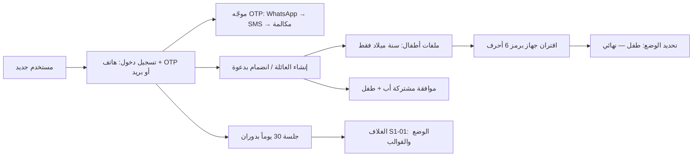
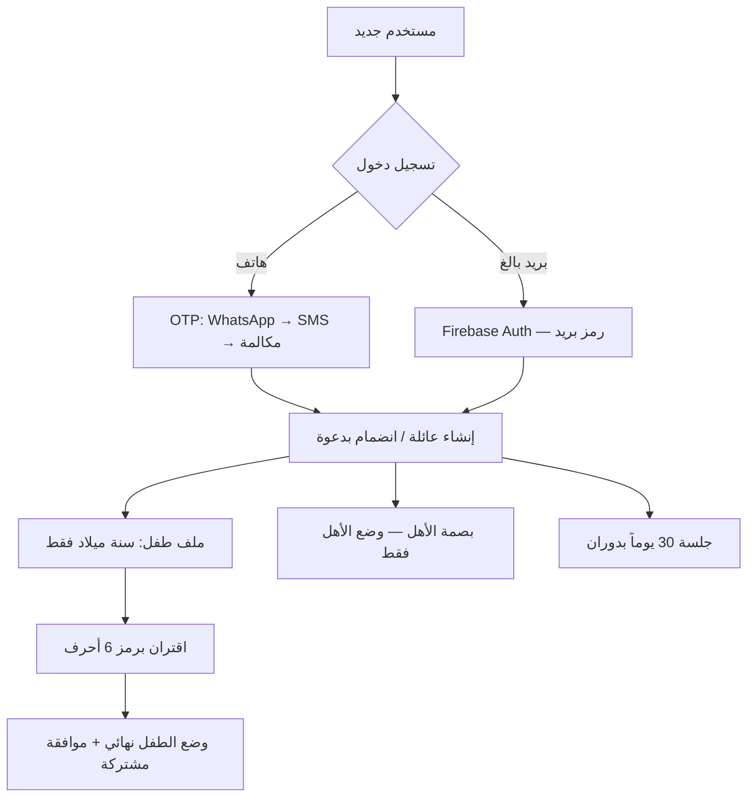
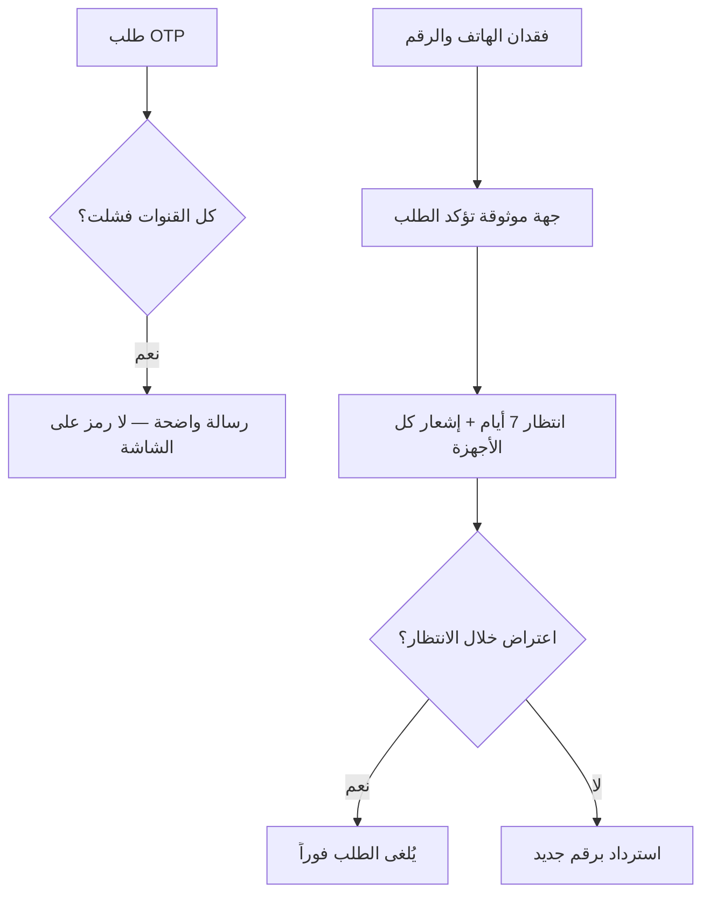
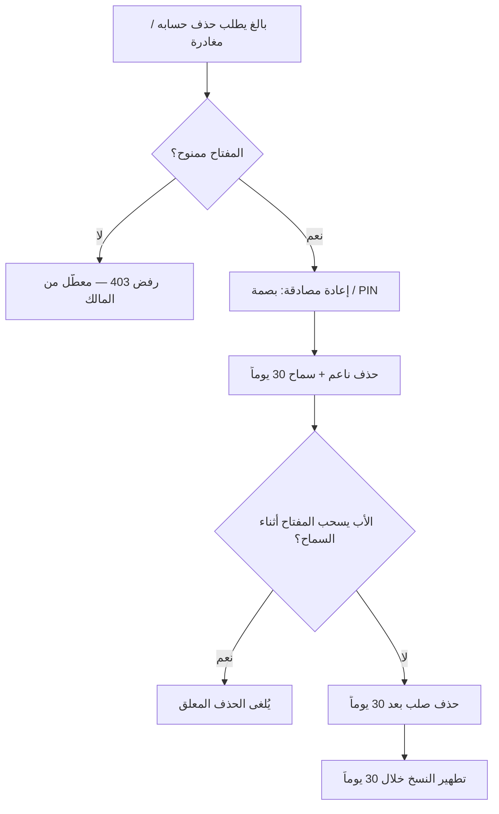
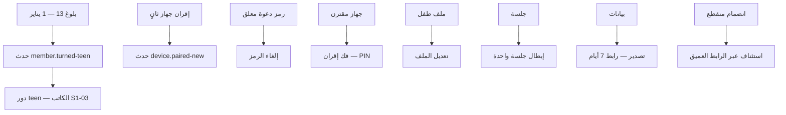

# S1-02: الهوية والتهيئة العائلية (Identity & Onboarding)

- **الحالة:** approved | **المرحلة:** 1 (نواة الحماية) · **آخر تحديث:** 2026-11-07
- **القرارات الحاكمة:** Q-001 · Q-002 · Q-005 · Q-006 · Q-007 · Q-008 · Q-021 · Q-022 · Q-062 · Q-063 · Q-065 · Q-068 · Q-070 · Q-071 · Q-072 · Q-073 · Q-074 · Q-075 · Q-076 · Q-077 · Q-079 · Q-080 · Q-084 · Q-106 · Q-137 · Q-189 · Q-235 · Q-245 · Q-246 · Q-247 · Q-248 · D-006 · D-007 · D-023 · D-038 · G-006 · G-011
- **حالة المراجعة:** الأقسام 1–8 معتمدة بالكامل في التخطيط — حكم المالك 2026-11-05 (الدفعة 19، e1d8611)؛ و§10 معتمدة — حكم المالك 2026-11-06 (الدفعة 43، c29d2e5) · **§9 في مرحلة التصميم (Q-091)**.
- **الأدلة المرجعية:** المواصفة القديمة S1-02 (مرجع فقط، G-009) · Deep-dives: Telegram (phone verification + SmsRetriever) · FamilyWall (family creation + child accounts w/o contact data) · Bark Kids (device-code pairing) · Qustodio (parent/child account model) · S1-01 (معتمد — الوضع يتحدد بالإقران)

## 1. الهدف والتحليل والنطاق

يمثل هذا النظام نقطة البداية الحقيقية لكل مستخدم: تسجيل الدخول برقم الهاتف أو بالبريد الإلكتروني، إنشاء العائلة وتسميتها، انضمام البالغين بدعوة، إنشاء ملفات الأطفال (بلا بيانات اتصال)، واقتران أجهزة الأطفال — مع موافقة مشتركة (أب + طفل) مرة واحدة.

**مخطط سياق النظام (§1 — بصري):**



**داخل النطاق:**
- تسجيل الدخول: رقم هاتف + OTP عبر الموجّه (WhatsApp أولاً → SMS مجمّع → مكالمة فائتة) **أو بريد إلكتروني للبالغين** (التحقق عبر Firebase Auth: رمز يُرسل بالبريد؛ الخادم يتحقق من ID Token ويصدر رموز الجلسة) + TOTP داخل التطبيق بعد أول تحقق.
- الجلسات: Access Token + Refresh Token بدوران آمن؛ مدة الجلسة 30 يوماً.
- إنشاء العائلة: التسمية + اختيار المنطقة (`region`)؛ رموز الدعوة تتولد عشوائياً لكل طلب انضمام (Q-076).
- انضمام البالغين: رمز دعوة + روابط عميقة (Deep Links).
- ملفات الأطفال: ينشئها الأب/المفوَّض فقط؛ بلا بيانات اتصال؛ اسم مستعار + صورة رمزية + لون + سنة ميلاد.
- اقتران أجهزة الأطفال: رمز جهاز (6 أحرف)؛ شهادة جهاز؛ تحديد الوضع عند الإقران.
- الموافقة المشتركة: إعداد مشترك (أب + طفل) مرة واحدة.
- فتح سريع بالبصمة/الوجه للأهل (وضع الأهل فقط).

**خارج النطاق:**
- محرك تقييم الصلاحيات وتفويضها (نظام الأدوار والصلاحيات).
- محرك الفرض وشاشات الحظر (نظام الحماية).
- الخطط والدفع (نظام الفوترة).
- تبديل الملفات (مؤجل للمرحلة 2 — أولوية، Q-063).

## 2. سيناريوهات المستخدم

### سيناريو 2-1: أب ينشئ عائلة جديدة لأول مرة
- **الممثل:** أب بلا حساب.
- **السياق:** أول تثبيت للتطبيق على جهاز الأهل.
- **التدفق:**
  1. يدخل الأب رقم هاتفه؛ التطبيق يتحقق من الصيغة الدولية (REQ-019).
  2. يصل OTP عبر WhatsApp أولاً؛ إن فشل التوصيل يتحول تلقائياً لـ SMS ثم مكالمة فائتة (REQ-002).
  3. يُدخل الرمز (أو يُقرأ تلقائياً من SMS حيث يدعم الجهاز)؛ بعد أول تحقق ناجح يُفعَّل TOTP داخل التطبيق (REQ-004/REQ-005).
  4. يسمّي العائلة ويختار المنطقة (`region`)؛ يُنشئ الحساب ويصبح المالك تلقائياً (`is_owner`)؛ رموز الدعوة تتولد عشوائياً لكل طلب انضمام (REQ-009/REQ-010).
- **النتيجة:** عائلة واحدة للحساب؛ المنشئ مالك؛ جلسة 30 يوماً بدوران Refresh (REQ-006/REQ-008).

### سيناريو 2-2: أم تنضم إلى العائلة برابط عميق
- **الممثل:** أم (بالغة).
- **السياق:** الأب أرسل لها رابط دعوة.
- **التدفق:**
  1. تضغط الأم الرابط؛ التطبيق يفتح على شاشة الانضمام مع رمز الدعوة معبّأً (REQ-009).
  2. تسجّل الدخول برقم هاتفها وOTP (REQ-001/REQ-002).
  3. تُقبل الدعوة وتدخل العائلة بدور `adult` بلا صلاحيات إشرافية حتى يفوّضها الأب (Q-007).
- **النتيجة:** عضوية بالغة في العائلة؛ الانضمام مسجَّل في `AuditEvent`.

### سيناريو 2-3: أب ينشئ ملف طفل ويقترن جهازه برمز
- **الممثل:** الأب + الطفل.
- **السياق:** جهاز الطفل جديد؛ الأب يجهزه.
- **التدفق:**
  1. ينشئ الأب ملف الطفل: اسم مستعار + صورة رمزية + لون + سنة ميلاد فقط — بلا هاتف أو بريد (REQ-011/REQ-012).
  2. يحدد سنة الميلاد قالب العرض تلقائياً (REQ-013).
  3. يصدر الأب رمز جهاز (6 أحرف)؛ يدخله الطفل على جهازه فيُقترن الجهاز وتُتبادل شهادة الجهاز ويُحدد الوضع (طفل) نهائياً (REQ-014).
  4. يتم الإعداد المشترك (أب + طفل) مرة واحدة وتُسجَّل الموافقة المشتركة (REQ-017).
- **النتيجة:** جهاز الطفل في وضع الطفل؛ لا حساب للطفل ولا بيانات اتصال له.

### سيناريو 2-4: أب يفتح التطبيق بالبصمة
- **الممثل:** الأب (وضع الأهل).
- **السياق:** جلسة سارية؛ التطبيق مغلق.
- **التدفق:**
  1. يفتح الأب التطبيق ويضع بصمته؛ يُفتح وضع الأهل مباشرة (REQ-016).
  2. البصمة لا تفتح وضع الطفل أبداً ولا تتجاوز بوابة الوالدين.
  3. بعد 3 محاولات بصمة فاشلة يُطلب PIN/OTP.
- **النتيجة:** فتح سريع للأهل فقط؛ أمان البوابة محفوظ (Q-065/Q-072).

### سيناريو 2-5: فشل كل قنوات OTP
- **الممثل:** أب يحاول تسجيل الدخول.
- **السياق:** شبكة ضعيفة؛ WhatsApp وSMS والمكالمة الفائتة كلها فشلت.
- **التدفق:**
  1. يفشل WhatsApp → يتحول تلقائياً لـ SMS → يفشل → مكالمة فائتة → تفشل (REQ-002).
  2. تظهر رسالة واضحة: "تعذر الإرسال — حاول لاحقاً"؛ لا يُعرض الرمز على الشاشة أبداً.
  3. يُسجَّل الفشل للمراقبة؛ إعادة المحاولة متاحة بعد فاصل.
- **النتيجة:** لا تسجيل دخول دون تحقق؛ لا تسريب للرمز.

### سيناريو 2-6: أب يسجل دخوله بالبريد الإلكتروني
- **الممثل:** الأب (بالغ).
- **السياق:** يفضل البريد على الهاتف، أو هاتفه بلا تغطية.
- **التدفق:**
  1. يدخل الأب بريده الإلكتروني؛ يتحقق التطبيق من صيغته (REQ-022).
  2. يرسل Firebase Auth رمزاً إلى البريد؛ يدخله الأب في التطبيق (REQ-023).
  3. يتحقق الخادم من ID Token عبر Firebase Admin SDK ويصدر رموز الجلسة (30 يوماً بدوران) (REQ-023/Q-075).
  4. إن تعذر Firebase يعرض التطبيق خيار الهاتف وOTP دون انقطاع (REQ-024).
- **النتيجة:** دخول بالبريد كبديل كامل للهاتف؛ البريد للبالغين فقط.

### سيناريو 2-7: أب يسترد حسابه بعد فقدان هاتفه ورقمه (جديد — من حكم Q-077)
- **الممثل:** الأب + جهة الاسترداد الموثوقة (بالغ في العائلة حدده الأب مسبقاً).
- **السياق:** فقد الأب هاتفه ورقم هاتفه معاً.
- **التدفق:**
  1. يطلب الأب الاسترداد من جهاز جديد برقم جديد؛ يحدد جهة الاسترداد الموثوقة (REQ-020).
  2. تؤكد جهة الاسترداد الطلب؛ تبدأ فترة انتظار 7 أيام، ويُشعَر كل جهاز في العائلة بالطلب (REQ-020).
  3. إن اعترض أي بالغ خلال الانتظار يُلغى الطلب فوراً؛ وإلا يُسترد الحساب بالرقم الجديد بعد 7 أيام.
- **النتيجة:** استرداد آمن بلا فريق دعم؛ لا استيلاء صامت على الحساب.

### سيناريو 2-8: بالغ يغادر العائلة بعد أن سحب الأب الإذن (جديد — من حكم Q-166)
- **الممثل:** أم (بالغة) + الأب (المالك).
- **السياق:** الأم تريد حذف حسابها؛ الأب سحب مفتاح `identity.account.delete_self` منها أمس.
- **التدفق:**
  1. الأم تطلب حذف حسابها من الإعدادات؛ الخادم يرفض (المفتاح غير ممنوح — deny-override) مع رسالة واضحة: «الحذف معطَّل من مالك العائلة».
  2. الأب يعيد منح المفتاح (منح حساس: PIN + تحدي Q-164)؛ الأم تعيد الطلب مع بصمتها.
  3. يُقبل الطلب: حذف ناعم + فترة سماح 30 يوماً؛ تُبطل جلساتها فوراً وتُشعَر العائلة؛ وخلال السماح تستطيع الأم إلغاء الحذف.
  4. إن سحب الأب المفتاح أثناء السماح — يُلغى الحذف المعلق فوراً.
- **النتيجة:** الصلاحية بيد الأب فعلاً لا قولاً؛ والافتراضي السماح، والتشديد صارم وحقيقي.

### سيناريو 2-9: مهمة بلوغ 13 (1 يناير — `member.turned-teen`)
- **الممثل:** مهمة خادمية يومية (بلا ممثل بشري).
- **السياق:** طفل يبلغ 13 في سنة ما.
- **التدفق:**
  1. تُطلق المهمة 1 يناير من سنة بلوغ 13 عند منتصف الليل المحلي للعائلة (Q-235 · Q-183).
  2. تُصدر المهمة حدث `member.turned-teen` الداخلي إلى S1-03 وS1-10 (عقد الحدث §4.4).
  3. يكتب S1-03 الدور `teen` (هو الكاتب الوحيد لـ `membership.role`) ويراجع المنح غير الإشرافية ويُشعر الأب.
- **النتيجة:** تحول تلقائي في الموعد المحكوم؛ بلا كتابة مزدوجة للدور.

### سيناريو 2-10: إقران جهاز ثانٍ لطفل لديه جهاز مقترن
- **الممثل:** الأب + الطفل.
- **السياق:** الطفل يحصل على جهاز ثانٍ.
- **التدفق:**
  1. يصدر الأب رمز جهاز جديداً (`POST …/devices/pairing-code`)؛ ويدخله الطفل على الجهاز الثاني.
  2. يكتمل الإقران ذرياً كسيناريو 2-3؛ وإن كان للطفل جهاز مقترن أصلاً يُطلق حدث `device.paired-new` الداخلي (Q-230).
- **النتيجة:** جهاز ثانٍ في وضع الطفل؛ والحدث الداخلي مسجَّل في `device_pairing`.

### سيناريو 2-11: المالك يلغي رمز دعوة معلقاً
- **الممثل:** المالك.
- **السياق:** رمز دعوة أُرسل لشخص لم ينضم بعد.
- **التدفق:**
  1. يفتح المالك إدارة الدعوات (S102-09)؛ ويضغط «إلغاء» على الرمز المعلق.
  2. يُلغى الرمز (`POST …/families/{id}/invites/{inviteId}/revoke`)؛ وأي محاولة انضمام به تُرفض.
- **النتيجة:** رمز ملغى لا يعمل؛ بلا أثر على رموز أخرى.

### سيناريو 2-12: فك إقران جهاز
- **الممثل:** المالك.
- **السياق:** جهاز طفل يُراد فك إقرانه (بيع/استبدال).
- **التدفق:**
  1. يفتح المالك فك الإقران (S102-27)؛ ويدخل PIN الأب.
  2. يُفك الإقران (`POST …/devices/{deviceId}/unpair`)؛ ويمسح رمز الدفع للجهاز؛ ويُتاح إقرانه لعائلة أخرى.
- **النتيجة:** الجهاز بلا وضع طفل وبلا حماية؛ وإقرانه الجديد ممكن.

### سيناريو 2-13: تعديل ملف طفل
- **الممثل:** الأب/المفوَّض.
- **السياق:** تغيير الاسم المستعار أو الصورة أو اللون أو سنة الميلاد.
- **التدفق:**
  1. يفتح الأب ملفات الأطفال (S102-12)؛ وينقر بطاقة الطفل؛ ويعدّل الحقول.
  2. يُحفظ التعديل (`PATCH …/children/{membershipId}`)؛ وإن تغيرت سنة الميلاد أعيد تحديد الدور والقالب (REQ-013).
- **النتيجة:** ملف محدَّث؛ والقالب يتبع سنة الميلاد الجديدة.

### سيناريو 2-14: إبطال جلسة واحدة
- **الممثل:** صاحب الجلسة أو المالك.
- **السياق:** جلسة على جهاز قديم/مسروق.
- **التدفق:**
  1. يفتح المستخدم الجلسات (S102-18)؛ ويضغط «إبطال» على الجلسة.
  2. تُبطل رموز تلك الجلسة فقط (`POST …/sessions/{sessionId}/revoke`)؛ وبقية الجلسات تعمل.
- **النتيجة:** جلسة مبطلة فوراً؛ بلا أثر على جلسات أخرى. (أي أثر عابر للأنظمة معلَّق على NEW-S103-08 المبوَّب.)

### سيناريو 2-15: تصدير بيانات (بالغ يصدّر بياناته؛ أب يصدّر بيانات قاصر)
- **الممثل:** بالغ / الأب.
- **السياق:** طلب نسخة من البيانات.
- **التدفق:**
  1. يطلب البالغ تصدير بياناته (S102-25) أو الأب تصدير بيانات قاصر (S102-26).
  2. تُجهَّز مهمة غير متزامنة (JSON + وسائط)؛ ويصل رابط تنزيل صالح 7 أيام.
- **النتيجة:** أرشيف كامل برابط ينتهي بعد 7 أيام.

### سيناريو 2-16: استئناف انضمام منقطع عبر رابط عميق
- **الممثل:** بالغ مدعو.
- **السياق:** انقطع الانضمام بعد فتح الرابط (إغلاق التطبيق/انقطاع).
- **التدفق:**
  1. يعيد المدعو فتح الرابط العميق الحامل للرمز؛ ويُستأنف الانضمام من حيث توقف (UC5 — يشمل استئناف الانضمام المنقطع).
  2. يُكمل المدعو تسجيل الدخول بالهاتف وOTP ثم الانضمام بدور `adult`.
- **النتيجة:** انضمام مكتمل بلا إعادة إرسال دعوة.

- **خارج نطاق §2:** فقدان جهاز TOTP بلا سيناريو — لا مسار محكوم للاسترداد (GAP-11)؛ وشاشة S102-07 تعرض «تواصل مع مالك العائلة» فقط.

**مخطط رحلة التهيئة (§2 — بصري):**



**مخطط الفشل والاسترداد (§2 — بصري):**



**مخطط الحذف والمغادرة (§2 — بصري):**



**مخطط عمليات الإدارة (§2 — بصري):**



## 3. المتطلبات الوظيفية

- **REQ-001:** تسجيل الدخول برقم هاتف دولي (رمز الدولة حسب المنطقة) أو بريد إلكتروني؛ الهاتف هو وسيلة المصادقة الأساسية، والبريد بديل موازٍ للبالغين. [D-007 · DERIVED]
- **REQ-002:** OTP عبر الموجّه بالترتيب: WhatsApp أولاً → SMS مجمّع → مكالمة فائتة؛ التحويل التلقائي عند فشل التوصيل؛ رسائل SMS الاحتياطية عبر الموجّه تُحسب من حصة SMS لخطة العائلة (Q-106). وعند صفر حصة SMS يُرفض OTP SMS؛ والموجّه ينتقل إلى مكالمة فائتة، ويُعلم المستخدم بالسبب (Q-247)؛ وتجاوز Q-106 يبقى SOS فقط — OTP لا يستهلك رسائل الطوارئ أبداً (Q-247). [Q-021 · DERIVED]
- **REQ-003:** رمز OTP صالح 5 دقائق؛ إعادة الإرسال بعد 60 ثانية؛ بعد 5 رموز خاطئة يُقفل الطلب 15 دقيقة. والعدادات الثلاثة (طلب/رمز خاطئ/إعادة إرسال) في جدول العدّادات أدناه (§3)؛ وإعادة الإرسال تُحسب طلباً وتُصدر رمزاً جديداً يُبطل السابق وتعيد ضبط مهلة 5 دقائق. [Q-021/Q-079 · DERIVED]
- **REQ-004:** قراءة OTP تلقائياً من SMS عند توفرها (دون أن يكتبه المستخدم) — حيث يدعم الجهاز ذلك. [VERIFIED: Telegram SmsRetriever · DERIVED]
- **REQ-005:** التسجيل في TOTP إلزامي بعد أول تحقق ناجح (Q-246): يُفعَّل TOTP داخل التطبيق لعمليات الدخول اللاحقة الحساسة؛ وعند تسجيل دخول لاحق يُتخطى التسجيل إن كان `totp_enrolled=true`؛ ومسار فقدان جهاز TOTP مسار مقترن (R2-S102-19/GAP-11) — يُشار إليه هنا دون تعريفه. **عمليات الدخول التي تتطلب TOTP (قائمة مغلقة — أي توسيع لها يؤكده المالك):** (1) تسجيل دخول يسبق عملية حساسة من تعداد S1-01 REQ-006 (الخروج من وضع الطفل، فك الإقران، إلغاء تثبيت الوكيل، فتح إعداد إداري)؛ (2) تسجيل دخول بعد تغيير البصمة/إبطال مفتاح التوقيع (REQ-016)؛ (3) تسجيل دخول لإتمام استرداد الحساب (REQ-020). والدخول اليومي العادي من جهاز موثوق بلا TOTP. [Q-021 · Q-246 · DERIVED]
- **REQ-006:** الجلسة منزلقة بسقف مطلق 30 يوماً من تسجيل الدخول (Q-245): Access Token قصير — **15 دقيقة** (معامل تقني مثبت هنا)؛ وRefresh Token بدوران آمن؛ كل تحديث يمدد الجلسة، ولا تتجاوز أبداً 30 يوماً من تسجيل الدخول؛ تسجيل الخروج يبطل كل الرموز فوراً. [Q-075 · Q-245 · DERIVED]
- **REQ-007:** إنشاء العائلة: التسمية + اختيار المنطقة (`region` — من تعداد §5)؛ المنشئ يصبح المالك (`is_owner` على دور `adult`) تلقائياً. [Q-005/Q-006/Q-008 · DERIVED]
- **REQ-008:** عائلة واحدة لكل حساب في MVP؛ محاولة إنشاء عائلة ثانية تُرفض برسالة واضحة. [Q-008 · DERIVED]
- **REQ-009:** انضمام البالغين برمز دعوة عشوائي يتولد لكل طلب (REQ-010) أو رابط عميق يحمل الرمز. [Q-074/Q-076 · DERIVED]
- **REQ-010:** رمز الدعوة عشوائي يتولد لكل طلب انضمام؛ استخدام واحد؛ صالح 7 أيام؛ المالك يلغي أي رمز معلق في أي وقت؛ كل انضمام يتطلب تحقق الهاتف/OTP ويُسجَّل في التدقيق. [Q-076 · DERIVED]
- **REQ-011:** ملفات الأطفال ينشئها الأب/المفوَّض فقط؛ لا يُطلب من الطفل رقم هاتف أو بريد أو بيانات مصرفية إطلاقاً. [D-006 · DERIVED]
- **REQ-012:** ملف الطفل: اسم مستعار + صورة رمزية + لون + سنة ميلاد فقط (لا تاريخ ميلاد كامل). [Q-073 · DERIVED]
- **REQ-013:** سنة الميلاد تحدد الدور والقالب تلقائياً: دون 7 سنوات → `child` بقالب `minimal`؛ 7–12 → `child` بقالب `standard`؛ 13–17 → `teen` بقالب `standard`. الحد 13 حد قانوني (معيار COPPA؛ بوابة «دون السن» في Quizlet)؛ حد 7 قرار تصميم خاص بنا (D-038). ويُطلق التحولَ عند بلوغ 13 مهمةٌ خادمية يومية عند منتصف الليل المحلي للعائلة (Q-183) تُصدر حدث `member.turned-teen` الداخلي إلى S1-03 وS1-10 (Q-189) — وعقد الحدث §4.4. و18 فأكثر → `adult` تلقائياً (Q-250)؛ وتُلغى منح المراهق ما لم يجددها الأب صراحة؛ وتُطلق المهمة اليومية نفسها التحول عند بلوغ 18 كما في سن 13 (Q-235). [Q-080 · Q-189 · Q-235 · Q-250 · DERIVED]
- **REQ-014:** اقتران جهاز الطفل برمز جهاز (6 أحرف) يصدره الأب؛ عند الإقران تُتبادل شهادة الجهاز ويُحدد الوضع (طفل) نهائياً للجهاز في المرحلة 1؛ وشهادة الجهاز هي اعتماد MQTT (mTLS — Q-168)؛ وعند إقران جهاز لطفل لديه جهاز مقترن أصلاً يُطلق الخادم حدث `device.paired-new` الداخلي (Q-230؛ التخزين: جدول `device_pairing`). [Q-071/Q-062 · Q-168 · Q-230 · DERIVED]
- **REQ-015:** جهاز مُقترن لعائلة لا يُقترن لعائلة أخرى دون فك إقران صريح من الأب (يتطلب PIN الأب، Q-065). [Q-062/Q-065 · DERIVED]
- **REQ-016:** فتح سريع بالبصمة/الوجه للأهل في وضع الأهل فقط؛ لا يتجاوز بوابة الوالدين أبداً ولا يفتح وضع الطفل. **تغيير بصمة الأب يُبطل مفتاح توقيع الجهاز** (REQ-023 في S1-01) ويتطلب إعادة تسجيله بـ PIN قبل أي عملية حساسة (Q-164). [Q-072/Q-065 · Q-164 · DERIVED]
- **REQ-017:** الموافقة المشتركة: إعداد مشترك (أب + طفل) مرة واحدة عند أول اقتران؛ شفافية عن الفئات المراقَبة لا عن المحتوى؛ تُسجَّل الموافقة في التدقيق. [G-006/D-023 · DERIVED]
- **REQ-018:** كل شاشات التهيئة عربي وإنجليزي؛ الافتراضي العربية. [Q-070 · DERIVED]
- **REQ-019:** رقم الهاتف يُتحقق من صيغته الدولية قبل إرسال OTP — بمعيار E.164 عبر libphonenumber؛ والتطبيع: الأرقام العربية تُحوَّل إلى لاتينية قبل التحقق؛ وأرقام اختبار الصيغة: `+9665XXXXXXXX` (السعودية) و`+9677XXXXXXXX` (اليمن) — صيغ أمثلة لا أرقام حقيقية؛ ورقم غير صالح يُرفض فوراً برسالة واضحة. [Q-005/Q-021 · DERIVED]
- **REQ-020:** استرداد الحساب عند فقدان الهاتف والرقم: الأب يحدد جهة استرداد موثوقة مسبقاً (بالغ في العائلة)؛ عند الطلب تؤكد الجهة، وتبدأ فترة انتظار 7 أيام مع إشعار كل أجهزة العائلة؛ الاعتراض خلال الانتظار يلغي الطلب؛ بعدها يُسترد الحساب برقم جديد. [Q-077 · DERIVED]
- **REQ-021:** سنة الميلاد تُقبل فقط ضمن نطاق معقول: السنة الحالية ناقص 99 إلى السنة الحالية؛ خارج النطاق تُرفض برسالة واضحة. [VERIFIED: Qustodio Kids `newKid` validation · Q-080 · DERIVED]
- **REQ-022:** تسجيل الدخول بالبريد الإلكتروني بديل موازٍ للهاتف للبالغين فقط؛ البريد لا يُطلب من الطفل إطلاقاً (D-006)؛ صيغة البريد تُتحقق قبل إرسال الرمز. [Q-084 · DERIVED]
- **REQ-023:** التحقق بالبريد عبر Firebase Auth: رمز يُرسل إلى بريد الأب؛ العميل يحصل على ID Token من Firebase؛ الخادم يتحقق من الـ ID Token عبر Firebase Admin SDK ثم يصدر رموز الجلسة الخاصة بنا (Q-075). Firebase موصّل مصادقة لا سلطة — بيانات العائلة لا تعيش فيه. **ملاحظة تحقق (2026-11-08):** آلية «رمز بريد» من 6 أرقام غير مثبتة مختبرياً — وثائق Firebase Auth توثق رابط البريد (email link) والبريد+كلمة المرور فقط، لا رمز بريد رقمياً أصلياً؛ ويُتحقق من التدفق في مختبر Q-027 قبل الاعتماد؛ وإن فشل التدفق يُعاد كتابة REQ-023 إلى التدفق المثبت (رابط أو رمز مخصص عبر موصّل مسمى). [Q-084 · DERIVED]
- **REQ-024:** عند تعذر الوصول إلى Firebase (انقطاع أو حجب) يبقى تسجيل الدخول بالهاتف وOTP يعمل؛ لا يعتمد النظام على Firebase وحدها. [Q-084 · DERIVED]
- **REQ-025:** حذف الحساب للبالغ نفسه: عبر `DELETE /api/v1/identity/me` بشرط مفتاح `identity.account.delete_self` (يُمنح تلقائياً عند الانضمام — الافتراضي السماح — والأب يلغيه فردياً) + إعادة مصادقة (بصمة/PIN)؛ حذف ناعم + فترة سماح 30 يوماً ثم حذف صلب؛ وإلغاء الحذف المعلق عبر `POST /api/v1/identity/me/deletion/cancel`؛ وإلغاء المفتاح أثناء السماح يُلغي الحذف المعلق. [Q-166 · DIRECT]
- **REQ-026:** مغادرة العائلة للبالغ نفسه: عبر `POST /api/v1/identity/me/leave` بشرط مفتاح `identity.family.leave` (الافتراضي ممنوح عند الانضمام)؛ فورية؛ والمالك لا يغادر. [Q-166 · DIRECT]
- **REQ-027:** التصدير: البالغ يصدّر بياناته عبر `POST /api/v1/identity/me/export`؛ والأب يصدّر بيانات قاصر عبر `POST /api/v1/identity/families/{id}/members/{memberId}/export`؛ الصيغة JSON + وسائط؛ مهمة غير متزامنة؛ رابط التنزيل 7 أيام. [Q-166 · DIRECT]
- **REQ-028:** الحذف الناعم: `person` و`family` تحملان `deleted_at` + `scheduled_purge_at`؛ وكل طلب حذف يُسجَّل في `deletion_request` (العضوية/النوع/الطالب/الوقت/موعد التطهير/الحالة — و`membership_id` بدل `person_id` Q-169). [Q-166 · Q-169 · DIRECT]

**جدول عدّادات OTP (Q-079 — REQ-003):**

| العدّاد | ما يحسبه | الحد | ما يفعله عند الحد | ما يعيد ضبطه |
|---|---|---|---|---|
| عدّاد طلبات الإرسال | استدعاءات `otp/request` — بما فيها إعادة الإرسال | 5 طلبات فاشلة متتالية → 429 | يرفض الطلب برمز 429 مع `retry_after` | إرسال ناجح واحد يعيد ضبطه إلى صفر |
| عدّاد الرموز الخاطئة | رموز `otp/verify` خاطئة لنفس الطلب | 5 → قفل الطلب 15 دقيقة (423) | يرفض التحقق برمز 423 | إصدار رمز جديد (إعادة إرسال) أو تحقق ناجح |
| عدّاد إعادة الإرسال | مرات إعادة إرسال نفس الطلب | إعادة الإرسال مسموحة بعد 60 ثانية فقط | طلب قبل 60 ثانية يُرفض 429 مع `retry_after`؛ وكل إعادة إرسال تُحسب طلباً (في عدّاد الطلبات) وتُصدر رمزاً جديداً يُبطل السابق وتعيد ضبط مهلة 5 دقائق وعدّاد الرموز الخاطئة | — (بلا حد عددي مستقل beyond عدّاد الطلبات) |

«طلب فاشل» = طلب مرفوض (صيغة غير صالحة، أو قبل 60 ثانية من السابق، أو فشل كل القنوات).

## 4. الواجهات والعقود

### 4.1 عقود الخادم (Ktor REST — `/api/v1/identity/`)

- `POST /api/v1/identity/otp/request` — body: `{phone, region}` (الـ `region` من تعداد §5) → `{channel, expires_in}` (200؛ 400 رقم غير صالح — فشل E.164 أو التطبيع؛ 429 بعد 5 طلبات فاشلة متتالية — انظر جدول العدّادات §3؛ وطلب قبل 60 ثانية من السابق يُرفض 429).
- `POST /api/v1/identity/otp/verify` — body: `{phone, code, device_id?, device_label?}` → `{access_token, refresh_token, totp_enrolled, expires_in: 900}` (200؛ 401 رمز خاطئ؛ 423 مقفل مؤقتاً 15 دقيقة بعد 5 رموز خاطئة).
- `POST /api/v1/identity/totp/enroll` — body: `{}` → `{secret, qr}` (بعد أول تحقق ناجح).
- `POST /api/v1/identity/totp/verify` — body: `{code}` → `{verified: boolean}` (200؛ 401 رمز خاطئ؛ 423 مقفل مؤقتاً 15 دقيقة بعد 5 رموز خاطئة — Q-079؛ وعمليات الدخول التي تتطلبه في REQ-005).
- `POST /api/v1/identity/sessions/refresh` — body: `{refresh_token}` → `{access_token, refresh_token, expires_in: 900}` (دوران: القديم يُبطل؛ ويُحدَّث `last_active_at` عند كل تحديث ناجح — §5).
- `POST /api/v1/identity/sessions/logout` — يبطل كل رموز الجلسة فوراً.
- `GET /api/v1/identity/sessions` — قائمة جلساتي → `{sessions: [{session_id, device_id, device_label, last_active_at, expires_at, is_current}]}` (S102-18).
- `POST /api/v1/identity/sessions/{sessionId}/revoke` — إبطال جلسة واحدة → `{session_id, status: "revoked"}` (صاحب الجلسة أو المالك — S102-18). **النطاق:** يبطل رموز تلك الجلسة فقط؛ وأي أثر عابر للأنظمة (منح S1-03) معلَّق على NEW-S103-08 المبوَّب — لم يُحسم هنا.
- `POST /api/v1/identity/recovery/request` — body: `{new_phone, trusted_contact_id?}` → `{recovery_id, status: "pending_confirmation"}` (من جهاز جديد برقم جديد؛ والجهة الموثوقة المحددة مسبقاً — S102-19).
- `POST /api/v1/identity/recovery/{recoveryId}/confirm` — تأكيد جهة الاسترداد الموثوقة → `{recovery_id, status: "waiting", wait_until}` (يبدأ انتظار 7 أيام + إشعار كل الأجهزة).
- `POST /api/v1/identity/recovery/{recoveryId}/object` — اعتراض أي بالغ → `{recovery_id, status: "cancelled"}` (يلغي الطلب فوراً).
- `POST /api/v1/identity/recovery/{recoveryId}/complete` — بعد 7 أيام بلا اعتراض → `{access_token, refresh_token, expires_in: 900}` (الاسترداد برقم جديد).
- `POST /api/v1/identity/recovery/trusted-contact` — body: `{trusted_contact_membership_id}` → `{trusted_contact_membership_id}` (تحديد/تغيير جهة الاسترداد — S102-19؛ والمالك فقط).
- `GET /api/v1/identity/recovery/{recoveryId}` — حالة الطلب (للعداد في S102-22) → `{recovery_id, status, wait_until, days_remaining}`.
- `POST /api/v1/identity/families` — body: `{name, region}` (الـ `region` من تعداد §5) → `{family_id, invite_code}` (المنشئ مالك تلقائياً؛ الرمز المعاد هو أول رمز دعوة لكل طلب — استخدام واحد، 7 أيام، Q-076؛ REQ-009/REQ-010). **والرمز المعاد رمز دعوة عادي كأي رمز من `POST …/invite` (استخدام واحد، 7 أيام، قابل للإلغاء، يُخزن `code_hash` فقط — §5)؛ ولا يُعرض أبداً كـ «رمز العائلة» ولا يُعاد عرضه بعد استهلاكه؛ وإعادة استخدامه بعد استهلاكه تُرفض كأي رمز مستهلك.**
- `POST /api/v1/identity/families/{id}/invite` — يولّد رمز دعوة عشوائياً جديداً (استخدام واحد، 7 أيام) → `{invite_code, expires_at}` (للمالك/المفوَّض).
- `POST /api/v1/identity/families/{id}/invites/{inviteId}/revoke` — إلغاء رمز دعوة معلق → `{invite_id, status: "revoked"}` (المالك/المفوَّض — S102-09؛ وانظر NEW-S102-04 للتخزين بـ `code_hash`).
- `POST /api/v1/identity/families/join` — body: `{invite_code}` → `{family_id, role: adult}` (يُتحقق بتجزئة الرمز المقدم ومقارنته بـ `code_hash` بمقارنة ثابتة الزمن — §5).
- `POST /api/v1/identity/children` — body: `{nickname, avatar, color, birth_year}` → `{membership_id}` (الأب/المفوَّض فقط؛ بلا بيانات اتصال).
- `PATCH /api/v1/identity/children/{membershipId}` — تحديث ملف طفل — body: `{nickname?, avatar?, color?, birth_year?}` → `{membership_id}` (الأب/المفوَّض — S102-12).
- `POST /api/v1/identity/consent` — body: `{type: "joint_onboarding", family_id, father_person_id, child_membership_id, father_granted_at, child_assented_at}` → `{consent_id}` (تسجيل الموافقة المشتركة — S102-15؛ وانظر R2-S102-04 لحقلي الطرفين).
- `POST /api/v1/identity/devices/pairing-code` — body: `{membership_id}` → `{pairing_code, expires_at}` (يصدر الأب/المفوَّض رمز جهاز 6 أحرف؛ صالح 15 دقيقة — S102-13).
- `POST /api/v1/identity/devices/pair` — body: `{pairing_code, device_cert, device_public_key}` → `{device_id, mode: child}`.
- `POST /api/v1/identity/devices/{deviceId}/unpair` — فك إقران جهاز (المالك فقط + PIN — REQ-015؛ S102-27) → `{device_id, status: "unpaired"}`.
- `POST /api/v1/identity/devices/{deviceId}/public-key` — body: `{device_public_key}` → المفتاح العام الجديد مسجَّل؛ تتطلب فتح PIN/بصمة + توقيع تحدٍّ خادم (Q-164) — إعادة التسجيل بعد تغيير البصمة (Q-225).
- `POST /api/v1/identity/email/verify` — body: `{firebase_id_token, device_id?, device_label?}` → `{access_token, refresh_token, expires_in: 900}` (الخادم يتحقق من الـ ID Token عبر Firebase Admin SDK؛ البريد للبالغين فقط؛ بريد مسجل لحساب آخر يُرفض).
- `DELETE /api/v1/identity/me` — حذف الحساب لنفسه (بالغ فقط؛ يتطلب `identity.account.delete_self` + إعادة مصادقة ببصمة/PIN) → `{status: "pending_deletion", purge_at}` — حذف ناعم + سماح 30 يوماً (Q-166).
- `POST /api/v1/identity/me/leave` — مغادرة العائلة (بالغ فقط؛ يتطلب `identity.family.leave`) → `{status: "left"}` — فورية؛ والمالك لا يغادر (Q-166).
- `POST /api/v1/identity/me/deletion/cancel` — إلغاء حذف حساب معلَّق خلال السماح → `{status: "active"}` (Q-166).
- `POST /api/v1/identity/me/export` — تصدير بياناتي (JSON + وسائط؛ مهمة غير متزامنة؛ رابط 7 أيام) → `{export_id, status: "preparing"}` (Q-166).
- `POST /api/v1/identity/families/{id}/members/{memberId}/export` — الأب يصدّر بيانات قاصر (Q-166).
- الأخطاء: صيغة موحدة `{code, message_ar, trace_id}`؛ كل طلب يحمل سياق `family_id` حيث ينطبق؛ رفض أي طلب خارج العائلة (403).

### 4.2 عقود العميل

- `MethodChannel("familyos/identity")`: `readOtpSms() -> String?` (قراءة تلقائية حيث يدعم الجهاز)؛ `biometricUnlock() -> bool` (وضع الأهل فقط).
- Firebase Auth SDK (العميل): طلب رمز البريد والتحقق منه؛ لا يعتمد على خدمات Google Play (يعمل عبر الشبكة فقط) — يُتحقق منه في مختبر Q-027 (ملاحظة التحقق 2026-11-08: التدفق «رمز بريد» بانتظار مختبر Q-027 — انظر REQ-023).

### 4.3 عمليات تملكها أنظمة أخرى — مؤشرات (R2-S102-14)

بلا endpoint في S1-02 لأيٍّ منها؛ وشاشتا نقل الملكية وحذف العائلة تعيشان في §9 لـ S1-03/S1-09 (GAP-16).

| العملية | النظام المالك | REQ | endpoint |
|---|---|---|---|
| نقل الملكية | S1-03 | REQ-016 | `POST /api/v1/families/{id}/ownership-transfer` (+ القبول/الإلغاء) |
| حذف العائلة كاملة | S1-03 | REQ-020 | `DELETE /api/v1/families/{id}` (+ الإلغاء) |
| حذف دون اتصال (التنفيذ) | بروتوكول الحذف والتصدير §6 | — | طلب الحذف يُحفظ في Outbox ويُنفَّذ عند الاتصال — ولا حذف محلي نهائي قبل تأكيد الخادم |

### 4.4 عقد حدث بلوغ 13 الداخلي (`member.turned-teen` — Q-189)

التعريف الوحيد للعقد هنا؛ وS1-03 يستهلكه حرفياً (NEW-S103-07) ولا يعيد تعريفه.

- **الاسم:** `member.turned-teen` — حدث داخلي خادمي (لا MQTT — ناقل أحداث Ktor الداخلي).
- **الناشر:** مهمة S1-02 الخادمية اليومية (Q-235: تُطلق 1 يناير من سنة بلوغ 13، عند منتصف الليل المحلي للعائلة — Q-183).
- **الحمولة:** `{family_id: uuid, membership_id: uuid, birth_year: int, turned_teen_at: timestamptz, effective_date: date (1 يناير من سنة بلوغ 13)}` — والطفل بلا `person_id` (Q-137) فلا حقل شخص في الحمولة.
- **المشتركون:** S1-03 (يكتب `membership.role` من `child` إلى `teen` + يراجع المنح غير الإشرافية ويُشعر الأب — S1-03 REQ-003)؛ وS1-10 (بطاقة مراجعة — S1-10 REQ-027).
- **ملكية الكتابة:** **S1-03 هو الكاتب الوحيد لـ `membership.role` عند الاستلام**؛ ومهمة S1-02 لا تكتب الدور أبداً — فلا كتابة مزدوجة ولا سباق.
- **بلوغ 18:** تُطلق المهمة اليومية نفسها التحول عند بلوغ 18 كما في سن 13 (Q-235)؛ وS1-03 هو الكاتب الوحيد للدور أيضاً؛ واسم الحدث الداخلي للتحول عند 18 يُعرَّف مع S1-03 (ليس جزءاً من هذا العقد).

## 5. البيانات — النموذج

| الجدول | الحقول الرئيسية | ملاحظة |
|---|---|---|
| `person` | `id`, `phone` (للبالغين فقط)، `email` (للبالغين فقط، فريد، قابل لأن يكون فارغاً)، `display_name`, `created_at`, `deleted_at`, `scheduled_purge_at` | لا هاتف ولا بريد للطفل إطلاقاً (D-006)؛ حذف ناعم + سماح 30 يوماً (Q-166) |
| `phone_verification` | `id`, `phone`, `channel`, `code_hash`, `attempts`, `expires_at`, `verified_at` | `code_hash` فقط — لا يُحفظ الرمز نصاً |
| `session` | `id`, `person_id`, `device_id` (معرّف الجهاز — UUID يولده العميل عند أول تثبيت ويُثبَّت لكل جلسات الجهاز)، `device_label` (تسمية الجهاز المعروضة)، `refresh_token_hash`, `expires_at`, `revoked_at`, `last_active_at` | دوران Refresh منزلق بسقف مطلق 30 يوماً من تسجيل الدخول — `expires_at` لا يتجاوز أبداً لحظة الدخول + 30 يوماً (Q-245)؛ الإبطال فوري؛ و`last_active_at` يُحدَّث عند كل تحديث Refresh ناجح؛ والجلسة تُعرض في S102-18 من هذه الأعمدة |
| `family` | `id`, `name`, `region`, `time_zone`, `trusted_recovery_contact_id` (membership_id لبالغ موثوق — nullable؛ يحدده المالك مسبقاً للاسترداد — REQ-020)، `created_by`, `created_at`, `deleted_at`, `scheduled_purge_at` | عائلة واحدة لكل حساب (Q-008)؛ حذف ناعم + سماح 30 يوماً (Q-166)؛ `time_zone` المنطقة الزمنية للعائلة (IANA) — مرساة «منتصف الليل المحلي للعائلة» (Q-183)؛ وتُضبط عند إنشاء العائلة (REQ-007)؛ وقيم `region` من التعداد أدناه |

**تعداد `region` (Q-005 — R2-S102-10):** المنطقة دولة (سوق = دولة)؛ وكل قيمة تطابق صف `country_profile` بذات `region` (S1-01 §5).

| الكود | الدولة | ملف المنطقة |
|---|---|---|
| `YE` | اليمن | صف `country_profile` بذات `region`؛ والنطاق المنخفض إلزامي (Q-064) |
| `SA` | السعودية | صف `country_profile` بذات `region` |
| `AE` | الإمارات | صف `country_profile` بذات `region` |
| `QA` | قطر | صف `country_profile` بذات `region` |
| `KW` | الكويت | صف `country_profile` بذات `region` |
| `BH` | البحرين | صف `country_profile` بذات `region` |
| `OM` | عُمان | صف `country_profile` بذات `region` |
| `membership` | `id`, `family_id`, `person_id`, `role`, `is_owner` | (من النواة المشتركة)؛ `person_id` قابل لأن يكون فارغاً — للطفل يُترك فارغاً: صف عضوية بالملف فقط بلا حساب `person` (D-006 · Q-137) |
| `invite_code` | `id`, `family_id`, `code_hash`, `created_by`, `expires_at`, `uses`, `status` (`active`\|`revoked`\|`used`\|`expired`), `revoked_at` | عشوائي لكل طلب؛ استخدام واحد؛ 7 أيام (Q-076)؛ ويُحفظ `code_hash` فقط — لا رمز نصاً أبداً؛ والتحقق عند الانضمام بتجزئة الرمز المقدم ومقارنته بـ `code_hash` بمقارنة ثابتة الزمن؛ والإلغاء عبر `POST …/families/{id}/invites/{inviteId}/revoke` (B4 — NEW-S102-08)؛ والترحيل: أي رموز نصية موجودة (بيانات اختبار فقط) تصبح غير صالحة وتُعاد إصدارها — لا ترحيل للتجزئات |
| `child_profile` | `id`, `family_id`, `membership_id`, `nickname`, `avatar`, `color`, `birth_year` | بلا هاتف/بريد (D-006)؛ سنة فقط (Q-073)؛ `membership_id` يشير إلى صف عضوية الطفل — و`person_id` في ذلك الصف فارغ (Q-137) |
| `device_pairing` | `id`, `family_id`, `device_id`, `pairing_code_hash`, `device_cert`, `device_public_key`, `mode`, `paired_at`, `paired_by` | الوضع يُحدد عند الإقران (Q-062)؛ وشهادة الجهاز هي اعتماد MQTT (mTLS — Q-168)؛ ودورة حياة الشهادة (إصدار/تدوير/إبطال) ملك مواصفة الوسيط MQTT (Q-168) — لا تُعرف هنا؛ والمفتاح العام للتوقيع (ECDSA P-256) يُسجَّل مع الإقران (Q-164 · Q-181)؛ وحدث `device.paired-new` الداخلي يُسجَّل هنا عند إقران جهاز إضافي لطفل لديه جهاز مقترن أصلاً (Q-230)؛ و`paired_by` معرّف شخص (uuid — FK إلى `person`) |
| `consent_record` | `id`, `family_id`, `type` (`joint_onboarding`), `granted_by` (الأب — person FK), `granted_at` (وقت موافقة الأب), `child_membership_id` (عضوية الطفل), `child_assented_at` (وقت تأكيد الطفل), `assent_method` (`tap`) | الموافقة المشتركة (G-006) — طرفان: موافقة الأب + تأكيد الطفل؛ و`granted_by` وحده لا يكفي |
| `recovery_request` | `id`, `family_id`, `person_id` (الطالب), `new_phone`, `trusted_contact_membership_id`, `status` (`pending_confirmation`\|`waiting`\|`objected`\|`cancelled`\|`completed`), `requested_at`, `confirmed_at`, `wait_until`, `completed_at` | الاسترداد برقم جديد (REQ-020) — 7 أيام انتظار بعد التأكيد؛ والاعتراض يلغي الطلب فوراً |
| `deletion_request` | `id`, `family_id`, `membership_id` (nullable — فارغ لحذف العائلة), `type` (`family`\|`member`\|`account`), `requested_by`, `requested_at`, `purge_at`, `status` (`pending`\|`completed`\|`cancelled`) | فترة السماح 30 يوماً (Q-166)؛ و`membership_id` بدل `person_id` (Q-169 — فالطفل بلا `person`) |

**مهمة بلوغ 13 (Q-235):** المهمة اليومية لبلوغ 13 تُطلق 1 يناير من سنة بلوغ 13 — مبكراً حتى 11 شهراً عن عيد الميلاد الفعلي؛ مقبول بموجب Q-235؛ وتُصدر حدث `member.turned-teen` عند منتصف الليل المحلي للعائلة (Q-183) إلى S1-03 وS1-10 (REQ-013 · Q-189) — وعقد الحدث §4.4.

**قاعدة ملزمة:** جداول العائلة تحمل `family_id` + عزل RLS (D-021)؛ أما جداول السجل العالمية فبلا `family_id` (صياغة S1-03 §5)؛ كل حدث هوية/إقران في `AuditEvent`.

## 6. القواعد والصلاحيات

| المفتاح (`domain.action`) | من يملكه | ملاحظة |
|---|---|---|
| `identity.login` | أي مستخدم (قبل المصادقة) | OTP فقط |
| `identity.email.login` | أي مستخدم (قبل المصادقة، بالبريد) | طريقة موازية للهاتف؛ البالغون فقط |
| `identity.family.create` | أي بالغ مصادق عليه (بلا عائلة بعد) | يصبح مالكاً تلقائياً |
| `identity.family.invite` | المالك أو بالغ مفوَّض | توليد/عرض رمز الدعوة |
| `identity.family.join` | أي بالغ مصادق عليه (برمز صحيح) | |
| `identity.child.create` | الأب/المفوَّض فقط | D-006 |
| `identity.child.profile.edit` | الأب/المفوَّض فقط | |
| `identity.device.pair` | الأب/المفوَّض فقط (يصدر الرمز) | Q-071 |
| `identity.device.unpair` | المالك فقط + PIN | Q-065 |
| `identity.session.revoke` | صاحب الجلسة أو المالك | |
| `identity.biometric.enable` | الأب (وضع الأهل فقط) | لا يتجاوز البوابة (Q-072) |
| `identity.member.remove` | المالك فقط + PIN | إزالة أي عضو (Q-166) — التنفيذ في S1-03: REQ-020 + `DELETE /api/v1/families/{id}/members/{memberId}` + شاشة R03-15؛ بلا endpoint هنا (مؤشر فقط) |
| `identity.account.delete_self` | البالغ نفسه — بمنح مسبق من الأب (الافتراضي ممنوح عند الانضمام — Q-166) | حذف الحساب لنفسه؛ حساس |
| `identity.family.leave` | البالغ نفسه — بمنح مسبق من الأب (الافتراضي ممنوح عند الانضمام — Q-166) | مغادرة العائلة؛ حساس |

**ثوابت صلبة:** deny-override (Q-007)؛ الأطفال لا ينشئون حسابات ولا يملكون صلاحيات إشرافية (D-006/D-038)؛ الغموض يُفسَّر لصالح حماية الطفل؛ `scope` و`valid_until` إلزاميان في كل منح — باستثناء منح بذرة Q-166 المعفاة صراحة من `valid_until` (Q-248).

**بذرة الانضمام (Q-166):** مفتاحا `identity.account.delete_self` و`identity.family.leave` يُمنحان تلقائياً لكل بالغ عند الانضمام (الافتراضي: السماح) — لا عبر القوالب؛ والأب يلغيهما فردياً في أي وقت (الإلغاء فوري — S1-03 سيناريو 3-7)؛ وإلغاؤهما أثناء فترة سماح حذف معلَّق يُلغي الحذف المعلق؛ والمفتاحان مصنَّفان «حساس» في السجل المركزي — البذرة التلقائية لا تحتاج تحققاً (ليست منحاً بمبادرة الأب)، أما إعادة المنح بعد إلغاء فتتطلب PIN/بصمة الأب مثبَتة بالتحدي (Q-088/Q-164). والمالك لا يُمنح `identity.family.leave` أبداً. منح بذرة Q-166 معفاة صراحة من `valid_until` (Q-248)؛ التقييم يعامل غياب `valid_until` فيها كمنح سارٍ مربوط بالعضوية.

## 7. الحالات الحدية والأخطاء

- **فشل كل قنوات OTP:** بعد فشل WhatsApp ثم SMS ثم المكالمة الفائتة → رسالة واضحة + إعادة المحاولة لاحقاً؛ لا يُعرض الرمز على الشاشة أبداً.
- **رمز OTP خاطئ 5 مرات:** قفل الطلب 15 دقيقة (Q-079)؛ وإعادة الإرسال بعد 60 ثانية تُصدر رمزاً جديداً يُبطل السابق وتعيد ضبط مهلة 5 دقائق وعدّاد الأخطاء (جدول العدّادات §3).
- **رمز TOTP خاطئ 5 مرات:** قفل الطلب 15 دقيقة (Q-079 — كعدادات OTP §3).
- **رمز دعوة منتهٍ/غير صالح:** رفض برسالة واضحة؛ لا يُكشف إن كان الرمز موجوداً أصلاً.
- **رمز إقران منتهٍ:** رموز الإقران صالحة 15 دقيقة (Q-079)؛ بعدها يولّد الأب رمزاً جديداً.
- **جهاز مُقترن لعائلة أخرى:** يُرفض الإقران؛ فك الإقران يتطلب PIN أب العائلة الأولى.
- **فقدان الهاتف/الشريحة:** مسار الاسترداد عبر جهة موثوقة + انتظار 7 أيام + إشعار كل الأجهزة (Q-077)؛ الاعتراض خلال الانتظار يلغي الطلب.
- **بصمة تفشل repeatedly:** بعد 3 محاولات فاشلة يُطلب PIN/OTP؛ البصمة لا تفتح وضع الطفل أبداً.
- **انقطاع أثناء الإقران:** العملية ذرية — إما يكتمل الإقران كاملاً (شهادة + وضع + عضوية) أو لا شيء.
- **البريد لم يصل:** إعادة الإرسال بعد 60 ثانية (Q-079)؛ تذكير بفحص البريد غير المرغوب فيه؛ بعد 5 محاولات خاطئة يُقفل الطلب 15 دقيقة.
- **Firebase غير متاح:** يُعرض خيار الهاتف وOTP تلقائياً؛ لا يتوقف تسجيل الدخول (REQ-024).
- **بريد مسجل لحساب آخر:** يُرفض الربط برسالة واضحة؛ لا يُكشف لمن ينتمي البريد.
- **نفاد حصة SMS لـ OTP (Q-247):** عند صفر حصة يُرفض إرسال OTP عبر SMS؛ والموجّه ينتقل إلى مكالمة فائتة ويُعلم المستخدم بالسبب؛ ولا يستهلك OTP رسائل الطوارئ أبداً — تجاوز Q-106 SOS فقط.
- **سقف الجلسة المطلق (Q-245):** كل تحديث (Refresh) يمدد الجلسة، لكن `expires_at` لا يتجاوز أبداً 30 يوماً من تسجيل الدخول؛ وتحديث بعد بلوغ السقف يُرفض ويتطلب تسجيل دخول جديد.
- **مهمة بلوغ 13 اليومية (Q-235):** تُطلق 1 يناير من سنة بلوغ 13 — مبكراً حتى 11 شهراً عن عيد الميلاد الفعلي؛ مقبول بموجب Q-235؛ وتُصدر `member.turned-teen` (REQ-013 · Q-183/Q-189).

## 8. معايير القبول

- **ACC-001:** تسجيل الدخول برقم الهاتف يعمل عبر WhatsApp أولاً؛ عند فشلها يتحول تلقائياً لـ SMS ثم مكالمة فائتة؛ وعند صفر حصة SMS يُرفض OTP SMS وينتقل الموجّه إلى مكالمة فائتة مع إعلام المستخدم بالسبب (Q-247). [REQ-002]
- **ACC-002:** رمز OTP صالح 5 دقائق؛ إعادة الإرسال بعد 60 ثانية؛ 5 أخطاء تقفل 15 دقيقة؛ وإعادة الإرسال تُحسب طلباً وتُبطل الرمز السابق وتعيد ضبط المهلة؛ وطلب قبل 60 ثانية يُرفض 429. [REQ-003]
- **ACC-003:** بعد أول تحقق ناجح يُفعَّل TOTP داخل التطبيق؛ والتسجيل إلزامي (Q-246) ويُتخطى عند `totp_enrolled=true`. [REQ-005]
- **ACC-004:** إنشاء عائلة يجعل المنشئ مالكاً تلقائياً؛ عائلة ثانية تُرفض؛ والرمز المعاد عند الإنشاء رمز دعوة عادي (استخدام واحد، 7 أيام) لا رمز عائلي ثابت — إعادة استخدامه بعد استهلاكه تُرفض. [REQ-007/REQ-008]
- **ACC-005:** بالغ ينضم برمز الدعوة أو رابط عميق ويدخل بدور `adult`. [REQ-009]
- **ACC-006:** ملف طفل يُنشأ بلا أي بيانات اتصال؛ سنة الميلاد فقط؛ القالب يُحدد تلقائياً (دون 7 → minimal). [REQ-011/REQ-012/REQ-013]
- **ACC-007:** اقتران جهاز برمز (6 أحرف) يحدد وضع الطفل؛ جهاز مُقترن لعائلة أخرى يُرفض. [REQ-014/REQ-015]
- **ACC-008:** البصمة/الوجه تفتح وضع الأهل فقط؛ لا تفتح وضع الطفل ولا تتجاوز بوابة الوالدين. [REQ-016]
- **ACC-009:** الموافقة المشتركة تُسجَّل مرة واحدة عند أول اقتران — بطرفيها (موافقة الأب + تأكيد الطفل) ووقتيهما. [REQ-017]
- **ACC-010:** كل شاشات التهيئة عربي وإنجليزي؛ الافتراضي العربية. [REQ-018]
- **ACC-011:** أب يسجل دخوله بالبريد: يصله الرمز، يدخله، وتُصدر الجلسة (30 يوماً بدوران)؛ واختبار قبول الدوران يغطي حد السقف المطلق: تحديث قرب نهاية الـ 30 يوماً يمدد حتى السقف فقط ولا يتجاوزه أبداً (Q-245). [REQ-022/REQ-023]
- **ACC-012:** عند تعذر Firebase يعمل تسجيل الدخول بالهاتف وOTP دون انقطاع. [REQ-024]
- **ACC-013:** استرداد الحساب يعمل: جهة موثوقة تؤكد، انتظار 7 أيام مع إشعار كل الأجهزة، ثم الاسترداد برقم جديد — عبر `POST …/recovery/request` + `…/confirm` + `…/object` + `…/complete`؛ والاعتراض يلغي الطلب فوراً. [REQ-020]
- **ACC-014:** بالغ بلا مفتاح حذف يطلب حذف حسابه: يُرفض 403 مع سبب واضح؛ وبعد إعادة المنح + بصمته يُقبل الطلب: حذف ناعم + سماح 30 يوماً؛ وإلغاء المفتاح أثناء السماح يُلغي الحذف. [REQ-025]
- **ACC-015:** تصدير بيانات قاصر: الأب يطلبه فيحصل على أرشيف JSON + وسائط برابط 7 أيام؛ وبعد 7 أيام ينتهي الرابط. [REQ-027]
- **ACC-016:** قراءة OTP تلقائياً من SMS حيث يدعم الجهاز (Android SmsRetriever)؛ وعلى iOS إدخال يدوي فقط بلا وعد بالقراءة التلقائية. [REQ-004]
- **ACC-017:** تحديث Refresh يمدد الجلسة حتى السقف المطلق فقط؛ وتحديث بعد بلوغ 30 يوماً يُرفض 401؛ وتسجيل الخروج يبطل كل الرموز فوراً. [REQ-006]
- **ACC-018:** رمز دعوة يُستخدم مرة واحدة فقط؛ وإعادة استخدامه تُرفض؛ ورمز منتهٍ بعد 7 أيام يُرفض؛ والمالك يلغي أي رمز معلق في أي وقت. [REQ-010]
- **ACC-019:** أرقام اختبار الصيغة `+9665XXXXXXXX` و`+9677XXXXXXXX` تُقبل؛ ورقم غير صالح E.164 يُرفض فوراً برسالة واضحة؛ والأرقام العربية تُطبَّع إلى لاتينية قبل التحقق. [REQ-019]
- **ACC-020:** سنة ميلاد ضمن السنة الحالية ناقص 99 إلى السنة الحالية تُقبل؛ وخارج النطاق تُرفض برسالة واضحة. [REQ-021]
- **ACC-021:** مغادرة بالغ غير مالك فورية؛ ومحاولة مغادرة المالك تُرفض. [REQ-026]
- **ACC-022:** حذف ناعم: `person` و`family` تحملان `deleted_at` + `scheduled_purge_at`؛ وكل طلب حذف يُسجَّل في `deletion_request` بحقولها. [REQ-028]

## 9. قائمة الشاشات

**الحالة:** مسودة (drafted) — للمراجعة الصباحية؛ لا اعتماد ليلاً.

**مصادر هذه المسودة:** S1-02 SPEC §§1–8 + §10 (28 REQ في §3)؛ DIAGRAMS.md §1 (16 حالة استخدام UC1–UC16)؛ قالب المواصفة `templates/system-spec.md` السطر 37 (Q-091)؛ قائمة قبول المسودات `design-draft-acceptance.md`؛ تقرير نطاق التصميم `report_design_scope.md` (§1 Q-090، §5 نظام التصميم)؛ مرجع معايير DS (128 معياراً) وملفات نظام التصميم: `child-mode-ui.md`، `navigation-patterns.md`، `rtl-and-localization-ui.md`، `states-empty-loading-error.md`، `components.md`، `microcopy-and-tone.md`، `command-center-and-dashboards.md`.

## قيود صريحة (تُقرأ قبل أي شاشة)

| القيد | نصه في هذه المسودة |
|---|---|
| Q-201 (بوابة «قبل التصميم» مفتوحة) | كل شاشة حذف/تصدير/مغادرة في هذا النظام تقوم على افتراض 30 يوماً (فترة سماح الحذف + تطهير النسخ) — **«قابل للتغيير بعد استشارة PDPL (Q-201)»**. يُكتب هذا الوسم على كل شاشة من S102-23 وS102-24 وS102-25 وS102-26، وعلى أي موضع يذكر 30 يوماً. |
| Q-042 / Q-044 | بلا خط عربي نهائي وبلا درجات ألوان 50–950 نهائية — المسودات البصرية على الرموز الحالية فقط (DS-TY، DS-CL)، والقيد مسجل لا قرار ضمني. |
| Q-043 | لا شعار SVG ولا شخصية مرشد مخترعة — علامة نصية «عائلتي» بألوان الشعار فقط (DS-BR: كحلي 1F3A6B، أخضر 1F6B3B، برتقالي CF5B2C، ذهبي C8A24A، كريمي FCFAED) كبديل مؤقت، والفجوة مسجلة (GAP-04). |
| Q-045 | التصميم للهاتف أولاً؛ والحد الأدنى على اللوحي «لا ينكسر» (S-001) — النطاق الكامل للوحي/الطيّ بطاقة صباحية. |
| Q-046 | بلا سياسة تحليلات للأطفال — لا أحداث تحليلية في شاشات الأطفال إطلاقاً (GAP-08). |
| Q-157 | قائمة الإعداد الأولي (DS-CC-10) بلا أي هدف زمني «24 ساعة» — الهدف بلا مصدر محكوم؛ انظر §9.4. |
| Q-063 | تبديل الملفات مؤجل للمرحلة 2 — وضع واحد ثابت لكل جهاز في المرحلة 1؛ لا شاشة تبديل ملفات هنا. |
| Q-065 | Parent Gate = PIN الأب فقط، بلا سؤال حسابي؛ 5 محاولات خاطئة ← قفل 5 دقائق (S1-01 SPEC §7). |
| Q-070 | كل شاشات التهيئة عربي وإنجليزي؛ الافتراضي العربية. |

## 9.1 فهرس الشاشات

27 شاشة. «الوضع» أهل/طفل بحسب الجهاز الذي تُعرض عليه؛ «قبل المصادقة» = بلا وضع بعد (لم يُحدد الجهاز).

| المعرف | الاسم | الوضع | الأدوار المستهدفة | الغرض | REQ | معايير DS |
|---|---|---|---|---|---|---|
| S102-01 | الترحيب واختيار طريقة الدخول | قبل المصادقة | بالغ بلا حساب | نقطة دخول التهيئة؛ اختيار هاتف أو بريد | REQ-001، REQ-018 | DS-RT-01، DS-MC-01، DS-NV-02 |
| S102-02 | تسجيل الدخول برقم الهاتف | قبل المصادقة | بالغ | إدخال رقم دولي والتحقق من صيغته | REQ-001، REQ-019 | DS-RT-04، DS-MC-03، DS-ST-02 |
| S102-03 | إدخال رمز OTP | قبل المصادقة | بالغ | رمز الموجّه WhatsApp ← SMS ← مكالمة فائتة؛ قراءة تلقائية؛ إعادة إرسال؛ قفل | REQ-002، REQ-003، REQ-004 | DS-RT-04، DS-MC-03، DS-ST-02، DS-ST-11 |
| S102-04 | تسجيل الدخول بالبريد الإلكتروني | قبل المصادقة | بالغ فقط | إدخال بريد والتحقق من صيغته | REQ-001، REQ-022 | DS-RT-04، DS-MC-03، DS-ST-02 |
| S102-05 | إدخال رمز البريد | قبل المصادقة | بالغ فقط | رمز Firebase Auth؛ احتياطي الهاتف عند تعذر Firebase | REQ-023، REQ-024 | DS-MC-03، DS-ST-02، DS-ST-06 |
| S102-06 | تفعيل TOTP داخل التطبيق | أهل | بالغ مصادق عليه | تفعيل TOTP بعد أول تحقق ناجح | REQ-005 | DS-MC-01، DS-ST-01 |
| S102-07 | إدخال رمز TOTP | أهل | بالغ | رمز TOTP للدخول اللاحق الحساس | REQ-005 | DS-RT-04، DS-MC-03، DS-ST-02 |
| S102-08 | إنشاء العائلة | أهل | بالغ بلا عائلة | تسمية العائلة + اختيار المنطقة؛ المنشئ مالك | REQ-007، REQ-008 | DS-MC-01، DS-ST-02، DS-NV-03 |
| S102-09 | إدارة الدعوات | أهل | المالك أو بالغ مفوَّض | توليد رمز دعوة عشوائي؛ مشاركة رابط عميق؛ إلغاء رمز معلق | REQ-009، REQ-010 | DS-MC-01، DS-ST-01، DS-NV-08 |
| S102-10 | الانضمام برمز دعوة / رابط عميق | قبل المصادقة | بالغ مدعو | رمز معبّأ من الرابط؛ قبول الدعوة بدور adult | REQ-009، REQ-010 | DS-NV-03، DS-NV-08، DS-MC-03 |
| S102-11 | إنشاء ملف طفل | أهل | الأب / المفوَّض | اسم مستعار + صورة رمزية + لون + سنة ميلاد فقط | REQ-011، REQ-012، REQ-013، REQ-021 | DS-CH-03، DS-CL-06، DS-MC-05، DS-ST-02 |
| S102-12 | ملفات الأطفال (قائمة وتعديل) | أهل | الأب / المفوَّض | عرض ملفات الأطفال؛ تعديل الملف؛ القالب المعروض لكل ملف | REQ-011، REQ-012، REQ-013 | DS-CH-03، DS-ST-01، DS-ST-07 |
| S102-13 | عرض رمز الإقران (جهاز الأب) | أهل | الأب / المفوَّض | إصدار رمز جهاز (6 أحرف) وعرضه؛ صالح 15 دقيقة | REQ-014 | DS-RT-04، DS-MC-01، DS-ST-01 |
| S102-14 | إدخال رمز الإقران (جهاز الطفل) | طفل | الطفل / المراهق | إدخال رمز الجهاز على جهاز الطفل؛ الإقران يحدد الوضع نهائياً | REQ-014، REQ-015 | DS-CH-01، DS-CH-03، DS-CH-07، DS-RT-04 |
| S102-15 | الموافقة المشتركة (أب + طفل) | أهل + طفل | الأب + الطفل | إعداد مشترك مرة واحدة؛ شفافية عن الفئات المراقَبة لا عن المحتوى | REQ-017 | DS-MC-07، DS-CH-06، DS-ST-01 |
| S102-16 | الفتح السريع بالبصمة / الوجه | أهل | الأب (وضع الأهل فقط) | فتح وضع الأهل بالبصمة؛ لا يفتح وضع الطفل ولا يتجاوز Parent Gate | REQ-016 | DS-CM-05، DS-MC-01، DS-ST-02 |
| S102-17 | إعادة تسجيل مفتاح التوقيع بعد تغيير البصمة | أهل | الأب | PIN الأب لإعادة التسجيل قبل أي عملية حساسة | REQ-016 | DS-CM-05، DS-MC-03، DS-ST-02 |
| S102-18 | الجلسات وتسجيل الخروج | أهل | صاحب الجلسة أو المالك | عرض الجلسات؛ إبطال جلسة؛ تسجيل خروج يبطل كل الرموز فوراً | REQ-006 | DS-SE-01، DS-ST-01، DS-ST-05 |
| S102-19 | تحديد جهة الاسترداد الموثوقة | أهل | الأب (المالك) | اختيار بالغ في العائلة جهة استرداد موثوقة مسبقاً | REQ-020 | DS-MC-01، DS-ST-07 |
| S102-20 | طلب استرداد الحساب | قبل المصادقة | بالغ فقد هاتفه ورقمه | طلب من جهاز جديد برقم جديد؛ تحديد جهة الاسترداد | REQ-019، REQ-020 | DS-MC-03، DS-ST-02 |
| S102-21 | تأكيد جهة الاسترداد الموثوقة | أهل | جهة الاسترداد الموثوقة (بالغ) | تأكيد طلب الاسترداد أو رفضه | REQ-020 | DS-MC-01، DS-ST-01 |
| S102-22 | انتظار الاسترداد والاعتراض (7 أيام) | أهل | الأب الطالب + كل بالغ في العائلة | عدّاد انتظار 7 أيام؛ إشعار كل الأجهزة؛ اعتراض أي بالغ يلغي الطلب | REQ-020 | DS-MC-01، DS-ST-01، DS-CC-04 |
| S102-23 | حذف الحساب لنفسه | أهل | بالغ (بمفتاح) | طلب حذف؛ إعادة مصادقة؛ حذف ناعم + سماح 30 يوماً؛ إلغاء الحذف المعلق | REQ-025، REQ-028 | DS-MC-04، DS-SE-05، DS-ST-01 |
| S102-24 | مغادرة العائلة | أهل | بالغ غير مالك (بمفتاح) | مغادرة فورية؛ المالك لا يغادر | REQ-026 | DS-MC-04، DS-SE-05، DS-ST-01 |
| S102-25 | تصدير بياناتي | أهل | بالغ | مهمة غير متزامنة؛ JSON + وسائط؛ رابط تنزيل 7 أيام | REQ-027 | DS-MC-01، DS-ST-01 |
| S102-26 | تصدير بيانات قاصر (الأب) | أهل | الأب | الأب يصدّر بيانات قاصر؛ مهمة غير متزامنة؛ رابط 7 أيام | REQ-027 | DS-MC-01، DS-ST-01 |
| S102-27 | فك إقران جهاز | أهل | المالك فقط + PIN | فك إقران جهاز مقترن؛ يتيح إقرانه لعائلة أخرى | REQ-015 | DS-CM-05، DS-SE-05، DS-ST-02 |

> REQ-018 (عربي وإنجليزي، الافتراضي العربية) ينطبق على كل شاشات الجدول؛ يُذكر في كل شاشة عبر DS-RT-03 (تغيير اللغة يغيّر الاتجاه فوراً بلا إعادة تشغيل).

## 9.2 تفصيل الشاشات

> اصطلاح: «الحالات» في كل شاشة تتبع DS-ST (تحميل / فارغة / خطأ / بلا اتصال / نجاح)؛ وما لا ينطبق يُذكر صراحة. «التنقل» يذكر الشاشة السابقة والتالية. الوايرفريم نصي ASCII. رموز DS أسماء فقط.

### S102-01 — الترحيب واختيار طريقة الدخول

- **الوضع:** قبل المصادقة · **الأدوار:** بالغ بلا حساب · **الغرض:** نقطة دخول التهيئة؛ يختار المستخدم الهاتف أو البريد.
- **REQ:** REQ-001 (هاتف أو بريد؛ الهاتف أساسي والبريد بديل موازٍ للبالغين)، REQ-018 · **DS:** DS-RT-01، DS-RT-03، DS-MC-01، DS-NV-02، DS-TY-02، DS-SP-03
- **الحقول الرئيسية:** علامة نصية «عائلتي» (DS-BR)؛ عنوان ترحيب؛ زر «الدخول برقم الهاتف» (أساسي)؛ زر «الدخول بالبريد الإلكتروني» (ثانوي)؛ رابط تبديل اللغة (عربي / English).
- **التنقل:** من: أول تثبيت (فتح التطبيق أول مرة) · إلى: S102-02 (هاتف) أو S102-04 (بريد) · رجوع: لا رجوع (شاشة جذر قبل المصادقة).
- **الحالات (DS-ST):** تحميل: لا تحميل (شاشة ثابتة) · فارغة: لا تنطبق · خطأ: لا ينطبق · بلا اتصال: بانر هادئ «أنت دون اتصال» ولا يمنع الاختيار (DS-ST-05) · نجاح: لا تنطبق (بلا إرسال).
- **وايرفريم:**
```
┌──────────────────────────────┐
│  عائلتي                     │
│                              │
│  أهلاً بك في عائلتي         │
│  منصة واحدة لعائلتك         │
│                              │
│  [ الدخول برقم الهاتف ]     │
│  [ الدخول بالبريد الإلكتروني ]│
│                              │
│  العربية | English           │
└──────────────────────────────┘
```
- **النصوص (مفاتيح `screens.s102-01.*`):**

| المفتاح | النص العربي |
|---|---|
| `screens.s102-01.title` | أهلاً بك في عائلتي |
| `screens.s102-01.subtitle` | منصة واحدة لعائلتك |
| `screens.s102-01.phone_button` | الدخول برقم الهاتف |
| `screens.s102-01.email_button` | الدخول بالبريد الإلكتروني |
| `screens.s102-01.language_switch` | العربية \| English |
| `screens.s102-01.offline_banner` | أنت دون اتصال |

### S102-02 — تسجيل الدخول برقم الهاتف

- **الوضع:** قبل المصادقة · **الأدوار:** بالغ · **الغرض:** إدخال رقم هاتف دولي والتحقق من صيغته قبل إرسال OTP.
- **REQ:** REQ-001، REQ-019 (صيغة دولية؛ رقم غير صالح يُرفض فوراً برسالة واضحة) · **DS:** DS-RT-04 (رقم الهاتف معزول LTR داخل جملة RTL)، DS-MC-03، DS-ST-02، DS-SP-06 (لوحة المفاتيح لا تحجب الحقل أو الزر)
- **الحقول الرئيسية:** `FosPhoneField` (رمز الدولة حسب المنطقة + رقم الهاتف؛ أرقام عربية/لاتينية — التطبيع: عربية ← لاتينية؛ والتحقق E.164 — REQ-019)؛ زر «أرسل رمز التحقق» (معطَّل حتى صيغة صالحة)؛ رابط «الدخول بالبريد بدلاً من ذلك».
- **التنقل:** من: S102-01 · إلى: S102-03 (عند إرسال OTP) · رجوع: إلى S102-01.
- **الحالات (DS-ST):** تحميل: مؤشر داخل الزر عند طلب OTP (DS-MT-08: بلا تحميل يتجاوز 2s بلا نص) · فارغة: لا تنطبق · خطأ: خطأ مضمَّن بجانب الحقل عند صيغة غير صالحة («رقم الهاتف غير صالح. تحقق من الرقم ورمز الدولة وحاول مجدداً.»)؛ خطأ شبكة/خادم برسالة + إعادة محاولة · بلا اتصال: زر الإرسال معطَّل بشرح صادق + بانر (DS-ST-05) · نجاح: انتقال إلى S102-03.
- **وايرفريم:**
```
┌──────────────────────────────┐
│  ←  تسجيل الدخول            │
│                              │
│  أدخل رقم هاتفك             │
│  سنرسل إليك رمز تحقق        │
│  ┌────────────────────────┐  │
│  │ ‎+966  5X XXX XXXX     │  │
│  └────────────────────────┘  │
│  ⚠ رقم الهاتف غير صالح      │
│                              │
│  [ أرسل رمز التحقق ]         │
│  الدخول بالبريد بدلاً من ذلك │
└──────────────────────────────┘
```
- **النصوص:**

| المفتاح | النص العربي |
|---|---|
| `screens.s102-02.title` | تسجيل الدخول |
| `screens.s102-02.label` | أدخل رقم هاتفك |
| `screens.s102-02.hint` | سنرسل إليك رمز تحقق |
| `screens.s102-02.phone_label` | رقم الهاتف |
| `screens.s102-02.invalid_error` | رقم الهاتف غير صالح. تحقق من الرقم ورمز الدولة وحاول مجدداً. |
| `screens.s102-02.submit` | أرسل رمز التحقق |
| `screens.s102-02.email_alt` | الدخول بالبريد بدلاً من ذلك |
| `screens.s102-02.offline_error` | لا اتصال. تحقق من اتصالك وحاول مجدداً. |

### S102-03 — إدخال رمز OTP

- **الوضع:** قبل المصادقة · **الأدوار:** بالغ · **الغرض:** إدخال رمز OTP الواصل عبر الموجّه؛ قراءة تلقائية من SMS حيث يدعم الجهاز؛ إعادة إرسال؛ قفل بعد الأخطاء.
- **REQ:** REQ-002 (الموجّه: WhatsApp أولاً ← SMS مجمّع ← مكالمة فائتة؛ تحويل تلقائي؛ SMS الاحتياطية تُحسب من حصة SMS لخطة العائلة Q-106)، REQ-003 (صالح 5 دقائق؛ إعادة إرسال بعد 60 ثانية؛ 5 رموز خاطئة ← قفل 15 دقيقة)، REQ-004 (قراءة تلقائية من SMS حيث يدعم الجهاز) · **DS:** DS-RT-04 (الرمز معزول LTR)، DS-MC-03، DS-ST-02، DS-ST-11 (شارة وضع النطاق المنخفض Q-064)، DS-TY-06 (الأرقام بحسب `locale.numerals`)
- **الحقول الرئيسية:** `FosOtpField` (6 خانات؛ لصق تلقائي من SMS بموافقة النظام)؛ سطر حالة القناة («أُرسل الرمز عبر WhatsApp» / «تحوّلنا إلى SMS» / «تحوّلنا إلى مكالمة فائتة»)؛ عدّاد صلاحية الرمز (5 دقائق)؛ زر «إعادة الإرسال» (معطَّل حتى 60 ثانية مع عدّاد)؛ عدّاد المحاولات المتبقية؛ رابط «تغيير رقم الهاتف».
- **التنقل:** من: S102-02 · إلى: S102-06 (أول تحقق ناجح: تفعيل TOTP) أو S102-08/S102-10 (لديه عائلة/انضمام — بحسب الحالة بعد الدخول) · رجوع: إلى S102-02 (تغيير الرقم).
- **الحالات (DS-ST):** تحميل: مؤشر داخل الحقل عند التحقق من الرمز · فارغة: لا تنطبق · خطأ: رمز خاطئ («الرمز غير صحيح. بقيت لك N محاولات.»)؛ 5 أخطاء ← حالة قفل 15 دقيقة مع عدّاد («الطلب مقفل 15 دقيقة. حاول لاحقاً.»)؛ فشل كل القنوات ← «تعذّر الإرسال — حاول لاحقاً» ولا يُعرض الرمز على الشاشة أبداً · بلا اتصال: بانر + زر إعادة الإرسال معطَّل بشرح (DS-ST-05) · نجاح: انتقال تلقائي؛ Snackbar قصير «تم التحقق».
- **وايرفريم:**
```
┌──────────────────────────────┐
│  ←  رمز التحقق              │
│                              │
│  أدخل الرمز المرسل إلى       │
│  ‎+966 5X XXX XXXX           │
│  أُرسل الرمز عبر WhatsApp    │
│  ┌──┬──┬──┬──┬──┬──┐          │
│  │  │  │  │  │  │  │          │
│  └──┴──┴──┴──┴──┴──┘          │
│  صالح لمدة 5 دقائق           │
│  إعادة الإرسال بعد 60 ثانية  │
│  تغيير رقم الهاتف            │
└──────────────────────────────┘
```
- **النصوص:**

| المفتاح | النص العربي |
|---|---|
| `screens.s102-03.title` | رمز التحقق |
| `screens.s102-03.label` | أدخل الرمز المرسل إلى |
| `screens.s102-03.channel_whatsapp` | أُرسل الرمز عبر WhatsApp |
| `screens.s102-03.channel_sms` | تحوّلنا إلى SMS |
| `screens.s102-03.channel_call` | تحوّلنا إلى مكالمة فائتة |
| `screens.s102-03.validity` | صالح لمدة 5 دقائق |
| `screens.s102-03.resend` | إعادة الإرسال |
| `screens.s102-03.resend_wait` | إعادة الإرسال بعد 60 ثانية |
| `screens.s102-03.wrong_code` | الرمز غير صحيح. بقيت لك {count} محاولات. |
| `screens.s102-03.locked` | الطلب مقفل 15 دقيقة. حاول لاحقاً. |
| `screens.s102-03.all_channels_failed` | تعذّر الإرسال — حاول لاحقاً |
| `screens.s102-03.change_phone` | تغيير رقم الهاتف |
| `screens.s102-03.success` | تم التحقق |

### S102-04 — تسجيل الدخول بالبريد الإلكتروني

- **الوضع:** قبل المصادقة · **الأدوار:** بالغ فقط (البريد لا يُطلب من الطفل إطلاقاً، D-006) · **الغرض:** إدخال بريد إلكتروني والتحقق من صيغته قبل إرسال الرمز.
- **REQ:** REQ-022 (بديل موازٍ للهاتف للبالغين فقط؛ صيغة البريد تُتحقق قبل إرسال الرمز) · **DS:** DS-RT-04 (البريد معزول LTR)، DS-MC-03، DS-ST-02، DS-SP-06
- **الحقول الرئيسية:** `FosTextField` بريد إلكتروني (لوحة مفاتيح لاتينية)؛ زر «أرسل رمز التحقق»؛ رابط «الدخول برقم الهاتف بدلاً من ذلك».
- **التنقل:** من: S102-01 أو S102-05 (احتياطي الهاتف ← هنا؟ لا: الاحتياطي من S102-05 إلى S102-02) · إلى: S102-05 · رجوع: إلى S102-01.
- **الحالات (DS-ST):** تحميل: مؤشر داخل الزر · فارغة: لا تنطبق · خطأ: صيغة بريد غير صالحة («البريد الإلكتروني غير صالح. تحقق منه وحاول مجدداً.») · بلا اتصال: زر معطَّل بشرح (DS-ST-05) · نجاح: انتقال إلى S102-05.
- **وايرفريم:**
```
┌──────────────────────────────┐
│  ←  الدخول بالبريد          │
│                              │
│  أدخل بريدك الإلكتروني       │
│  سنرسل إليك رمز تحقق        │
│  ┌────────────────────────┐  │
│  │ name@example.com       │  │
│  └────────────────────────┘  │
│                              │
│  [ أرسل رمز التحقق ]         │
│  الدخول برقم الهاتف بدلاً من ذلك│
└──────────────────────────────┘
```
- **النصوص:**

| المفتاح | النص العربي |
|---|---|
| `screens.s102-04.title` | الدخول بالبريد |
| `screens.s102-04.label` | أدخل بريدك الإلكتروني |
| `screens.s102-04.hint` | سنرسل إليك رمز تحقق |
| `screens.s102-04.email_label` | البريد الإلكتروني |
| `screens.s102-04.invalid_error` | البريد الإلكتروني غير صالح. تحقق منه وحاول مجدداً. |
| `screens.s102-04.submit` | أرسل رمز التحقق |
| `screens.s102-04.phone_alt` | الدخول برقم الهاتف بدلاً من ذلك |

### S102-05 — إدخال رمز البريد

- **الوضع:** قبل المصادقة · **الأدوار:** بالغ فقط · **الغرض:** إدخال رمز البريد؛ التحقق عبر Firebase Auth؛ عرض خيار الهاتف عند تعذر Firebase.
- **REQ:** REQ-023 (رمز إلى بريد الأب؛ العميل يحصل على ID Token؛ الخادم يتحقق عبر Firebase Admin SDK ثم يصدر رموز الجلسة؛ Firebase موصّل مصادقة لا سلطة — بيانات العائلة لا تعيش فيه)، REQ-024 (عند تعذر Firebase يبقى الهاتف وOTP يعملان) · **DS:** DS-MC-03، DS-ST-02، DS-ST-06 (فشل مكوّن واحد لا يعطّل بقية الشاشة)، DS-RT-04
- **الحقول الرئيسية:** `FosOtpField` (6 خانات)؛ زر «تحقق»؛ زر «إعادة الإرسال بعد 60 ثانية»؛ تذكير «تحقق من البريد غير المرغوب فيه»؛ بطاقة احتياطي عند تعذر Firebase: «تعذّر الوصول إلى خدمة البريد. يمكنك الدخول برقم هاتفك.» + زر «الدخول برقم الهاتف».
- **التنقل:** من: S102-04 · إلى: S102-06 (أول تحقق ناجح) أو S102-08/S102-10 · احتياطي: إلى S102-02 (هاتف) · رجوع: إلى S102-04.
- **الحالات (DS-ST):** تحميل: مؤشر عند التحقق · فارغة: لا تنطبق · خطأ: رمز خاطئ؛ 5 محاولات خاطئة ← قفل 15 دقيقة (§7)؛ بريد مسجل لحساب آخر ← «هذا البريد مرتبط بحساب آخر. استخدم بريداً آخر أو ادخل برقم هاتفك.» (بلا كشف لمن ينتمي البريد) · بلا اتصال: بانر (DS-ST-05) · نجاح: انتقال تلقائي.
- **وايرفريم:**
```
┌──────────────────────────────┐
│  ←  رمز البريد              │
│                              │
│  أدخل الرمز المرسل إلى بريدك │
│  ┌──┬──┬──┬──┬──┬──┐          │
│  │  │  │  │  │  │  │          │
│  └──┴──┴──┴──┴──┴──┘          │
│  تحقق من البريد غير المرغوب فيه│
│  إعادة الإرسال بعد 60 ثانية  │
│  [ تحقق ]                    │
│  ─────────────────────       │
│  تعذّر الوصول إلى خدمة البريد│
│  [ الدخول برقم الهاتف ]      │
└──────────────────────────────┘
```
- **النصوص:**

| المفتاح | النص العربي |
|---|---|
| `screens.s102-05.title` | رمز البريد |
| `screens.s102-05.label` | أدخل الرمز المرسل إلى بريدك |
| `screens.s102-05.spam_hint` | تحقق من البريد غير المرغوب فيه |
| `screens.s102-05.resend_wait` | إعادة الإرسال بعد 60 ثانية |
| `screens.s102-05.submit` | تحقق |
| `screens.s102-05.wrong_code` | الرمز غير صحيح. بقيت لك {count} محاولات. |
| `screens.s102-05.locked` | الطلب مقفل 15 دقيقة. حاول لاحقاً. |
| `screens.s102-05.email_taken` | هذا البريد مرتبط بحساب آخر. استخدم بريداً آخر أو ادخل برقم هاتفك. |
| `screens.s102-05.firebase_down` | تعذّر الوصول إلى خدمة البريد. يمكنك الدخول برقم هاتفك. |
| `screens.s102-05.phone_fallback` | الدخول برقم الهاتف |

### S102-06 — تفعيل TOTP داخل التطبيق

- **الوضع:** أهل · **الأدوار:** بالغ مصادق عليه (بعد أول تحقق ناجح) · **الغرض:** تفعيل TOTP داخل التطبيق لعمليات الدخول اللاحقة الحساسة.
- **REQ:** REQ-005 · **DS:** DS-MC-01، DS-ST-01، DS-MC-07 (التفعيل إلزامي بعد أول تحقق — Q-246؛ بلا رابط تخطٍّ)
- **الحقول الرئيسية:** شرح مبسط («رمز إضافي داخل التطبيق لعمليات الدخول اللاحقة الحساسة»)؛ عرض رمز QR/المفتاح السري من الخادم (`POST /api/v1/identity/totp/enroll`)؛ زر «فعّلت الرمز»؛ بلا رابط تخطٍّ — التفعيل إلزامي بعد أول تحقق (Q-246)؛ زر نسخ المفتاح السري.
- **التنقل:** من: S102-03 أو S102-05 (أول تحقق ناجح) · إلى: S102-08 (بلا عائلة) أو S102-10 (انضمام) أو الرئيسية (لديه عائلة) · رجوع: لا رجوع (خطوة إعداد لمرة واحدة بعد التحقق).
- **الحالات (DS-ST):** تحميل: Skeleton لعرض QR حتى وصول الاستجابة · فارغة: لا تنطبق · خطأ: فشل التفعيل («لم نتمكن من تفعيل الرمز الإضافي. حاول مجدداً.») مع إعادة محاولة · بلا اتصال: بانر + زر معطَّل (DS-ST-05) · نجاح: Snackbar «تم تفعيل الرمز الإضافي».
- **وايرفريم:**
```
┌──────────────────────────────┐
│  رمز إضافي داخل التطبيق     │
│                              │
│  رمز إضافي لعمليات الدخول   │
│  اللاحقة الحساسة             │
│  ┌──────────────────┐        │
│  │   [ رمز QR ]     │        │
│  └──────────────────┘        │
│  [ نسخ المفتاح السري ]       │
│  [ فعّلت الرمز ]             │
└──────────────────────────────┘
```
- **النصوص:**

| المفتاح | النص العربي |
|---|---|
| `screens.s102-06.title` | رمز إضافي داخل التطبيق |
| `screens.s102-06.body` | رمز إضافي لعمليات الدخول اللاحقة الحساسة |
| `screens.s102-06.copy_secret` | نسخ المفتاح السري |
| `screens.s102-06.confirm` | فعّلت الرمز |
| `screens.s102-06.error` | لم نتمكن من تفعيل الرمز الإضافي. حاول مجدداً. |
| `screens.s102-06.success` | تم تفعيل الرمز الإضافي |

### S102-07 — إدخال رمز TOTP

- **الوضع:** أهل · **الأدوار:** بالغ · **الغرض:** إدخال رمز TOTP للدخول اللاحق الحساس.
- **REQ:** REQ-005 (النقطة: `POST /api/v1/identity/totp/verify`) · **DS:** DS-RT-04، DS-MC-03، DS-ST-02
- **الحقول الرئيسية:** `FosOtpField` (6 خانات)؛ زر «تحقق»؛ رابط «فقدت جهاز الرمز الإضافي؟» — بلا مسار محكوم (GAP-11: لا يُملأ تخميناً؛ الرابط يعرض رسالة «تواصل مع مالك العائلة» فقط في المسودة، والمسار الكامل فجوة).
- **التنقل:** من: مسار الدخول الحساس (بعد S102-03 عند طلب TOTP) · إلى: الوجهة المطلوبة بعد التحقق · رجوع: إلى شاشة الدخول.
- **الحالات (DS-ST):** تحميل: مؤشر عند التحقق · فارغة: لا تنطبق · خطأ: رمز خاطئ («الرمز غير صحيح. حاول مجدداً.») · بلا اتصال: بانر (DS-ST-05) · نجاح: انتقال تلقائي.
- **وايرفريم:**
```
┌──────────────────────────────┐
│  ←  الرمز الإضافي           │
│                              │
│  أدخل الرمز من تطبيقك        │
│  ┌──┬──┬──┬──┬──┬──┐          │
│  │  │  │  │  │  │  │          │
│  └──┴──┴──┴──┴──┴──┘          │
│  [ تحقق ]                    │
│  فقدت جهاز الرمز الإضافي؟    │
└──────────────────────────────┘
```
- **النصوص:**

| المفتاح | النص العربي |
|---|---|
| `screens.s102-07.title` | الرمز الإضافي |
| `screens.s102-07.label` | أدخل الرمز من تطبيقك |
| `screens.s102-07.submit` | تحقق |
| `screens.s102-07.wrong_code` | الرمز غير صحيح. حاول مجدداً. |
| `screens.s102-07.lost_device` | فقدت جهاز الرمز الإضافي؟ |

### S102-08 — إنشاء العائلة

- **الوضع:** أهل · **الأدوار:** بالغ بلا عائلة · **الغرض:** تسمية العائلة واختيار المنطقة؛ المنشئ يصبح المالك تلقائياً.
- **REQ:** REQ-007 (التسمية + المنطقة؛ المنشئ مالك `is_owner` على دور `adult`)، REQ-008 (عائلة واحدة لكل حساب؛ محاولة ثانية تُرفض برسالة واضحة) · **DS:** DS-MC-01، DS-ST-02، DS-NV-03، DS-SP-06
- **الحقول الرئيسية:** `FosTextField` اسم العائلة؛ `FosDropdown` اختيار المنطقة (`region` — قيم التعداد §5: `YE`/`SA`/`AE`/`QA`/`KW`/`BH`/`OM`)؛ زر «أنشئ العائلة»؛ ملاحظة «ستصبح مالك العائلة تلقائياً».
- **التنقل:** من: S102-03/S102-05/S102-06 (بعد الدخول بلا عائلة) · إلى: S102-11 (إنشاء ملف طفل) أو S102-09 (دعوة) أو الرئيسية · رجوع: لا رجوع (لا خروج من المعالج قبل إنشاء عائلة أو انضمام — البديل S102-10).
- **الحالات (DS-ST):** تحميل: مؤشر داخل الزر · فارغة: لا تنطبق · خطأ: اسم فارغ («اكتب اسماً لعائلتك.»)؛ عائلة ثانية ← «لديك عائلة بالفعل. الحساب الواحد له عائلة واحدة.» (REQ-008) · بلا اتصال: زر معطَّل بشرح (DS-ST-05) · نجاح: Snackbar «أُنشئت العائلة. أنت مالكها.».
- **وايرفريم:**
```
┌──────────────────────────────┐
│  أنشئ عائلتك                │
│                              │
│  اسم العائلة                 │
│  ┌────────────────────────┐  │
│  │ عائلة أحمد             │  │
│  └────────────────────────┘  │
│  المنطقة                     │
│  ┌────────────────────────┐  │
│  │ اختر المنطقة ▼         │  │
│  └────────────────────────┘  │
│  ستصبح مالك العائلة تلقائياً │
│  [ أنشئ العائلة ]            │
│  لديك رمز دعوة؟ انضم لعائلة  │
└──────────────────────────────┘
```
- **النصوص:**

| المفتاح | النص العربي |
|---|---|
| `screens.s102-08.title` | أنشئ عائلتك |
| `screens.s102-08.name_label` | اسم العائلة |
| `screens.s102-08.name_hint` | عائلة أحمد |
| `screens.s102-08.region_label` | المنطقة |
| `screens.s102-08.region_hint` | اختر المنطقة |
| `screens.s102-08.owner_note` | ستصبح مالك العائلة تلقائياً |
| `screens.s102-08.submit` | أنشئ العائلة |
| `screens.s102-08.empty_name` | اكتب اسماً لعائلتك. |
| `screens.s102-08.second_family` | لديك عائلة بالفعل. الحساب الواحد له عائلة واحدة. |
| `screens.s102-08.join_alt` | لديك رمز دعوة؟ انضم لعائلة |
| `screens.s102-08.success` | أُنشئت العائلة. أنت مالكها. |

### S102-09 — إدارة الدعوات

- **الوضع:** أهل · **الأدوار:** المالك أو بالغ مفوَّض (`identity.family.invite`) · **الغرض:** توليد رمز دعوة عشوائي لكل طلب؛ مشاركة رابط عميق؛ إلغاء أي رمز معلق.
- **REQ:** REQ-009 (انضمام برمز أو رابط عميق يحمل الرمز)، REQ-010 (عشوائي لكل طلب؛ استخدام واحد؛ صالح 7 أيام؛ المالك يلغي أي رمز معلق — الإلغاء: `POST /api/v1/identity/families/{id}/invites/{inviteId}/revoke`؛ كل انضمام يتطلب تحقق الهاتف/OTP ويُسجَّل في التدقيق) · **DS:** DS-MC-01، DS-ST-01، DS-ST-07 (فارغ بإجراء)، DS-NV-08 (روابط الدعوة تعمل قبل التسجيل وتُستأنف بعده)
- **الحقول الرئيسية:** زر «توليد رمز دعوة جديد»؛ بطاقة الرمز الحالي (الرمز معزول LTR + «صالح 7 أيام» + «استخدام واحد»)؛ زر «مشاركة الرابط» (رابط عميق `fos://invite/{token}`)؛ زر «نسخ الرمز»؛ قائمة الرموز المعلقة مع زر «إلغاء» لكل رمز؛ سطر «كل انضمام يتطلب تحقق الهاتف ويُسجَّل».
- **التنقل:** من: الرئيسية / S102-08 (بعد الإنشاء) / قائمة الإعداد الأولي DS-CC-10 (بند «ادعُ الشريك») · إلى: مشاركة خارجية (نظام المشاركة) · رجوع: إلى الرئيسية.
- **الحالات (DS-ST):** تحميل: Skeleton لبطاقة الرمز · فارغة: «لا رموز دعوة معلقة» + زر توليد (DS-ST-07) · خطأ: فشل التوليد («لم نتمكن من توليد رمز دعوة. حاول مجدداً.») · بلا اتصال: زر التوليد معطَّل بشرح؛ الرموز المحفوظة تُقرأ من الكاش (DS-ST-05) · نجاح: Snackbar «تم توليد رمز الدعوة».
- **وايرفريم:**
```
┌──────────────────────────────┐
│  ←  دعوة أفراد عائلتك       │
│                              │
│  [ توليد رمز دعوة جديد ]     │
│  ┌────────────────────────┐  │
│  │ الرمز: ‎X7K2P9‎        │  │
│  │ صالح 7 أيام · استخدام واحد│
│  │ [ مشاركة الرابط ] [ نسخ ]│
│  └────────────────────────┘  │
│  رموز معلقة                  │
│  ‎A1B2C3‎  صالح 5 أيام [ إلغاء ]│
│  كل انضمام يتطلب تحقق الهاتف │
└──────────────────────────────┘
```
- **النصوص:**

| المفتاح | النص العربي |
|---|---|
| `screens.s102-09.title` | دعوة أفراد عائلتك |
| `screens.s102-09.generate` | توليد رمز دعوة جديد |
| `screens.s102-09.code_label` | الرمز |
| `screens.s102-09.validity` | صالح 7 أيام · استخدام واحد |
| `screens.s102-09.share` | مشاركة الرابط |
| `screens.s102-09.copy` | نسخ |
| `screens.s102-09.pending_title` | رموز معلقة |
| `screens.s102-09.revoke` | إلغاء |
| `screens.s102-09.empty` | لا رموز دعوة معلقة |
| `screens.s102-09.audit_note` | كل انضمام يتطلب تحقق الهاتف |
| `screens.s102-09.error` | لم نتمكن من توليد رمز دعوة. حاول مجدداً. |
| `screens.s102-09.success` | تم توليد رمز الدعوة |

### S102-10 — الانضمام برمز دعوة / رابط عميق

- **الوضع:** قبل المصادقة (الرابط يعمل قبل التسجيل ويُستأنف بعده) · **الأدوار:** بالغ مدعو · **الغرض:** قبول دعوة برمز أو رابط عميق معبّأ؛ الدخول بدور `adult` بلا صلاحيات إشرافية حتى يفوّض الأب.
- **REQ:** REQ-009، REQ-010 · **DS:** DS-NV-03 (الرابط يمر بحراسة الصلاحية ويصل لأقرب شاشة مسموحة برسالة صادقة)، DS-NV-08، DS-MC-03، DS-ST-02
- **الحقول الرئيسية:** حقل رمز الدعوة (معبّأ تلقائياً من الرابط العميق)؛ اسم العائلة الداعية (يعرض بعد التحقق من الرمز — بلا كشف زائد)؛ زر «انضم إلى العائلة»؛ ملاحظة «ستدخل بدور بالغ، بلا صلاحيات إشرافية حتى يفوّضك الأب».
- **التنقل:** من: رابط عميق خارجي / S102-08 (رابط «انضم لعائلة») · إلى: S102-02 (تسجيل دخول بالهاتف وOTP أولاً إن لم يكن مسجلاً — REQ-010: كل انضمام يتطلب تحقق الهاتف/OTP) ثم الرئيسية بدور `adult` · رجوع: إلى S102-01.
- **الحالات (DS-ST):** تحميل: تحقق من الرمز · فارغة: لا تنطبق · خطأ: رمز منتهٍ/غير صالح («رمز الدعوة غير صالح أو منتهٍ. اطلب رمزاً جديداً من مالك العائلة.») — بلا كشف إن كان الرمز موجوداً أصلاً (§7) · بلا اتصال: زر معطَّل بشرح (DS-ST-05) · نجاح: «انضممت إلى العائلة».
- **وايرفريم:**
```
┌──────────────────────────────┐
│  ←  الانضمام إلى عائلة      │
│                              │
│  رمز الدعوة                  │
│  ┌────────────────────────┐  │
│  │ ‎X7K2P9‎               │  │
│  └────────────────────────┘  │
│  ستدخل بدور بالغ، بلا صلاحيات│
│  إشرافية حتى يفوّضك الأب    │
│  [ انضم إلى العائلة ]        │
└──────────────────────────────┘
```
- **النصوص:**

| المفتاح | النص العربي |
|---|---|
| `screens.s102-10.title` | الانضمام إلى عائلة |
| `screens.s102-10.code_label` | رمز الدعوة |
| `screens.s102-10.role_note` | ستدخل بدور بالغ، بلا صلاحيات إشرافية حتى يفوّضك الأب |
| `screens.s102-10.submit` | انضم إلى العائلة |
| `screens.s102-10.invalid_code` | رمز الدعوة غير صالح أو منتهٍ. اطلب رمزاً جديداً من مالك العائلة. |
| `screens.s102-10.success` | انضممت إلى العائلة |

### S102-11 — إنشاء ملف طفل

- **الوضع:** أهل · **الأدوار:** الأب / المفوَّض (`identity.child.create`) · **الغرض:** إنشاء ملف طفل بلا أي بيانات اتصال؛ سنة ميلاد فقط؛ القالب يُحدد تلقائياً.
- **REQ:** REQ-011 (ينشئها الأب/المفوَّض فقط؛ لا يُطلب من الطفل هاتف أو بريد أو بيانات مصرفية إطلاقاً)، REQ-012 (اسم مستعار + صورة رمزية + لون + سنة ميلاد فقط)، REQ-013 (سنة الميلاد تحدد الدور والقالب تلقائياً)، REQ-021 (سنة الميلاد ضمن السنة الحالية ناقص 99 إلى السنة الحالية؛ خارج النطاق تُرفض برسالة واضحة) · **DS:** DS-CH-03 (أهداف لمس ≥ الحد لكل ملف)، DS-CL-06 (لوحة ألوان الأفراد مختبرة لعمى الألوان)، DS-MC-05 (نصوص الأطفال بلا لوم)، DS-ST-02، DS-SP-03
- **الحقول الرئيسية:** `FosTextField` الاسم المستعار؛ منتقي الصورة الرمزية (من مجموعة نظام التصميم — بلا اختراع شخصية مرشد، Q-043)؛ منتقي اللون (لوحة ألوان الأفراد DS-CL-06)؛ حقل سنة الميلاد (سنة فقط، لا تاريخ ميلاد كامل)؛ بطاقة «القالب الذي سيراه طفلك» تظهر تلقائياً بعد إدخال السنة (دون 7 ← `minimal`؛ 7–12 ← `standard`؛ 13–17 ← `standard` للمراهق)؛ زر «أنشئ الملف».
- **التنقل:** من: S102-08 / S102-12 / قائمة الإعداد الأولي DS-CC-10 (بند «أضف أول فرد») · إلى: S102-13 (إصدار رمز إقران) · رجوع: إلى S102-12.
- **الحالات (DS-ST):** تحميل: مؤشر داخل الزر · فارغة: لا تنطبق · خطأ: سنة ميلاد خارج النطاق («سنة الميلاد غير صالحة. أدخل سنة بين السنة الحالية ناقص 99 والسنة الحالية.»)؛ اسم فارغ («اكتب اسماً مستعاراً لطفلك.») · بلا اتصال: زر معطَّل بشرح (DS-ST-05) · نجاح: «أُنشئ ملف الطفل».
- **وايرفريم:**
```
┌──────────────────────────────┐
│  ←  ملف طفل جديد            │
│                              │
│  الاسم المستعار               │
│  ┌────────────────────────┐  │
│  │                        │  │
│  └────────────────────────┘  │
│  الصورة الرمزية  [○ ○ ○ ○]   │
│  اللون           [● ● ● ●]   │
│  سنة الميلاد                 │
│  ┌────────────────────────┐  │
│  │ 2018                   │  │
│  └────────────────────────┘  │
│  القالب: standard — طفل       │
│  [ أنشئ الملف ]              │
└──────────────────────────────┘
```
- **النصوص:**

| المفتاح | النص العربي |
|---|---|
| `screens.s102-11.title` | ملف طفل جديد |
| `screens.s102-11.nickname_label` | الاسم المستعار |
| `screens.s102-11.avatar_label` | الصورة الرمزية |
| `screens.s102-11.color_label` | اللون |
| `screens.s102-11.birth_year_label` | سنة الميلاد |
| `screens.s102-11.template_label` | القالب |
| `screens.s102-11.template_minimal` | minimal — دون 7 سنوات |
| `screens.s102-11.template_child` | standard — طفل |
| `screens.s102-11.template_teen` | standard — مراهق |
| `screens.s102-11.submit` | أنشئ الملف |
| `screens.s102-11.invalid_year` | سنة الميلاد غير صالحة. أدخل سنة بين السنة الحالية ناقص 99 والسنة الحالية. |
| `screens.s102-11.empty_nickname` | اكتب اسماً مستعاراً لطفلك. |
| `screens.s102-11.success` | أُنشئ ملف الطفل |

### S102-12 — ملفات الأطفال (قائمة وتعديل)

- **الوضع:** أهل · **الأدوار:** الأب / المفوَّض (`identity.child.profile.edit`) · **الغرض:** عرض ملفات الأطفال؛ تعديل الاسم المستعار/الصورة/اللون/سنة الميلاد؛ عرض القالب والدور لكل ملف.
- **REQ:** REQ-011، REQ-012، REQ-013 (التعديل: `PATCH /api/v1/identity/children/{membershipId}`) · **DS:** DS-CH-03، DS-ST-01، DS-ST-07 (فارغ بإجراء)، DS-SE-02 (ما يراه كل ملف يطابق `can()`)
- **الحقول الرئيسية:** قائمة بطاقات (`FosMemberCard` مبسطة): الصورة الرمزية + الاسم المستعار + الدور (`child`/`teen`) + القالب (`minimal`/`standard`)؛ زر «أضف طفلاً»؛ نقر البطاقة ← ورقة تعديل الملف (الحقول نفسها في S102-11)؛ زر «إقران جهاز» في كل بطاقة ← S102-13.
- **التنقل:** من: الرئيسية / العائلة · إلى: S102-11 (إضافة)؛ S102-13 (إقران)؛ ورقة التعديل (داخل الشاشة) · رجوع: إلى الرئيسية.
- **الحالات (DS-ST):** تحميل: Skeleton للبطاقات · فارغة: «لم تضف أحداً من العائلة بعد» + زر «أضف طفلاً» (DS-ST-07) · خطأ: فشل التحميل («لم نتمكن من تحميل ملفات الأطفال. حاول مجدداً.») مع إعادة محاولة · بلا اتصال: قراءة من الكاش + بانر (DS-ST-05) · نجاح: لا تنطبق (بلا إرسال).
- **وايرفريم:**
```
┌──────────────────────────────┐
│  ←  أفراد العائلة           │
│                              │
│  ┌────────────────────────┐  │
│  │ (○) سارة · طفل · standard│
│  │     [ إقران جهاز ]     │  │
│  └────────────────────────┘  │
│  ┌────────────────────────┐  │
│  │ (○) عمر · مراهق · standard│
│  │     [ إقران جهاز ]     │  │
│  └────────────────────────┘  │
│  [ أضف طفلاً ]               │
└──────────────────────────────┘
```
- **النصوص:**

| المفتاح | النص العربي |
|---|---|
| `screens.s102-12.title` | أفراد العائلة |
| `screens.s102-12.empty` | لم تضف أحداً من العائلة بعد |
| `screens.s102-12.add_child` | أضف طفلاً |
| `screens.s102-12.pair_device` | إقران جهاز |
| `screens.s102-12.role_child` | طفل |
| `screens.s102-12.role_teen` | مراهق |
| `screens.s102-12.load_error` | لم نتمكن من تحميل ملفات الأطفال. حاول مجدداً. |

### S102-13 — عرض رمز الإقران (جهاز الأب)

- **الوضع:** أهل · **الأدوار:** الأب / المفوَّض (`identity.device.pair` — يصدر الرمز) · **الغرض:** إصدار رمز جهاز (6 أحرف) وعرضه ليدخله الطفل على جهازه؛ صالح 15 دقيقة.
- **REQ:** REQ-014 (رمز جهاز 6 أحرف يصدره الأب — الإصدار: `POST /api/v1/identity/devices/pairing-code`؛ عند الإقران تُتبادل شهادة الجهاز ويُحدد الوضع طفل نهائياً) · **DS:** DS-RT-04 (الرمز معزول LTR)، DS-MC-01، DS-ST-01، DS-TY-06
- **الحقول الرئيسية:** بطاقة الرمز الكبيرة (6 أحرف، LTR معزولة)؛ عدّاد «صالح 15 دقيقة»؛ زر «توليد رمز جديد» (بعد الانتهاء)؛ زر «نسخ الرمز»؛ تعليمات «أدخل هذا الرمز على جهاز طفلك»؛ حالة «بانتظار إدخال الرمز على جهاز الطفل».
- **التنقل:** من: S102-11 / S102-12 · إلى: S102-15 (الموافقة المشتركة — عند اكتمال الإقران) · رجوع: إلى S102-12.
- **الحالات (DS-ST):** تحميل: توليد الرمز · فارغة: لا تنطبق · خطأ: فشل التوليد («لم نتمكن من توليد رمز إقران. حاول مجدداً.») · بلا اتصال: زر التوليد معطَّل بشرح (DS-ST-05) · نجاح: «تم الإقران» عند إدخال الطفل الرمز (انتقال إلى S102-15).
- **وايرفريم:**
```
┌──────────────────────────────┐
│  ←  إقران جهاز طفل          │
│                              │
│  أدخل هذا الرمز على جهاز طفلك│
│  ┌────────────────────────┐  │
│  │      ‎K4M8Q2‎          │  │
│  │   صالح 15 دقيقة        │  │
│  └────────────────────────┘  │
│  [ نسخ الرمز ]               │
│  بانتظار إدخال الرمز على جهاز│
│  الطفل…                      │
└──────────────────────────────┘
```
- **النصوص:**

| المفتاح | النص العربي |
|---|---|
| `screens.s102-13.title` | إقران جهاز طفل |
| `screens.s102-13.instruction` | أدخل هذا الرمز على جهاز طفلك |
| `screens.s102-13.validity` | صالح 15 دقيقة |
| `screens.s102-13.copy` | نسخ الرمز |
| `screens.s102-13.regenerate` | توليد رمز جديد |
| `screens.s102-13.waiting` | بانتظار إدخال الرمز على جهاز الطفل… |
| `screens.s102-13.error` | لم نتمكن من توليد رمز إقران. حاول مجدداً. |
| `screens.s102-13.success` | تم الإقران |

### S102-14 — إدخال رمز الإقران (جهاز الطفل)

- **الوضع:** طفل · **الأدوار:** الطفل / المراهق (المشاركة في الإقران فقط؛ لا حساب له ولا بيانات اتصال — D-006) · **الغرض:** إدخال رمز الجهاز على جهاز الطفل؛ الإقران ذري ويحدد وضع الطفل نهائياً.
- **REQ:** REQ-014، REQ-015 (جهاز مقترن لعائلة أخرى يُرفض؛ فك الإقران يتطلب PIN أب العائلة الأولى — يظهر كحالة خطأ هنا) · **DS:** DS-CH-01 (الطفل في `minimal` لا يخرج دون Parent Gate)، DS-CH-03 (نص مقروء أقل ما يمكن في `minimal`؛ أهداف لمس كبيرة)، DS-CH-07 (رسائل خطأ بلا لوم أو تخويف)، DS-RT-04، DS-MC-05
- **الحقول الرئيسية:** حقل رمز الإقران (6 أحرف؛ لوحة مفاتيح كبيرة في `minimal` + صوت اسم الحقل عند اللمس حيث ينطبق)؛ زر «أقرن جهازي» (كبير)؛ تعليمات مصورة («اطلب الرمز من بابا وأدخله هنا»)؛ بلا أي حقل هاتف أو بريد أو بيانات اتصال.
- **التنقل:** من: أول فتح على جهاز طفل غير مقترن · إلى: S102-15 (الموافقة المشتركة) · رجوع: لا رجوع إلى إعدادات (الخروج عبر Parent Gate فقط — DS-CH-01).
- **الحالات (DS-ST):** تحميل: مؤشر عند التحقق من الرمز · فارغة: لا تنطبق · خطأ: رمز خاطئ («الرمز غير صحيح. تأكد منه مع بابا وحاول مجدداً.» — بلا لوم، DS-CH-07)؛ رمز منتهٍ بعد 15 دقيقة («انتهت صلاحية الرمز. اطلب رمزاً جديداً من بابا.»)؛ جهاز مقترن لعائلة أخرى («هذا الجهاز مقترن بعائلة أخرى. فك الإقران يتطلب PIN أب العائلة الأولى.») · بلا اتصال: بانر + زر معطَّل (DS-ST-05) · نجاح: «تم إقران جهازك» (انتقال إلى S102-15).
- **وايرفريم:**
```
┌──────────────────────────────┐
│  جهازك الجديد               │
│                              │
│  اطلب الرمز من بابا          │
│  وأدخله هنا                  │
│  ┌──┬──┬──┬──┬──┬──┐          │
│  │  │  │  │  │  │  │          │
│  └──┴──┴──┴──┴──┴──┘          │
│                              │
│  [ أقرن جهازي ]              │
└──────────────────────────────┘
```
- **النصوص:**

| المفتاح | النص العربي |
|---|---|
| `screens.s102-14.title` | جهازك الجديد |
| `screens.s102-14.instruction` | اطلب الرمز من بابا وأدخله هنا |
| `screens.s102-14.submit` | أقرن جهازي |
| `screens.s102-14.wrong_code` | الرمز غير صحيح. تأكد منه مع بابا وحاول مجدداً. |
| `screens.s102-14.expired_code` | انتهت صلاحية الرمز. اطلب رمزاً جديداً من بابا. |
| `screens.s102-14.already_paired` | هذا الجهاز مقترن بعائلة أخرى. فك الإقران يتطلب PIN أب العائلة الأولى. |
| `screens.s102-14.success` | تم إقران جهازك |

### S102-15 — الموافقة المشتركة (أب + طفل)

- **الوضع:** أهل + طفل (يعرض على جهازي الأب والطفل معاً) · **الأدوار:** الأب + الطفل · **الغرض:** إعداد مشترك مرة واحدة عند أول اقتران؛ شفافية عن الفئات المراقَبة لا عن المحتوى؛ تُسجَّل الموافقة في التدقيق.
- **REQ:** REQ-017 (G-006/D-023) · **DS:** DS-MC-07 (زرا القبول والرفض بنفس الوزن البصري والنصي)، DS-CH-06 («ماذا يراه بابا وماما؟» يطابق المعالجات المفعّلة بكل فئة عمرية)، DS-ST-01، DS-MC-05
- **الحقول الرئيسية:** `FosConsentSheet` بخطوات: «ما نجمعه» (الفئات المراقَبة: الموقع، وقت الشاشة، التنبيهات — بلا محتوى)؛ «لماذا»؛ «من يراه»؛ «كيف تسحب موافقتك»؛ زرّا «أوافق» / «لا أوافق» متكافئان؛ توقيع الأب + تأكيد الطفل (مرة واحدة)؛ نسخة الإشعار الدائم `FosPersistentNotification` تُشرح هنا مرة واحدة. (يُسجَّلان في `consent_record` — `POST /api/v1/identity/consent`.)
- **التنقل:** من: S102-13 / S102-14 (عند اكتمال الإقران) · إلى: الرئيسية في وضع الطفل (تسليم للغلاف S1-01) · رجوع: لا رجوع (خطوة لمرة واحدة).
- **الحالات (DS-ST):** تحميل: تحميل نص الموافقة · فارغة: لا تنطبق · خطأ: فشل التسجيل («لم نتمكن من تسجيل الموافقة. حاول مجدداً.») · بلا اتصال: بانر؛ لا إكمال دون اتصال (التسجيل في التدقيق يتطلب الخادم) · نجاح: «تم تسجيل الموافقة المشتركة».
- **وايرفريم:**
```
┌──────────────────────────────┐
│  لنجهّز جهازك معاً          │
│                              │
│  ما نراه:                    │
│  • موقعك حين تطلبه العائلة  │
│  • وقت الشاشة                │
│  • التنبيهات                 │
│  لا نقرأ رسائلك أبداً        │
│                              │
│  [ أوافق ]    [ لا أوافق ]   │
└──────────────────────────────┘
```
- **النصوص:**

| المفتاح | النص العربي |
|---|---|
| `screens.s102-15.title` | لنجهّز جهازك معاً |
| `screens.s102-15.what_we_see` | ما نراه |
| `screens.s102-15.no_content` | لا نقرأ رسائلك أبداً |
| `screens.s102-15.accept` | أوافق |
| `screens.s102-15.decline` | لا أوافق |
| `screens.s102-15.error` | لم نتمكن من تسجيل الموافقة. حاول مجدداً. |
| `screens.s102-15.success` | تم تسجيل الموافقة المشتركة |

### S102-16 — الفتح السريع بالبصمة / الوجه

- **الوضع:** أهل · **الأدوار:** الأب (وضع الأهل فقط) · **الغرض:** فتح وضع الأهل بالبصمة/الوجه؛ لا يفتح وضع الطفل أبداً ولا يتجاوز Parent Gate.
- **REQ:** REQ-016 (Q-072/Q-065) · **DS:** DS-CM-05 (Parent Gate: PIN فقط؛ 5 محاولات خاطئة ← قفل 5 دقائق)، DS-MC-01، DS-ST-02
- **الحقول الرئيسية:** أيقونة بصمة كبيرة؛ زر «فتح بالبصمة»؛ رابط «استخدام PIN بدلاً من ذلك» (Parent Gate — S1-01)؛ ملاحظة «البصمة تفتح وضع الأهل فقط».
- **التنقل:** من: فتح التطبيق (جلسة سارية) · إلى: الرئيسية في وضع الأهل · فشل 3 محاولات ← طلب PIN/OTP (§7) · رجوع: لا رجوع (شاشة قفل).
- **الحالات (DS-ST):** تحميل: انتظار قراءة البصمة · فارغة: لا تنطبق · خطأ: بصمة غير مطابقة («لم تتطابق البصمة. حاول مجدداً.»)؛ 3 محاولات فاشلة ← «استخدم PIN أو رمز التحقق»؛ تغيير البصمة ← انتقال إلى S102-17 · بلا اتصال: يعمل محلياً (التحقق على الجهاز) · نجاح: فتح وضع الأهل.
- **وايرفريم:**
```
┌──────────────────────────────┐
│  عائلتي                     │
│                              │
│       ( بصمة )              │
│  ضع بصمتك لفتح وضع الأهل    │
│                              │
│  البصمة تفتح وضع الأهل فقط   │
│  استخدام PIN بدلاً من ذلك    │
└──────────────────────────────┘
```
- **النصوص:**

| المفتاح | النص العربي |
|---|---|
| `screens.s102-16.title` | ضع بصمتك لفتح وضع الأهل |
| `screens.s102-16.note` | البصمة تفتح وضع الأهل فقط |
| `screens.s102-16.use_pin` | استخدام PIN بدلاً من ذلك |
| `screens.s102-16.mismatch` | لم تتطابق البصمة. حاول مجدداً. |
| `screens.s102-16.too_many` | استخدم PIN أو رمز التحقق |

### S102-17 — إعادة تسجيل مفتاح التوقيع بعد تغيير البصمة

- **الوضع:** أهل · **الأدوار:** الأب · **الغرض:** تغيير بصمة الأب يُبطل مفتاح توقيع الجهاز؛ إعادة التسجيل بـ PIN قبل أي عملية حساسة.
- **REQ:** REQ-016 (Q-164: تغيير البصمة يُبطل مفتاح التوقيع ويتطلب إعادة تسجيله بـ PIN قبل أي عملية حساسة) · **DS:** DS-CM-05، DS-MC-03، DS-ST-02
- **الحقول الرئيسية:** شرح «تغيّرت بصماتك، فأُبطل مفتاح توقيع الجهاز»؛ `FosPinPad` (PIN الأب فقط — Q-065)؛ زر «أعد التسجيل»؛ ملاحظة «لا عمليات حساسة حتى إعادة التسجيل».
- **التنقل:** من: S102-16 (عند اكتشاف تغيير البصمة) أو عند طلب عملية حساسة بمفتاح باطل · إلى: الوجهة المطلوبة بعد التسجيل · رجوع: إلى S102-16.
- **الحالات (DS-ST):** تحميل: توليد مفتاح جديد (ECDSA P-256 مربوط بالعتاد) · فارغة: لا تنطبق · خطأ: PIN خاطئ («PIN غير صحيح. حاول مجدداً.»)؛ 5 محاولات خاطئة ← قفل 5 دقائق (S1-01) · بلا اتصال: PIN محلي يعمل؛ تسجيل المفتاح العام الجديد على الخادم يتطلب اتصالاً (بلا تسجيل ← بلا عمليات حساسة) · نجاح: «أُعيد تسجيل مفتاحك. العمليات الحساسة متاحة.».
- **وايرفريم:**
```
┌──────────────────────────────┐
│  ←  إعادة تسجيل مفتاحك      │
│                              │
│  تغيّرت بصماتك، فأُبطل مفتاح │
│  توقيع الجهاز                │
│  أدخل PIN الأب لإعادة التسجيل│
│  ┌──────────────────┐        │
│  │  • • • •        │        │
│  └──────────────────┘        │
│  [ 1 2 3 ]                   │
│  [ 4 5 6 ]                   │
│  [ 7 8 9 ]                   │
│  [   0   ⌫ ]                 │
│  لا عمليات حساسة حتى إعادة   │
│  التسجيل                     │
└──────────────────────────────┘
```
- **النصوص:**

| المفتاح | النص العربي |
|---|---|
| `screens.s102-17.title` | إعادة تسجيل مفتاحك |
| `screens.s102-17.body` | تغيّرت بصماتك، فأُبطل مفتاح توقيع الجهاز |
| `screens.s102-17.pin_label` | أدخل PIN الأب لإعادة التسجيل |
| `screens.s102-17.note` | لا عمليات حساسة حتى إعادة التسجيل |
| `screens.s102-17.wrong_pin` | PIN غير صحيح. حاول مجدداً. |
| `screens.s102-17.locked` | قفل 5 دقائق بعد 5 محاولات خاطئة. حاول لاحقاً. |
| `screens.s102-17.success` | أُعيد تسجيل مفتاحك. العمليات الحساسة متاحة. |

### S102-18 — الجلسات وتسجيل الخروج

- **الوضع:** أهل · **الأدوار:** صاحب الجلسة أو المالك (`identity.session.revoke`) · **الغرض:** عرض الجلسات؛ إبطال جلسة؛ تسجيل خروج يبطل كل الرموز فوراً.
- **REQ:** REQ-006 (Access Token قصير + Refresh Token بدوران آمن؛ مدة الجلسة 30 يوماً؛ تسجيل الخروج يبطل كل الرموز فوراً) (القائمة: `GET /api/v1/identity/sessions`؛ الإبطال: `POST /api/v1/identity/sessions/{sessionId}/revoke`) · **DS:** DS-SE-01 (صفحة إعدادات تتولد من السجل)، DS-ST-01، DS-ST-05، DS-ST-07
- **الحقول الرئيسية:** بطاقة «جلستي الحالية» (الجهاز + آخر نشاط + «تنتهي بعد 30 يوماً» — مدة الجلسة لا عدّاد يومي مخترع)؛ قائمة الجلسات الأخرى (الجهاز + آخر نشاط) مع زر «إبطال» لكل جلسة؛ زر «تسجيل الخروج من كل الأجهزة» (تأكيد)؛ زر «تسجيل الخروج» (هذا الجهاز).
- **التنقل:** من: الإعدادات (مركز الإعدادات S1-09 — «الجلسات») · إلى: S102-01 (بعد تسجيل الخروج) · رجوع: إلى الإعدادات.
- **الحالات (DS-ST):** تحميل: Skeleton لقائمة الجلسات · فارغة: «لا جلسات أخرى» (جلسة واحدة فقط) · خطأ: فشل الإبطال («لم نتمكن من إبطال الجلسة. حاول مجدداً.») · بلا اتصال: قراءة من الكاش؛ أزرار الإبطال معطَّلة بشرح (DS-ST-05) · نجاح: «تم إبطال الجلسة» / «تم تسجيل الخروج».
- **وايرفريم:**
```
┌──────────────────────────────┐
│  ←  الجلسات                 │
│                              │
│  جلستي الحالية               │
│  هذا الجهاز · تنتهي بعد      │
│  30 يوماً                    │
│  جلسات أخرى                  │
│  جهاز آخر · أمس [ إبطال ]    │
│                              │
│  [ تسجيل الخروج ]            │
│  [ تسجيل الخروج من كل الأجهزة ]│
└──────────────────────────────┘
```
- **النصوص:**

| المفتاح | النص العربي |
|---|---|
| `screens.s102-18.title` | الجلسات |
| `screens.s102-18.current` | جلستي الحالية |
| `screens.s102-18.this_device` | هذا الجهاز |
| `screens.s102-18.expiry` | تنتهي بعد 30 يوماً |
| `screens.s102-18.others` | جلسات أخرى |
| `screens.s102-18.revoke` | إبطال |
| `screens.s102-18.logout` | تسجيل الخروج |
| `screens.s102-18.logout_all` | تسجيل الخروج من كل الأجهزة |
| `screens.s102-18.empty` | لا جلسات أخرى |
| `screens.s102-18.error` | لم نتمكن من إبطال الجلسة. حاول مجدداً. |
| `screens.s102-18.success` | تم إبطال الجلسة |

### S102-19 — تحديد جهة الاسترداد الموثوقة

- **الوضع:** أهل · **الأدوار:** الأب (المالك) · **الغرض:** اختيار بالغ في العائلة جهة استرداد موثوقة مسبقاً (قبل فقدان الهاتف والرقم).
- **REQ:** REQ-020 (الأب يحدد جهة استرداد موثوقة مسبقاً — بالغ في العائلة) (النقطة: `POST /api/v1/identity/recovery/trusted-contact`) · **DS:** DS-MC-01، DS-ST-07، DS-SE-02
- **الحقول الرئيسية:** قائمة البالغين في العائلة (`FosMemberPicker` — بالغون فقط)؛ بطاقة الجهة الحالية (أو حالة فارغة)؛ زر «حفظ»؛ ملاحظة «جهة الاسترداد تؤكد طلب استردادك إن فقدت هاتفك ورقمك».
- **التنقل:** من: الإعدادات (الأمان — الاسترداد) · إلى: الإعدادات · رجوع: إلى الإعدادات.
- **الحالات (DS-ST):** تحميل: Skeleton لقائمة البالغين · فارغة: «لم تحدد جهة استرداد بعد» + زر اختيار (DS-ST-07)؛ فارغة ثانية: «لا بالغين آخرين في العائلة» (لا جهة ممكنة — حالة صادقة) · خطأ: فشل الحفظ («لم نتمكن من حفظ جهة الاسترداد. حاول مجدداً.») · بلا اتصال: زر الحفظ معطَّل بشرح (DS-ST-05) · نجاح: «تم حفظ جهة الاسترداد».
- **وايرفريم:**
```
┌──────────────────────────────┐
│  ←  جهة الاسترداد الموثوقة  │
│                              │
│  جهة الاسترداد تؤكد طلب      │
│  استردادك إن فقدت هاتفك      │
│  ورقمك                       │
│  ┌────────────────────────┐  │
│  │ (○) الأم — بالغة       │  │
│  └────────────────────────┘  │
│  [ حفظ ]                     │
└──────────────────────────────┘
```
- **النصوص:**

| المفتاح | النص العربي |
|---|---|
| `screens.s102-19.title` | جهة الاسترداد الموثوقة |
| `screens.s102-19.body` | جهة الاسترداد تؤكد طلب استردادك إن فقدت هاتفك ورقمك |
| `screens.s102-19.empty` | لم تحدد جهة استرداد بعد |
| `screens.s102-19.no_adults` | لا بالغين آخرين في العائلة |
| `screens.s102-19.save` | حفظ |
| `screens.s102-19.error` | لم نتمكن من حفظ جهة الاسترداد. حاول مجدداً. |
| `screens.s102-19.success` | تم حفظ جهة الاسترداد |

### S102-20 — طلب استرداد الحساب

- **الوضع:** قبل المصادقة · **الأدوار:** بالغ فقد هاتفه ورقمه · **الغرض:** طلب استرداد من جهاز جديد برقم جديد؛ تحديد جهة الاسترداد الموثوقة.
- **REQ:** REQ-020 (النقطة: `POST /api/v1/identity/recovery/request`) · **DS:** DS-MC-03، DS-ST-02، DS-RT-04
- **الحقول الرئيسية:** `FosPhoneField` الرقم الجديد؛ حقل جهة الاسترداد الموثوقة (تعرض الجهة المحددة مسبقاً، أو اختيارها إن لم تُحدد)؛ زر «أرسل طلب الاسترداد»؛ ملاحظة «ستؤكد جهة الاسترداد طلبك، ثم تبدأ فترة انتظار 7 أيام يُشعَر فيها كل جهاز في العائلة».
- **التنقل:** من: S102-01 (رابط «فقدت هاتفك ورقمك؟» — يضاف إلى S102-01 كرابط ثالث؛ بلا مصدر يمنعه، والرابط نفسه عنصر تنقل لا محتوى مخترع) · إلى: S102-22 (انتظار) بعد تأكيد الجهة · رجوع: إلى S102-01.
- **الحالات (DS-ST):** تحميل: مؤشر عند الإرسال · فارغة: لا تنطبق · خطأ: رقم غير صالح (REQ-019)؛ بلا جهة موثوقة محددة («حدد جهة استرداد موثوقة أولاً من إعدادات حسابك قبل الفقدان.» — حالة صادقة؛ لا طلب بلا جهة) · بلا اتصال: زر معطَّل بشرح (DS-ST-05) · نجاح: «أُرسل طلب الاسترداد إلى جهة الاسترداد».
- **وايرفريم:**
```
┌──────────────────────────────┐
│  ←  استرداد الحساب          │
│                              │
│  فقدت هاتفك ورقمك؟           │
│  أدخل رقمك الجديد            │
│  ┌────────────────────────┐  │
│  │ ‎+966  5X XXX XXXX     │  │
│  └────────────────────────┘  │
│  جهة الاسترداد: الأم         │
│  ستؤكد جهة الاسترداد طلبك،   │
│  ثم تبدأ فترة انتظار 7 أيام  │
│  [ أرسل طلب الاسترداد ]      │
└──────────────────────────────┘
```
- **النصوص:**

| المفتاح | النص العربي |
|---|---|
| `screens.s102-20.title` | استرداد الحساب |
| `screens.s102-20.body` | فقدت هاتفك ورقمك؟ |
| `screens.s102-20.new_phone_label` | أدخل رقمك الجديد |
| `screens.s102-20.trusted_label` | جهة الاسترداد |
| `screens.s102-20.wait_note` | ستؤكد جهة الاسترداد طلبك، ثم تبدأ فترة انتظار 7 أيام يُشعَر فيها كل جهاز في العائلة |
| `screens.s102-20.submit` | أرسل طلب الاسترداد |
| `screens.s102-20.no_trusted` | حدد جهة استرداد موثوقة أولاً من إعدادات حسابك قبل الفقدان. |
| `screens.s102-20.success` | أُرسل طلب الاسترداد إلى جهة الاسترداد |

### S102-21 — تأكيد جهة الاسترداد الموثوقة

- **الوضع:** أهل · **الأدوار:** جهة الاسترداد الموثوقة (بالغ في العائلة) · **الغرض:** تأكيد طلب استرداد الأب أو رفضه.
- **REQ:** REQ-020 (عند الطلب تؤكد الجهة — النقطة: `POST /api/v1/identity/recovery/{id}/confirm`) · **DS:** DS-MC-01، DS-ST-01، DS-CC-04 (حالات صادقة للويدجت/البطاقة)
- **الحقول الرئيسية:** بطاقة الطلب (اسم الطالب + الرقم الجديد + وقت الطلب)؛ تحذير «تأكد أن الطالب هو صاحب الحساب فعلاً قبل التأكيد»؛ زرّا «أؤكد الطلب» / «أرفض الطلب» (متكافئان — DS-MC-07)؛ ملاحظة «بعد التأكيد تبدأ فترة انتظار 7 أيام يُشعَر فيها كل جهاز في العائلة».
- **التنقل:** من: إشعار طلب الاسترداد (رابط عميق) / الرئيسية (بطاقة «تحتاج انتباهك») · إلى: الرئيسية بعد القرار · رجوع: إلى الرئيسية.
- **الحالات (DS-ST):** تحميل: تحميل تفاصيل الطلب · فارغة: «لا طلبات استرداد معلقة» (عند فتحها بلا طلب) · خطأ: فشل إرسال القرار («لم نتمكن من إرسال قرارك. حاول مجدداً.») · بلا اتصال: الأزرار معطَّلة بشرح (DS-ST-05) · نجاح: «تم تأكيد طلب الاسترداد» / «تم رفض طلب الاسترداد».
- **وايرفريم:**
```
┌──────────────────────────────┐
│  ←  طلب استرداد             │
│                              │
│  الأب يطلب استرداد حسابه     │
│  برقم جديد                   │
│  الرقم الجديد: ‎+966 …‎      │
│  تأكد أن الطالب هو صاحب      │
│  الحساب فعلاً قبل التأكيد    │
│  [ أؤكد الطلب ] [ أرفض الطلب ]│
│  بعد التأكيد تبدأ فترة انتظار│
│  7 أيام                      │
└──────────────────────────────┘
```
- **النصوص:**

| المفتاح | النص العربي |
|---|---|
| `screens.s102-21.title` | طلب استرداد |
| `screens.s102-21.body` | الأب يطلب استرداد حسابه برقم جديد |
| `screens.s102-21.new_phone_label` | الرقم الجديد |
| `screens.s102-21.warn` | تأكد أن الطالب هو صاحب الحساب فعلاً قبل التأكيد |
| `screens.s102-21.confirm` | أؤكد الطلب |
| `screens.s102-21.reject` | أرفض الطلب |
| `screens.s102-21.wait_note` | بعد التأكيد تبدأ فترة انتظار 7 أيام |
| `screens.s102-21.empty` | لا طلبات استرداد معلقة |
| `screens.s102-21.error` | لم نتمكن من إرسال قرارك. حاول مجدداً. |
| `screens.s102-21.success_confirm` | تم تأكيد طلب الاسترداد |
| `screens.s102-21.success_reject` | تم رفض طلب الاسترداد |

### S102-22 — انتظار الاسترداد والاعتراض (7 أيام)

- **الوضع:** أهل · **الأدوار:** الأب الطالب + كل بالغ في العائلة (الاعتراض لأي بالغ) · **الغرض:** عدّاد انتظار 7 أيام؛ إشعار كل أجهزة العائلة؛ اعتراض أي بالغ يلغي الطلب فوراً.
- **REQ:** REQ-020 (انتظار 7 أيام مع إشعار كل أجهزة العائلة؛ الاعتراض خلال الانتظار يلغي الطلب؛ بعدها يُسترد الحساب برقم جديد) (الحالة: `GET /api/v1/identity/recovery/{id}`؛ الاعتراض: `POST /api/v1/identity/recovery/{id}/object`؛ الإكمال: `POST /api/v1/identity/recovery/{id}/complete`) · **DS:** DS-MC-01، DS-ST-01، DS-CC-04، DS-TY-06
- **الحقول الرئيسية:** بطاقة حالة الطلب («قيد الانتظار» + الأيام المتبقية من 7 أيام)؛ سطر «أُشعر كل جهاز في العائلة بالطلب»؛ زر «اعترض على الطلب» (لأي بالغ — يعرض سبب الاعتراض اختيارياً)؛ زر «إلغاء طلبي» (للطالب نفسه)؛ حالة «أُلغي الطلب» بعد الاعتراض/الإلغاء.
- **التنقل:** من: S102-20 (بعد تأكيد الجهة) / إشعار لكل أجهزة العائلة · إلى: S102-02 (تسجيل دخول بالرقم الجديد بعد اكتمال 7 أيام) · رجوع: إلى الرئيسية.
- **الحالات (DS-ST):** تحميل: تحميل حالة الطلب · فارغة: لا تنطبق · خطأ: فشل تحميل الحالة («لم نتمكن من تحميل حالة الطلب. حاول مجدداً.») · بلا اتصال: قراءة من الكاش؛ زر الاعتراض معطَّل بشرح (DS-ST-05) · نجاح: «استُرد الحساب بالرقم الجديد» بعد 7 أيام بلا اعتراض؛ «أُلغي طلب الاسترداد» عند الاعتراض.
- **وايرفريم:**
```
┌──────────────────────────────┐
│  ←  طلب استرداد             │
│                              │
│  قيد الانتظار                │
│  بقي 5 أيام من 7 أيام        │
│  أُشعر كل جهاز في العائلة    │
│  بالطلب                      │
│  [ اعترض على الطلب ]         │
│  [ إلغاء طلبي ]              │
└──────────────────────────────┘
```
- **النصوص:**

| المفتاح | النص العربي |
|---|---|
| `screens.s102-22.title` | طلب استرداد |
| `screens.s102-22.pending` | قيد الانتظار |
| `screens.s102-22.remaining` | بقي {count} أيام من 7 أيام |
| `screens.s102-22.notified` | أُشعر كل جهاز في العائلة بالطلب |
| `screens.s102-22.object` | اعترض على الطلب |
| `screens.s102-22.cancel_mine` | إلغاء طلبي |
| `screens.s102-22.cancelled` | أُلغي طلب الاسترداد |
| `screens.s102-22.recovered` | استُرد الحساب بالرقم الجديد |
| `screens.s102-22.error` | لم نتمكن من تحميل حالة الطلب. حاول مجدداً. |

### S102-23 — حذف الحساب لنفسه

- **الوضع:** أهل · **الأدوار:** بالغ (بمفتاح `identity.account.delete_self`) · **الغرض:** طلب حذف الحساب؛ إعادة مصادقة؛ حذف ناعم + سماح 30 يوماً؛ إلغاء الحذف المعلق.
- **REQ:** REQ-025 (حذف ناعم + سماح 30 يوماً ثم حذف صلب؛ إلغاء عبر `POST /api/v1/identity/me/deletion/cancel`؛ إلغاء المفتاح أثناء السماح يُلغي الحذف المعلق)، REQ-028 (الحذف الناعم: `deleted_at` + `scheduled_purge_at`؛ كل طلب يُسجَّل في `deletion_request` — الجزء المرئي: حالة «معلّق» + موعد التطهير) · **DS:** DS-MC-04 (صياغة الحالات الصادقة)، DS-SE-05 (تغييرات الخطورة العالية تتطلب step-up)، DS-ST-01، DS-MC-03
- **وسم القيد:** **«قابل للتغيير بعد استشارة PDPL (Q-201)»** — مكتوب على الشاشة بجانب كل ذكر لـ 30 يوماً.
- **الحقول الرئيسية:** شرح الأثر («سيُحذف حسابك وجميع رسائله ولا يمكن التراجع بعد انتهاء فترة السماح.»)؛ زر «احذف حسابي» (`FosButton.destructive`)؛ خطوة إعادة مصادقة (بصمة/PIN) قبل الإرسال؛ حالة «حذف معلّق» + موعد التطهير + زر «إلغاء الحذف»؛ حالة الرفض 403 («الحذف معطَّل من مالك العائلة») مع زر «اطلب من الأب»؛ حالة المالك («لا يمكنك حذف حسابك قبل نقل الملكية أو حذف العائلة كاملة» — بروتوكول الحذف والتصدير (`DELETION-EXPORT-PROTOCOL.md` §6)؛ شاشتا نقل الملكية وحذف العائلة تعيشان في S1-03/S1-09 §9 لا هنا).
- **التنقل:** من: الإعدادات (الخصوصية والبيانات) · إلى: S102-01 (بعد قبول الطلب وإبطال الجلسات) · رجوع: إلى الإعدادات.
- **الحالات (DS-ST):** تحميل: مؤشر عند الإرسال · فارغة: لا تنطبق · خطأ: 403 بلا مفتاح («الحذف معطَّل من مالك العائلة»)؛ فشل إعادة المصادقة؛ فشل الإرسال · بلا اتصال: زر الحذف معطَّل بشرح (DS-ST-05)؛ لا حذف محلي نهائي قبل تأكيد الخادم · نجاح: «طُلب حذف حسابك. فترة السماح 30 يوماً. يمكنك إلغاء الحذف خلالها.».
- **وايرفريم:**
```
┌──────────────────────────────┐
│  ←  حذف الحساب              │
│                              │
│  سيُحذف حسابك وجميع رسائله  │
│  ولا يمكن التراجع بعد انتهاء │
│  فترة السماح.                │
│  فترة السماح 30 يوماً *      │
│  * قابل للتغيير بعد استشارة  │
│  PDPL ‏(Q-201)               │
│  [ احذف حسابي ]              │
│  ─────────────────────       │
│  حذف معلّق — التطهير في:     │
│  [تاريخ]  [ إلغاء الحذف ]    │
└──────────────────────────────┘
```
- **النصوص:**

| المفتاح | النص العربي |
|---|---|
| `screens.s102-23.title` | حذف الحساب |
| `screens.s102-23.impact` | سيُحذف حسابك وجميع رسائله ولا يمكن التراجع بعد انتهاء فترة السماح. |
| `screens.s102-23.grace` | فترة السماح 30 يوماً |
| `screens.s102-23.q015_tag` | قابل للتغيير بعد استشارة PDPL (Q-201) |
| `screens.s102-23.submit` | احذف حسابي |
| `screens.s102-23.denied` | الحذف معطَّل من مالك العائلة |
| `screens.s102-23.ask_owner` | اطلب من الأب |
| `screens.s102-23.owner_blocked` | لا يمكنك حذف حسابك قبل نقل الملكية أو حذف العائلة كاملة |
| `screens.s102-23.pending` | حذف معلّق — التطهير في |
| `screens.s102-23.cancel` | إلغاء الحذف |
| `screens.s102-23.success` | طُلب حذف حسابك. فترة السماح 30 يوماً. يمكنك إلغاء الحذف خلالها. |
| `screens.s102-23.cancelled` | أُلغي طلب الحذف |

### S102-24 — مغادرة العائلة

- **الوضع:** أهل · **الأدوار:** بالغ غير مالك (بمفتاح `identity.family.leave`) · **الغرض:** مغادرة فورية؛ المالك لا يغادر.
- **REQ:** REQ-026 (فورية؛ المالك لا يغادر) · **DS:** DS-MC-04، DS-SE-05، DS-ST-01
- **وسم القيد:** بلا افتراض 30 يوماً هنا (المغادرة فورية بلا سماح) — لا وسم Q-201 على هذه الشاشة إلا إن ذُكر الحذف.
- **الحقول الرئيسية:** شرح الأثر («ستغادر العائلة فوراً. ستفقد الوصول إلى محادثات العائلة ومهامها.»)؛ زر «غادر العائلة» (`FosButton.destructive`)؛ حالة الرفض 403 (بلا مفتاح أو الطالب مالك) مع سبب واضح؛ تأكيد من خطوة واحدة (بلا حوار تأكيد إضافي — الإجراء نفسه هو التأكيد بزر صريح، DS-MC §4.4).
- **التنقل:** من: الإعدادات (الخصوصية والبيانات) · إلى: S102-01 أو S102-08 (بلا عائلة بعد المغادرة) · رجوع: إلى الإعدادات.
- **الحالات (DS-ST):** تحميل: مؤشر عند الإرسال · فارغة: لا تنطبق · خطأ: 403 («المغادرة معطَّلة من مالك العائلة» أو «المالك لا يغادر عائلته») · بلا اتصال: زر معطَّل بشرح (DS-ST-05) · نجاح: «غادرت العائلة».
- **وايرفريم:**
```
┌──────────────────────────────┐
│  ←  مغادرة العائلة          │
│                              │
│  ستغادر العائلة فوراً.       │
│  ستفقد الوصول إلى محادثات    │
│  العائلة ومهامها.            │
│                              │
│  [ غادر العائلة ]            │
│  [ تراجع ]                   │
└──────────────────────────────┘
```
- **النصوص:**

| المفتاح | النص العربي |
|---|---|
| `screens.s102-24.title` | مغادرة العائلة |
| `screens.s102-24.impact` | ستغادر العائلة فوراً. ستفقد الوصول إلى محادثات العائلة ومهامها. |
| `screens.s102-24.submit` | غادر العائلة |
| `screens.s102-24.cancel` | تراجع |
| `screens.s102-24.denied_key` | المغادرة معطَّلة من مالك العائلة |
| `screens.s102-24.denied_owner` | المالك لا يغادر عائلته |
| `screens.s102-24.success` | غادرت العائلة |

### S102-25 — تصدير بياناتي

- **الوضع:** أهل · **الأدوار:** بالغ (بياناته هو) · **الغرض:** تصدير بيانات البالغ؛ مهمة غير متزامنة؛ JSON + وسائط؛ رابط تنزيل 7 أيام.
- **REQ:** REQ-027 · **DS:** DS-MC-01، DS-ST-01، DS-ST-05
- **وسم القيد:** **«قابل للتغيير بعد استشارة PDPL (Q-201)»** — بجانب ذكر مدة الاحتفاظ/التطهير حيث تظهر؛ رابط التنزيل 7 أيام مصدره REQ-027 لا Q-201.
- **الحقول الرئيسية:** شرح «سنجهّز أرشيفاً ببياناتك (JSON + وسائط)»؛ زر «اطلب التصدير»؛ حالة «قيد التجهيز» + زر «تحقق لاحقاً»؛ بطاقة «رابط التنزيل جاهز — صالح 7 أيام» + زر «تنزيل الأرشيف»؛ سجل طلبات التصدير السابقة (حالة كل طلب).
- **التنقل:** من: الإعدادات (الخصوصية والبيانات) · إلى: تحميل خارجي (متصفح/مدير ملفات) · رجوع: إلى الإعدادات.
- **الحالات (DS-ST):** تحميل: حالة «قيد التجهيز» (عملية غير متزامنة — بلا مؤشر دوّار مفتوح) · فارغة: «لا طلبات تصدير بعد» + زر طلب (DS-ST-07) · خطأ: فشل الطلب («لم نتمكن من طلب التصدير. حاول مجدداً.»)؛ رابط منتهٍ بعد 7 أيام («انتهت صلاحية الرابط. اطلب تصديراً جديداً.») · بلا اتصال: زر الطلب معطَّل بشرح؛ حالة الطلب تُقرأ من الكاش (DS-ST-05) · نجاح: «أرشيفك جاهز للتنزيل».
- **وايرفريم:**
```
┌──────────────────────────────┐
│  ←  تصدير بياناتي           │
│                              │
│  سنجهّز أرشيفاً ببياناتك     │
│  (JSON + وسائط)              │
│  [ اطلب التصدير ]            │
│  ┌────────────────────────┐  │
│  │ قيد التجهيز…           │  │
│  └────────────────────────┘  │
│  ┌────────────────────────┐  │
│  │ رابط التنزيل جاهز       │  │
│  │ صالح 7 أيام            │  │
│  │ [ تنزيل الأرشيف ]      │  │
│  └────────────────────────┘  │
└──────────────────────────────┘
```
- **النصوص:**

| المفتاح | النص العربي |
|---|---|
| `screens.s102-25.title` | تصدير بياناتي |
| `screens.s102-25.body` | سنجهّز أرشيفاً ببياناتك (JSON + وسائط) |
| `screens.s102-25.submit` | اطلب التصدير |
| `screens.s102-25.preparing` | قيد التجهيز… |
| `screens.s102-25.ready` | رابط التنزيل جاهز |
| `screens.s102-25.link_validity` | صالح 7 أيام |
| `screens.s102-25.download` | تنزيل الأرشيف |
| `screens.s102-25.empty` | لا طلبات تصدير بعد |
| `screens.s102-25.error` | لم نتمكن من طلب التصدير. حاول مجدداً. |
| `screens.s102-25.link_expired` | انتهت صلاحية الرابط. اطلب تصديراً جديداً. |
| `screens.s102-25.success` | أرشيفك جاهز للتنزيل |

### S102-26 — تصدير بيانات قاصر (الأب)

- **الوضع:** أهل · **الأدوار:** الأب · **الغرض:** الأب يصدّر بيانات قاصر؛ مهمة غير متزامنة؛ رابط 7 أيام.
- **REQ:** REQ-027 · **DS:** DS-MC-01، DS-ST-01
- **وسم القيد:** **«قابل للتغيير بعد استشارة PDPL (Q-201)»** — حيث تظهر مدد الاحتفاظ.
- **الحقول الرئيسية:** منتقي القاصر (`FosMemberPicker` — قاصرون فقط)؛ زر «اطلب التصدير»؛ حالة «قيد التجهيز»؛ بطاقة «رابط التنزيل جاهز — صالح 7 أيام» + زر «تنزيل الأرشيف».
- **التنقل:** من: S102-12 (بطاقة الطفل — «تصدير بياناته») / الإعدادات · إلى: تحميل خارجي · رجوع: إلى S102-12.
- **الحالات (DS-ST):** تحميل: حالة «قيد التجهيز» · فارغة: «لا قاصرين في العائلة» (بلا منتقي) · خطأ: فشل الطلب؛ رابط منتهٍ بعد 7 أيام · بلا اتصال: زر معطَّل بشرح (DS-ST-05) · نجاح: «أرشيف القاصر جاهز للتنزيل».
- **وايرفريم:**
```
┌──────────────────────────────┐
│  ←  تصدير بيانات قاصر       │
│                              │
│  اختر القاصر                 │
│  ┌────────────────────────┐  │
│  │ (○) سارة ▼            │  │
│  └────────────────────────┘  │
│  [ اطلب التصدير ]            │
│  ┌────────────────────────┐  │
│  │ رابط التنزيل جاهز       │  │
│  │ صالح 7 أيام            │  │
│  │ [ تنزيل الأرشيف ]      │  │
│  └────────────────────────┘  │
└──────────────────────────────┘
```
- **النصوص:**

| المفتاح | النص العربي |
|---|---|
| `screens.s102-26.title` | تصدير بيانات قاصر |
| `screens.s102-26.member_label` | اختر القاصر |
| `screens.s102-26.submit` | اطلب التصدير |
| `screens.s102-26.preparing` | قيد التجهيز… |
| `screens.s102-26.ready` | رابط التنزيل جاهز |
| `screens.s102-26.link_validity` | صالح 7 أيام |
| `screens.s102-26.download` | تنزيل الأرشيف |
| `screens.s102-26.empty` | لا قاصرين في العائلة |
| `screens.s102-26.error` | لم نتمكن من طلب التصدير. حاول مجدداً. |
| `screens.s102-26.link_expired` | انتهت صلاحية الرابط. اطلب تصديراً جديداً. |
| `screens.s102-26.success` | أرشيف القاصر جاهز للتنزيل |

### S102-27 — فك إقران جهاز

- **الوضع:** أهل · **الأدوار:** المالك فقط + PIN (`identity.device.unpair`) · **الغرض:** فك إقران جهاز مقترن؛ يتيح إقرانه لعائلة أخرى.
- **REQ:** REQ-015 (فك الإقران يتطلب PIN الأب، Q-065) (النقطة: `POST /api/v1/identity/devices/{deviceId}/unpair`) · **DS:** DS-CM-05، DS-SE-05 (step-up للخطورة العالية)، DS-ST-02
- **الحقول الرئيسية:** قائمة الأجهزة المقترنة (الجهاز + صاحبه + وضع الطفل)؛ زر «فك الإقران» لكل جهاز؛ خطوة PIN الأب (`FosPinPad`) قبل التنفيذ؛ شرح الأثر («سيفقد الجهاز وضع الطفل وحمايته. يمكن إقرانه لعائلة أخرى بعد الفك.»).
- **التنقل:** من: S102-12 (بطاقة الطفل — «فك إقران الجهاز») / الإعدادات (الأجهزة) · إلى: S102-12 · رجوع: إلى S102-12.
- **الحالات (DS-ST):** تحميل: مؤشر عند التنفيذ · فارغة: «لا أجهزة مقترنة» · خطأ: PIN خاطئ؛ 5 محاولات ← قفل 5 دقائق (S1-01)؛ فشل الفك («لم نتمكن من فك الإقران. حاول مجدداً.») · بلا اتصال: زر معطَّل بشرح (DS-ST-05) · نجاح: «تم فك إقران الجهاز».
- **وايرفريم:**
```
┌──────────────────────────────┐
│  ←  فك إقران جهاز           │
│                              │
│  جهاز سارة — وضع الطفل       │
│  سيفقد الجهاز وضع الطفل      │
│  وحمايته. يمكن إقرانه لعائلة │
│  أخرى بعد الفك.              │
│  أدخل PIN الأب               │
│  ┌──────────────────┐        │
│  │  • • • •        │        │
│  └──────────────────┘        │
│  [ فك الإقران ]              │
└──────────────────────────────┘
```
- **النصوص:**

| المفتاح | النص العربي |
|---|---|
| `screens.s102-27.title` | فك إقران جهاز |
| `screens.s102-27.impact` | سيفقد الجهاز وضع الطفل وحمايته. يمكن إقرانه لعائلة أخرى بعد الفك. |
| `screens.s102-27.pin_label` | أدخل PIN الأب |
| `screens.s102-27.submit` | فك الإقران |
| `screens.s102-27.empty` | لا أجهزة مقترنة |
| `screens.s102-27.wrong_pin` | PIN غير صحيح. حاول مجدداً. |
| `screens.s102-27.locked` | قفل 5 دقائق بعد 5 محاولات خاطئة. حاول لاحقاً. |
| `screens.s102-27.error` | لم نتمكن من فك الإقران. حاول مجدداً. |
| `screens.s102-27.success` | تم فك إقران الجهاز |

## 9.3 سطح التحكم (Q-092) — الهوية والإلحاق

سطح التحكم في هذا النظام هو ما يضبطه الأب/البالغ على الهوية نفسها: الجلسة، البصمة، الاسترداد، جهة الاسترداد الموثوقة، الحذف/المغادرة/التصدير، الدعوات، الإقران، ملفات الأطفال. تحكمات الحماية والصلاحيات التفصيلية تعيش في S1-03 §9 وS1-09 §9 ولا تُكرر هنا.

### (أ) جرد التحكمات

| `control_key` | النوع | القيمة الافتراضية | القيم المتاحة / من يملكها | الشاشة |
|---|---|---|---|---|
| `identity.biometric.enable` | toggle | معطَّل (Q-219 — opt-in صريح من الأب) | الأب؛ وضع الأهل فقط؛ لا يتجاوز Parent Gate ولا يفتح وضع الطفل | S102-16 (الفتح)؛ مفتاح التفعيل في إعدادات الأمان (S1-09 §9) |
| `identity.session.revoke` | action (لكل جلسة) + action (خروج من كل الأجهزة) | الجلسات نشطة حتى الإبطال أو انتهاء 30 يوماً | صاحب الجلسة أو المالك | S102-18 |
| `identity.recovery.trusted_contact` | member_set (إعداد — ليس مفتاح `domain.action` في SPEC §6) | بلا جهة حتى يحددها الأب مسبقاً | بالغ في العائلة | S102-19 |
| `identity.account.delete_self` | permission-gated action | ممنوح عند الانضمام (Q-166 — بذرة تلقائية، لا عبر القوالب) | البالغ نفسه إن منحه الأب؛ المالك مستثنى (نقل ملكية أو حذف عائلة كاملة) | S102-23 |
| `identity.family.leave` | permission-gated action | ممنوح عند الانضمام (Q-166 — بذرة تلقائية، لا عبر القوالب) | البالغ نفسه إن منحه الأب؛ المالك لا يُمنح أبداً | S102-24 |
| `identity.family.invite` | action (توليد/إلغاء رمز) | المالك أو بالغ مفوَّض | توليد رمز عشوائي جديد؛ إلغاء أي رمز معلق | S102-09 |
| `identity.device.unpair` | action + PIN step-up | المالك فقط | فك إقران أي جهاز مقترن | S102-27 |
| `identity.child.create` / `identity.child.profile.edit` | action | الأب / المفوَّض فقط | إنشاء ملف؛ تعديل الاسم المستعار/الصورة/اللون/سنة الميلاد | S102-11 / S102-12 |
| `identity.data.export_self` | action | البالغ نفسه (بلا مفتاح `domain.action` مسمّى في SPEC §6 — GAP-14) | تصدير بياناته؛ رابط 7 أيام | S102-25 |
| `identity.data.export_minor` | action | الأب (بلا مفتاح `domain.action` مسمّى في SPEC §6 — GAP-14) | تصدير بيانات قاصر؛ رابط 7 أيام | S102-26 |

> ملاحظة البذرة (S1-02 SPEC §6): مفتاحا `identity.account.delete_self` و`identity.family.leave` يُمنحان تلقائياً لكل بالغ عند الانضمام (الافتراضي: السماح) — لا عبر القوالب؛ والأب يلغيهما فردياً في أي وقت (الإلغاء فوري)؛ وإلغاؤهما أثناء فترة سماح حذف معلَّق يُلغي الحذف المعلق؛ وإعادة المنح بعد إلغاء تتطلب PIN/بصمة الأب مثبَتة بالتحدي (Q-088/Q-164) — وواجهة إعادة المنح تعيش في S1-03 §9 لا هنا.

### (ب) العرض المزدوج: سريع مقابل متقدم

- **سريع (بطاقات بنقرة واحدة — في شاشات هذا النظام):** بطاقة جلسة مع زر «إبطال» (S102-18)؛ بطاقة «حذف معلّق» مع زر «إلغاء الحذف» (S102-23)؛ بطاقة رابط تنزيل مع زر «تنزيل الأرشيف» (S102-25/S102-26)؛ بطاقة رمز دعوة مع «مشاركة الرابط» و«إلغاء» (S102-09)؛ بطاقة رمز إقران (S102-13). كل بطاقة `FosSettingRow` يعرض القيمة الفعالة وشارة المصدر وزر «لماذا؟» (DS-SE-03).
- **متقدم (شجرة صلاحيات + سجل تضارب):** لا يُبنى هنا — يعيش في S1-03 §9 (شجرة الصلاحيات وقوالب Q-089 وسجل التضارب) وS1-09 §9 (سجل التدقيق `FosAuditTimeline`). شاشات S1-02 تربط إليه برابط «عرض الصلاحيات» حيث ينطبق، ولا تكرر محتواه.
- **قوالب Q-089:** لا تنطبق على مفتاحي الحذف/المغادرة (بذرة تلقائية عند الانضمام — انظر الملاحظة أعلاه)؛ وتنطبق على `identity.family.invite` و`identity.child.create` عبر قوالب S1-03 (شريك / وصي محدود / مراقب — قابلة للتعديل).

### (ج) من يتحكم بماذا

| المتحكم | يتحكم في | لا يتحكم في |
|---|---|---|
| الأب (المالك، `is_owner`) | كل ما في الجدول (أ)؛ إلغاء/إعادة منح مفتاحي الحذف والمغادرة؛ تحديد جهة الاسترداد؛ فك الإقران؛ إلغاء رموز الدعوة | لا يغادر عائلته؛ لا يحذف حسابه إلا بنقل الملكية أو حذف العائلة كاملة |
| بالغ مفوَّض | الدعوات وملفات الأطفال والإقران حيث فوّضه الأب؛ جلسته هو؛ حذفه/مغادرته/تصديره هو حيث مُنح المفتاحان | لا يفك إقراناً؛ لا يحدد جهة استرداد؛ لا يصدّر بيانات قاصر؛ لا يلغي مفتاحي غيره |
| بالغ (بلا تفويض) | جلسته هو؛ حذفه/مغادرته/تصديره هو حيث مُنح المفتاحان (الافتراضي ممنوحان) | كل ما فوقه |
| الطفل / المراهق | إدخال رمز الإقران على جهازه؛ المشاركة في الموافقة المشتركة | لا حساب له ولا بيانات اتصال ولا أي تحكم هوية (D-006)؛ لا يرى أي صفحة إدارية (DS-SE-10) |

### (د) مصفوفة التوفر الصادقة — Android مقابل iOS (Q-005)

| التحكم / الميزة | Android | iOS | ملاحظة الصدق |
|---|---|---|---|
| تسجيل الدخول بالهاتف + OTP | متاح | متاح | القنوات الثلاث (WhatsApp ← SMS ← مكالمة فائتة) على المنصتين |
| قراءة OTP تلقائياً من SMS | متاح حيث يدعم الجهاز (`SmsRetriever`) | غير متاح — إدخال يدوي فقط | الشاشة S102-03 لا تعد بقراءة تلقائية على iOS |
| تسجيل الدخول بالبريد (Firebase Auth) | متاح | متاح | Firebase موصّل مصادقة لا سلطة؛ يعمل عبر الشبكة فقط |
| TOTP داخل التطبيق | متاح | متاح | بلا فرق منصتي |
| البصمة / الوجه | متاح بحسب عتاد الجهاز (بصمة/وجه) | متاح بحسب عتاد الجهاز (Face ID / Touch ID) | بلا وعد ببصمة على جهاز بلا مستشعر — حالة صادقة `unavailable_on_device` |
| PIN الأب + `FosPinPad` | متاح | متاح | بلا فرق منصتي |
| الإقران برمز 6 أحرف + شهادة جهاز | متاح | متاح | عمق الفرض على الجهاز يختلف (S1-10)؛ الإقران نفسه متاح على المنصتين |
| إشعار كل الأجهزة (استرداد/حذف) عبر MQTT — الموضوع `family/{family_id}/alerts/new` (Q-210) | متاح (MQTT-over-TLS قناة أساسية، Q-022) | متاح (MQTT-over-TLS قناة أساسية، Q-022) | بلا فرق منصتي في شاشات S1-02 |
| الروابط العميقة للدعوة | متاح | متاح | تعمل قبل التسجيل وتُستأنف بعده (DS-NV-08) |
| وضع النطاق المنخفض (Q-064) | متاح | متاح | إلزامي في المرحلة 1 على المنصتين |

## 9.4 خريطة قوالب العرض (Q-090) — موطن إجابة السؤال في هذا النظام

**القاعدة الحاكمة (REQ-013):** سنة الميلاد تحدد الدور والقالب تلقائياً: دون 7 سنوات ← `child` بقالب `minimal`؛ 7–12 ← `child` بقالب `standard`؛ 13–17 ← `teen` بقالب `standard`. الحد 13 حد قانوني (COPPA)؛ حد 7 قرار تصميم خاص بنا (D-038). **ملف الطفل بسنة الميلاد فقط** (REQ-012: لا تاريخ ميلاد كامل، ولا هاتف ولا بريد — D-006). هذه المسودة تجيب عن Q-090 في نطاق S1-02: أي شاشة من شاشات هذا النظام يراها كل قالب، وما يُخفى عنه. الخريطة الكاملة عبر الأنظمة العشرة تُبنى تراكمياً مع §9 لكل نظام (GAP-03).

| الشاشة | `minimal` (دون 7) | `standard` طفل (7–12) | `standard` مراهق (13–17) | ما يُخفى عن القالب |
|---|---|---|---|---|
| S102-01…S102-08 (دخول + TOTP + إنشاء عائلة) | لا يراها | لا يراها | لا يراها | كل شاشات الدخول وإنشاء العائلة — الطفل بلا حساب (D-006) |
| S102-09 (الدعوات) | لا يراها | لا يراها | لا يراها | إدارة الدعوات إدارية للأهل فقط |
| S102-10 (الانضمام) | لا يراها | لا يراها | لا يراها | الانضمام للبالغين فقط |
| S102-11/12 (ملف الطفل) | لا يراها | لا يراها | لا يراها | ينشئها الأب فقط؛ الطفل لا يعدّل ملفه بنفسه |
| S102-13 (عرض رمز الإقران) | لا يراها | لا يراها | لا يراها | على جهاز الأب فقط |
| S102-14 (إدخال رمز الإقران) | **يراها** — مبسطة: أرقام كبيرة + صوت + بلا نص تقني | **يراها** — قراءة مبسطة + تعليمات مصورة | **يراها** — نص مباشر | تُخفى كل الحقول عدا حقل الرمز؛ بلا هاتف/بريد/إعدادات؛ بلا نص تقني |
| S102-15 (الموافقة المشتركة) | **يراها** — صور + صوت؛ قبول/رفض متكافئان | **يراها** — صياغة عمرية مبسطة للفئات | **يراها** — قائمة فئات مفصلة + حق معرفة ما جُمع | يُخفى المحتوى (شفافية عن الفئات لا عن المحتوى — REQ-017)؛ تُخفى المصطلحات القانونية |
| S102-16/17 (البصمة) | لا يراها | لا يراها | لا يراها | البصمة وضع الأهل فقط (REQ-016) |
| S102-18 (الجلسات) | لا يراها | لا يراها | لا يراها | جلسات الأهل فقط |
| S102-19…22 (الاسترداد) | لا يراها | لا يراها | لا يراها | الاسترداد للبالغين فقط؛ الاعتراض لأي بالغ (REQ-020) — المراهق ليس بالغاً فلا يعترض |
| S102-23…26 (حذف/مغادرة/تصدير) | لا يراها | لا يراها | لا يراها | القاصر لا يحذف نفسه أبداً — إزالته بيد الأب في S1-03 |
| S102-27 (فك الإقران) | لا يراها | لا يراها | لا يراها | المالك فقط + PIN |

**ما يُخفى عن كل قالب (ملخص):**

- **`minimal` (دون 7):** يُخفى كل نص تقني وكل إعداد وكل شاشة إدارية؛ لا إدخال مفتوح؛ لا خروج من التجربة دون Parent Gate (DS-CH-01)؛ لا شاشة دفع/ترقية/سعر أو رابط خارجي أو إعلان (DS-CH-02)؛ النص المقروء أقل ما يمكن (DS-CH-03)؛ رسائل الخطأ بلا لوم أو تخويف (DS-CH-07)؛ بلا أحداث تحليلية (Q-046).
- **`standard` طفل (7–12):** يُخفى كل ما هو إداري (دخول، عائلة، دعوات، جلسات، استرداد، حذف)؛ يرى الإقران والموافقة المشتركة بصياغة عمرية؛ زر «اطلب من بابا» حاضر (DS-CH-05)؛ «ماذا يراه بابا وماما؟» بصياغة عمرية (DS-CH-06).
- **`standard` مراهق (13–17):** يُخفى كل ما هو إداري كما في الطفل؛ يرى الإقران والموافقة بقائمة فئات مفصلة؛ له قناة اعتراض/نقاش تُرسَل للأب وحق معرفة ما جُمع (child-mode-ui §9) — في نطاق S1-02: عبر الموافقة المشتركة وصفحة الشفافية (S1-01/S1-09)، لا عبر شاشة هوية مستقلة.

**قائمة الإعداد الأولي DS-CC-10 — مساهمة S1-02 (بلا هدف زمني «24 ساعة» — Q-157):**

| بند القائمة (من DS-CC-10 §10) | مصدره في S1-02 | الشاشة |
|---|---|---|
| أضف أول فرد | إنشاء ملف طفل | S102-11 |
| أقرن جهاز طفل | إصدار رمز الإقران + إدخاله | S102-13 / S102-14 |
| ادعُ الشريك | توليد رمز دعوة ومشاركة رابطه | S102-09 |

> بقية بنود DS-CC-10 (فعّل مشاركة الموقع؛ اختر قالباً؛ عيّن جهات طوارئ SOS) تعيش في §9 للأنظمة المالكة لها (S1-07، S1-01) لا هنا. القائمة نفسها تُعرض في مركز القيادة (S1-09 §9) وتُحدَّث وتُشطَب تلقائياً بالإنجاز وتُقاس (DS-CC-10) — **بلا أي هدف زمني «24 ساعة»** حتى يُحسم Q-157 (حوكمة).

## 9.5 جدول تغطية REQ

28 REQ في §3 — كلها مغطاة بشاشة واحدة على الأقل؛ صفر REQ «بلا واجهة».

| REQ | الشاشة / الشاشات | ملاحظة |
|---|---|---|
| REQ-001 | S102-01، S102-02، S102-04 | هاتف أساسي + بريد بديل موازٍ للبالغين |
| REQ-002 | S102-03 | الموجّه WhatsApp ← SMS ← مكالمة فائتة |
| REQ-003 | S102-03 | 5 دقائق؛ إعادة بعد 60 ثانية؛ 5 أخطاء ← قفل 15 دقيقة |
| REQ-004 | S102-03 | قراءة تلقائية من SMS حيث يدعم الجهاز (Android فقط — §9.3 (د)) |
| REQ-005 | S102-06، S102-07 | تفعيل بعد أول تحقق + إدخال لاحق |
| REQ-006 | S102-18 | الجلسة 30 يوماً بدوران؛ إبطال فوري عند الخروج (التجديد الدوراني نفسه خلفي بلا شاشة) |
| REQ-007 | S102-08 | التسمية + المنطقة؛ المنشئ مالك |
| REQ-008 | S102-08 | حالة خطأ «عائلة ثانية» في الشاشة نفسها |
| REQ-009 | S102-09، S102-10 | رمز أو رابط عميق |
| REQ-010 | S102-09، S102-10 | عشوائي لكل طلب؛ استخدام واحد؛ 7 أيام؛ إلغاء معلق؛ تحقق هاتف + تدقيق |
| REQ-011 | S102-11، S102-12 | الأب/المفوَّض فقط؛ بلا بيانات اتصال إطلاقاً |
| REQ-012 | S102-11، S102-12 | اسم مستعار + صورة + لون + سنة ميلاد فقط |
| REQ-013 | S102-11، S102-12، §9.4 | سنة الميلاد تحدد الدور والقالب؛ بطاقة القالب في S102-11 |
| REQ-014 | S102-13، S102-14 | رمز 6 أحرف؛ شهادة؛ وضع نهائي |
| REQ-015 | S102-14 (حالة الرفض)، S102-27 | فك الإقران يتطلب PIN الأب |
| REQ-016 | S102-16، S102-17 | بصمة الأهل فقط؛ تغيير البصمة يبطل المفتاح؛ إعادة تسجيل بـ PIN |
| REQ-017 | S102-15 | موافقة مشتركة مرة واحدة؛ شفافية عن الفئات لا المحتوى |
| REQ-018 | كل الشاشات (S102-01…S102-27) | عربي وإنجليزي؛ الافتراضي العربية (DS-RT-03 في كل شاشة) |
| REQ-019 | S102-02 (وأيضاً S102-20 للرقم الجديد) | صيغة دولية قبل إرسال OTP |
| REQ-020 | S102-19، S102-20، S102-21، S102-22 | جهة موثوقة + تأكيد + انتظار 7 أيام + إشعار كل الأجهزة + اعتراض |
| REQ-021 | S102-11 | نطاق السنة الحالية ناقص 99 إلى السنة الحالية |
| REQ-022 | S102-04 | بريد للبالغين فقط |
| REQ-023 | S102-05 | Firebase Auth؛ ID Token؛ الخادم يتحقق ثم يصدر الجلسة |
| REQ-024 | S102-05 (بطاقة الاحتياطي) | تعذر Firebase ← خيار الهاتف وOTP |
| REQ-025 | S102-23 | حذف ناعم + سماح 30 يوماً؛ إلغاء معلق؛ إلغاء المفتاح أثناء السماح يلغي الحذف — **«قابل للتغيير بعد استشارة PDPL (Q-201)»** |
| REQ-026 | S102-24 | مغادرة فورية؛ المالك لا يغادر |
| REQ-027 | S102-25، S102-26 | JSON + وسائط؛ مهمة غير متزامنة؛ رابط 7 أيام |
| REQ-028 | S102-23 | الجزء المرئي: حالة «حذف معلّق» + موعد التطهير + إلغاء؛ جداول `deleted_at`/`scheduled_purge_at`/`deletion_request` نفسها بلا واجهة (نموذج بيانات خلفي) |

## 9.6 فجوات مسجلة (بمالك + بوابة) — ما بلا مصدر لا يُملأ تخميناً

| المعرف | الفجوة | المالك | البوابة |
|---|---|---|---|
| GAP-01 | مغلقة بـ Q-225: إعادة تسجيل المفتاح العام للجهاز بعد تغيير البصمة — النقطة `POST /api/v1/identity/devices/{deviceId}/public-key` (الجسم `{device_public_key}`؛ تتطلب فتح PIN/بصمة + توقيع تحدٍّ خادم Q-164) مسماة في SPEC §4 ومستخدمة في تسلسل 3-ح | المعمارية / الخادم | مغلقة |
| GAP-02 | مسح QR لرمز الإقران: ملحق RE في SPEC يذكر مسح QR كبديل في FamiSafe Jr؛ REQ-014 يحدد إدخال الرمز فقط — هل يُدعم المسح؟ بلا حكم | تصميم | مرحلة التصميم |
| GAP-03 | Q-090: الخريطة الكاملة لقوالب العرض عبر الأنظمة العشرة — هذه المسودة تجيب في نطاق S1-02 فقط (§9.4)؛ الجمع التراكمي مع §9 لكل نظام | تصميم | نهاية التصميم (المرحلة 1) |
| GAP-04 | Q-043: أصول الشعار (SVG) وشخصية المرشد — العلامة النصية «عائلتي» بديل مؤقت فقط | المستخدم (المالك) | قبل التنفيذ البصري |
| GAP-05 | Q-042/Q-044: الخط العربي النهائي ودرجات الألوان 50–950 النهائية | تصميم | نظام التصميم |
| GAP-06 | Q-201: استشارة PDPL — مدد الحذف/التطهير (30 يوماً) وسياسة التدقيق وإقامة البيانات غير مثبتة؛ كل شاشات الحذف/التصدير موسومة «قابل للتغيير بعد استشارة PDPL (Q-201)» | المالك | قبل التصميم |
| GAP-07 | Q-157: هدف «أول فرد خلال 24 ساعة» (DS-CC-10) بلا مصدر محكوم — القائمة في §9.4 بلا هدف زمني | حوكمة | مرحلة التصميم |
| GAP-08 | Q-046: عتبة التجهيل k + سياسة التحليلات لحسابات الأطفال — بلا سياسة؛ لا أحداث تحليلية في شاشات الأطفال في هذه المسودة | تحليلات / قانوني | قبل التنفيذ (المرحلة 1) |
| GAP-09 | Q-045: النطاق الكامل للوحي/الطيّ والويب (S-001/S-002) — المسودة للهاتف أولاً والحد الأدنى على اللوحي «لا ينكسر» | تصميم / بنية | المرحلة 1 / المرحلة 6 |
| GAP-10 | جهة الاسترداد الموثوقة تغادر العائلة أو تُزال — SPEC بلا قاعدة: هل يسقط التعيين؟ هل يُطلب تعيين بديل؟ | حوكمة | قبل التنفيذ (المرحلة 1) |
| GAP-11 | فقدان جهاز TOTP — SPEC بلا مسار استرداد؛ S102-07 تعرض رابطاً بلا مسار محكوم خلفه | حوكمة / أمن | قبل التنفيذ (المرحلة 1) |
| GAP-12 | مغلقة بـ Q-246: التفعيل إلزامي بعد أول تحقق؛ والتسلسل 3-أ يتفرع على `totp_enrolled` (تخطٍّ عند true؛ مسار تسجيل عند false)؛ ورابط التخطي في S102-06 أُزيل | حوكمة | مغلقة |
| GAP-13 | مغلقة بـ Q-219: الافتراضي لمفتاح `identity.biometric.enable` = معطَّل (opt-in صريح من الأب) | حوكمة | مغلقة |
| GAP-14 | مفاتيح `domain.action` للتصدير غير مسماة في SPEC §6 — التحكمان `identity.data.export_self` و`identity.data.export_minor` في §9.3 (أ) اسما إجراء في المسودة لا مفتاحان في السجل المركزي | حوكمة / S1-03 | قبل التنفيذ (المرحلة 1) |
| GAP-15 | Q-158: المسرد الكامل لمصطلحات الواجهة — مصطلحات §9.7 الجديدة بانتظار مسودة المسرد | حوكمة | مرحلة التصميم |
| GAP-16 | شاشتا نقل الملكية وحذف العائلة كاملة (حالة المالك المحظور في S102-23) تعيشان في §9 لـ S1-03/S1-09 — بلا موضع مثبت في S1-02 (المؤشرات في §4.3) | تصميم (S1-03/S1-09) | مرحلة التصميم |

## 9.7 مصطلحات جديدة لمسودة المسرد (Q-158)

مصطلحات واجهة ظهرت أول مرة في §9 هذه وتُحال لمسودة المسرد قبل استخدامها خارجها (DS-MC-02): رمز الجهاز؛ جهة الاسترداد الموثوقة؛ رمز الدعوة؛ الرمز الإضافي (TOTP)؛ حذف معلّق؛ فترة السماح؛ رابط التنزيل؛ إقران / فك إقران؛ موافقة مشتركة؛ جلسة / إبطال جلسة؛ رمز الإقران المنتهي؛ طلب استرداد؛ اعتراض على الاسترداد.

---

**خلاصة عدّ المسودة:** 27 شاشة (S102-01…S102-27) · 28 REQ مغطاة بشاشة واحدة على الأقل · 0 REQ «بلا واجهة» (REQ-028 مغطى جزئياً واجهياً عبر حالة الحذف المعلق في S102-23؛ جداوله الخلفية بلا واجهة بطبيعتها) · 16 فجوة مسجلة (GAP-01…GAP-16) · 16 حالة استخدام UC1–UC16 مغطاة كلها · سطح تحكم بـ 10 تحكمات (§9.3) · خريطة قوالب Q-090 لنطاق S1-02 (§9.4) · قائمة إعداد أولي DS-CC-10 بثلاثة بنود من هذا النظام وبلا هدف زمني (Q-157).

## 10. خطة التنفيذ

- **ترتيب البناء:** الجداول + RLS ← موجّه OTP (WhatsApp → SMS → مكالمة فائتة) + TOTP ← قراءة SMS تلقائية ← الجلسات (30 يوماً بدوران Refresh) ← إنشاء العائلة + المنطقة ← رموز الدعوة (عشوائي لكل طلب، 7 أيام، استخدام واحد) + الروابط العميقة ← ملفات الأطفال (سنة ميلاد فقط + قالب حسب العمر) ← اقتران الأجهزة (رمز 6 أحرف + شهادة + تحديد الوضع) ← البصمة/الوجه (وضع الأهل فقط) ← الدخول بالبريد عبر Firebase Auth (موصّل لا سلطة + احتياطي الهاتف) ← استرداد الحساب (جهة موثوقة + انتظار 7 أيام + إشعار كل الأجهزة) ← الموافقة المشتركة ← الشاشات بعد مرحلة التصميم.
- **بذرة المفاتيح:** مفاتيح S1-02 الأربعة عشر (§6) تُزرع في سجل `permission_key` المركزي (S1-03 §10-1 — القائمة الموحدة 82 مفتاحاً).
- **الوحدات:** وحدة Ktor باسم `identity`؛ وشاشات Flutter للهوية والتهيئة؛ ووحدة Kotlin للبصمة + قراءة SMS + الروابط العميقة.
- **الاعتماديات:** S1-01 (الوضع يتحدد بالإقران) · S1-03 (الأدوار) · Q-021 (موجّه OTP) · Q-022 (MQTT — إشعار كل الأجهزة في الاسترداد عبر `family/{family_id}/alerts/new` — Q-210) · مختبر Q-027 (التحقق من عمل Firebase بلا خدمات Google Play).
- **الاختبارات:** وحدة (انتهاء OTP/القفل؛ انتهاء رمز الدعوة؛ التحقق من سنة الميلاد؛ القالب حسب العمر؛ دوران Refresh) · تكامل (سلسلة تحويل OTP؛ إقران ذري؛ دخول بالبريد + احتياطي الهاتف؛ استرداد مع انتظار 7 أيام + اعتراض) · قبول ACC-001…022 · أمن (code_hash فقط؛ لا رمز في السجلات؛ رمز الدعوة غير قابل للتخمين).

## أسئلة مفتوحة (من هذه المواصفة)

- **Q-090 (جديد):** محتوى قوالب العرض الثلاثة (`minimal` دون 7 / `standard` للطفل / `standard` للمراهق) — ما الذي يعرضه كل قالب برمجياً (شاشات/حقول/أزرار/ما يُخفى)؟ المواصفة تحدد *أي* قالب لكل عمر (REQ-013) فقط، لا *ماذا يحتوي*؛ يُجاب مع §9 في مرحلة التصميم (توضيح المالك 2026-11-05).

## ملحق أ: الاستخلاص من الهندسة العكسية (RE) — ما نُعيد استخدامه فعلاً

| المصدر المفكك | الآلية المستخلصة | أين تُستخدم في S1-02 |
|---|---|---|
| Telegram | تدفق التحقق برقم الهاتف + قراءة SMS تلقائية (`SmsRetriever`) | تسجيل الدخول + تعبئة OTP تلقائياً (REQ-001/REQ-004) |
| Telegram | مهلة OTP ذكية وتحويل تلقائي للقناة التالية | موجّه OTP (REQ-002) |
| FamilyWall | إنشاء دائرة العائلة + حسابات أطفال دون بيانات اتصال | تأسيس العائلة + ملفات الأطفال (REQ-007/REQ-011) |
| Bark Kids | الإقران برمز جهاز يصدره الأب | اقتران أجهزة الأطفال (REQ-014) |
| Qustodio | نموذج حساب الأهل + ملفات الأطفال المرتبطة | بنية العضوية (REQ-007/REQ-011) |
| Qustodio Kids | التحقق من سنة الميلاد كنطاق معقول (السنة الحالية − 99 … السنة الحالية) مع خطأ `error_birth_year_invalid` | قاعدة التحقق من سنة الميلاد (REQ-021) |
| Quizlet | بوابة «دون السن» — مطالبة بريد الأب عند التسجيل دون السن القانونية | حد الدور 13: `child` حتى 12 / `teen` من 13 (REQ-013) — العتبة معيار COPPA؛ القرار في الخادم عند Quizlet |
| FamiSafe Jr | الدخول/الإقران برمز إقران (`CodeLoginActivity`): إدخال يدوي عبر `VerificationCodeView` أو مسح QR بالكاميرا، مع تحقق خادمي (200 نجاح / 470 رمز خاطئ `wrong_pair_code`) | اقتران أجهزة الأطفال برمز (REQ-014) + رسالة الرمز الخاطئ في الحالات الحدية (§7) |
