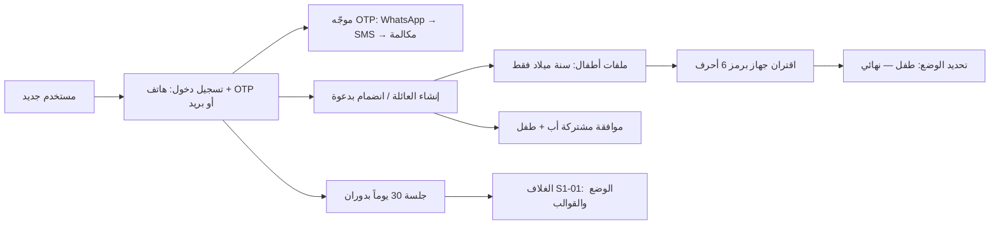
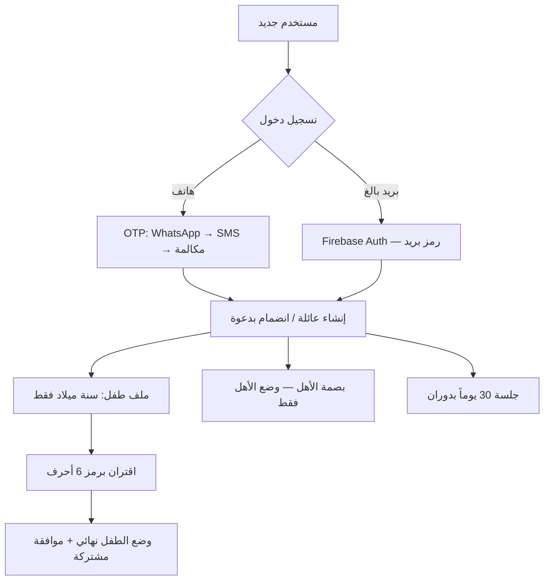
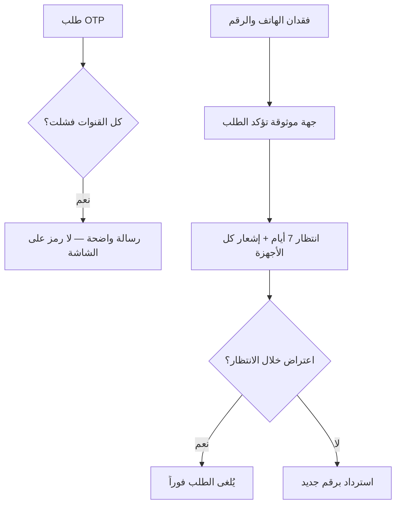
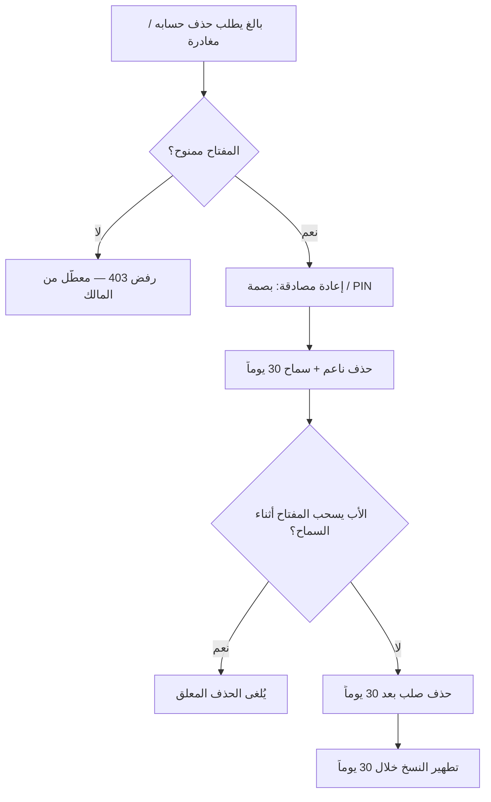

# S1-02: الهوية والتهيئة العائلية (Identity & Onboarding)

- **الحالة:** approved | **المرحلة:** 1 (نواة الحماية) · **آخر تحديث:** 2026-11-05
- **القرارات الحاكمة:** Q-001 · Q-002 · Q-005 · Q-006 · Q-007 · Q-008 · Q-021 · Q-022 · Q-062 · Q-063 · Q-065 · Q-068 · Q-070 · Q-071 · Q-072 · Q-073 · Q-074 · Q-075 · Q-076 · Q-077 · Q-079 · Q-080 · Q-084 · Q-106 · Q-137 · D-006 · D-007 · D-023 · D-038 · G-006 · G-011
- **حالة المراجعة:** الأقسام 1–8 + §10 معتمدة بالكامل في التخطيط — حكم المالك 2026-11-06 · **§9 في مرحلة التصميم (Q-091)**.
- **الأدلة المرجعية:** المواصفة القديمة S1-02 (مرجع فقط، G-009) · Deep-dives: Telegram (phone verification + SmsRetriever) · FamilyWall (family creation + child accounts w/o contact data) · Bark Kids (device-code pairing) · Qustodio (parent/child account model) · S1-01 (معتمد — الوضع يتحدد بالإقران)

## 1. الهدف والتحليل والنطاق

يمثل هذا النظام نقطة البداية الحقيقية لكل مستخدم: تسجيل الدخول برقم الهاتف أو بالبريد الإلكتروني، إنشاء العائلة وتسميتها، انضمام البالغين بدعوة، إنشاء ملفات الأطفال (بلا بيانات اتصال)، واقتران أجهزة الأطفال — مع موافقة مشتركة (أب + طفل) مرة واحدة.

**مخطط سياق النظام (§1 — بصري):**

**داخل النطاق:**
- تسجيل الدخول: رقم هاتف + OTP عبر الموجّه (WhatsApp أولاً → SMS مجمّع → مكالمة فائتة) **أو بريد إلكتروني للبالغين** (التحقق عبر Firebase Auth: رمز يُرسل بالبريد؛ الخادم يتحقق من ID Token ويصدر رموز الجلسة) + TOTP داخل التطبيق بعد أول تحقق.
- الجلسات: Access Token + Refresh Token بدوران آمن؛ مدة الجلسة 30 يوماً.
- إنشاء العائلة: التسمية + اختيار المنطقة (`region`)؛ رموز الدعوة تتولد عشوائياً لكل طلب انضمام (Q-076).
- انضمام البالغين: رمز دعوة + روابط عميقة (Deep Links).
- ملفات الأطفال: ينشئها الأب/المفوَّض فقط؛ بلا بيانات اتصال؛ اسم مستعار + صورة رمزية + لون + سنة ميلاد.
- اقتران أجهزة الأطفال: رمز جهاز (6 أحرف)؛ شهادة جهاز؛ تحديد الوضع عند الإقران.
- الموافقة المشتركة: إعداد مشترك (أب + طفل) مرة واحدة.
- فتح سريع بالبصمة/الوجه للأهل (وضع الأهل فقط).

**خارج النطاق:**
- محرك تقييم الصلاحيات وتفويضها (نظام الأدوار والصلاحيات).
- محرك الفرض وشاشات الحظر (نظام الحماية).
- الخطط والدفع (نظام الفوترة).
- تبديل الملفات (مؤجل للمرحلة 2 — أولوية، Q-063).

## 2. سيناريوهات المستخدم

### سيناريو 2-1: أب ينشئ عائلة جديدة لأول مرة
- **الممثل:** أب بلا حساب.
- **السياق:** أول تثبيت للتطبيق على جهاز الأهل.
- **التدفق:**
  1. يدخل الأب رقم هاتفه؛ التطبيق يتحقق من الصيغة الدولية (REQ-019).
  2. يصل OTP عبر WhatsApp أولاً؛ إن فشل التوصيل يتحول تلقائياً لـ SMS ثم مكالمة فائتة (REQ-002).
  3. يُدخل الرمز (أو يُقرأ تلقائياً من SMS حيث يدعم الجهاز)؛ بعد أول تحقق ناجح يُفعَّل TOTP داخل التطبيق (REQ-004/REQ-005).
  4. يسمّي العائلة ويختار المنطقة (`region`)؛ يُنشئ الحساب ويصبح المالك تلقائياً (`is_owner`)؛ رموز الدعوة تتولد عشوائياً لكل طلب انضمام (REQ-009/REQ-010).
- **النتيجة:** عائلة واحدة للحساب؛ المنشئ مالك؛ جلسة 30 يوماً بدوران Refresh (REQ-006/REQ-008).

### سيناريو 2-2: أم تنضم إلى العائلة برابط عميق
- **الممثل:** أم (بالغة).
- **السياق:** الأب أرسل لها رابط دعوة.
- **التدفق:**
  1. تضغط الأم الرابط؛ التطبيق يفتح على شاشة الانضمام مع رمز الدعوة معبّأً (REQ-009).
  2. تسجّل الدخول برقم هاتفها وOTP (REQ-001/REQ-002).
  3. تُقبل الدعوة وتدخل العائلة بدور `adult` بلا صلاحيات إشرافية حتى يفوّضها الأب (Q-007).
- **النتيجة:** عضوية بالغة في العائلة؛ الانضمام مسجَّل في `AuditEvent`.

### سيناريو 2-3: أب ينشئ ملف طفل ويقترن جهازه برمز
- **الممثل:** الأب + الطفل.
- **السياق:** جهاز الطفل جديد؛ الأب يجهزه.
- **التدفق:**
  1. ينشئ الأب ملف الطفل: اسم مستعار + صورة رمزية + لون + سنة ميلاد فقط — بلا هاتف أو بريد (REQ-011/REQ-012).
  2. يحدد سنة الميلاد قالب العرض تلقائياً (REQ-013).
  3. يصدر الأب رمز جهاز (6 أحرف)؛ يدخله الطفل على جهازه فيُقترن الجهاز وتُتبادل شهادة الجهاز ويُحدد الوضع (طفل) نهائياً (REQ-014).
  4. يتم الإعداد المشترك (أب + طفل) مرة واحدة وتُسجَّل الموافقة المشتركة (REQ-017).
- **النتيجة:** جهاز الطفل في وضع الطفل؛ لا حساب للطفل ولا بيانات اتصال له.

### سيناريو 2-4: أب يفتح التطبيق بالبصمة
- **الممثل:** الأب (وضع الأهل).
- **السياق:** جلسة سارية؛ التطبيق مغلق.
- **التدفق:**
  1. يفتح الأب التطبيق ويضع بصمته؛ يُفتح وضع الأهل مباشرة (REQ-016).
  2. البصمة لا تفتح وضع الطفل أبداً ولا تتجاوز بوابة الوالدين.
  3. بعد 3 محاولات بصمة فاشلة يُطلب PIN/OTP.
- **النتيجة:** فتح سريع للأهل فقط؛ أمان البوابة محفوظ (Q-065/Q-072).

### سيناريو 2-5: فشل كل قنوات OTP
- **الممثل:** أب يحاول تسجيل الدخول.
- **السياق:** شبكة ضعيفة؛ WhatsApp وSMS والمكالمة الفائتة كلها فشلت.
- **التدفق:**
  1. يفشل WhatsApp → يتحول تلقائياً لـ SMS → يفشل → مكالمة فائتة → تفشل (REQ-002).
  2. تظهر رسالة واضحة: "تعذر الإرسال — حاول لاحقاً"؛ لا يُعرض الرمز على الشاشة أبداً.
  3. يُسجَّل الفشل للمراقبة؛ إعادة المحاولة متاحة بعد فاصل.
- **النتيجة:** لا تسجيل دخول دون تحقق؛ لا تسريب للرمز.

### سيناريو 2-6: أب يسجل دخوله بالبريد الإلكتروني
- **الممثل:** الأب (بالغ).
- **السياق:** يفضل البريد على الهاتف، أو هاتفه بلا تغطية.
- **التدفق:**
  1. يدخل الأب بريده الإلكتروني؛ يتحقق التطبيق من صيغته (REQ-022).
  2. يرسل Firebase Auth رمزاً إلى البريد؛ يدخله الأب في التطبيق (REQ-023).
  3. يتحقق الخادم من ID Token عبر Firebase Admin SDK ويصدر رموز الجلسة (30 يوماً بدوران) (REQ-023/Q-075).
  4. إن تعذر Firebase يعرض التطبيق خيار الهاتف وOTP دون انقطاع (REQ-024).
- **النتيجة:** دخول بالبريد كبديل كامل للهاتف؛ البريد للبالغين فقط.

### سيناريو 2-7: أب يسترد حسابه بعد فقدان هاتفه ورقمه (جديد — من حكم Q-077)
- **الممثل:** الأب + جهة الاسترداد الموثوقة (بالغ في العائلة حدده الأب مسبقاً).
- **السياق:** فقد الأب هاتفه ورقم هاتفه معاً.
- **التدفق:**
  1. يطلب الأب الاسترداد من جهاز جديد برقم جديد؛ يحدد جهة الاسترداد الموثوقة (REQ-020).
  2. تؤكد جهة الاسترداد الطلب؛ تبدأ فترة انتظار 7 أيام، ويُشعَر كل جهاز في العائلة بالطلب (REQ-020).
  3. إن اعترض أي بالغ خلال الانتظار يُلغى الطلب فوراً؛ وإلا يُسترد الحساب بالرقم الجديد بعد 7 أيام.
- **النتيجة:** استرداد آمن بلا فريق دعم؛ لا استيلاء صامت على الحساب.

### سيناريو 2-8: بالغ يغادر العائلة بعد أن سحب الأب الإذن (جديد — من حكم Q-166)
- **الممثل:** أم (بالغة) + الأب (المالك).
- **السياق:** الأم تريد حذف حسابها؛ الأب سحب مفتاح `identity.account.delete_self` منها أمس.
- **التدفق:**
  1. الأم تطلب حذف حسابها من الإعدادات؛ الخادم يرفض (المفتاح غير ممنوح — deny-override) مع رسالة واضحة: «الحذف معطَّل من مالك العائلة».
  2. الأب يعيد منح المفتاح (منح حساس: PIN + تحدي Q-164)؛ الأم تعيد الطلب مع بصمتها.
  3. يُقبل الطلب: حذف ناعم + فترة سماح 30 يوماً؛ تُبطل جلساتها فوراً وتُشعَر العائلة؛ وخلال السماح تستطيع الأم إلغاء الحذف.
  4. إن سحب الأب المفتاح أثناء السماح — يُلغى الحذف المعلق فوراً.
- **النتيجة:** الصلاحية بيد الأب فعلاً لا قولاً؛ والافتراضي السماح، والتشديد صارم وحقيقي.

**مخطط رحلة التهيئة (§2 — بصري):**

**مخطط الفشل والاسترداد (§2 — بصري):**

**مخطط الحذف والمغادرة (§2 — بصري):**

## 3. المتطلبات الوظيفية

- **REQ-001:** تسجيل الدخول برقم هاتف دولي (رمز الدولة حسب المنطقة) أو بريد إلكتروني؛ الهاتف هو وسيلة المصادقة الأساسية، والبريد بديل موازٍ للبالغين. [D-007 · DERIVED]
- **REQ-002:** OTP عبر الموجّه بالترتيب: WhatsApp أولاً → SMS مجمّع → مكالمة فائتة؛ التحويل التلقائي عند فشل التوصيل؛ رسائل SMS الاحتياطية عبر الموجّه تُحسب من حصة SMS لخطة العائلة (Q-106). [Q-021 · DERIVED]
- **REQ-003:** رمز OTP صالح 5 دقائق؛ إعادة الإرسال بعد 60 ثانية؛ بعد 5 رموز خاطئة يُقفل الطلب 15 دقيقة. [Q-021/Q-079 · DERIVED]
- **REQ-004:** قراءة OTP تلقائياً من SMS عند توفرها (دون أن يكتبه المستخدم) — حيث يدعم الجهاز ذلك. [VERIFIED: Telegram SmsRetriever · DERIVED]
- **REQ-005:** بعد أول تحقق ناجح يُفعَّل TOTP داخل التطبيق لعمليات الدخول اللاحقة الحساسة. [Q-021 · DERIVED]
- **REQ-006:** الجلسة: Access Token قصير + Refresh Token بدوران آمن؛ مدة الجلسة 30 يوماً؛ تسجيل الخروج يبطل كل الرموز فوراً. [Q-075 · DERIVED]
- **REQ-007:** إنشاء العائلة: التسمية + اختيار المنطقة (`region`)؛ المنشئ يصبح المالك (`is_owner` على دور `adult`) تلقائياً. [Q-005/Q-006/Q-008 · DERIVED]
- **REQ-008:** عائلة واحدة لكل حساب في MVP؛ محاولة إنشاء عائلة ثانية تُرفض برسالة واضحة. [Q-008 · DERIVED]
- **REQ-009:** انضمام البالغين برمز دعوة عشوائي يتولد لكل طلب (REQ-010) أو رابط عميق يحمل الرمز. [Q-074/Q-076 · DERIVED]
- **REQ-010:** رمز الدعوة عشوائي يتولد لكل طلب انضمام؛ استخدام واحد؛ صالح 7 أيام؛ المالك يلغي أي رمز معلق في أي وقت؛ كل انضمام يتطلب تحقق الهاتف/OTP ويُسجَّل في التدقيق. [Q-076 · DERIVED]
- **REQ-011:** ملفات الأطفال ينشئها الأب/المفوَّض فقط؛ لا يُطلب من الطفل رقم هاتف أو بريد أو بيانات مصرفية إطلاقاً. [D-006 · DERIVED]
- **REQ-012:** ملف الطفل: اسم مستعار + صورة رمزية + لون + سنة ميلاد فقط (لا تاريخ ميلاد كامل). [Q-073 · DERIVED]
- **REQ-013:** سنة الميلاد تحدد الدور والقالب تلقائياً: دون 7 سنوات → `child` بقالب `minimal`؛ 7–12 → `child` بقالب `standard`؛ 13–17 → `teen` بقالب `standard`. الحد 13 حد قانوني (معيار COPPA؛ بوابة «دون السن» في Quizlet)؛ حد 7 قرار تصميم خاص بنا (D-038). [Q-080 · DERIVED]
- **REQ-014:** اقتران جهاز الطفل برمز جهاز (6 أحرف) يصدره الأب؛ عند الإقران تُتبادل شهادة الجهاز ويُحدد الوضع (طفل) نهائياً للجهاز في المرحلة 1. [Q-071/Q-062 · DERIVED]
- **REQ-015:** جهاز مُقترن لعائلة لا يُقترن لعائلة أخرى دون فك إقران صريح من الأب (يتطلب PIN الأب، Q-065). [Q-062/Q-065 · DERIVED]
- **REQ-016:** فتح سريع بالبصمة/الوجه للأهل في وضع الأهل فقط؛ لا يتجاوز بوابة الوالدين أبداً ولا يفتح وضع الطفل. **تغيير بصمة الأب يُبطل مفتاح توقيع الجهاز** (REQ-023 في S1-01) ويتطلب إعادة تسجيله بـ PIN قبل أي عملية حساسة (Q-164). [Q-072/Q-065 · Q-164 · DERIVED]
- **REQ-017:** الموافقة المشتركة: إعداد مشترك (أب + طفل) مرة واحدة عند أول اقتران؛ شفافية عن الفئات المراقَبة لا عن المحتوى؛ تُسجَّل الموافقة في التدقيق. [G-006/D-023 · DERIVED]
- **REQ-018:** كل شاشات التهيئة عربي وإنجليزي؛ الافتراضي العربية. [Q-070 · DERIVED]
- **REQ-019:** رقم الهاتف يُتحقق من صيغته الدولية قبل إرسال OTP؛ رقم غير صالح يُرفض فوراً برسالة واضحة. [Q-005/Q-021 · DERIVED]
- **REQ-020:** استرداد الحساب عند فقدان الهاتف والرقم: الأب يحدد جهة استرداد موثوقة مسبقاً (بالغ في العائلة)؛ عند الطلب تؤكد الجهة، وتبدأ فترة انتظار 7 أيام مع إشعار كل أجهزة العائلة؛ الاعتراض خلال الانتظار يلغي الطلب؛ بعدها يُسترد الحساب برقم جديد. [Q-077 · DERIVED]
- **REQ-021:** سنة الميلاد تُقبل فقط ضمن نطاق معقول: السنة الحالية ناقص 99 إلى السنة الحالية؛ خارج النطاق تُرفض برسالة واضحة. [VERIFIED: Qustodio Kids `newKid` validation · Q-080 · DERIVED]
- **REQ-022:** تسجيل الدخول بالبريد الإلكتروني بديل موازٍ للهاتف للبالغين فقط؛ البريد لا يُطلب من الطفل إطلاقاً (D-006)؛ صيغة البريد تُتحقق قبل إرسال الرمز. [Q-084 · DERIVED]
- **REQ-023:** التحقق بالبريد عبر Firebase Auth: رمز يُرسل إلى بريد الأب؛ العميل يحصل على ID Token من Firebase؛ الخادم يتحقق من الـ ID Token عبر Firebase Admin SDK ثم يصدر رموز الجلسة الخاصة بنا (Q-075). Firebase موصّل مصادقة لا سلطة — بيانات العائلة لا تعيش فيه. [Q-084 · DERIVED]
- **REQ-024:** عند تعذر الوصول إلى Firebase (انقطاع أو حجب) يبقى تسجيل الدخول بالهاتف وOTP يعمل؛ لا يعتمد النظام على Firebase وحدها. [Q-084 · DERIVED]
- **REQ-025:** حذف الحساب للبالغ نفسه: عبر `DELETE /api/v1/identity/me` بشرط مفتاح `identity.account.delete_self` (يُمنح تلقائياً عند الانضمام — الافتراضي السماح — والأب يلغيه فردياً) + إعادة مصادقة (بصمة/PIN)؛ حذف ناعم + فترة سماح 30 يوماً ثم حذف صلب؛ وإلغاء الحذف المعلق عبر `POST /api/v1/identity/me/deletion/cancel`؛ وإلغاء المفتاح أثناء السماح يُلغي الحذف المعلق. [Q-166 · DIRECT]
- **REQ-026:** مغادرة العائلة للبالغ نفسه: عبر `POST /api/v1/identity/me/leave` بشرط مفتاح `identity.family.leave` (الافتراضي ممنوح عند الانضمام)؛ فورية؛ والمالك لا يغادر. [Q-166 · DIRECT]
- **REQ-027:** التصدير: البالغ يصدّر بياناته عبر `POST /api/v1/identity/me/export`؛ والأب يصدّر بيانات قاصر عبر `POST /api/v1/identity/families/{id}/members/{memberId}/export`؛ الصيغة JSON + وسائط؛ مهمة غير متزامنة؛ رابط التنزيل 7 أيام. [Q-166 · DIRECT]
- **REQ-028:** الحذف الناعم: `person` و`family` تحملان `deleted_at` + `scheduled_purge_at`؛ وكل طلب حذف يُسجَّل في `deletion_request` (النوع/الطالب/الوقت/موعد التطهير/الحالة). [Q-166 · DIRECT]

## 4. الواجهات والعقود

### 4.1 عقود الخادم (Ktor REST — `/api/v1/identity/`)

- `POST /api/v1/identity/otp/request` — body: `{phone, region}` → `{channel, expires_in}` (200؛ 400 رقم غير صالح؛ 429 بعد 5 طلبات فاشلة).
- `POST /api/v1/identity/otp/verify` — body: `{phone, code}` → `{access_token, refresh_token, totp_enrolled}` (200؛ 401 رمز خاطئ؛ 423 مقفل مؤقتاً).
- `POST /api/v1/identity/totp/enroll` — body: `{}` → `{secret, qr}` (بعد أول تحقق ناجح).
- `POST /api/v1/identity/sessions/refresh` — body: `{refresh_token}` → `{access_token, refresh_token}` (دوران: القديم يُبطل).
- `POST /api/v1/identity/sessions/logout` — يبطل كل رموز الجلسة فوراً.
- `POST /api/v1/identity/families` — body: `{name, region}` → `{family_id, invite_code}` (المنشئ مالك تلقائياً؛ الرمز المعاد هو أول رمز دعوة لكل طلب — استخدام واحد، 7 أيام، Q-076؛ REQ-009/REQ-010).
- `POST /api/v1/identity/families/{id}/invite` — يولّد رمز دعوة عشوائياً جديداً (استخدام واحد، 7 أيام) → `{invite_code, expires_at}` (للمالك/المفوَّض).
- `POST /api/v1/identity/families/join` — body: `{invite_code}` → `{family_id, role: adult}`.
- `POST /api/v1/identity/children` — body: `{nickname, avatar, color, birth_year}` → `{membership_id}` (الأب/المفوَّض فقط؛ بلا بيانات اتصال).
- `POST /api/v1/identity/devices/pair` — body: `{pairing_code, device_cert}` → `{device_id, mode: child}`.
- `POST /api/v1/identity/email/verify` — body: `{firebase_id_token}` → `{access_token, refresh_token}` (الخادم يتحقق من الـ ID Token عبر Firebase Admin SDK؛ البريد للبالغين فقط؛ بريد مسجل لحساب آخر يُرفض).
- `DELETE /api/v1/identity/me` — حذف الحساب لنفسه (بالغ فقط؛ يتطلب `identity.account.delete_self` + إعادة مصادقة ببصمة/PIN) → `{status: "pending_deletion", purge_at}` — حذف ناعم + سماح 30 يوماً (Q-166).
- `POST /api/v1/identity/me/leave` — مغادرة العائلة (بالغ فقط؛ يتطلب `identity.family.leave`) → `{status: "left"}` — فورية؛ والمالك لا يغادر (Q-166).
- `POST /api/v1/identity/me/deletion/cancel` — إلغاء حذف حساب معلَّق خلال السماح → `{status: "active"}` (Q-166).
- `POST /api/v1/identity/me/export` — تصدير بياناتي (JSON + وسائط؛ مهمة غير متزامنة؛ رابط 7 أيام) → `{export_id, status: "preparing"}` (Q-166).
- `POST /api/v1/identity/families/{id}/members/{memberId}/export` — الأب يصدّر بيانات قاصر (Q-166).
- الأخطاء: صيغة موحدة `{code, message_ar, trace_id}`؛ كل طلب يحمل سياق `family_id` حيث ينطبق؛ رفض أي طلب خارج العائلة (403).

### 4.2 عقود العميل

- `MethodChannel("familyos/identity")`: `readOtpSms() -> String?` (قراءة تلقائية حيث يدعم الجهاز)؛ `biometricUnlock() -> bool` (وضع الأهل فقط).
- Firebase Auth SDK (العميل): طلب رمز البريد والتحقق منه؛ لا يعتمد على خدمات Google Play (يعمل عبر الشبكة فقط) — يُتحقق منه في مختبر Q-027.

## 5. البيانات — النموذج

| الجدول | الحقول الرئيسية | ملاحظة |
|---|---|---|
| `person` | `id`, `phone` (للبالغين فقط)، `email` (للبالغين فقط، فريد، قابل لأن يكون فارغاً)، `display_name`, `created_at`, `deleted_at`, `scheduled_purge_at` | لا هاتف ولا بريد للطفل إطلاقاً (D-006)؛ حذف ناعم + سماح 30 يوماً (Q-166) |
| `phone_verification` | `id`, `phone`, `channel`, `code_hash`, `attempts`, `expires_at`, `verified_at` | `code_hash` فقط — لا يُحفظ الرمز نصاً |
| `session` | `id`, `person_id`, `refresh_token_hash`, `expires_at`, `revoked_at` | دوران Refresh؛ الإبطال فوري |
| `family` | `id`, `name`, `region`, `created_by`, `created_at`, `deleted_at`, `scheduled_purge_at` | عائلة واحدة لكل حساب (Q-008)؛ حذف ناعم + سماح 30 يوماً (Q-166) |
| `membership` | `id`, `family_id`, `person_id`, `role`, `is_owner` | (من النواة المشتركة)؛ `person_id` قابل لأن يكون فارغاً — للطفل يُترك فارغاً: صف عضوية بالملف فقط بلا حساب `person` (D-006 · Q-137) |
| `invite_code` | `id`, `family_id`, `code`, `created_by`, `expires_at`, `uses` | عشوائي لكل طلب؛ استخدام واحد؛ 7 أيام (Q-076) |
| `child_profile` | `id`, `family_id`, `membership_id`, `nickname`, `avatar`, `color`, `birth_year` | بلا هاتف/بريد (D-006)؛ سنة فقط (Q-073)؛ `membership_id` يشير إلى صف عضوية الطفل — و`person_id` في ذلك الصف فارغ (Q-137) |
| `device_pairing` | `id`, `family_id`, `device_id`, `pairing_code_hash`, `mode`, `paired_at`, `paired_by` | الوضع يُحدد عند الإقران (Q-062) |
| `consent_record` | `id`, `family_id`, `type` (`joint_onboarding`), `granted_by`, `granted_at` | الموافقة المشتركة (G-006) |
| `deletion_request` | `id`, `family_id`, `person_id`, `type` (`family`\|`member`\|`account`), `requested_by`, `requested_at`, `purge_at`, `status` (`pending`\|`completed`\|`cancelled`) | فترة السماح 30 يوماً (Q-166) |

**قاعدة ملزمة:** جداول العائلة تحمل `family_id` + عزل RLS (D-021)؛ أما جداول السجل العالمية فبلا `family_id` (صياغة S1-03 §5)؛ كل حدث هوية/إقران في `AuditEvent`.

## 6. القواعد والصلاحيات

| المفتاح (`domain.action`) | من يملكه | ملاحظة |
|---|---|---|
| `identity.login` | أي مستخدم (قبل المصادقة) | OTP فقط |
| `identity.email.login` | أي مستخدم (قبل المصادقة، بالبريد) | طريقة موازية للهاتف؛ البالغون فقط |
| `identity.family.create` | أي بالغ مصادق عليه (بلا عائلة بعد) | يصبح مالكاً تلقائياً |
| `identity.family.invite` | المالك أو بالغ مفوَّض | توليد/عرض رمز الدعوة |
| `identity.family.join` | أي بالغ مصادق عليه (برمز صحيح) | |
| `identity.child.create` | الأب/المفوَّض فقط | D-006 |
| `identity.child.profile.edit` | الأب/المفوَّض فقط | |
| `identity.device.pair` | الأب/المفوَّض فقط (يصدر الرمز) | Q-071 |
| `identity.device.unpair` | المالك فقط + PIN | Q-065 |
| `identity.session.revoke` | صاحب الجلسة أو المالك | |
| `identity.biometric.enable` | الأب (وضع الأهل فقط) | لا يتجاوز البوابة (Q-072) |
| `identity.member.remove` | المالك فقط + PIN | إزالة أي عضو (Q-166) |
| `identity.account.delete_self` | البالغ نفسه — بمنح مسبق من الأب (الافتراضي ممنوح عند الانضمام — Q-166) | حذف الحساب لنفسه؛ حساس |
| `identity.family.leave` | البالغ نفسه — بمنح مسبق من الأب (الافتراضي ممنوح عند الانضمام — Q-166) | مغادرة العائلة؛ حساس |

**ثوابت صلبة:** deny-override (Q-007)؛ الأطفال لا ينشئون حسابات ولا يملكون صلاحيات إشرافية (D-006/D-038)؛ الغموض يُفسَّر لصالح حماية الطفل؛ `scope` و`valid_until` إلزاميان في كل منح.

**بذرة الانضمام (Q-166):** مفتاحا `identity.account.delete_self` و`identity.family.leave` يُمنحان تلقائياً لكل بالغ عند الانضمام (الافتراضي: السماح) — لا عبر القوالب؛ والأب يلغيهما فردياً في أي وقت (الإلغاء فوري — S1-03 سيناريو 3-7)؛ وإلغاؤهما أثناء فترة سماح حذف معلَّق يُلغي الحذف المعلق؛ والمفتاحان مصنَّفان «حساس» في السجل المركزي — البذرة التلقائية لا تحتاج تحققاً (ليست منحاً بمبادرة الأب)، أما إعادة المنح بعد إلغاء فتتطلب PIN/بصمة الأب مثبَتة بالتحدي (Q-088/Q-164). والمالك لا يُمنح `identity.family.leave` أبداً.

## 7. الحالات الحدية والأخطاء

- **فشل كل قنوات OTP:** بعد فشل WhatsApp ثم SMS ثم المكالمة الفائتة → رسالة واضحة + إعادة المحاولة لاحقاً؛ لا يُعرض الرمز على الشاشة أبداً.
- **رمز OTP خاطئ 5 مرات:** قفل الطلب 15 دقيقة (Q-079).
- **رمز دعوة منتهٍ/غير صالح:** رفض برسالة واضحة؛ لا يُكشف إن كان الرمز موجوداً أصلاً.
- **رمز إقران منتهٍ:** رموز الإقران صالحة 15 دقيقة (Q-079)؛ بعدها يولّد الأب رمزاً جديداً.
- **جهاز مُقترن لعائلة أخرى:** يُرفض الإقران؛ فك الإقران يتطلب PIN أب العائلة الأولى.
- **فقدان الهاتف/الشريحة:** مسار الاسترداد عبر جهة موثوقة + انتظار 7 أيام + إشعار كل الأجهزة (Q-077)؛ الاعتراض خلال الانتظار يلغي الطلب.
- **بصمة تفشل repeatedly:** بعد 3 محاولات فاشلة يُطلب PIN/OTP؛ البصمة لا تفتح وضع الطفل أبداً.
- **انقطاع أثناء الإقران:** العملية ذرية — إما يكتمل الإقران كاملاً (شهادة + وضع + عضوية) أو لا شيء.
- **البريد لم يصل:** إعادة الإرسال بعد 60 ثانية (Q-079)؛ تذكير بفحص البريد غير المرغوب فيه؛ بعد 5 محاولات خاطئة يُقفل الطلب 15 دقيقة.
- **Firebase غير متاح:** يُعرض خيار الهاتف وOTP تلقائياً؛ لا يتوقف تسجيل الدخول (REQ-024).
- **بريد مسجل لحساب آخر:** يُرفض الربط برسالة واضحة؛ لا يُكشف لمن ينتمي البريد.

## 8. معايير القبول

- **ACC-001:** تسجيل الدخول برقم الهاتف يعمل عبر WhatsApp أولاً؛ عند فشلها يتحول تلقائياً لـ SMS ثم مكالمة فائتة. [REQ-002]
- **ACC-002:** رمز OTP صالح 5 دقائق؛ إعادة الإرسال بعد 60 ثانية؛ 5 أخطاء تقفل 15 دقيقة. [REQ-003]
- **ACC-003:** بعد أول تحقق ناجح يُفعَّل TOTP داخل التطبيق. [REQ-005]
- **ACC-004:** إنشاء عائلة يجعل المنشئ مالكاً تلقائياً؛ عائلة ثانية تُرفض. [REQ-007/REQ-008]
- **ACC-005:** بالغ ينضم برمز الدعوة أو رابط عميق ويدخل بدور `adult`. [REQ-009]
- **ACC-006:** ملف طفل يُنشأ بلا أي بيانات اتصال؛ سنة الميلاد فقط؛ القالب يُحدد تلقائياً (دون 7 → minimal). [REQ-011/REQ-012/REQ-013]
- **ACC-007:** اقتران جهاز برمز (6 أحرف) يحدد وضع الطفل؛ جهاز مُقترن لعائلة أخرى يُرفض. [REQ-014/REQ-015]
- **ACC-008:** البصمة/الوجه تفتح وضع الأهل فقط؛ لا تفتح وضع الطفل ولا تتجاوز بوابة الوالدين. [REQ-016]
- **ACC-009:** الموافقة المشتركة تُسجَّل مرة واحدة عند أول اقتران. [REQ-017]
- **ACC-010:** كل شاشات التهيئة عربي وإنجليزي؛ الافتراضي العربية. [REQ-018]
- **ACC-011:** أب يسجل دخوله بالبريد: يصله الرمز، يدخله، وتُصدر الجلسة (30 يوماً بدوران). [REQ-022/REQ-023]
- **ACC-012:** عند تعذر Firebase يعمل تسجيل الدخول بالهاتف وOTP دون انقطاع. [REQ-024]
- **ACC-013:** استرداد الحساب يعمل: جهة موثوقة تؤكد، انتظار 7 أيام مع إشعار كل الأجهزة، ثم الاسترداد برقم جديد. [REQ-020]
- **ACC-014:** بالغ بلا مفتاح حذف يطلب حذف حسابه: يُرفض 403 مع سبب واضح؛ وبعد إعادة المنح + بصمته يُقبل الطلب: حذف ناعم + سماح 30 يوماً؛ وإلغاء المفتاح أثناء السماح يُلغي الحذف. [REQ-025]
- **ACC-015:** تصدير بيانات قاصر: الأب يطلبه فيحصل على أرشيف JSON + وسائط برابط 7 أيام؛ وبعد 7 أيام ينتهي الرابط. [REQ-027]

## 9. قائمة الشاشات

في مرحلة التصميم.

## 10. خطة التنفيذ

- **ترتيب البناء:** الجداول + RLS ← موجّه OTP (WhatsApp → SMS → مكالمة فائتة) + TOTP ← قراءة SMS تلقائية ← الجلسات (30 يوماً بدوران Refresh) ← إنشاء العائلة + المنطقة ← رموز الدعوة (عشوائي لكل طلب، 7 أيام، استخدام واحد) + الروابط العميقة ← ملفات الأطفال (سنة ميلاد فقط + قالب حسب العمر) ← اقتران الأجهزة (رمز 6 أحرف + شهادة + تحديد الوضع) ← البصمة/الوجه (وضع الأهل فقط) ← الدخول بالبريد عبر Firebase Auth (موصّل لا سلطة + احتياطي الهاتف) ← استرداد الحساب (جهة موثوقة + انتظار 7 أيام + إشعار كل الأجهزة) ← الموافقة المشتركة ← الشاشات بعد مرحلة التصميم.
- **بذرة المفاتيح:** مفاتيح S1-02 الأربعة عشر (§6) تُزرع في سجل `permission_key` المركزي (S1-03 §10-1 — القائمة الموحدة 82 مفتاحاً).
- **الوحدات:** وحدة Ktor باسم `identity`؛ وشاشات Flutter للهوية والتهيئة؛ ووحدة Kotlin للبصمة + قراءة SMS + الروابط العميقة.
- **الاعتماديات:** S1-01 (الوضع يتحدد بالإقران) · S1-03 (الأدوار) · Q-021 (موجّه OTP) · Q-022 (MQTT — إشعار كل الأجهزة في الاسترداد) · مختبر Q-027 (التحقق من عمل Firebase بلا خدمات Google Play).
- **الاختبارات:** وحدة (انتهاء OTP/القفل؛ انتهاء رمز الدعوة؛ التحقق من سنة الميلاد؛ القالب حسب العمر؛ دوران Refresh) · تكامل (سلسلة تحويل OTP؛ إقران ذري؛ دخول بالبريد + احتياطي الهاتف؛ استرداد مع انتظار 7 أيام + اعتراض) · قبول ACC-001…013 · أمن (code_hash فقط؛ لا رمز في السجلات؛ رمز الدعوة غير قابل للتخمين).

## أسئلة مفتوحة (من هذه المواصفة)

- **Q-090 (جديد):** محتوى قوالب العرض الثلاثة (`minimal` دون 7 / `standard` للطفل / `standard` للمراهق) — ما الذي يعرضه كل قالب برمجياً (شاشات/حقول/أزرار/ما يُخفى)؟ المواصفة تحدد *أي* قالب لكل عمر (REQ-013) فقط، لا *ماذا يحتوي*؛ يُجاب مع §9 في مرحلة التصميم (توضيح المالك 2026-11-05).

## ملحق أ: الاستخلاص من الهندسة العكسية (RE) — ما نُعيد استخدامه فعلاً

| المصدر المفكك | الآلية المستخلصة | أين تُستخدم في S1-02 |
|---|---|---|
| Telegram | تدفق التحقق برقم الهاتف + قراءة SMS تلقائية (`SmsRetriever`) | تسجيل الدخول + تعبئة OTP تلقائياً (REQ-001/REQ-004) |
| Telegram | مهلة OTP ذكية وتحويل تلقائي للقناة التالية | موجّه OTP (REQ-002) |
| FamilyWall | إنشاء دائرة العائلة + حسابات أطفال دون بيانات اتصال | تأسيس العائلة + ملفات الأطفال (REQ-007/REQ-011) |
| Bark Kids | الإقران برمز جهاز يصدره الأب | اقتران أجهزة الأطفال (REQ-014) |
| Qustodio | نموذج حساب الأهل + ملفات الأطفال المرتبطة | بنية العضوية (REQ-007/REQ-011) |
| Qustodio Kids | التحقق من سنة الميلاد كنطاق معقول (السنة الحالية − 99 … السنة الحالية) مع خطأ `error_birth_year_invalid` | قاعدة التحقق من سنة الميلاد (REQ-021) |
| Quizlet | بوابة «دون السن» — مطالبة بريد الأب عند التسجيل دون السن القانونية | حد الدور 13: `child` حتى 12 / `teen` من 13 (REQ-013) — العتبة معيار COPPA؛ القرار في الخادم عند Quizlet |
| FamiSafe Jr | الدخول/الإقران برمز إقران (`CodeLoginActivity`): إدخال يدوي عبر `VerificationCodeView` أو مسح QR بالكاميرا، مع تحقق خادمي (200 نجاح / 470 رمز خاطئ `wrong_pair_code`) | اقتران أجهزة الأطفال برمز (REQ-014) + رسالة الرمز الخاطئ في الحالات الحدية (§7) |
