# S1-03: مخططات هندسة البرمجيات (DIAGRAMS)

- **الحالة:** معتمدة — المخططات الستة معتمدة (حكم المالك 2026-11-08 — D-2، بعد موجة الإصلاح 0e4a3e2..f7da470)؛ والمواصفة معتمدة بالكامل في التخطيط؛ **وأُعيد رسمها كلها 2026-11-16 على التصميم المعتمد (Q-401 · Q-402) — تأكيد المالك للرسم الجديد بكلمة (Q-289) لم يصدر بعد**
- **المواصفة:** `SPEC.md` (§§1–8 + §10 معتمدة بالكامل في التخطيط)
- **السياق المحدد (Bounded Context):** #2 الصلاحيات (Permissions) — `CONTEXT-MAP.md` §2 صف 2
- **القرارات الحاكمة:** Q-001 · Q-003 · Q-006 · Q-007 · Q-010 · Q-065 · Q-072 · Q-080 · Q-085 · Q-086 · Q-087 · Q-088 · Q-089 · Q-093 · Q-164 · Q-166 · Q-189 · Q-174 · Q-201 · Q-204 · Q-227 · Q-232 · Q-235 · Q-248 · Q-250 · D-006 · D-021 · D-023 · D-038 · G-006 · G-011 · Q-168 · Q-329 · Q-330 · Q-343 · Q-401 · Q-402 · Q-257 · Q-269 · Q-291 · Q-344 — ونُقض بـ Q-401 فخرج من الرسم: Q-139 · Q-162 · Q-259
- **تحديث 2026-11-16 (Q-401 · Q-402) — إعادة رسم كاملة:** المخططات الستة مرسومة الآن على التصميم المعتمد (SPEC §9-8)، والرسم والنص متطابقان فلا ملاحظة تسود على رسم. ما تغيّر: (1) «الصلاحية الكاملة» بدل نقل الملكية — تُعطى فتسري فوراً بلا قبول، والمالك يبقى مالكاً ويسحبها؛ (2) لكل صلاحية حالتها ونطاقها ومدتها، والمنع الصريح ظاهر؛ (3) الأدوار الثلاثة تُعدَّل لكل عائلة؛ (4) كل تغيير من المالك يتبعه إشعار للعضو؛ (5) طلب الصلاحية من البالغ والمراهق؛ (6) حذف حساب المالك يسلّم العائلة لحامل الصلاحية الكاملة بعد 30 يوماً. الجديد في الرسم: فاعل «بالغ يحمل الصلاحية الكاملة»، الجدول `full_authority` وجداول تعديل الأدوار، والتسلسلات 3-ي و3-ك و3-ل.
- **الأنواع الستة:** 1. حالات الاستخدام · 2. ERD · 3. التسلسل · 4. تدفق المستخدم · 5. DFD · 6. النشاط
- **الأشكال الموحدة:** مستطيل = جهة خارجية · مستطيل مستدير = عملية · معين = قرار · أسطوانة = مخزن بيانات · خط متقطع = يتضمن / اختياري

## 1. حالات الاستخدام

23 حالة استخدام من السيناريوهات الاثني عشر والمتطلبات (§2/§3) ومن التصميم المعتمد (SPEC §9-8 — Q-401 · Q-402)، في أربع مجموعات مرسومة على لوحتين (1-أ و1-ب): **(أ) إدارة صلاحيات الأعضاء** للمالك، ولبالغ يحمل الصلاحية الكاملة بقاعدة المالك؛ **(ب) الصلاحية الكاملة** يعطيها المالك نفسه ويسحبها؛ **(ج) العضو مع صلاحياته** يراها ويطلب ويصله إشعار بكل تغيير؛ **(د) الفحص** — كل فحص صلاحية في المنصة يمر بمحرك التقييم (deny-override — Q-007). البالغ المفوَّض يمارس ما فُوِّض له فقط ولا يفوِّض غيره؛ والمراهق يدير مهامه الخاصة فقط.

**1-أ. من يدير: صلاحيات الأعضاء والصلاحية الكاملة (المجموعتان أ وب)**

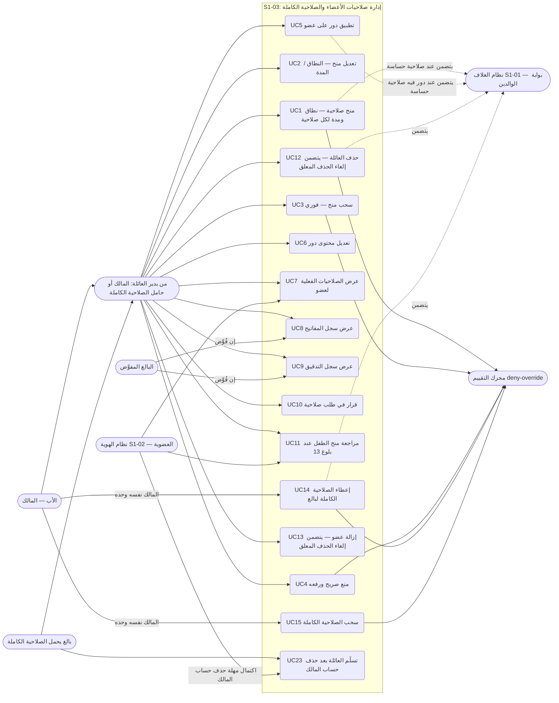

**1-ب. العضو مع صلاحياته والفحص (المجموعتان ج ود)**

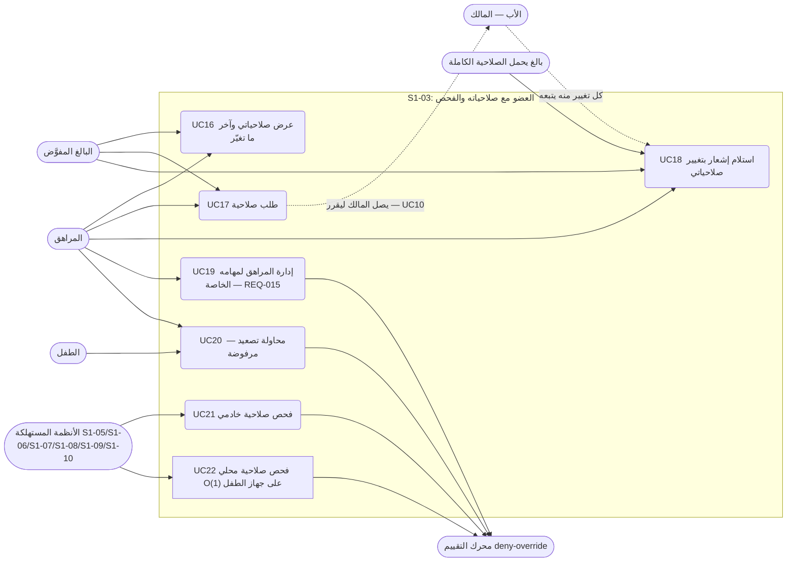

- **أ (UC1–UC13)** للمالك ولحامل الصلاحية الكاملة بقاعدة المالك (REQ-010/016)؛ الحامل لا يعدّل منح نفسه ولا يزيل المالك (SPEC §7-16)؛ والبالغ المفوَّض لا يفوِّض غيره (لا تفويض متسلسل).
- **UC1/UC2:** لكل صلاحية نطاقها ومدتها وحدها (REQ-011 — Q-401). **UC4:** المنع الصريح ظاهر، ويبقى عند تغيير الدور حتى يُرفع أو تُسحب كل منح العضو (REQ-004/014 — Q-402).
- **UC5/UC6:** الأدوار الثلاثة تُعدَّل لكل عائلة، وتعديل الدور لا يغيّر من طُبّق عليه من قبل (REQ-013/014 — Q-089).
- **ب (UC14/UC15)** للمالك نفسه وحده: الصلاحية الكاملة تسري فوراً بلا قبول، والمالك يبقى مالكاً ويسحبها متى شاء (REQ-016 — Q-401). **UC23:** المالك يحذف حسابه والصلاحية الكاملة عند بالغ، فيصير ذلك البالغ مالكاً بعد 30 يوماً (SPEC §7-18 — Q-402) — مرسوم في 3-ك.
- **ج (UC16–UC18 — R03-17 · R03-11):** العضو يرى منح نفسه فقط، يطلب صلاحية بنقرة (بالغ أو مراهق — Q-402)، ويصله إشعار بكل تغيير من المالك بلا خطوة قبول (REQ-010).
- حذف العائلة وإزالة عضو (UC12/UC13) لا يُمنحان مفردين (REQ-020 · Q-166)؛ وحذف العائلة بشرط PIN/بصمة مثبَتة بالتحدي (Q-164)، وإزالة العضو بشرط مفتاح `identity.member.remove` + PIN؛ وكلاهما حذف ناعم + سماح 30 يوماً ثم حذف صلب، والإلغاء خلال السماح عبر `POST /api/v1/families/{id}/deletion/cancel`.
- `roles.grant.create` و`roles.grant.edit` و`roles.grant.revoke` و`roles.template.apply` للمالك (§6-1) ويشمله حامل الصلاحية الكاملة بقاعدة المالك؛ `roles.ownership.transfer` للمالك نفسه وحده؛ `roles.key.view` و`roles.audit.view` قابلان للتفويض. (سجل المفاتيح الذرية — Q-010)

## 2. مخطط قاعدة البيانات (ERD)

الجداول التسعة من §5 كما هي، مع أربعة مراجع خارجية: العائلة والعضوية (`membership` — الدور {`adult`، `teen`، `child`} + `is_owner` — سنة الميلاد تحدد الدور: دون 13 → `child`؛ 13–17 → `teen` — REQ-001 · Q-006/Q-080) والشخص (`person`) من S1-02، و`AuditEvent` (النواة المشتركة). ملاحظتان: جداول السجل العام (`permission_key` و`role_template` و`template_key`) مشتركة لكل العائلات بلا `family_id` — بذرة واحدة تخدم كل العائلات؛ وما عداها (`permission_grant` و`permission_request` و`full_authority` و`family_role` و`family_role_key` و`member_role`) يحمل `family_id` + عزل RLS (D-021). ولقطة المنح المحلية (REQ-006) مخزن عميل على الجهاز وليست جدول خادم، فلا تظهر جدولاً هنا.

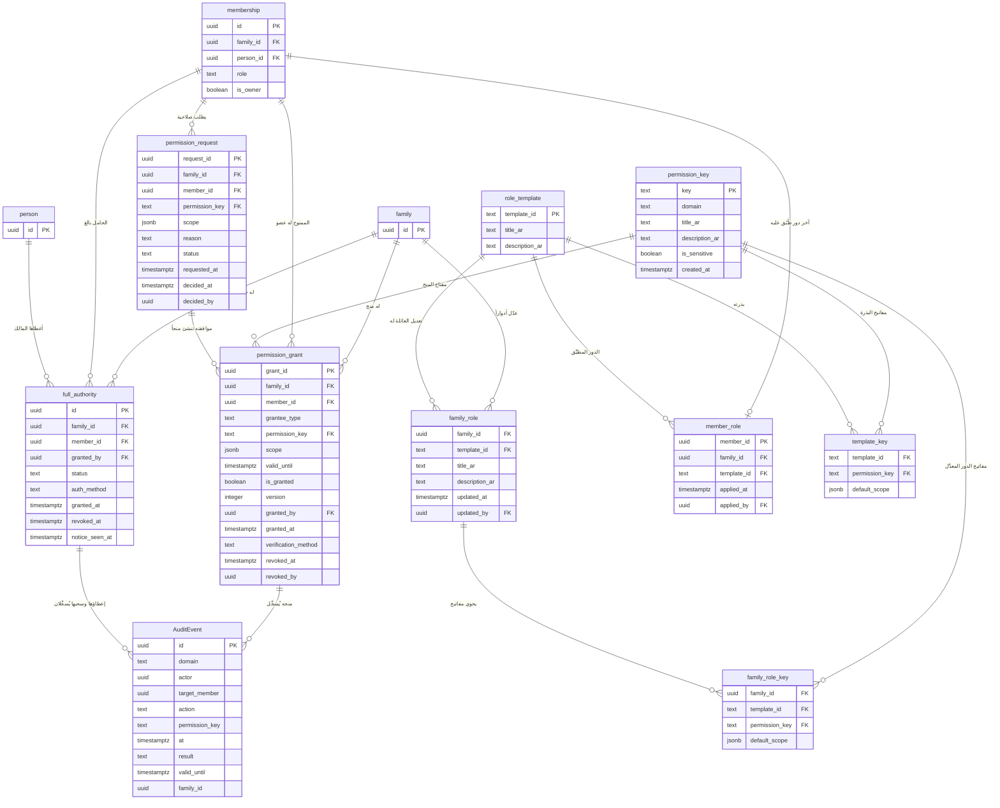

- `template_key` مفتاحه المركب (`template_id`, `permission_key`) (§5-3)؛ وصفوف البذرة (شريك 43 / وصي محدود 24 / مراقب 10) في SPEC §5-3-أ (Q-262 · Q-329 · Q-330 · Q-343). [تصحيح 2026-11-08 (D-2): كانت 40/22/10 قبل Q-329/Q-330/Q-343.]
- **تسوية المفاتيح (Q-326…Q-333 · Q-343):** المجموع **95 مفتاحاً**: شريك 43 / وصي محدود 24 / مراقب 10؛ و§5-أ (مالك حصري) **28**؛ و§5-ب 23؛ و§5-ج 1 (`identity.device.pair`)؛ 43+28+23+1 = 95. والمراهق (Q-318…Q-325): المفتاح الوحيد القابل للمنح `tasks.create` (scope=self)؛ و14 متأصلة في الدور (Q-253 — أُضيف `tasks.cancel`، scope=self)؛ و5 حدّية حُسمت؛ و75 مستبعدة (76 ← 75 بنقل `tasks.cancel` منها إلى الملازمة)؛ 1+14+5+75 = 95؛ و`tasks.own.manage` محذوف من وايرفريم R03-09 (Q-325).
- `AuditEvent` في ERD يسرد كل حقل في §5-6 (بعد تصحيح R2-S103-19 في B4) — بأنواع مطابقة.
- `permission_request` جدول جديد (§5-7) — طلبات تعديل الصلاحية (R03-17)؛ و`member_id` مفتاح أجنبي إلى `membership.id` (Q-169).
- **توحيد الهوية (Q-169):** `permission_grant.member_id` مفتاح أجنبي إلى `membership.id` (S1-03 SPEC §5-4) — لا إلى `person`؛ فالمراهق والطفل لهما عضوية وبلا `person` (Q-137). وعند منح الوكيل (`grantee_type='agent'`) يكون `member_id` فارغاً.
- `scope` + `valid_until` إلزاميان في كل منح (Q-007 · Q-087)؛ `is_granted=false` رفض صريح وليس غياباً (Q-007).
- `verification_method` قيمه `pin` / `biometric` — للمنح الحساس فقط (REQ-012).
- **`full_authority` (§5-5 — Q-401):** حلّ محل `ownership_transfer`. `status` قيمتاه `active` / `revoked` فقط — لا `pending` ولا `accepted` ولا `expired` ولا `expires_at`؛ صف `active` واحد على الأكثر لكل عضو؛ `auth_method` PIN أو بصمة (Q-093)؛ `notice_seen_at` متى رأى الحامل إشعاره. و`membership.is_owner` لا ينتقل إلا عند اكتمال مهلة حذف حساب المالك (Q-402).
- **`family_role` + `family_role_key` (§5-3-ب — Q-401):** تعديل العائلة لدور؛ صفوف تُكتب فقط حين تعدّل، ومفتاحاهما المركبان (`family_id`, `template_id`) و(`family_id`, `template_id`, `permission_key`). البذرة (`role_template` + `template_key`) لا تُمس.
- **`member_role` (§5-3-ج):** آخر دور طُبّق على العضو — للعرض فقط، ولا يدخل في التقييم.
- المنع الصريح صف في `permission_grant` بـ `is_granted=false`؛ `valid_until` فيه اختياري وغيابه يعني «حتى يُرفع» (Q-402).

## 3. التسلسل (Sequence) — من عقود §4

اثنا عشر مخططاً، كل واحد لتدفق واحد (3-أ … 3-ل):

### 3-أ. إنشاء منح (REQ-010/011/012 — §4-1)

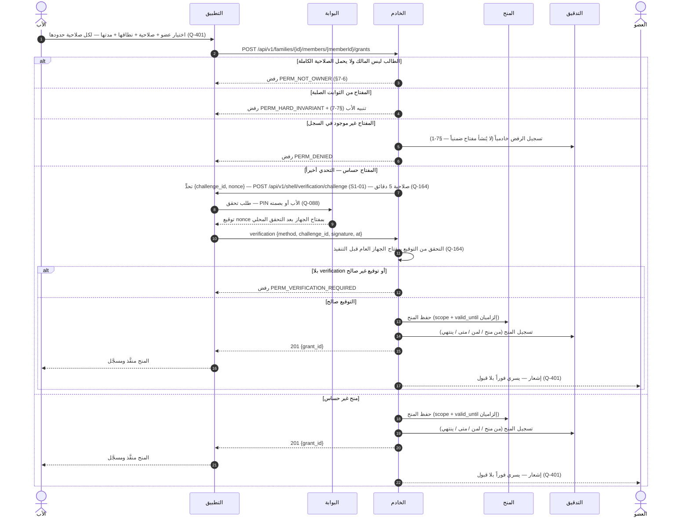

- التحقق نفسه محلي (بوابة الوالدين Q-065 / بصمة Q-072) **ويتحقق الخادم من توقيع التحدي بمفتاح الجهاز العام قبل التنفيذ (Q-164)** ويُسجَّل في التدقيق (§4-1)؛ ولو فشل التحقق 3 مرات يعود النظام لطلب PIN (سيناريو 2-4 · Q-072).
- ترتيب الفحص عند إنشاء منح (قاعدة §6-3): المالك أولاً → الثابت الصلب → المفتاح في السجل → التحدي أخيراً؛ فلا تحدٍّ يُصدر لغير المالك ولا لمفتاح ثابت صلب ولا لمفتاح غير موجود. ومنتقي المفتاح يقرأ السجل للعرض فقط (GET /api/v1/permissions/keys) — والتحقق الحاكم خادمي.
- رفض المفتاح غير المعروف يكتبه الخادم في التدقيق (Ktor→Audit) — لا كتابة تدقيق من العميل أبداً (§7-1)؛ وبلا اتصال يُحفظ سجل الرفض محلياً ويُصالح مع الخادم عند عودة الاتصال. والاستثناء Q-174 (تبديل المنح من S1-09 بلا تحدٍّ) يتجاوز التحدي فقط، لا الفحوص قبله.
- رموز الخطأ الموحدة (§4-4): `PERM_DENIED` · `PERM_HARD_INVARIANT` · `PERM_NOT_OWNER` · `PERM_VERIFICATION_REQUIRED` · `PERM_GRANT_EXPIRED` · `PERM_CONFLICT` — والأخير لتعديلين متزامنين على منح عضو واحد: الثاني يفشل ويُطلب إعادة تحميل أحدث حالة قبل إعادة المحاولة (REQ-019 · §7-8).
- حامل الصلاحية الكاملة يسلك هذا التسلسل كالمالك في منح غيره؛ وتعديله منح نفسه يُرفض `403` + `PERM_DENIED` (§7-16). والمنع الصريح يسلك النقطة نفسها بـ `is_granted: false` — مرسوم في 3-ي.

### 3-ب. تطبيق قالب على عضو (REQ-013/014 — §4-1)

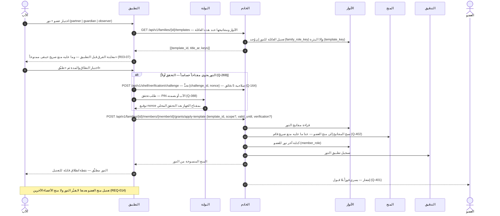

### 3-ج. فحص صلاحية — خادمي ومحلي O(1) (REQ-004/005/006 — §4-1/§4-3)

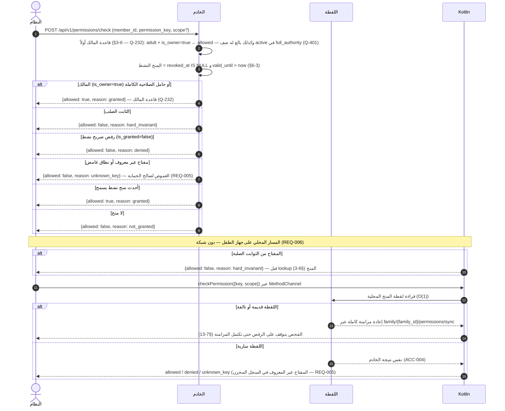

- قاعدة المالك أولاً (§6-3 — Q-232): `adult` + `is_owner=true` → `allowed` بلا منح صريح؛ والتجاوز تقييم فقط — لا يشمل التدقيق أبداً ولا فحوص `PERM_HARD_INVARIANT` ولا يمتد لغير المالك. والمسار المحلي يطبق قاعدة المالك نفسها حين يكون العضو المفحوص مالكاً (§6-3).
- أي رفض صريح نشط يفوز على أي منح سامح (§6-3 — deny-override)؛ وإلا يفوز أحدث منح نشط ويُؤخذ نطاقه.
- حامل الصلاحية الكاملة يُقيَّم بقاعدة المالك قبل النظر في منحه، فلا يسري عليه منع صريح أثناء الحمل، ويعود المنع نافذاً لحظة السحب؛ ويُستثنى مما للمالك نفسه: إعطاؤها وسحبها وإزالة المالك وتعديل منح نفسه (SPEC §5-5 · §7-16).
- الثابت الصلب يعطي `reason: "hard_invariant"` (§4-1)؛ والمنح المنتهي `valid_until` يُرفض فوراً (§7-9). والمسار المحلي يميز `unknown_key` بالمفتاح الغائب من نسخة السجل المخزنة على الجهاز (R03-05) — كالخادم في التسمية، ورفض في الأثر. والثابت الصلب يُفحص قبل lookup المنح — خادمياً ومحلياً (§6-3)؛ فلا منح يغطي ثابتاً صلباً.

### 3-د. إلغاء منح — فوري بلا إبطال جلسات (REQ-017 — §4-1/§4-2 · Q-257)

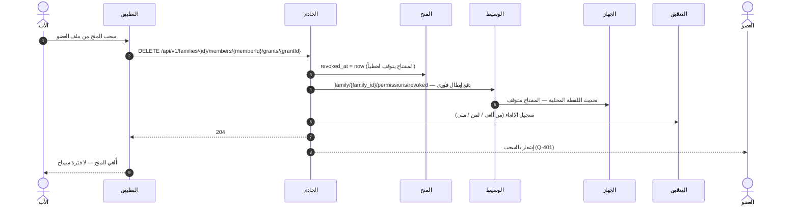

- إلغاء المنح لا يبطل أي جلسة (Q-257): الجلسات تُبطل فقط بالعمليات الصريحة في S1-02 §4.1 — وتبقى جلسات العضو عاملة لباقي صلاحياتها بعد الإلغاء.
- «اسحب كل صلاحياتها» يسلك `DELETE /api/v1/families/{id}/members/{memberId}/grants`: يسحب كل منح العضو ويرفع كل منع صريح عليه دفعة واحدة، ويفرّغ `member_role` (Q-402 — مرسوم في 3-ي).

### 3-هـ. إعطاء الصلاحية الكاملة لبالغ (REQ-016 — §4-1 · Q-093 · Q-401)

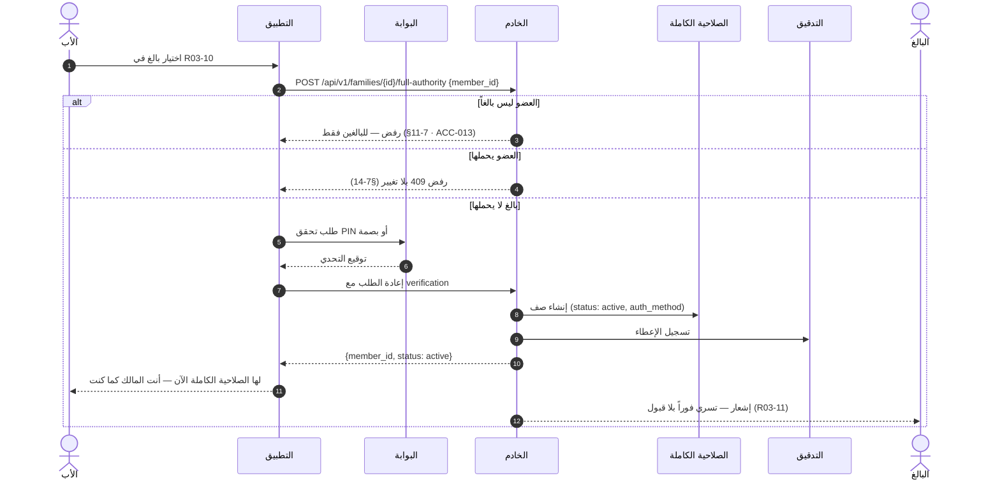

- تسري من لحظة نجاح الطلب؛ لا خطوة قبول ولا مهلة ولا حالة معلقة (Q-401 — نُقض Q-139 · Q-259).
- دون اتصال تُرفض ولا تدخل صندوق الصادر (Q-269)؛ و`is_owner` لا ينتقل (Q-006).

### 3-و. تحول الدور عند بلوغ 13 (REQ-003 — §6-3)

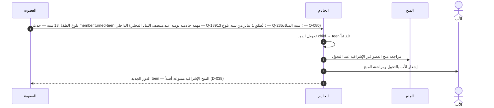

- حدث داخلي بلا موضوع MQTT (Q-189)؛ والحمولة والمعالج وكاتب الدور في SPEC §4-2-أ.

### 3-ز. حذف العائلة / إزالة عضو / إلغاء الحذف (REQ-020 — §4-1 · Q-166)

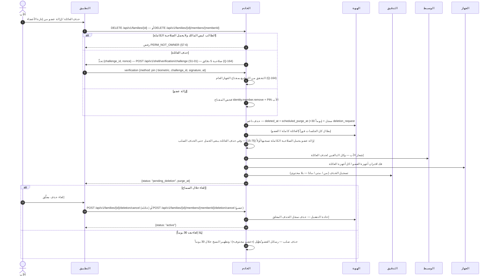

- ملاحظة: حذف العائلة وإزالة العضو غير قابلين للتفويض (REQ-020 — ثابت صلب)؛ والقاصر لا يُزال إلا بيد الأب؛ وطلب حذف دون اتصال يُحفظ في الصندوق الصادر ويُنفَّذ عند الاتصال (بروتوكول الحذف والتصدير — `DELETION-EXPORT-PROTOCOL.md` §6). وحامل الصلاحية الكاملة يفعلهما بقاعدة المالك وبالشروط نفسها — عدا إزالة المالك (Q-402).

### 3-ح. سحب الصلاحية الكاملة (REQ-016 — §4-1 · Q-401)

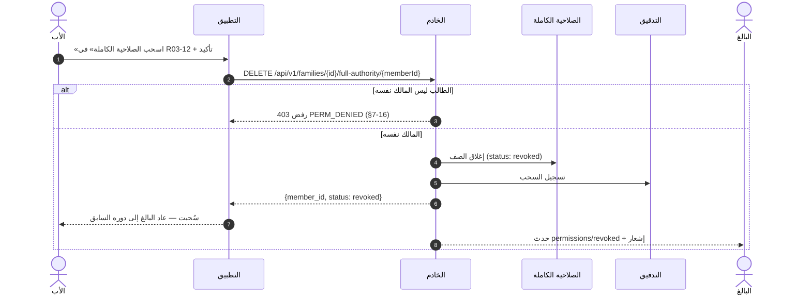

- السحب تأكيد واحد بلا رقم سري، كإلغاء أي منح (REQ-017)؛ ولا تُبطل جلسة (Q-257).
- البالغ يعود إلى منحه في `permission_grant` كما هي؛ ما انتهت مدته أثناء الحمل يبقى منتهياً (SPEC §5-5).

### 3-ط. طلب تعديل صلاحية وقرار الأب (REQ-002/004/015 — §4-1 · R03-17)

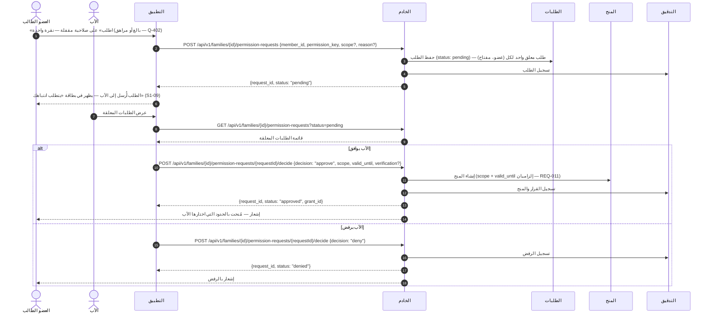

- الطلب قناة طلب لا منح: لا يمنح شيئاً بذاته ولا يُعدّ تصعيداً ولا يُنبَّه به (§7-20)؛ والموافقة تنشئ المنح بقواعد المنح نفسها (REQ-011/012 — والمفتاح الحساس يتطلب `verification`)؛ وطلب ثانٍ لنفس المفتاح وهو معلق → `409`. والطالب بالغ مفوَّض أو مراهق (Q-402)، والأب يختار النطاق والمدة أو يرفض.

### 3-ي. المنع الصريح: إنشاؤه وبقاؤه عند تغيير الدور ورفعه (REQ-004/014 — §4-1 · Q-401 · Q-402)

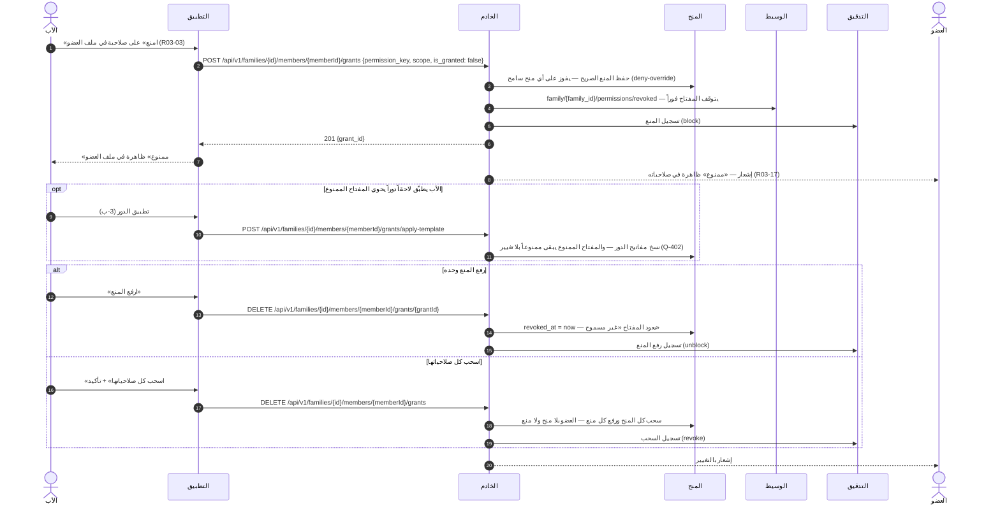

- الحالات الثلاث لكل صلاحية كما تظهر للمالك وللعضو: **مسموح** (منح نشط) · **غير مسموح** (لا منح) · **ممنوع** (`is_granted=false`). لا حالة مخفية (Q-401).
- المنع يضيّق ولا يوسّع، فلا يتطلب تحققاً ولو كان المفتاح حساساً؛ ومدته اختيارية وغيابها يعني «حتى يُرفع».
- منحا حق الخروج (`identity.account.delete_self` · `identity.family.leave`) لا يُمنعان ولا يُسحبان (Q-291).

### 3-ك. المالك يحذف حسابه — تسليم العائلة لحامل الصلاحية الكاملة (REQ-016 · S1-02 REQ-025 — §7-18 · Q-402)

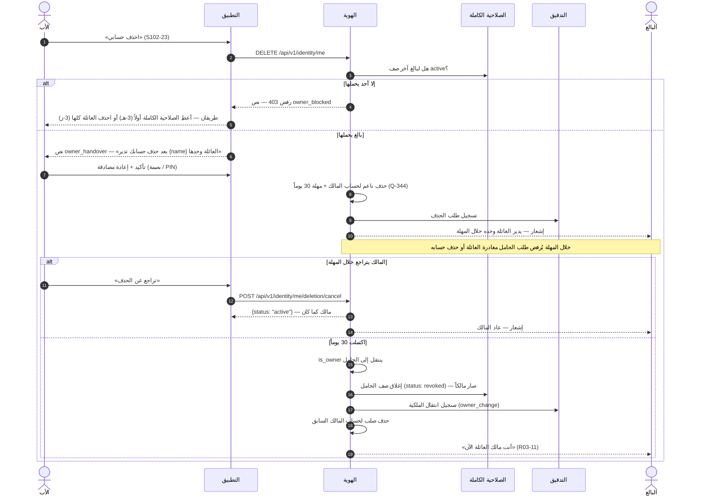

- هذا **الطريق الوحيد** لانتقال `is_owner` (Q-402)؛ إعطاء الصلاحية الكاملة لا ينقله (Q-006).
- نقطة الحذف وإلغاؤه يملكهما S1-02 (REQ-025 — تسلسله 3-ز)؛ وهذا النظام يجيب «من يحمل الصلاحية الكاملة؟» ويغلق الصف عند الانتقال.
- أكثر من حامل عند حذف حساب المالك: بلا حكم بعد (G-R03-11) — التصميم يعرضها لبالغ واحد.

### 3-ل. تعديل محتوى دور (REQ-013/014 — §4-1 · Q-089 · Q-205 · Q-401)

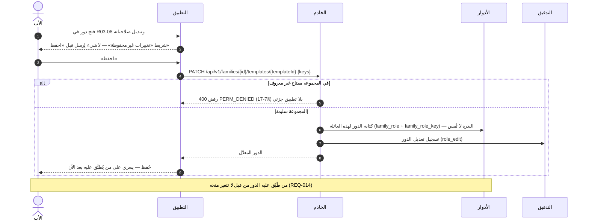

- `keys` تستبدل مجموعة الدور كاملة؛ والأدوار ثلاثة لا رابع لها (Q-089).

## 4. تدفق المستخدم (User Flow) — من السيناريوهات الاثني عشر (§2) والتصميم المعتمد (§9-8)

ثلاثة مداخل: المالك يدير (ومثله حامل الصلاحية الكاملة عدا ما للمالك نفسه)، والعضو يحاول فعلاً، والمالك يحذف حسابه.

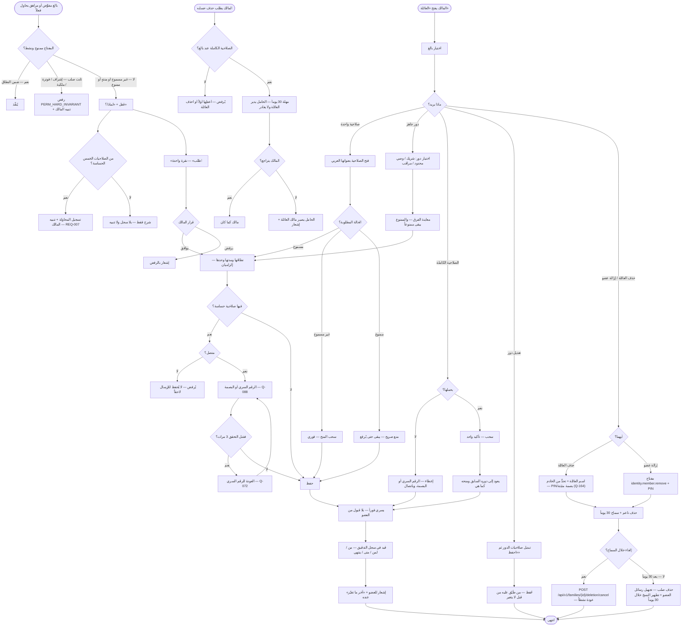

- لكل صلاحية حالتها ونطاقها ومدتها وحدها (Q-401)؛ و«حدود كل الصلاحيات دفعة واحدة» اختصار في الواجهة يسلك مسار «مسموح» لكل منح قائم (REQ-011).
- الدور نقطة انطلاق لا قيد: تعديل منح العضو بعد تطبيقه لا يغيّر الدور ولا منح الآخرين (REQ-014 · سيناريو 2-1)؛ والمنع الصريح يبقى بعد تغيير الدور (Q-402).
- كل ما يفعله المالك يسري فوراً بلا خطوة قبول، ويتبعه قيد وإشعار (REQ-010 — Q-401). والمراهق يصله إشعار حين يتغيّر ما سُمح له به (Q-402).
- بالغ منضم جديداً يبدأ بلا أي منح — لا صلاحية له حتى يمنحه الأب صراحة — عدا منحي بذرة Q-166 (Q-248) (REQ-002).
- القفل: الضغط على عنصر مقفل يشرح السبب دائماً؛ ويُسجَّل ويُنبَّه المالك في الصلاحيات الخمس الحساسة فقط (REQ-007 — Q-402).

## 5. مخطط تدفق البيانات (DFD — المستوى 1) — من §4/§5

العمليات مرقمة 1.0–9.0، والمخازن D1–D6. المخزن D5 سجل التدقيق (النواة المشتركة)؛ واللقطة المحلية على جهاز الطفل مخزن عميل (ليست جدول خادم) وتُزامَن عبر MQTT.

- **تغطية نقاط §4:** كل نقطة في §4-1 مرسومة هنا حافةً أو في تسلسلات §3: `PATCH …/grants/{grantId}` (تعديل النطاق/المدة — REQ-010، حافة Father→P2) · `GET …/members/{memberId}/permissions` (الصلاحيات الفعلية — REQ-004، حواف P4 مع المالك ومع العضو لنفسه) · `GET …/audit/permissions` (سجل التدقيق — REQ-018، حواف Father→P6 وD5→P6 وP6→Father، وP6→العضو لأحداث منحه) · `GET …/full-authority` و`POST …/full-authority/{memberId}/seen` (حافتا P8 مع البالغين ومع الحامل)؛ والباقي في §3: keys (3-أ)، grants إنشاء/سحب (3-أ/3-د)، المنع وسحب الكل (3-ي)، apply-template (3-ب)، templates (3-ب/3-ل)، check (3-ج)، full-authority إعطاء/سحب (3-هـ/3-ح)، حذف العائلة/العضو وإلغاؤه (3-ز)، permission-requests (3-ط). [تصحيح 2026-11-08 (D-2): كانت النقاط الثلاث الأولى نثراً فقط؛ رُسمت حوافَّ.] [إعادة رسم 2026-11-16 (Q-401 · Q-402): خرج مسار نقل الملكية وقبوله وإلغاؤه؛ ودخلت العمليتان 8.0 و9.0 والمخزن D6.]

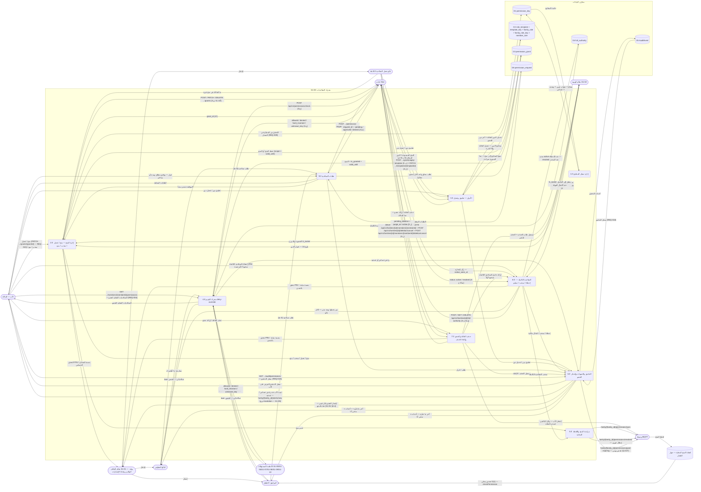

- العملية 4.0 هي الحارس الوحيد: كل فحص صلاحية في المنصة يمر بها (§1) — «لا عملية بلا مفتاح» (REQ-009). وتقرأ D3 للمنح وD4 لحامل الصلاحية الكاملة (قاعدة المالك — §6-3).
- العملية 8.0 بلا حالة معلقة: الإعطاء صف `active` فوراً والسحب `revoked` فوراً؛ وانتقال `is_owner` يكتبه S1-02 عند اكتمال مهلة حذف حساب المالك فقط (Q-402).
- العملية 6.0 تخدم ثلاثة قرّاء: المالك (السجل كله + تنبيه الرفض الحساس والتصعيد)، والعضو (أحداث منحه في «آخر ما تغيّر»)، وقناة الإشعارات.
- سجل المفاتيح D1 وبذرة الأدوار في D2 مشتركان لكل العائلات بلا `family_id`؛ وباقي D2 (تعديل العائلة وآخر دور للعضو) وD3 وD4 وD6 تحمل `family_id` + RLS (D-021).

## 6. مخطط النشاط (Activity) — دورة حياة المنح والفحص

المسارات الخمسة (الأب المالك / العضو: بالغ مفوَّض أو مراهق أو حامل للصلاحية الكاملة / جهاز الطفل / الخادم / وسيط MQTT) كمسارات متوازية. والمزامنة عبر MQTT والإبطال الفوري يعملان **بالتوازي** مع استخدام التطبيق. ولا نشاط ينتظر قبولاً من العضو: كل ما يحفظه المالك يسري ثم يُشعَر به (Q-401).

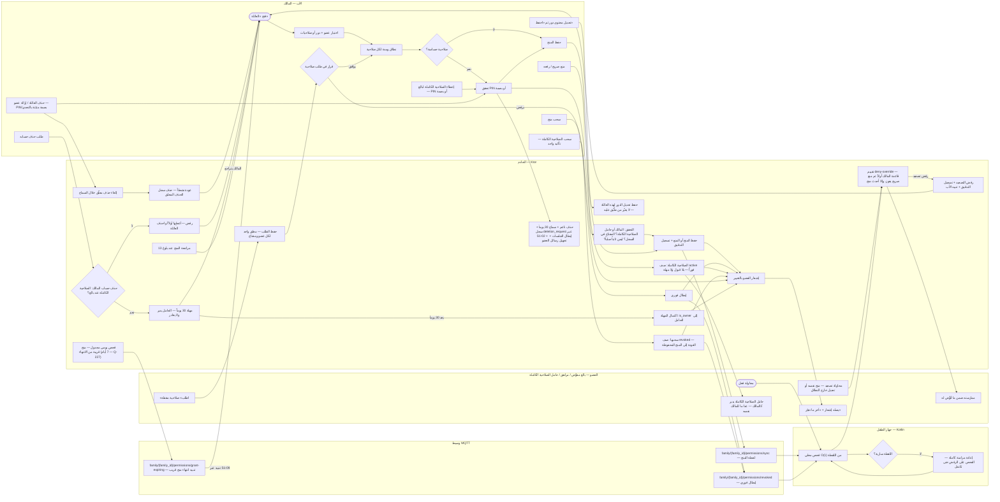

- عند بلوغ الطفل 13 يتحول دوره تلقائياً وتُراجع منحُه غير الإشرافية ويُشعَر الأب (REQ-003) — المسار V5 إلى F1.
- محاولة التصعيد المرفوضة (M3) تذهب إلى الرفض + التدقيق + تنبيه الأب (V11)؛ ومراجعة العضو تتم من التنبيه (V11 → F1) لا من عقدة التقييم. وطلب الصلاحية (M4) ليس تصعيداً: يُحفظ طلباً (V14) ويقرره الأب (F13).
- كل حفظ من المالك ينتهي بإشعار العضو (V13 → M5): منح، منع، سحب، إعطاء الصلاحية الكاملة وسحبها، ورفض طلب (Q-401).
- الصلاحية الكاملة بلا انتظار: الإعطاء يسري لحظة نجاحه (V9) والسحب كذلك (V12)؛ فلا فحص يومي لانتهاء نقل ولا حالة معلقة (نُقض Q-139).
- حذف حساب المالك (F14) يُرفض ما لم تكن الصلاحية الكاملة عند بالغ (V18)؛ وإلا مهلة 30 يوماً ثم يصير الحامل مالكاً (V16 → V17 — Q-402).
- المنح بلا شبكة لا يُنفَّذ محلياً: الخادم هو المرجع، ويُحفظ طلب المنح غير الحساس في صندوق الصادر ويُعاد عند عودة الاتصال (§7-12 — نمط S1-01). **والمنح الحساس لا يُدرج في صندوق الصادر أبداً (Q-269):** محاولة منح حساس بلا اتصال تُرفض فوراً ولا تُعاد — فلا نجاح على تحدٍّ ميت ولا تنفيذ مكرر (§7-12).
- الفحص اليومي للمنح القريبة من الانتهاء (V8) يصدر `family/{family_id}/permissions/grant-expiring` (عتبة 7 أيام — Q-227)؛ ويستهلكه S1-09 لتنبيهات `grant_expiring` (§4-2).
