# S1-03: مخططات هندسة البرمجيات (DIAGRAMS)

- **الحالة:** معتمدة — المخططات الستة معتمدة (حكم المالك 2026-11-08 — D-2، بعد موجة الإصلاح 0e4a3e2..f7da470)؛ والمواصفة معتمدة بالكامل في التخطيط؛ **وأُعيد رسمها كلها 2026-11-16 على التصميم المعتمد (Q-401 · Q-402) — تأكيد المالك للرسم الجديد بكلمة (Q-289) لم يصدر بعد**
- **المواصفة:** `SPEC.md` (§§1–8 + §10 معتمدة بالكامل في التخطيط)
- **السياق المحدد (Bounded Context):** #2 الصلاحيات (Permissions) — `CONTEXT-MAP.md` §2 صف 2
- **القرارات الحاكمة:** Q-001 · Q-003 · Q-006 · Q-007 · Q-010 · Q-065 · Q-072 · Q-080 · Q-085 · Q-086 · Q-087 · Q-088 · Q-089 · Q-093 · Q-164 · Q-166 · Q-189 · Q-174 · Q-201 · Q-204 · Q-227 · Q-232 · Q-235 · Q-248 · Q-250 · D-006 · D-021 · D-023 · D-038 · G-006 · G-011 · Q-168 · Q-329 · Q-330 · Q-343 · Q-401 · Q-402 · Q-257 · Q-269 · Q-291 · Q-344 — ونُقض بـ Q-401 فخرج من الرسم: Q-139 · Q-162 · Q-259
- **تحديث 2026-11-16 (Q-401 · Q-402) — إعادة رسم كاملة:** المخططات الستة مرسومة الآن على التصميم المعتمد (SPEC §9-8)، والرسم والنص متطابقان فلا ملاحظة تسود على رسم. ما تغيّر: (1) «الصلاحية الكاملة» بدل نقل الملكية — تُعطى فتسري فوراً بلا قبول، والمالك يبقى مالكاً ويسحبها؛ (2) لكل صلاحية حالتها ونطاقها ومدتها، والمنع الصريح ظاهر؛ (3) الأدوار الثلاثة تُعدَّل لكل عائلة؛ (4) كل تغيير من المالك يتبعه إشعار للعضو؛ (5) طلب الصلاحية من البالغ والمراهق؛ (6) حذف حساب المالك يسلّم العائلة لحامل الصلاحية الكاملة بعد 30 يوماً. الجديد في الرسم: فاعل «بالغ يحمل الصلاحية الكاملة»، الجدول `full_authority` وجداول تعديل الأدوار، والتسلسلات 3-ي و3-ك و3-ل. **تصحيح 2026-11-16 (ملاحظة المالك: أخطاء في مخطط التدفق ومخطط النشاط):** كان تدفق المستخدم (§4) وتدفق البيانات (§5) والنشاط (§6) كلٌّ في رسم واحد كبير تتقاطع أسهمه، ونصوصه تخلط العربية باللاتينية فينقلب ترتيب الكلمات عند العرض، وفي §4 كان «تعديل دور» و«حذف العائلة» يتفرعان بعد «اختيار بالغ» خطأً. أُعيد رسم الثلاثة لوحات صغيرة (§4 ست لوحات · §5 أربع · §6 خمس)، نصوصها عربية وحدها، وأسماء النقاط والجداول والمواضيع في السطور والجداول تحت اللوحات.
- **مراجعة 2026-11-19 (Q-434):** روجعت المخططات الستة على التصميم المعتمد (Q-401 · Q-402)؛ «الصلاحية الكاملة» هي المرسومة في كل موضع (UC14/UC15، جدول `full_authority`، التسلسلات 3-هـ و3-ح و3-ك)، ولا أثر لـ«نقل الملكية» كتدفق في أي مخطط (مفتاح `roles.ownership.transfer` باقٍ باسمه في السجل ويحكم إعطاء الصلاحية الكاملة وسحبها — Q-401)؛ ولا قالب `minimal` ولا مستخدم دون 7 في الملف. وأُعيد ضبط الشكل (§3) بلا تغيير في المحتوى: قُسّم ERD لوحتين، وقُسّم مسار التحدي في 3-أ إلى 3-م، وقُسّم طلب الصلاحية إلى 3-ط و3-س، ووُحّد ترتيب المشاركين، وقُصّرت التسميات.
- **الأنواع الستة:** 1. حالات الاستخدام · 2. ERD · 3. التسلسل · 4. تدفق المستخدم · 5. DFD · 6. النشاط
- **الأشكال الموحدة:** مستطيل = جهة خارجية · مستطيل مستدير = عملية · معين = قرار · أسطوانة = مخزن بيانات · خط متقطع = يتضمن / اختياري

## 1. حالات الاستخدام

23 حالة استخدام من السيناريوهات الاثني عشر والمتطلبات (§2/§3) ومن التصميم المعتمد (SPEC §9-8 — Q-401 · Q-402)، في أربع مجموعات مرسومة على ثلاث لوحات (1-أ و1-ب و1-ج): **(أ) إدارة صلاحيات الأعضاء** للمالك، ولبالغ يحمل الصلاحية الكاملة بقاعدة المالك؛ **(ب) الصلاحية الكاملة** يعطيها المالك نفسه ويسحبها؛ **(ج) العضو مع صلاحياته** يراها ويطلب ويصله إشعار بكل تغيير؛ **(د) الفحص** — كل فحص صلاحية في المنصة يمر بمحرك التقييم (deny-override — Q-007). البالغ المفوَّض يمارس ما فُوِّض له فقط ولا يفوِّض غيره؛ والمراهق يدير مهامه الخاصة فقط (REQ-015).

**1-أ. إدارة صلاحيات الأعضاء (المجموعة أ)**

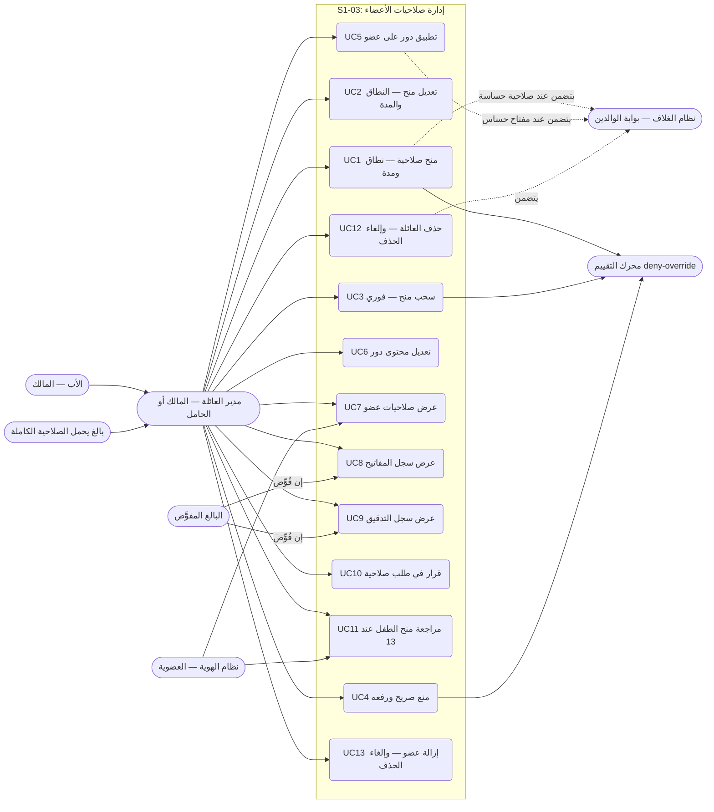

- أُعيد رسمه 2026-11-19 (Q-434 — شكل فقط): قُصّرت تسميات UC1 وUC2 وUC11 وUC12 وUC13 و«مدير العائلة»، وتسمية الحافة «يتضمن عند مفتاح حساس»؛ ونُقلت التفاصيل إلى السطور تحت اللوحة.
- أُعيد تقسيمه 2026-11-19 (دفعة الشكل 2): اللوحة الواحدة (23 عقدة) قُسّمت إلى لوحتين حسب الفاعل — هذه اللوحة لإدارة الصلاحيات (UC1–UC13)، واللوحة 1-ب للصلاحية الكاملة (UC14 وUC15 وUC23)؛ ولوحة العضو والفحص صارت 1-ج. لا تغيير في العقد أو العلاقات.
- S101 = نظام الغلاف — بوابة الوالدين (S1-01)؛ وS102 = نظام الهوية — العضوية (S1-02)؛ وUC7: عرض الصلاحيات الفعلية لعضو.

**1-ب. الصلاحية الكاملة (المجموعة ب)**

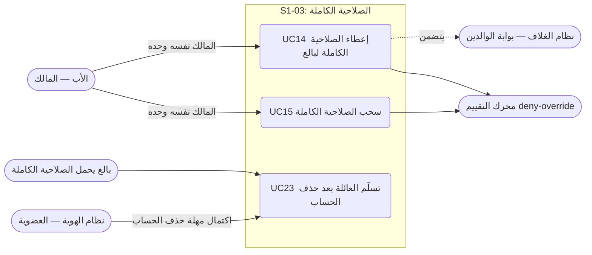

- S101 = نظام الغلاف — بوابة الوالدين (S1-01)؛ وS102 = نظام الهوية — العضوية (S1-02).

**1-ج. العضو مع صلاحياته والفحص (المجموعتان ج ود)**

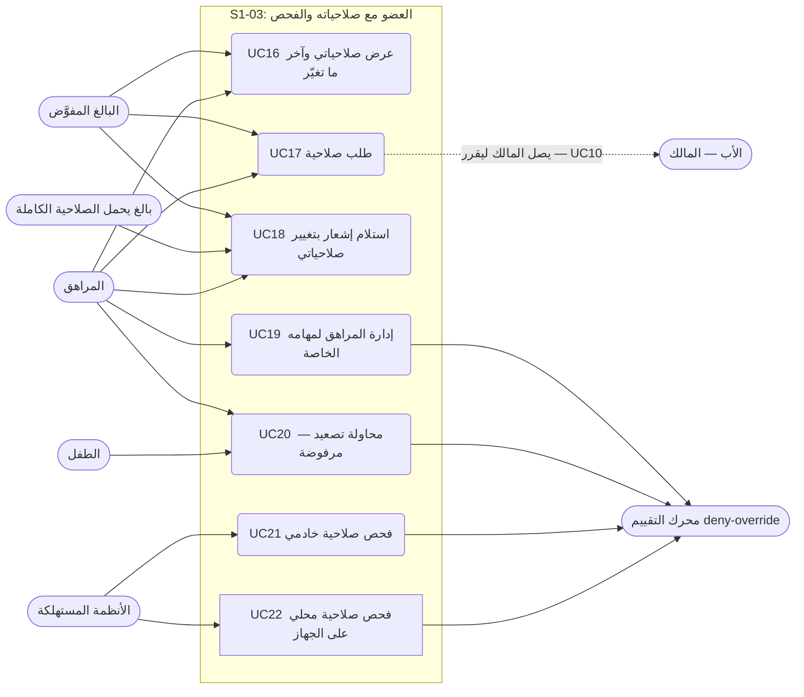

- أُعيد رسمه 2026-11-19 (Q-434 — شكل فقط): قُصّرت تسميات UC19 وUC22 و«الأنظمة المستهلكة»؛ ونُقلت التفاصيل إلى السطور تحت اللوحة؛ وحُذف سهم «كل تغيير منه يتبعه» من الأب إلى UC18 بعد فحص العين (كان يقطع عنوان اللوحة) — والإشعار بكل تغيير من المالك باقٍ في سطر (ج) تحت اللوحة (REQ-010).

- **أ (UC1–UC13)** للمالك ولحامل الصلاحية الكاملة بقاعدة المالك (REQ-010/016)؛ الحامل لا يعدّل منح نفسه ولا يزيل المالك (SPEC §7-16)؛ والبالغ المفوَّض لا يفوِّض غيره (لا تفويض متسلسل).
- **UC1/UC2:** لكل صلاحية نطاقها ومدتها وحدها (REQ-011 — Q-401). **UC4:** المنع الصريح ظاهر، ويبقى عند تغيير الدور حتى يُرفع أو تُسحب كل منح العضو (REQ-004/014 — Q-402).
- **UC5/UC6:** الأدوار الثلاثة تُعدَّل لكل عائلة، وتعديل الدور لا يغيّر من طُبّق عليه من قبل (REQ-013/014 — Q-089).
- **ب (UC14/UC15)** للمالك نفسه وحده: الصلاحية الكاملة تسري فوراً بلا قبول، والمالك يبقى مالكاً ويسحبها متى شاء (REQ-016 — Q-401). **UC23:** المالك يحذف حسابه والصلاحية الكاملة عند بالغ، فيصير ذلك البالغ مالكاً بعد 30 يوماً (SPEC §7-18 — Q-402) — مرسوم في 3-ك.
- **ج (UC16–UC18 — R03-17 · R03-11):** العضو يرى منح نفسه فقط، يطلب صلاحية بنقرة (بالغ أو مراهق — Q-402)، ويصله إشعار بكل تغيير من المالك بلا خطوة قبول (REQ-010).
- **UC11:** مراجعة منح الطفل عند بلوغ 13 (REQ-029 · REQ-030). **UC22:** فحص محلي O(1) على جهاز الطفل (§4-2). والأنظمة المستهلكة (UC21/UC22): S1-05/S1-06/S1-07/S1-08/S1-09/S1-10.
- حذف العائلة وإزالة عضو (UC12/UC13) لا يُمنحان مفردين (REQ-020 · Q-166)؛ وحذف العائلة بشرط PIN/بصمة مثبَتة بالتحدي (Q-164)، وإزالة العضو بشرط مفتاح `identity.member.remove` + PIN؛ وكلاهما حذف ناعم + سماح 30 يوماً ثم حذف صلب، والإلغاء خلال السماح عبر `POST /api/v1/families/{id}/deletion/cancel`.
- `roles.grant.create` و`roles.grant.edit` و`roles.grant.revoke` و`roles.template.apply` للمالك (§6-1) ويشمله حامل الصلاحية الكاملة بقاعدة المالك؛ `roles.ownership.transfer` للمالك نفسه وحده؛ `roles.key.view` و`roles.audit.view` قابلان للتفويض. (سجل المفاتيح الذرية — Q-010)

## 2. مخطط قاعدة البيانات (ERD)

الجداول التسعة من §5 كما هي، مع أربعة مراجع خارجية: العائلة والعضوية (`membership` — الدور {`adult`، `teen`، `child`} + `is_owner` — سنة الميلاد تحدد الدور: دون 13 → `child`؛ 13–17 → `teen` — REQ-001 · Q-006/Q-080) والشخص (`person`) من S1-02، و`AuditEvent` (النواة المشتركة). وهي 13 جدولاً فمقسمة لوحتين (§3-1): **2-أ المنح والأدوار** (10 جداول) و**2-ب الصلاحية الكاملة والتدقيق** (3 جداول كاملة + 3 مكررة باسمها ومفتاحها فقط)؛ وفي كل جدول: المفتاح الأساسي أولاً، ثم المفاتيح الأجنبية، ثم الحقول، ثم حقول التواريخ في الآخر (§3-7). ملاحظتان: جداول السجل العام (`permission_key` و`role_template` و`template_key`) مشتركة لكل العائلات بلا `family_id` — بذرة واحدة تخدم كل العائلات؛ وما عداها (`permission_grant` و`permission_request` و`full_authority` و`family_role` و`family_role_key` و`member_role`) يحمل `family_id` + عزل RLS (D-021). ولقطة المنح المحلية (REQ-006) مخزن عميل على الجهاز وليست جدول خادم، فلا تظهر جدولاً هنا.

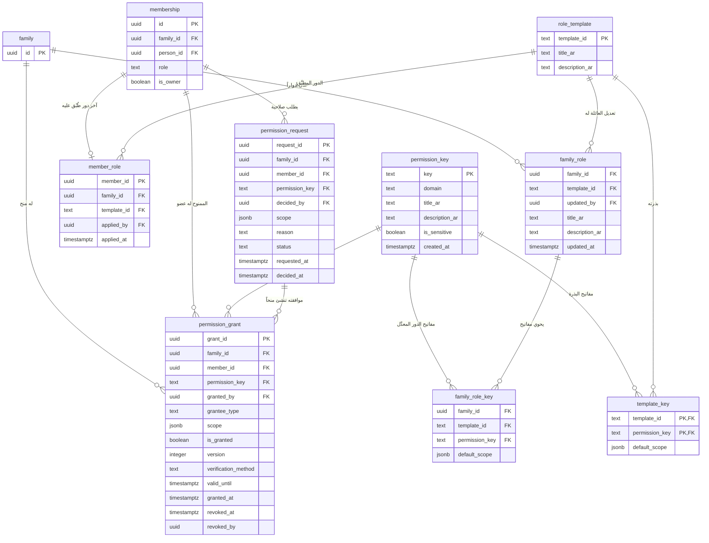

- أُعيد رسمه 2026-11-19 (Q-434 — شكل فقط): قُسّم ERD لوحتين لأن جداوله 13؛ وفي كل جدول: المفتاح الأساسي أولاً ثم المفاتيح الأجنبية ثم الحقول ثم التواريخ في الآخر؛ و`template_key` بمفتاحه المركب (PK, FK) كما في السطر تحت اللوحة؛ و`permission_request.decided_by` مفتاح أجنبي إلى الشخص كما في SPEC §5-7. لا تغيير في المحتوى.

**2-ب. الصلاحية الكاملة والتدقيق (3 جداول كاملة + 3 مكررة باسمها ومفتاحها فقط)**

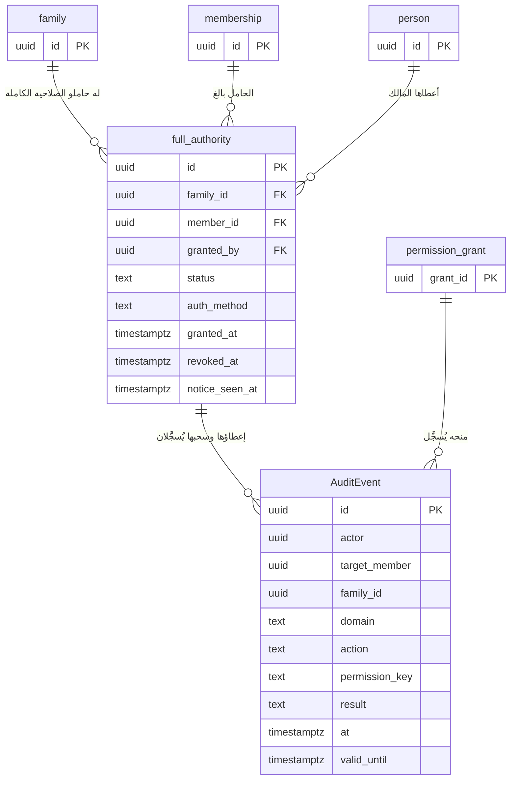

- أُعيد رسمه 2026-11-19 (Q-434 — شكل فقط): اللوحة الثانية من تقسيم ERD؛ والجداول `family` و`membership` و`permission_grant` مكررة باسمها ومفتاحها فقط، وتعريفها الكامل في 2-أ. لا تغيير في المحتوى.

- `template_key` مفتاحه المركب (`template_id`, `permission_key`) (§5-3)؛ وصفوف البذرة (شريك 43 / وصي محدود 24 / مراقب 10) في SPEC §5-3-أ (Q-262 · Q-329 · Q-330 · Q-343). [تصحيح 2026-11-08 (D-2): كانت 40/22/10 قبل Q-329/Q-330/Q-343.]
- **تسوية المفاتيح (Q-326…Q-333 · Q-343):** المجموع **94 مفتاحاً**: شريك 43 / وصي محدود 24 / مراقب 10؛ و§5-أ (مالك حصري) **27**؛ و§5-ب 23؛ و§5-ج 1 (`identity.device.pair`)؛ 43+27+23+1 = 94. والمراهق (Q-318…Q-325): المفتاح الوحيد القابل للمنح `tasks.create` (scope=self)؛ و14 متأصلة في الدور (Q-253 — أُضيف `tasks.cancel`، scope=self)؛ و5 حدّية حُسمت؛ و74 مستبعدة (76 ← 75 بنقل `tasks.cancel` منها إلى الملازمة، ثم 75 ← 74 بحذف مفتاح القسيمة)؛ 1+14+5+74 = 94؛ و`tasks.own.manage` محذوف من وايرفريم R03-09 (Q-325). [Q-421 — 2026-11-18: كانت 95 و28 و75 قبل حذف `billing.voucher.redeem` مع حذف القسائم.]
- `AuditEvent` في ERD يسرد كل حقل في §5-6 (بعد تصحيح R2-S103-19 في B4) — بأنواع مطابقة.
- `permission_request` جدول جديد (§5-7) — طلبات تعديل الصلاحية (R03-17)؛ و`member_id` مفتاح أجنبي إلى `membership.id` (Q-169).
- **توحيد الهوية (Q-169):** `permission_grant.member_id` مفتاح أجنبي إلى `membership.id` (S1-03 SPEC §5-4) — لا إلى `person`؛ فالمراهق والطفل لهما عضوية وبلا `person` (Q-137). وعند منح الوكيل (`grantee_type='agent'`) يكون `member_id` فارغاً.
- `scope` + `valid_until` إلزاميان في كل منح (Q-007 · Q-087)؛ `is_granted=false` رفض صريح وليس غياباً (Q-007).
- `verification_method` قيمه `pin` / `biometric` — للمنح الحساس فقط (REQ-012).
- **`full_authority` (§5-5 — Q-401):** حلّ محل `ownership_transfer`. `status` قيمتاه `active` / `revoked` فقط — لا `pending` ولا `accepted` ولا `expired` ولا `expires_at`؛ صف `active` واحد على الأكثر لكل عضو؛ `auth_method` PIN أو بصمة (Q-093)؛ `notice_seen_at` متى رأى الحامل إشعاره. و`membership.is_owner` لا ينتقل إلا عند اكتمال مهلة حذف حساب المالك (Q-402).
- **`family_role` + `family_role_key` (§5-3-ب — Q-401):** تعديل العائلة لدور؛ صفوف تُكتب فقط حين تعدّل، ومفتاحاهما المركبان (`family_id`, `template_id`) و(`family_id`, `template_id`, `permission_key`). البذرة (`role_template` + `template_key`) لا تُمس.
- **`member_role` (§5-3-ج):** آخر دور طُبّق على العضو — للعرض فقط، ولا يدخل في التقييم.
- المنع الصريح صف في `permission_grant` بـ `is_granted=false`؛ `valid_until` فيه اختياري وغيابه يعني «حتى يُرفع» (Q-402).

## 3. التسلسل (Sequence) — من عقود §4

أربعة عشر مخططاً، كل واحد لتدفق واحد (3-أ … 3-س):

### 3-أ. إنشاء منح (REQ-010/011/012 — §4-1)

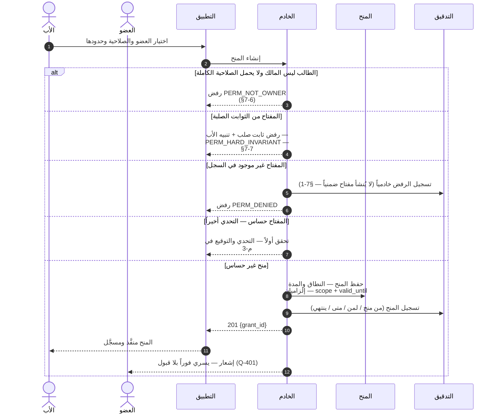

- الرسالة 1: `اختيار عضو + صلاحية + نطاقها + مدتها — لكل صلاحية حدودها (Q-401)`.
- الرسالة 2: `POST /api/v1/families/{id}/members/{memberId}/grants`.

- أُعيد رسمه 2026-11-19 (Q-434 — شكل فقط): فُرع التحدي والتوقيع للمفتاح الحساس إلى 3-م؛ ووُحّد ترتيب المشاركين. لا تغيير في المحتوى.

- التحقق نفسه محلي (بوابة الوالدين Q-065 / بصمة Q-072) **ويتحقق الخادم من توقيع التحدي بمفتاح الجهاز العام قبل التنفيذ (Q-164)** ويُسجَّل في التدقيق (§4-1)؛ ولو فشل التحقق 3 مرات يعود النظام لطلب PIN (سيناريو 2-4 · Q-072).
- مسار التحدي والتوقيع للمفتاح الحساس في 3-م.
- ترتيب الفحص عند إنشاء منح (قاعدة §6-3): المالك أولاً → الثابت الصلب → المفتاح في السجل → التحدي أخيراً؛ فلا تحدٍّ يُصدر لغير المالك ولا لمفتاح ثابت صلب ولا لمفتاح غير موجود. ومنتقي المفتاح يقرأ السجل للعرض فقط (GET /api/v1/permissions/keys) — والتحقق الحاكم خادمي.
- رفض المفتاح غير المعروف يكتبه الخادم في التدقيق (Ktor→Audit) — لا كتابة تدقيق من العميل أبداً (§7-1)؛ وبلا اتصال يُحفظ سجل الرفض محلياً ويُصالح مع الخادم عند عودة الاتصال. والاستثناء Q-174 (تبديل المنح من S1-09 بلا تحدٍّ) يتجاوز التحدي فقط، لا الفحوص قبله.
- رموز الخطأ الموحدة (§4-4): `PERM_DENIED` · `PERM_HARD_INVARIANT` · `PERM_NOT_OWNER` · `PERM_VERIFICATION_REQUIRED` · `PERM_GRANT_EXPIRED` · `PERM_CONFLICT` — والأخير لتعديلين متزامنين على منح عضو واحد: الثاني يفشل ويُطلب إعادة تحميل أحدث حالة قبل إعادة المحاولة (REQ-019 · §7-8).
- حامل الصلاحية الكاملة يسلك هذا التسلسل كالمالك في منح غيره؛ وتعديله منح نفسه يُرفض `403` + `PERM_DENIED` (§7-16). والمنع الصريح يسلك النقطة نفسها بـ `is_granted: false` — مرسوم في 3-ي.

### 3-ب. تطبيق قالب على عضو (REQ-013/014 — §4-1)

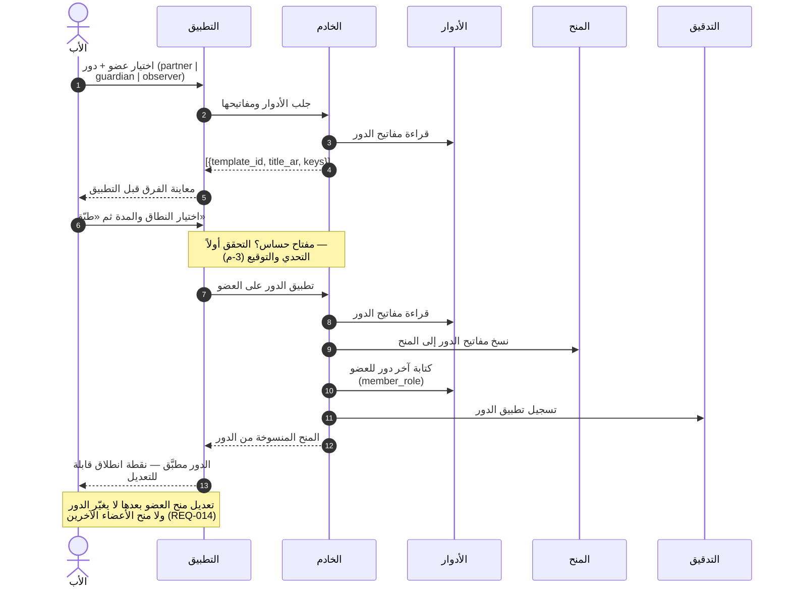

- الرسالة 2: `GET /api/v1/families/{id}/templates — الأدوار ومفاتيحها عند هذه العائلة`.
- الرسالة 3: `تعديل العائلة للدور إن وُجد (family_role_key) وإلا البذرة (template_key)`.
- الرسالة 5: `معاينة الفرق قبل التطبيق — وما عليه منع صريح «يبقى ممنوعاً» (R03-07)`.
- الرسالة 7: `POST /api/v1/families/{id}/members/{memberId}/grants/apply-template {template_id, scope?, valid_until, verification?}`.
- الرسالة 9: `نسخ المفاتيح إلى منح العضو — عدا ما عليه منع صريح قائم (Q-402)`.
- ملاحظة: إن كان في الدور مفتاح حساس فالتحقق أولاً — التحدي والتوقيع كما في 3-م — وverification تُرسل مع طلب التطبيق.

- أُعيد رسمه 2026-11-19 (Q-434 — شكل فقط): فُرع التحدي والتوقيع إلى 3-م؛ وإشعار العضو في السطر تحت المخطط؛ ووُحّد ترتيب المشاركين. لا تغيير في المحتوى.
- ويصل العضو إشعار — يسري فوراً بلا قبول (Q-401).

### 3-ج. فحص صلاحية — خادمي ومحلي O(1) (REQ-004/005/006 — §4-1/§4-3)

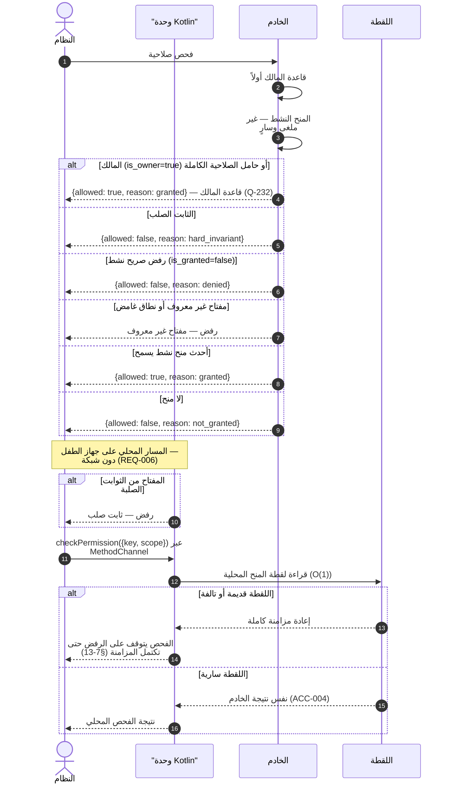

- الرسالة 1: `POST /api/v1/permissions/check {member_id, permission_key, scope?}`.
- الرسالة 2: `قاعدة المالك أولاً (§6-3 — Q-232): adult + is_owner=true ← allowed — وكذلك بالغ له صف active في full_authority (Q-401)`.
- الرسالة 3: `المنح النشط = revoked_at IS NULL و valid_until > now (§6-3)`.
- الرسالة 7: `{allowed: false, reason: unknown_key} — الغموض لصالح الحماية (REQ-005)`.
- الرسالة 10: `{allowed: false, reason: hard_invariant} — قبل lookup المنح (§6-3)`.
- الرسالة 13: `إعادة مزامنة كاملة عبر family/{family_id}/permissions/sync`.
- الرسالة 16: `allowed / denied / unknown_key (المفتاح غير المعروف في السجل المخزن — REQ-005)`.

- أُعيد رسمه 2026-11-19 (Q-434 — شكل فقط): وُحّد ترتيب المشاركين. لا تغيير في المحتوى.

- قاعدة المالك أولاً (§6-3 — Q-232): `adult` + `is_owner=true` → `allowed` بلا منح صريح؛ والتجاوز تقييم فقط — لا يشمل التدقيق أبداً ولا فحوص `PERM_HARD_INVARIANT` ولا يمتد لغير المالك. والمسار المحلي يطبق قاعدة المالك نفسها حين يكون العضو المفحوص مالكاً (§6-3).
- أي رفض صريح نشط يفوز على أي منح سامح (§6-3 — deny-override)؛ وإلا يفوز أحدث منح نشط ويُؤخذ نطاقه.
- حامل الصلاحية الكاملة يُقيَّم بقاعدة المالك قبل النظر في منحه، فلا يسري عليه منع صريح أثناء الحمل، ويعود المنع نافذاً لحظة السحب؛ ويُستثنى مما للمالك نفسه: إعطاؤها وسحبها وإزالة المالك وتعديل منح نفسه (SPEC §5-5 · §7-16).
- الثابت الصلب يعطي `reason: "hard_invariant"` (§4-1)؛ والمنح المنتهي `valid_until` يُرفض فوراً (§7-9). والمسار المحلي يميز `unknown_key` بالمفتاح الغائب من نسخة السجل المخزنة على الجهاز (R03-05) — كالخادم في التسمية، ورفض في الأثر. والثابت الصلب يُفحص قبل lookup المنح — خادمياً ومحلياً (§6-3)؛ فلا منح يغطي ثابتاً صلباً.

### 3-د. إلغاء منح — فوري بلا إبطال جلسات (REQ-017 — §4-1/§4-2 · Q-257)

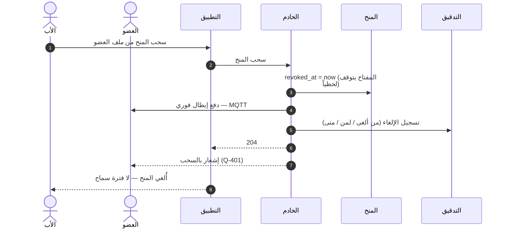

- الرسالة 2: `DELETE /api/v1/families/{id}/members/{memberId}/grants/{grantId}`.
- الرسالة 4: `دفع إبطال فوري عبر MQTT — تحديث اللقطة المحلية — المفتاح متوقف`.

- أُعيد رسمه 2026-11-19 (Q-434 — شكل فقط): دُمج الجهاز في العضو وطُوي دفع MQTT في رسالة الخادم إلى العضو. لا تغيير في المحتوى.

- إلغاء المنح لا يبطل أي جلسة (Q-257): الجلسات تُبطل فقط بالعمليات الصريحة في S1-02 §4.1 — وتبقى جلسات العضو عاملة لباقي صلاحياتها بعد الإلغاء.
- «اسحب كل صلاحياتها» يسلك `DELETE /api/v1/families/{id}/members/{memberId}/grants`: يسحب كل منح العضو ويرفع كل منع صريح عليه دفعة واحدة، ويفرّغ `member_role` (Q-402 — مرسوم في 3-ي).
- الإبطال الفوري عبر موضوع `family/{family_id}/permissions/revoked` (§4-2).

### 3-هـ. إعطاء الصلاحية الكاملة لبالغ (REQ-016 — §4-1 · Q-093 · Q-401)

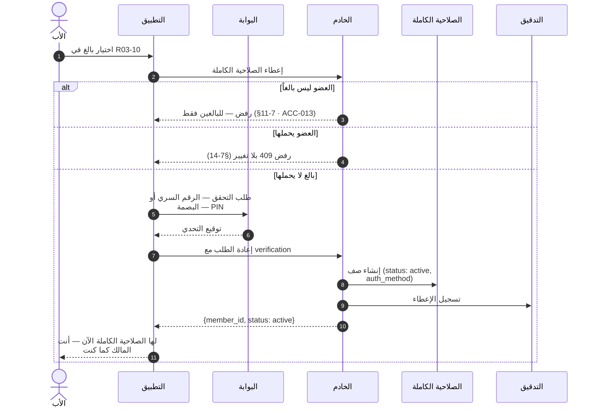

- الرسالة 2: `POST /api/v1/families/{id}/full-authority {member_id}`.

- أُعيد رسمه 2026-11-19 (Q-434 — شكل فقط): إشعار البالغ في السطر تحت المخطط؛ ووُحّد ترتيب المشاركين. لا تغيير في المحتوى.
- ويصل البالغ إشعار — تسري فوراً بلا قبول (R03-11).

- تسري من لحظة نجاح الطلب؛ لا خطوة قبول ولا مهلة ولا حالة معلقة (Q-401 — نُقض Q-139 · Q-259).
- دون اتصال تُرفض ولا تدخل صندوق الصادر (Q-269)؛ و`is_owner` لا ينتقل (Q-006).

### 3-و. تحول الدور عند بلوغ 13 (REQ-003 — §6-3)

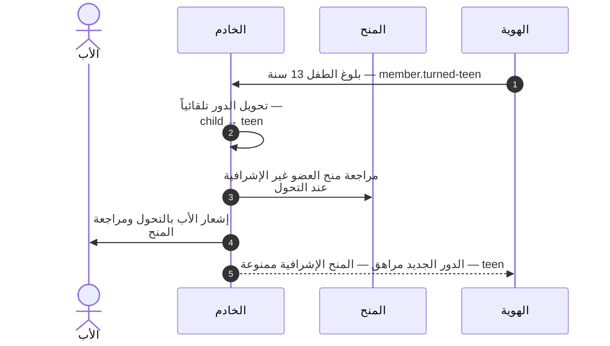

- الرسالة 5: `الدور الجديد teen — المنح الإشرافية ممنوعة أصلاً (D-038)`.

- أُعيد رسمه 2026-11-19 (Q-434 — شكل فقط): وُحّد ترتيب المشاركين؛ وقُصّرت تسمية الرسالة الأولى بعد فحص العين (كانت تُقصّ من الطرفين).

- حدث داخلي بلا موضوع MQTT (Q-189)؛ والحمولة والمعالج وكاتب الدور في SPEC §4-2-أ. ومهمة خادمية يومية عند منتصف الليل المحلي (Q-189)؛ تُطلق 1 يناير من سنة بلوغ 13 (Q-235)؛ وسنة الميلاد تحدد الدور (Q-080).

### 3-ز. حذف العائلة / إزالة عضو / إلغاء الحذف (REQ-020 — §4-1 · Q-166)

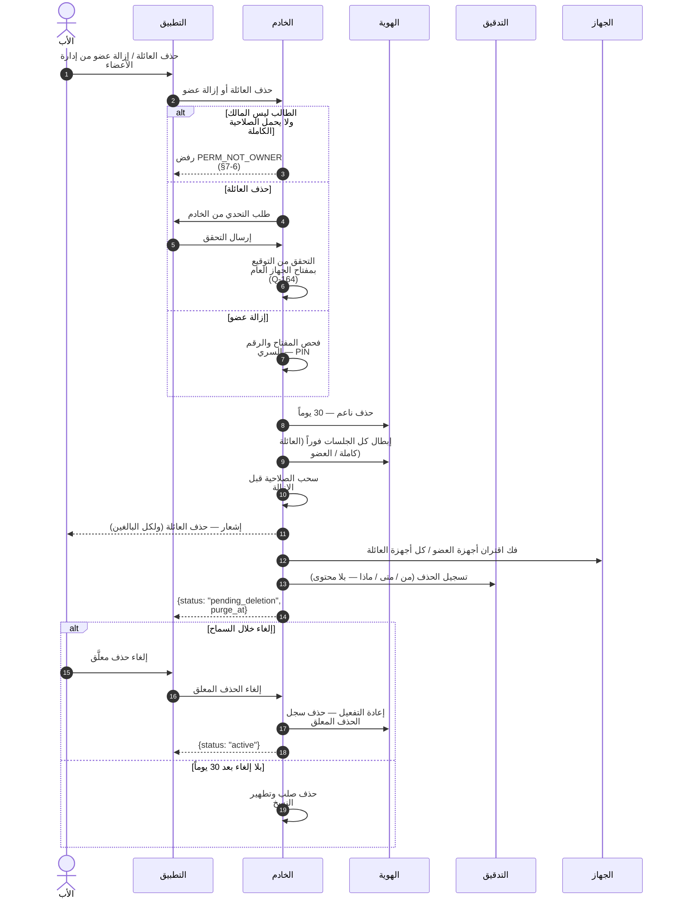

- الرسالة 2: `DELETE /api/v1/families/{id} — أو DELETE /api/v1/families/{id}/members/{memberId}`.
- الرسالة 4: `تحدٍّ {challenge_id, nonce} — POST /api/v1/shell/verification/challenge (S1-01) — صلاحية 5 دقائق (Q-164)`.
- الرسالة 5: `verification {method: pin | biometric, challenge_id, signature, at}`.
- الرسالة 7: `فحص المفتاح identity.member.remove + PIN الأب`.
- الرسالة 8: `حذف ناعم — deleted_at + scheduled_purge_at (+30 يوماً) + سجل deletion_request`.
- الرسالة 10: `إزالة عضو يحمل الصلاحية الكاملة تسحبها أولاً (§7-15) — وفي حذف العائلة يبقى الحمل حتى الحذف الصلب`.
- الرسالة 16: `POST /api/v1/families/{id}/deletion/cancel (عائلة) أو POST /api/v1/families/{id}/members/{memberId}/deletion/cancel (عضو)`.
- الرسالة 19: `حذف صلب — رسائل العضو تُجهَّل («عضو محذوف»)؛ وتطهير النسخ خلال 30 يوماً`.

- أُعيد رسمه 2026-11-19 (Q-434 — شكل فقط): طُوي إشعار الوسيط في رسالة الخادم إلى الأب. لا تغيير في المحتوى.

- ملاحظة: حذف العائلة وإزالة العضو غير قابلين للتفويض (REQ-020 — ثابت صلب)؛ والقاصر لا يُزال إلا بيد الأب؛ وطلب حذف دون اتصال يُحفظ في الصندوق الصادر ويُنفَّذ عند الاتصال (بروتوكول الحذف والتصدير — `DELETION-EXPORT-PROTOCOL.md` §6). وحامل الصلاحية الكاملة يفعلهما بقاعدة المالك وبالشروط نفسها — عدا إزالة المالك (Q-402).

### 3-ح. سحب الصلاحية الكاملة (REQ-016 — §4-1 · Q-401)

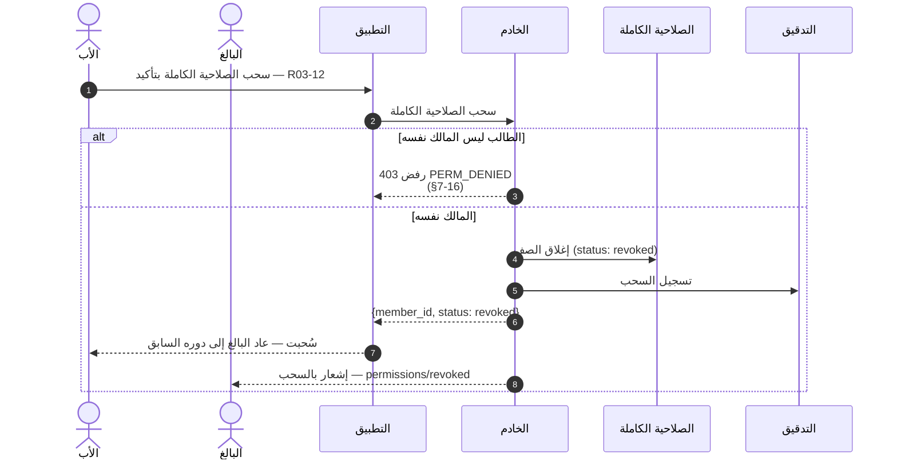

- الرسالة 2: `DELETE /api/v1/families/{id}/full-authority/{memberId}`.

- أُعيد رسمه 2026-11-19 (Q-434 — شكل فقط): وُحّد ترتيب المشاركين. لا تغيير في المحتوى.

- السحب تأكيد واحد بلا رقم سري، كإلغاء أي منح (REQ-017)؛ ولا تُبطل جلسة (Q-257).
- البالغ يعود إلى منحه في `permission_grant` كما هي؛ ما انتهت مدته أثناء الحمل يبقى منتهياً (SPEC §5-5).

### 3-ط. طلب تعديل صلاحية (REQ-002/015 — §4-1 · R03-17)

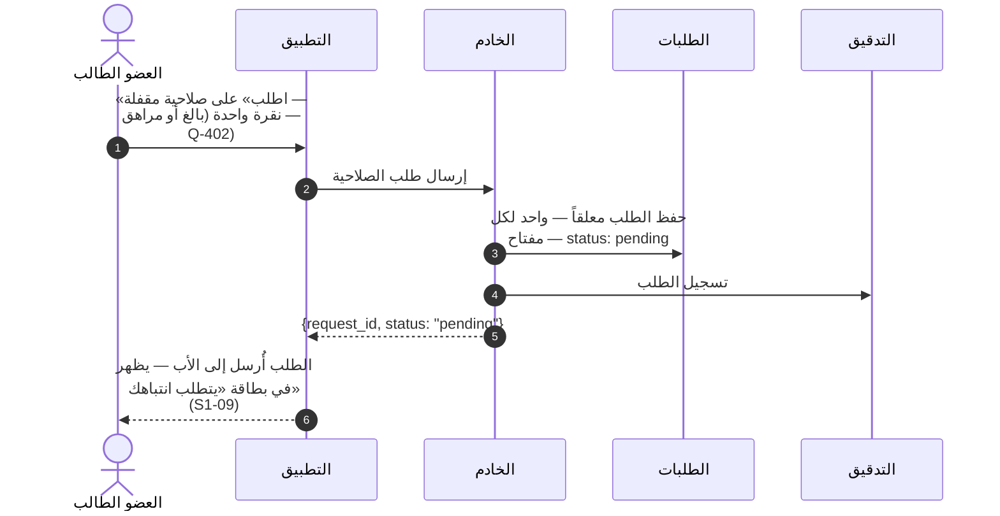

- الرسالة 2: `POST /api/v1/families/{id}/permission-requests {member_id, permission_key, scope?, reason?}`.

- أُعيد رسمه 2026-11-19 (Q-434 — شكل فقط): قُسّم طلب الصلاحية: الإرسال هنا، والقرار في 3-س. لا تغيير في المحتوى.

- الطلب قناة طلب لا منح: لا يمنح شيئاً بذاته ولا يُعدّ تصعيداً ولا يُنبَّه به (§7-20)؛ وطلب ثانٍ لنفس المفتاح وهو معلق → `409`. والطالب بالغ مفوَّض أو مراهق (Q-402). والقرار في 3-س.

### 3-ي. المنع الصريح: إنشاؤه وبقاؤه عند تغيير الدور ورفعه (REQ-004/014 — §4-1 · Q-401 · Q-402)

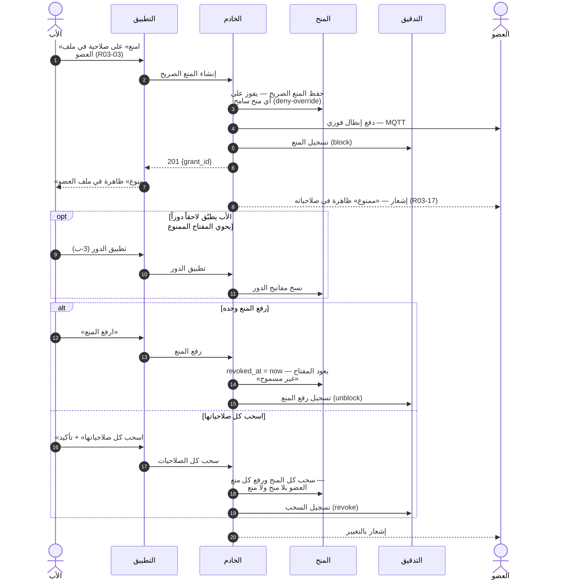

- الرسالة 2: `POST /api/v1/families/{id}/members/{memberId}/grants {permission_key, scope, is_granted: false}`.
- الرسالة 4: `دفع إبطال فوري عبر MQTT — يتوقف المفتاح فوراً`.
- الرسالة 10: `POST /api/v1/families/{id}/members/{memberId}/grants/apply-template`.
- الرسالة 11: `نسخ مفاتيح الدور — والمفتاح الممنوع يبقى ممنوعاً بلا تغيير (Q-402)`.
- الرسالة 13: `DELETE /api/v1/families/{id}/members/{memberId}/grants/{grantId}`.
- الرسالة 17: `DELETE /api/v1/families/{id}/members/{memberId}/grants`.

- أُعيد رسمه 2026-11-19 (Q-434 — شكل فقط): طُوي دفع الوسيط في رسالة الخادم إلى العضو. لا تغيير في المحتوى.

- الحالات الثلاث لكل صلاحية كما تظهر للمالك وللعضو: **مسموح** (منح نشط) · **غير مسموح** (لا منح) · **ممنوع** (`is_granted=false`). لا حالة مخفية (Q-401).
- المنع يضيّق ولا يوسّع، فلا يتطلب تحققاً ولو كان المفتاح حساساً؛ ومدته اختيارية وغيابها يعني «حتى يُرفع».
- منحا حق الخروج (`identity.account.delete_self` · `identity.family.leave`) لا يُمنعان ولا يُسحبان (Q-291).
- الإبطال الفوري عبر موضوع `family/{family_id}/permissions/revoked` (§4-2).

### 3-ك. المالك يحذف حسابه — تسليم العائلة لحامل الصلاحية الكاملة (REQ-016 · S1-02 REQ-025 — §7-18 · Q-402)

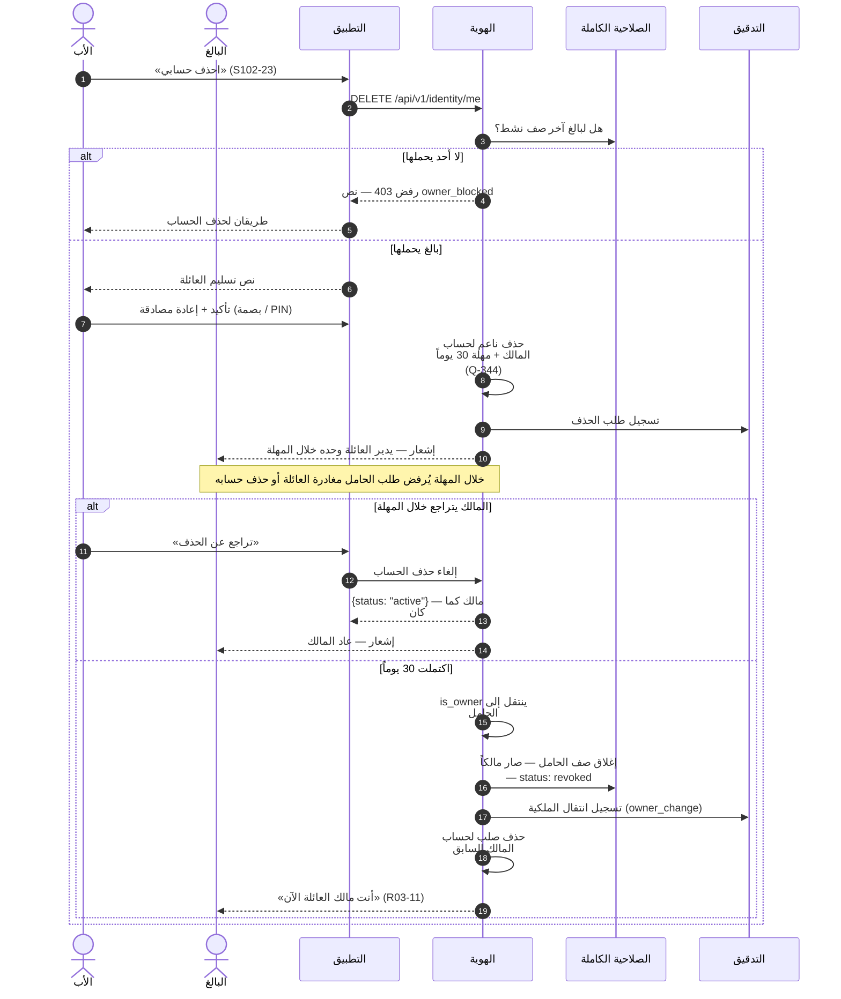

- الرسالة 3: `هل لبالغ آخر صف active؟`.
- الرسالة 5: `طريقان — أعطِ الصلاحية الكاملة أولاً (3-هـ) أو احذف العائلة كلها (3-ز)`.
- الرسالة 6: `نص owner_handover — «بعد حذف حسابك تدير {name} العائلة وحدها»`.
- الرسالة 12: `POST /api/v1/identity/me/deletion/cancel`.

- أُعيد رسمه 2026-11-19 (Q-434 — شكل فقط): وُحّد ترتيب المشاركين. لا تغيير في المحتوى.
- هذا **الطريق الوحيد** لانتقال `is_owner` (Q-402)؛ إعطاء الصلاحية الكاملة لا ينقله (Q-006).
- نقطة الحذف وإلغاؤه يملكهما S1-02 (REQ-025 — تسلسله 3-ز)؛ وهذا النظام يجيب «من يحمل الصلاحية الكاملة؟» ويغلق الصف عند الانتقال.
- أكثر من حامل عند حذف حساب المالك: بلا حكم بعد (G-R03-11) — التصميم يعرضها لبالغ واحد.

### 3-ل. تعديل محتوى دور (REQ-013/014 — §4-1 · Q-089 · Q-205 · Q-401)

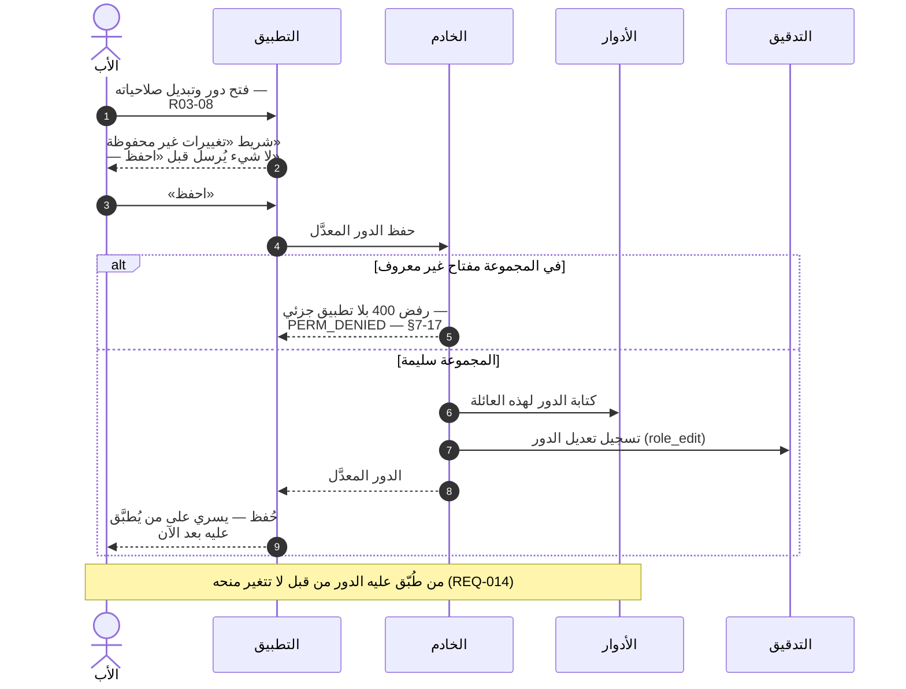

- الرسالة 4: `PATCH /api/v1/families/{id}/templates/{templateId} {keys}`.
- الرسالة 6: `كتابة الدور لهذه العائلة (family_role + family_role_key) — البذرة لا تُمس`.

- `keys` تستبدل مجموعة الدور كاملة؛ والأدوار ثلاثة لا رابع لها (Q-089).

### 3-م. إنشاء منح حساس — التحدي والتوقيع (REQ-012 — §4-1 · Q-164)

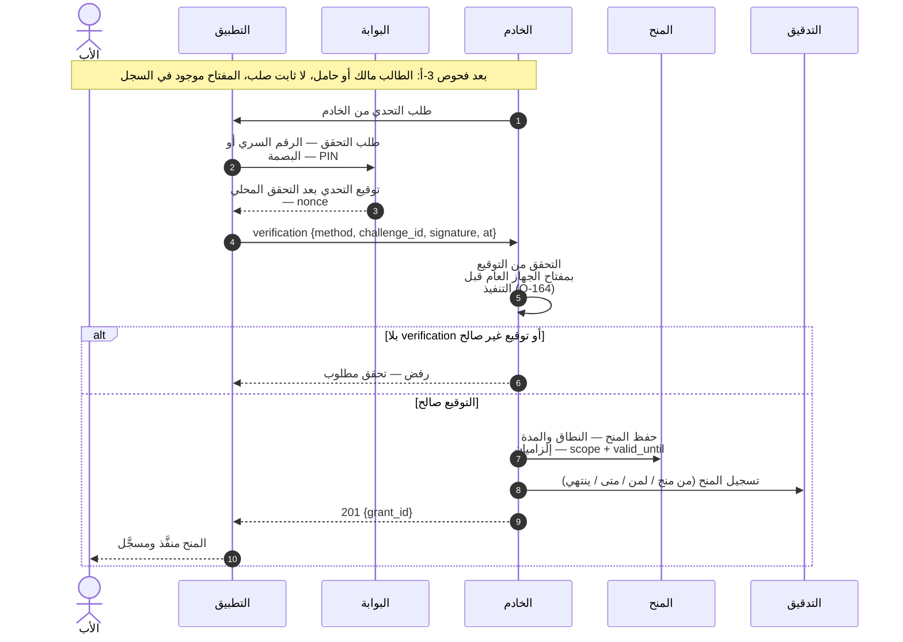

- الرسالة 1: `تحدٍّ {challenge_id, nonce} — POST /api/v1/shell/verification/challenge (S1-01) — صلاحية 5 دقائق (Q-164)`.
- الرسالة 2: `طلب تحقق — PIN الأب أو بصمته (Q-088)`.
- الرسالة 6: `رفض PERM_VERIFICATION_REQUIRED`.

- مخطط جديد 2026-11-19 (Q-434): فرع التحدي والتوقيع من 3-أ، بلا تغيير في المحتوى.
- التحقق نفسه محلي (بوابة الوالدين Q-065 / بصمة Q-072)؛ ولو فشل التحقق 3 مرات يعود النظام لطلب PIN (سيناريو 2-4 · Q-072).
- ويصل العضو إشعار بالمنح — يسري فوراً بلا قبول (Q-401).

### 3-س. قرار الأب في طلب صلاحية (REQ-004 — §4-1 · R03-17)

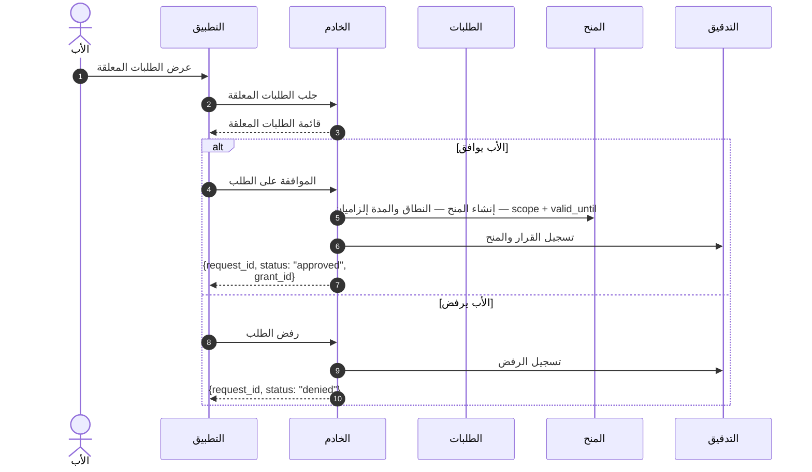

- الرسالة 2: `GET /api/v1/families/{id}/permission-requests?status=pending`.
- الرسالة 4: `POST /api/v1/families/{id}/permission-requests/{requestId}/decide {decision: "approve", scope, valid_until, verification?}`.
- الرسالة 5: `إنشاء المنح (scope + valid_until إلزاميان — REQ-011)`.
- الرسالة 8: `POST /api/v1/families/{id}/permission-requests/{requestId}/decide {decision: "deny"}`.

- مخطط جديد 2026-11-19 (Q-434): قرار الأب من 3-ط، بلا تغيير في المحتوى.
- الموافقة تنشئ المنح بقواعد المنح نفسها (REQ-011/012 — والمفتاح الحساس يتطلب `verification`)؛ والأب يختار النطاق والمدة أو يرفض؛ ويصل الطالب إشعار بالقرار.

## 4. تدفق المستخدم (User Flow) — من السيناريوهات الاثني عشر (§2) والتصميم المعتمد (§9-8)

ستة تدفقات، كل واحد في لوحة صغيرة تُقرأ من أعلى إلى أسفل. اللوحات بلغة المستخدم فقط؛ وأسماء النقاط والمفاتيح في التسلسلات (§3) لا هنا.

### 4-أ. المالك يغيّر صلاحيات بالغ

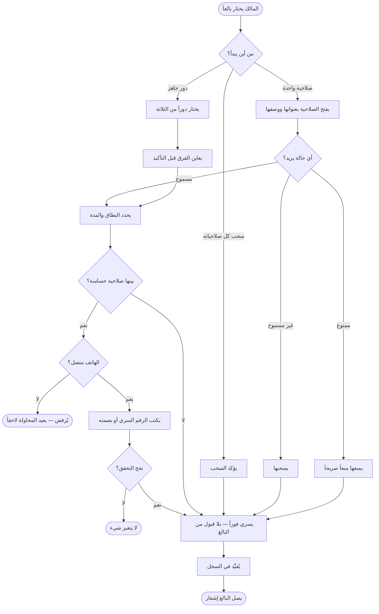

- أُعيد رسمه 2026-11-19 (Q-434 — شكل فقط): قُصّرت التسميات؛ ونُقلت التفاصيل إلى السطور تحت اللوحة. لا تغيير في المحتوى.

- لكل صلاحية حالتها (مسموح · غير مسموح · ممنوع) ونطاقها ومدتها وحدها (Q-401)؛ و«حدود كل الصلاحيات دفعة واحدة» اختصار في الواجهة يسلك فرع «مسموح» لكل منح قائم (REQ-011).
- الأدوار الثلاثة: شريك / وصي محدود / مراقب. والإشعار يظهر للبالغ في «آخر ما تغيّر» عنده.
- الدور نقطة انطلاق لا قيد: تعديل منح البالغ بعد تطبيق الدور لا يغيّر الدور ولا منح الآخرين (REQ-014 · سيناريو 2-1)؛ والمنع الصريح يبقى بعد تغيير الدور (Q-402 · §7-19).
- الحساس خمس صلاحيات (§6-1)؛ منحها يتطلب الرقم السري أو البصمة مثبتاً بتحدٍّ من الخادم (REQ-012 · Q-088 · Q-164)، ودون اتصال يُرفض ولا يُحفظ للإرسال لاحقاً (Q-269 · §7-12). وغير الحساس دون اتصال يُحفظ في صندوق الصادر ويُرسل عند عودة الاتصال.
- بعد ثلاث بصمات فاشلة يُطلب الرقم السري (Q-072).
- حامل الصلاحية الكاملة يسلك هذا التدفق نفسه مع غيره من الأعضاء، لا مع نفسه (§7-16).
- المراهق: الصلاحية الوحيدة القابلة للمنح له «إنشاء مهامه»، وتسلك فرع «صلاحية واحدة» بلا دور وبلا تحقق (REQ-015).
- بالغ منضم جديداً يبدأ بلا أي منح عدا حقَّي المغادرة وحذف حسابه (REQ-002 · Q-166 · Q-248).

### 4-ب. المالك يعطي الصلاحية الكاملة أو يسحبها

```mermaid
flowchart TD
    B1([المالك يختار بالغاً]) --> B2{هل يحملها هذا البالغ؟}
    B2 -->|لا| B3[يقرأ ما تعنيه]
    B3 --> B4{الهاتف متصل؟}
    B4 -->|لا| B5([يُرفض — يعيد المحاولة لاحقاً])
    B4 -->|نعم| B6[يكتب الرقم السري أو بصمته]
    B6 --> B7[تسري فوراً — بلا قبول]
    B7 --> B8([يصل البالغ إشعار])
    B2 -->|نعم| B9[يسحبها بتأكيد واحد]
    B9 --> B10[يعود البالغ إلى صلاحياته]
    B10 --> B11([يصل البالغ إشعار بالسحب])
```

- أُعيد رسمه 2026-11-19 (Q-434 — شكل فقط): قُصّرت التسميات؛ ونُقلت التفاصيل إلى السطور تحت اللوحة. لا تغيير في المحتوى.

- لا قبول ولا رفض من البالغ ولا مهلة ولا حالة معلقة (Q-401 — نُقض Q-139)؛ والإعطاء لبالغ فقط (§7-11).
- الباقي للمالك وحده: إعطاء الصلاحية الكاملة وسحبها، وإزالة المالك من العائلة؛ وحاملها لا يعدّل منح نفسه (§7-16).
- الإشعار يشرح ما صار عند البالغ وما بقي للمالك وحده.
- السحب بتأكيد واحد بلا رقم سري وإعطاؤها بالرقم السري وباتصال: اختيار المنفّذ المسجَّل في G-R03-13 ما لم يحكم المالك بغيره.

### 4-ج. المالك يعدّل محتوى دور

```mermaid
flowchart TD
    C1([المالك يفتح الأدوار ويختار دوراً]) --> C2[يضيف صلاحيات أو يزيل]
    C2 --> C3{يحفظ أم يتراجع؟}
    C3 -->|يحفظ| C4[يُحفظ الدور لهذه العائلة]
    C4 --> C5([من طُبّق عليه لا يتغير])
    C3 -->|يتراجع| C6([يبقى الدور كما كان])
```

- أُعيد رسمه 2026-11-19 (Q-434 — شكل فقط): قُصّرت التسميات؛ ونُقلت التفاصيل إلى السطور تحت اللوحة. لا تغيير في المحتوى.

- الأدوار الثلاثة قابلة للتعديل لكل عائلة (Q-089 · Q-401)؛ وتعديل الدور لا يمسّ منح أحد (REQ-014).

### 4-د. حذف العائلة أو إزالة عضو

```mermaid
flowchart TD
    D1([المالك أو الحامل يفتح العائلة]) --> D2{ماذا يريد؟}
    D2 -->|حذف العائلة| D3[يكتب اسم العائلة ويتحقق]
    D2 -->|إزالة عضو| D4[يقرأ أثر الإزالة ويتحقق]
    D3 --> D5[تبدأ مهلة ثلاثين يوماً]
    D4 --> D5
    D5 --> D6{يتراجع خلال المهلة؟}
    D6 -->|نعم — يُلغى الحذف| D7([يُلغى الحذف])
    D6 -->|لا — حذف نهائي| D8([حذف نهائي بعد ثلاثين يوماً])
```

- أُعيد رسمه 2026-11-19 (Q-434 — شكل فقط): قُصّرت التسميات؛ ونُقلت التفاصيل إلى السطور تحت اللوحة. لا تغيير في المحتوى.

- أُصلح 2026-11-19 (فحص عين بمحرك GitHub 10.9.3 بعد الشكل 2): تسميتا «نعم»/«لا» المجردتان صارتا تصفان النتيجة («نعم — يُلغى الحذف»، «لا — حذف نهائي») لتُقرآ من أول نظرة؛ لا تغيير في الفروع ولا النتائج.

- حذف العائلة وإزالة العضو للمالك ولحامل الصلاحية الكاملة (REQ-020 · Q-402)؛ وحاملها لا يزيل المالك (§7-16).
- العضو المُزال تتوقف جلساته وأجهزته فوراً؛ والمهلة لبياناته لا لدخوله (`DELETION-EXPORT-PROTOCOL.md`).

### 4-هـ. عضو يحاول فعلاً لا يملك صلاحيته

```mermaid
flowchart TD
    E1([بالغ أو مراهق يضغط عنصراً]) --> E2{هل هو مسموح له الآن؟}
    E2 -->|نعم — يُنفَّذ| E3([يُنفَّذ])
    E2 -->|لا — ولا يُمنح لأحد| E4([يُرفض ويُسجَّل ويصل المالك تنبيه])
    E2 -->|غير مسموح أو ممنوع| E5[يظهر مقفلاً ومعه سبب المنع]
    E5 --> E6{من الصلاحيات الخمس الحساسة؟}
    E6 -->|نعم — تُسجَّل المحاولة| E7[تُسجَّل المحاولة ويصل المالك تنبيه]
    E6 -->|لا — شرح فقط| E8[شرح فقط — بلا سجل ولا تنبيه]
    E7 --> E9{يريد أن يطلبها؟}
    E8 --> E9
    E9 -->|لا — انتهى| E10([انتهى])
    E9 -->|نعم — بنقرة واحدة| E11[يصل الطلب إلى المالك]
    E11 --> E12{قرار المالك}
    E12 -->|يوافق — يمنحها| E13([يحدد المالك حدودها ويمنحها])
    E12 -->|يرفض — إشعار بالرفض| E14([يصل العضو إشعار بالرفض])
```

- أُعيد رسمه 2026-11-19 (Q-434 — شكل فقط): قُصّرت التسميات؛ ونُقلت التفاصيل إلى السطور تحت اللوحة. لا تغيير في المحتوى.

- أُصلح 2026-11-19 (فحص عين بمحرك GitHub 10.9.3 بعد الشكل 2): تسميات «نعم»/«لا» المجردة الباقية صارت تصف النتيجة («نعم — يُنفَّذ»، «لا — شرح فقط»...)، و«يوافق»/«يرفض» صارتا («يوافق — يمنحها»، «يرفض — إشعار بالرفض») لأن الخط يقطعهما على GitHub؛ لا تغيير في الفروع ولا النتائج.

- ما لا يُمنح لأحد: الثوابت الصلبة — الإشراف لطفل أو مراهق، والفوترة، وحذف العائلة لغير المالك وحامل الصلاحية الكاملة (REQ-020 · §7-7).
- الضغط على عنصر مقفل يشرح السبب دائماً؛ ويُسجَّل ويُنبَّه المالك في الصلاحيات الخمس الحساسة فقط (REQ-007 — Q-402).
- منحها بعد الموافقة كما في لوحة تغيير الصلاحيات (4-أ).
- الطلب لا يمنح شيئاً وليس تصعيداً؛ وطلب ثانٍ للصلاحية نفسها وهو معلق يُرفض (§7-20).
- المراهق يطلب صلاحيته الوحيدة بالطريقة نفسها، ويصله إشعار حين يتغيّر ما سُمح له به (REQ-015 — Q-402).

### 4-و. المالك يحذف حسابه

```mermaid
flowchart TD
    F1([المالك يطلب حذف حسابه]) --> F2{الصلاحية الكاملة عند بالغ آخر؟}
    F2 -->|لا — يُرفض| F3([يُرفض — يعطيها لبالغ أولاً])
    F2 -->|نعم — مهلة ثلاثين يوماً| F4[مهلة ثلاثين يوماً — حاملها يدير العائلة]
    F4 --> F5{المالك يتراجع خلال المهلة؟}
    F5 -->|نعم — يعود مالكاً| F6([يعود مالكاً كما كان])
    F5 -->|لا — حاملها يصير مالك العائلة| F7([حاملها يصير مالك العائلة])
```

- أُعيد رسمه 2026-11-19 (Q-434 — شكل فقط): قُصّرت التسميات؛ ونُقلت التفاصيل إلى السطور تحت اللوحة. لا تغيير في المحتوى.

- أُصلح 2026-11-19 (فحص عين بمحرك GitHub 10.9.3 بعد الشكل 2): تسميات «نعم»/«لا» المجردة صارت تصف النتيجة («لا — يُرفض»، «نعم — يعود مالكاً»...) لتُقرأ من أول نظرة؛ لا تغيير في الفروع ولا النتائج.

- هذا الطريق الوحيد الذي تنتقل به صفة المالك (Q-402 · §7-18)؛ وتسلسله 3-ك، وطلب الحذف نفسه في S1-02 (3-ز).

## 5. مخطط تدفق البيانات (DFD — المستوى 1) — من §4/§5

العمليات تسع والمخازن ستة. رُسمت على تسع لوحات (لوحة لكل عملية) ليُقرأ كل سهم؛ والنصوص داخل اللوحات بالعربية وحدها، وأسماء النقاط والجداول في الجدولين تحت اللوحات. مخزن 5 هو سجل التدقيق (النواة المشتركة)؛ واللقطة المحلية على الجهاز مخزن عميل لا جدول خادم.

- أُعيد تقسيمه 2026-11-19 (دفعة الشكل 2): اللوحات الأربع قُسّمت إلى تسع لوحات — لوحة لكل عملية — لأن ثلاث لوحات تجاوزت حد العرض 1280؛ ولا تغيير في العقد أو العلاقات.

- **اللوحات عمودية (TD) لا أفقية — انحراف موثّق عن أمر Q-434** الذي نصّ على أن DFD أفقية: محرك GitHub (Mermaid 10.9.3) لا يرسم خلفية خلف تسمية السهم الأفقي، فيمرّ خط السهم من وسط التسمية فتُقرأ مشطوبة — مثبت بالتجربة المحلية بمحرك 10.9.3 نفسه (توجيه `edgeLabelBackground` لا يغيّر شيئاً)، وفحص GitHub بعد الدمج أكّد الشطب في 26 تسمية عبر اللوحات التسع؛ أما في الاتجاه العمودي فالتسمية بجانب السهم فلا يقطعها. قصد الأمر (§3-9) أن تُقرأ التسميات أولاً، والاتجاه وسيلة لا غاية.

### 5-أ. سجل المفاتيح (P1)

```mermaid
flowchart TD
    P1(العملية 1: سجل المفاتيح)
    D1[(مخزن 1: سجل المفاتيح)]
    P2x["العملية 2: إدارة المنح (5-ب)"]

    P1 -->|المفاتيح بعناوينها وأوصافها| D1
    D1 -->|هل المفتاح موجود وحساس| P2x
```
- أُصلح 2026-11-19 (فحص GitHub بعد الدمج): اللوحة عمودية (TD) بعدما شطب السهم الأفقي تسمياتها في معاينة GitHub؛ العقد والأسهم والتسميات نفسها بلا تغيير.

- أُعيد رسمه 2026-11-19 (Q-434 — شكل فقط): قُصّرت التسميات؛ ونُقلت التفاصيل إلى السطور تحت اللوحة. لا تغيير في المحتوى.

### 5-ب. إدارة المنح (P2)

```mermaid
flowchart TD
    Owner([المالك أو حامل الصلاحية الكاملة])
    D1[(مخزن 1: سجل المفاتيح)]
    P9x["العملية 9: طلبات الصلاحية (5-ط)"]
    P2(العملية 2: إدارة المنح)
    Gate([بوابة الوالدين في نظام الغلاف])
    D3[(مخزن 3: المنح)]

    Owner -->|منح وتعديل وسحب ومنع| P2
    D1 -->|هل المفتاح موجود وحساس| P2
    P9x -->|الموافقة تنشئ منحاً| P2
    P2 -->|تحقق الرقم أو البصمة| Gate
    P2 -->|حفظ المنح أو المنع| D3
```
- أُصلح 2026-11-19 (فحص GitHub بعد الدمج): اللوحة عمودية (TD) بعدما شطب السهم الأفقي تسمياتها في معاينة GitHub؛ العقد والأسهم والتسميات نفسها بلا تغيير.

### 5-ج. الأدوار (P3)

```mermaid
flowchart TD
    Owner([المالك أو حامل الصلاحية الكاملة])
    D2[(مخزن 2: الأدوار ومحتواها)]
    P3(العملية 3: الأدوار)
    D3[(مخزن 3: المنح)]

    Owner -->|تطبيق دور أو تعديله| P3
    D2 -->|محتوى الدور| P3
    P3 -->|تعديل الدور وآخر دور| D2
    P3 -->|نسخ صلاحيات الدور| D3
```
- أُصلح 2026-11-19 (فحص GitHub بعد الدمج): اللوحة عمودية (TD) بعدما شطب السهم الأفقي تسمياتها في معاينة GitHub؛ العقد والأسهم والتسميات نفسها بلا تغيير.

### 5-د. محرك التقييم (P4)

```mermaid
flowchart TD
    Systems([أنظمة المنصة الأخرى])
    Owner([المالك])
    D3[(مخزن 3: المنح)]
    D4[(مخزن 4: الصلاحية الكاملة)]
    P4(العملية 4: محرك التقييم)
    Member([العضو])

    Systems -->|هل يملك العضو الصلاحية؟| P4
    Owner -->|يسأل عن صلاحيات عضو| P4
    D3 -->|المنح والمنع والمدة| P4
    D4 -->|من يحمل الصلاحية الكاملة| P4
    P4 -->|مسموح أو مرفوض| Systems
    P4 -->|صلاحيات العضو الفعلية| Owner
    P4 -->|صلاحياتي أنا فقط| Member
```
- أُصلح 2026-11-19 (فحص GitHub بعد الدمج): اللوحة عمودية (TD) بعدما شطب السهم الأفقي تسمياتها في معاينة GitHub؛ العقد والأسهم والتسميات نفسها بلا تغيير.

- العضو: بالغ أو مراهق أو طفل.

### 5-هـ. مزامنة المنح (P5)

```mermaid
flowchart TD
    D3[(مخزن 3: المنح)]
    D4[(مخزن 4: الصلاحية الكاملة)]
    P5(العملية 5: مزامنة المنح)
    Broker([وسيط الرسائل])
    Snap[(لقطة المنح)]
    Member([العضو])

    D3 -->|كل تغيير في المنح| P5
    D4 -->|سحب الصلاحية الكاملة| P5
    P5 -->|اللقطة والإبطال الفوري| Broker
    Broker -->|لقطة المنح| Snap
    Snap -->|فحص محلي فوري| Member
```
- أُصلح 2026-11-19 (فحص GitHub بعد الدمج): اللوحة عمودية (TD) بعدما شطب السهم الأفقي تسمياتها في معاينة GitHub؛ العقد والأسهم والتسميات نفسها بلا تغيير.

- العضو: بالغ أو مراهق أو طفل. اللقطة: لقطة المنح على الجهاز. السهم من P5 إلى وسيط الرسائل: اللقطة الجديدة والإبطال الفوري.

### 5-و. التدقيق والتنبيهات وإشعار العضو (P6)

```mermaid
flowchart TD
    Ops([العمليات 2 و3 و4 و7 و8 و9])
    P6(العملية 6: التدقيق والتنبيهات والإشعار)
    D5[(مخزن 5: سجل التدقيق)]
    Owner([المالك])
    Member([العضو صاحب المنح])
    Push([قناة الإشعارات في نظام الغلاف])
    Broker([وسيط الرسائل])
    Center([مركز التحكم])

    Ops -->|كل تغيير في الصلاحيات| P6
    P6 -->|أحداث التدقيق| D5
    D5 -->|السجل| P6
    P6 -->|السجل كله للعرض| Owner
    P6 -->|تنبيه الرفض والتصعيد| Owner
    P6 -->|منحي وآخر ما تغيّر| Member
    P6 -->|إشعار بكل تغيير| Push
    Push -->|إشعار| Member
    P6 -->|تنبيه قرب انتهاء منح| Broker
    Broker -->|تنبيه| Center
```
- أُصلح 2026-11-19 (فحص GitHub بعد الدمج): اللوحة عمودية (TD) بعدما شطب السهم الأفقي تسمياتها في معاينة GitHub؛ العقد والأسهم والتسميات نفسها بلا تغيير.

- أُعيد رسمه 2026-11-19 (Q-434 — شكل فقط): قُصّرت التسميات؛ ونُقلت التفاصيل إلى السطور تحت اللوحة. لا تغيير في المحتوى.

### 5-ز. حذف العائلة والعضو (P7)

```mermaid
flowchart TD
    Owner([المالك])
    Holder([بالغ يحمل الصلاحية الكاملة])
    P7(العملية 7: حذف العائلة والعضو)
    Gate([بوابة الوالدين في نظام الغلاف])
    Identity([نظام الهوية])
    P8x["العملية 8: الصلاحية الكاملة (5-ح)"]

    Owner -->|حذف العائلة أو عضو| P7
    Holder -->|حذف وإزالة عدا المالك| P7
    P7 -->|تحقق مثبت بتحدي الخادم| Gate
    P7 -->|تسجيل الحذف والمهلة| Identity
    P7 -->|إزالة حاملها تسحبها أولاً| P8x
```
- أُصلح 2026-11-19 (فحص GitHub بعد الدمج): اللوحة عمودية (TD) بعدما شطب السهم الأفقي تسمياتها في معاينة GitHub؛ العقد والأسهم والتسميات نفسها بلا تغيير.

- أُعيد رسمه 2026-11-19 (Q-434 — شكل فقط): قُصّرت التسميات؛ ونُقلت التفاصيل إلى السطور تحت اللوحة. لا تغيير في المحتوى.

### 5-ح. الصلاحية الكاملة (P8)

```mermaid
flowchart TD
    Owner([المالك])
    Holder([بالغ يحمل الصلاحية الكاملة])
    P7x["العملية 7: حذف العائلة والعضو (5-ز)"]
    Identity([نظام الهوية])
    P8(العملية 8: الصلاحية الكاملة)
    Gate([بوابة الوالدين في نظام الغلاف])
    D4[(مخزن 4: الصلاحية الكاملة)]
    Adults([كل بالغ في العائلة])

    Owner -->|إعطاء أو سحب| P8
    Holder -->|رأيت الإشعار| P8
    Identity -->|حذف حساب المالك| P8
    P7x -->|إزالة حاملها تسحبها أولاً| P8
    P8 -->|تحقق مثبت بتحدي الخادم| Gate
    P8 -->|صف نشط أو مغلق| D4
    P8 -->|من يحملها ومنذ متى| Adults
    P8 -->|صفة المالك تنتقل| Identity
```
- أُصلح 2026-11-19 (فحص GitHub بعد الدمج): اللوحة عمودية (TD) بعدما شطب السهم الأفقي تسمياتها في معاينة GitHub؛ العقد والأسهم والتسميات نفسها بلا تغيير.

### 5-ط. طلبات الصلاحية (P9)

```mermaid
flowchart TD
    Member([بالغ أو مراهق])
    Owner([المالك أو حامل الصلاحية الكاملة])
    P9(العملية 9: طلبات الصلاحية)
    D6[(مخزن 6: الطلبات)]
    P2x["العملية 2: إدارة المنح (5-ب)"]

    Member -->|طلب صلاحية| P9
    Owner -->|قرار الطلب| P9
    P9 -->|طلب معلق لكل صلاحية| D6
    P9 -->|الطلبات المعلقة| Owner
    P9 -->|الموافقة تنشئ منحاً| P2x
```
- أُصلح 2026-11-19 (فحص GitHub بعد الدمج): اللوحة عمودية (TD) بعدما شطب السهم الأفقي تسمياتها في معاينة GitHub؛ العقد والأسهم والتسميات نفسها بلا تغيير.


**العمليات — نقاطها وتسلسلاتها:**

| العملية | النقاط (§4-1 · §4-2) | التسلسل |
|---|---|---|
| 1 سجل المفاتيح (1.0) | `GET /api/v1/permissions/keys` | 3-أ |
| 2 إدارة المنح (2.0) | `POST …/members/{memberId}/grants` (منح أو منع بـ `is_granted: false`) · `PATCH …/grants/{grantId}` · `DELETE …/grants/{grantId}` · `DELETE …/members/{memberId}/grants` (سحب الكل) | 3-أ · 3-د · 3-ي |
| 3 الأدوار (3.0) | `GET …/templates` · `POST …/grants/apply-template` · `PATCH …/templates/{templateId}` | 3-ب · 3-ل |
| 4 محرك التقييم (4.0) | `POST /api/v1/permissions/check` · `GET …/members/{memberId}/permissions` | 3-ج |
| 5 مزامنة المنح (5.0) | `family/{family_id}/permissions/sync` · `family/{family_id}/permissions/revoked` | 3-د |
| 6 التدقيق والتنبيهات والإشعار (6.0) | `GET …/audit/permissions` · `family/{family_id}/alerts/new` (نوع `escalation` — S1-09) · `family/{family_id}/permissions/grant-expiring` (Q-227) · قناة الدفع (S1-01 §4.4) | 3-أ · 3-ج |
| 7 حذف العائلة والعضو (7.0) | `DELETE /api/v1/families/{id}` · `DELETE /api/v1/families/{id}/members/{memberId}` · `POST /api/v1/families/{id}/deletion/cancel` · `POST /api/v1/families/{id}/members/{memberId}/deletion/cancel` | 3-ز |
| 8 الصلاحية الكاملة (8.0) | `POST /api/v1/families/{id}/full-authority` · `GET …/full-authority` · `DELETE …/full-authority/{memberId}` · `POST …/full-authority/{memberId}/seen` | 3-هـ · 3-ح · 3-ك |
| 9 طلبات الصلاحية (9.0) | `POST …/permission-requests` · `GET …/permission-requests` · `POST …/permission-requests/{requestId}/decide` | 3-ط · 3-س |

**المخازن — جداولها:**

| المخزن | الجداول (§5) |
|---|---|
| 1 سجل المفاتيح (D1) | `permission_key` |
| 2 الأدوار ومحتواها (D2) | `role_template` · `template_key` · `family_role` · `family_role_key` · `member_role` |
| 3 المنح (D3) | `permission_grant` |
| 4 الصلاحية الكاملة (D4) | `full_authority` |
| 5 سجل التدقيق (D5) | `AuditEvent` (النواة المشتركة) |
| 6 الطلبات (D6) | `permission_request` |

- **تغطية نقاط §4:** كل نقطة في §4-1 و§4-2 في جدول العمليات أعلاه، ومرسومة سهماً في لوحتها أو خطوةً في تسلسلها.
- العملية 4 هي الحارس الوحيد: كل فحص صلاحية في المنصة يمر بها (§1) — «لا عملية بلا مفتاح» (REQ-009). وتقرأ مخزن 3 للمنح ومخزن 4 لحامل الصلاحية الكاملة (قاعدة المالك — §6-3).
- العملية 8 بلا حالة معلقة: الإعطاء صف `active` فوراً والسحب `revoked` فوراً؛ وانتقال `is_owner` يكتبه S1-02 عند اكتمال مهلة حذف حساب المالك فقط (Q-402).
- العملية 6 تخدم ثلاثة قرّاء: المالك (السجل كله + تنبيه الرفض الحساس والتصعيد)، والعضو (أحداث منحه في «آخر ما تغيّر»)، وقناة الإشعارات.
- سجل المفاتيح (مخزن 1) وبذرة الأدوار في مخزن 2 مشتركان لكل العائلات بلا `family_id`؛ وباقي مخزن 2 (تعديل العائلة وآخر دور للعضو) والمخازن 3 و4 و6 تحمل `family_id` + RLS (D-021).

## 6. مخطط النشاط (Activity) — دورة حياة المنح والفحص

ست دورات، كل واحدة في لوحة. كل إطار ملوّن مسار لطرف واحد (المالك · الخادم · وسيط الرسائل · العضو وجهازه)، والقراءة من أعلى إلى أسفل. النصوص داخل اللوحات بالعربية وحدها؛ وأسماء النقاط والمواضيع في السطور تحت كل لوحة.

### 6-أ. المالك يحفظ تغييراً حتى يصل جهاز العضو

```mermaid
flowchart TD
    subgraph LO [المالك]
        O1([يحفظ تغييراً])
        O2[يوقّع التحدي بالرقم أو البصمة]
    end
    subgraph LS [الخادم]
        S1{الطالب مالك أو حامل؟}
        S2{الصلاحية مما لا يُمنح لأحد؟}
        S3{فيها صلاحية حساسة؟}
        S4[يرسل تحدياً صالحاً خمس دقائق]
        S5{التوقيع صحيح؟}
        S6[يحفظ التغيير ويزيد رقم النسخة]
        S7[يكتب قيد السجل]
        S8([يرفض ويسجّل الرفض])
        S9([يرفض ويسجّل وينبّه المالك])
    end
    subgraph LB [الوسيط وقناة الإشعارات]
        B1[ينشر اللقطة الجديدة أو الإبطال]
        B2[يرسل إشعاراً للعضو]
    end
    subgraph LM [العضو وجهازه]
        M1[الجهاز يحدّث لقطته المحلية]
        M2([العضو يرى الإشعار])
    end
    O1 --> S1
    S1 -->|لا — يرفض| S8
    S1 -->|نعم — يتابع| S2
    S2 -->|نعم — يرفض وينبّه| S9
    S2 -->|لا — يتابع| S3
    S3 -->|نعم — تحدٍّ| S4
    S4 --> O2
    O2 --> S5
    S5 -->|لا — يرفض| S8
    S5 -->|نعم — يحفظ| S6
    S3 -->|لا — يحفظ مباشرة| S6
    S6 --> S7
    S6 --> B1
    S7 --> B2
    B1 --> M1
    B2 --> M2
```

- أُعيد رسمه 2026-11-19 (Q-434 — شكل فقط): قُصّرت التسميات؛ ونُقلت التفاصيل إلى السطور تحت اللوحة. لا تغيير في المحتوى.

- أُصلح 2026-11-19 (فحص عين بمحرك GitHub 10.9.3 بعد الشكل 2): تسميات «نعم»/«لا» المجردة صارت تصف النتيجة («لا — يرفض»، «نعم — يحفظ»...) لتُقرأ من أول نظرة؛ لا تغيير في الفروع ولا النتائج.

- ترتيب الفحص: المالك أولاً ثم الثابت الصلب ثم وجود المفتاح في السجل ثم التحدي أخيراً (§6-3)؛ فلا تحدٍّ يُصدر لغير المالك ولا لمفتاح لا يُمنح.
- النقاط: `POST …/members/{memberId}/grants` (منح أو منع صريح بـ `is_granted: false`)، `PATCH` و`DELETE …/grants/{grantId}`، `DELETE …/members/{memberId}/grants` (سحب الكل)، `POST …/apply-template` (§4-1). تفصيلها في التسلسلات 3-أ و3-ب و3-د و3-ي.
- المواضيع: `family/{family_id}/permissions/sync` للقطة و`family/{family_id}/permissions/revoked` للإبطال (§4-2)؛ والإشعار عبر قناة الدفع الموحدة (S1-01 §4.4).
- تعديل بنسخة قديمة يُرفض بـ `412` + `PERM_CONFLICT` ويُعاد تحميل أحدث حالة (REQ-019 · §7-8).
- دون اتصال: الحساس يُرفض فوراً ولا يدخل صندوق الصادر (Q-269)؛ وغير الحساس يُحفظ في صندوق الصادر ويُرسل عند عودة الاتصال (§7-12).
- السحب لا يُبطل أي جلسة (Q-257).

### 6-ب. عضو يحاول فعلاً ثم يطلب الصلاحية

```mermaid
flowchart TD
    subgraph LM [العضو وجهازه]
        M1([العضو يحاول فعلاً])
        M2{اللقطة المحلية سليمة وحديثة؟}
        M3[مزامنة كاملة]
        M4{اللقطة تسمح؟}
        M5([يُنفَّذ الفعل])
        M6[يظهر مقفلاً ومعه السبب]
        M7{يطلب الصلاحية؟}
        M8([انتهى])
        M9([يرى إشعار الرفض])
    end
    subgraph LS [الخادم]
        S1{الفحص الخادمي يسمح؟}
        S2[يسجّل الرفض وينبّه المالك]
        S3[يحفظ الطلب — واحد معلق]
        S4[يرسل إشعاراً بالرفض]
    end
    subgraph LO [المالك]
        O1{يوافق على الطلب؟}
        O2([يحدد حدودها ويمنحها — الدورة السابقة])
    end
    M1 --> M2
    M2 -->|لا — مزامنة| M3
    M2 -->|نعم — يتابع| M4
    M4 -->|لا — مقفل| M6
    M4 -->|نعم — فحص| S1
    S1 -->|نعم — يُنفَّذ| M5
    S1 -->|لا — يسجّل| S2
    S2 --> M6
    M6 --> M7
    M7 -->|لا — انتهى| M8
    M7 -->|نعم — يحفظ| S3
    S3 --> O1
    O1 -->|نعم — يمنح| O2
    O1 -->|لا — يرفض| S4
    S4 --> M9
```

- أُعيد رسمه 2026-11-19 (Q-434 — شكل فقط): قُصّرت التسميات؛ ونُقلت التفاصيل إلى السطور تحت اللوحة. لا تغيير في المحتوى.

- أُصلح 2026-11-19 (فحص عين بمحرك GitHub 10.9.3 بعد الشكل 2): تسميات «نعم»/«لا» المجردة صارت تصف النتيجة («لا — مزامنة»، «نعم — يُنفَّذ»...) لتُقرأ من أول نظرة؛ وقُصّر نص عقدة M3 إلى «مزامنة كاملة» (والرفض في السطر تحت اللوحة) لإنزال العرض تحت حد 1280؛ لا تغيير في الفروع ولا النتائج.

- الفحص المحلي من لقطة المنح على الجهاز بزمن ثابت، والفحص الخادمي عبر `POST /api/v1/permissions/check`؛ والاثنان يعطيان القرار نفسه (REQ-004 · REQ-005 · REQ-006 — تسلسل 3-ج).
- ترتيب القرار: المالك وحامل الصلاحية الكاملة مسموح لهما أولاً، ثم أي منع صريح سارٍ يفوز، ثم أحدث منح سارٍ ضمن نطاقه ومدته، وإلا رفض (§6-3 · Q-007 · Q-232).
- الفعل المحلي البحت (على جهاز الطفل دون اتصال) يُنفَّذ بقرار اللقطة وحدها؛ والفعل الذي يمرّ بالخادم يُعاد فحصه هناك.
- لقطة قديمة أو تالفة: مزامنة كاملة، والغموض يُحسم بالرفض (§7-13).
- المفتاح العادي المقفل يُشرح محلياً بلا سجل ولا تنبيه؛ والحساس تُرسل محاولته فتُسجَّل ويُنبَّه المالك عبر `family/{family_id}/alerts/new` (REQ-007 — Q-402).
- الطلب عبر `POST …/permission-requests`، وطلب ثانٍ للمفتاح نفسه وهو معلق → `409` (§5-7 · §7-20 — تسلسلا 3-ط و3-س).

### 6-ج. الصلاحية الكاملة: إعطاء ثم سحب

```mermaid
flowchart TD
    subgraph LO [المالك]
        O1([يعطي بالغاً الصلاحية الكاملة])
        O2[يسحبها متى شاء بتأكيد واحد]
    end
    subgraph LS [الخادم]
        S1{توقيع المالك للتحدي صحيح؟}
        S2[يحفظها نشطة فوراً]
        S3([يرفض ولا يتغير شيء])
        S4[يغلقها فوراً]
    end
    subgraph LH [البالغ حامل الصلاحية الكاملة]
        H1[يصله إشعار]
        H2([يعود إلى صلاحياته ويصله إشعار])
    end
    O1 --> S1
    S1 -->|لا — يرفض| S3
    S1 -->|نعم — يحفظها نشطة| S2
    S2 --> H1
    H1 --> O2
    O2 --> S4
    S4 --> H2
```

- أُعيد رسمه 2026-11-19 (Q-434 — شكل فقط): قُصّرت التسميات؛ ونُقلت التفاصيل إلى السطور تحت اللوحة. لا تغيير في المحتوى.

- أُصلح 2026-11-19 (فحص عين بمحرك GitHub 10.9.3 بعد الشكل 2): تسميتا «نعم»/«لا» المجردتان صارتا تصفان النتيجة («لا — يرفض»، «نعم — يحفظها نشطة») لتُقرآ من أول نظرة؛ لا تغيير في الفروع ولا النتائج.

- النقاط: `POST /api/v1/families/{id}/full-authority` للإعطاء، `DELETE …/full-authority/{memberId}` للسحب، `POST …/full-authority/{memberId}/seen` لتسجيل رؤية الإشعار (§4-1 — تسلسلا 3-هـ و3-ح).
- الإعطاء يسري لحظة نجاحه والسحب كذلك؛ فلا فحص يومي لانتهاء ولا حالة معلقة (Q-401 — نُقض Q-139). والإعطاء لمن يحملها يُرفض بـ `409` (§7-14).
- ما للمالك وحده: إعطاؤها وسحبها وإزالة المالك؛ وحاملها لا يعدّل منح نفسه (§7-16).

### 6-د. المالك يحذف حسابه فتنتقل العائلة لحامل الصلاحية الكاملة

```mermaid
flowchart TD
    subgraph LO [المالك]
        O1([يطلب حذف حسابه])
        O2([يُرفض — يعطيها أولاً])
        O3{يتراجع خلال المهلة؟}
        O4([يعود مالكاً كما كان])
    end
    subgraph LS [الخادم]
        S1{الصلاحية الكاملة عند بالغ الآن؟}
        S2[يبدأ مهلة ثلاثين يوماً]
        S3[ينقل صفة المالك]
    end
    subgraph LH [البالغ حامل الصلاحية الكاملة]
        H1[يدير العائلة خلال المهلة]
        H2([صار مالك العائلة ويصله إشعار])
    end
    O1 --> S1
    S1 -->|لا — يُرفض| O2
    S1 -->|نعم — مهلة ثلاثين يوماً| S2
    S2 --> H1
    H1 --> O3
    O3 -->|نعم — يعود مالكاً| O4
    O3 -->|لا — ينقل الصفة| S3
    S3 --> H2
```

- أُعيد رسمه 2026-11-19 (Q-434 — شكل فقط): قُصّرت التسميات؛ ونُقلت التفاصيل إلى السطور تحت اللوحة. لا تغيير في المحتوى.

- أُصلح 2026-11-19 (فحص عين بمحرك GitHub 10.9.3 بعد الشكل 2): تسميات «نعم»/«لا» المجردة صارت تصف النتيجة («لا — يُرفض»، «نعم — يعود مالكاً»...) لتُقرأ من أول نظرة؛ لا تغيير في الفروع ولا النتائج.

- حذف حساب المالك يبدأ في S1-02 (`DELETE /api/v1/identity/me`)؛ ويُرفض ما لم يكن للصلاحية الكاملة حامل؛ والتراجع عبر `POST /api/v1/identity/me/deletion/cancel` (Q-402 · §7-18 — تسلسل 3-ك).
- اكتمال المهلة هو الطريق الوحيد لانتقال `is_owner`؛ وصف الصلاحية الكاملة يُغلق عندها لأن حاملها صار المالك (§5-5).

### 6-هـ. ما يفعله الخادم وحده في موعده — انتهاء المنح

```mermaid
flowchart TD
    subgraph LS [الخادم]
        S1([فحص يومي])
        S2{منح ينتهي خلال سبعة أيام؟}
        S3{منح انتهت مدته؟}
        S4[المنح المنتهي يتوقف]
        E1([لا إجراء — ينتهي الفحص])
    end
    subgraph LB [وسيط الرسائل]
        B1[ينشر تنبيه قرب الانتهاء]
        B2[ينشر اللقطة الجديدة للأجهزة]
    end
    subgraph LO [المالك]
        O1([يرى التنبيه في مركز التحكم])
    end
    S1 --> S2
    S2 -->|نعم — ينشر| B1
    S2 -->|لا إجراء| E1
    B1 --> O1
    S1 --> S3
    S3 -->|نعم — يوقف| S4
    S3 -->|لا إجراء| E1
    S4 --> B2
```

- أُعيد رسمه 2026-11-19 (Q-434 — شكل فقط): قُصّرت التسميات؛ ونُقلت التفاصيل إلى السطور تحت اللوحة. لا تغيير في المحتوى.

- أُصلح 2026-11-19 (فحص عين بمحرك GitHub 10.9.3 بعد الشكل 2): الفرع «لا» في قراري انتهاء المنح رُسم صراحةً إلى «لا إجراء — ينتهي الفحص» (كان مفقوداً من اللوحة)؛ وتسميتا «نعم» صارتا تصفان النتيجة. وقُسّمت اللوحة إلى لوحتين (6-هـ و6-و) لأن الفروع الجديدة تجاوزت حد العرض 1280. لا تغيير في المحتوى.

- تنبيه قرب الانتهاء: موضوع `family/{family_id}/permissions/grant-expiring` بعتبة 7 أيام (Q-227)، ويستهلكه S1-09 لتنبيهات `grant_expiring` (§4-2).
- التنبيه في مركز التحكم: الأب يمدّد المنح أو يتركه ينتهي.

### 6-و. ما يفعله الخادم وحده في موعده — بلوغ 13 ومهلة الحذف

```mermaid
flowchart TD
    subgraph LS [الخادم]
        S1x(["فحص يومي (6-هـ)"])
        S5{طفل بلغ الثالثة عشرة؟}
        S6[يحوّل دوره ويراجع منحه]
        S7{مهلة حذف اكتملت بلا تراجع؟}
        S8([حذف نهائي للعائلة أو للعضو])
        E2([لا إجراء — ينتهي الفحص])
    end
    subgraph LO [المالك]
        O2([يصله إشعار ببلوغ الطفل])
    end
    S1x --> S5
    S5 -->|نعم — يحوّل| S6
    S5 -->|لا إجراء| E2
    S6 --> O2
    S1x --> S7
    S7 -->|نعم — حذف| S8
    S7 -->|لا إجراء| E2
```

- لوحة جديدة 2026-11-19 (فحص عين بمحرك GitHub 10.9.3 بعد الشكل 2): النصف الثاني من 6-هـ القديمة (بلوغ 13 ومهلة الحذف) مع فرعي «لا» إلى «لا إجراء — ينتهي الفحص»؛ قُسّمت اللوحة لأن الفروع الجديدة تجاوزت حد العرض 1280. لا تغيير في المحتوى.

- بلوغ 13: الحدث الداخلي `member.turned-teen` من مهمة S1-02 اليومية في 1 يناير؛ يتحول الدور تلقائياً وتُراجع المنح ويُشعَر الأب (REQ-003 — تسلسل 3-و).
- مهلة الحذف 30 يوماً للعائلة وللعضو (REQ-020 · Q-344 — تسلسل 3-ز)؛ وإلغاؤها عبر `POST /api/v1/families/{id}/deletion/cancel`.
- لا فحص يومي للصلاحية الكاملة: لا مدة لها ولا انتهاء (Q-401).
