# S1-03: مخططات هندسة البرمجيات (DIAGRAMS)

- **الحالة:** مسودة للمراجعة على GitHub — المواصفة معتمدة بالكامل في التخطيط؛ والمخططات الستة مسودة بانتظار مراجعة المالك على GitHub (لم تُعتمد بعد)
- **المواصفة:** `SPEC.md` (§§1–8 + §10 معتمدة بالكامل في التخطيط)
- **السياق المحدد (Bounded Context):** #2 الصلاحيات (Permissions) — `CONTEXT-MAP.md` §2 صف 2
- **القرارات الحاكمة:** Q-003 · Q-006 · Q-007 · Q-010 · Q-065 · Q-072 · Q-080 · Q-085 · Q-086 · Q-087 · Q-088 · Q-089 · Q-093 · D-006 · D-021 · D-023 · D-038 · G-006 · G-011
- **الأنواع الستة:** 1. حالات الاستخدام · 2. ERD · 3. التسلسل · 4. تدفق المستخدم · 5. DFD · 6. النشاط
- **الأشكال الموحدة:** مستطيل = جهة خارجية · مستطيل مستدير = عملية · معين = قرار · أسطوانة = مخزن بيانات · خط متقطع = يتضمن / اختياري

## 1. حالات الاستخدام

15 حالة استخدام من السيناريوهات الستة والمتطلبات (§2/§3): المالك وحده يمنح ويلغي ويطبق القوالب وينقل الملكية ويحذف العائلة ويزيل الأعضاء؛ البالغ المفوَّض يمارس ما فُوِّض له فقط ولا يفوِّض غيره؛ المراهق يدير مهامه الخاصة فقط؛ وكل فحص صلاحية في المنصة يمر بمحرك التقييم (deny-override). وبوابة الوالدين (S1-01) والعضوية (S1-02) ممثلتان كجهات خارجية، والأنظمة المستهلكة لمفاتيح الصلاحيات (S1-05/S1-06/S1-07/S1-08/S1-09) تسأل المحرك.

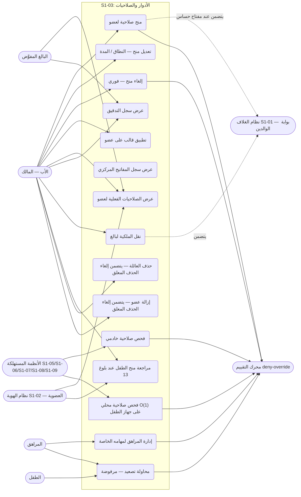

- المنح والتعديل والإلغاء وتطبيق القالب ونقل الملكية حصراً للمالك (REQ-010/016)؛ البالغ المفوَّض لا يفوِّض غيره (لا تفويض متسلسل).
- حذف العائلة وإزالة عضو حصراً للمالك (REQ-020 · Q-166) — غير قابلين للتفويض؛ وحذف العائلة بشرط PIN/بصمة مثبَتة بالتحدي (Q-164)، وإزالة العضو بشرط مفتاح `identity.member.remove` + PIN؛ وكلاهما حذف ناعم + سماح 30 يوماً ثم حذف صلب، والإلغاء خلال السماح عبر `POST /families/{id}/deletion/cancel`.
- `roles.grant.create` و`roles.grant.edit` و`roles.grant.revoke` و`roles.template.apply` و`roles.ownership.transfer` للمالك حصراً (§6-1)؛ `roles.key.view` و`roles.audit.view` قابلان للتفويض.

## 2. مخطط قاعدة البيانات (ERD)

الجداول الخمسة من §5 كما هي، مع أربعة مراجع خارجية: العائلة والعضوية (`membership` — الدور + `is_owner`) والشخص (`person`) من S1-02، و`AuditEvent` (النواة المشتركة). ملاحظتان: جداول السجل العام (`permission_key` و`role_template` و`template_key`) مشتركة لكل العائلات بلا `family_id` — نفس المفتاح والقالب يخدمان كل العائلات؛ وجدولا `permission_grant` و`ownership_transfer` يحملان `family_id` + عزل RLS (D-021). ولقطة المنح المحلية (REQ-006) مخزن عميل على الجهاز وليست جدول خادم، فلا تظهر جدولاً هنا.

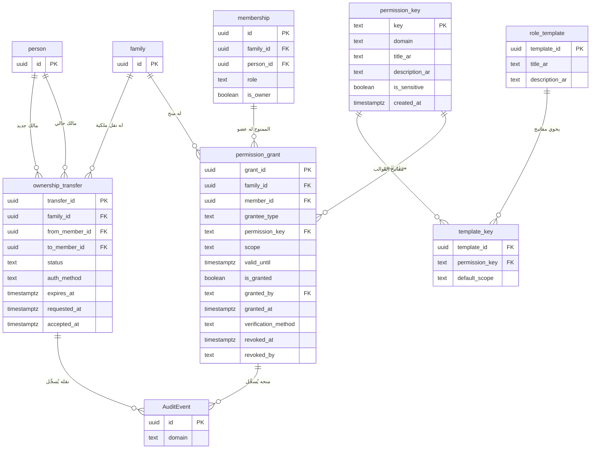

- `template_key` مفتاحه المركب (`template_id`, `permission_key`) (§5-3).
- **توحيد الهوية (Q-169):** `permission_grant.member_id` مفتاح أجنبي إلى `membership.id` (S1-03 SPEC §5-4) — لا إلى `person`؛ فالمراهق والطفل لهما عضوية وبلا `person` (Q-137). وعند منح الوكيل (`grantee_type='agent'`) يكون `member_id` فارغاً.
- `scope` + `valid_until` إلزاميان في كل منح (Q-007 · Q-087)؛ `is_granted=false` رفض صريح وليس غياباً (Q-007).
- `verification_method` قيمه `pin` / `biometric` — للمنح الحساس فقط (REQ-012)؛ و`auth_method` في نقل الملكية PIN أو بصمة (Q-093).

## 3. التسلسل (Sequence) — من عقود §4

ثمانية مخططات، كل واحد لتدفق واحد:

### 3-أ. إنشاء منح (REQ-010/011/012 — §4-1)

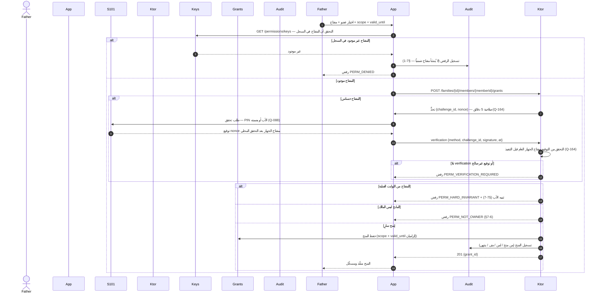

- التحقق نفسه محلي (بوابة الوالدين Q-065 / بصمة Q-072) **ويتحقق الخادم من توقيع التحدي بمفتاح الجهاز العام قبل التنفيذ (Q-164)** ويُسجَّل في التدقيق (§4-1)؛ ولو فشل التحقق 3 مرات يعود النظام لطلب PIN (سيناريو 2-4 · Q-072).
- رموز الخطأ الموحدة (§4-4): `PERM_DENIED` · `PERM_HARD_INVARIANT` · `PERM_NOT_OWNER` · `PERM_VERIFICATION_REQUIRED` · `PERM_GRANT_EXPIRED` · `PERM_CONFLICT` — والأخير لتعديلين متزامنين على منح عضو واحد: الثاني يفشل ويُطلب إعادة تحميل أحدث حالة قبل إعادة المحاولة (REQ-019 · §7-8).

### 3-ب. تطبيق قالب على عضو (REQ-013/014 — §4-1)

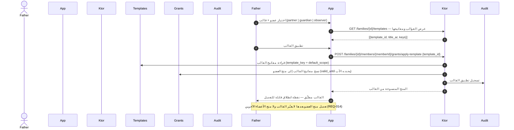

### 3-ج. فحص صلاحية — خادمي ومحلي O(1) (REQ-004/005/006 — §4-1/§4-3)

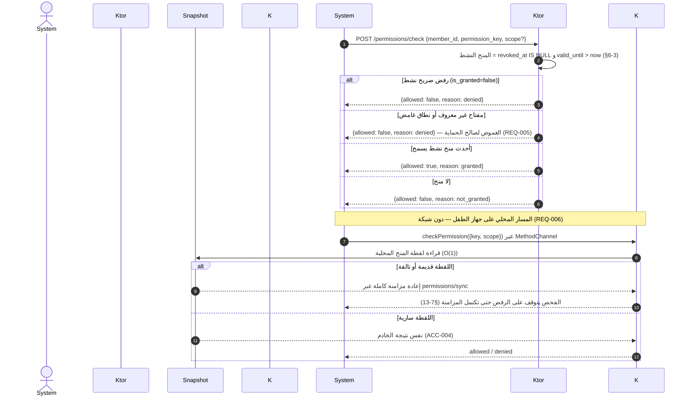

- أي رفض صريح نشط يفوز على أي منح سامح (§6-3 — deny-override)؛ وإلا يفوز أحدث منح نشط ويُؤخذ نطاقه.
- الثابت الصلب يعطي `reason: "hard_invariant"` (§4-1)؛ والمنح المنتهي `valid_until` يُرفض فوراً (§7-9).

### 3-د. إلغاء منح — فوري مع إبطال الجلسات (REQ-017 — §4-1/§4-2)

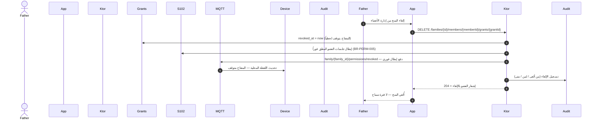

### 3-هـ. نقل الملكية لبالغ (REQ-016 — §4-1 · Q-093)

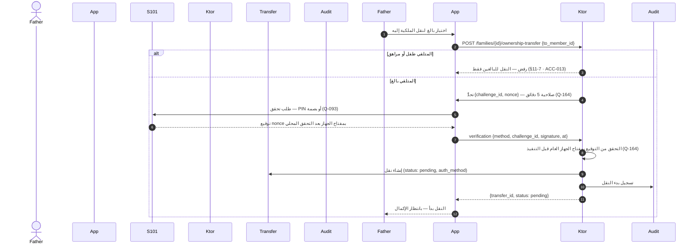

### 3-و. تحول الدور عند بلوغ 13 (REQ-003 — §6-3)

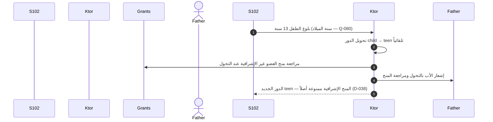

### 3-ز. حذف العائلة / إزالة عضو / إلغاء الحذف (REQ-020 — §4-1 · Q-166)

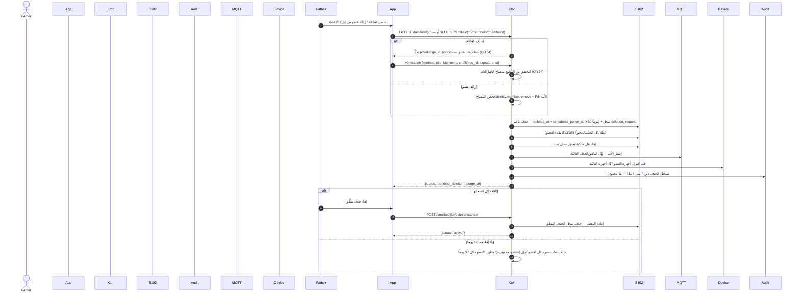

- ملاحظة: حذف العائلة وإزالة العضو غير قابلين للتفويض (REQ-020 — ثابت صلب)؛ والقاصر لا يُزال إلا بيد الأب؛ وطلب حذف دون اتصال يُحفظ في الصندوق الصادر ويُنفَّذ عند الاتصال (البروتوكول §6).

### 3-ح. قبول نقل الملكية (REQ-016 — §4-1 · Q-093 · Q-164)

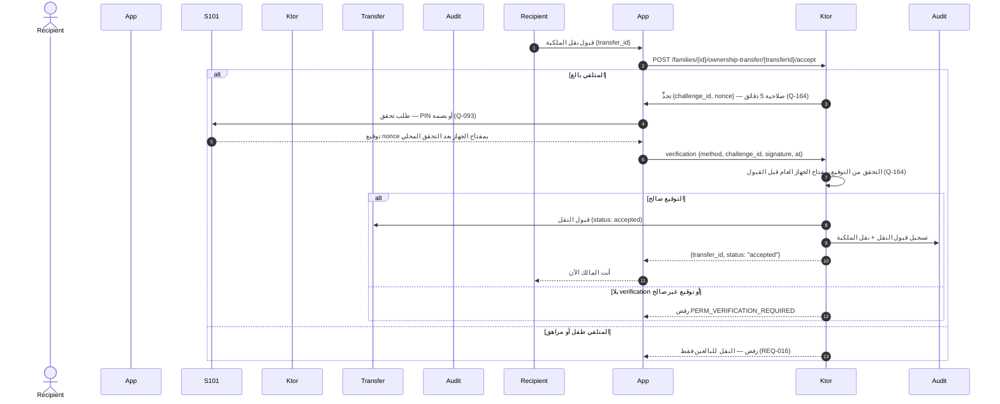

- القبول يثبَّت بالتحدي كالبدء تماماً (REQ-016 · Q-093 · Q-164)؛ والاستثناء Q-174 (بلا تحدي لتبديل المنح من S1-09) لا ينطبق هنا. وينتهي النقل بعد 7 أيام بلا قبول (Q-139).

## 4. تدفق المستخدم (User Flow) — من السيناريوهات الستة (§2)

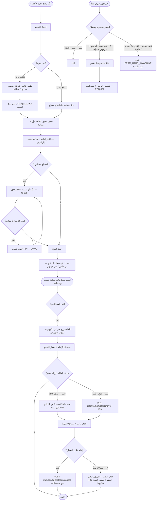

- ملاحظة: القالب نقطة انطلاق لا قيداً — تعديل منح العضو بعد تطبيقه لا يغيّر القالب ولا منح الآخرين (REQ-014 · سيناريو 2-1).
- ملاحظة: بالغ منضم جديداً يبدأ بلا أي منح — لا صلاحية له حتى يمنحه الأب صراحة (REQ-002).

## 5. مخطط تدفق البيانات (DFD — المستوى 1) — من §4/§5

العمليات مرقمة 1.0–7.0، والمخازن D1–D5. المخزن D5 سجل التدقيق (النواة المشتركة)؛ واللقطة المحلية على جهاز الطفل مخزن عميل (ليست جدول خادم) وتُزامَن عبر MQTT.

- **تغطية نقاط §4:** التسلسلات في §3 تغطي التدفقات الأساسية فقط؛ وكل نقطة §4-1 تظهر هنا على الأقل: `PATCH /families/{id}/members/{memberId}/grants/{grantId}` (تعديل النطاق/المدة — REQ-010، يمر عبر P2) · `GET /families/{id}/members/{memberId}/permissions` (الصلاحيات الفعلية لعضو — REQ-004، تُقرأ عبر P4) · `GET /families/{id}/audit/permissions` (سجل التدقيق — REQ-018، يُقرأ من D5 عبر P6)؛ وبقية النقاط مرسومة في §3 (keys، grants إنشاء/إلغاء، templates، apply-template، check، ownership-transfer، حذف العائلة/العضو وإلغاء الحذف — 3-ز).

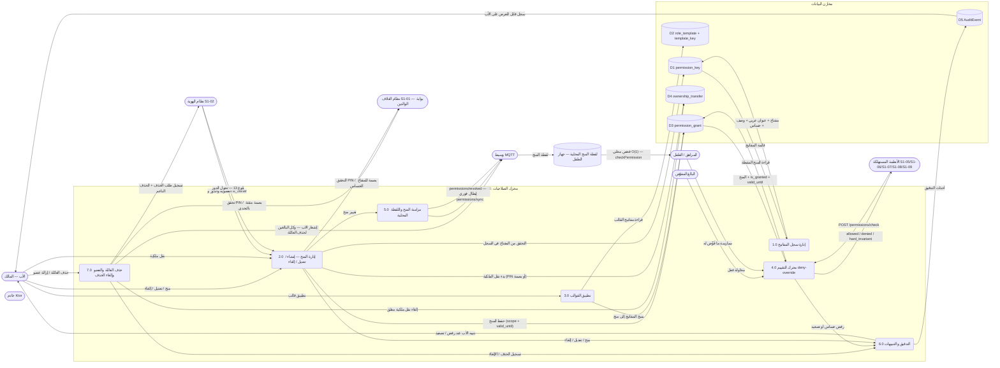

- العملية 4.0 هي الحارس الوحيد: كل فحص صلاحية في المنصة يمر بها (§1).
- سجل المفاتيح D1 مشترك لكل العائلات بلا `family_id`؛ وD3 وD4 يحملان `family_id` + RLS (D-021).

## 6. مخطط النشاط (Activity) — دورة حياة المنح والفحص

المسارات الخمسة (الأب / البالغ المفوَّض والمراهق / جهاز الطفل / الخادم / وسيط MQTT) كمسارات متوازية. والمزامنة عبر MQTT والإبطال الفوري يعملان **بالتوازي** مع استخدام التطبيق.

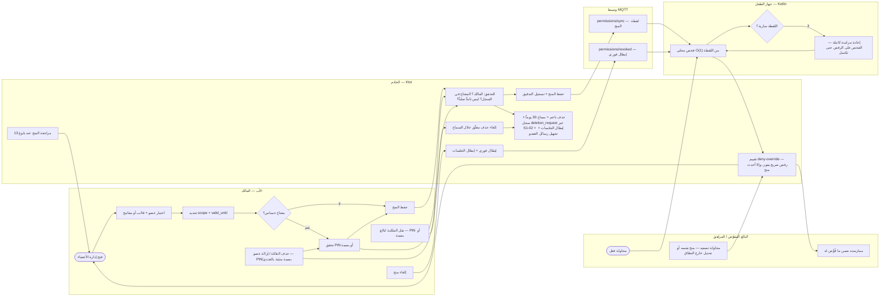

- عند بلوغ الطفل 13 يتحول دوره تلقائياً وتُراجع منحُه غير الإشرافية ويُشعَر الأب (REQ-003) — المسار V5 إلى F1.
- المنح بلا شبكة لا يُنفَّذ محلياً: الخادم هو المرجع، ويُحفظ الطلب في صندوق الصادر ويُعاد عند عودة الاتصال (§7-12 — نمط S1-01).
