# S1-03: مخططات هندسة البرمجيات (DIAGRAMS)

- **الحالة:** معتمدة — المخططات الستة معتمدة (حكم المالك 2026-11-08 — D-2، بعد موجة الإصلاح 0e4a3e2..f7da470)؛ والمواصفة معتمدة بالكامل في التخطيط؛ **وأُعيد رسمها كلها 2026-11-16 على التصميم المعتمد (Q-401 · Q-402) — تأكيد المالك للرسم الجديد بكلمة (Q-289) لم يصدر بعد**
- **المواصفة:** `SPEC.md` (§§1–8 + §10 معتمدة بالكامل في التخطيط)
- **السياق المحدد (Bounded Context):** #2 الصلاحيات (Permissions) — `CONTEXT-MAP.md` §2 صف 2
- **القرارات الحاكمة:** Q-001 · Q-003 · Q-006 · Q-007 · Q-010 · Q-065 · Q-072 · Q-080 · Q-085 · Q-086 · Q-087 · Q-088 · Q-089 · Q-093 · Q-164 · Q-166 · Q-189 · Q-174 · Q-201 · Q-204 · Q-227 · Q-232 · Q-235 · Q-248 · Q-250 · D-006 · D-021 · D-023 · D-038 · G-006 · G-011 · Q-168 · Q-329 · Q-330 · Q-343 · Q-401 · Q-402 · Q-257 · Q-269 · Q-291 · Q-344 — ونُقض بـ Q-401 فخرج من الرسم: Q-139 · Q-162 · Q-259
- **تحديث 2026-11-16 (Q-401 · Q-402) — إعادة رسم كاملة:** المخططات الستة مرسومة الآن على التصميم المعتمد (SPEC §9-8)، والرسم والنص متطابقان فلا ملاحظة تسود على رسم. ما تغيّر: (1) «الصلاحية الكاملة» بدل نقل الملكية — تُعطى فتسري فوراً بلا قبول، والمالك يبقى مالكاً ويسحبها؛ (2) لكل صلاحية حالتها ونطاقها ومدتها، والمنع الصريح ظاهر؛ (3) الأدوار الثلاثة تُعدَّل لكل عائلة؛ (4) كل تغيير من المالك يتبعه إشعار للعضو؛ (5) طلب الصلاحية من البالغ والمراهق؛ (6) حذف حساب المالك يسلّم العائلة لحامل الصلاحية الكاملة بعد 30 يوماً. الجديد في الرسم: فاعل «بالغ يحمل الصلاحية الكاملة»، الجدول `full_authority` وجداول تعديل الأدوار، والتسلسلات 3-ي و3-ك و3-ل. **تصحيح 2026-11-16 (ملاحظة المالك: أخطاء في مخطط التدفق ومخطط النشاط):** كان تدفق المستخدم (§4) وتدفق البيانات (§5) والنشاط (§6) كلٌّ في رسم واحد كبير تتقاطع أسهمه، ونصوصه تخلط العربية باللاتينية فينقلب ترتيب الكلمات عند العرض، وفي §4 كان «تعديل دور» و«حذف العائلة» يتفرعان بعد «اختيار بالغ» خطأً. أُعيد رسم الثلاثة لوحات صغيرة (§4 ست لوحات · §5 أربع · §6 خمس)، نصوصها عربية وحدها، وأسماء النقاط والجداول والمواضيع في السطور والجداول تحت اللوحات.
- **الأنواع الستة:** 1. حالات الاستخدام · 2. ERD · 3. التسلسل · 4. تدفق المستخدم · 5. DFD · 6. النشاط
- **الأشكال الموحدة:** مستطيل = جهة خارجية · مستطيل مستدير = عملية · معين = قرار · أسطوانة = مخزن بيانات · خط متقطع = يتضمن / اختياري

## 1. حالات الاستخدام

23 حالة استخدام من السيناريوهات الاثني عشر والمتطلبات (§2/§3) ومن التصميم المعتمد (SPEC §9-8 — Q-401 · Q-402)، في أربع مجموعات مرسومة على لوحتين (1-أ و1-ب): **(أ) إدارة صلاحيات الأعضاء** للمالك، ولبالغ يحمل الصلاحية الكاملة بقاعدة المالك؛ **(ب) الصلاحية الكاملة** يعطيها المالك نفسه ويسحبها؛ **(ج) العضو مع صلاحياته** يراها ويطلب ويصله إشعار بكل تغيير؛ **(د) الفحص** — كل فحص صلاحية في المنصة يمر بمحرك التقييم (deny-override — Q-007). البالغ المفوَّض يمارس ما فُوِّض له فقط ولا يفوِّض غيره؛ والمراهق يدير مهامه الخاصة فقط.

**1-أ. من يدير: صلاحيات الأعضاء والصلاحية الكاملة (المجموعتان أ وب)**


**1-ب. العضو مع صلاحياته والفحص (المجموعتان ج ود)**


- **أ (UC1–UC13)** للمالك ولحامل الصلاحية الكاملة بقاعدة المالك (REQ-010/016)؛ الحامل لا يعدّل منح نفسه ولا يزيل المالك (SPEC §7-16)؛ والبالغ المفوَّض لا يفوِّض غيره (لا تفويض متسلسل).
- **UC1/UC2:** لكل صلاحية نطاقها ومدتها وحدها (REQ-011 — Q-401). **UC4:** المنع الصريح ظاهر، ويبقى عند تغيير الدور حتى يُرفع أو تُسحب كل منح العضو (REQ-004/014 — Q-402).
- **UC5/UC6:** الأدوار الثلاثة تُعدَّل لكل عائلة، وتعديل الدور لا يغيّر من طُبّق عليه من قبل (REQ-013/014 — Q-089).
- **ب (UC14/UC15)** للمالك نفسه وحده: الصلاحية الكاملة تسري فوراً بلا قبول، والمالك يبقى مالكاً ويسحبها متى شاء (REQ-016 — Q-401). **UC23:** المالك يحذف حسابه والصلاحية الكاملة عند بالغ، فيصير ذلك البالغ مالكاً بعد 30 يوماً (SPEC §7-18 — Q-402) — مرسوم في 3-ك.
- **ج (UC16–UC18 — R03-17 · R03-11):** العضو يرى منح نفسه فقط، يطلب صلاحية بنقرة (بالغ أو مراهق — Q-402)، ويصله إشعار بكل تغيير من المالك بلا خطوة قبول (REQ-010).
- حذف العائلة وإزالة عضو (UC12/UC13) لا يُمنحان مفردين (REQ-020 · Q-166)؛ وحذف العائلة بشرط PIN/بصمة مثبَتة بالتحدي (Q-164)، وإزالة العضو بشرط مفتاح `identity.member.remove` + PIN؛ وكلاهما حذف ناعم + سماح 30 يوماً ثم حذف صلب، والإلغاء خلال السماح عبر `POST /api/v1/families/{id}/deletion/cancel`.
- `roles.grant.create` و`roles.grant.edit` و`roles.grant.revoke` و`roles.template.apply` للمالك (§6-1) ويشمله حامل الصلاحية الكاملة بقاعدة المالك؛ `roles.ownership.transfer` للمالك نفسه وحده؛ `roles.key.view` و`roles.audit.view` قابلان للتفويض. (سجل المفاتيح الذرية — Q-010)

## 2. مخطط قاعدة البيانات (ERD)

الجداول التسعة من §5 كما هي، مع أربعة مراجع خارجية: العائلة والعضوية (`membership` — الدور {`adult`، `teen`، `child`} + `is_owner` — سنة الميلاد تحدد الدور: دون 13 → `child`؛ 13–17 → `teen` — REQ-001 · Q-006/Q-080) والشخص (`person`) من S1-02، و`AuditEvent` (النواة المشتركة). ملاحظتان: جداول السجل العام (`permission_key` و`role_template` و`template_key`) مشتركة لكل العائلات بلا `family_id` — بذرة واحدة تخدم كل العائلات؛ وما عداها (`permission_grant` و`permission_request` و`full_authority` و`family_role` و`family_role_key` و`member_role`) يحمل `family_id` + عزل RLS (D-021). ولقطة المنح المحلية (REQ-006) مخزن عميل على الجهاز وليست جدول خادم، فلا تظهر جدولاً هنا.


- `template_key` مفتاحه المركب (`template_id`, `permission_key`) (§5-3)؛ وصفوف البذرة (شريك 43 / وصي محدود 24 / مراقب 10) في SPEC §5-3-أ (Q-262 · Q-329 · Q-330 · Q-343). [تصحيح 2026-11-08 (D-2): كانت 40/22/10 قبل Q-329/Q-330/Q-343.]
- **تسوية المفاتيح (Q-326…Q-333 · Q-343):** المجموع **94 مفتاحاً**: شريك 43 / وصي محدود 24 / مراقب 10؛ و§5-أ (مالك حصري) **27**؛ و§5-ب 23؛ و§5-ج 1 (`identity.device.pair`)؛ 43+27+23+1 = 94. والمراهق (Q-318…Q-325): المفتاح الوحيد القابل للمنح `tasks.create` (scope=self)؛ و14 متأصلة في الدور (Q-253 — أُضيف `tasks.cancel`، scope=self)؛ و5 حدّية حُسمت؛ و74 مستبعدة (76 ← 75 بنقل `tasks.cancel` منها إلى الملازمة، ثم 75 ← 74 بحذف مفتاح القسيمة)؛ 1+14+5+74 = 94؛ و`tasks.own.manage` محذوف من وايرفريم R03-09 (Q-325). [Q-421 — 2026-11-18: كانت 95 و28 و75 قبل حذف `billing.voucher.redeem` مع حذف القسائم.]
- `AuditEvent` في ERD يسرد كل حقل في §5-6 (بعد تصحيح R2-S103-19 في B4) — بأنواع مطابقة.
- `permission_request` جدول جديد (§5-7) — طلبات تعديل الصلاحية (R03-17)؛ و`member_id` مفتاح أجنبي إلى `membership.id` (Q-169).
- **توحيد الهوية (Q-169):** `permission_grant.member_id` مفتاح أجنبي إلى `membership.id` (S1-03 SPEC §5-4) — لا إلى `person`؛ فالمراهق والطفل لهما عضوية وبلا `person` (Q-137). وعند منح الوكيل (`grantee_type='agent'`) يكون `member_id` فارغاً.
- `scope` + `valid_until` إلزاميان في كل منح (Q-007 · Q-087)؛ `is_granted=false` رفض صريح وليس غياباً (Q-007).
- `verification_method` قيمه `pin` / `biometric` — للمنح الحساس فقط (REQ-012).
- **`full_authority` (§5-5 — Q-401):** حلّ محل `ownership_transfer`. `status` قيمتاه `active` / `revoked` فقط — لا `pending` ولا `accepted` ولا `expired` ولا `expires_at`؛ صف `active` واحد على الأكثر لكل عضو؛ `auth_method` PIN أو بصمة (Q-093)؛ `notice_seen_at` متى رأى الحامل إشعاره. و`membership.is_owner` لا ينتقل إلا عند اكتمال مهلة حذف حساب المالك (Q-402).
- **`family_role` + `family_role_key` (§5-3-ب — Q-401):** تعديل العائلة لدور؛ صفوف تُكتب فقط حين تعدّل، ومفتاحاهما المركبان (`family_id`, `template_id`) و(`family_id`, `template_id`, `permission_key`). البذرة (`role_template` + `template_key`) لا تُمس.
- **`member_role` (§5-3-ج):** آخر دور طُبّق على العضو — للعرض فقط، ولا يدخل في التقييم.
- المنع الصريح صف في `permission_grant` بـ `is_granted=false`؛ `valid_until` فيه اختياري وغيابه يعني «حتى يُرفع» (Q-402).

## 3. التسلسل (Sequence) — من عقود §4

اثنا عشر مخططاً، كل واحد لتدفق واحد (3-أ … 3-ل):

### 3-أ. إنشاء منح (REQ-010/011/012 — §4-1)

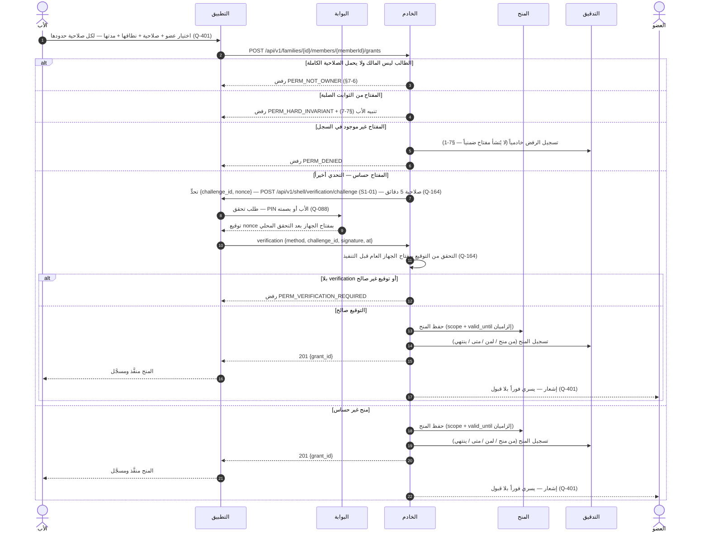

- التحقق نفسه محلي (بوابة الوالدين Q-065 / بصمة Q-072) **ويتحقق الخادم من توقيع التحدي بمفتاح الجهاز العام قبل التنفيذ (Q-164)** ويُسجَّل في التدقيق (§4-1)؛ ولو فشل التحقق 3 مرات يعود النظام لطلب PIN (سيناريو 2-4 · Q-072).
- ترتيب الفحص عند إنشاء منح (قاعدة §6-3): المالك أولاً → الثابت الصلب → المفتاح في السجل → التحدي أخيراً؛ فلا تحدٍّ يُصدر لغير المالك ولا لمفتاح ثابت صلب ولا لمفتاح غير موجود. ومنتقي المفتاح يقرأ السجل للعرض فقط (GET /api/v1/permissions/keys) — والتحقق الحاكم خادمي.
- رفض المفتاح غير المعروف يكتبه الخادم في التدقيق (Ktor→Audit) — لا كتابة تدقيق من العميل أبداً (§7-1)؛ وبلا اتصال يُحفظ سجل الرفض محلياً ويُصالح مع الخادم عند عودة الاتصال. والاستثناء Q-174 (تبديل المنح من S1-09 بلا تحدٍّ) يتجاوز التحدي فقط، لا الفحوص قبله.
- رموز الخطأ الموحدة (§4-4): `PERM_DENIED` · `PERM_HARD_INVARIANT` · `PERM_NOT_OWNER` · `PERM_VERIFICATION_REQUIRED` · `PERM_GRANT_EXPIRED` · `PERM_CONFLICT` — والأخير لتعديلين متزامنين على منح عضو واحد: الثاني يفشل ويُطلب إعادة تحميل أحدث حالة قبل إعادة المحاولة (REQ-019 · §7-8).
- حامل الصلاحية الكاملة يسلك هذا التسلسل كالمالك في منح غيره؛ وتعديله منح نفسه يُرفض `403` + `PERM_DENIED` (§7-16). والمنع الصريح يسلك النقطة نفسها بـ `is_granted: false` — مرسوم في 3-ي.

### 3-ب. تطبيق قالب على عضو (REQ-013/014 — §4-1)

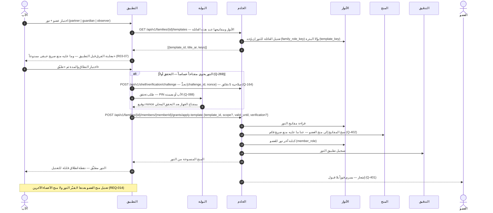

### 3-ج. فحص صلاحية — خادمي ومحلي O(1) (REQ-004/005/006 — §4-1/§4-3)

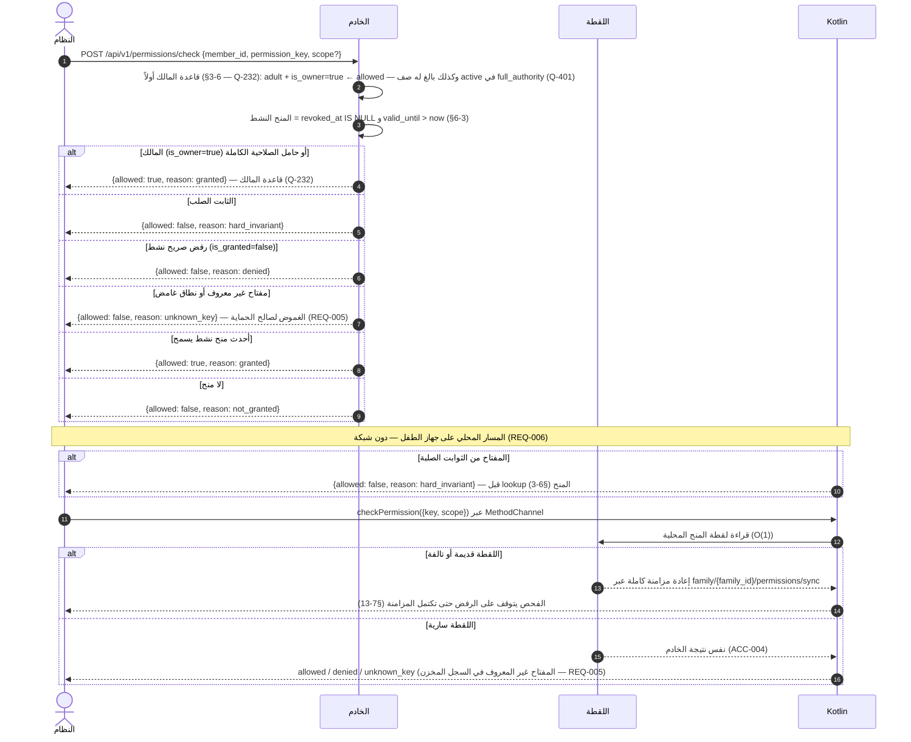

- قاعدة المالك أولاً (§6-3 — Q-232): `adult` + `is_owner=true` → `allowed` بلا منح صريح؛ والتجاوز تقييم فقط — لا يشمل التدقيق أبداً ولا فحوص `PERM_HARD_INVARIANT` ولا يمتد لغير المالك. والمسار المحلي يطبق قاعدة المالك نفسها حين يكون العضو المفحوص مالكاً (§6-3).
- أي رفض صريح نشط يفوز على أي منح سامح (§6-3 — deny-override)؛ وإلا يفوز أحدث منح نشط ويُؤخذ نطاقه.
- حامل الصلاحية الكاملة يُقيَّم بقاعدة المالك قبل النظر في منحه، فلا يسري عليه منع صريح أثناء الحمل، ويعود المنع نافذاً لحظة السحب؛ ويُستثنى مما للمالك نفسه: إعطاؤها وسحبها وإزالة المالك وتعديل منح نفسه (SPEC §5-5 · §7-16).
- الثابت الصلب يعطي `reason: "hard_invariant"` (§4-1)؛ والمنح المنتهي `valid_until` يُرفض فوراً (§7-9). والمسار المحلي يميز `unknown_key` بالمفتاح الغائب من نسخة السجل المخزنة على الجهاز (R03-05) — كالخادم في التسمية، ورفض في الأثر. والثابت الصلب يُفحص قبل lookup المنح — خادمياً ومحلياً (§6-3)؛ فلا منح يغطي ثابتاً صلباً.

### 3-د. إلغاء منح — فوري بلا إبطال جلسات (REQ-017 — §4-1/§4-2 · Q-257)

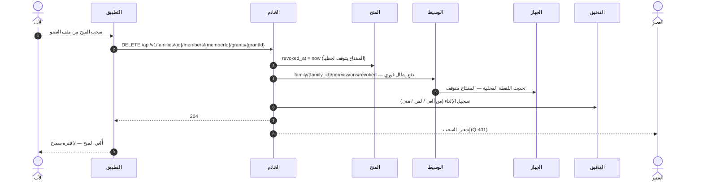

- إلغاء المنح لا يبطل أي جلسة (Q-257): الجلسات تُبطل فقط بالعمليات الصريحة في S1-02 §4.1 — وتبقى جلسات العضو عاملة لباقي صلاحياتها بعد الإلغاء.
- «اسحب كل صلاحياتها» يسلك `DELETE /api/v1/families/{id}/members/{memberId}/grants`: يسحب كل منح العضو ويرفع كل منع صريح عليه دفعة واحدة، ويفرّغ `member_role` (Q-402 — مرسوم في 3-ي).

### 3-هـ. إعطاء الصلاحية الكاملة لبالغ (REQ-016 — §4-1 · Q-093 · Q-401)

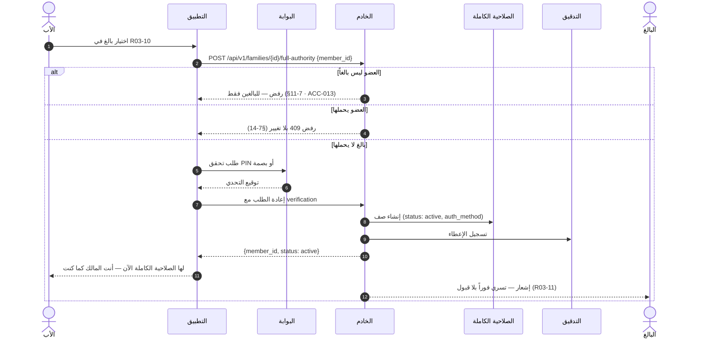

- تسري من لحظة نجاح الطلب؛ لا خطوة قبول ولا مهلة ولا حالة معلقة (Q-401 — نُقض Q-139 · Q-259).
- دون اتصال تُرفض ولا تدخل صندوق الصادر (Q-269)؛ و`is_owner` لا ينتقل (Q-006).

### 3-و. تحول الدور عند بلوغ 13 (REQ-003 — §6-3)

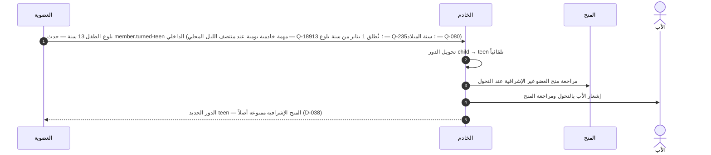

- حدث داخلي بلا موضوع MQTT (Q-189)؛ والحمولة والمعالج وكاتب الدور في SPEC §4-2-أ.

### 3-ز. حذف العائلة / إزالة عضو / إلغاء الحذف (REQ-020 — §4-1 · Q-166)

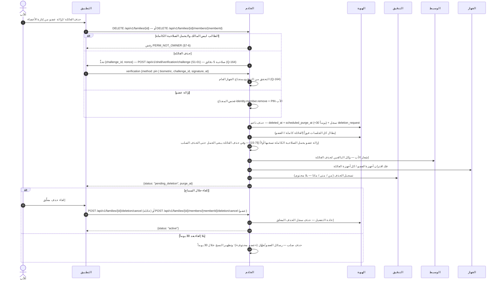

- ملاحظة: حذف العائلة وإزالة العضو غير قابلين للتفويض (REQ-020 — ثابت صلب)؛ والقاصر لا يُزال إلا بيد الأب؛ وطلب حذف دون اتصال يُحفظ في الصندوق الصادر ويُنفَّذ عند الاتصال (بروتوكول الحذف والتصدير — `DELETION-EXPORT-PROTOCOL.md` §6). وحامل الصلاحية الكاملة يفعلهما بقاعدة المالك وبالشروط نفسها — عدا إزالة المالك (Q-402).

### 3-ح. سحب الصلاحية الكاملة (REQ-016 — §4-1 · Q-401)

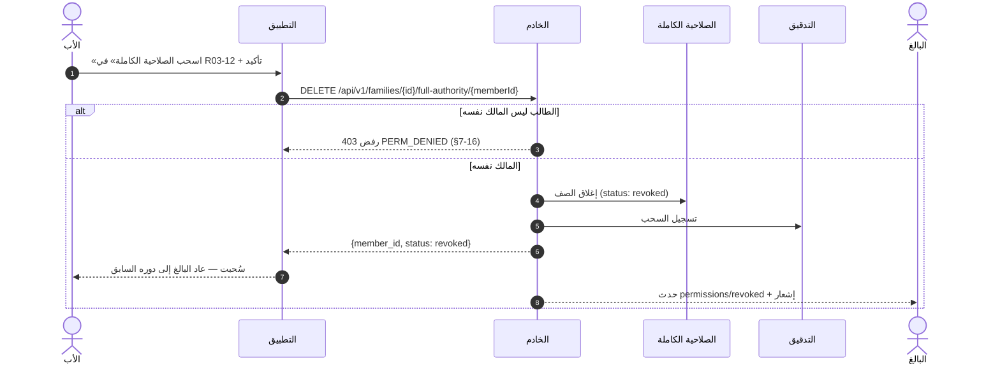

- السحب تأكيد واحد بلا رقم سري، كإلغاء أي منح (REQ-017)؛ ولا تُبطل جلسة (Q-257).
- البالغ يعود إلى منحه في `permission_grant` كما هي؛ ما انتهت مدته أثناء الحمل يبقى منتهياً (SPEC §5-5).

### 3-ط. طلب تعديل صلاحية وقرار الأب (REQ-002/004/015 — §4-1 · R03-17)

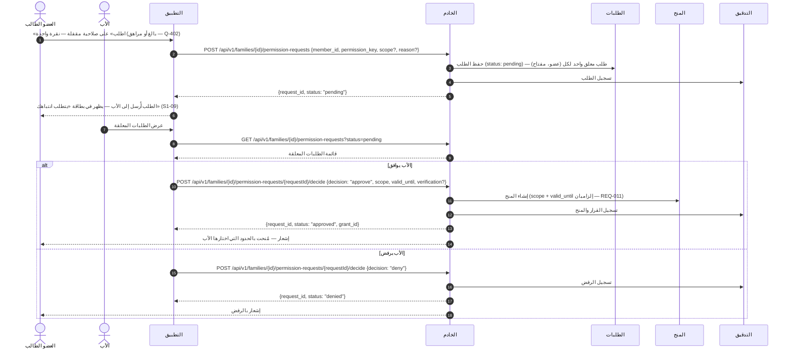

- الطلب قناة طلب لا منح: لا يمنح شيئاً بذاته ولا يُعدّ تصعيداً ولا يُنبَّه به (§7-20)؛ والموافقة تنشئ المنح بقواعد المنح نفسها (REQ-011/012 — والمفتاح الحساس يتطلب `verification`)؛ وطلب ثانٍ لنفس المفتاح وهو معلق → `409`. والطالب بالغ مفوَّض أو مراهق (Q-402)، والأب يختار النطاق والمدة أو يرفض.

### 3-ي. المنع الصريح: إنشاؤه وبقاؤه عند تغيير الدور ورفعه (REQ-004/014 — §4-1 · Q-401 · Q-402)

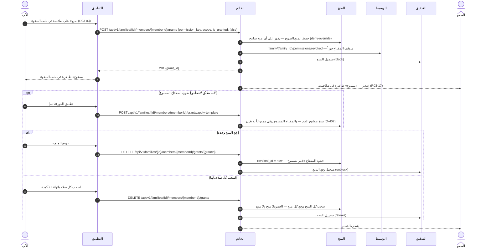

- الحالات الثلاث لكل صلاحية كما تظهر للمالك وللعضو: **مسموح** (منح نشط) · **غير مسموح** (لا منح) · **ممنوع** (`is_granted=false`). لا حالة مخفية (Q-401).
- المنع يضيّق ولا يوسّع، فلا يتطلب تحققاً ولو كان المفتاح حساساً؛ ومدته اختيارية وغيابها يعني «حتى يُرفع».
- منحا حق الخروج (`identity.account.delete_self` · `identity.family.leave`) لا يُمنعان ولا يُسحبان (Q-291).

### 3-ك. المالك يحذف حسابه — تسليم العائلة لحامل الصلاحية الكاملة (REQ-016 · S1-02 REQ-025 — §7-18 · Q-402)

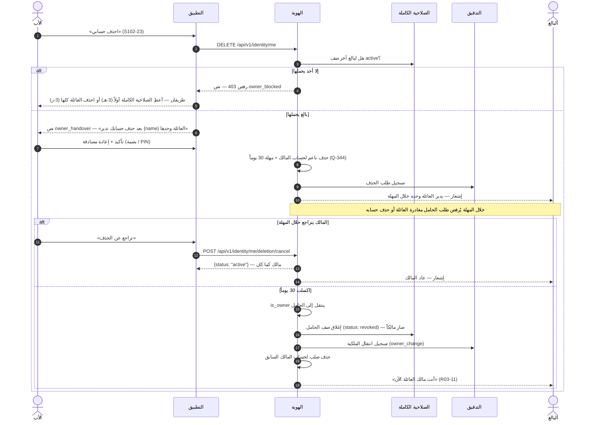

- هذا **الطريق الوحيد** لانتقال `is_owner` (Q-402)؛ إعطاء الصلاحية الكاملة لا ينقله (Q-006).
- نقطة الحذف وإلغاؤه يملكهما S1-02 (REQ-025 — تسلسله 3-ز)؛ وهذا النظام يجيب «من يحمل الصلاحية الكاملة؟» ويغلق الصف عند الانتقال.
- أكثر من حامل عند حذف حساب المالك: بلا حكم بعد (G-R03-11) — التصميم يعرضها لبالغ واحد.

### 3-ل. تعديل محتوى دور (REQ-013/014 — §4-1 · Q-089 · Q-205 · Q-401)

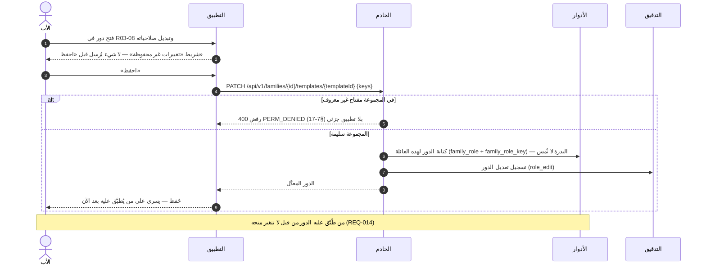

- `keys` تستبدل مجموعة الدور كاملة؛ والأدوار ثلاثة لا رابع لها (Q-089).

## 4. تدفق المستخدم (User Flow) — من السيناريوهات الاثني عشر (§2) والتصميم المعتمد (§9-8)

ستة تدفقات، كل واحد في لوحة صغيرة تُقرأ من أعلى إلى أسفل. اللوحات بلغة المستخدم فقط؛ وأسماء النقاط والمفاتيح في التسلسلات (§3) لا هنا.

### 4-أ. المالك يغيّر صلاحيات بالغ

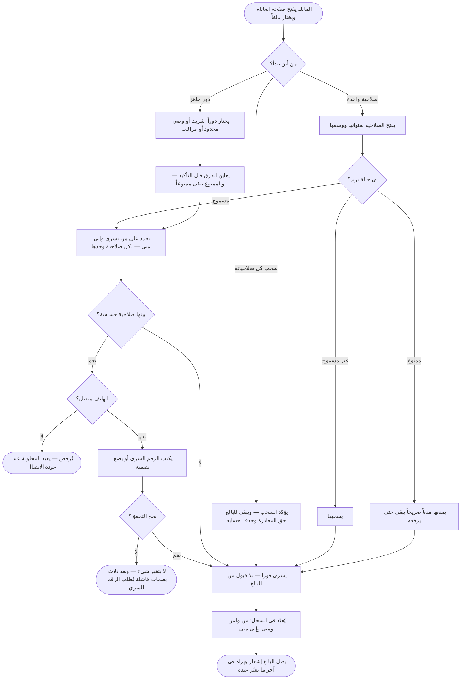

- لكل صلاحية حالتها (مسموح · غير مسموح · ممنوع) ونطاقها ومدتها وحدها (Q-401)؛ و«حدود كل الصلاحيات دفعة واحدة» اختصار في الواجهة يسلك فرع «مسموح» لكل منح قائم (REQ-011).
- الدور نقطة انطلاق لا قيد: تعديل منح البالغ بعد تطبيق الدور لا يغيّر الدور ولا منح الآخرين (REQ-014 · سيناريو 2-1)؛ والمنع الصريح يبقى بعد تغيير الدور (Q-402 · §7-19).
- الحساس خمس صلاحيات (§6-1)؛ منحها يتطلب الرقم السري أو البصمة مثبتاً بتحدٍّ من الخادم (REQ-012 · Q-088 · Q-164)، ودون اتصال يُرفض ولا يُحفظ للإرسال لاحقاً (Q-269 · §7-12). وغير الحساس دون اتصال يُحفظ في صندوق الصادر ويُرسل عند عودة الاتصال.
- بعد ثلاث بصمات فاشلة يُطلب الرقم السري (Q-072).
- حامل الصلاحية الكاملة يسلك هذا التدفق نفسه مع غيره من الأعضاء، لا مع نفسه (§7-16).
- المراهق: الصلاحية الوحيدة القابلة للمنح له «إنشاء مهامه»، وتسلك فرع «صلاحية واحدة» بلا دور وبلا تحقق (REQ-015).
- بالغ منضم جديداً يبدأ بلا أي منح عدا حقَّي المغادرة وحذف حسابه (REQ-002 · Q-166 · Q-248).

### 4-ب. المالك يعطي الصلاحية الكاملة أو يسحبها

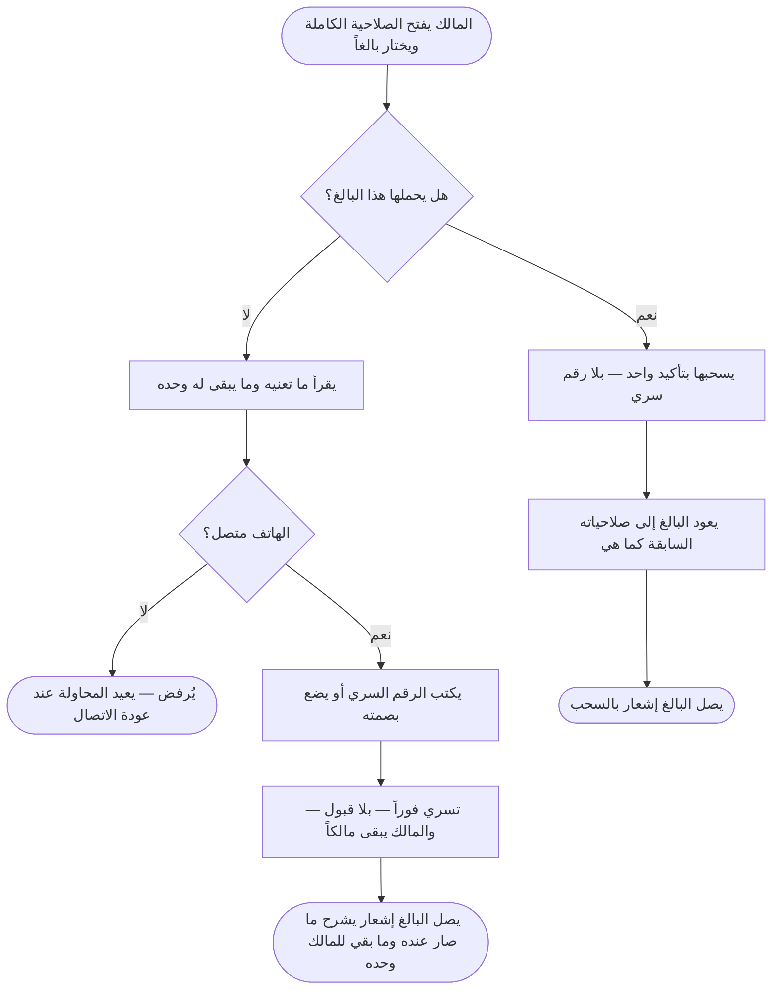

- لا قبول ولا رفض من البالغ ولا مهلة ولا حالة معلقة (Q-401 — نُقض Q-139)؛ والإعطاء لبالغ فقط (§7-11).
- الباقي للمالك وحده: إعطاء الصلاحية الكاملة وسحبها، وإزالة المالك من العائلة؛ وحاملها لا يعدّل منح نفسه (§7-16).
- السحب بتأكيد واحد بلا رقم سري وإعطاؤها بالرقم السري وباتصال: اختيار المنفّذ المسجَّل في G-R03-13 ما لم يحكم المالك بغيره.

### 4-ج. المالك يعدّل محتوى دور

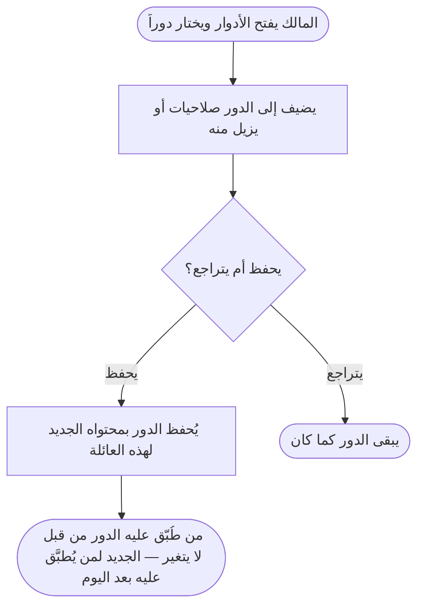

- الأدوار الثلاثة قابلة للتعديل لكل عائلة (Q-089 · Q-401)؛ وتعديل الدور لا يمسّ منح أحد (REQ-014).

### 4-د. حذف العائلة أو إزالة عضو

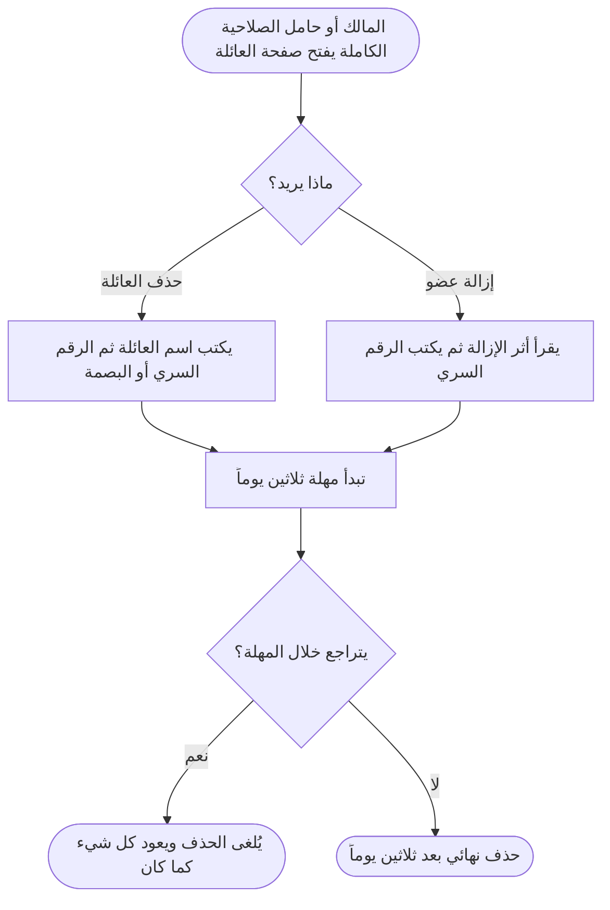

- حذف العائلة وإزالة العضو للمالك ولحامل الصلاحية الكاملة (REQ-020 · Q-402)؛ وحاملها لا يزيل المالك (§7-16).
- العضو المُزال تتوقف جلساته وأجهزته فوراً؛ والمهلة لبياناته لا لدخوله (`DELETION-EXPORT-PROTOCOL.md`).

### 4-هـ. عضو يحاول فعلاً لا يملك صلاحيته

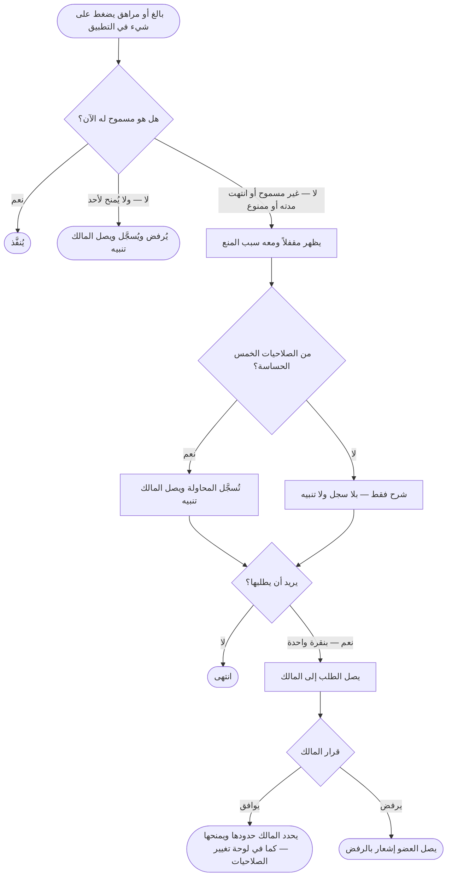

- ما لا يُمنح لأحد: الثوابت الصلبة — الإشراف لطفل أو مراهق، والفوترة، وحذف العائلة لغير المالك وحامل الصلاحية الكاملة (REQ-020 · §7-7).
- الضغط على عنصر مقفل يشرح السبب دائماً؛ ويُسجَّل ويُنبَّه المالك في الصلاحيات الخمس الحساسة فقط (REQ-007 — Q-402).
- الطلب لا يمنح شيئاً وليس تصعيداً؛ وطلب ثانٍ للصلاحية نفسها وهو معلق يُرفض (§7-20).
- المراهق يطلب صلاحيته الوحيدة بالطريقة نفسها، ويصله إشعار حين يتغيّر ما سُمح له به (REQ-015 — Q-402).

### 4-و. المالك يحذف حسابه

```mermaid
flowchart TD
    F1([المالك يطلب حذف حسابه]) --> F2{الصلاحية الكاملة عند بالغ آخر؟}
    F2 -->|لا| F3([يُرفض — يعطيها لبالغ أولاً أو يحذف العائلة])
    F2 -->|نعم| F4[مهلة ثلاثين يوماً — حاملها يدير العائلة ولا يغادرها]
    F4 --> F5{المالك يتراجع خلال المهلة؟}
    F5 -->|نعم| F6([يعود مالكاً كما كان])
    F5 -->|لا| F7([حاملها يصير مالك العائلة ويصله إشعار])
```

- هذا الطريق الوحيد الذي تنتقل به صفة المالك (Q-402 · §7-18)؛ وتسلسله 3-ك، وطلب الحذف نفسه في S1-02 (3-ز).

## 5. مخطط تدفق البيانات (DFD — المستوى 1) — من §4/§5

العمليات تسع والمخازن ستة. رُسمت على أربع لوحات ليُقرأ كل سهم؛ والنصوص داخل اللوحات بالعربية وحدها، وأسماء النقاط والجداول في الجدولين تحت اللوحات. مخزن 5 هو سجل التدقيق (النواة المشتركة)؛ واللقطة المحلية على الجهاز مخزن عميل لا جدول خادم.

### 5-أ. المنح والأدوار وطلبات الصلاحية

```mermaid
flowchart LR
    Owner([المالك أو حامل الصلاحية الكاملة])
    Member([بالغ أو مراهق])
    Gate([بوابة الوالدين في نظام الغلاف])
    P1(العملية 1: سجل المفاتيح)
    P2(العملية 2: إدارة المنح)
    P3(العملية 3: الأدوار)
    P9(العملية 9: طلبات الصلاحية)
    D1[(مخزن 1: سجل المفاتيح)]
    D2[(مخزن 2: الأدوار ومحتواها)]
    D3[(مخزن 3: المنح)]
    D6[(مخزن 6: الطلبات)]

    Owner -->|منح أو تعديل أو سحب أو منع| P2
    Owner -->|تطبيق دور أو تعديل محتواه| P3
    Member -->|طلب صلاحية| P9
    P9 -->|طلب معلق واحد لكل صلاحية| D6
    P9 -->|الطلبات المعلقة| Owner
    Owner -->|قرار الطلب| P9
    P9 -->|الموافقة تنشئ منحاً| P2
    P1 -->|المفاتيح بعناوينها وأوصافها| D1
    D1 -->|هل المفتاح موجود وهل هو حساس| P2
    P2 -->|تحقق الرقم السري أو البصمة للحساس| Gate
    P2 -->|حفظ المنح أو المنع بنطاقه ومدته| D3
    D2 -->|محتوى الدور| P3
    P3 -->|تعديل الدور وآخر دور للعضو| D2
    P3 -->|نسخ صلاحيات الدور إلى منح عدا الممنوع صراحة| D3
```

### 5-ب. الفحص والمزامنة

```mermaid
flowchart LR
    Systems([أنظمة المنصة الأخرى])
    Owner([المالك])
    Member([بالغ أو مراهق أو طفل])
    P4(العملية 4: محرك التقييم)
    P5(العملية 5: مزامنة المنح)
    D3[(مخزن 3: المنح)]
    D4[(مخزن 4: الصلاحية الكاملة)]
    Broker([وسيط الرسائل])
    Snap[(لقطة المنح على الجهاز)]

    Systems -->|هل يملك العضو هذه الصلاحية؟| P4
    P4 -->|مسموح أو مرفوض مع السبب| Systems
    D3 -->|المنح والمنع والمدة| P4
    D4 -->|من يحمل الصلاحية الكاملة| P4
    Owner -->|يسأل عن الصلاحيات الفعلية لعضو| P4
    P4 -->|صلاحيات العضو الفعلية| Owner
    P4 -->|صلاحياتي أنا فقط| Member
    D3 -->|كل تغيير في المنح| P5
    D4 -->|سحب الصلاحية الكاملة| P5
    P5 -->|اللقطة الجديدة والإبطال الفوري| Broker
    Broker -->|لقطة المنح| Snap
    Snap -->|فحص محلي فوري| Member
```

### 5-ج. الصلاحية الكاملة وحذف العائلة والعضو

```mermaid
flowchart LR
    Owner([المالك])
    Holder([بالغ يحمل الصلاحية الكاملة])
    Adults([كل بالغ في العائلة])
    Gate([بوابة الوالدين في نظام الغلاف])
    Identity([نظام الهوية])
    P7(العملية 7: حذف العائلة والعضو)
    P8(العملية 8: الصلاحية الكاملة)
    D4[(مخزن 4: الصلاحية الكاملة)]

    Owner -->|إعطاء بالرقم السري أو البصمة — أو سحب| P8
    P8 -->|تحقق مثبت بتحدي الخادم| Gate
    P8 -->|صف نشط عند الإعطاء ومغلق عند السحب| D4
    P8 -->|من يحملها ومنذ متى| Adults
    Holder -->|رأيت الإشعار| P8
    Identity -->|المالك يحذف حسابه: هل لها حامل؟ ثم اكتمال المهلة| P8
    P8 -->|صفة المالك تنتقل إلى حاملها| Identity
    Owner -->|حذف العائلة أو إزالة عضو| P7
    Holder -->|حذف العائلة أو إزالة عضو غير المالك| P7
    P7 -->|تحقق مثبت بتحدي الخادم| Gate
    P7 -->|تسجيل الحذف والمهلة| Identity
    P7 -->|إزالة حاملها تسحبها أولاً| P8
```

### 5-د. التدقيق والتنبيهات وإشعار العضو

```mermaid
flowchart LR
    Ops([العمليات 2 و3 و4 و7 و8 و9])
    P6(العملية 6: التدقيق والتنبيهات والإشعار)
    D5[(مخزن 5: سجل التدقيق)]
    Owner([المالك])
    Member([العضو صاحب المنح])
    Push([قناة الإشعارات في نظام الغلاف])
    Broker([وسيط الرسائل])
    Center([مركز التحكم])

    Ops -->|كل منح وتعديل وسحب ومنع ودور وطلب وحذف ورفض| P6
    P6 -->|أحداث التدقيق| D5
    D5 -->|السجل| P6
    P6 -->|السجل كله للعرض| Owner
    P6 -->|تنبيه عند رفض حساس أو تصعيد| Owner
    P6 -->|أحداث منحي أنا في آخر ما تغيّر| Member
    P6 -->|إشعار بكل تغيير| Push
    Push -->|إشعار| Member
    P6 -->|تنبيه قرب انتهاء منح| Broker
    Broker -->|تنبيه| Center
```

**العمليات — نقاطها وتسلسلاتها:**

| العملية | النقاط (§4-1 · §4-2) | التسلسل |
|---|---|---|
| 1 سجل المفاتيح (1.0) | `GET /api/v1/permissions/keys` | 3-أ |
| 2 إدارة المنح (2.0) | `POST …/members/{memberId}/grants` (منح أو منع بـ `is_granted: false`) · `PATCH …/grants/{grantId}` · `DELETE …/grants/{grantId}` · `DELETE …/members/{memberId}/grants` (سحب الكل) | 3-أ · 3-د · 3-ي |
| 3 الأدوار (3.0) | `GET …/templates` · `POST …/grants/apply-template` · `PATCH …/templates/{templateId}` | 3-ب · 3-ل |
| 4 محرك التقييم (4.0) | `POST /api/v1/permissions/check` · `GET …/members/{memberId}/permissions` | 3-ج |
| 5 مزامنة المنح (5.0) | `family/{family_id}/permissions/sync` · `family/{family_id}/permissions/revoked` | 3-د |
| 6 التدقيق والتنبيهات والإشعار (6.0) | `GET …/audit/permissions` · `family/{family_id}/alerts/new` (نوع `escalation` — S1-09) · `family/{family_id}/permissions/grant-expiring` (Q-227) · قناة الدفع (S1-01 §4.4) | 3-أ · 3-ج |
| 7 حذف العائلة والعضو (7.0) | `DELETE /api/v1/families/{id}` · `DELETE /api/v1/families/{id}/members/{memberId}` · `POST /api/v1/families/{id}/deletion/cancel` · `POST /api/v1/families/{id}/members/{memberId}/deletion/cancel` | 3-ز |
| 8 الصلاحية الكاملة (8.0) | `POST /api/v1/families/{id}/full-authority` · `GET …/full-authority` · `DELETE …/full-authority/{memberId}` · `POST …/full-authority/{memberId}/seen` | 3-هـ · 3-ح · 3-ك |
| 9 طلبات الصلاحية (9.0) | `POST …/permission-requests` · `GET …/permission-requests` · `POST …/permission-requests/{requestId}/decide` | 3-ط |

**المخازن — جداولها:**

| المخزن | الجداول (§5) |
|---|---|
| 1 سجل المفاتيح (D1) | `permission_key` |
| 2 الأدوار ومحتواها (D2) | `role_template` · `template_key` · `family_role` · `family_role_key` · `member_role` |
| 3 المنح (D3) | `permission_grant` |
| 4 الصلاحية الكاملة (D4) | `full_authority` |
| 5 سجل التدقيق (D5) | `AuditEvent` (النواة المشتركة) |
| 6 الطلبات (D6) | `permission_request` |

- **تغطية نقاط §4:** كل نقطة في §4-1 و§4-2 في جدول العمليات أعلاه، ومرسومة سهماً في لوحتها أو خطوةً في تسلسلها.
- العملية 4 هي الحارس الوحيد: كل فحص صلاحية في المنصة يمر بها (§1) — «لا عملية بلا مفتاح» (REQ-009). وتقرأ مخزن 3 للمنح ومخزن 4 لحامل الصلاحية الكاملة (قاعدة المالك — §6-3).
- العملية 8 بلا حالة معلقة: الإعطاء صف `active` فوراً والسحب `revoked` فوراً؛ وانتقال `is_owner` يكتبه S1-02 عند اكتمال مهلة حذف حساب المالك فقط (Q-402).
- العملية 6 تخدم ثلاثة قرّاء: المالك (السجل كله + تنبيه الرفض الحساس والتصعيد)، والعضو (أحداث منحه في «آخر ما تغيّر»)، وقناة الإشعارات.
- سجل المفاتيح (مخزن 1) وبذرة الأدوار في مخزن 2 مشتركان لكل العائلات بلا `family_id`؛ وباقي مخزن 2 (تعديل العائلة وآخر دور للعضو) والمخازن 3 و4 و6 تحمل `family_id` + RLS (D-021).

## 6. مخطط النشاط (Activity) — دورة حياة المنح والفحص

خمس دورات، كل واحدة في لوحة. كل إطار ملوّن مسار لطرف واحد (المالك · الخادم · وسيط الرسائل · العضو وجهازه)، والقراءة من أعلى إلى أسفل. النصوص داخل اللوحات بالعربية وحدها؛ وأسماء النقاط والمواضيع في السطور تحت كل لوحة.

### 6-أ. المالك يحفظ تغييراً حتى يصل جهاز العضو

```mermaid
flowchart TD
    subgraph LO [المالك]
        O1([يحفظ تغييراً: منح أو سحب أو منع أو دور])
        O2[يوقّع التحدي بالرقم السري أو البصمة]
    end
    subgraph LS [الخادم]
        S1{الطالب مالك أو حامل للصلاحية الكاملة؟}
        S2{الصلاحية مما لا يُمنح لأحد؟}
        S3{فيها صلاحية حساسة؟}
        S4[يرسل تحدياً صالحاً خمس دقائق]
        S5{التوقيع صحيح؟}
        S6[يحفظ التغيير ويزيد رقم النسخة]
        S7[يكتب قيد السجل]
        S8([يرفض ويسجّل الرفض])
        S9([يرفض ويسجّل وينبّه المالك])
    end
    subgraph LB [الوسيط وقناة الإشعارات]
        B1[ينشر لقطة الصلاحيات الجديدة — وعند السحب ينشر الإبطال فوراً]
        B2[يرسل إشعاراً للعضو]
    end
    subgraph LM [العضو وجهازه]
        M1[الجهاز يحدّث لقطته المحلية — بلا إبطال جلسة]
        M2([العضو يرى الإشعار وآخر ما تغيّر])
    end
    O1 --> S1
    S1 -->|لا| S8
    S1 -->|نعم| S2
    S2 -->|نعم| S9
    S2 -->|لا| S3
    S3 -->|نعم| S4
    S4 --> O2
    O2 --> S5
    S5 -->|لا| S8
    S5 -->|نعم| S6
    S3 -->|لا| S6
    S6 --> S7
    S6 --> B1
    S7 --> B2
    B1 --> M1
    B2 --> M2
```

- ترتيب الفحص: المالك أولاً ثم الثابت الصلب ثم وجود المفتاح في السجل ثم التحدي أخيراً (§6-3)؛ فلا تحدٍّ يُصدر لغير المالك ولا لمفتاح لا يُمنح.
- النقاط: `POST …/members/{memberId}/grants` (منح أو منع صريح بـ `is_granted: false`)، `PATCH` و`DELETE …/grants/{grantId}`، `DELETE …/members/{memberId}/grants` (سحب الكل)، `POST …/apply-template` (§4-1). تفصيلها في التسلسلات 3-أ و3-ب و3-د و3-ي.
- المواضيع: `family/{family_id}/permissions/sync` للقطة و`family/{family_id}/permissions/revoked` للإبطال (§4-2)؛ والإشعار عبر قناة الدفع الموحدة (S1-01 §4.4).
- تعديل بنسخة قديمة يُرفض بـ `412` + `PERM_CONFLICT` ويُعاد تحميل أحدث حالة (REQ-019 · §7-8).
- دون اتصال: الحساس يُرفض فوراً ولا يدخل صندوق الصادر (Q-269)؛ وغير الحساس يُحفظ في صندوق الصادر ويُرسل عند عودة الاتصال (§7-12).
- السحب لا يُبطل أي جلسة (Q-257).

### 6-ب. عضو يحاول فعلاً ثم يطلب الصلاحية

```mermaid
flowchart TD
    subgraph LM [العضو وجهازه]
        M1([العضو يحاول فعلاً])
        M2{اللقطة المحلية سليمة وحديثة؟}
        M3[مزامنة كاملة — والفعل مرفوض حتى تكتمل]
        M4{اللقطة تسمح؟}
        M5([يُنفَّذ الفعل])
        M6[يظهر مقفلاً ومعه السبب]
        M7{يطلب الصلاحية؟}
        M8([انتهى])
        M9([يرى إشعار الرفض])
    end
    subgraph LS [الخادم]
        S1{الفحص الخادمي يسمح؟}
        S2[يسجّل الرفض — وينبّه المالك إن كانت حساسة]
        S3[يحفظ الطلب — واحد معلق لكل صلاحية]
        S4[يرسل إشعاراً بالرفض]
    end
    subgraph LO [المالك]
        O1{يوافق على الطلب؟}
        O2([يحدد حدودها ويمنحها — الدورة السابقة])
    end
    M1 --> M2
    M2 -->|لا| M3
    M2 -->|نعم| M4
    M4 -->|لا| M6
    M4 -->|نعم| S1
    S1 -->|نعم| M5
    S1 -->|لا| S2
    S2 --> M6
    M6 --> M7
    M7 -->|لا| M8
    M7 -->|نعم| S3
    S3 --> O1
    O1 -->|نعم| O2
    O1 -->|لا| S4
    S4 --> M9
```

- الفحص المحلي من لقطة المنح على الجهاز بزمن ثابت، والفحص الخادمي عبر `POST /api/v1/permissions/check`؛ والاثنان يعطيان القرار نفسه (REQ-004 · REQ-005 · REQ-006 — تسلسل 3-ج).
- ترتيب القرار: المالك وحامل الصلاحية الكاملة مسموح لهما أولاً، ثم أي منع صريح سارٍ يفوز، ثم أحدث منح سارٍ ضمن نطاقه ومدته، وإلا رفض (§6-3 · Q-007 · Q-232).
- الفعل المحلي البحت (على جهاز الطفل دون اتصال) يُنفَّذ بقرار اللقطة وحدها؛ والفعل الذي يمرّ بالخادم يُعاد فحصه هناك.
- لقطة قديمة أو تالفة: مزامنة كاملة، والغموض يُحسم بالرفض (§7-13).
- المفتاح العادي المقفل يُشرح محلياً بلا سجل ولا تنبيه؛ والحساس تُرسل محاولته فتُسجَّل ويُنبَّه المالك عبر `family/{family_id}/alerts/new` (REQ-007 — Q-402).
- الطلب عبر `POST …/permission-requests`، وطلب ثانٍ للمفتاح نفسه وهو معلق → `409` (§5-7 · §7-20 — تسلسل 3-ط).

### 6-ج. الصلاحية الكاملة: إعطاء ثم سحب

```mermaid
flowchart TD
    subgraph LO [المالك]
        O1([يعطي بالغاً الصلاحية الكاملة])
        O2[يسحبها متى شاء بتأكيد واحد]
    end
    subgraph LS [الخادم]
        S1{توقيع المالك للتحدي صحيح؟}
        S2[يحفظها نشطة فوراً — بلا انتظار ولا قبول]
        S3([يرفض ولا يتغير شيء])
        S4[يغلقها فوراً]
    end
    subgraph LH [البالغ حامل الصلاحية الكاملة]
        H1[يصله إشعار — ويفعل ما يفعله المالك عدا ما للمالك وحده]
        H2([يعود إلى صلاحياته السابقة ويصله إشعار])
    end
    O1 --> S1
    S1 -->|لا| S3
    S1 -->|نعم| S2
    S2 --> H1
    H1 --> O2
    O2 --> S4
    S4 --> H2
```

- النقاط: `POST /api/v1/families/{id}/full-authority` للإعطاء، `DELETE …/full-authority/{memberId}` للسحب، `POST …/full-authority/{memberId}/seen` لتسجيل رؤية الإشعار (§4-1 — تسلسلا 3-هـ و3-ح).
- الإعطاء يسري لحظة نجاحه والسحب كذلك؛ فلا فحص يومي لانتهاء ولا حالة معلقة (Q-401 — نُقض Q-139). والإعطاء لمن يحملها يُرفض بـ `409` (§7-14).
- ما للمالك وحده: إعطاؤها وسحبها وإزالة المالك؛ وحاملها لا يعدّل منح نفسه (§7-16).

### 6-د. المالك يحذف حسابه فتنتقل العائلة لحامل الصلاحية الكاملة

```mermaid
flowchart TD
    subgraph LO [المالك]
        O1([يطلب حذف حسابه])
        O2([يُرفض — يعطيها أولاً أو يحذف العائلة])
        O3{يتراجع خلال المهلة؟}
        O4([يعود مالكاً كما كان])
    end
    subgraph LS [الخادم]
        S1{الصلاحية الكاملة عند بالغ الآن؟}
        S2[يبدأ مهلة ثلاثين يوماً]
        S3[ينقل صفة المالك إلى حاملها عند اكتمال المهلة]
    end
    subgraph LH [البالغ حامل الصلاحية الكاملة]
        H1[يدير العائلة خلال المهلة — ولا يغادر ولا يحذف حسابه]
        H2([صار مالك العائلة ويصله إشعار])
    end
    O1 --> S1
    S1 -->|لا| O2
    S1 -->|نعم| S2
    S2 --> H1
    H1 --> O3
    O3 -->|نعم| O4
    O3 -->|لا| S3
    S3 --> H2
```

- حذف حساب المالك يبدأ في S1-02 (`DELETE /api/v1/identity/me`)؛ ويُرفض ما لم يكن للصلاحية الكاملة حامل؛ والتراجع عبر `POST /api/v1/identity/me/deletion/cancel` (Q-402 · §7-18 — تسلسل 3-ك).
- اكتمال المهلة هو الطريق الوحيد لانتقال `is_owner`؛ وصف الصلاحية الكاملة يُغلق عندها لأن حاملها صار المالك (§5-5).

### 6-هـ. ما يفعله الخادم وحده في موعده

```mermaid
flowchart TD
    subgraph LS [الخادم]
        S1([فحص يومي])
        S2{منح ينتهي خلال سبعة أيام؟}
        S3{منح انتهت مدته؟}
        S4[المنح المنتهي يتوقف — والفحص يرفضه من لحظتها]
        S5{طفل بلغ الثالثة عشرة هذه السنة؟}
        S6[يحوّل دوره إلى مراهق ويراجع منحه غير الإشرافية]
        S7{مهلة حذف اكتملت بلا تراجع؟}
        S8([حذف نهائي للعائلة أو للعضو])
    end
    subgraph LB [وسيط الرسائل]
        B1[ينشر تنبيه قرب الانتهاء]
        B2[ينشر اللقطة الجديدة للأجهزة]
    end
    subgraph LO [المالك]
        O1([يرى التنبيه في مركز التحكم فيمدّد أو يترك])
        O2([يصله إشعار ببلوغ الطفل ومراجعة منحه])
    end
    S1 --> S2
    S2 -->|نعم| B1
    B1 --> O1
    S1 --> S3
    S3 -->|نعم| S4
    S4 --> B2
    S1 --> S5
    S5 -->|نعم| S6
    S6 --> O2
    S1 --> S7
    S7 -->|نعم| S8
```

- تنبيه قرب الانتهاء: موضوع `family/{family_id}/permissions/grant-expiring` بعتبة 7 أيام (Q-227)، ويستهلكه S1-09 لتنبيهات `grant_expiring` (§4-2).
- بلوغ 13: الحدث الداخلي `member.turned-teen` من مهمة S1-02 اليومية في 1 يناير؛ يتحول الدور تلقائياً وتُراجع المنح ويُشعَر الأب (REQ-003 — تسلسل 3-و).
- مهلة الحذف 30 يوماً للعائلة وللعضو (REQ-020 · Q-344 — تسلسل 3-ز)؛ وإلغاؤها عبر `POST /api/v1/families/{id}/deletion/cancel`.
- لا فحص يومي للصلاحية الكاملة: لا مدة لها ولا انتهاء (Q-401).
