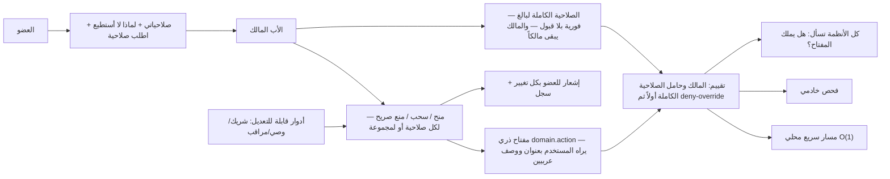
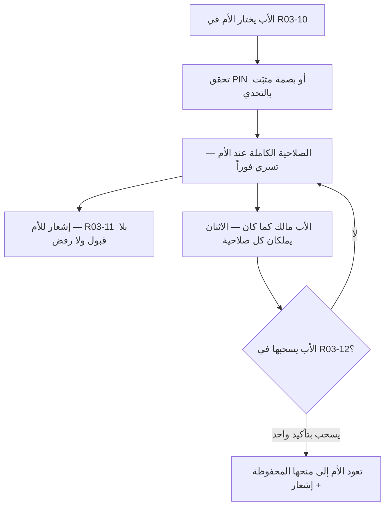
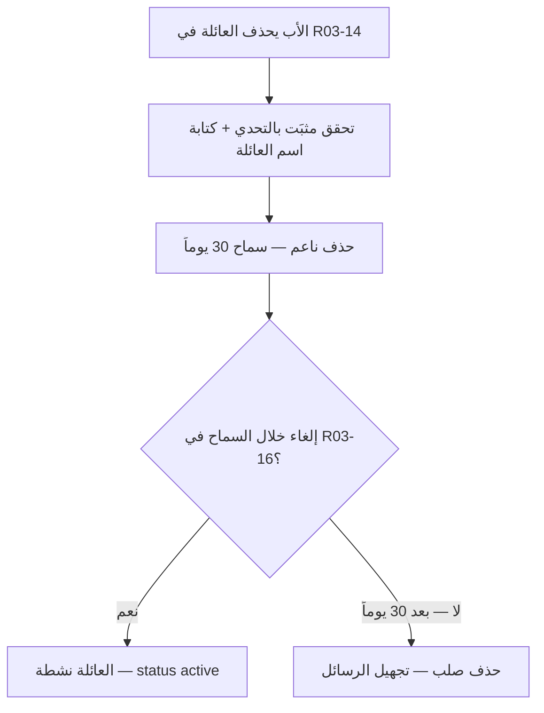
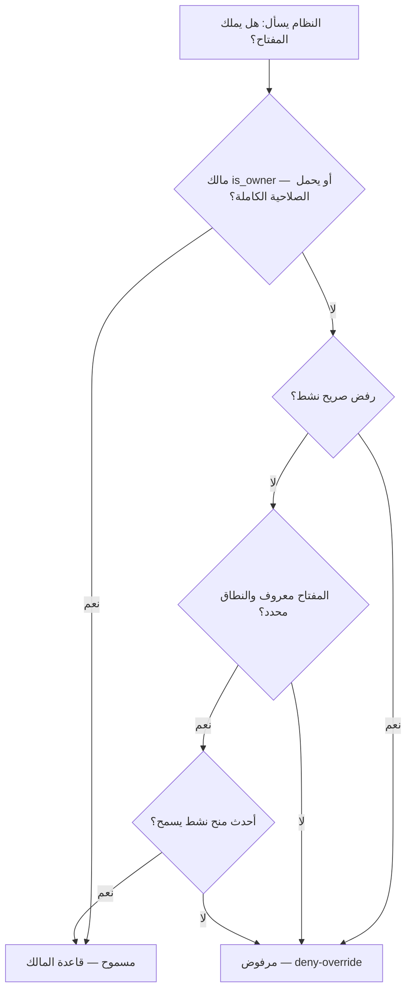
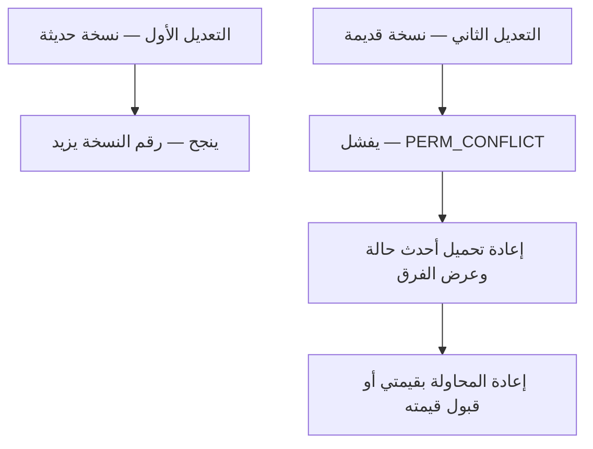
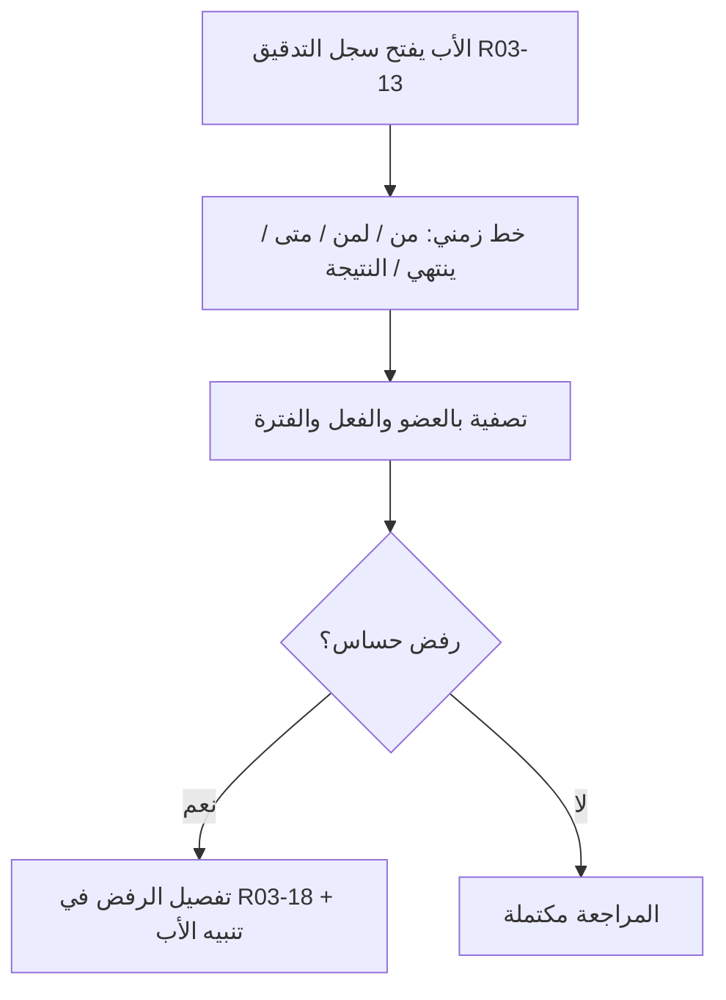
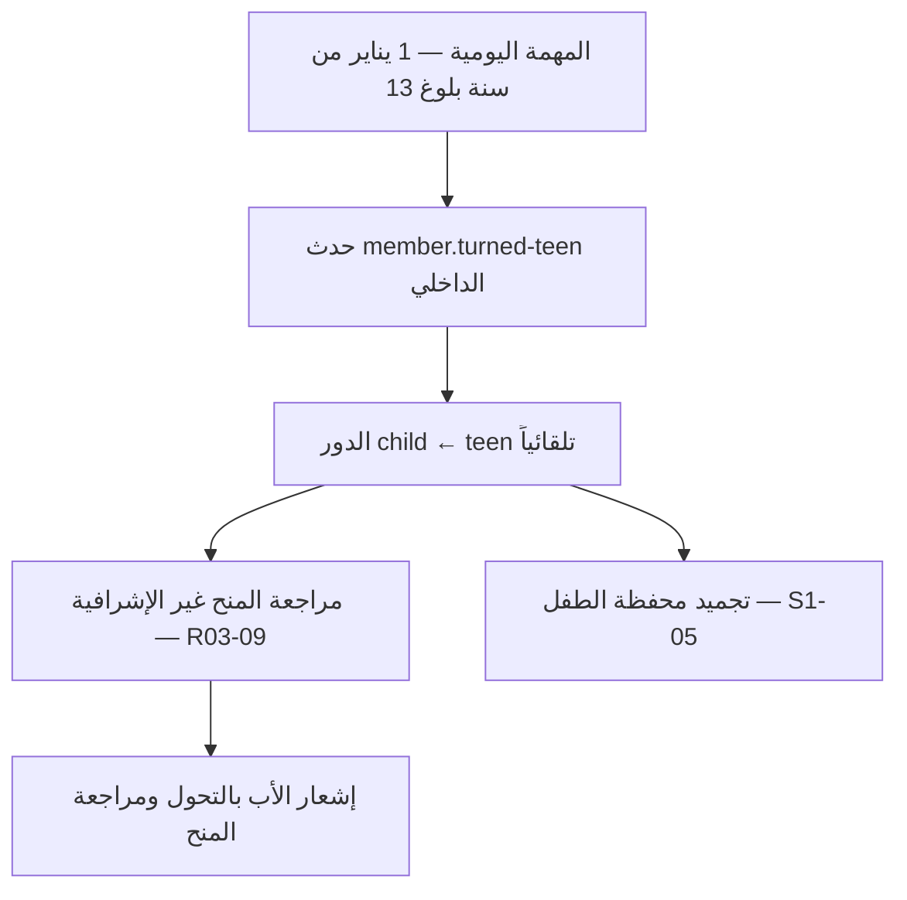
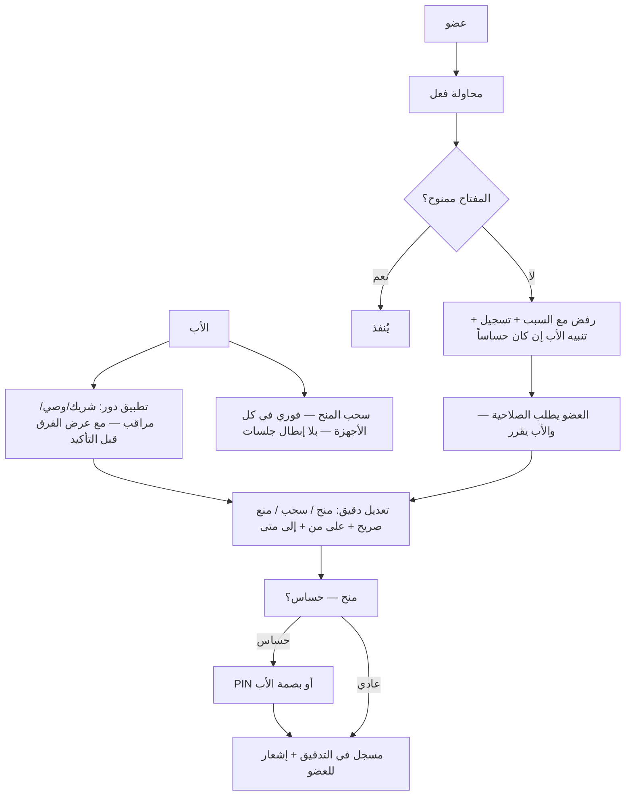

# S1-03: الأدوار والصلاحيات (Family Roles & Permissions)

- **الحالة:** approved | **المرحلة:** 1 (نواة الحماية) · **آخر تحديث:** 2026-11-07
- **القرارات الحاكمة:** Q-001 · Q-003 · Q-006 · Q-007 · Q-010 · Q-065 · Q-072 · Q-080 · Q-085 · Q-086 · Q-087 · Q-088 · Q-089 · Q-093 · Q-139 · Q-162 · Q-164 · Q-166 · Q-174 · Q-189 · Q-201 · Q-204 · Q-227 · Q-232 · Q-235 · Q-248 · Q-250 · D-006 · D-021 · D-023 · D-038 · G-006 · G-011 · Q-168 · Q-329 · Q-330 · Q-343 · Q-344 · Q-401 · Q-402
- **حالة المراجعة:** §§1–8 + §10 معتمدة بالكامل في التخطيط — حكم المالك 2026-11-05 (§1 · §2 سيناريوهات (12 سيناريواً) · §3 المتطلبات (20 متطلباً) · §4 العقود (20 نقطة + 4 مواضيع — 3 مملوكة + مرجع `alerts/new` — + طريقتان) · §5 البيانات (6 جداول + مرجعان) · §6 القواعد والصلاحيات (7 مفاتيح) · §7 الحالات الحدية (17 حالة) · §8 القبول (18 معياراً) · §10 خطة التنفيذ) · §9 **أُغلق تصميمه (Q-401 · Q-402 — 2026-11-16، والأدوار المخصصة Q-455 · Q-456)**: التفصيل في §9-8. والأعداد بين القوسين هي ما اعتُمد يوم 2026-11-05؛ والعدّ اليوم بعد أحكام التصميم: 13 سيناريواً · 23 متطلباً · 26 نقطة · 26 حالة حدية · 27 معيار قبول.
- **الأدلة المرجعية:** المواصفة القديمة S1-03 (مرجع فقط، G-009) · Deep-dives: FamilyWall (`FWPermission`) · Qustodio (نموذج حساب الأهل + ملفات الأطفال) · S1-01 (معتمد) · S1-02 (معتمد)

## 1. الهدف والتحليل والنطاق

محرك صلاحيات واحد يجيب عن سؤال تسأله كل الأنظمة: "هل يستطيع هذا العضو فعل هذا؟" — الأب يتحكم بكل شيء من شاشة واحدة: قوالب جاهزة كنقطة انطلاق ومصفوفة تفويض للتعديل الدقيق.

**مخطط سياق النظام (§1 — بصري):**

**التحليل (لماذا هذا النظام):** العائلة ليست مستخدماً واحداً — أدوار مختلفة (بالغ/مراهق/طفل، والمالك بالغ بصفة `is_owner`) باحتياجات مختلفة، والأب وحده يقرر من يفعل ماذا. بدون محرك مركزي يخترع كل نظام صلاحياته، وتتسرب الثغرات. لذلك S1-03 هو **الحارس الوحيد**: كل فحص صلاحية في المنصة يمر به، وكل منح يُسجَّل فيه.

**داخل النطاق:**
- تعداد الدور هو {`adult`، `teen`، `child`}؛ المالك هو `adult` + `is_owner=true` (Q-006)؛ سنة الميلاد تحدد الدور.
- محرك التقييم (deny-override): `is_granted=false` رفض صريح؛ `scope` + `valid_until` إلزاميان؛ الغموض يُحسم لصالح حماية الطفل.
- مفاتيح الصلاحيات الذرية بصيغة `domain.action` — كل عملية إدارية مفتاح مستقل قابل للتفويض.
- التفويض: قوالب جاهزة كنقطة انطلاق + مصفوفة تفويض للتعديل الدقيق؛ المالك وحده ينشئ/يعدل/يلغي المنح؛ لا تفويض متسلسل.
- مدة التفويض: بلا مدة افتراضية حتى يلغيها الأب؛ `valid_until` إلزامي يحدده الأب عند كل منح.
- المنح الحساس: يتطلب PIN الأب أو بصمته عند كل منح حساس.
- تفويض المراهق: صلاحيات غير إشرافية فقط يفوضها الأب (مثل إدارة مهامه الخاصة)؛ الثوابت الصلبة تمنع منحه أي إشراف/إدارة/إبطال رقابة.
- القوالب الثلاثة القابلة للتعديل: شريك (كل شيء إلا الفوترة والملكية والحذف) + وصي محدود (عرض + مهام) + مراقب (عرض فقط) — الأب يضيف صلاحيات ويأخذ منها. ومعها أدوار مخصصة ينشئها المالك، وحصتها بحسب الخطة (Q-455 · Q-456 — REQ-013).
- سجل تدقيق كامل لكل منح/تعديل/إلغاء (من منح/لمن/متى/ينتهي)؛ إعطاء الصلاحية الكاملة لبالغ فقط؛ إبطال فوري لجلسات الأعضاء المعلقين.

**خارج النطاق (أنظمة أخرى):**
- الهوية والتهيئة وإنشاء الحسابات والاقتران (S1-02).
- محرك الفرض وشاشات الحظر وجداول وقت الشاشة (نظام الحماية).
- الخطط والدفع (نظام الفوترة — الحد الأدنى في المرحلة 1).
- تبديل الملفات (مؤجل للمرحلة 2 — أولوية، Q-063).

**يعتمد على:** S1-01 (الوضعان والبوابة) + S1-02 (العضوية والملفات والأجهزة).

**المصطلحات:** دور (role) · مفتاح صلاحية (`domain.action`) · منح (grant) · نطاق (scope) · مدة (`valid_until`) · قالب (template) · تفويض حساس · ثابت صلب (لا يُمنح أبداً).

**من التطبيقات المفككة (§1):** نمط FamilyWall `FWPermission` — كل إذن يحمل أيقونة + عنوان مبرر + نص مبرر؛ نأخذ منه أن **كل مفتاح صلاحية في مصفوفة التفويض يحمل عنواناً عربياً ووصفاً يشرح ما يمنحه**، فالأب يفهم ما يمنح قبل أن يمنح.

## 2. سيناريوهات المستخدم

### 2-1: الأب يمنح الأم قالب الشريك ويعدّله
- **الممثل:** الأب (المالك). **السياق:** الأم انضمت للعائلة حديثاً؛ الأب يريدها شريكة كاملة إلا في أمر واحد.
- **التدفق:** 1) الأب يفتح إدارة الأعضاء ويختار الأم. 2) يطبق قالب "شريك" — تُمنح كل مفاتيح الشريك دفعة واحدة. 3) يزيل من القالب مفتاح إدارة دعوات الانضمام (`identity.family.invite`) — لا تريد الأم استقبال طلبات انضمام. 4) يضيف مفتاح إدارة أجهزة الأطفال (`identity.device.pair`). 5) يحدد `valid_until` (تاريخ انتهاء يختاره). 6) النظام يحفظ المنح ويسجله في سجل التدقيق. **النتيجة:** الأم شريكة بصلاحيات معدّلة حسب رغبة الأب — القالب كان نقطة انطلاق لا قيداً.

### 2-2: الأب يمنح الجد قالب المراقب
- **الممثل:** الأب. **السياق:** الجد يريد الاطمئنان على الأحفاد دون أي تحكم.
- **التدفق:** 1) الأب يطبق قالب "مراقب" على الجد. 2) الجد يرى موقع الأطفال وتقاريرهم فقط. 3) الجد يحاول تعديل قاعدة وقت شاشة — النظام يرفض (المفتاح غير ممنوح؛ deny-override). **النتيجة:** عرض بلا تحكم، والرفض صامت وواضح.

### 2-3: الأب يمنح المراهق إدارة مهامه الخاصة
- **الممثل:** الأب + الابن المراهق (15 سنة). **السياق:** المراهق يريد تنظيم مهامه بنفسه.
- **التدفق:** 1) الأب يمنح المراهق صلاحية إدارة مهامه الخاصة فقط (تفويض غير إشرافي — Q-086). 2) المراهق ينشئ مهمة ويسلّمها مع الإثبات، فيتحقق الذكاء (Q-110/Q-167) فتُسجَّل منجزة بلا نقاط ولا حدث كسب — لا إنجاز ذاتي بعلامة ولا اعتماد ذاتي. 3) المراهق يحاول تعديل مهمة أخيه الأصغر — النظام يرفض (خارج النطاق). 4) المراهق يحاول تعديل قاعدة حماية — النظام يرفض (ثابت صلب — D-038) وينبّه الأب. **النتيجة:** استقلالية محدودة آمنة داخل حدود يرسمها الأب.

### 2-4: منح صلاحية حساسة يتطلب PIN أو بصمة
- **الممثل:** الأب. **السياق:** الأب يمنح الأم صلاحية تعديل قواعد الحماية (مفتاح حساس).
- **التدفق:** 1) الأب يختار المفتاح الحساس ويضغط "منح". 2) النظام يطلب تحققاً: PIN الأب أو بصمته (Q-088). 3) الأب يبصم — يُنفَّذ المنح ويُسجَّل في سجل التدقيق (من منح/لمن/متى/ينتهي). 4) لو فشل التحقق 3 مرات — يعود النظام لطلب PIN (Q-072). **النتيجة:** لا منح حساس بلا تحقق من الأب نفسه.

### 2-5: الأب يلغي تفويضاً — إبطال فوري
- **الممثل:** الأب. **السياق:** تغيرت الظروف؛ الأب يسحب صلاحية من بالغ مفوَّض.
- **التدفق:** 1) الأب يلغي المنح من إدارة الأعضاء. 2) الإلغاء فوري: المفتاح يتوقف عن العمل لحظياً في كل الأجهزة. 3) إن كان العضو معلقاً — تُبطل جلساته فوراً (BR-PERM-005). 4) يُسجَّل الإلغاء في سجل التدقيق ويُشعَر العضو. **النتيجة:** لا صلاحية معلقة بعد الإلغاء — لا فترة سماح.

### 2-6: محاولة تصعيد مرفوضة
- **الممثل:** مراهق يحاول تجاوز حدوده. **السياق:** المراهق يكتشف شاشة إدارة الأعضاء.
- **التدفق:** 1) المراهق يفتح إدارة الأعضاء ويحاول منح نفسه صلاحية تعديل وقت الشاشة. 2) النظام يرفض قبل التنفيذ: المراهق ليس مالكاً (المنح حصراً للمالك)، والمفتاح المطلوب من الثوابت الصلبة (D-038). 3) يُسجَّل الرفض في سجل التدقيق ويُرسل تنبيه للأب. **النتيجة:** التصعيد مستحيل برمجياً — لا يعتمد على حسن نية الطفل.

### 2-7: الأب يعطي الأم الصلاحية الكاملة ثم يسحبها
- **الممثل:** الأب (المالك) + الأم (بالغة). **السياق:** الأب يريد أن تدير الأم العائلة معه بكل ما يملكه هو.
- **التدفق:** 1) الأب يختار الأم في R03-10 ويقرأ ما تعنيه الصلاحية الكاملة. 2) يتحقق بـ PIN أو بصمة مثبَتة بتحدٍّ من الخادم (Q-093 · Q-164). 3) تسري فوراً بلا قبول منها؛ يصلها إشعار وترى في R03-11 ما صار عندها وما يبقى للأب وحده. 4) الأب يبقى المالك (`is_owner` لا ينتقل)؛ والاثنان يملكان كل صلاحية. 5) متى شاء الأب سحبها من R03-12 بتأكيد واحد؛ فتعود الأم إلى منحها المحفوظة كما كانت ويصلها إشعار. **النتيجة:** سلطة مشتركة فورية يملك المالك وحده ردّها.

### 2-8: الأب يحذف العائلة ثم يلغي الحذف خلال السماح
- **الممثل:** الأب (المالك). **السياق:** الأب يريد حذف العائلة ثم يتراجع قبل انتهاء السماح.
- **التدفق:** 1) الأب يفتح R03-14 ويكتب اسم العائلة ويتحقق بـ PIN أو بصمة مثبَتة بالتحدي (Q-164). 2) حذف ناعم + فترة سماح 30 يوماً (قابلة للتغيير بقرار لاحق — Q-344). 3) تُبطل كل الجلسات فوراً وتُفك الأجهزة. 4) خلال السماح يلغي الحذف من R03-16 → تعود العائلة نشطة (`status: "active"`). 5) بلا إلغاء بعد 30 يوماً → حذف صلب وتُجهَّل الرسائل. **النتيجة:** حذف قابل للتراجع خلال السماح فقط، لا بعده.

### 2-9: نظام يسأل عن صلاحية — الفحص الخادمي والمحلي يعطيان القرار نفسه
- **الممثل:** نظام مستهلك (S1-06) + طفل دون اتصال. **السياق:** نظام المهام يسأل هل يستطيع الطفل تسليم مهمة.
- **التدفق:** 1) النظام يستدعي `POST /api/v1/permissions/check`. 2) قاعدة المالك أولاً (Q-232)؛ ثم أي رفض صريح نشط يفوز (deny-override)؛ وإلا يفوز أحدث منح نشط. 3) مفتاح غير معروف أو نطاق غامض → رفض (الغموض لصالح حماية الطفل — REQ-005). 4) على جهاز الطفل دون شبكة: الفحص المحلي O(1) من اللقطة يعطي نفس النتيجة (REQ-006)؛ ولقطة قديمة أو تالفة → إعادة مزامنة كاملة والفحص على الرفض حتى تكتمل. **النتيجة:** قرار واحد خادمياً ومحلياً، والغموض رفض دائماً.

### 2-10: تعارض متفائل — تعديلان متزامنان على منح عضو واحد
- **الممثل:** الأب من جهازين في الوقت نفسه. **السياق:** الأب يعدّل منح سارة من هاتفه وجهازه اللوحي معاً.
- **التدفق:** 1) التعديل الأول بنسخة حديثة ينجح ويزيد رقم النسخة. 2) التعديل الثاني بنسخة قديمة يفشل (`PERM_CONFLICT`). 3) يعيد الأب تحميل أحدث حالة ويرى الفرق، ثم يعيد المحاولة بقيمه أو يقبل القيمة الأحدث — بلا دمج صامت للنطاقات. **النتيجة:** لا تعديل يضيع بصمت، ولا دمج يوسّع منحاً بلا قصد.

### 2-11: الأب يراجع سجل التدقيق ويرى رفضاً حساساً
- **الممثل:** الأب (المالك). **السياق:** الأب يراجع ما حدث هذا الأسبوع.
- **التدفق:** 1) الأب يفتح R03-13. 2) يرى كل منح/تعديل/إلغاء/رفض: من منح/لمن/متى/ينتهي/النتيجة. 3) يصفّي بالعضو والفعل والفترة. 4) رفض حساس يظهر مع تنبيهه وتفصيله في R03-18 (من حاول/ماذا/متى/لماذا). **النتيجة:** كل فعل قابل للعرض والتتبع، والرفض الحساس لا يمر بصمت.

### 2-12: الطفل يبلغ 13 سنة — تحول الدور ومراجعة المنح
- **الممثل:** المهمة الخادمية اليومية (S1-02) + الأب. **السياق:** عمر يبلغ 13 سنة في 1 يناير من سنة بلوغه.
- **التدفق:** 1) المهمة اليومية تُصدر حدث `member.turned-teen` الداخلي عند منتصف الليل المحلي (Q-189 · Q-235). 2) يتحول الدور تلقائياً من `child` إلى `teen`. 3) تُراجع منحُه غير الإشرافية ويُشعَر الأب (R03-09). 4) المنح الإشرافية ممنوعة أصلاً (D-038) فلا شيء يُراجع منها. 5) محفظة الطفل تُجمَّد تبعاً لتغير الدور (S1-05 — Q-237). **النتيجة:** تحول تلقائي موثق، والأب يراجع لا النظام يقرر عنه.

### 2-13: الأب ينشئ دوراً مخصصاً، يعدّله وهو محمول، ثم يحذفه
- **الممثل:** الأب (المالك) على الخطة الأساسية. **السياق:** في البيت مربية ترعى الأطفال نهاراً، ولا دور جاهز يطابق ما يريده لها.
- **التدفق:** 1) الأب يفتح «الأدوار» ويضغط «دور مخصص جديد» (أو «انسخ» على دور جاهز). 2) يسمّيه «مربية» ويختار صلاحياته ويحفظ — لا أحد يتغير. 3) يطبّقه على المربية بمعاينة الفرق والنطاق والمدة (2-1). 4) بعد أسبوع يفتح الدور ويضيف صلاحية ويزيل أخرى؛ الشريط السفلي يقول «يتغيّر عند المربية فور الحفظ: تُضاف 1، تُسحب 1»؛ يحفظ فيسري عليها فوراً ويصلها إشعار. 5) لاحقاً يحذف الدور: النظام يسمّيها حاملةً له ويطلب دورها بعد الحذف أو «بلا دور»؛ يختار «مراقب» فتُسحب منها صلاحيات «مربية» وتأخذ صلاحيات «مراقب» ويُحذف «مربية». **النتيجة:** دور باسم العائلة يتبع حامليه عند كل تعديل، ولا يُحذف وصلاحياته معلّقة على أحد. **بديل:** على المجانية يفتح «دور مخصص جديد» بطاقة بلوغ الحد (S1-04 S04-10)؛ وعند الدور الرابع على الأساسية الزر معطَّل وتحته «بلغت الحد · احذف دوراً لتضيف غيره». [REQ-021 · REQ-022 · REQ-023]

**تغطية §2 للمتطلبات (REQ):** كل متطلب يمارسه سيناريو واحد على الأقل، أو هو قاعدة خلفية بلا تدفق مستقل:

| REQ | السيناريو / الملاحظة |
|---|---|
| REQ-001 | 2-7 (الصلاحية الكاملة لبالغ فقط تفترض تعداد الأدوار)؛ والتعداد نفسه قاعدة خلفية |
| REQ-002 | 2-1 (الأم تبدأ بلا منح ثم يطبق الأب القالب) |
| REQ-003 | 2-12 |
| REQ-004/005/006 | 2-9 |
| REQ-007 | 2-6، 2-11 |
| REQ-008/009 | قاعدة خلفية — سجل المفاتيح يظهر في منتقي المفتاح (2-1/2-3) بلا تدفق مستقل |
| REQ-010 | 2-6 (رفض غير المالك) + كل سيناريوهات الأب |
| REQ-011 | 2-1 (تحديد `valid_until` عند المنح) |
| REQ-012 | 2-4 |
| REQ-013/014 | 2-1، 2-2 |
| REQ-015 | 2-3 |
| REQ-016 | 2-7 |
| REQ-017 | 2-5 |
| REQ-018 | 2-11 |
| REQ-019 | 2-10 |
| REQ-020 | 2-8 |
| REQ-021/022/023 | 2-13 |

**مخطط دورة الصلاحية (§2 — بصري):**

## 3. المتطلبات الوظيفية

### الأدوار
- **REQ-001:** تعداد الدور هو {`adult`، `teen`، `child`}؛ المالك هو `adult` + `is_owner=true` (Q-006)؛ سنة الميلاد تحدد الدور (دون 13 → `child`؛ 13–17 → `teen`؛ 18 فأكثر → `adult` تلقائياً — Q-250). [Q-006 · Q-080 · Q-250 · DIRECT]
- **REQ-002:** البالغ المنضم جديداً يبدأ بدور `adult` بلا أي منح — لا صلاحية له حتى يمنحه الأب صراحة — **عدا منحي بذرة الانضمام Q-166** (`identity.account.delete_self` و`identity.family.leave`)، فهما يُمنحان تلقائياً لكل بالغ عند الانضمام (الافتراضي: السماح بالخروج) ولا يملك الأب سحبهما أبداً (حق أصيل — Q-291) ومعفَيان صراحة من `valid_until` (Q-248)؛ والمالك لا يُمنح `identity.family.leave` أبداً. [Q-007 · Q-166 · Q-248 · Q-291 · DERIVED]
- **REQ-003:** عند بلوغ الطفل 13 سنة يتحول دوره تلقائياً من `child` إلى `teen` (بناءً على سنة الميلاد)؛ تُراجع منحُه غير الإشرافية عند التحول ويُشعَر الأب. ويُطلق التحولَ حدث `member.turned-teen` الداخلي الذي تُصدره مهمة S1-02 الخادمية اليومية عند منتصف الليل المحلي (Q-189)؛ وتُطلق مهمةُ بلوغ 13 في 1 يناير من سنة بلوغ 13 (Q-235). [Q-080 · Q-189 · Q-235 · DERIVED]

### محرك التقييم
- **REQ-004:** التقييم deny-override: أي مفتاح غير ممنوح صراحة = مرفوض؛ `is_granted=false` رفض صريح وليس غياباً. **عدا المالك:** العضو `adult` + `is_owner=true` مسموح له كل مفتاح بقاعدة المالك (§6-3 — Q-232) بلا منح صريح — والتجاوز تقييم فقط، لا يشمل التدقيق أبداً ولا فحوص `PERM_HARD_INVARIANT` ولا يمتد لغير المالك. [Q-007 · Q-232 · DIRECT]
- **REQ-005:** أي غموض في التقييم (مفتاح غير معروف، نطاق غير محدد) يُحسم لصالح حماية الطفل — الرفض. [Q-007 · DIRECT]
- **REQ-006:** فحص الصلاحية محلياً O(1): نسخة محلية من المنح على الجهاز للفحص دون شبكة؛ تُحدَّث النسخة عند كل تغيير منح. [BR-PERM-006 · DERIVED]
- **REQ-007:** كل رفض لصلاحية حساسة وكل محاولة تصعيد يُسجَّل في سجل التدقيق ويصل الأب تنبيه به (R03-18). الحساس هنا المفاتيح الخمسة الحساسة: محاولة استعمالها تُرسل إلى الخادم فتُسجَّل وتُنبّه. أما الضغط على عنصر مقفل بمفتاح عادي فيُشرح محلياً من لقطة المنح ولا يُرسل طلب، فلا سجل ولا تنبيه. وكل ما يرفضه الخادم فعلاً يُسجَّل دائماً (REQ-018). [D-038 · Q-402-4 · DERIVED]

### سجل المفاتيح
- **REQ-008:** سجل مركزي لمفاتيح الصلاحيات: كل مفتاح بصيغة `domain.action` + عنوان عربي + وصف يشرح ما يمنحه + علامة "حساس" من عدمه (نمط `FWPermission`: كل إذن يحمل مبرره). [Q-010 · RE-FWPermission · DIRECT]
- **REQ-009:** كل عملية إدارية في المنصة لها مفتاح ذري في السجل — لا عملية بلا مفتاح، ولا مفتاح بلا مالك نطاق (domain). [Q-010 · DIRECT]

### التفويض
- **REQ-010:** المالك وحده ينشئ/يعدل/يلغي المنح؛ البالغ المفوَّض يمارس ما فُوِّض له فقط ولا يفوِّض غيره (لا تفويض متسلسل). [BR-PERM-001 · DERIVED] **وكل ما يفعله المالك بمنح عضو — منح، تعديل، سحب، منع، تغيير دور — يسري فوراً بلا قبول من العضو، ويصله إشعار عبر قناة الدفع الموحدة (S1-01 §4.4) ويظهر له في «آخر ما تغيّر» (R03-17) [Q-401-3].** وحامل الصلاحية الكاملة يفعل ما يفعله المالك في منح غيره (REQ-016).
- **REQ-011:** كل منح يحمل `scope` + `valid_until` إلزاميين؛ بلا مدة افتراضية — المنح سارٍ حتى يلغيه الأب أو تنتهي مدته. [Q-007 · Q-087 · DIRECT] [Q-401-2: لكل منح نطاقه ومدته وحده — لا يُقيَّد العضو بنطاق واحد أو مدة واحدة؛ و«حدود كل الصلاحيات دفعة واحدة» اختصار في الواجهة يُنفَّذ تعديلاً لكل منح قائم غير مرفوض، ويتطلب التحقق إن كان بينها حساس.]
- **REQ-012:** المنح الحساس يتطلب PIN الأب أو بصمته عند كل منح حساس — **ويُثبَت بتحدٍّ من الخادم:** الخادم يصدر nonce (صلاحية 5 دقائق) فيوقّعه الجهاز بمفتاح التوقيع الجهازي بعد فتحه بـ PIN أو بصمة، ويتحقق الخادم من التوقيع قبل تنفيذ المنح (Q-164)؛ فلا منح حساس بادّعاء عميل. **وينطبق هذا على تطبيق قالب يحوي مفتاحاً حساساً (Q-269):** عقد `apply-template` يحمل `verification` (§4-1)؛ وبلا تحقق يُرفض التطبيق كاملاً. **يُستثنى من التحدي تبديلُ المنح من مركز التحكم S1-09 (Q-174):** يكتفي بـ PIN/بصمة الأب عبر بوابة الوالدين (Q-065) — بلا nonce وبلا توقيع جهازي؛ والتنفيذ يعتمد على الجلسة + البوابة المحلية (مخاطرة مقبولة بقرار المالك — السهولة أولاً). [Q-088 · Q-164 · Q-174 · Q-269 · DIRECT]
- **REQ-013:** القوالب الثلاثة الجاهزة (شريك / وصي محدود / مراقب) نقطة انطلاق، ومعها أدوار العائلة المخصصة (REQ-021 — Q-455) ومصفوفة تفويض للتعديل الدقيق. محتوى القوالب: بذرة §5-3-أ — شريك 43 مفتاحاً، وصي محدود 24، مراقب 10. [Q-085 · Q-089 · Q-262 · Q-329 · Q-330 · Q-343 · DIRECT]
- **REQ-014:** تطبيق القالب ينسخ مفاتيحه إلى منح العضو؛ تعديل منح العضو بعدها لا يغير القالب ولا منح الأعضاء الآخرين. ويُسجَّل مع كل منح منسوخ الدور الذي جاء منه (`source_role_id` — §5-4)، فتعديل الدور نفسه يسري على حامليه (REQ-022 — Q-455). [Q-089 · Q-455 · DERIVED] **والرفض الصريح القائم على العضو (`is_granted=false`) لا يمسّه تطبيق القالب: يبقى ممنوعاً ولو كان مفتاحه في القالب؛ يُرفع برفعه هو أو بسحب كل منح العضو [Q-402-3].** والنطاق والمدة عند التطبيق يختارهما الأب للمنح المنسوخة (Q-087 · Q-401-2)؛ وتعديل محتوى الدور لاحقاً يسري على من يحمله فوراً (REQ-022 — Q-455).
- **REQ-015:** تفويض المراهق: المفتاح الوحيد القابل للمنح له هو `tasks.create` بنطاق `scope=self` (إدارة مهامه الخاصة)، يفوضه الأب؛ والقدرات الملازمة لدوره ليست منحاً (Q-318 · Q-319)، والمفاتيح الحدّية الخمسة مستثناة (Q-320…Q-324)؛ والثوابت الصلبة تمنع منحه أي إشراف/إدارة/إبطال رقابة. المراهق يطلب هذه الصلاحية بنقرة (طلب في `permission_request` — §5-7) والأب يختار مدتها أو يرفض؛ ويصل المراهق إشعار حين يتغيّر ما سُمح له به، ويراه في رئيسيته وفي R03-17 (Q-402). [Q-086 · D-038 · Q-318…Q-325 · Q-402]
- **REQ-016:** **الصلاحية الكاملة (Q-401 — حلّت محل نقل الملكية):** المالك يعطي بالغاً «الصلاحية الكاملة» فيصير مسموحاً له كل مفتاح بقاعدة المالك (§6-3) — للبالغين فقط؛ يُمنع إعطاؤها لطفل أو مراهق. **حامل واحد في المرحلة 1:** لا تُعطى لبالغ ثانٍ ما دامت عند بالغ آخر؛ يسحبها المالك من الأول ثم يعطيها (Q-411). شرط الإعطاء: PIN أو بصمة (Q-093) **مثبتاً بتحدٍّ من الخادم** (توقيع nonce بمفتاح التوقيع الجهازي — Q-164)، وباتصال: دون اتصال تُرفض ولا تدخل صندوق الصادر (Q-269). **تسري فوراً بلا قبول من البالغ، ويصله إشعار.** المالك يبقى مالكاً: `is_owner` لا ينتقل (Q-006). **المالك نفسه وحده** يعطيها ويسحبها؛ يسحبها متى شاء بتأكيد واحد فيعود البالغ إلى منحه في `permission_grant` كما هي. حاملها لا يعطيها لغيره ولا يسحبها ولا يزيل المالك ولا يعدّل منح نفسه؛ ويحذف العائلة كالمالك (Q-402). الثوابت الصلبة (`PERM_HARD_INVARIANT`) تبقى فوقها. **حذف حساب المالك (Q-402):** إن كانت الصلاحية الكاملة عند بالغ آخر حذف المالك حسابه بمهلة 30 يوماً؛ يدير ذلك البالغ العائلة خلالها ولا يغادر ولا يحذف حسابه؛ إن تراجع المالك عاد مالكاً؛ وإن اكتملت المهلة انتقل `is_owner` إلى ذلك البالغ — ولا ينتقل بأي طريق آخر. وإن لم تكن عند أحد فلا يُحذف حساب المالك. [BR-PERM-004 · Q-093 · Q-164 · Q-401 · Q-402 · Q-411 · DIRECT — نُقض: Q-139 · Q-162 · Q-259]
- **REQ-021:** **الأدوار المخصصة (Q-455):** المالك ينشئ للعائلة دوراً مخصصاً، فارغاً أو نسخاً من دور موجود، باسم لا يتكرر داخل العائلة (حتى 24 حرفاً) ووصف اختياري، ومفاتيحه من المفاتيح القابلة للمنح لبالغ وحدها؛ ما هو للمالك والثوابت الصلبة يرفضه الخادم (`PERM_HARD_INVARIANT`). الأدوار الثلاثة الجاهزة لا تُحذف. **الدور رزمة مسمّاة فقط:** الفحص يقرأ المنح و`full_authority` وحدهما (§6-3) ولا يقرأ الدور. إدارة الأدوار للمالك (ومعه حامل الصلاحية الكاملة بقاعدة المالك) بلا مفتاح جديد. عدد الأدوار المخصصة حصة في الخطة: المجانية 0، الأساسية 3، المميزة 10 (S1-04 REQ-022 — Q-456). وكل إنشاء وتعديل وحذف لدور يُكتب في سجل التدقيق. [Q-455 · Q-456 · DIRECT]
- **REQ-022:** **تعديل دور محمول يسري فوراً (Q-455):** حفظ تعديل على دور يحمله أعضاء يسري عليهم في العملية نفسها: المفتاح المضاف إلى الدور يُمنح لكل حامل ليس عنده منح ولا منع لذلك المفتاح، بنطاق ومدة آخر تطبيق للدور عليه (`member_role` — §5-3-د)؛ والمفتاح المحذوف من الدور يُسحب من كل حامل جاءه من الدور (`source_role_id`). **لا يُمس** منح أُعطي للعضو بعينه ولا منع صريح عليه. قبل الحفظ تعرض الواجهة من يتأثر وعدد ما يُضاف وما يُسحب. إن أضاف التعديل مفتاحاً حساساً لدور له حاملون طُلب التحقق بتحدي الخادم (REQ-012)، ولا يُدرج دون اتصال (Q-269). يصل كل حامل إشعار ويظهر التغيير في «آخر ما تغيّر» عنده (REQ-010). تغيير الاسم أو الوصف وحده لا يغيّر منحاً ولا يُشعر أحداً. [Q-455 · DIRECT]
- **REQ-023:** **حذف دور مخصص (Q-455):** دور لا يحمله أحد يُحذف بتأكيد. ودور يحمله أعضاء لا يُحذف حتى يختار المالك ما يصير إليه حاملوه: **دور بديل** — تُسحب من كل حامل المنح التي جاءته من الدور المحذوف (`source_role_id`) وتُمنح له مفاتيح البديل في اللحظة نفسها، بعد معاينة الفرق واختيار النطاق والمدة، وبالتحقق إن حوى البديل مفتاحاً حساساً (REQ-012)؛ أو **«بلا دور»** — تُسحب المنح التي جاءته من الدور المحذوف وحدها. وفي الحالين **لا يُمس** منح أُعطي للحامل بعينه ولا منع صريح عليه. السحب والمنح والحذف عملية واحدة على الخادم: إن فشل جزء لم يُحذف الدور. يصل كل حامل إشعار (REQ-010). [Q-455 · DIRECT]

### الإلغاء والتدقيق
- **REQ-017:** الإلغاء فوري في كل الأجهزة (دفع حدث الإبطال `permissions/revoked` — فتتوقف الصلاحية فوراً)؛ **ولا يبطل إلغاء منح أي جلسة بصمت (Q-257):** الجلسات تُبطل فقط بالعمليات الصريحة في S1-02 §4.1 — إلغاء إقران جهاز يبطل كل جلساته؛ وإبطال صريح يبطل تلك الجلسة فقط؛ و«إبطال كل جلساتي» فعل منفصل صريح ببوابة الأب؛ وبلا تتالٍ صامت أبداً. يُسجَّل الإلغاء ويُشعَر العضو. [BR-PERM-005 · Q-257 · DERIVED]
- **REQ-018:** سجل تدقيق كامل لكل منح/تعديل/إلغاء/رفض: من منح/لمن/متى/ينتهي/النتيجة — قابل للعرض على الأب. [Q-089 · DERIVED]
- **REQ-019:** تعارض الوالدين: تعديلان متزامنان على منح عضو واحد — قفل تفاؤلي: التعديل الثاني يفشل ويُطلب إعادة تحميل أحدث حالة قبل إعادة المحاولة. [BR-PERM-003 · DERIVED]
- **REQ-020:** الثوابت الصلبة: الفوترة والملكية للمالك حصراً، غير قابلة للتفويض؛ ولا إشراف للأطفال والمراهقين أبداً. حذف العائلة وإزالة الأعضاء للمالك، ومعه بالغ يحمل الصلاحية الكاملة بقاعدة المالك وبالشروط نفسها — عدا إزالة المالك نفسه (Q-402-1)؛ وهذا ليس تفويضاً بمنح: المفتاحان يبقيان خارج ما يُمنح مفرداً. **حذف العائلة (Q-166):** عبر `DELETE /api/v1/families/{id}` بشرط PIN أو بصمة مثبَتة بالتحدي (Q-164)؛ حذف ناعم ثم فترة سماح 30 يوماً ثم حذف صلب، وإلغاؤه عبر `POST /api/v1/families/{id}/deletion/cancel`. **إزالة عضو:** عبر `DELETE /api/v1/families/{id}/members/{memberId}` (`identity.member.remove` + PIN). والبروتوكول الكامل في `DELETION-EXPORT-PROTOCOL.md`. [D-038 · Q-166 · Q-402-1 · DIRECT]

## 4. الواجهات والعقود

### 4-1. نقاط الوصول (REST — `/api/v1`)

| الطريقة والمسار | الغرض | المدخل | المخرج | التفويض |
|---|---|---|---|---|
| `GET /api/v1/permissions/keys` | سجل المفاتيح المركزي (REQ-008) | — | قائمة المفاتيح: `key` (`domain.action`) + العنوان العربي + الوصف + علامة "حساس"  | `roles.key.view` — المالك ضمناً (Q-232)؛ والبالغ المفوَّض الحامل للمفتاح |
| `GET /api/v1/families/{id}/members/{memberId}/permissions` | الصلاحيات الفعلية لعضو (الأدوار + المنح المحلولة) | — | `{member_id, role, template_id?, grants: [{key, scope, valid_until, is_granted}]}` — و`template_id` آخر دور طُبّق على العضو (`member_role` — §5-3-د)، وغائب إن لم يُطبَّق دور  | المالك؛ أو العضو نفسه لمنحه (R03-17) — بلا مفتاح (قراءة بيانات النفس) |
| `POST /api/v1/families/{id}/members/{memberId}/grants` | إنشاء منح (المالك فقط — REQ-010؛ و`{memberId}` هو معرّف العضوية `membership.id` — Q-169) | `{permission_key, scope, valid_until, is_granted?: boolean, verification?: {method: "pin" \| "biometric", challenge_id, signature, at}}` — **`is_granted: false` ينشئ منعاً صريحاً (REQ-004 · Q-401-4): يُرسل بنطاقه، و`valid_until` فيه اختياري وغيابه يعني «حتى يُرفع» (Q-402-3)، ولا يتطلب تحققاً ولو كان المفتاح حساساً لأنه يضيّق ولا يوسّع؛ ويُرفع بـ `DELETE …/grants/{grantId}`**؛ والمفتاح الحساس بلا `verification` يُرفض (REQ-012)؛ التحقق نفسه محلي (بوابة الوالدين Q-065 / بصمة Q-072) **ويتحقق الخادم من التوقيع بمفتاح الجهاز العام قبل التنفيذ (Q-164)** — **عدا تبديل المنح من S1-09 (Q-174): يُقبل `verification: {method, at}` بلا `challenge_id`/`signature`**؛ ويُسجَّل في التدقيق؛ وتُرسل الترويسة `Idempotency-Key: <uuid>` مع كل إنشاء منح — والخادم ينفذ كل مفتاح مرة واحدة على الأكثر (§7-12) | `{grant_id, ...}` — `201`  | `roles.grant.create` — المالك حصراً (REQ-010) |
| `PATCH /api/v1/families/{id}/members/{memberId}/grants/{grantId}` | تعديل منح (النطاق/المدة) | `{scope?, valid_until?}` + ترويسة `If-Match: <version>` (إلزامية — REQ-019) | المنح المعدَّل (مع `version` الجديد)  | `roles.grant.edit` — المالك حصراً (REQ-010) |
| `DELETE /api/v1/families/{id}/members/{memberId}/grants/{grantId}` | إلغاء منح — فوري (REQ-017) | — | `204` + دفع حدث إبطال `permissions/revoked` لكل أجهزة العضو (يُبطل اللقطة المحلية للمنح فقط — ولا يبطل أي جلسة؛ الجلسات بعمليات S1-02 §4.1 الصريحة — Q-257)  | `roles.grant.revoke` — المالك حصراً (REQ-010) |
| `DELETE /api/v1/families/{id}/members/{memberId}/grants` | سحب كل منح العضو ورفع كل منع صريح عليه دفعة واحدة — «اسحب كل صلاحياتها» (REQ-017 · Q-402-3) | — | `{revoked_count}` — `200` + حدث `permissions/revoked` لكل منح مسحوب؛ يعود العضو بلا منح ولا منع؛ ولا تُبطل جلسة (Q-257)؛ ومنحا بذرة Q-166 (حق الخروج) لا يُسحبان (Q-291) | `roles.grant.revoke` — المالك حصراً (REQ-010) |
| `POST /api/v1/families/{id}/members/{memberId}/grants/apply-template` | تطبيق قالب (REQ-013/014) | `{template_id (دور جاهز `partner` / `guardian` / `observer` أو معرّف دور مخصص للعائلة — Q-455), scope?, valid_until, verification?: {method: "pin" \| "biometric", challenge_id, signature, at}}` — `valid_until` واحد يطبَّق على كل المنح المنسوخة؛ و`scope` الاختياري (كل الأطفال أو أطفال بعينهم — Q-401-2) يحل محل `default_scope` في مفاتيح الأطفال، ومفاتيح العائلة تبقى بنطاق العائلة؛ **والرفض الصريح القائم على العضو لا يُستبدل (Q-402-3)**؛ وبلا افتراضي على مستوى القالب (Q-087)؛ **والتحقق إلزامي حين يحوي القالب مفتاحاً حساساً (Q-269 — REQ-012): القالب الحساس بلا `verification` يُرفض كاملاً (`PERM_VERIFICATION_REQUIRED`)؛ والقالب بلا مفاتيح حساسة لا يتطلب تحققاً** | المنح المنسوخة من القالب  | `roles.template.apply` — المالك حصراً (REQ-010) |
| `GET /api/v1/families/{id}/templates` | الأدوار الثلاثة الجاهزة وأدوار العائلة المخصصة ومفاتيح كل منها (Q-455) | — | `[{template_id, title_ar, description_ar, is_custom, holders_count, version, keys: [...]}]`  | المالك فقط (عرض القوالب — R03-06) — بلا مفتاح منفصل |
| `PATCH /api/v1/families/{id}/templates/{templateId}` | تعديل تعريف قالب (المالك فقط — Q-089 · Q-205) | `{title_ar?, description_ar?, keys?}` — المفاتيح مجموعة الدور **عند هذه العائلة** (`family_role_key` — §5-3-ج؛ بذرة `template_key` المشتركة لا تُمس، ولا يرى التعديل غير هذه العائلة — Q-401-2)؛ و`keys` **تستبدل المجموعة كاملة** (الغائب عنها يُزال؛ وفارغة تمسحها؛ ومفتاح غير معروف فيها → `400` + `PERM_DENIED` بلا تطبيق جزئي — §7-17) | القالب المعدَّل  | المالك فقط (Q-089 · Q-205) — بلا مفتاح ذري |
| `POST /api/v1/families/{id}/templates` | إنشاء دور مخصص (المالك فقط — REQ-021 · Q-455) | `{title_ar, description_ar?, keys}` — `keys` من المفاتيح القابلة للمنح لبالغ وحدها؛ والنسخ من دور موجود يرسله العميل مجموعةَ مفاتيح | `{template_id, title_ar, version, keys}` — `201`؛ اسم مكرر في العائلة → `409` + `PERM_ROLE_NAME_TAKEN`؛ بلوغ حصة الخطة → `QUOTA_EXCEEDED` (S1-04 REQ-022)؛ مفتاح للمالك أو ثابت صلب → `PERM_HARD_INVARIANT` | المالك فقط — بلا مفتاح منفصل |
| `DELETE /api/v1/families/{id}/templates/{templateId}` | حذف دور مخصص (المالك فقط — REQ-023 · Q-455) | `{replacement_template_id?: string \| null, scope?, valid_until?, verification?}` — `replacement_template_id` دور يأخذه الحاملون مكان المحذوف (بنطاق ومدة وتحقق `apply-template` نفسها)، و`null` الصريحة = «بلا دور» | `{deleted: true, reassigned_count}` — `200`؛ دور جاهز → `409` + `PERM_ROLE_BUILTIN`؛ دور له حاملون والحقل غائب → `409` + `PERM_ROLE_IN_USE`؛ فشل التبديل → لا حذف | المالك فقط — بلا مفتاح منفصل |
| `POST /api/v1/families/{id}/full-authority` | إعطاء الصلاحية الكاملة لبالغ (REQ-016 · Q-401) | `{member_id, verification: {method: "pin" \| "biometric", challenge_id, signature, at}}` — التحقق مثبَت بالتحدي (Q-093 · Q-164)؛ ويُصدر التحدي عبر `POST /api/v1/shell/verification/challenge` (S1-01 — §4-1-أ)؛ **لغير بالغ → يُرفض (§7-11)؛ ولمن يحملها → `409` بلا تغيير (§7-14)** | `{member_id, status: "active", granted_at}`  | `roles.ownership.transfer` — المالك نفسه (`is_owner`) حصراً؛ لا يكفي حمل الصلاحية الكاملة (REQ-016) |
| `GET /api/v1/families/{id}/full-authority` | من يحمل الصلاحية الكاملة ومنذ متى (REQ-016) | — | `{holders: [{member_id, granted_at, notice_seen_at}]}` — `200`  | كل بالغ في العائلة (جلسة مصادق عليها) — بلا مفتاح |
| `DELETE /api/v1/families/{id}/full-authority/{memberId}` | سحب الصلاحية الكاملة (المالك نفسه — REQ-016 · Q-401) | — | `{member_id, status: "revoked"}` — `200`  | `roles.ownership.transfer` — المالك نفسه (`is_owner`) حصراً (REQ-016 · Q-401) |
| `POST /api/v1/families/{id}/full-authority/{memberId}/seen` | الحامل رأى إشعاره (R03-11) — يكتب `notice_seen_at` مرة واحدة | — | `{member_id, notice_seen_at}` — `200` | الحامل نفسه (جلسة مصادق عليها) — بلا مفتاح |
| `DELETE /api/v1/families/{id}` | حذف العائلة (المالك فقط — REQ-020 · Q-166) | `{verification: {method: "pin" \| "biometric", challenge_id, signature, at}}` — التحقق مثبَت بالتحدي (Q-164) | `{status: "pending_deletion", purge_at}` — حذف ناعم + سماح 30 يوماً  | المالك فقط — ثابت صلب (D-038)، بلا مفتاح |
| `DELETE /api/v1/families/{id}/members/{memberId}` | إزالة عضو (المالك فقط + PIN — `identity.member.remove` · Q-166) | `{verification: {method: "pin" \| "biometric", challenge_id, signature, at}}` — التحقق مثبَت بالتحدي (Q-164) | `{status: "pending_deletion", purge_at}` — حذف ناعم + سماح 30 يوماً؛ والرسائل تُجهَّل  | `identity.member.remove` + المالك + PIN (REQ-020 · Q-166) |
| `POST /api/v1/families/{id}/deletion/cancel` | إلغاء حذف عائلة معلَّق خلال السماح (المالك فقط — Q-166 · Q-204) | `{verification: {method: "pin" \| "biometric", challenge_id, signature, at}}` — التحقق مثبَت بالتحدي (Q-164) | `{status: "active"}` — `200`  | المالك فقط (Q-166 · Q-204) — بلا مفتاح |
| `POST /api/v1/families/{id}/members/{memberId}/deletion/cancel` | إلغاء حذف عضو معلَّق خلال السماح (المالك فقط — Q-166 · Q-204) | `{verification: {method: "pin" \| "biometric", challenge_id, signature, at}}` — التحقق مثبَت بالتحدي (Q-164) | `{status: "active"}` — `200`  | المالك فقط (Q-166 · Q-204) — بلا مفتاح |
| `GET /api/v1/families/{id}/audit/permissions` | سجل التدقيق (REQ-018) | `?member_id&action&from&to&limit=50&cursor` — `limit` افتراضي 50 وأقصى 100؛ و`action` من قيم `action` في §5-6 | قائمة الأحداث: `{actor, target_member, action, permission_key?, at, valid_until?, family_id, result}`  | `roles.audit.view` — المالك ضمناً (Q-232)؛ **والعضو نفسه يقرأ أحداث منحه هو (`member_id` = نفسه) بلا مفتاح — قراءة بيانات النفس، لقائمة «آخر ما تغيّر» في R03-17 (Q-401-3)** |
| `POST /api/v1/permissions/check` | فحص صلاحية خادمي (للوحة الأهل والخادم) | `{member_id (معرّف العضوية `membership.id` — Q-169), permission_key, scope?}` | `{allowed: bool, reason: "granted" \| "denied" \| "not_granted" \| "hard_invariant" \| "unknown_key"}` — وللمالك (`adult` + `is_owner=true`): `{allowed: true, reason: "granted"}` بقاعدة المالك (§6-3 — Q-232)؛ والمفتاح غير المعروف أو النطاق الغامض يعطي `reason: "unknown_key"` — رفض في الأثر، مميز في التسمية (REQ-005 · §6-3)  | فحص خادمي للأنظمة — جلسة/خدمة مصادق عليها؛ بلا مفتاح (القارئ يفحص مفتاحاً آخر) |
| `POST /api/v1/families/{id}/permission-requests` | إنشاء طلب تعديل صلاحية (مراهق/بالغ مفوَّض — R03-17) | `{member_id (معرّف العضوية — Q-169), permission_key, scope?, reason?}` — طلب معلق واحد لكل (عضو، مفتاح)؛ وطلب ثانٍ لنفس المفتاح وهو معلق → `409` | `{request_id, status: "pending"}` — `201` | العضو الطالب نفسه (جلسة مصادق عليها) — بلا مفتاح |
| `GET /api/v1/families/{id}/permission-requests` | قائمة طلبات التعديل (للمالك — قراره في R03-17) | `?member_id&status` | `[{request_id, member_id, permission_key, scope?, reason?, status, at}]` | المالك فقط — بلا مفتاح |
| `POST /api/v1/families/{id}/permission-requests/{requestId}/decide` | قرار الأب على الطلب (REQ-010) | `{decision: "approve" \| "deny", scope?, valid_until?, verification?}` — الموافقة تنشئ المنح (فيتطلب `scope` + `valid_until` — REQ-011؛ والمفتاح الحساس يتطلب `verification` — REQ-012) | `{request_id, status: "approved" \| "denied", grant_id?}` | `roles.grant.create` — المالك حصراً (الموافقة تنشئ منحاً) |

**سريان تعديل الدور (REQ-022 — Q-455):** `PATCH …/templates/{templateId}` على دور له حاملون يطبّق الفرق عليهم في المعاملة نفسها ويردّ معه `{synced_members, added, removed}`؛ وترويسة `If-Match: <version>` (نسخة الدور) إلزامية ونسخة قديمة → `412` + `PERM_CONFLICT`. إن أضاف التعديل مفتاحاً حساساً ولدور حاملون وجب `verification` في الطلب وإلا `PERM_VERIFICATION_REQUIRED`، ولا يُدرج الطلب في صندوق الصادر. وتعديل دور مخصص والعائلة فوق حصة خطتها → `QUOTA_EXCEEDED`.

**حامل الصلاحية الكاملة في عمود الصلاحية (Q-401):** حيث يرد في الجدول أعلاه «المالك حصراً» أو «المالك فقط» يشمله بالغ له صف `active` في `full_authority` بقاعدة المالك (§6-3)، **عدا** صفوف `full-authority` الثلاثة (إعطاء / سحب — للمالك نفسه)، وإزالة المالك، وأي تعديل على منح نفسه (§7-16). **والإشعار (Q-401-3):** كل نقطة تغيّر ما لعضو — منح، تعديل، سحب، منع، تطبيق دور، قرار في طلب، إعطاء الصلاحية الكاملة وسحبها — يتبعها إشعار للعضو عبر قناة الدفع الموحدة (S1-01 §4.4) وقيد في التدقيق يقرؤه العضو في «آخر ما تغيّر».

### 4-1-أ. إصدار التحدي (إعادة استخدام S1-01 — Q-164)

لا نقطة إصدار تحدي أصلية في هذا النظام: كل خطوات التحدي في §4-1 تستهلك نقطتي S1-01 (§4.2 — `S101/SPEC.md:155`):

| النقطة (S1-01) | الاتجاه | المخرج |
|---|---|---|
| `POST /api/v1/shell/verification/challenge` | إصدار تحدٍّ | `{challenge_id, nonce, expires_at}` — صلاحية 5 دقائق، استخدام واحد |
| `POST /api/v1/shell/verification/prove` | إثبات التحقق | `{challenge_id, signature, method}` → `{verified}` — الخادم يتحقق من التوقيع بمفتاح الجهاز العام المسجَّل |

تستهلك `challenge_id` خطوات هذا النظام: إنشاء منح حساس (`POST …/grants` — REQ-012)، وتطبيق قالب يحوي مفتاحاً حساساً (`POST …/grants/apply-template` — REQ-012 · Q-269)، وتعديل دور محمول يضيف مفتاحاً حساساً (`PATCH …/templates/{templateId}` — REQ-022 · Q-455)، وحذف دور محمول ببديل يحوي مفتاحاً حساساً (`DELETE …/templates/{templateId}` — REQ-023 · Q-455)، وإعطاء الصلاحية الكاملة (`POST …/full-authority` — REQ-016 · Q-401)، وحذف العائلة/العضو وإلغاء الحذف (`DELETE …` و`POST …/deletion/cancel` — REQ-020). ولا يُقبل nonce صادر من تدفق في تدفق آخر — `challenge_id` مربوط بعملية واحدة. **الاستثناء Q-174:** تبديل المنح من مركز التحكم S1-09 يكتفي بـ PIN/بصمة الأب عبر بوابة الوالدين — بلا `challenge_id` وبلا توقيع جهازي؛ وهذا الاستثناء لا ينطبق على أي نقطة في §4-1.

### 4-2. الأحداث (MQTT → وكيل الطفل)

| الموضوع | الغرض | QoS | Retained | الحمولة | الناشر | المشترك |
|---|---|---|---|---|---|---|
| `family/{family_id}/permissions/sync` | مزامنة لقطة المنح إلى جهاز الطفل (للفحص المحلي O(1) — REQ-006) | 1 | نعم | `{family_id, grants: [{permission_key, scope, valid_until, is_granted}], snapshot_version, at}` | الخادم Ktor — عند كل تغيير منح | جهاز الطفل (اللقطة المحلية) |
| `family/{family_id}/permissions/revoked` | دفع إبطال فوري عند أي إلغاء (REQ-017) | 1 | لا | `{family_id, member_id, grant_id, permission_key, revoked_at}` | الخادم Ktor — عند الإلغاء | كل أجهزة العضو (إبطال اللقطة) |
| `family/{family_id}/permissions/grant-expiring` | تنبيه انتهاء منح قريب (7 أيام قبل الانتهاء — Q-227): يصدره فحص يومي مجدول للمنح القريبة من الانتهاء؛ يستهلكه S1-09 لتنبيهات `grant_expiring` | 1 | لا | `{family_id, member_id, grant_id, permission_key, valid_until, days_left}` | فحص يومي مجدول (الخادم — Q-227) | S1-09 (تنبيهات `grant_expiring`) |
| `family/{family_id}/alerts/new` (مرجع — مالكه S1-09) | دفع تنبيه رفض حساس / محاولة تصعيد إلى الأب (REQ-007) — النوع `escalation` | 1 | لا | `{family_id, alert_id, kind: "escalation", system: "S1-03", target_member_id, at}` | الخادم Ktor — عند الرفض الحساس أو التصعيد | S1-09 (بطاقة «يتطلب انتباهك» + R03-18) |

QoS والاحتفاظ منقولان من مواصفة الوسيط §6 (Q-168): اللقطة QoS 1 + retained؛ والأحداث QoS 1 بلا retained. وموضوع `alerts/new` مالكه S1-09 (§4-2) — يُذكر هنا مرجعاً فقط لأن REQ-007 يعتمد عليه؛ ولا يُعاد تعريفه هنا.

### 4-2-أ. حدث داخلي: `member.turned-teen` (بلا موضوع MQTT — Q-189)

- **الاسم:** `member.turned-teen` — حدث خادم داخلي، **بلا موضوع MQTT** (Q-189)؛ وتسميته وحمولته كما في S1-02 §4.4 — التعريف الوحيد هناك؛ وهذا القسم مرجع استهلاك لا تعريف ثانٍ.
- **الناشر:** مهمة S1-02 الخادمية اليومية عند منتصف الليل المحلي للعائلة (Q-183)؛ وتُطلق 1 يناير من سنة بلوغ 13 (Q-235).
- **الحمولة:** `{family_id: uuid, membership_id: uuid, birth_year: int, turned_teen_at: timestamptz, effective_date: date (1 يناير من سنة بلوغ 13)}` — حرفياً من S1-02 §4.4 (التعريف الوحيد)؛ والطفل بلا `person_id` (Q-137) فلا حقل شخص في الحمولة.
- **المشتركان:** S1-03 (يكتب `membership.role` من `child` إلى `teen` + يراجع المنح غير الإشرافية ويُشعَر الأب — REQ-003؛ التسلسلية 3-و) وS1-10 (تبقى قواعد الطفل سارية ويُشعَر الأب — S1-10 REQ-027).
- **كاتب الدور:** **S1-03 هو الكاتب الوحيد لـ `membership.role` عند الاستلام** (يكتب `child` → `teen`)؛ ومهمة S1-02 لا تكتب الدور أبداً — فلا كتابة مزدوجة ولا سباق (S1-02 §4.4 — Q-189).

QoS والاحتفاظ منقولان من مواصفة الوسيط §6 (Q-168): اللقطة QoS 1 + retained؛ والأحداث QoS 1 بلا retained.

### 4-3. قناة المنصة (MethodChannel — Flutter ↔ Kotlin)

| الطريقة | الغرض |
|---|---|
| `checkPermission({key, scope}) → bool` | فحص محلي O(1) على جهاز الطفل من لقطة المنح (REQ-006) |
| `getEffectivePermissions() → List` | لقطة المنح المحلية الحالية |

### 4-4. صيغة الخطأ الموحدة

`{code, message_ar, trace_id}` — كما في S1-02 §4. رموز هذا النظام: `PERM_DENIED` (مرفوض — deny-override) · `PERM_HARD_INVARIANT` (ثابت صلب — لا يُمنح أبداً) · `PERM_NOT_OWNER` (المنح حصراً للمالك) · `PERM_VERIFICATION_REQUIRED` (منح حساس بلا تحقق) · `PERM_GRANT_EXPIRED` (انتهت `valid_until`) · `PERM_CONFLICT` (تعارض متفائل — أعد التحميل، REQ-019) · `PERM_ROLE_NAME_TAKEN` (اسم دور مكرر في العائلة — REQ-021) · `PERM_ROLE_BUILTIN` (دور جاهز لا يُحذف — REQ-021) · `PERM_ROLE_IN_USE` (دور له حاملون ولم يُحدَّد ما يصيرون إليه — REQ-023).

## 5. البيانات — النموذج

**تصحيح بعد المراجعة:** جداول العائلة تحمل `family_id` + RLS (D-021)؛ أما جداول السجل العام (`permission_key` و`role_template` و`template_key`) فمشتركة لكل العائلات بلا `family_id` — لأن نفس المفتاح والقالب يخدمان كل العائلات، ونسخها لكل عائلة عبث. العضوية والدور في S1-02 §5 (`membership` — الدور + `is_owner`)؛ هذا النظام يضيف جداوله الخاصة. والأدوار تُعدَّل (Q-401): البذرة تبقى مشتركة بلا نسخ لكل عائلة؛ والعائلة التي تعدّل دوراً يُكتب لها تعديلها وحدها في جدولين يحملان `family_id` + RLS (§5-3-ج)؛ وآخر دور طُبّق على كل عضو في §5-3-د.

### 5-1. `permission_key` — سجل المفاتيح المركزي (REQ-008/009)
| الحقل | النوع | ملاحظات |
|---|---|---|
| `key` | text (PK) | بصيغة `domain.action` (مثال `identity.child.create`) |
| `domain` | text | نطاق المفتاح (مثال `identity`) |
| `title_ar` | text | العنوان العربي (نمط `FWPermission`: كل مفتاح يحمل مبرره) |
| `description_ar` | text | وصف يشرح ما يمنحه |
| `is_sensitive` | boolean | يتطلب PIN أو بصمة عند المنح (REQ-012) |
| `created_at` | timestamptz | |

### 5-2. `role_template` — القوالب الثلاثة (Q-089)
| الحقل | النوع | ملاحظات |
|---|---|---|
| `template_id` | text (PK) | `partner` / `guardian` / `observer` |
| `title_ar` | text | شريك / وصي محدود / مراقب |
| `description_ar` | text | وصف القالب |

### 5-3. `template_key` — مفاتيح كل قالب (REQ-013/014)
| الحقل | النوع | ملاحظات |
|---|---|---|
| `template_id` | text (FK → `role_template`) | |
| `permission_key` | text (FK → `permission_key`) | |
| `default_scope` | jsonb | النطاق الافتراضي للمفتاح في هذا القالب |
| PK | (`template_id`, `permission_key`) | |

### 5-3-أ. صفوف بذرة `template_key` (Q-262 — مسودة D-4)

**المصدر:** مجموعات مفاتيح قوالب مسودة D-4 حرفياً (`~/workspace/goals/family-os/files/draft-permission-templates-D4.md`)، معتمدة بذرةً محكومة (Q-262) بعد تسوية المفاتيح (Q-326…Q-333 · Q-343): شريك 43 / وصي محدود 24 / مراقب 10. كل مفتاح أدناه موجود في سجل الـ 94 (§10-5) باسمه الموثق؛ ولا مفتاح مخترع. البنود الحدّية الـ 19 والأعلام الحساسة الخمسة في مسودة D-4 حُسمت كلها كما في المسودة، بلا تغيير في عضوية القوالب (Q-298…Q-317)؛ وعلامات «حساس» عند بذر `permission_key` (Q-317): `chat.minor.view` و`location.history.view` و`chat.channel.close` و`chat.message.delete.any` و`protection.rule.delete` هي `is_sensitive=true` (منح أي منها يتطلب PIN/بصمة الأب — Q-088).

**عمود `default_scope` في كل صف:** بلا قيمة محكومة في المسودة (D-4 §0-أ: لا مصدر محكوم لقيمها) — يحدده الأب عند التطبيق/المنح (REQ-011: `scope` إلزامي)؛ فالجداول أدناه تسرد المفاتيح فقط، ولا قيمة افتراضية مخترعة هنا.

#### قالب الشريك (`partner`) — 43 مفتاحاً

| المفتاح |
|---|
| `shell.admin.access` |
| `shell.config.view` |
| `identity.family.invite` |
| `identity.child.create` |
| `identity.child.profile.edit` |
| `roles.key.view` |
| `roles.audit.view` |
| `rewards.wallet.view` |
| `rewards.grant.create` |
| `rewards.time_request.decide` |
| `rewards.ledger.view` |
| `tasks.create` |
| `tasks.view` |
| `tasks.approve` |
| `tasks.cancel` |
| `calendar.event.create` |
| `calendar.view` |
| `location.view` |
| `location.history.view` |
| `location.sos.acknowledge` |
| `location.sos.resolve` |
| `chat.channel.create.group` |
| `chat.message.delete.any` |
| `chat.channel.close` |
| `chat.parents.view` |
| `chat.minor.view` |
| `hub.dashboard.view` |
| `hub.settings.view` |
| `hub.settings.edit` |
| `hub.alerts.view` |
| `hub.alerts.acknowledge` |
| `hub.plan.view` |
| `protection.rule.view` |
| `protection.rule.create` |
| `protection.rule.edit` |
| `protection.rule.delete` |
| `protection.schedule.edit` |
| `protection.priority.edit` |
| `protection.tamper.view` |
| `protection.state.view` |
| `protection.mode_preset.apply` |
| `protection.audit.view` |
| `protection.filter.view` |

#### قالب الوصي المحدود (`guardian`) — 24 مفتاحاً

| المفتاح |
|---|
| `shell.config.view` |
| `roles.key.view` |
| `rewards.wallet.view` |
| `rewards.ledger.view` |
| `tasks.create` |
| `tasks.view` |
| `tasks.approve` |
| `tasks.cancel` |
| `calendar.view` |
| `location.view` |
| `location.history.view` |
| `location.sos.acknowledge` |
| `chat.parents.view` |
| `chat.minor.view` |
| `hub.dashboard.view` |
| `hub.settings.view` |
| `hub.alerts.view` |
| `hub.alerts.acknowledge` |
| `hub.plan.view` |
| `protection.rule.view` |
| `protection.tamper.view` |
| `protection.state.view` |
| `protection.audit.view` |
| `protection.filter.view` |

#### قالب المراقب (`observer`) — 10 مفاتيح

| المفتاح |
|---|
| `rewards.wallet.view` |
| `tasks.view` |
| `calendar.view` |
| `location.view` |
| `location.history.view` |
| `hub.dashboard.view` |
| `hub.alerts.view` |
| `protection.rule.view` |
| `protection.tamper.view` |
| `protection.state.view` |

**قاعدة الصيانة (AUD-018):** أي مفتاح جديد في السجل افتراضياً في *لا* قالب حتى يُحكم موضعه صراحة — وإلا اكتسبت القوالب/فقدت صلاحيات بصمت.

**مفاتيح بلا موضع في القوالب بعد (بند مفتوح — يُبلَّغ):**
- **المفاتيح العشرة المضافة بعد المسودة:** `rewards.grant.reverse`، `rewards.objection.create`، `rewards.objection.decide`، `rewards.wallet.redeem`، `rewards.time_request.create`، `rewards.settings.view`، `protection.quota.edit`، `protection.mode_preset.apply`، `protection.audit.view`، `protection.tamper.resolve` — حُسمت مواضعها كلها (Q-326…Q-330): 5 مالك حصري (§5-أ) + 3 قدرات طفل (§5-ب) + `protection.mode_preset.apply` في الشريك + `protection.audit.view` في الشريك والوصي؛ ولا مفتاح منها بلا موضع.
- **الثلاثة الحدّية بلا موضع (D-4 §3-1/2/3):** `billing.view`، `identity.device.pair`، `identity.session.revoke` — بانتظار اعتماد D-4 المنفصل. [2026-11-08 (Q-298…Q-300 · Q-331…Q-333): حُسمت — `billing.view` و`identity.session.revoke` في §5-أ؛ و`identity.device.pair` في §5-ج الجديدة.]
- **الـ 19 بنداً الحدّياً (D-4 §3) + الأعلام الحساسة الخمسة (D-4 §4):** حُسمت كلها كما في المسودة، بلا تغيير في عضوية القوالب (Q-298…Q-317)، والمواضع المزروعة أعلاه عليها. الحكم لكل بند: Q-298 `billing.view` مستثنى من كل قالب · Q-299 `identity.device.pair` خارج كل قالب (§5-ج) · Q-300 `identity.session.revoke` مالك حصري · Q-301 `location.sos.resolve` في الشريك فقط · Q-302 `chat.channel.close` في الشريك فقط · Q-303 `chat.parents.view` مستثنى من المراقب · Q-304 `chat.minor.view` مستثنى من المراقب · Q-305 `rewards.grant.create` في الشريك فقط · Q-306 `rewards.time_request.decide` في الشريك فقط · Q-307 `hub.settings.edit` في الشريك فقط · Q-308 `hub.settings.view` مستثنى من المراقب · Q-309 `hub.plan.view` مستثنى من المراقب · Q-310 `location.history.view` يبقى في المراقب مع التحفظ · Q-311 `roles.audit.view` في الشريك فقط · Q-312 `shell.admin.access` مستثنى من الوصي · Q-313 `chat.channel.create.group` في الشريك فقط · Q-314 `chat.message.delete.any` في الشريك فقط · Q-315 `calendar.event.create` في الشريك فقط · Q-316 `rewards.ledger.view` مستثنى من المراقب · Q-317 الأعلام الحساسة الخمسة `is_sensitive=true`.
- باقي مفاتيح الـ 94 بلا موضع في القوالب أصلاً: مالك حصري (D-4 §5-أ) أو غير قابلة للمنح عبر القوالب (D-4 §5-ب) — لا موضع لها هنا.

### 5-3-ب. المفاتيح خارج القوالب — §5-أ/§5-ب/§5-ج (مواءمة الـ 93 — Q-326…Q-333)

**المصدر:** فئتا مسودة D-4 §5-أ/§5-ب حرفياً + §5-ج الجديدة؛ والأعداد بعد المواءمة: مالك حصري 27 + غير قابلة للمنح 23 + فردية 1. كل مفتاح أدناه موجود في سجل الـ 94 (§10-5) باسمه الموثق؛ ولا مفتاح مخترع. (Q-343 · Q-421)

#### §5-أ. مالك حصري — 27 مفتاحاً (لا تُمنح لأحد)

| المفاتيح |
|---|
| `roles.grant.create`، `roles.grant.edit`، `roles.grant.revoke`، `roles.template.apply`، `roles.ownership.transfer` |
| `shell.parent_gate.manage`، `shell.mode.exit_child`، `shell.config.edit` |
| `identity.device.unpair`، `identity.member.remove`، `identity.biometric.enable` |
| `billing.manage`، `billing.topup.buy`، `billing.view` (Q-298 · Q-332) |
| `rewards.settings.edit`، `rewards.streak.freeze`، `rewards.grant.reverse`، `rewards.objection.decide`، `rewards.settings.view` (Q-326) |
| `tasks.revoke`، `tasks.category.create` |
| `protection.free_mode.activate`، `protection.quota.edit`، `protection.tamper.resolve`، `protection.filter.edit` (Q-326 · Q-343) |
| `location.emergency.manage`، `identity.session.revoke` (Q-300 · Q-333) |

#### §5-ب. غير قابلة للمنح عبر القوالب — 23 مفتاحاً

| المفاتيح |
|---|
| `identity.login`، `identity.email.login`، `identity.family.create`، `identity.family.join` |
| `identity.account.delete_self`، `identity.family.leave` |
| `shell.view`، `location.sos.trigger`، `tasks.submit` |
| `chat.channel.create.direct`، `chat.channel.view`، `chat.message.send` |
| `rewards.objection.create`، `rewards.wallet.redeem`، `rewards.time_request.create` (Q-327 — قدرات طفل، ملازمة للدور عند المراهق) |
| `billing.plan.edit` (Q-260 · Q-328 — مالك المنصة وحده، خارج التطبيق) |
| `agent.summary.read`، `agent.plan.create`، `agent.task.verify`، `agent.rule.change`، `agent.message.send`، `agent.payment.execute`، `agent.data.delete` |

#### §5-ج. تُمنح فردياً فقط — ليست في أي قالب — مفتاح واحد (Q-331)

| المفتاح | السبب |
|---|---|
| `identity.device.pair` | خارج كل قالب (Q-299 — الأب يضيفه يدوياً لنسخة العضو، سيناريو 2-1)؛ وهي تُمنح فردياً فلا تناسب §5-أ (لا تُمنح أبداً) ولا §5-ب (غير قابلة للمنح). |

**مطابقة الأعداد (Q-343):** في قالب واحد على الأقل 43 (شريك 43 / وصي 24 / مراقب 10) + مالك حصري 27 + غير قابلة للمنح 23 + فردية 1 = **94** ✓.

### 5-3-ج. `family_role` و`family_role_key` — الدور كما عدّلته العائلة (Q-089 · Q-205 · Q-401-2)

صفوف تُكتب **فقط** حين تعدّل عائلة دوراً (`PATCH …/templates/{templateId}`) أو تنشئ دوراً مخصصاً (`POST …/templates` — Q-455)؛ العائلة التي لم تعدّل تقرأ البذرة المشتركة (§5-2 · §5-3). و`GET …/templates` يعيد لكل دور تعديل العائلة إن وُجد وإلا البذرة.

| الجدول | الحقل | النوع | ملاحظات |
|---|---|---|---|
| `family_role` | `family_id` | uuid (FK) | + RLS |
| `family_role` | `template_id` | text | معرّف الدور عند العائلة: `partner` / `guardian` / `observer` لدور جاهز عدّلته العائلة، أو معرّف يولّده الخادم لدور مخصص (Q-455) |
| `family_role` | `is_custom` | boolean | `true` لدور مخصص؛ الجاهز المعدَّل `false` ولا يُحذف (REQ-021) |
| `family_role` | `version` | integer | نسخة الدور للقفل التفاؤلي عند التعديل (REQ-022) |
| `family_role` | `title_ar` / `description_ar` | text (nullable) | اسم الدور ووصفه عند هذه العائلة؛ الفارغ = البذرة. الاسم لا يتكرر داخل العائلة بعد التطبيع، ويشمل ذلك أسماء الأدوار الجاهزة (REQ-021) |
| `family_role` | `updated_at` / `updated_by` | timestamptz / uuid (FK → `person`) | آخر حفظ ومن حفظ |
| `family_role` | PK | (`family_id`, `template_id`) | |
| `family_role_key` | `family_id` | uuid (FK) | + RLS |
| `family_role_key` | `template_id` | text (FK → `role_template`) | |
| `family_role_key` | `permission_key` | text (FK → `permission_key`) | من المفاتيح القابلة للمنح لبالغ فقط |
| `family_role_key` | `default_scope` | jsonb | النطاق الافتراضي للمفتاح في الدور |
| `family_role_key` | PK | (`family_id`, `template_id`, `permission_key`) | |

- **القاعدة:** وجود صف `family_role` لدور يعني أن مفاتيحه عند العائلة هي صفوف `family_role_key` كاملة لا البذرة. وتعديل الدور يسري فوراً على من يحمله: يُمنح ما أُضيف ويُسحب ما جاء من الدور (REQ-022 — Q-455).

### 5-3-د. `member_role` — آخر دور طُبّق على العضو (REQ-013 · Q-401)

| الحقل | النوع | ملاحظات |
|---|---|---|
| `family_id` | uuid (FK) | + RLS |
| `member_id` | uuid (PK — FK → `membership`) | بالغ غير المالك |
| `template_id` | text (nullable) | آخر دور طُبّق، جاهزاً أو مخصصاً (Q-455)؛ فارغ إن سُحبت كل منحه |
| `scope` / `valid_until` | jsonb / timestamptz (nullable) | نطاق ومدة آخر تطبيق؛ يأخذهما ما يضيفه سريان تعديل الدور (REQ-022) |
| `applied_at` / `applied_by` | timestamptz / uuid (FK → `person`) | |

- **للعرض ولمعرفة الحاملين:** اسم الدور في قائمة الأفراد (R03-01) وفي «تعود إلى دورها السابق: {role}» (R03-12). **لا أثر له في الفحص:** التقييم يقرأ `permission_grant` و`full_authority` وحدهما (§6-3). ويُكتب عند `apply-template`، ويُفرَّغ عند سحب كل منح العضو. ويُعرف به حاملو الدور عند سريان تعديله وعند حذفه (REQ-022 · REQ-023).

### 5-4. `permission_grant` — المنح (REQ-010/011/017)
| الحقل | النوع | ملاحظات |
|---|---|---|
| `grant_id` | uuid (PK) | |
| `family_id` | uuid (FK) | + RLS |
| `member_id` | uuid (FK → `membership`, nullable) | الممنوح له — **صف العضوية لا `person`** (Q-169): فالمراهق والطفل لهما عضوية وبلا `person` (Q-137)؛ وNULL عند `grantee_type='agent'` |
| `grantee_type` | text | `member` (افتراضي) / `agent` — للمنح الممنوحة للوكيل (Q-167): عند `agent` يكون `member_id` فارغاً ويُعرَّف الممنوح له بـ `family_id` (وكيل واحد لكل عائلة) |
| `permission_key` | text (FK → `permission_key`) | |
| `scope` | jsonb | إلزامي (Q-007) |
| `valid_until` | timestamptz | إلزامي (Q-087) — بلا افتراضي |
| `is_granted` | boolean | `false` = رفض صريح (Q-007) |
| `source_role_id` | text (nullable) | الدور الذي نُسخ منه هذا المنح عند التطبيق أو عند سريان تعديل؛ فارغ لمنح أُعطي للعضو بعينه. لا أثر له في الفحص؛ يُقرأ عند سريان تعديل الدور وحده (REQ-022 — Q-455) |
| `version` | integer | رقم نسخة المنح — يبدأ 1 ويزيد عند كل تغيير على **هذا المنح** (نطاق النسخة: المنح نفسه لا مجموعة منح العضو — REQ-019)؛ و`PATCH …/grants/{grantId}` يتطلب ترويسة `If-Match: <version>`؛ ونسخة قديمة → `412` + `PERM_CONFLICT` (§4-4 · §7-8) |
| `granted_by` | uuid (FK → `person`) | المالك حصراً (REQ-010) |
| `granted_at` | timestamptz | |
| `verification_method` | text (nullable) | `pin` / `biometric` — للمنح الحساس (REQ-012)؛ ويُحفظ معه `challenge_id` والتوقيع في التدقيق (Q-164) |
| `revoked_at` | timestamptz (nullable) | |
| `revoked_by` | uuid (nullable) | |

**قاعدة الهوية الموحدة (Q-169):** العضوية (`membership.id`) هي الهوية الوحيدة للممنوح له داخل العائلة — لا `person_id` في أي منح؛ و`granted_by` وحده يشير إلى `person` (المانح مالك بالغ دائماً).

### 5-5. `full_authority` — الصلاحية الكاملة (REQ-016 · Q-401)
| الحقل | النوع | ملاحظات |
|---|---|---|
| `id` | uuid (PK) | |
| `family_id` | uuid (FK) | + RLS |
| `member_id` | uuid (FK → `membership`) | الحامل — بالغ فقط |
| `granted_by` | uuid (FK → `person`) | المالك (`is_owner`) |
| `status` | text | `active` / `revoked` — صف `active` واحد على الأكثر لكل عضو |
| `auth_method` | text (nullable) | شرط الإعطاء: PIN أو بصمة (Q-093) |
| `granted_at` / `revoked_at` | timestamptz (nullable) | |
| `notice_seen_at` | timestamptz (nullable) | متى رأى الحامل إشعاره (R03-11) |

- **التقييم:** عضو له صف `active` يُعامَل في الفحص بقاعدة المالك (§6-3): كل مفتاح مسموح بلا منح صريح — **عدا** إعطاء الصلاحية الكاملة وسحبها، وإزالة المالك، وتعديل منح نفسه. منحه في `permission_grant` لا تُمس أثناء الحمل، وتعود هي المرجع عند السحب (ما انتهت مدته أثناء الحمل يبقى منتهياً).
- **انتقال `is_owner` (Q-402):** لا ينتقل إلا عند اكتمال مهلة حذف حساب المالك وحامل `active` موجود؛ عندها يصير الحامل مالكاً ويُغلق صفه `revoked`.

### 5-6. `AuditEvent` — سجل التدقيق (النواة المشتركة — REQ-018)
حدث تدقيق مشترك (من خريطة السياقات) بنطاق `domain = "permissions"`: `{actor, target_member, action, permission_key?, at, result, valid_until?, family_id}` — قابل للعرض على الأب. قيم `action` (Q-401 · Q-402): `grant` منح · `modify` تعديل نطاق أو مدة · `revoke` سحب · `deny` رفض محاولة · `block` منع صريح · `unblock` رفع المنع · `role_apply` تطبيق دور · `role_edit` تعديل محتوى دور · `request` طلب صلاحية · `request_decide` قرار في طلب · `full_authority_give` · `full_authority_take` · `owner_change` انتقال الملكية بعد حذف حساب المالك. و`valid_until` من المنح المعني (لاغٍ في الرفض)؛ و`family_id` من سياق العائلة — فيستطيع ACC-012 اختبار «ينتهي» من السجل وحده (REQ-018). والحقلان الجديدان في نواة `AuditEvent` المشتركة — يُنسَّقان عبر خريطة السياقات، بلا نسخة خاصة بالصلاحيات. ويكتب قيد التدقيق الخادم وحده — فلا كتابة تدقيق من العميل أبداً (§7-1).

### 5-7. `permission_request` — طلبات تعديل الصلاحية (REQ-002/004/015 — R03-17)
| الحقل | النوع | ملاحظات |
|---|---|---|
| `request_id` | uuid (PK) | |
| `family_id` | uuid (FK) | + RLS |
| `member_id` | uuid (FK → `membership`) | الطالب — معرّف العضوية (Q-169) |
| `permission_key` | text (FK → `permission_key`) | المفتاح المطلوب |
| `scope` | jsonb (nullable) | النطاق المطلوب |
| `reason` | text (nullable) | سبب الطلب كما كتبه الطالب |
| `status` | text | `pending` / `approved` / `denied` |
| `requested_at` | timestamptz | |
| `decided_at` | timestamptz (nullable) | |
| `decided_by` | uuid (nullable — FK → `person`) | الأب الذي قرر (المالك حصراً) |

**ملاحظة:** لقطة المنح المحلية (REQ-006 — الفحص O(1)) مخزن عميل على الجهاز (ليست جدول خادم): تُزامَن عبر `family/{family_id}/permissions/sync` وتُبطل عبر `family/{family_id}/permissions/revoked`.

## 6. القواعد والصلاحيات

### 6-1. مفاتيح هذا النظام (`roles.*`)

| المفتاح | الوصف | لمن؟ |
|---|---|---|
| `roles.key.view` | عرض سجل المفاتيح (العناوين والأوصاف) | قابل للتفويض |
| `roles.grant.create` | إنشاء منح | المالك حصراً (REQ-010) |
| `roles.grant.edit` | تعديل منح (النطاق/المدة) | المالك حصراً (REQ-010) |
| `roles.grant.revoke` | إلغاء منح | المالك حصراً (REQ-010) |
| `roles.template.apply` | تطبيق قالب على عضو | المالك حصراً (REQ-010) |
| `roles.ownership.transfer` | إعطاء الصلاحية الكاملة وسحبها (المفتاح باقٍ باسمه — Q-401) | المالك نفسه حصراً (REQ-016) |
| `roles.audit.view` | عرض سجل التدقيق | قابل للتفويض |

### 6-2. الثوابت الصلبة (لا تُمنح أبداً)
- deny-override: غير الممنوح صراحة = مرفوض؛ الغموض يُحسم لصالح حماية الطفل (Q-007).
- الفوترة والملكية وحذف العائلة للمالك حصراً غير قابلة للتفويض (D-038).
- لا إشراف/إدارة/إبطال رقابة للأطفال أو المراهقين أبداً (D-038).
- `scope` + `valid_until` إلزاميان في كل منح (Q-007) — عدا منح بذرة Q-166 المعفاة صراحة (Q-248 — انظر §6-3).
- لا تفويض متسلسل: المفوَّض لا يفوِّض غيره (REQ-010).
- المنح الحساس يتطلب PIN الأب أو بصمته (Q-088) — مثبَتاً بتحدٍّ من الخادم (Q-164)؛ وينطبق على تطبيق قالب يحوي مفتاحاً حساساً (Q-269).
- **المنح الحساس لا يُدرج في قائمة انتظار دون اتصال أبداً (Q-269):** محاولة منح حساس بلا اتصال تُرفض فوراً (`PERM_VERIFICATION_REQUIRED` + رسالة «أعد المحاولة عند عودة الاتصال») ولا تُكتب في صندوق الصادر إطلاقاً؛ والمنح غير الحساس وحده يجوز إدراجه وإعادة إرساله عند عودة الاتصال (§7-12).

### 6-3. قواعد التقييم
- **قاعدة المالك** (Q-232 — أول قاعدة تقييم): العضو `adult` + `is_owner=true` → `allowed` لأي مفتاح بلا منح صريح. **نطاق التجاوز تقييم فقط:** لا يشمل التدقيق أبداً (أفعال المالك وفحوصه تُسجَّل في سجل التدقيق كغيرها)؛ ولا يشمل فحوص `PERM_HARD_INVARIANT` (الثوابت الصلبة تبقى مرفوضة — فمحاولة منح ثابت صلب تُرفض حتى حين يطلبها المالك)؛ ولا يمتد لغير المالك (بالغ مفوَّض بلا منح = مرفوض — REQ-002).
- **المفتاح غير المعروف:** مفتاح غير موجود في السجل أو نطاق غامض → `{allowed: false, reason: "unknown_key"}` — رفض في الأثر كالرفض الصريح، مميز في التسمية (REQ-005)؛ والرفض الصريح النشط وحده يبقى `reason: "denied"`.
- **ترتيب الفحص عند إنشاء منح (3-أ):** المالك أولاً → الثابت الصلب → المفتاح في السجل → التحدي أخيراً؛ فلا تحدٍّ يُصدر لغير المالك ولا لمفتاح ثابت صلب ولا لمفتاح غير موجود. وينطبق الترتيب نفسه على بدء إعطاء الصلاحية الكاملة (3-هـ) وحذف العائلة/إزالة العضو (3-ز) — فحص المالك أولاً والتحدي أخيراً؛ وسحب الصلاحية الكاملة (3-ح) يفحص المالك فقط بلا تحدٍّ (تأكيد واحد — Q-402). والاستثناء Q-174 (تبديل المنح من S1-09 بلا تحدٍّ) يتجاوز التحدي فقط، لا الفحوص قبله.
- **المنح النشط** = `revoked_at IS NULL` و`valid_until > now`. والمنع الصريح بلا `valid_until` نشط حتى يُرفع (Q-402-3). **وحامل الصلاحية الكاملة (Q-401):** عضو له صف `active` في `full_authority` يُقيَّم بقاعدة المالك قبل النظر في منحه، **فلا يسري عليه منع صريح أثناء الحمل**؛ ويعود المنع نافذاً لحظة السحب.
- **المنح المتداخلة** (أكثر من منح نشط لنفس العضو ونفس المفتاح — كُشف في مراجعة §5): أي رفض صريح نشط (`is_granted=false`) يفوز → مرفوض (Q-007 deny-override)؛ وإلا يفوز أحدث منح نشط (ويُؤخذ نطاقه).
- منح بذرة Q-166 معفاة صراحة من `valid_until` (Q-248)؛ التقييم يعامل غياب `valid_until` فيها كمنح سارٍ مربوط بالعضوية.
- **تغير الدور** (REQ-003): عند بلوغ 13 وتحول `child` إلى `teen` تُراجع منحُه غير الإشرافية ويُشعَر الأب.
- **تغير الدور عند 18** (REQ-001 — Q-250): عند بلوغ 18 يتحول الدور تلقائياً من `teen` إلى `adult`؛ وتُلغى منحُ المراهق ما لم يجددها الأب صراحة — فلا تنتقل أي صلاحية إشرافية بصمت؛ والمحفز سنة الميلاد + المهمة الخادمية اليومية (قارن Q-189 لسن 13).
- **نطاق الإبطال (Q-257 — REQ-017):** إلغاء منح يوقف الصلاحية فوراً عبر دفع `permissions/revoked` ولا يبطل أي جلسة؛ والجلسات تُبطل فقط بالعمليات الصريحة في S1-02 §4.1 (إلغاء إقران جهاز ← كل جلساته؛ إبطال صريح ← تلك الجلسة فقط؛ «إبطال كل جلساتي» ← فعل منفصل صريح ببوابة الأب)؛ وبلا تتالٍ صامت أبداً — لا من المنح إلى الجلسات ولا من الجلسات إلى المنح.

## 7. الحالات الحدية والأخطاء

1. **مفتاح غير موجود في السجل:** منح مفتاح ليس في `permission_key` → يُرفض (`PERM_DENIED`) ويُسجَّل الرفض؛ لا يُنشأ مفتاح ضمنياً أبداً. **ويكتب الرفضَ الخادمُ في التدقيق (Ktor→Audit — 3-أ)؛ فلا كتابة تدقيق من العميل أبداً.** وبلا اتصال يُحفظ سجل الرفض محلياً ويُصالح مع الخادم عند عودة الاتصال — فيكتب الخادم قيد التدقيق حينها؛ ولا يكتب العميل مباشرة في تدقيق الخادم أبداً.
2. **عضو غير موجود أو خارج العائلة:** منح لعضو ليس في العائلة → `404`؛ لا يُكشف وجود العضو لغير أفراد عائلته.
3. **منح بلا نطاق أو مدة:** غياب `scope` أو `valid_until` → يُرفض (`400`)؛ الإلزامية لا تُتجاوز — عدا منح بذرة Q-166 المعفاة صراحة من `valid_until` (Q-248 — انظر §6-3).
4. **`valid_until` في الماضي:** منح بمدة منتهية أصلاً → يُرفض (`400`)؛ لا منح منتهي الصلاحية منذ ولادته.
5. **منح حساس بلا تحقق:** مفتاح حساس بلا `verification` → يُرفض (`PERM_VERIFICATION_REQUIRED`)؛ التحقق لا يُستنتج من الجلسة وحدها.
6. **منح من غير المالك:** بالغ مفوَّض يحاول منح غيره → يُرفض (`PERM_NOT_OWNER`)؛ لا تفويض متسلسل (REQ-010).
7. **منح ثابت صلب:** محاولة منح مفتاح فوترة/ملكية/حذف أو إشراف لطفل → يُرفض (`PERM_HARD_INVARIANT`) ويُنبَّه الأب (سيناريو 2-6) — ويُرسل التنبيه عبر `family/{family_id}/alerts/new` (النوع `escalation` — S1-09 §4-2) ويُعرض تفصيله في R03-18 (REQ-007).
8. **تعارض متفائل:** تعديلان متزامنان على منح عضو → الثاني يفشل (`PERM_CONFLICT`)؛ يُعاد تحميل أحدث حالة قبل إعادة المحاولة (REQ-019)؛ ويُكتشف التعارض عبر `version` المنح + ترويسة `If-Match` (§5-4 · §4-1).
9. **انتهاء مدة منح أثناء الاستخدام:** `valid_until` تنتهي والعضو يستخدم الصلاحية → الفحص يرفض فوراً؛ اللقطة المحلية تُحدَّث عند المزامنة التالية.
10. **إلغاء منح أثناء جلسة نشطة:** إلغاء منح عضو لديه جلسة نشطة → تتوقف الصلاحية فوراً في كل الأجهزة عبر دفع `permissions/revoked` (اللقطة المحلية)؛ **ولا تُبطل أي جلسة (Q-257)** — الجلسة تبقى صالحة لباقي صلاحياتها؛ وإبطال الجلسات يتم فقط بالعمليات الصريحة في S1-02 §4.1 (إبطال جلسة واحدة / إلغاء إقران جهاز / إبطال كل جلساتي ببوابة الأب)؛ وأي طلب لاحق بالمنح الملغى يُرفض.
11. **إعطاء الصلاحية الكاملة لغير بالغ:** طلب إعطائها لطفل أو مراهق → يُرفض؛ هي للبالغين فقط (REQ-016).
12. **فقدان الاتصال أثناء منح:** انقطاع الشبكة أثناء إنشاء منح → المنح لا يُنفَّذ محلياً (الخادم هو المرجع)؛ **والمنح الحساس لا يُدرج في صندوق الصادر أبداً (Q-269):** محاولة منح حساس بلا اتصال تُرفض فوراً (`PERM_VERIFICATION_REQUIRED` + رسالة «أعد المحاولة عند عودة الاتصال») — فلا منح حساس معلَّق ولا إعادة إرسال بتحدٍّ ميت؛ ويحكم هذا البند محل مسار إعادة التحدي عند عودة الاتصال السابق (Q-269). أما المنح غير الحساس فيُحفظ في صندوق الصادر ويُعاد عند عودة الاتصال (نمط S1-01) بنفس `Idempotency-Key`؛ وينفذ الخادم كل مفتاح عدم تكرار مرة واحدة على الأكثر.
13. **لقطة محلية قديمة أو تالفة:** لقطة المنح على جهاز الطفل أقدم من نسخة الخادم أو تالفة → إعادة مزامنة كاملة عبر `family/{family_id}/permissions/sync`؛ الفحص يتوقف على الرفض حتى تكتمل المزامنة (الغموض لصالح الحماية — REQ-005).
14. **إعطاء الصلاحية الكاملة لمن يحملها (Q-401):** `POST …/full-authority` لعضو له صف `active` → يُرفض بـ `409` بلا تغيير ولا صف جديد (REQ-016 · §5-5).
15. **سحب الصلاحية الكاملة (Q-401):** المالك نفسه يسحبها عبر `DELETE /api/v1/families/{id}/full-authority/{memberId}` → `revoked` فوراً على كل أجهزة البالغ (حدث `permissions/revoked`)؛ يعود إلى منحه المحفوظة كما هي؛ يصله إشعار؛ ولا تُبطل جلسة (Q-257). وإزالة حاملها من العائلة أو مغادرته تسحبها أولاً (REQ-016 · REQ-017).
16. **حامل الصلاحية الكاملة يطلب ما هو للمالك نفسه (Q-401):** إعطاؤها لغيره، أو سحبها، أو إزالة المالك، أو تعديل منح نفسه → يُرفض بـ `403` + `PERM_DENIED` ويُسجَّل؛ والإعطاء بتحقق PIN/بصمة خاطئ → يُرفض `PERM_VERIFICATION_REQUIRED` ولا يتغير شيء (REQ-016 · Q-093).
17. **تعديل قالب بمجموعة مفاتيح جزئية:** `PATCH …/templates/{templateId}` بمصفوفة `keys` **تستبدل** مجموعة `template_key` كاملة — فالمفتاح الغائب عن المصفوفة يُزال من القالب؛ ومصفوفة فارغة تمسح المجموعة؛ ومفتاح غير معروف في المصفوفة → يُرفض الطلب كاملاً (`400` + `PERM_DENIED` — §7-1) بلا تطبيق جزئي؛ وعلى العميل إرسال المجموعة الكاملة المقصودة في كل مرة (Q-089 · Q-205).
18. **المالك يحذف حسابه (Q-402):** وصف `active` للصلاحية الكاملة قائم → يُقبل بمهلة 30 يوماً؛ خلالها الحامل يدير العائلة، وطلبه مغادرة العائلة أو حذف حسابه يُرفض؛ تراجع المالك يعيده مالكاً كما كان؛ واكتمال المهلة ينقل `is_owner` إلى الحامل ويُشعَر. وبلا صف `active` → يُرفض حذف حساب المالك مع الطريقين: إعطاء الصلاحية الكاملة أولاً أو حذف العائلة (REQ-016 · S1-02 REQ-025).
19. **تطبيق قالب وعلى العضو رفض صريح (Q-402-3):** مفتاح في القالب وعليه `is_granted=false` قائم للعضو → يُنسخ باقي القالب، ويبقى ذلك المفتاح مرفوضاً بلا تغيير؛ وتعرض المعاينة (R03-07) «تبقى ممنوعة» قبل التطبيق (REQ-014).
20. **طلب صلاحية من عضو (Q-402-5):** الطلب لا يمنح شيئاً ولا يُسجَّل رفضاً ولا يُنبَّه به كتصعيد؛ يظهر للأب طلباً يقرره: يختار النطاق والمدة ويمنح (بقواعد المنح نفسها)، أو يرفض؛ وطلب ثانٍ للمفتاح نفسه وهو معلق → `409` (§5-7).
21. **اسم دور مكرر (Q-455):** إنشاء دور أو إعادة تسميته باسم دور آخر في العائلة (بعد التطبيع، ومنه أسماء الأدوار الجاهزة) → `409` + `PERM_ROLE_NAME_TAKEN` بلا حفظ؛ والواجهة تقول «عندك دور بهذا الاسم» بجانب الحقل (REQ-021).
22. **بلوغ حصة الأدوار المخصصة (Q-456):** إنشاء دور مخصص والعائلة عند حد خطتها (المجانية 0، الأساسية 3، المميزة 10) → `QUOTA_EXCEEDED` ولا يُنشأ شيء. الواجهة تسبق الخادم: زر الإضافة معطَّل وتحته «بلغت الحد · احذف دوراً لتضيف غيره»، وعلى المجانية بطاقة بلوغ الحد (S1-04 S04-10).
23. **العائلة فوق حصتها بعد تخفيض الخطة (Q-456):** الأدوار المخصصة القائمة ومنح حامليها تبقى تعمل، ويبقى الحذف والتطبيق متاحين؛ وإنشاء دور أو تعديل دور مخصص → `QUOTA_EXCEEDED` حتى يعود العدد ضمن الحصة. الأدوار الجاهزة تُعدَّل على كل الخطط.
24. **تعديل دور محمول يضيف مفتاحاً حساساً (Q-455):** بلا `verification` → `PERM_VERIFICATION_REQUIRED` بلا أي تغيير في الدور ولا في منح أحد؛ ودون اتصال يُرفض محلياً ولا يُحفظ للإرسال (Q-269). تعديل الدور نفسه وليس له حاملون لا يطلب تحققاً: الحفظ لا يعطي أحداً شيئاً.
25. **حذف دور له حاملون (Q-455):** بلا `replacement_template_id` → `409` + `PERM_ROLE_IN_USE`؛ ببديل → تُسحب منح الدور المحذوف وتُمنح مفاتيح البديل ثم يُحذف الدور في معاملة واحدة، وفشل أيٍّ منها يلغي الكل؛ بـ`null` → تُسحب المنح التي جاءت من الدور وحدها ثم يُحذف؛ وما أُعطي للحامل بعينه وما مُنع عنه يبقى في الحالين. وحذف دور جاهز → `409` + `PERM_ROLE_BUILTIN`.
26. **سريان التعديل وعلى الحامل منع أو منح بعينه (Q-455):** مفتاح أُضيف إلى الدور وعلى الحامل منع صريح له → يبقى ممنوعاً؛ ومفتاح حُذف من الدور والحامل أُعطيه بعينه (`source_role_id` فارغ) → يبقى له.

## 8. معايير القبول

- **ACC-001:** تعداد الدور {`adult`، `teen`، `child`} يعمل؛ المالك هو `adult` + `is_owner=true`؛ سنة الميلاد تحدد الدور تلقائياً. [REQ-001]
- **ACC-002:** بالغ منضم جديداً لا يستطيع فعل أي شيء إداري حتى يمنحه الأب صراحة — **عدا منحي البذرة:** يستطيع حذف حسابه نفسه (`identity.account.delete_self`) ومغادرة العائلة (`identity.family.leave`) بلا منح من الأب، ولا يملك الأب سحبهما (Q-291)؛ ولا يستطيع أي شيء آخر (لا دعوة أعضاء، لا منح، لا إدارة أجهزة). [REQ-002 · Q-166 · Q-248 · Q-291]
- **ACC-003:** مفتاح غير ممنوح = مرفوض (deny-override)؛ ومفتاح غير معروف أو نطاق غامض = مرفوض لصالح حماية الطفل. [REQ-004/005]
- **ACC-004:** فحص الصلاحية على جهاز الطفل يعمل دون شبكة (O(1) من اللقطة المحلية) ويعطي نفس نتيجة الخادم. [REQ-006]
- **ACC-005:** سجل المفاتيح المركزي يحوي كل مفتاح بصيغة `domain.action` مع عنوان عربي ووصف وعلامة "حساس". [REQ-008/009]
- **ACC-006:** بالغ مفوَّض يحاول منح غيره → يُرفض؛ المنح حصراً للمالك. [REQ-010]
- **ACC-007:** كل منح يحمل `scope` + `valid_until`؛ منح بلا مدة افتراضية يبقى سارياً حتى يلغيه الأب أو تنتهي مدته. [REQ-011]
- **ACC-008:** منح مفتاح حساس بلا PIN أو بصمة → يُرفض؛ وبالتحقق يُنفَّذ ويُسجَّل. [REQ-012]
- **ACC-009:** تطبيق قالب "شريك" يمنح مفاتيحه دفعة واحدة؛ تعديل منح العضو بعدها لا يغير القالب ولا منح الآخرين. [REQ-013/014]
- **ACC-010:** مراهق ممنوح إدارة مهامه ينجزها [REQ-015]؛ ومحاولته تعديل مهمة أخيه تُرفض وتُنبَّه الأب [REQ-015]؛ ومحاولته تعديل قاعدة حماية تُرفض وتُنبَّه الأب [REQ-020/D-038].
- **ACC-011:** إلغاء منح يوقف الصلاحية فوراً في كل الأجهزة (دفع اللقطة)؛ ولا يُبطل أي جلسة — جلسات العضو تبقى عاملة لباقي صلاحياتها (Q-257). [REQ-017]
- **ACC-012:** سجل التدقيق يحوي كل منح/تعديل/إلغاء/رفض (من/لمن/متى/ينتهي/النتيجة) وقابل للعرض على الأب. [REQ-018]
- **ACC-013:** إعطاء الصلاحية الكاملة لطفل أو مراهق يُرفض؛ هي للبالغين فقط. [REQ-016]
- **ACC-014:** إعطاء الصلاحية الكاملة يسري فوراً بلا أي قبول من البالغ: بعد نجاح الطلب يُسمح له بمفتاح للمالك حصراً (مثل `billing.manage`) ويصله إشعار؛ والمالك يبقى مالكاً؛ وسحب المالك لها يوقفها فوراً ويعيد البالغ إلى منحه السابقة كما كانت؛ وحاملها لا يعطيها ولا يسحبها ولا يزيل المالك. [REQ-016 · Q-401]
- **ACC-015:** عند بلوغ الطفل 13 يتحول دوره تلقائياً إلى مراهق وتُراجع منحُه غير الإشرافية ويُشعَر الأب (R03-09). [REQ-003 · Q-189 · Q-235]
- **ACC-016:** الرفض الحساس والتصعيد يُسجَّلان في التدقيق ويُنبَّه الأب عبر `family/{family_id}/alerts/new` (نوع `escalation`) ويظهران في R03-18. [REQ-007]
- **ACC-017:** تعديل متزامن ثانٍ بإصدار قديم يفشل بـ `PERM_CONFLICT`؛ وإعادة التحميل ثم إعادة المحاولة تنجح. [REQ-019]
- **ACC-018:** حذف العائلة/العضو → حذف ناعم + سماح 30 يوماً → الإلغاء خلال السماح يعيد الكيان نشطاً؛ ولا إلغاء بعد 30 يوماً → حذف صلب. [REQ-020]
- **ACC-019:** حذف حساب المالك بلا حامل للصلاحية الكاملة يُرفض؛ ومع حامل يُقبل بمهلة 30 يوماً: الحامل لا يغادر ولا يحذف حسابه خلالها، وتراجع المالك يعيده مالكاً، واكتمال المهلة يجعل الحامل مالكاً. وإعطاؤها لمن يحملها → `409` بلا تغيير. [REQ-016 · Q-402]
- **ACC-020:** محاولة منح حساس دون اتصال تُرفض فوراً (`PERM_VERIFICATION_REQUIRED` + رسالة الاتصال) ولا تظهر في صندوق الصادر أبداً — ولو بعد 6 ساعات؛ وتطبيق قالب يحوي مفتاحاً حساساً بلا `verification` يُرفض كاملاً، وبالتحقق يُنفَّذ. [REQ-012 · Q-269]
- **ACC-021:** منح أو تعديل أو سحب أو منع أو تغيير دور من المالك يسري فوراً بلا أي قبول من العضو: الفحص التالي مباشرة يعكس التغيير، ويصل العضو إشعار، ويظهر الحدث في «آخر ما تغيّر» عنده. [REQ-010 · REQ-017 · Q-401]
- **ACC-022:** تطبيق قالب على عضو له رفض صريح لمفتاح في القالب → بقية مفاتيح القالب تُنسخ، وذلك المفتاح يبقى مرفوضاً في الفحص؛ وسحب كل منح العضو يرفع الرفض. [REQ-014 · REQ-004 · Q-402]
- **ACC-023:** إنشاء دور مخصص باسم جديد على الخطة الأساسية → يُحفظ ولا تتغير منح أحد؛ وباسم دور قائم في العائلة → `PERM_ROLE_NAME_TAKEN`؛ ومفتاح للمالك ضمن مفاتيحه → `PERM_HARD_INVARIANT` بلا حفظ. [REQ-021 · Q-455]
- **ACC-024:** حفظ تعديل على دور يحمله عضو: الفحص التالي مباشرة يعكس عنده المفتاح المضاف والمفتاح المسحوب، ويصله إشعار ويظهر في «آخر ما تغيّر»؛ ومنعه الصريح ومنحه المعطى بعينه لا يتغيران. [REQ-022 · Q-455]
- **ACC-025:** تعديل دور محمول يضيف مفتاحاً حساساً بلا تحقق → `PERM_VERIFICATION_REQUIRED` ولا تغيير في الدور ولا عند حامليه؛ وبالتحقق يسري؛ ودون اتصال لا يدخل صندوق الصادر. والتعديل نفسه على دور بلا حاملين يُحفظ بلا تحقق. [REQ-022 · REQ-012 · Q-269]
- **ACC-026:** حذف دور مخصص يحمله عضو ببديل → بعد العملية يحمل العضو البديل بمنحه، ومنحه المعطى بعينه ومنعه الصريح كما كانا، والدور المحذوف غائب عن `GET …/templates`؛ وبـ«بلا دور» تزول عنه منح الدور وحدها؛ وبلا تحديد ما يصير إليه الحامل → `PERM_ROLE_IN_USE` بلا حذف؛ وحذف دور جاهز → `PERM_ROLE_BUILTIN`. [REQ-023 · Q-455]
- **ACC-027:** حصة الخطة: المجانية ترفض أول دور مخصص، والأساسية الرابع، والمميزة الحادي عشر بـ`QUOTA_EXCEEDED`؛ وبعد تخفيض الخطة تبقى منح حاملي الأدوار القائمة سارية في الفحص، وتعديل دور مخصص يُرفض حتى يعود العدد ضمن الحصة. [REQ-021 · Q-456]

## 9. قائمة الشاشات

**الحالة:** مسودة (drafted) — للمراجعة الصباحية؛ لا اعتماد ليلاً.
>
المصدر: `SPEC.md` §§1–8 + §10 و`DIAGRAMS.md` §1 (16 حالة استخدام UC1–UC16) لنفس النظام، وقالب المواصفة (Q-091)، وقائمة قبول المسودات `design-draft-acceptance.md`.
كل شاشة تستشهد بـ REQ واحد على الأقل + معيار DS واحد على الأقل. لا رقم ولا تاريخ ولا عدد بلا مصدر (REQ أو قرار محكوم أو معيار DS).
العربية أولاً RTL (Q-070)؛ كل نص من مفاتيح الترجمة بنمط `screens.<screen-id>.<element>` (DS-MC-01)؛ المفاتيح اشتقاق ميكانيكي من معرف الشاشة وعنصرها، لا محتوى مخترع.

## قيود صريحة (تُقرأ قبل كل شاشة)

- **Q-201 (بوابة «قبل التصميم» مغلقة — Q-344، 2026-11-08):** شاشتا الحذف (R03-14، R03-15) وشاشة إلغاء الحذف (R03-16) تقوم على افتراض 30 يوماً فترة سماح ثم حذف صلب (REQ-020 · Q-166) — **«قابل للتغيير بقرار لاحق (Q-344)»**. أي تغيير في المدة يغيّر النصوص والتواريخ في هذه الشاشات الثلاث فقط.
- **Q-042 / Q-044:** بلا خط عربي نهائي وبلا درجات ألوان 50–950 نهائية — كل المسودات البصرية في §9 على رموز نظام التصميم الحالية فقط (DS-CL، DS-TY بأسمائها)، والقيد مسجل لا قرار ضمني.
- **Q-043:** لا شعار SVG ولا شخصية مرشد مخترعة — العلامة في كل رأس شاشة علامة نصية «عائلتي» بألوان DS-BR فقط (كحلي 1F3A6B / أخضر 1F6B3B / برتقالي CF5B2C / ذهبي C8A24A / كريمي FCFAED — DS-BR)، والفجوة مسجلة في §9-6 (G-R03-6).
- **Q-045:** التصميم للهاتف أولاً؛ والحد الأدنى على اللوحي «لا ينكسر» (S-001) — كل شاشة تعمل في Compact وMedium وExpanded بلا فقد حالة (DS-SP-04، DS-NV-06)؛ والنطاق الكامل للوحي/الطيّ بطاقة صباحية.
- **Q-046:** بلا سياسة تحليلات للأطفال — لا أحداث تحليلية في شاشات الأطفال إلا «بلا بيانات شخصية» (QUALITY-GATES §2)؛ شاشات هذا النظام للأب أصلاً، وشاشة R03-17 (قراءة للمراهق) بلا أي حدث تحليلي.
- **Q-157:** لا هدف «24 ساعة» في أي شاشة — لا ينطبق على هذا النظام (لا قائمة إعداد أولي هنا)؛ يُسجَّل لعدم الالتباس.
- **Q-063:** تبديل الملفات مؤجل للمرحلة 2 — وضع واحد ثابت لكل جهاز في المرحلة 1؛ كل شاشات §9 تفترض جهاز الأب في وضع الأهل، وشاشة R03-11 تفترض جهاز البالغ المتلقي في وضع الأهل.
- **Q-065:** بوابة الوالدين = PIN الأب فقط، بلا سؤال حسابي (DS-CM-05: 5 محاولات خاطئة → قفل 5 دقائق)؛ وQ-088: المنح الحساس يتطلب PIN الأب أو بصمته؛ وQ-072: فشل التحقق 3 مرات → العودة لطلب PIN.
- **Q-174 (استثناء):** تبديل المنح من مركز التحكم S1-09 يكتفي بـ PIN/بصمة الأب عبر بوابة الوالدين — بلا nonce وبلا توقيع جهازي؛ هذا الاستثناء لا ينطبق على أي شاشة في هذا النظام (كل منح حساس هنا يثبَّت بتحدٍّ من الخادم، REQ-012 · Q-164).

## 9-1. فهرس الشاشات

| المعرف | الاسم | الوضع | الأدوار المستهدفة | الغرض | REQ | معايير DS |
|---|---|---|---|---|---|---|
| R03-01 | إدارة الأعضاء | أهل | المالك (الأب) | قائمة أعضاء العائلة وأدوارهم ونقطة دخول كل إدارة صلاحيات | REQ-001، REQ-002، REQ-010 | DS-SE-01، DS-SE-02، DS-NV-01، DS-ST-01 |
| R03-02 | صلاحيات عضو | أهل | المالك | الصلاحيات الفعلية لعضو واحد: شجرة المفاتيح + القيمة الفعالة + المصدر | REQ-004، REQ-008، REQ-009، REQ-010 | DS-SE-03، DS-CM-02، DS-ST-03 |
| R03-03 | منح صلاحية / تعديل منح | أهل | المالك | منح مفتاح مفرد أو تعديل نطاقه/مدته، مع step-up للحساس | REQ-008، REQ-010، REQ-011، REQ-012، REQ-015، REQ-019 | DS-SE-05، DS-SE-06، DS-SE-07، DS-CM-05 |
| R03-04 | إلغاء منح | أهل | المالك | سحب صلاحية واحدة من ورقتها: نص الأثر وزر باسم الفعل، ثم «تراجع» 10 ثوانٍ + إشعار العضو (بلا إبطال جلسات — Q-257) | REQ-017 | DS-SE-05، DS-ST-01، DS-MC-03 |
| R03-05 | سجل المفاتيح المركزي | أهل | المالك (+ مفوَّض قراءة) | تصفح/بحث المفاتيح الذرية الـ 94: العنوان العربي + الوصف + «حساس» | REQ-008، REQ-009 | DS-SE-01، DS-SE-08، DS-NV-09 |
| R03-06 | الأدوار: الجاهزة والمخصصة | أهل | المالك | عرض الأدوار الثلاثة الجاهزة وأدوار العائلة المخصصة ومفاتيح كل منها؛ وإنشاء دور مخصص ونسخه وحذفه (Q-455) | REQ-013، REQ-021، REQ-023 | DS-SE-04، DS-CM-02 |
| R03-07 | تطبيق قالب على عضو | أهل | المالك | تطبيق قالب بنقرة مع معاينة فرق دقيقة + تحديد `valid_until` | REQ-010، REQ-011، REQ-013، REQ-014 | DS-SE-04، DS-SE-06، DS-CM-02 |
| R03-08 | تعديل نسخة القالب المطبقة | أهل | المالك | إضافة/إزالة مفاتيح من نسخة العضو بعد تطبيق القالب؛ وتعديل محتوى الدور نفسه، ويسري على حامليه فوراً (Q-455) | REQ-014، REQ-021، REQ-022 | DS-SE-04، DS-SE-06، DS-SE-12 |
| R03-09 | مراجعة المنح عند بلوغ 13 | أهل | المالك | مراجعة منح الطفل غير الإشرافية عند تحوله `child` ← `teen` | REQ-003 | DS-SE-09، DS-ST-01، DS-MC-03 |
| R03-10 | الصلاحية الكاملة — إعطاء | أهل | المالك | اختيار بالغ + تحقق PIN/بصمة مثبَت بالتحدي؛ تسري فوراً؛ ثم حالها وزر سحبها | REQ-016 | DS-SE-05، DS-CM-05، DS-ST-01 |
| R03-11 | الصلاحية الكاملة عند حاملها | أهل | البالغ الحامل | إشعار وعرض: ما صار عنده وما يبقى للمالك وحده؛ بلا قبول ولا رفض | REQ-016 | DS-SE-05، DS-CM-05، DS-ST-01 |
| R03-12 | سحب الصلاحية الكاملة | أهل | المالك | سحبها متى شاء بتأكيد واحد؛ يعود البالغ إلى منحه السابقة | REQ-016 | DS-SE-05، DS-ST-01 |
| R03-13 | سجل تدقيق الصلاحيات | أهل | المالك (+ مفوَّض قراءة) | كل منح/تعديل/إلغاء/رفض: من/لمن/متى/ينتهي/النتيجة، مع تصفية | REQ-007، REQ-017، REQ-018 | DS-CM-02، DS-SE-12، DS-ST-01 |
| R03-14 | حذف العائلة | أهل | المالك | حذف ناعم + سماح 30 يوماً (قابل للتغيير بقرار لاحق — Q-344) + تحقق مثبَت بالتحدي | REQ-020 | DS-SE-05، DS-CM-05، DS-MC-03 |
| R03-15 | إزالة عضو | أهل | المالك | إزالة عضو بمفتاح `identity.member.remove` + PIN + حذف ناعم 30 يوماً (قابل للتغيير بقرار لاحق — Q-344) | REQ-020 | DS-SE-05، DS-CM-05، DS-MC-03 |
| R03-16 | إلغاء حذف معلق | أهل | المالك | إلغاء حذف عائلة/عضو معلق خلال السماح وعودة «نشط» | REQ-020 | DS-ST-01، DS-MC-03 |
| R03-17 | صلاحياتي | أهل | بالغ مفوَّض / مراهق (قراءة) | عرض قراءة لمنحي أنا فقط + طلب تعديل المقفل | REQ-002، REQ-004، REQ-015 | DS-SE-10، DS-CH-06، DS-ST-03 |
| R03-18 | تنبيه رفض / محاولة تصعيد | أهل | المالك | تفصيل رفض حساس أو محاولة تصعيد: من حاول/ماذا/متى + إجراء | REQ-007 | DS-ST-10، DS-MC-03، DS-CC-02 |

## 9-2. تفصيل الشاشات

### R03-01 — إدارة الأعضاء

- **الوضع:** أهل. **الأدوار المستهدفة:** المالك (الأب) وحده.
- **الغرض:** قائمة أعضاء العائلة بدور كل منهم (`adult` / `teen` / `child` + شارة المالك `is_owner`) ونقطة دخول إدارة صلاحيات كل عضو (UC1–UC5 في DIAGRAMS §1؛ سيناريوهات 2-1/2-2/2-5).
- **REQ:** REQ-001 (الدور من سنة الميلاد؛ المالك `adult` + `is_owner=true`)، REQ-002 (البالغ الجديد بلا أي منح عدا منحي بذرة Q-166 — يظهر بلا شارة صلاحيات)، REQ-010 (المنح حصراً للمالك — الشاشة نفسها لا تظهر لغير المالك).
- **الحقول الرئيسية:** بطاقة كل عضو (الاسم + الدور + سنة الميلاد + شارة «المالك» إن وجدت + عدد المنح النشطة + أقرب انتهاء `valid_until`)؛ بحث بالاسم (تطبيع عربي DS-RT-05)؛ زر دخول «صلاحيات العضو»؛ تنبيه «مراجعة بلوغ 13» عند وجوده (يربط R03-09).
- **التنقل:** من: مركز الإعدادات (S1-09 — قسم «الأفراد») / اللوحة (تنبيه انتهاء منح). إلى: R03-02 (صلاحيات عضو)؛ R03-09 (مراجعة بلوغ 13)؛ R03-14/R03-15 (حذف/إزالة — من صف العضو).
- **الحالات (DS-ST):** تحميل: هيكل Skeleton بشكل البطاقات (DS-ST-01)؛ فارغة: عائلة بلا أعضاء بعد — لا تنطبق عملياً (العائلة تُنشأ بالمالك) فيُذكر: «لا تنطبق — المالك عضو دائماً»؛ خطأ: بطاقة خطأ داخل الشاشة مع إعادة محاولة وباقي الشاشة يعمل (DS-ST-06)؛ بلا اتصال: قراءة من اللقطة المخزنة + بانر «أنت دون اتصال» والكتابة تتجمع في صندوق الصادر (DS-ST-05 — نمط S1-01 §7-1)؛ نجاح: القائمة + Snackbar قصير عند أي تغيير (+ تراجع 10 ثوانٍ DS-MT-07 حيث ينطبق).
- **وايرفريم:** حُذف الرسم القديم في تنظيف المراجعة الأخيرة (Q-425 — 2026-11-18). الشكل المعتمد هو سطح التصميم في النموذج `phases/phase-1/prototype/`، والربط في قسم إغلاق التصميم من هذا الملف.
- **رموز DS المستخدمة:** DS-SE-01، DS-SE-02، DS-NV-01، DS-ST-01، DS-ST-05، DS-ST-06، DS-RT-01، DS-RT-05، DS-MC-01، DS-CM-07، DS-SP-03.
- **النصوص (مفاتيح الترجمة):**
  - `screens.r03_members.title`: «إدارة الأعضاء»
  - `screens.r03_members.search_hint`: «ابحث عن عضو…»
  - `screens.r03_members.owner_badge`: «المالك»
  - `screens.r03_members.active_grants`: «المنح النشطة: {count}»
  - `screens.r03_members.no_grants`: «بلا أي منح بعد»
  - `screens.r03_members.open_permissions`: «صلاحيات {name}»
  - `screens.r03_members.review_13`: «مراجعة بلوغ 13»

### R03-02 — صلاحيات عضو

- **الوضع:** أهل. **الأدوار المستهدفة:** المالك (الأب) وحده.
- **الغرض:** الصلاحيات الفعلية لعضو واحد: كل مفتاح ممنوح مع قيمته الفعالة (`is_granted` + `scope` + `valid_until`) وشارة مصدره (DS-SE-03)، ورفض صريح يظهر كرفض لا كغياب (REQ-004). مصدرها `GET /api/v1/families/{id}/members/{memberId}/permissions` (§4-1).
- **REQ:** REQ-004 (غير الممنوح = مرفوض)، REQ-008 (كل مفتاح بعنوان عربي + وصف + «حساس»)، REQ-009 (لا عملية بلا مفتاح — الشجرة تعرض مفاتيح السجل فقط)، REQ-010 (التعديل حصراً للمالك).
- **الحقول الرئيسية:** رأس العضو (الاسم + الدور + شارة المالك)؛ مبدّل عرض: «بطاقات سريعة» / «شجرة المفاتيح» (العرض المزدوج Q-092 — انظر §9-3)؛ صف كل مفتاح: العنوان العربي + الوصف (نمط `FWPermission` — RE) + شارة «حساس» + القيمة الفعالة + شارة المصدر (`FosProvenanceChip`: «من قالب: شريك» / «منح مباشر») + زر `info.why` يفتح `FosEffectiveValueSheet`؛ زر «منح صلاحية»؛ زر «إلغاء» على كل منح نشط.
- **التنقل:** من: R03-01؛ R03-13 (من حدث تدقيق إلى العضو). إلى: R03-03 (منح/تعديل)؛ R03-04 (إلغاء)؛ R03-07 (تطبيق قالب)؛ R03-13 (سجل التدقيق مصفّى بهذا العضو).
- **الحالات (DS-ST):** تحميل: Skeleton لصفوف المفاتيح؛ فارغة: عضو بلا أي منح — «بلا أي منح بعد» + زر «منح صلاحية» (DS-ST-07)؛ خطأ: `PERM_DENIED` يُترجم لحالة `not_delegated` لا «خطأ» (DS-ST-02)؛ بلا اتصال: آخر لقطة منح مخزنة + وسم عمرها (DS-ST-05)؛ نجاح: الشجرة + Snackbar عند التعديل؛ تعارض: `PERM_CONFLICT` يعرض الفرق ولا يفقد كتابة صامتاً (DS-ST-04 — REQ-019).
- **وايرفريم:** حُذف الرسم القديم في تنظيف المراجعة الأخيرة (Q-425 — 2026-11-18). الشكل المعتمد هو سطح التصميم في النموذج `phases/phase-1/prototype/`، والربط في قسم إغلاق التصميم من هذا الملف.
- **رموز DS المستخدمة:** DS-SE-03، DS-CM-02، DS-ST-02، DS-ST-03، DS-ST-04، DS-ST-05، DS-ST-07، DS-RT-01، DS-MC-01، DS-MC-03، DS-SP-03.
- **النصوص (مفاتيح الترجمة):**
  - `screens.r03_member_permissions.title`: «صلاحيات {name}»
  - `screens.r03_member_permissions.quick_view`: «بطاقات سريعة»
  - `screens.r03_member_permissions.tree_view`: «شجرة المفاتيح»
  - `screens.r03_member_permissions.sensitive_badge`: «حساس»
  - `screens.r03_member_permissions.explicit_deny`: «رفض صريح»
  - `screens.r03_member_permissions.from_template`: «من قالب: {template}»
  - `screens.r03_member_permissions.why`: «لماذا؟»
  - `screens.r03_member_permissions.grant_action`: «منح صلاحية»
  - `screens.r03_member_permissions.empty`: «بلا أي منح بعد»

### R03-03 — منح صلاحية / تعديل منح

- **الوضع:** أهل. **الأدوار المستهدفة:** المالك (الأب) وحده.
- **الغرض:** منح مفتاح مفرد (`domain.action`) لعضو أو تعديل نطاق/مدة منح قائم؛ `scope` + `valid_until` إلزاميان بلا مدة افتراضية (REQ-011)؛ والمفتاح الحساس يتطلب PIN أو بصمة مثبَتة بتحدٍّ من الخادم (REQ-012 · Q-164: nonce صلاحيته 5 دقائق). سيناريوهات 2-1/2-3/2-4.
- **REQ:** REQ-008 (اختيار المفتاح من السجل — لا مفتاح يُنشأ ضمنياً، §7-1)، REQ-010 (المالك وحده)، REQ-011 (`scope` + `valid_until` إلزاميان)، REQ-012 (التحقق للمفتاح الحساس)، REQ-015 (للمراهق: غير الإشرافية فقط — مفاتيح الإشراف لا تظهر أصلاً في قائمة الاختيار للمراهق)، REQ-019 (تعارض متفائل: التعديل الثاني يفشل ويُطلب إعادة تحميل).
- **الحقول الرئيسية:** منتقي العضو (ثابت من السياق)؛ منتقي المفتاح من السجل (بحث + تصفية بالنطاق + شارة «حساس»)؛ حقل النطاق `scope` (منتقي أفراد/مجموعة بحسب المفتاح — `FosMemberPicker`)؛ منتقي `valid_until` (تاريخ — بلا افتراضي؛ ورفض تاريخ في الماضي `400` §7-4)؛ مبدّل `is_granted` (منح / رفض صريح)؛ خطوة التحقق للمفتاح الحساس (`FosParentGate`: PIN أو بصمة؛ فشل 3 مرات → العودة لطلب PIN — Q-072)؛ زر «حفظ المنح».
- **التنقل:** من: R03-02؛ R03-08 (تعديل نسخة قالب). إلى: R03-02 (بعد الحفظ — Snackbar «تم المنح»)؛ R03-13 (سجل التدقيق).
- **الحالات (DS-ST):** تحميل: مؤشر في زر الحفظ + منع النقر المزدوج (DS-CM-01)؛ فارغة: لا تنطبق (النموذج دائماً قابل للملء)؛ خطأ: `PERM_VERIFICATION_REQUIRED` (منح حساس بلا تحقق) و`PERM_HARD_INVARIANT` (محاولة منح ثابت صلب — يُسجَّل ويُنبَّه الأب) و`PERM_NOT_OWNER` — كلها بصيغة DS-MC-03 (ما حدث + ما تفعله) بلا رموز تقنية ظاهرة (DS-ST-08)؛ بلا اتصال: المنح لا يُنفَّذ محلياً — المنح غير الحساس يُحفظ في صندوق الصادر ويُعاد عند الاتصال (§7-12) مع شارة «ستُرسل عند الاتصال» (DS-ST-05)؛ **والمنح الحساس يُرفض فوراً ولا يُدرج في الصندوق أبداً (Q-269)** — بلا إعادة إرسال وبلا تحدٍّ ميت؛ نجاح: Snackbar «تم المنح» + تراجع 10 ثوانٍ (DS-MT-07)؛ تعارض: عرض الفرق ثم إعادة تحميل أحدث حالة وإعادة المحاولة بقيمتي، أو قبول قيمته — بلا فقدان صامت وبلا دمج نطاقات (REQ-019 — DS-ST-04).
- **وايرفريم:** حُذف الرسم القديم في تنظيف المراجعة الأخيرة (Q-425 — 2026-11-18). الشكل المعتمد هو سطح التصميم في النموذج `phases/phase-1/prototype/`، والربط في قسم إغلاق التصميم من هذا الملف.
- **رموز DS المستخدمة:** DS-SE-05، DS-SE-06، DS-SE-07، DS-CM-05، DS-ST-02، DS-ST-04، DS-ST-05، DS-ST-08، DS-MC-01، DS-MC-03، DS-RT-01، DS-SP-06.
- **النصوص (مفاتيح الترجمة):**
  - `screens.r03_grant.title`: «منح صلاحية»
  - `screens.r03_grant.edit_title`: «تعديل منح»
  - `screens.r03_grant.key_picker_hint`: «ابحث في سجل المفاتيح…»
  - `screens.r03_grant.scope_label`: «النطاق»
  - `screens.r03_grant.valid_until_label`: «ينتهي في»
  - `screens.r03_grant.no_default_duration`: «بلا مدة افتراضية — سارٍ حتى تلغيه أو تنتهي مدته»
  - `screens.r03_grant.grant_option`: «منح»
  - `screens.r03_grant.deny_option`: «رفض صريح»
  - `screens.r03_grant.save`: «حفظ المنح»
  - `screens.r03_grant.saved`: «تم المنح وسُجِّل في التدقيق»
  - `screens.r03_grant.verification_required`: «هذا مفتاح حساس — أكّد بـ PIN أو بصمتك لإتمام المنح»

### R03-04 — إلغاء منح

- **الوضع:** أهل. **الأدوار المستهدفة:** المالك (الأب) وحده.
- **الغرض:** تأكيد إلغاء منح نشط؛ الإلغاء فوري في كل الأجهزة + تسجيل الإلغاء + إشعار العضو (REQ-017؛ سيناريو 2-5؛ `DELETE /api/v1/families/{id}/members/{memberId}/grants/{grantId}` → `204` + دفع `family/{family_id}/permissions/revoked`)؛ **ولا يبطل الإلغاء أي جلسة (Q-257)** — إبطال الجلسات عمليات صريحة في S1-02 §4.1.
- **REQ:** REQ-017.
- **الحقول الرئيسية:** السحب يتم من ورقة الصلاحية نفسها (`perm-key`) لا من نافذة ثانية. يختار المالك «غير مسموح» فيظهر مكان حقلي النطاق والمدة نصُّ الأثر («تتوقف الصلاحية فوراً على كل أجهزة {العضو}. لا يخرج من حسابه.») وزر واحد باسم الفعل: `FosButton.destructive` «اسحب الصلاحية». بلا رقم سري: السحب تضييق لا توسيع، والرقم السري للمنح الحساس (REQ-012). بعد التنفيذ يصل العضو إشعار ويظهر شريط «سُحبت» فيه «تراجع» لعشر ثوانٍ يعيد المنح بنطاقه ومدته كما كان. [Q-441 — 2026-11-19: حُذفت نافذة «إلغاء منح؟» وشارة «لا فترة سماح». السبب: نافذة ثانية تسأل «متأكد؟» بعد زر يقول ما سيحدث تُعلّم الضغط بلا قراءة، و«لا فترة سماح» بجانب «تراجع» تُقرأ تناقضاً. الحماية من الزلّة هي التراجع.]
- **التنقل:** من: R03-02 (زر إلغاء على المنح). إلى: R03-02 (بعد الإلغاء — Snackbar)؛ R03-13 (سجل التدقيق).
- **الحالات (DS-ST):** تحميل: مؤشر في الزر؛ فارغة: لا تنطبق (تأكيد على منح قائم)؛ خطأ: فشل الإلغاء — Snackbar مع إعادة محاولة (DS-ST-02)؛ بلا اتصال: يُحفظ في صندوق الصادر ويُنفَّذ عند الاتصال (§7-12) مع شارة «ستُرسل عند الاتصال»؛ نجاح: «سُحبت · وصل {العضو} إشعار» + تراجع 10 ثوانٍ (DS-MT-07).
- **وايرفريم:** حُذف الرسم القديم في تنظيف المراجعة الأخيرة (Q-425 — 2026-11-18). الشكل المعتمد هو سطح التصميم في النموذج `phases/phase-1/prototype/`، والربط في قسم إغلاق التصميم من هذا الملف.
- **رموز DS المستخدمة:** DS-SE-05، DS-ST-01، DS-ST-05، DS-MC-03، DS-MC-04، DS-CM-01.
- **النصوص (مفاتيح الترجمة):**
  - `screens.r03_revoke.impact`: «تتوقف الصلاحية فوراً على كل أجهزة {name}. لا يخرج من حسابه.»
  - `screens.r03_revoke.confirm`: «اسحب الصلاحية»
  - `screens.r03_revoke.done`: «سُحبت · وصل {name} إشعار»
  - `screens.r03_revoke.undo`: «تراجع»

### R03-05 — سجل المفاتيح المركزي

- **الوضع:** أهل. **الأدوار المستهدفة:** المالك؛ وبالغ مفوَّض بمفتاح `roles.key.view` (قراءة فقط).
- **الغرض:** تصفح/بحث سجل المفاتيح الذرية الـ 94 (`domain.action` + العنوان العربي + الوصف + «حساس») — مصدرها `GET /api/v1/permissions/keys` (§4-1)؛ وكل مفتاح يحمل مبرره (نمط `FWPermission` — RE، ملحق أ).
- **REQ:** REQ-008 (السجل المركزي)، REQ-009 (كل عملية إدارية لها مفتاح ذري — اكتمال السجل هو ما تعرضه الشاشة).
- **الحقول الرئيسية:** بحث شامل (تطبيع عربي DS-RT-05 + مرادفات DS-SE-08)؛ تصفية بالنطاق (`domain`: 11 مجموعة نطاقات / 12 بادئة — انظر §9-3)؛ تصفية «حساس فقط»؛ صف كل مفتاح: `domain.action` (معزول LTR — DS-RT-04) + العنوان العربي + الوصف + شارة «حساس»؛ عدّاد «94 مفتاحاً».
- **التنقل:** من: R03-02 (رابط «عرض السجل»)؛ R03-03 (منتقي المفتاح يفتح السجل). إلى: R03-03 (اختيار مفتاح لمنحه).
- **الحالات (DS-ST):** تحميل: Skeleton لقائمة المفاتيح؛ فارغة: لا نتائج بحث — «لا نتائج لـ {query}» + «مسح المرشحات» (DS-ST-07)؛ خطأ: بطاقة خطأ قسمية مع إعادة محاولة (DS-ST-06)؛ بلا اتصال: آخر نسخة مخزنة من السجل + وسم عمرها (DS-ST-05)؛ نجاح: القائمة الكاملة.
- **وايرفريم:** حُذف الرسم القديم في تنظيف المراجعة الأخيرة (Q-425 — 2026-11-18). الشكل المعتمد هو سطح التصميم في النموذج `phases/phase-1/prototype/`، والربط في قسم إغلاق التصميم من هذا الملف.
- **رموز DS المستخدمة:** DS-SE-01، DS-SE-08، DS-NV-09، DS-ST-01، DS-ST-05، DS-ST-06، DS-ST-07، DS-RT-04، DS-RT-05، DS-MC-01.
- **النصوص (مفاتيح الترجمة):**
  - `screens.r03_key_registry.title`: «سجل المفاتيح»
  - `screens.r03_key_registry.count`: «{count} مفتاحاً»
  - `screens.r03_key_registry.search_hint`: «ابحث عن مفتاح…»
  - `screens.r03_key_registry.sensitive_only`: «حساس فقط»
  - `screens.r03_key_registry.no_results`: «لا نتائج لـ {query}»
  - `screens.r03_key_registry.clear_filters`: «مسح المرشحات»
  - `screens.r03_key_registry.sensitive_badge`: «حساس»

### R03-06 — الأدوار: الجاهزة والمخصصة

- **الوضع:** أهل. **الأدوار المستهدفة:** المالك (الأب) وحده.
- **الغرض:** عرض أدوار العائلة: المخصصة منها (Q-455)، والقوالب الثلاثة الجاهزة القابلة للتعديل (Q-089): شريك (كل شيء إلا الفوترة والملكية والحذف) + وصي محدود (عرض + مهام) + مراقب (عرض فقط) — مصدرها `GET /api/v1/families/{id}/templates` (§4-1)؛ القالب نقطة انطلاق لا قيداً (سيناريو 2-1).
- **REQ:** REQ-013، REQ-021، REQ-023.
- **الأدوار المخصصة (Q-455 · Q-456):** تحت الأدوار الثلاثة الجاهزة قسم «أدوارك المخصصة» وعدّادها من حصة الخطة («1 من 3»). على كل بطاقة: «عدّل» و«انسخ» و«طبّق»، وعلى المخصصة «احذف الدور». «دور مخصص جديد» و«انسخ» يفتحان المحرر (R03-08) بمسودة لا تُحفظ إلا بـ«احفظ»؛ **وعند بلوغ الحصة يتعطلان، وتحت الزر «بلغت الحد · احذف دوراً لتضيف غيره»** ومعه رابط «خطة أوسع» إن وُجدت خطة أعلى؛ وعلى المجانية (الحصة صفر) يفتحان بطاقة بلوغ الحد (S1-04 S04-10). حذف دور لا يحمله أحد بتأكيد؛ وحذف دور محمول يفتح اختيار دور الحامل بعده («بلا دور» منها) ثم معاينة الفرق (R03-07) وفيها «بعد التطبيق يُحذف دور {role}» وأن ما أُعطي للحامل بعينه يبقى معه. فوق الحصة بعد تخفيض الخطة: تنبيه يقول إن الأدوار تعمل وتُحذف ولا تُعدَّل ولا يُضاف إليها.
- **الحقول الرئيسية:** بطاقة كل قالب (`FosTemplatePicker`): العنوان العربي + الوصف + عدد مفاتيحه + قائمة مفاتيحه (عناوين عربية) + زر «تفاصيل» + زر «تطبيق على عضو».
- **التنقل:** من: R03-01؛ R03-02. إلى: R03-07 (تطبيق قالب على عضو)؛ R03-08 (تعديل نسخة مطبقة — من بطاقة القالب عبر اختيار عضو أولاً).
- **الحالات (DS-ST):** تحميل: Skeleton للبطاقات الثلاث؛ فارغة: لا تنطبق (القوالب الثلاثة ثابتة في السجل)؛ خطأ: بطاقة خطأ مع إعادة محاولة (DS-ST-06)؛ بلا اتصال: آخر نسخة مخزنة + وسم عمرها (DS-ST-05)؛ نجاح: البطاقات الثلاث.
- **وايرفريم:** حُذف الرسم القديم في تنظيف المراجعة الأخيرة (Q-425 — 2026-11-18). الشكل المعتمد هو سطح التصميم في النموذج `phases/phase-1/prototype/`، والربط في قسم إغلاق التصميم من هذا الملف.
- **رموز DS المستخدمة:** DS-SE-04، DS-CM-02، DS-ST-01، DS-ST-05، DS-ST-06، DS-MC-01.
- **النصوص (مفاتيح الترجمة):**
  - `screens.r03_templates.title`: «القوالب»
  - `screens.r03_templates.partner`: «شريك»
  - `screens.r03_templates.partner_desc`: «كل شيء إلا الفوترة والملكية والحذف»
  - `screens.r03_templates.guardian`: «وصي محدود»
  - `screens.r03_templates.guardian_desc`: «عرض + مهام»
  - `screens.r03_templates.observer`: «مراقب»
  - `screens.r03_templates.observer_desc`: «عرض فقط»
  - `screens.r03_templates.apply`: «تطبيق على عضو»
  - `screens.r03_templates.keys_count`: «{count} مفاتيح»
- **ملاحظة عدد:** عدد مفاتيح كل قالب محكوم (Q-262 · Q-343): شريك 43 / وصي محدود 24 / مراقب 10 — صفوف البذرة في SPEC §5-3-أ؛ ويُعرض العدد من `GET /api/v1/families/{id}/templates` وقت التنفيذ. والـ 19 بنداً الحدّياً والأعلام الحساسة الخمسة حُسمت باعتماد D-4 بلا تغيير في عضوية القوالب (Q-298…Q-317)؛ والمفاتيح المضافة بعد المسودة كلها لها موضع (Q-326…Q-333).

### R03-07 — تطبيق قالب على عضو

- **الوضع:** أهل. **الأدوار المستهدفة:** المالك (الأب) وحده.
- **الغرض:** تطبيق دور — جاهز (شريك / وصي محدود / مراقب) أو مخصص (Q-455) — على عضو بنقرة واحدة: تُنسخ مفاتيح القالب إلى منح العضو، مع معاينة فرق دقيقة قبل التطبيق (DS-SE-04) وتحديد `valid_until` الذي يختاره الأب (سيناريو 2-1/2-2؛ `POST /api/v1/families/{id}/members/{memberId}/grants/apply-template`).
- **REQ:** REQ-010، REQ-011، REQ-013 (القوالب كنقطة انطلاق)، REQ-014 (التطبيق ينسخ المفاتيح إلى منح العضو).
- **الحقول الرئيسية:** منتقي العضو؛ بطاقة القالب المختار؛ معاينة الفرق (`FosDiffPreview`): ما سيُمنح (مفاتيح جديدة) + ما غير متاح على الجهاز؛ حقل `valid_until` (إلزامي — يحدده الأب عند كل منح، Q-087)؛ زر «طبّق القالب»؛ تقرير النتيجة بعد التطبيق.
- **التنقل:** من: R03-06؛ R03-02. إلى: R03-02 (صلاحيات العضو بعد التطبيق)؛ R03-08 (تعديل النسخة المطبقة).
- **الحالات (DS-ST):** تحميل: مؤشر في زر التطبيق؛ فارغة: لا تنطبق (القالب والعضو مختاران)؛ خطأ: فشل التطبيق — Snackbar مع إعادة محاولة + رمز مرجع صغير للدعم (DS-ST-02)؛ بلا اتصال: لا يُنفَّذ محلياً — القالب بلا مفاتيح حساسة يُحفظ في صندوق الصادر (DS-ST-05)؛ **والقالب الحاوي مفتاحاً حساساً يُرفض فوراً ولا يُدرج في الصندوق أبداً (Q-269 — §7-12)**؛ نجاح: تقرير النتيجة «طُبِّق قالب {template} على {name}».
- **وايرفريم:** حُذف الرسم القديم في تنظيف المراجعة الأخيرة (Q-425 — 2026-11-18). الشكل المعتمد هو سطح التصميم في النموذج `phases/phase-1/prototype/`، والربط في قسم إغلاق التصميم من هذا الملف.
- **رموز DS المستخدمة:** DS-SE-04، DS-SE-06، DS-CM-02، DS-ST-01، DS-ST-02، DS-ST-05، DS-MC-01، DS-MC-03.
- **النصوص (مفاتيح الترجمة):**
  - `screens.r03_apply_template.title`: «تطبيق قالب»
  - `screens.r03_apply_template.diff_title`: «معاينة الفرق»
  - `screens.r03_apply_template.will_grant`: «سيُمنح»
  - `screens.r03_apply_template.unavailable_on_device`: «غير متاح على الجهاز»
  - `screens.r03_apply_template.apply`: «طبّق القالب»
  - `screens.r03_apply_template.done`: «طُبِّق قالب {template} على {name}»

### R03-08 — تعديل نسخة القالب المطبقة

- **الوضع:** أهل. **الأدوار المستهدفة:** المالك (الأب) وحده.
- **الغرض:** إضافة/إزالة مفاتيح من نسخة العضو بعد تطبيق القالب (سيناريو 2-1: الأب يزيل `identity.family.invite` من نسخة الأم ويضيف `identity.device.pair`)؛ التعديل لا يغيّر القالب ولا منح الأعضاء الآخرين (REQ-014). **والشاشة نفسها محرر الدور (Q-455):** تعديل محتوى دور جاهز أو مخصص، وإنشاء دور مخصص أو نسخه.
- **REQ:** REQ-014، REQ-021، REQ-022.
- **محرر الدور (Q-455 · Q-456 — السطح `role-edit`):** الاسم إلزامي، ≤ 24 حرفاً، ولا يتكرر في العائلة (`PERM_ROLE_NAME_TAKEN`)؛ ووصف في جملة ≤ 90 حرفاً؛ والمفاتيح من القابلة للمنح لبالغ وحدها، مع بحث داخل المحرر. الحفظ صريح، والخروج بتعديل غير محفوظ يحذّر. دور بلا أي مفتاح يُحفظ ومعه تنبيه «الدور الآن بلا أي صلاحية». إن كان للدور حاملون قال الشريط السفلي قبل الحفظ ما يُضاف عندهم وما يُسحب، والحفظ يسري عليهم فوراً (REQ-022) ولا يمسّ ما أُعطوه بعينه ولا ما مُنعوه صراحةً؛ وإضافة مفتاح حساس لدور محمول تطلب الرقم السري ولا تُحفظ دون اتصال (REQ-012). وإن كانت العائلة فوق حصة خطتها فلا تعديل ولا إنشاء حتى تعود تحت الحد (S1-04 REQ-022).
- **الحقول الرئيسية:** رأس العضو + شارة «من قالب: {template}» (`FosProvenanceChip`)؛ شجرة مفاتيح النسخة مع مبدّل كل مفتاح (منح/إزالة)؛ حقل `valid_until` لكل منح مضاف؛ زر حفظ صريح + تحذير مغادرة عند تغييرات غير محفوظة (DS-SE-06 — محرر بحفظ صريح)؛ سجل تغييرات النسخة (آخر التعديلات — DS-SE-08 في settings-patterns §3).
- **التنقل:** من: R03-02؛ R03-07 (بعد التطبيق). إلى: R03-02؛ R03-03 (منح مفتاح مفرد — نفس النتيجة عبر نموذج آخر).
- **الحالات (DS-ST):** تحميل: Skeleton للشجرة؛ فارغة: نسخة بلا مفاتيح بعد إزالة الكل — «أزلت كل مفاتيح النسخة» + زر «إعادة تطبيق القالب» (DS-ST-07)؛ خطأ: فشل الحفظ — خطأ مضمَّن بجانب الحقل (DS-ST-02)؛ بلا اتصال: صندوق الصادر (DS-ST-05)؛ نجاح: Snackbar «تم التعديل» + تراجع 10 ثوانٍ (DS-MT-07)؛ تعارض: عرض الفرق (DS-ST-04).
- **وايرفريم:** حُذف الرسم القديم في تنظيف المراجعة الأخيرة (Q-425 — 2026-11-18). الشكل المعتمد هو سطح التصميم في النموذج `phases/phase-1/prototype/`، والربط في قسم إغلاق التصميم من هذا الملف.
- **رموز DS المستخدمة:** DS-SE-04، DS-SE-06، DS-SE-12، DS-ST-01، DS-ST-04، DS-ST-05، DS-ST-07، DS-MC-01، DS-CM-02.
- **النصوص (مفاتيح الترجمة):**
  - `screens.r03_template_copy.title`: «تعديل نسخة القالب»
  - `screens.r03_template_copy.from_template`: «من قالب: {template}»
  - `screens.r03_template_copy.removed`: «أُزيل من النسخة»
  - `screens.r03_template_copy.save`: «حفظ التعديلات»
  - `screens.r03_template_copy.unsaved`: «تغييرات غير محفوظة»
  - `screens.r03_template_copy.reapply`: «إعادة تطبيق القالب»
  - `screens.r03_template_copy.done`: «تم التعديل — القالب الأصلي لم يتغير»

### R03-09 — مراجعة المنح عند بلوغ 13

- **الوضع:** أهل. **الأدوار المستهدفة:** المالك (الأب) وحده.
- **الغرض:** عند بلوغ الطفل 13 سنة يتحول دوره تلقائياً من `child` إلى `teen` (بناءً على سنة الميلاد)؛ تُراجع منحُه غير الإشرافية ويُشعَر الأب (REQ-003؛ DIAGRAMS 3-و). الشاشة تعرض قائمة المنح المراجَعة وتتيح للأب تأكيدها أو تعديلها أو إلغاءها — ولا تُطبَّق أي توصية آلياً على تحكمات الحماية (DS-SE-09). وعند بلوغ 18 يتحول الدور تلقائياً إلى `adult` وتُلغى منح المراهق ما لم يجددها الأب صراحة (REQ-001 — Q-250)؛ فلا تنتقل أي صلاحية إشرافية بصمت.
- **REQ:** REQ-003.
- **الحقول الرئيسية:** رأس الطفل (الاسم + «بلغ 13 سنة — تحوّل الدور إلى مراهق»)؛ قائمة المنح غير الإشرافية المراجَعة (كل منح: المفتاح + النطاق + `valid_until` + توصية «إبقاء / تعديل / إلغاء»)؛ زر تأكيد لكل منح أو «تأكيد الكل»؛ رابط «عرض صلاحياته» (R03-02).
- **التنقل:** من: R03-01 (تنبيه «مراجعة بلوغ 13»)؛ تنبيه في اللوحة (S1-09). إلى: R03-02 (صلاحيات العضو)؛ R03-03 (تعديل منح)؛ R03-04 (إلغاء منح).
- **الحالات (DS-ST):** تحميل: Skeleton للقائمة؛ فارغة: لا منح غير إشرافية للمراجعة — «لا منح لمراجعتها — الدور تحوّل فقط» (DS-ST-07)؛ خطأ: بطاقة خطأ مع إعادة محاولة؛ بلا اتصال: آخر قائمة مخزنة + وسم عمرها (DS-ST-05)؛ نجاح: Snackbar «تمت المراجعة».
- **وايرفريم:** حُذف الرسم القديم في تنظيف المراجعة الأخيرة (Q-425 — 2026-11-18). الشكل المعتمد هو سطح التصميم في النموذج `phases/phase-1/prototype/`، والربط في قسم إغلاق التصميم من هذا الملف.
- **رموز DS المستخدمة:** DS-SE-09، DS-ST-01، DS-ST-05، DS-ST-07، DS-MC-03، DS-MC-01، DS-CM-07.
- **النصوص (مفاتيح الترجمة):**
  - `screens.r03_age13_review.title`: «مراجعة بلوغ 13»
  - `screens.r03_age13_review.role_changed`: «تحوّل الدور: طفل ← مراهق»
  - `screens.r03_age13_review.keep`: «إبقاء»
  - `screens.r03_age13_review.edit`: «تعديل»
  - `screens.r03_age13_review.revoke`: «إلغاء»
  - `screens.r03_age13_review.confirm_all`: «تأكيد المراجعة»
  - `screens.r03_age13_review.empty`: «لا منح لمراجعتها — الدور تحوّل فقط»

### R03-10 — الصلاحية الكاملة — إعطاء

- **الوضع:** أهل. **الأدوار المستهدفة:** المالك (الأب) نفسه وحده.
- **الغرض:** إعطاء بالغ «الصلاحية الكاملة» (REQ-016 · Q-401): يفعل كل ما يفعله المالك؛ تسري فوراً بلا قبول منه ويصله إشعار؛ والمالك يبقى مالكاً ويسحبها متى شاء. التحقق PIN أو بصمة مثبَت بتحدٍّ من الخادم (Q-093 · Q-164: nonce صلاحيته 5 دقائق). وبعد الإعطاء تعرض الشاشة نفسها حالها وزر سحبها.
- **REQ:** REQ-016.
- **الحقول الرئيسية:** نص المعنى («تجعل {name} مثلك: الاشتراك، ومنح الصلاحيات وسحبها، وتغيير القواعد. تسري فوراً ويصلها إشعار، وأنت تبقى المالك، وتسحبها متى شئت»)؛ قائمة البالغين (بالغون فقط — الطفل/المراهق لا يظهر أصلاً؛ الإعطاء لغير بالغ يُرفض §7-11)؛ «يبقى لك وحدك» (إعطاء الصلاحية الكاملة وسحبها · مكانك في العائلة)؛ خطوة التحقق (`FosParentGate` + توقيع التحدي)؛ زر «أعطِ {name} الصلاحية الكاملة بالرقم السري». بعد الإعطاء: عند من · منذ متى · «إن سحبتها تعود {role}» + زر «اسحب الصلاحية الكاملة» (R03-12).
- **التنقل:** من: R03-01 (ملف المالك)؛ إعدادات العائلة؛ R03-02 (ملف البالغ). إلى: R03-12 (السحب)؛ R03-13 (السجل).
- **الحالات (DS-ST):** تحميل: مؤشر في الزر؛ فارغة: لا بالغ آخر في العائلة — «لا بالغ آخر في العائلة» + زر «ادعُ بالغاً» (يربط S1-02 — DS-ST-07)؛ خطأ: `PERM_VERIFICATION_REQUIRED` (بلا تحقق أو توقيع غير صالح) بصيغة DS-MC-03؛ من يحملها → `409` بلا تغيير (§7-14)؛ بلا اتصال: الزر معطل مع «تحتاج اتصالاً» — لا يدخل صندوق الصادر (Q-269 · DS-ST-05)؛ نجاح: الشاشة تتحول إلى حالها + Snackbar «لـ{name} الصلاحية الكاملة الآن».
- **وايرفريم:** حُذف الرسم القديم في تنظيف المراجعة الأخيرة (Q-425 — 2026-11-18). الشكل المعتمد هو سطح التصميم في النموذج `phases/phase-1/prototype/`، والربط في قسم إغلاق التصميم من هذا الملف.
- **رموز DS المستخدمة:** DS-SE-05، DS-CM-05، DS-ST-01، DS-ST-05، DS-ST-07، DS-MC-01، DS-MC-03.
- **النصوص (مفاتيح الترجمة):**
  - `screens.r03_full_authority.title`: «الصلاحية الكاملة»
  - `screens.r03_full_authority.meaning`: «الصلاحية الكاملة تجعل {name} مثلك: الاشتراك، ومنح الصلاحيات وسحبها، وتغيير القواعد. تسري فوراً ويصلها إشعار، وأنت تبقى المالك، وتسحبها متى شئت.»
  - `screens.r03_full_authority.pick`: «لمن»
  - `screens.r03_full_authority.yours_only`: «يبقى لك وحدك»
  - `screens.r03_full_authority.give`: «أعطِ {name} الصلاحية الكاملة بالرقم السري»
  - `screens.r03_full_authority.given`: «لـ{name} الصلاحية الكاملة الآن»
  - `screens.r03_full_authority.state`: «منذ {date}. تفعل كل ما تفعله أنت، وأنت المالك كما كنت.»
  - `screens.r03_full_authority.no_adult`: «لا بالغ آخر في العائلة»
  - `screens.r03_full_authority.offline`: «تحتاج اتصالاً»
- **سطح التصميم:** `transfer`.

### R03-11 — الصلاحية الكاملة عند حاملها

- **الوضع:** أهل. **الأدوار المستهدفة:** البالغ الذي أُعطي الصلاحية الكاملة.
- **الغرض:** إعلام الحامل بأنها عنده وما تعنيه (REQ-016 · Q-401) — **بلا قبول ولا رفض**: تسري من لحظة إعطائها. يرى ما يبقى للمالك وحده، وأن المالك يسحبها متى شاء، وإلى أي دور يعود عندها. وتعرض حال «المالك يحذف حسابه» (Q-402): يدير العائلة الآن، ويصير مالكها إن اكتملت المهلة.
- **REQ:** REQ-016.
- **الحقول الرئيسية:** بطاقة في الرئيسية («أعطاكِ {owner} الصلاحية الكاملة» + «عرض» + «تمّ»)؛ في «صلاحياتي»: شارة «صلاحية كاملة»، منذ متى، «ما يبقى لـ{owner} وحده» (إعطاؤها وسحبها · مكانه في العائلة)، «إن سحبها عدتِ إلى دورك السابق: {role}»؛ قائمة «آخر ما تغيّر». عند حذف المالك حسابه: تنبيه «{owner} يحذف حسابه — أنتِ تديرين العائلة الآن»، وعند اكتمال المهلة شاشة كاملة «صرتِ مالكة العائلة».
- **التنقل:** من: إشعار (رابط عميق `fos://roles/full-authority` — DS-NV-03: يمر بحراسة الصلاحية)؛ بطاقة الرئيسية؛ R03-17. إلى: R03-01؛ كل شاشات المالك (صارت متاحة له).
- **الحالات (DS-ST):** تحميل: Skeleton؛ فارغة: لا تنطبق؛ خطأ: سُحبت قبل الفتح — تعود الشاشة إلى R03-17 مع «سحب {owner} الصلاحية الكاملة» (DS-ST-01)؛ بلا اتصال: آخر حال محفوظ + شارة عدم الاتصال (DS-ST-05)؛ نجاح: لا إجراء مطلوب.
- **وايرفريم:** حُذف الرسم القديم في تنظيف المراجعة الأخيرة (Q-425 — 2026-11-18). الشكل المعتمد هو سطح التصميم في النموذج `phases/phase-1/prototype/`، والربط في قسم إغلاق التصميم من هذا الملف.
- **رموز DS المستخدمة:** DS-SE-05، DS-CM-05، DS-ST-01، DS-ST-05، DS-MC-01.
- **النصوص (مفاتيح الترجمة):**
  - `screens.r03_full_authority_holder.notice`: «أعطاكِ {owner} الصلاحية الكاملة»
  - `screens.r03_full_authority_holder.title`: «لديكِ الصلاحية الكاملة»
  - `screens.r03_full_authority_holder.body`: «أعطاكِ إياها {owner} {date}. تفعلين كل ما يفعله: الاشتراك والصلاحيات والقواعد.»
  - `screens.r03_full_authority_holder.owner_only`: «ما يبقى لـ{owner} وحده»
  - `screens.r03_full_authority_holder.fallback`: «إن سحبها عدتِ إلى دورك السابق: {role}.»
  - `screens.r03_full_authority_holder.owner_leaving`: «{owner} يحذف حسابه. أنتِ تديرين العائلة الآن. إن تراجع خلال {days} يوماً عاد مالكاً كما كان، وإلا صرتِ أنتِ مالكة العائلة.»
  - `screens.r03_full_authority_holder.owner_now`: «صرتِ مالكة العائلة»
- **سطح التصميم:** بطاقة الرئيسية + `my-perms` + `owner-now`.

### R03-12 — سحب الصلاحية الكاملة

- **الوضع:** أهل. **الأدوار المستهدفة:** المالك (الأب) نفسه وحده.
- **الغرض:** سحب الصلاحية الكاملة متى شاء المالك (`DELETE /api/v1/families/{id}/full-authority/{memberId}` — REQ-016 · Q-401): تتوقف فوراً على كل أجهزة البالغ، ويعود إلى منحه السابقة كما هي، ويصله إشعار (§7-15). تأكيد واحد بلا رقم سري، كإلغاء أي منح (REQ-017).
- **REQ:** REQ-016.
- **الحقول الرئيسية:** زر `FosButton.destructive` «اسحب الصلاحية الكاملة» في R03-10 وفي ملف البالغ (R03-02)؛ حوار تأكيد: نص الأثر («تتوقف فوراً على كل أجهزتها، وتعود إلى دورها السابق: {role}. يصلها إشعار.») + «اسحبها» + «إلغاء».
- **التنقل:** من: R03-10؛ R03-02. إلى: R03-10 (بحال «لا أحد يحملها»)؛ R03-13.
- **الحالات (DS-ST):** تحميل: مؤشر في الزر؛ فارغة: لا أحد يحملها — يعرض R03-10 نموذج الإعطاء (DS-ST-07)؛ خطأ: فشل السحب — Snackbar مع «أعد المحاولة» (DS-MC-03)؛ بلا اتصال: صندوق الصادر كسحب أي منح (DS-ST-05)؛ نجاح: Snackbar «سُحبت · عادت {name} {role}».
- **وايرفريم:** حُذف الرسم القديم في تنظيف المراجعة الأخيرة (Q-425 — 2026-11-18). الشكل المعتمد هو سطح التصميم في النموذج `phases/phase-1/prototype/`، والربط في قسم إغلاق التصميم من هذا الملف.
- **رموز DS المستخدمة:** DS-SE-05، DS-ST-01، DS-ST-05، DS-MC-01، DS-MC-03.
- **النصوص (مفاتيح الترجمة):**
  - `screens.r03_full_authority_take.title`: «سحب الصلاحية الكاملة من {name}؟»
  - `screens.r03_full_authority_take.impact`: «تتوقف فوراً على كل أجهزتها، وتعود إلى دورها السابق: {role}. يصلها إشعار.»
  - `screens.r03_full_authority_take.confirm`: «اسحبها»
  - `screens.r03_full_authority_take.done`: «سُحبت · عادت {name} {role}»
- **سطح التصميم:** `transfer` + حوار التأكيد.

### R03-13 — سجل تدقيق الصلاحيات

- **الوضع:** أهل. **الأدوار المستهدفة:** المالك؛ وبالغ مفوَّض بمفتاح `roles.audit.view` (قراءة فقط — يرى منح الأعضاء الآخرين — Q-226).
- **الغرض:** سجل تدقيق كامل لكل منح/تعديل/إلغاء/رفض: من منح/لمن/متى/ينتهي/النتيجة — قابل للعرض على الأب (REQ-018)؛ وكل رفض حساس أو محاولة تصعيد يُسجَّل هنا ويُنبَّه الأب (REQ-007). مصدرها `GET /api/v1/families/{id}/audit/permissions?member_id&from&to` (§4-1)؛ والعرض `FosAuditTimeline` (components §3.12).
- **REQ:** REQ-007، REQ-018.
- **الحقول الرئيسية:** خط زمني للأحداث (بصياغة مبسطة — DS-CM-02 في components §3.12): الفاعل + الهدف + الفعل (منح/تعديل/إلغاء/رفض) + المفتاح + الوقت + النتيجة؛ وكل حدث يحمل `valid_until` للمنح المعني و`family_id` (§5-6 — REQ-018)؛ تصفية (بالعضو + بالفعل + بالفترة) — والتصفية بالفعل تستخدم معامل `action` في `GET …/audit/permissions` (§4-1: `limit` افتراضي 50 وأقصى 100)؛ زر «تراجع» حيث ممكن (DS-CM-02 §3.12)؛ رابط «عرض صلاحيات العضو» من كل حدث.
- **التنقل:** من: R03-01؛ R03-02؛ R03-18 (من تنبيه رفض إلى حدثه). إلى: R03-02 (صلاحيات عضو)؛ R03-18 (تفصيل رفض).
- **الحالات (DS-ST):** تحميل: Skeleton للخط الزمني؛ فارغة: لا أحداث بعد — «لا أحداث تدقيق بعد» (DS-ST-07)؛ أو لا نتائج تصفية — «لا نتائج لـ {filter}»؛ خطأ: بطاقة خطأ مع إعادة محاولة (DS-ST-06)؛ بلا اتصال: آخر نسخة مخزنة + وسم عمرها (DS-ST-05)؛ نجاح: الخط الزمني + تحميل المزيد عند التمرير.
- **وايرفريم:** حُذف الرسم القديم في تنظيف المراجعة الأخيرة (Q-425 — 2026-11-18). الشكل المعتمد هو سطح التصميم في النموذج `phases/phase-1/prototype/`، والربط في قسم إغلاق التصميم من هذا الملف.
- **رموز DS المستخدمة:** DS-CM-02، DS-SE-12، DS-ST-01، DS-ST-05، DS-ST-06، DS-ST-07، DS-MC-01، DS-RT-01.
- **النصوص (مفاتيح الترجمة):**
  - `screens.r03_audit.title`: «سجل تدقيق الصلاحيات»
  - `screens.r03_audit.filter_member`: «العضو: {name}»
  - `screens.r03_audit.filter_action`: «الفعل: {action}»
  - `screens.r03_audit.empty`: «لا أحداث تدقيق بعد»
  - `screens.r03_audit.no_results`: «لا نتائج لـ {filter}»
  - `screens.r03_audit.granted`: «منح»
  - `screens.r03_audit.revoked`: «ألغى»
  - `screens.r03_audit.denied`: «مرفوض»

### R03-14 — حذف العائلة

- **الوضع:** أهل. **الأدوار المستهدفة:** المالك (الأب) وحده — غير قابل للتفويض (ثابت صلب، REQ-020 · D-038).
- **الغرض:** حذف العائلة عبر `DELETE /api/v1/families/{id}` بشرط PIN/بصمة مثبَتة بالتحدي (Q-164)؛ حذف ناعم + فترة سماح 30 يوماً ثم حذف صلب؛ والإلغاء خلال السماح عبر `POST /api/v1/families/{id}/deletion/cancel` (R03-16). **الافتراض 30 يوماً قابل للتغيير بقرار لاحق (Q-344).**
- **REQ:** REQ-020.
- **الحقول الرئيسية:** نص الأثر الكامل (ما سيُحذف: العائلة كلها + إبطال كل الجلسات فوراً + فك اقتران كل الأجهزة + تجهيل رسائل الأعضاء؛ وما يبقى خلال السماح)؛ شارة «قابل للتغيير بقرار لاحق (Q-344)» بجانب مدة السماح؛ حقل تأكيد بكتابة اسم العائلة (نمط التأكيدات الخطرة DS-MC-04 في microcopy §4.4: الزر بالمعنى لا «تأكيد» الغامضة)؛ خطوة التحقق (`FosParentGate` + توقيع التحدي)؛ زر `FosButton.destructive` «احذف العائلة نهائياً»؛ حالة «حذف معلق — ينتهي في {purge_at}» بعد التنفيذ + زر «إلغاء الحذف» (R03-16).
- **التنقل:** من: R03-01 (من صف المالك — إجراء خطورة عالية خلف Parent Gate، DS-SE-05 في settings §6.2). إلى: R03-16 (إلغاء الحذف)؛ R03-13 (سجل التدقيق).
- **الحالات (DS-ST):** تحميل: مؤشر في الزر؛ فارغة: لا تنطبق؛ خطأ: `PERM_VERIFICATION_REQUIRED` أو فشل الحذف — بصيغة DS-MC-03 + رمز مرجع صغير للدعم؛ بلا اتصال: يُحفظ في صندوق الصادر ويُنفَّذ عند الاتصال (§7-12 في DIAGRAMS 3-ز) مع شارة «ستُرسل عند الاتصال»؛ نجاح: «العائلة في حذف معلق — يمكنك الإلغاء خلال 30 يوماً» + تاريخ `purge_at` (قابل للتغيير بقرار لاحق — Q-344).
- **وايرفريم:** حُذف الرسم القديم في تنظيف المراجعة الأخيرة (Q-425 — 2026-11-18). الشكل المعتمد هو سطح التصميم في النموذج `phases/phase-1/prototype/`، والربط في قسم إغلاق التصميم من هذا الملف.
- **رموز DS المستخدمة:** DS-SE-05، DS-CM-05، DS-ST-01، DS-ST-05، DS-MC-03، DS-MC-04، DS-MC-01، DS-RT-01.
- **النصوص (مفاتيح الترجمة):**
  - `screens.r03_delete_family.title`: «حذف العائلة»
  - `screens.r03_delete_family.warning`: «إجراء لا يمكن التراجع عنه بعد انتهاء السماح»
  - `screens.r03_delete_family.impact`: «سيُحذف: العائلة كلها، وتُبطل كل الجلسات فوراً، وتُفك أجهزة العائلة.»
  - `screens.r03_delete_family.grace`: «فترة السماح 30 يوماً — قابل للتغيير بقرار لاحق (Q-344)»
  - `screens.r03_delete_family.confirm_hint`: «اكتب اسم العائلة للتأكيد»
  - `screens.r03_delete_family.confirm`: «احذف العائلة نهائياً»
  - `screens.r03_delete_family.pending`: «العائلة في حذف معلق — يمكنك الإلغاء خلال 30 يوماً»
  - `screens.r03_delete_family.purge_at`: «الحذف النهائي في: {date}»

### R03-15 — إزالة عضو

- **الوضع:** أهل. **الأدوار المستهدفة:** المالك (الأب) وحده — بمفتاح `identity.member.remove` + PIN (REQ-020 · Q-166).
- **الغرض:** إزالة عضو عبر `DELETE /api/v1/families/{id}/members/{memberId}`؛ حذف ناعم + سماح 30 يوماً ثم حذف صلب؛ ورسائل العضو تُجهَّل («عضو محذوف»)؛ والإلغاء خلال السماح عبر `POST /api/v1/families/{id}/members/{memberId}/deletion/cancel` (R03-16). **الافتراض 30 يوماً قابل للتغيير بقرار لاحق (Q-344).**
- **REQ:** REQ-020.
- **الحقول الرئيسية:** رأس العضو المُراد إزالته (الاسم + الدور)؛ نص الأثر (إبطال جلساته فوراً + فك اقتران أجهزته + تجهيل رسائله + سحب الصلاحية الكاملة منه إن كان يحملها — Q-401)؛ شارة «قابل للتغيير بقرار لاحق (Q-344)» بجانب مدة السماح؛ خطوة التحقق (PIN الأب)؛ زر `FosButton.destructive` «أزل {name} من العائلة».
- **التنقل:** من: R03-01 (من صف العضو)؛ R03-02. إلى: R03-16 (إلغاء الحذف)؛ R03-13 (سجل التدقيق).
- **الحالات (DS-ST):** تحميل: مؤشر في الزر؛ فارغة: لا تنطبق؛ خطأ: محاولة إزالة المالك نفسه — «المالك لا يُزال من عائلته» (Q-401: ولو طلبها حامل الصلاحية الكاملة)؛ بلا اتصال: صندوق الصادر (DS-ST-05)؛ نجاح: «أُزيل {name} — الحذف معلق 30 يوماً ويمكن إلغاؤه» (قابل للتغيير بقرار لاحق — Q-344).
- **وايرفريم:** حُذف الرسم القديم في تنظيف المراجعة الأخيرة (Q-425 — 2026-11-18). الشكل المعتمد هو سطح التصميم في النموذج `phases/phase-1/prototype/`، والربط في قسم إغلاق التصميم من هذا الملف.
- **رموز DS المستخدمة:** DS-SE-05، DS-CM-05، DS-ST-01، DS-ST-05، DS-MC-03، DS-MC-04، DS-MC-01.
- **النصوص (مفاتيح الترجمة):**
  - `screens.r03_remove_member.title`: «إزالة عضو»
  - `screens.r03_remove_member.impact`: «ستُبطل جلسات {name} فوراً، وتُفك أجهزته، وتُجهَّل رسائله.»
  - `screens.r03_remove_member.grace`: «فترة السماح 30 يوماً — قابل للتغيير بقرار لاحق (Q-344)»
  - `screens.r03_remove_member.confirm`: «أزل {name} من العائلة»
  - `screens.r03_remove_member.done`: «أُزيل {name} — الحذف معلق 30 يوماً ويمكن إلغاؤه»
  - `screens.r03_remove_member.owner_error`: «المالك لا يُزال من عائلته»

### R03-16 — إلغاء حذف معلق

- **الوضع:** أهل. **الأدوار المستهدفة:** المالك (الأب) وحده.
- **الغرض:** إلغاء حذف عائلة/عضو معلَّق خلال فترة السماح عبر `POST /api/v1/families/{id}/deletion/cancel` (عائلة) أو `POST /api/v1/families/{id}/members/{memberId}/deletion/cancel` (عضو) → `{status: "active"}` (REQ-020 · Q-166 · Q-204).
- **REQ:** REQ-020.
- **الحقول الرئيسية:** ملخص الحذف المعلق (ما حُذف + `purge_at` + الأيام المتبقية)؛ زر «إلغاء الحذف وعودة نشطاً»؛ نص الأثر («ستعود العائلة / العضو نشطاً كما كان»).
- **التنقل:** من: R03-14؛ R03-15؛ بانر «حذف معلق» في R03-01. إلى: R03-01 (بعد الإلغاء)؛ R03-13.
- **الحالات (DS-ST):** تحميل: مؤشر في الزر؛ فارغة: لا حذف معلق — «لا يوجد حذف معلق» (DS-ST-07)؛ خطأ: انتهت السماح — «انتهت فترة السماح — الحذف النهائي تم» (DS-ST-02)؛ بلا اتصال: صندوق الصادر (DS-ST-05)؛ نجاح: «عاد نشطاً».
- **وايرفريم:** حُذف الرسم القديم في تنظيف المراجعة الأخيرة (Q-425 — 2026-11-18). الشكل المعتمد هو سطح التصميم في النموذج `phases/phase-1/prototype/`، والربط في قسم إغلاق التصميم من هذا الملف.
- **رموز DS المستخدمة:** DS-ST-01، DS-ST-02، DS-ST-05، DS-ST-07، DS-MC-03، DS-MC-01.
- **النصوص (مفاتيح الترجمة):**
  - `screens.r03_cancel_deletion.title`: «إلغاء حذف معلق»
  - `screens.r03_cancel_deletion.remaining`: «المتبقي: {days} أيام»
  - `screens.r03_cancel_deletion.impact`: «ستعود العائلة نشطة كما كانت.»
  - `screens.r03_cancel_deletion.confirm`: «إلغاء الحذف وعودة نشطاً»
  - `screens.r03_cancel_deletion.done`: «عاد نشطاً»
  - `screens.r03_cancel_deletion.empty`: «لا يوجد حذف معلق»
  - `screens.r03_cancel_deletion.too_late`: «انتهت فترة السماح — الحذف النهائي تم»

### R03-17 — صلاحياتي

- **الوضع:** أهل (وضع الأهل على جهاز البالغ المفوَّض) / مراهق. **الأدوار المستهدفة:** بالغ مفوَّض / مراهق — قراءة فقط.
- **الغرض:** عرض قراءة لمنحي أنا فقط (مصدرها `GET /api/v1/families/{id}/members/{memberId}/permissions` لنفسي) + زر «اطلب تعديلاً» للمقفل/المرفوض (DS-SE-10: صفحة المراهق تعرض الشفافية وطلب التعديل؛ وchild-mode-ui §9: المراهق له قناة اعتراض/نقاش تُرسَل للأب). لا صفحة إدارية للطفل أبداً (DS-SE-10) — الطفل دون 13 لا يرى هذه الشاشة (انظر §9-4).
- **REQ:** REQ-002 (أرى أنني بدأت بلا منح عدا منحي بذرة Q-166 حتى منحني الأب — إن كنت بلا منح تظهر الحالة الفارغة)، REQ-004 (أرى ما مُنح لي صراحة فقط — غير الممنوح لا يظهر كممنوح)، REQ-015 (المراهق يرى منح إدارة مهامه الخاصة فقط).
- **الحقول الرئيسية:** رأسي (اسمي + دوري)؛ قائمة منحي (المفتاح + العنوان العربي + النطاق + `valid_until` + شارة المصدر)؛ حالة `not_delegated` للمقفل مع زر «اطلب من الأب» (DS-ST-03 — صياغة DS-MC-04: «لم يمنحك [الأب] صلاحية هذا الإعداد. يمكنك أن تطلبها منه.»)؛ بلا أي زر منح/إلغاء (المنح حصراً للمالك — REQ-010).
- **التنقل:** من: «أنا/الحساب» / صفحة الشفافية (DS-SE-10). إلى: طلب تعديل عبر `POST /api/v1/families/{id}/permission-requests` — يظهر في بطاقة «يتطلب انتباهك» عند الأب (S1-09)؛ لا انتقال إلى أي شاشة إدارة.
- **الحالات (DS-ST):** تحميل: Skeleton؛ فارغة: بلا أي منح — «لم يمنحك الأب أي صلاحية بعد» + زر «اطلب صلاحية» (DS-ST-07)؛ خطأ: بطاقة خطأ مع إعادة محاولة؛ بلا اتصال: آخر نسخة مخزنة + وسم عمرها (DS-ST-05)؛ نجاح: القائمة. **بلا أحداث تحليلية** (Q-046).
- **وايرفريم:** حُذف الرسم القديم في تنظيف المراجعة الأخيرة (Q-425 — 2026-11-18). الشكل المعتمد هو سطح التصميم في النموذج `phases/phase-1/prototype/`، والربط في قسم إغلاق التصميم من هذا الملف.
- **رموز DS المستخدمة:** DS-SE-10، DS-CH-06، DS-ST-03، DS-ST-05، DS-ST-07، DS-MC-04، DS-MC-05، DS-MC-01، DS-CH-07.
- **النصوص (مفاتيح الترجمة):**
  - `screens.r03_my_permissions.title`: «صلاحياتي»
  - `screens.r03_my_permissions.empty`: «لم يمنحك الأب أي صلاحية بعد»
  - `screens.r03_my_permissions.request`: «اطلب صلاحية»
  - `screens.r03_my_permissions.not_delegated`: «لم يمنحك الأب هذه الصلاحية. يمكنك أن تطلبها منه.»
  - `screens.r03_my_permissions.request_edit`: «اطلب من الأب»

### R03-18 — تنبيه رفض / محاولة تصعيد

- **الوضع:** أهل. **الأدوار المستهدفة:** المالك (الأب) وحده.
- **الغرض:** تفصيل رفض حساس أو محاولة تصعيد (سيناريو 2-6؛ REQ-007): من حاول / ماذا طلب / متى / لماذا رُفض (مفتاح غير ممنوح / ثابت صلب D-038 / ليس مالكاً) + إجراء الأب (عرض صلاحيات العضو / مراجعة المنح / تجاهل). ويصل التنبيه عبر `family/{family_id}/alerts/new` (النوع `escalation` — S1-09 §4-2 · §5-4).
- **REQ:** REQ-007.
- **الحقول الرئيسية:** رأس التنبيه (نوع الرفض + الأولوية P1 — DS-CC-03: تنبيه مخاطر عالٍ)؛ التفصيل (العضو + المفتاح المطلوب + السبب + الوقت)؛ زر «عرض صلاحيات العضو» (R03-02)؛ زر «تأكيد القراءة» (يربط S1-09 `hub.alerts.acknowledge`)؛ رابط حدث التدقيق (R03-13).
- **التنقل:** من: تنبيه في اللوحة (S1-09 — بطاقة «يتطلب انتباهك» / قائمة التنبيهات)؛ R03-13. إلى: R03-02؛ R03-13.
- **الحالات (DS-ST):** تحميل: Skeleton؛ فارغة: لا تنطبق (تفصيل تنبيه قائم)؛ خطأ: التنبيه غير موجود — بطاقة خطأ مع إعادة محاولة؛ بلا اتصال: آخر نسخة مخزنة + وسم عمرها (DS-ST-05)؛ نجاح: التفصيل + إقرار يخفيه من كل الأجهزة (DS-CC-02).
- **وايرفريم:** حُذف الرسم القديم في تنظيف المراجعة الأخيرة (Q-425 — 2026-11-18). الشكل المعتمد هو سطح التصميم في النموذج `phases/phase-1/prototype/`، والربط في قسم إغلاق التصميم من هذا الملف.
- **رموز DS المستخدمة:** DS-ST-10، DS-MC-03، DS-CC-02، DS-CC-03، DS-ST-01، DS-ST-05، DS-MC-01.
- **النصوص (مفاتيح الترجمة):**
  - `screens.r03_denial_alert.title`: «محاولة تصعيد — مرفوضة»
  - `screens.r03_denial_alert.reason_hard`: «السبب: ثابت صلب — لا إشراف للأطفال أبداً»
  - `screens.r03_denial_alert.reason_not_granted`: «السبب: المفتاح غير ممنوح»
  - `screens.r03_denial_alert.view_member`: «عرض صلاحيات {name}»
  - `screens.r03_denial_alert.acknowledge`: «تأكيد القراءة»

## 9-3. سطح التحكم (Q-092) — قلب سطح التحكم مع S1-09

### (أ) جرد المفاتيح الذرية (`domain.action` — 94 مفتاحاً)

المصدر: SPEC §10-1 (بذرة المفاتيح الموحدة). المفاتيح الـ 94 موزعة على 11 مجموعة نطاقات (12 بادئة — `tasks.*` و`calendar.*` بادئتان منفصلتان)؛ أسماء المفاتيح الفردية لكل نطاق مصدرها مواصفة نظامها (لا تُخترع هنا)؛ وما يُعرض في شاشات §9 هو العنوان العربي + الوصف + «حساس» من جدول `permission_key` (REQ-008 — شاشة R03-05).

| النطاق | عدد المفاتيح | المصدر | شاشة العرض |
|---|---|---|---|
| S1-01 (الغلاف) | 6 | S1-03 SPEC §10-1 | R03-05 |
| S1-02 (الهوية) | 14 | S1-03 SPEC §10-1 | R03-05 |
| `roles.*` (هذا النظام) | 7 | S1-03 SPEC §6-1 — مسماة أدناه | R03-02 / R03-05 |
| `billing.*` (الفوترة) | 4 | S1-03 SPEC §10-1 | R03-05 |
| `rewards.*` (المكافآت) | 12 | S1-03 SPEC §10-1 | R03-05 |
| `tasks.*` / `calendar.*` (المهام والتقويم) | 9 | S1-03 SPEC §10-1 | R03-05 |
| `location.*` (الموقع) | 6 | S1-03 SPEC §10-1 | R03-05 |
| `chat.*` (المحادثة) | 8 | S1-03 SPEC §10-1 | R03-05 |
| `hub.*` (مركز الأوامر) | 6 | S1-03 SPEC §10-1؛ مسماة في S1-09 §6-1 | R03-05 |
| `protection.*` (الحماية) | 15 | S1-03 SPEC §10-1 | R03-05 |
| `agent.*` (الوكيل) | 7 | S1-03 SPEC §10-1؛ عقد التحقق Q-167 | R03-05 |
| **المجموع** | **94** | | |

مفاتيح `roles.*` السبعة (SPEC §6-1 — الأسماء حرفياً من المواصفة):

| المفتاح | الوصف | لمن؟ |
|---|---|---|
| `roles.key.view` | عرض سجل المفاتيح (العناوين والأوصاف) | قابل للتفويض |
| `roles.grant.create` | إنشاء منح | المالك حصراً (REQ-010) |
| `roles.grant.edit` | تعديل منح (النطاق/المدة) | المالك حصراً (REQ-010) |
| `roles.grant.revoke` | إلغاء منح | المالك حصراً (REQ-010) |
| `roles.template.apply` | تطبيق قالب على عضو | المالك حصراً (REQ-010) |
| `roles.ownership.transfer` | إعطاء الصلاحية الكاملة وسحبها (المفتاح باقٍ باسمه — Q-401) | المالك نفسه حصراً (REQ-016) |
| `roles.audit.view` | عرض سجل التدقيق | قابل للتفويض |

### (ب) العرض المزدوج: سريع مقابل متقدم

| | العرض السريع (بطاقات) | العرض المتقدم (شجرة + سجل تضارب) |
|---|---|---|
| **الشاشات** | R03-06 (الأدوار الجاهزة والمخصصة) + R03-07 (تطبيق قالب + معاينة فرق) | R03-02 (شجرة المفاتيح الكاملة) + R03-13 (سجل التدقيق) + R03-03 (تعارض `PERM_CONFLICT` — سجل التضارب يظهر كحالة في R03-03 وحدث في R03-13) |
| **لمن** | الأب الذي يريد قراراً بنقرة واحدة (سيناريوهات 2-1/2-2) | الأب الذي يريد ضبطاً دقيقاً (سيناريو 9-4 في S1-09؛ §2-مخطط دورة الصلاحية) |
| **القاعدة** | قوالب Q-089 الثلاثة نقطة انطلاق (DS-SE-04: معاينة فرق) | كل مفتاح من الـ 94 بمبدّل مستقل + القيمة الفعالة + شارة المصدر (DS-SE-03) |
| **السلوك** | تطبيق القالب ينسخ مفاتيحه إلى منح العضو (REQ-014) | تعديل نسخة العضو لا يغيّر القالب ولا منح الآخرين (REQ-014 — شاشة R03-08) |

### (ج) من يتحكم بماذا

| المتحكم | يتحكم في | لا يتحكم في أبداً |
|---|---|---|
| المالك (الأب) | كل شيء: إنشاء/تعديل/إلغاء المنح (R03-03/R03-04)، تطبيق القوالب (R03-07)، إعطاء الصلاحية الكاملة (R03-10/R03-12)، حذف العائلة/العضو (R03-14/R03-15)، عرض التدقيق (R03-13) | — |
| بالغ يحمل الصلاحية الكاملة (Q-401) | كل ما يتحكم فيه المالك، ومنه حذف العائلة (Q-402) | إعطاء الصلاحية الكاملة وسحبها؛ إزالة المالك؛ تعديل منح نفسه؛ ولا يغادر ولا يحذف حسابه أثناء مهلة حذف حساب المالك |
| بالغ مفوَّض | يمارس ما فُوِّض له فقط (فحص عبر `POST /api/v1/permissions/check`)؛ ويقرأ سجل المفاتيح (`roles.key.view`) والتدقيق (`roles.audit.view`) إن فُوِّض بهما؛ ويرى صلاحياته في R03-17 | لا يمنح غيره (لا تفويض متسلسل — REQ-010)؛ لا ينقل ملكية؛ لا يحذف |
| مراهق (13–17) | إدارة مهامه الخاصة فقط إن فوّضه الأب (REQ-015 — سيناريو 2-3)؛ ويرى صلاحياته في R03-17 + يطلب تعديلاً. قائمته: مفتاح واحد قابل للمنح (`tasks.create`، `scope=self`) + 14 قدرة ملازمة للدور + 5 حدّية مستثناة + 74 مستثناة = 94 (Q-318…Q-325 · Q-253 · Q-421) | أي إشراف/إدارة/إبطال رقابة (ثابت صلب D-038)؛ أي منح |
| طفل (دون 13) | لا شيء إداري | كل شيء إداري |
| الوكيل (`agent.*`) | ما فُوِّض به بمفاتيح `agent.*` السبعة (Q-167 — `grantee_type='agent'` في `permission_grant`) | لا يظهر في شاشات §9 — منحه إدارة خادمية، وعرضه في سجل أفعال الوكيل (S1-09 §9) |

**الثوابت الصلبة (لا تُمنح أبداً — SPEC §6-2):** الفوترة والملكية وحذف العائلة للمالك حصراً غير قابلة للتفويض؛ لا إشراف للأطفال/المراهقين أبداً؛ `scope` + `valid_until` إلزاميان في كل منح؛ لا تفويض متسلسل؛ المنح الحساس يتطلب PIN الأب أو بصمته.

### (د) مصفوفة التوفر الصادقة — Android مقابل iOS (Q-005)

القاعدة: Android وiOS معاً عند الإطلاق (Q-005)؛ والتحكم العميق بالطفل Android فقط بحسب قيود Apple. الجدول يغطي ما يخص هذا النظام فقط؛ وما يخص أنظمة أخرى مصدره مواصفتها.

| التحكم / القدرة | Android | iOS | المصدر / الملاحظة |
|---|---|---|---|
| إدارة المنح والقوالب والتدقيق (واجهة Flutter — R03-01…R03-18) | متوفر | متوفر | تطبيق Flutter واحد (Q-068) |
| بوابة الوالدين PIN (Q-065) + بصمة الأب (Q-072) | متوفر | متوفر | بصمة للوالدين في المرحلة 1 — وضع الأهل فقط |
| الفحص المحلي O(1) على جهاز الطفل (`checkPermission` عبر MethodChannel — REQ-006) | متوفر (Kotlin) | **غير محدد في المواصفة** | فجوة G-R03-2: قناة المنصة في §4-3 Kotlin فقط؛ ومسار iOS يُحدد في S1-01 §9 |
| فرض الإلغاء الفوري على جهاز الطفل (`family/{family_id}/permissions/revoked` — REQ-017) | متوفر | محدود بقيود Apple | Q-005: التحكم العميق Android فقط بحسب قيود Apple |
| DeviceAdmin + Accessibility + VPN (فرض الحماية) | متوفر (Q-031) | محدود بقيود Apple | Q-031: مع تجريد التهيئة؛ وDevice Owner لاحقاً |
| إعطاء الصلاحية الكاملة / حذف العائلة (تحقق مثبَت بالتحدي Q-164) | متوفر | متوفر | تحقق خادمي — بلا اعتماد على قدرات الجهاز |

## 9-4. خريطة قوالب العرض (Q-090)

أي شاشة يراها كل قالب — لبنة Q-090 لهذا النظام. القاعدة: شاشات المنح للأب وحده أصلاً؛ والطفل/المراهق لا يريان أي شاشة إدارية (DS-SE-10).

القوالب اثنان في المرحلة 1 (Q-426): كل ابن دون 13، ومنهم من هو دون 7، يرى ما في عمود قالب الطفل.

| الشاشة | `standard` طفل (حتى 12) | `standard` مراهق (13–17) | ما يُخفى عن كل قالب |
|---|---|---|---|
| R03-01…R03-16، R03-18 | مخفية تماماً | مخفية تماماً | كل شاشات الإدارة: المنح والقوالب والنقل والحذف والتدقيق — للأب وحده (REQ-010/016/020) |
| R03-17 صلاحياتي | مخفية تماماً | **يراها — قراءة فقط + طلب تعديل** | يُخفى عن `standard` طفل كل شيء إداري (DS-SE-10: لا صفحة إدارية لتجربة child)؛ ويُخفى عن المراهق كل أزرار المنح/الإلغاء وكل منح غيره (يرى منح نفسه فقط) |

**ملاحظة Q-090:** خريطة هذا النظام تكتمل هنا لأن كل شاشاته إدارية إلا R03-17؛ والقالب الكامل للمنصة يُبنى تراكمياً مع §9 لكل نظام (قالب المواصفة سطر 37).

## 9-5. تغطية REQ

| REQ | الشاشة/الشاشات | ملاحظة |
|---|---|---|
| REQ-001 | R03-01 | الدور + شارة المالك في قائمة الأعضاء |
| REQ-002 | R03-01، R03-17 | بالغ جديد بلا منح عدا منحي بذرة Q-166 يظهر بلا شارة صلاحيات؛ ويرى ذلك في «صلاحياتي» |
| REQ-003 | R03-09 | مراجعة المنح عند بلوغ 13 |
| REQ-004 | R03-02، R03-17 | القيمة الفعالة + الرفض الصريح في شجرة العضو وفي «صلاحياتي» |
| REQ-005 | **بلا واجهة** | قاعدة تقييم خلفية (الغموض يُحسم للرفض) — بلا شاشة مستقلة؛ أثرها يظهر كرفض مسجل في R03-13 وتنبيه في R03-18 |
| REQ-006 | **بلا واجهة** | فحص محلي O(1) بلا شاشة — مخزن عميل على الجهاز (§5)؛ أثره: الرفض يعمل دون شبكة، ويظهر في R03-02 كوسم «آخر لقطة» عند انقطاع الاتصال |
| REQ-007 | R03-13، R03-18 | الرفض الحساس والتصعيد مسجلان + تنبيه للأب |
| REQ-008 | R03-05، R03-02، R03-03 | السجل المركزي + العنوان/الوصف/«حساس» في كل صف مفتاح |
| REQ-009 | R03-05، R03-02 | اكتمال السجل (94 مفتاحاً) هو ما تعرضه الشاشة؛ والقاعدة «لا عملية بلا مفتاح» قاعدة خلفية |
| REQ-010 | R03-01، R03-02، R03-03، R03-07 | المنح حصراً للمالك — الشاشات نفسها لا تظهر لغير المالك |
| REQ-011 | R03-03، R03-07 | `scope` + `valid_until` إلزاميان في نموذج المنح وتطبيق القالب |
| REQ-012 | R03-03 | step-up للمفتاح الحساس |
| REQ-013 | R03-06، R03-07 | القوالب الثلاثة + تطبيقها |
| REQ-014 | R03-07، R03-08 | نسخ القالب إلى منح العضو + تعديل النسخة دون مساس بالقالب |
| REQ-015 | R03-03، R03-17 | منح المراهق غير الإشرافي (مفاتيح الإشراف لا تظهر له) + رؤيته لمنحه |
| REQ-016 | R03-10، R03-11، R03-12 | إعطاء الصلاحية الكاملة / عرضها عند حاملها / سحبها (Q-401) |
| REQ-017 | R03-04، R03-13 | تأكيد الإلغاء الفوري + تسجيله |
| REQ-018 | R03-13 | سجل التدقيق الكامل |
| REQ-019 | R03-03 (حالة تعارض) | لا شاشة مستقلة — حالة `PERM_CONFLICT` داخل نموذج المنح (عرض الفرق + إعادة تحميل) + حدث في R03-13 |
| REQ-020 | R03-14، R03-15، R03-16 | حذف العائلة / إزالة عضو / إلغاء الحذف |
| REQ-021 | R03-06، R03-08 | الأدوار المخصصة: إنشاء ونسخ واسم لا يتكرر؛ عند بلوغ الحصة زر معطَّل وسببه تحته |
| REQ-022 | R03-08 | تعديل دور محمول يسري فوراً: الشريط يقول ما يتغير عند الحامل، والحساس بالتحقق |
| REQ-023 | R03-06، R03-07 | حذف دور مخصص: بتأكيد، أو باختيار دور الحامل بعده («بلا دور» منها) ثم معاينة الفرق |

**خلاصة التغطية:** 18 شاشة؛ 18 REQ مغطاة؛ 2 بلا واجهة (REQ-005، REQ-006)؛ المجموع 20 REQ.

## 9-6. فجوات مسجلة (بمالك + بوابة) — ما بلا مصدر لا يُملأ تخميناً

| الفجوة | المالك | البوابة |
|---|---|---|
| G-R03-1 (مغلقة بـ Q-205): نقطة تعديل تعريف القالب نفسه أُضيفت في §4-1 — `PATCH /api/v1/families/{id}/templates/{templateId}` (المالك فقط)؛ و`GET /api/v1/families/{id}/templates` للعرض فقط | حوكمة/تخطيط | مغلقة |
| G-R03-2: الفحص المحلي O(1) على iOS غير محدد — قناة المنصة §4-3 Kotlin فقط؛ ومسار iOS (Q-005/Q-068) يُحدد في S1-01 §9 | بنية / S1-01 | قبل بناء iOS — أندرويد أولاً (Q-002)؛ ليست فجوة تصميم |
| G-R03-3 (مغلقة بـ Q-226): البالغ المفوَّض الحامل لـ `roles.audit.view` يرى منح الأعضاء الآخرين؛ وحدّ التصفية في R03-13: بلا تصفية بما يخص تفويضه | حوكمة | مغلقة |
| G-R03-4 (مغلقة بـ Q-227): عتبة «قريب الانتهاء» لتنبيه `grant_expiring` = 7 أيام قبل الانتهاء — مثبَّتة في §4-2 | تخطيط | مغلقة |
| G-R03-5: افتراض 30 يوماً للحذف/التطهير قابل للتغيير بقرار لاحق (Q-344 — 2026-11-08) — شاشات R03-14/R03-15/R03-16 | المالك (Q-344) | مغلقة |
| G-R03-6: لا شعار SVG ولا شخصية مرشد (Q-043 — B-001/B-002) — العلامة النصية «عائلتي» بألوان DS-BR بديل مؤقت فقط | المستخدم (Q-043) | **الشعار مغلق — Q-433:** «القمرية» محكوم ومبني في النموذج. المرشد بعد المرحلة 1 (Q-412)؛ وبحث العلامات المشابهة قبل الإطلاق (Q-427) |
| G-R03-7: محتوى القوالب الثلاثة بذرة محكومة (شريك 43 / وصي محدود 24 / مراقب 10 — §5-3-أ · Q-262)؛ البنود الحدّية الـ 19 والأعلام الحساسة الخمسة حُسمت باعتماد D-4 (Q-298…Q-317)؛ ومواءمة المفاتيح المضافة اكتملت: كل مفتاح من الـ 94 له موضع (قوالب 43 + مالك حصري 27 + غير قابلة للمنح 23 + فردي 1 — Q-326…Q-333 · Q-343 · Q-421) | تخطيط | مغلقة |
| G-R03-8 (مغلقة بـ Q-401): لا قبول ولا رفض من المتلقي أصلاً — الصلاحية الكاملة تسري فوراً والمالك وحده يسحبها | حوكمة | مغلقة |
| G-R03-9 (مغلقة بـ Q-401 في حدود المرحلة 1): النطاق يُعرض بثلاثة أشكال فقط — «العائلة كلها» · «كل الأطفال» · أسماء أطفال بعينهم — ولكل صلاحية وحدها؛ أشكال `scope` الأعقد (مجموعات/استثناءات) بلا واجهة في المرحلة 1 ولا تُنشأ منها | تصميم | مغلقة |
| G-R03-11: تعدد حاملي الصلاحية الكاملة في العائلة الواحدة بلا حكم — التصميم يعرضها لبالغ واحد (العائلة النموذجية فيها بالغ واحد غير المالك)؛ وعند حذف حساب المالك وأكثر من حامل: من يصير المالك؟ | المالك | **مغلقة — Q-411:** حامل واحد في المرحلة 1 |
| G-R03-12: الإنجليزية الكاملة واللوحي/القابل للطي مرحَّلان لكل الأنظمة بـ Q-399؛ حكم Q-401 (4) «لا يُؤجَّل شيء» قد يعيد فتحهما — بلا حكم صريح | المالك | **محسومة — Q-411:** مؤجَّلان صراحةً بأمر المالك، ويُنفَّذان دفعة واحدة بعد تصميم النظام العاشر |
| G-R03-13 (مغلقة في التصميم — 2026-11-16): ثلاث فجوات عقد كشفها التصميم المعتمد وسُدّت هنا: (1) تعديل الدور كان على جدول مشترك لكل العائلات؛ صار تعديل كل عائلة لها وحدها (§5-3-ج). (2) لا مكان لآخر دور طُبّق على العضو؛ أُضيف `member_role` (§5-3-د). (3) لا عقد للمنع الصريح ولا لسحب كل المنح ولا لرؤية الإشعار؛ أُضيفت في §4-1. اختيار المنفّذ لا حكم مالك — يُراجَع قبل البناء | حوكمة | مغلقة — تُراجَع قبل البناء |
| G-R03-10 (مغلقة بـ ACC-018): طرف الحذف من REQ-020 (حذف العائلة/العضو + الحذف الناعم + فترة السماح) يغطيه ACC-018 — ACC-010 يغطي الرفض فقط (NEW-S103-09 — P1/B5) | حوكمة | مغلقة |

## 9-7. ملاحظة الاستخلاص من الهندسة العكسية (RE)

- نمط FamilyWall `FWPermission` (ملحق أ في SPEC): كل مفتاح يحمل عنواناً عربياً ووصفاً يشرح ما يمنحه — يُستخدم في R03-02 وR03-05 (صف كل مفتاح) وR03-03 (منتقي المفتاح)؛ والأيقونة مؤجلة إلى مرحلة التصميم (انظر ملحق أ).
- نموذج Qustodio (حساب الأهل + ملفات الأطفال): ملاحظة بحثية فقط — بلا آلية مفككة مُعاد استخدامها (انظر ملحق أ)؛ وبنية الأدوار والعضوية محكومة بـ Q-006/Q-085 لا بهذا النموذج.
- لا آلية أخرى من التطبيقات المفككة تُستخدم في §9 هذا — وما عداه من SPEC (§§1–8) هو المصدر الوحيد للشاشات.

## 9-8. إغلاق التصميم المعتمد (Q-401 · Q-402)

أصدر المالك في 2026-11-16 خمسة أحكام على هذا النظام (Q-401) ثم أجاب عن أسئلة التصميم بعد عرضه (Q-402)، ونُفّذت كلها في التصميم الأساسي `phases/phase-1/prototype/` قبل هذا التحديث. المنهج: Q-396 (تجربة المستخدم في التصميم هي المسطرة، ثم تُحدَّث الحوكمة بما قُبل). **نُقضت ثلاثة أحكام سابقة: Q-139 · Q-162 · Q-259** (نقل الملكية بقبول ومهلة ونقل معلق واحد)، وصُحّحت مواضعها في هذا الملف في أماكنها: §2-7 · REQ-016 · §4-1 · §5-5 · §7-11/14/15/16/18 · ACC-013/014/019 · R03-10/11/12.

| الفرز | ما اعتُمد | موضعه في هذا الملف | سطح التصميم |
|---|---|---|---|
| خط أحمر بقي | المالك وحده يمنح ويعدّل ويسحب؛ المفوَّض لا يفوّض غيره | REQ-010 | `member` · `my-perms` |
| خط أحمر بقي | ما ليس ممنوحاً صراحة مرفوض؛ والممنوع أقوى من أي منح | REQ-004 · §5-4 | `perm-key` |
| خط أحمر بقي | المنح الحساس بالرقم السري أو البصمة، وباتصال: دون اتصال يُرفض ولا يُحفظ للإرسال | REQ-012 · ACC-020 · Q-269 | `perm-key` · `tpl-diff` · `grant-terms` |
| خط أحمر بقي | لا مدة افتراضية: تُختار «على من» و«إلى متى» عند كل منح (Q-087) | REQ-011 | `perm-key` · `tpl-diff` · `teen-grant` |
| خط أحمر بقي | السحب فوري على كل الأجهزة ولا يُخرج من الحساب (Q-257) | REQ-017 | `perm-key` · `revokeAll` |
| خط أحمر بقي | المراهق: صلاحية واحدة (ينشئ مهامه هو)، ولا إشراف على إخوته | REQ-015 | `teen-grant` · `t-me` |
| خط أحمر بقي | حذف الحساب ومغادرة العائلة حقّان لا يسحبهما المالك (Q-291) | REQ-002 | `my-perms` |
| خط أحمر بقي | حذف العائلة: كتابة اسمها + الرقم السري + مهلة 30 يوماً قابلة للإلغاء | REQ-020 · ACC-018 | `family-delete` |
| خط أحمر بقي | الصلاحية الكاملة للبالغين فقط، وبالرقم السري أو البصمة (Q-093) | REQ-016 · ACC-013 | `transfer` |
| حكم جديد (Q-401-1) | العناوين والأوصاف العربية للصلاحيات كما في التصميم؛ معرّف المفتاح لا يظهر | §9-3 (أ) | `perm-registry` · `perm-group` |
| حكم جديد (Q-401-2) | لكل صلاحية وحدها حالها ونطاقها ومدتها؛ وتعديل الكل دفعة واحدة اختصار | REQ-011 · §5-4 · R03-02 · R03-03 | `perm-key` · `grant-terms` · `member` |
| حكم جديد (Q-401-2 · Q-455) | محتوى الأدوار يُعدَّل بحفظ صريح وتحذير عند الخروج؛ والحفظ يسري فوراً على من يحمل الدور، والشريط السفلي يقول ما يتغير عنده قبل الحفظ | REQ-013 · REQ-014 · REQ-022 · R03-08 | `roles` · `role-edit` |
| حكم جديد (Q-455 · Q-456) | أدوار مخصصة: إنشاء ونسخ وحذف، واسم لا يتكرر؛ حذف المحمول باختيار دور الحامل بعده أو «بلا دور»، ولا يُسحب إلا ما جاء من الدور؛ والعدد حصة في الخطة (0 / 3 / 10): عند بلوغها يتعطل الزر وسببه تحته، وعلى المجانية بطاقة بلوغ الحد | REQ-021 · REQ-023 · S1-04 REQ-022 | `roles` · `role-edit` · `role-pick` · `tpl-diff` · `plan-limit` |
| حكم جديد (Q-401-3) | كل تغيير من المالك يسري فوراً بلا قبول، ويصل صاحبه إشعار: في الرئيسية وفي «آخر ما تغيّر» | REQ-016 · REQ-017 · R03-17 | `home` · `my-perms` · `t-home` |
| حكم جديد (Q-401-4) | لا شيء مخفي: الممنوع، دليل الـ94، التعارض بين جهازين بقيمتيه، السجل بتصفية بالفرد والفعل والفترة مع «تراجع» | REQ-004 · REQ-018 · REQ-019 · R03-05 · R03-13 | `perm-key` · `perm-registry` · `audit` · `audit-ev` |
| حكم جديد (Q-401-5) | «الصلاحية الكاملة» تحل محل نقل الملكية: فورية، المالك يبقى مالكاً، ويسحبها متى شاء | REQ-016 · §5-5 · §7-14…18 · R03-10/11/12 | `transfer` · `my-perms` |
| حكم جديد (Q-402-1) | حامل الصلاحية الكاملة يحذف العائلة كالمالك | REQ-016 · REQ-020 | `family-delete` |
| حكم جديد (Q-402-2) | حذف حساب المالك: يُقبل إن كانت الصلاحية الكاملة عند بالغ آخر، ويصير ذلك البالغ مالكاً بعد 30 يوماً إن لم يتراجع المالك | REQ-016 · §7-18 · ACC-019 | `delete-account` · `owner-now` · `leave-family` |
| حكم جديد (Q-402-3) | الممنوع يبقى عند تغيير الدور؛ يُرفع برفعه أو بسحب كل الصلاحيات | REQ-004 · REQ-014 | `tpl-diff` · `perm-key` |
| حكم جديد (Q-402-4) | القفل العادي يشرح محلياً بلا طلب ولا سجل ولا تنبيه؛ والمفاتيح الخمسة الحساسة تُسجَّل محاولتها ويُنبَّه المالك | REQ-007 · REQ-018 · R03-18 | `why` · `denial` |
| حكم جديد (Q-402-5) | المفوَّض والمراهق يطلبان صلاحية بنقرة؛ المالك يختار حدودها أو يرفض | §5-7 · R03-17 | `my-perms` · `perm-request` · `t-me` |
| حكم جديد (Q-402-6) | المراهق يصله إشعار حين يتغيّر ما سُمح له به | REQ-015 | `t-home` · `t-me` |
| حكم نُقض | القبول من المتلقي، مهلة 7 أيام، النقل المعلق وإلغاؤه، والمعلق الواحد (Q-139 · Q-162 · Q-259)؛ و«المالك السابق يصبح بالغاً بلا منح» | كانت في REQ-016 · §5-5 · §7-14/15/16/18 · ACC-014/019 · R03-11/12 | — |
| أُخفي عن الواجهة وبقي شرط بناء | `domain.action` ← عنوان عربي؛ `is_granted=false` ← «ممنوع»؛ `scope` ← «على من»؛ `valid_until` ← «إلى متى»؛ `version` و`412 PERM_CONFLICT` ← «تغيّرت هذه الصلاحية قبل لحظات» بقيمتيها | §5-4 · REQ-019 | `perm-key` |
| أُخفي عن الواجهة وبقي شرط بناء | القالب ← «الدور»؛ `is_owner` ← «المالك»؛ `full_authority` ← «الصلاحية الكاملة»؛ التحدي والتوقيع ← «بالرقم السري» | REQ-013 · REQ-016 · Q-164 | `roles` · `transfer` |

**خريطة الشاشات إلى أسطح التصميم:** R03-01 `family` · R03-02 `member` (ملف البالغ: ملخص / كل الصلاحيات) + `perm-group` · R03-03 `perm-key` + `grant-terms` · R03-04 `perm-key` بحال «غير مسموح» + «اسحب كل صلاحياتها» · R03-05 `perm-registry` · R03-06 و07 `role-pick` + `tpl-diff` + `roles` · R03-08 `role-edit` · R03-09 `turn13` · R03-10 `transfer` · R03-11 بطاقة الرئيسية + `my-perms` + `owner-now` · R03-12 `transfer` + حوار التأكيد · R03-13 `audit` + `audit-ev` · R03-14 `family-delete` · R03-15 `member-remove` · R03-16 إلغاء الحذف من `family-delete` و`member-remove` · R03-17 `my-perms` + `why` + `perm-request` (وللمراهق `t-me` + `teen-grant`) · R03-18 `denial`.

**كيف فُحص:** اختبار آلي في `phases/phase-1/prototype/tools/test-s1-03.cjs` (169 فحصاً) يمشي في مسارات هذا النظام: الدور ومحتواه، الصلاحية الواحدة بحالاتها الثلاث وحدّيها، الحساسة، التعارض، الطلب، إشعار المتلقي، الصلاحية الكاملة وسحبها، حذف حساب المالك، حذف العائلة، إزالة فرد، المراهق، بلوغ 13، الدليل، السجل؛ ويفحص كل سطح بحثاً عن تجاوز أفقي وعن معرّفات المفاتيح وكلمات المهندسين. **لم يُتحقق منه على جهاز حقيقي.** العدّادات الزمنية (انتهاء مدة، مهلة 30 يوماً، بلوغ 13) تُعرض بحالات جاهزة لا بمرور وقت فعلي.

**الباقي في هذا النظام:**

- من المالك (Q-411): حامل واحد للصلاحية الكاملة (G-R03-11)؛ والإنجليزية الكاملة واللوحي مؤجَّلان صراحةً إلى ما بعد النظام العاشر (G-R03-12). واعتمد المالك شاشات هذا النظام كلها، ومعها: السحب بتأكيد واحد والإعطاء بالرقم السري واتصال، وحامل الصلاحية لا يعدّل منحه، وتعديل الدور لا يغيّر الأعضاء الحاليين، وحاملها لا يغادر في مهلة حذف حساب المالك.
- بنود الحد الـ19 والأعلام الحساسة الخمسة في مسودة D-4 (G-R03-7) محسومة كما في المسودة (Q-298…Q-317).
- مسار الفحص المحلي على iOS (G-R03-2) كما كان — تصميم S1-01.
- `ACC-014` و`ACC-019` أُعيدت صياغتهما بمعرّفيهما؛ اختبارات القبول القديمة لنقل الملكية لا تُبنى. وأُضيف `ACC-021` (السريان بلا قبول والإشعار) و`ACC-022` (بقاء الرفض الصريح عند تطبيق القالب)، و§7-19 و§7-20. وبالأدوار المخصصة (Q-455 · Q-456): `ACC-023` إلى `ACC-027`، و§7-21 إلى §7-26.
- المخططات (Q-403 — 2026-11-16): أُعيد رسم `DIAGRAMS.md` كاملاً على هذا التصميم — حالات الاستخدام (23 حالة على لوحتين)، ERD، اثنا عشر تسلسلاً (الجديد: 3-ي المنع الصريح، 3-ك المالك يحذف حسابه فيصير الحامل مالكاً، 3-ل تعديل الدور)، تدفق المستخدم، DFD، النشاط — وأُعيد رسم مخطط السياق ومخطط دورة الصلاحية في §1 و§2 من هذا الملف. ما اختاره المنفّذ في العقود دون حكم مسجَّل في G-R03-13. وأعاد وكيل المخططات رسمها بعد ذلك لوحات صغيرة بنص عربي (Q-404 · Q-432 · Q-434).
- ما مسّ أنظمة أخرى صُحّح في أماكنه: S1-02 (حذف حساب المالك — REQ-025 · S102-23)، `DELETION-EXPORT-PROTOCOL.md`، `design-system/ui-glossary.md`.

**حذف قالب دون 7 من المرحلة 1 (Q-426 — 2026-11-18):** بأمر المالك حُذف القالب `minimal` وكل ما يخصه من هذا النظام: أسطحه في النموذج، وعموده في خريطة القوالب، وصياغاته الخاصة. من هو دون 7 يُقبل ويستعمل قالب الطفل كما هو. القالب مؤجَّل إلى مرحلة لاحقة (`ROADMAP.md`). ونص هذا الملف مكتوب على ذلك (Q-443).

## 10. خطة التنفيذ (Implementation Plan)

### 10-1. خطوات البناء بالترتيب
1. **سجل المفاتيح المركزي** (`permission_key`) + بذرة المفاتيح الموحدة (94 مفتاحاً): S1-01 ‏(6) + S1-02 ‏(14) + `roles.*` ‏(7) + `billing.*` ‏(4) + `rewards.*` ‏(12) + `tasks.*`/`calendar.*` ‏(9) + `location.*` ‏(6) + `chat.*` ‏(8) + `hub.*` ‏(6) + `protection.*` ‏(15) + `agent.*` ‏(7) — Ktor + PostgreSQL.
2. **جداول المنح والقوالب** (`permission_grant` + `role_template` + `template_key` + `family_role` + `family_role_key` + `member_role` + `full_authority` + `permission_request`) + RLS + فهارس (`member_id`, `grantee_type`, `permission_key`, `valid_until`).
3. **محرك التقييم الخادمي** (deny-override + حل المنح المتداخلة §6-3) + نقطة `POST /api/v1/permissions/check`.
4. **نقاط المنح والقوالب والتدقيق وطلبات التعديل** (REST §4-1: إنشاء/تعديل/إلغاء/تطبيق قالب/نقل ملكية/سجل تدقيق/حذف العائلة والعضو Q-166/طلبات تعديل R03-17).
5. **مزامنة المنح** عبر MQTT (`family/{family_id}/permissions/sync` + `family/{family_id}/permissions/revoked` + `family/{family_id}/permissions/grant-expiring` عبر فحص يومي مجدول للمنح القريبة من الانتهاء (7 أيام قبل الانتهاء — Q-227)) + اللقطة المحلية + قناة `MethodChannel` (`checkPermission`) + فحص يومي مجدول لانتهاء إعطاء الصلاحية الكاملة (7 أيام — Q-139) يقلب المعلق إلى `expired` ويُشعر الأب والمتلقي (§7-14).
6. **شاشات إدارة الأعضاء والقوالب** — تُبنى بعد مرحلة التصميم (§9)؛ هذه الخطة تعتمد على مخرجاتها.
7. **بروتوكول الحذف والتصدير (Q-166)** — نقاط الحذف/الإلغاء/التصدير + مصفوفة الأثر + تطهير النسخ خلال 30 يوماً + TTL آخر موقع 7 أيام (S1-07) — `DELETION-EXPORT-PROTOCOL.md`.
8. **مفاتيح الوكيل `agent.*` (Q-167)** — تُزرع في السجل المركزي (7 مفاتيح)؛ والممنوح له هو الوكيل نفسه ككيان مستقل بنطاق العائلة — `AI-VERIFICATION-CONTRACT.md`.

**قائمة المراهق المسموحة (Q-318…Q-325 · Q-327 · Q-253 · Q-421):** من سجل الـ 94: مفتاح واحد قابل للمنح (`tasks.create`، `scope=self`) + 14 قدرة ملازمة للدور ليست منحاً (Q-318 · Q-319) — وهي: `tasks.view` (S1-06 §6، scope=self)، `tasks.submit` (S1-06 §6)، `tasks.cancel` (S1-06 §6، scope=self — المراهق يلغي فقط المهام التي أنشأها بنفسه، Q-253)، `calendar.view` (S1-06 §6)، `chat.message.send` (S1-08 §6-1)، `chat.channel.view` (S1-08 §6-1)، `chat.channel.create.direct` (S1-08 §6-1)، `location.sos.trigger` (S1-07 §6-1، Q-067)، `shell.view` (S1-01 §6)، `rewards.wallet.view` (S1-05 §6، المحفظة مجمَّدة)، `protection.state.view` (S1-10 §6)، `rewards.objection.create` و`rewards.wallet.redeem` و`rewards.time_request.create` (Q-327) — + 5 مفاتيح حدّية مستثناة (Q-320…Q-324؛ منها `roles.key.view` Q-321 · `identity.session.revoke` Q-322، مالك حصري بموجب Q-300 · `calendar.event.create` Q-323) + 74 مفتاحاً مستثناة؛ 1 + 14 + 5 + 74 = 94. ولا يُزرع `tasks.own.manage` أبداً (Q-325).

**مطابقة الأعداد (Q-326…Q-333 · Q-343 · Q-253 · Q-421):** القوالب: شريك 43 / وصي محدود 24 / مراقب 10 (الوصي والمراقب داخل الشريك)؛ والمواضع خارج القوالب: مالك حصري 27 (§5-أ) + غير قابلة للمنح عبر القوالب 23 (§5-ب) + تُمنح فردياً فقط 1 (§5-ج: `identity.device.pair`) — 43 + 27 + 23 + 1 = 94 ✓. والمراهق: قابل للمنح 1 + ملازم للدور 14 + حدّي مستثنى 5 + مستثنى 74 — 1 + 14 + 5 + 74 = 94 ✓. ولا مفتاح بلا موضع (G-R03-7 مغلقة).

### 10-2. الوحدات/المكونات
- **الخادم (Ktor):** وحدة `permissions` (التقييم + المنح + القوالب + التدقيق + حذف العائلة/العضو Q-166)؛ وحدة `sync` (MQTT).
- **العميل (Flutter):** شاشات إدارة الأعضاء (§9)؛ مخزن اللقطة المحلية.
- **الأصلي (Kotlin):** الفحص المحلي O(1) عبر `MethodChannel`.

### 10-3. التبعيات
- S1-01 (الغلاف والوضعان + بوابة الوالدين PIN) · S1-02 (العضوية والجلسات) · Q-022 (MQTT) · مختبر Q-027 (للاختبار).

### 10-4. نهج الاختبار
- **وحدات:** محرك التقييم (deny-override + المتداخلة + المنتهية) — كل قاعدة §6-3 لها اختبار.
- **تكامل:** النقاط العشرون (§4-1) + أحداث MQTT الثلاثة (§4-2) + قناة المنصة.
- **قبول:** ACC-001…020 — كل معيار له اختبار آلي.
- **أداء:** الفحص المحلي O(1) — زمن الاستجابة يُقاس في مختبر Q-027 (هدف: فوري دون شبكة).

### 10-5. قائمة بذرة المفاتيح الكاملة (94 مفتاحاً — حرفياً من مواصفات الأنظمة)

كل اسم أدناه حرفي من §6 في مواصفة نظامه (لا يُخترع هنا)، عدا مفاتيح `agent.*` السبعة (`agent.summary.read`، `agent.plan.create`، `agent.task.verify`، `agent.rule.change`، `agent.message.send`، `agent.payment.execute`، `agent.data.delete`) فمصدرها عقد التحقق Q-167 (لا §6 نظام)؛ والمجموع 94 = 6 + 14 + 7 + 4 + 12 + 9 + 6 + 8 + 6 + 15 + 7 (§10-1). وأي مفتاح جديد في أي نظام يُضاف هنا أولاً قبل زرعه (REQ-009).

| النطاق | المفاتيح |
|---|---|
| S1-01 (6) | `shell.view`، `shell.admin.access`، `shell.parent_gate.manage`، `shell.mode.exit_child`، `shell.config.view`، `shell.config.edit` |
| S1-02 (14) | `identity.login`، `identity.email.login`، `identity.family.create`، `identity.family.invite`، `identity.family.join`، `identity.child.create`، `identity.child.profile.edit`، `identity.device.pair`، `identity.device.unpair`، `identity.session.revoke`، `identity.biometric.enable`، `identity.member.remove`، `identity.account.delete_self`، `identity.family.leave` |
| `roles.*` (7) | `roles.key.view`، `roles.grant.create`، `roles.grant.edit`، `roles.grant.revoke`، `roles.template.apply`، `roles.ownership.transfer`، `roles.audit.view` |
| `billing.*` (4) | `billing.view`، `billing.manage`، `billing.topup.buy`، `billing.plan.edit` |
| `rewards.*` (12) | `rewards.wallet.view`، `rewards.grant.create`، `rewards.time_request.decide`، `rewards.settings.edit`، `rewards.streak.freeze`، `rewards.ledger.view`، `rewards.grant.reverse`، `rewards.objection.create`، `rewards.objection.decide`، `rewards.wallet.redeem`، `rewards.time_request.create`، `rewards.settings.view` |
| `tasks.*` / `calendar.*` (9) | `tasks.create`، `tasks.view`، `tasks.submit`، `tasks.approve`، `tasks.revoke`، `tasks.cancel`، `tasks.category.create`، `calendar.event.create`، `calendar.view` |
| `location.*` (6) | `location.view`، `location.history.view`، `location.sos.trigger`، `location.sos.acknowledge`، `location.sos.resolve`، `location.emergency.manage` |
| `chat.*` (8) | `chat.channel.create.direct`، `chat.channel.create.group`، `chat.channel.view`، `chat.message.send`، `chat.message.delete.any`، `chat.channel.close`، `chat.parents.view`، `chat.minor.view` |
| `hub.*` (6) | `hub.dashboard.view`، `hub.settings.view`، `hub.settings.edit`، `hub.alerts.view`، `hub.alerts.acknowledge`، `hub.plan.view` |
| `protection.*` (15) | `protection.rule.view`، `protection.rule.create`، `protection.rule.edit`، `protection.rule.delete`، `protection.schedule.edit`، `protection.priority.edit`، `protection.free_mode.activate`، `protection.tamper.view`، `protection.state.view`، `protection.quota.edit`، `protection.mode_preset.apply`، `protection.audit.view`، `protection.tamper.resolve`، `protection.filter.view`، `protection.filter.edit` |
| `agent.*` (7) | `agent.summary.read`، `agent.plan.create`، `agent.task.verify`، `agent.rule.change`، `agent.message.send`، `agent.payment.execute`، `agent.data.delete` |

**ملاحظة (Q-260):** مفتاح `billing.plan.edit` للمالك وحده — لا دور `admin` جديد إطلاقاً؛ وكل من عدا المالك يُرفض بـ `403`؛ وتعريفه الكامل (تعديل أعلام/حصص الخطة) في S1-04 §6.

**ملاحظة:** `tasks.own.manage` ليس مفتاحاً: غير موجود في §6 لأي نظام ولا يُزرع أبداً؛ المعتمد للمراهق `tasks.create` بنطاق `self` مع `tasks.view` و`tasks.submit` الملازمين (Q-325 — R2-S103-01 مغلقة).

**المواضع (Q-326…Q-333 · Q-343 · Q-421):** كل مفتاح من الـ 94 أعلاه له موضع محكوم — قوالب 43 (§5-3-أ) + مالك حصري 27 + غير قابل للمنح 23 + فردي 1 (§5-3-ب)؛ ولا مفتاح بلا موضع (G-R03-7 مغلقة).

## أسئلة مفتوحة (من هذه المواصفة)

لا أسئلة مفتوحة من هذه المواصفة حتى الآن.

## ملحق أ: الاستخلاص من الهندسة العكسية (RE) — ما نُعيد استخدامه فعلاً

| المصدر المفكك | الآلية المستخلصة | أين تُستخدم في المواصفة |
|---|---|---|
| FamilyWall | `FWPermission` (تعداد أذونات Android): كل إذن يحمل أيقونة + عنوان مبرر + نص مبرر + أذونات Android المقابلة (`com/familywall/app/permissions/FWPermission.java`) | كل مفتاح صلاحية في مصفوفة التفويض يحمل عنواناً عربياً ووصفاً يشرح ما يمنحه (§1، §3، §5)؛ والأيقونة من النمط الأصلي غير محددة في شاشات §9 — مؤجلة إلى مرحلة التصميم (لا حقل أيقونة في R03-02/R03-05)، ليست محذوفة بقرار |
ملاحظة: لا آلية مفككة من Qustodio أُعيد استخدامها هنا — نموذج حساب الأهل + ملفات الأطفال ملاحظة بحثية فقط (CARD §3 صف Deep-dives)، بلا آلية/ملف في فهرس الأصول.
