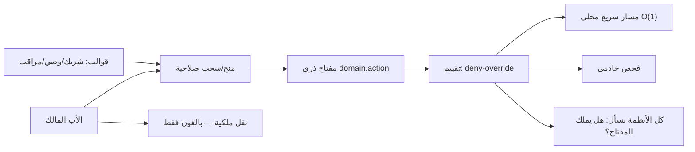
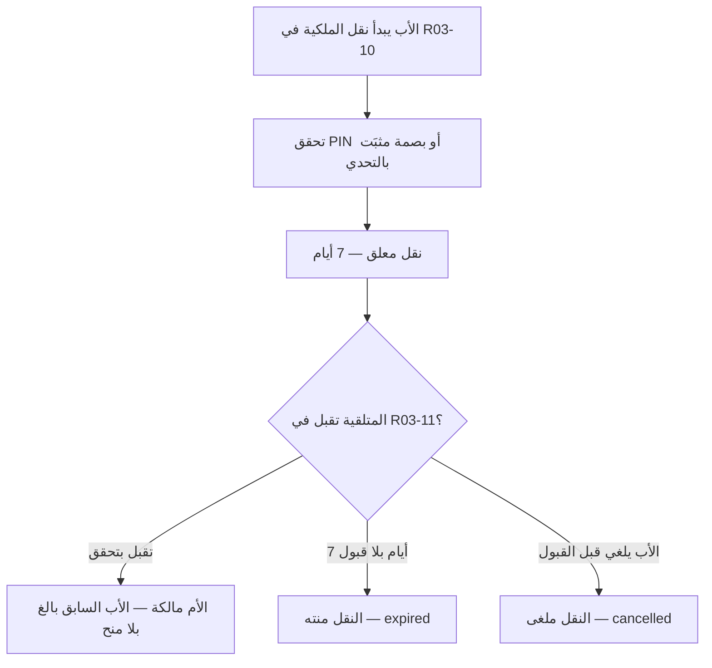
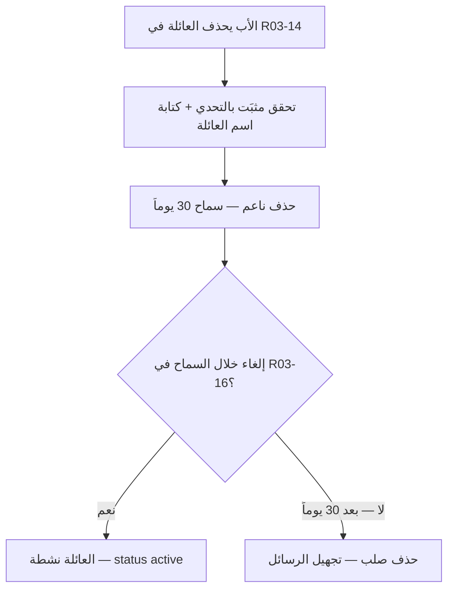
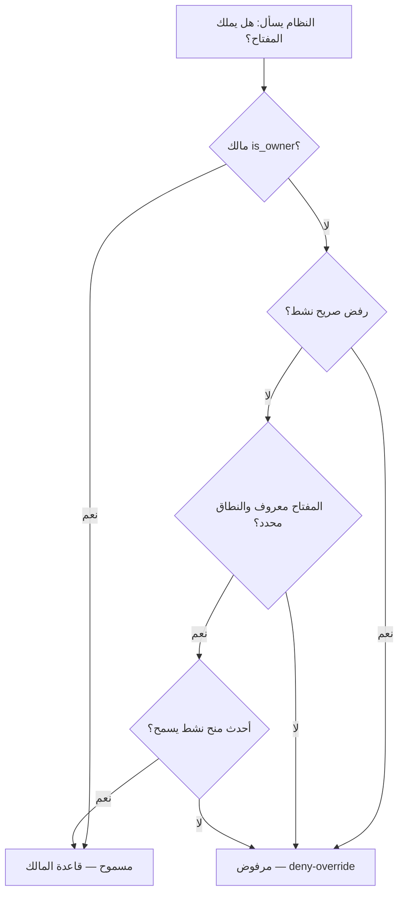
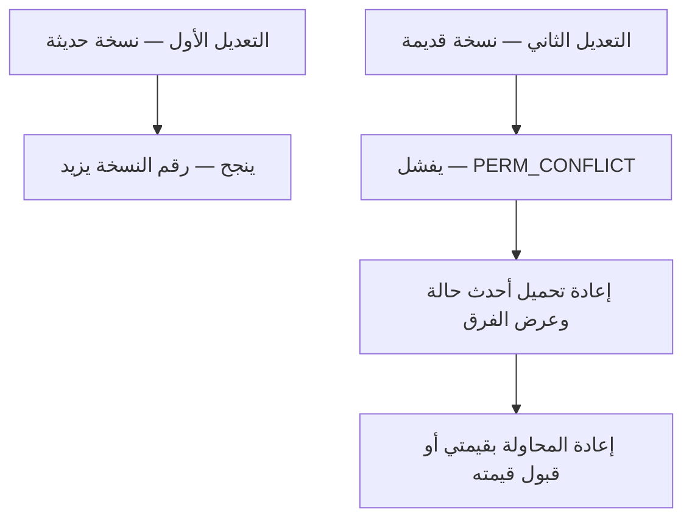
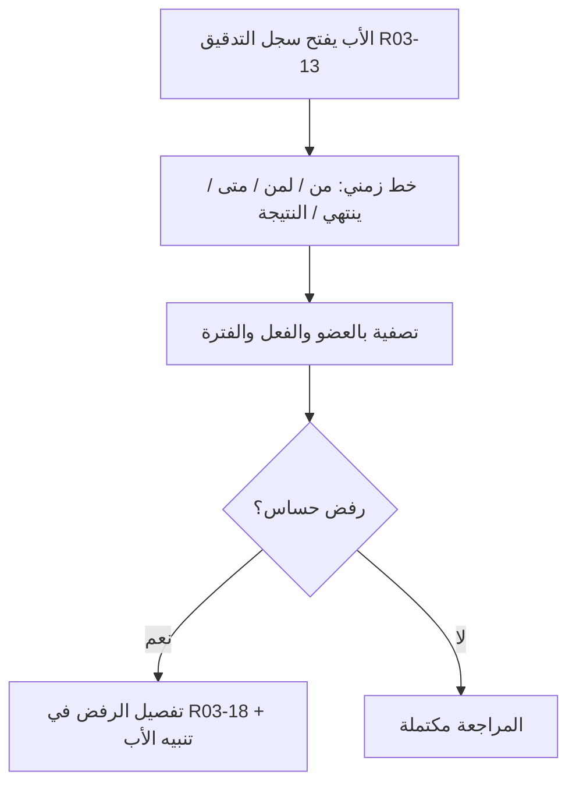
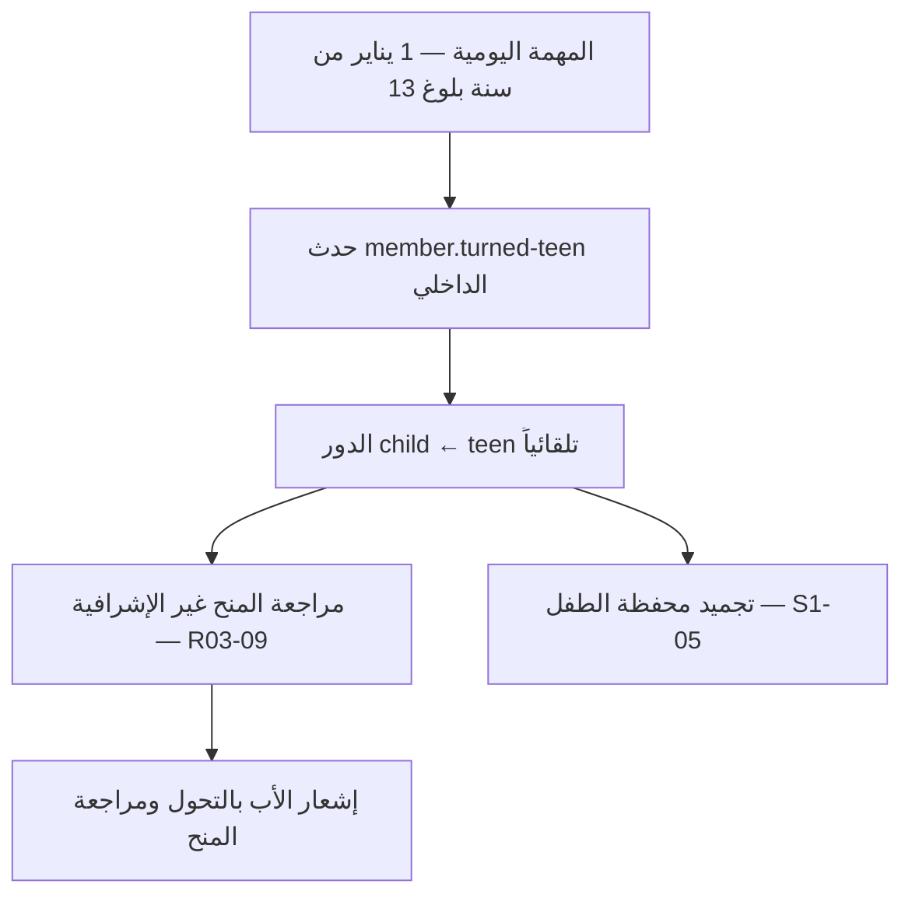
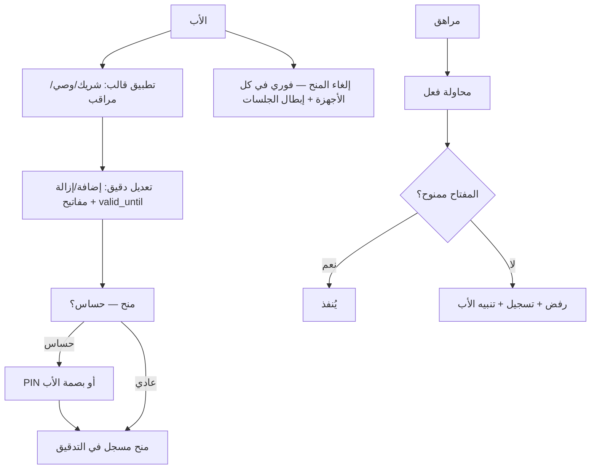

# S1-03: الأدوار والصلاحيات (Family Roles & Permissions)

- **الحالة:** approved | **المرحلة:** 1 (نواة الحماية) · **آخر تحديث:** 2026-11-07
- **القرارات الحاكمة:** Q-001 · Q-003 · Q-006 · Q-007 · Q-010 · Q-065 · Q-072 · Q-080 · Q-085 · Q-086 · Q-087 · Q-088 · Q-089 · Q-093 · Q-139 · Q-162 · Q-164 · Q-166 · Q-174 · Q-189 · Q-201 · Q-204 · Q-227 · Q-232 · Q-235 · Q-248 · Q-250 · D-006 · D-021 · D-023 · D-038 · G-006 · G-011
- **حالة المراجعة:** §§1–8 + §10 معتمدة بالكامل في التخطيط — حكم المالك 2026-11-05 (§1 · §2 سيناريوهات (12 سيناريواً) · §3 المتطلبات (20 متطلباً) · §4 العقود (20 نقطة + 4 مواضيع — 3 مملوكة + مرجع `alerts/new` — + طريقتان) · §5 البيانات (6 جداول + مرجعان) · §6 القواعد والصلاحيات (7 مفاتيح) · §7 الحالات الحدية (17 حالة) · §8 القبول (18 معياراً) · §10 خطة التنفيذ) · **§9 في مرحلة التصميم (Q-091)**.
- **الأدلة المرجعية:** المواصفة القديمة S1-03 (مرجع فقط، G-009) · Deep-dives: FamilyWall (`FWPermission`) · Qustodio (نموذج حساب الأهل + ملفات الأطفال) · S1-01 (معتمد) · S1-02 (معتمد)

## 1. الهدف والتحليل والنطاق

محرك صلاحيات واحد يجيب عن سؤال تسأله كل الأنظمة: "هل يستطيع هذا العضو فعل هذا؟" — الأب يتحكم بكل شيء من شاشة واحدة: قوالب جاهزة كنقطة انطلاق ومصفوفة تفويض للتعديل الدقيق.

**مخطط سياق النظام (§1 — بصري):**



**التحليل (لماذا هذا النظام):** العائلة ليست مستخدماً واحداً — أدوار مختلفة (بالغ/مراهق/طفل، والمالك بالغ بصفة `is_owner`) باحتياجات مختلفة، والأب وحده يقرر من يفعل ماذا. بدون محرك مركزي يخترع كل نظام صلاحياته، وتتسرب الثغرات. لذلك S1-03 هو **الحارس الوحيد**: كل فحص صلاحية في المنصة يمر به، وكل منح يُسجَّل فيه.

**داخل النطاق:**
- تعداد الدور هو {`adult`، `teen`، `child`}؛ المالك هو `adult` + `is_owner=true` (Q-006)؛ سنة الميلاد تحدد الدور.
- محرك التقييم (deny-override): `is_granted=false` رفض صريح؛ `scope` + `valid_until` إلزاميان؛ الغموض يُحسم لصالح حماية الطفل.
- مفاتيح الصلاحيات الذرية بصيغة `domain.action` — كل عملية إدارية مفتاح مستقل قابل للتفويض.
- التفويض: قوالب جاهزة كنقطة انطلاق + مصفوفة تفويض للتعديل الدقيق؛ المالك وحده ينشئ/يعدل/يلغي المنح؛ لا تفويض متسلسل.
- مدة التفويض: بلا مدة افتراضية حتى يلغيها الأب؛ `valid_until` إلزامي يحدده الأب عند كل منح.
- المنح الحساس: يتطلب PIN الأب أو بصمته عند كل منح حساس.
- تفويض المراهق: صلاحيات غير إشرافية فقط يفوضها الأب (مثل إدارة مهامه الخاصة)؛ الثوابت الصلبة تمنع منحه أي إشراف/إدارة/إبطال رقابة.
- القوالب الثلاثة القابلة للتعديل: شريك (كل شيء إلا الفوترة والملكية والحذف) + وصي محدود (عرض + مهام) + مراقب (عرض فقط) — الأب يضيف صلاحيات ويأخذ منها.
- سجل تدقيق كامل لكل منح/تعديل/إلغاء (من منح/لمن/متى/ينتهي)؛ نقل الملكية لبالغ فقط؛ إبطال فوري لجلسات الأعضاء المعلقين.

**خارج النطاق (أنظمة أخرى):**
- الهوية والتهيئة وإنشاء الحسابات والاقتران (S1-02).
- محرك الفرض وشاشات الحظر وجداول وقت الشاشة (نظام الحماية).
- الخطط والدفع (نظام الفوترة — الحد الأدنى في المرحلة 1).
- تبديل الملفات (مؤجل للمرحلة 2 — أولوية، Q-063).

**يعتمد على:** S1-01 (الوضعان والبوابة) + S1-02 (العضوية والملفات والأجهزة).

**المصطلحات:** دور (role) · مفتاح صلاحية (`domain.action`) · منح (grant) · نطاق (scope) · مدة (`valid_until`) · قالب (template) · تفويض حساس · ثابت صلب (لا يُمنح أبداً).

**من التطبيقات المفككة (§1):** نمط FamilyWall `FWPermission` — كل إذن يحمل أيقونة + عنوان مبرر + نص مبرر؛ نأخذ منه أن **كل مفتاح صلاحية في مصفوفة التفويض يحمل عنواناً عربياً ووصفاً يشرح ما يمنحه**، فالأب يفهم ما يمنح قبل أن يمنح.

## 2. سيناريوهات المستخدم

### 2-1: الأب يمنح الأم قالب الشريك ويعدّله
- **الممثل:** الأب (المالك). **السياق:** الأم انضمت للعائلة حديثاً؛ الأب يريدها شريكة كاملة إلا في أمر واحد.
- **التدفق:** 1) الأب يفتح إدارة الأعضاء ويختار الأم. 2) يطبق قالب "شريك" — تُمنح كل مفاتيح الشريك دفعة واحدة. 3) يزيل من القالب مفتاح إدارة دعوات الانضمام (`identity.family.invite`) — لا تريد الأم استقبال طلبات انضمام. 4) يضيف مفتاح إدارة أجهزة الأطفال (`identity.device.pair`). 5) يحدد `valid_until` (تاريخ انتهاء يختاره). 6) النظام يحفظ المنح ويسجله في سجل التدقيق. **النتيجة:** الأم شريكة بصلاحيات معدّلة حسب رغبة الأب — القالب كان نقطة انطلاق لا قيداً.

### 2-2: الأب يمنح الجد قالب المراقب
- **الممثل:** الأب. **السياق:** الجد يريد الاطمئنان على الأحفاد دون أي تحكم.
- **التدفق:** 1) الأب يطبق قالب "مراقب" على الجد. 2) الجد يرى موقع الأطفال وتقاريرهم فقط. 3) الجد يحاول تعديل قاعدة وقت شاشة — النظام يرفض (المفتاح غير ممنوح؛ deny-override). **النتيجة:** عرض بلا تحكم، والرفض صامت وواضح.

### 2-3: الأب يمنح المراهق إدارة مهامه الخاصة
- **الممثل:** الأب + الابن المراهق (15 سنة). **السياق:** المراهق يريد تنظيم مهامه بنفسه.
- **التدفق:** 1) الأب يمنح المراهق صلاحية إدارة مهامه الخاصة فقط (تفويض غير إشرافي — Q-086). 2) المراهق ينشئ مهمة ويعلّمها منجزة. 3) المراهق يحاول تعديل مهمة أخيه الأصغر — النظام يرفض (خارج النطاق). 4) المراهق يحاول تعديل قاعدة حماية — النظام يرفض (ثابت صلب — D-038) وينبّه الأب. **النتيجة:** استقلالية محدودة آمنة داخل حدود يرسمها الأب.

### 2-4: منح صلاحية حساسة يتطلب PIN أو بصمة
- **الممثل:** الأب. **السياق:** الأب يمنح الأم صلاحية تعديل قواعد الحماية (مفتاح حساس).
- **التدفق:** 1) الأب يختار المفتاح الحساس ويضغط "منح". 2) النظام يطلب تحققاً: PIN الأب أو بصمته (Q-088). 3) الأب يبصم — يُنفَّذ المنح ويُسجَّل في سجل التدقيق (من منح/لمن/متى/ينتهي). 4) لو فشل التحقق 3 مرات — يعود النظام لطلب PIN (Q-072). **النتيجة:** لا منح حساس بلا تحقق من الأب نفسه.

### 2-5: الأب يلغي تفويضاً — إبطال فوري
- **الممثل:** الأب. **السياق:** تغيرت الظروف؛ الأب يسحب صلاحية من بالغ مفوَّض.
- **التدفق:** 1) الأب يلغي المنح من إدارة الأعضاء. 2) الإلغاء فوري: المفتاح يتوقف عن العمل لحظياً في كل الأجهزة. 3) إن كان العضو معلقاً — تُبطل جلساته فوراً (BR-PERM-005). 4) يُسجَّل الإلغاء في سجل التدقيق ويُشعَر العضو. **النتيجة:** لا صلاحية معلقة بعد الإلغاء — لا فترة سماح.

### 2-6: محاولة تصعيد مرفوضة
- **الممثل:** مراهق يحاول تجاوز حدوده. **السياق:** المراهق يكتشف شاشة إدارة الأعضاء.
- **التدفق:** 1) المراهق يفتح إدارة الأعضاء ويحاول منح نفسه صلاحية تعديل وقت الشاشة. 2) النظام يرفض قبل التنفيذ: المراهق ليس مالكاً (المنح حصراً للمالك)، والمفتاح المطلوب من الثوابت الصلبة (D-038). 3) يُسجَّل الرفض في سجل التدقيق ويُرسل تنبيه للأب. **النتيجة:** التصعيد مستحيل برمجياً — لا يعتمد على حسن نية الطفل.

### 2-7: الأب ينقل الملكية إلى الأم وتقبلها
- **الممثل:** الأب (المالك) + الأم (بالغة متلقية). **السياق:** الأب يريد نقل ملكية العائلة إلى الأم.
- **التدفق:** 1) الأب يختار الأم بالغة متلقية في R03-10. 2) يتحقق بـ PIN أو بصمة مثبَتة بتحدٍّ من الخادم (Q-093 · Q-164). 3) يُنشأ نقل معلق 7 أيام (`transfer_id` + `expires_at`). 4) الأم تقبل من جهازها في R03-11 بتحقق مثبَت بالتحدي. 5) تصبح الأم المالكة؛ والأب السابق بالغ عادي بلا منح. 6) إن لم تقبل خلال 7 أيام ينتهي النقل (`expired`)؛ والأب يستطيع إلغاءه في أي وقت قبل القبول (R03-12). **النتيجة:** نقل ملكية لا يكتمل إلا بقبول موثق من بالغ.



### 2-8: الأب يحذف العائلة ثم يلغي الحذف خلال السماح
- **الممثل:** الأب (المالك). **السياق:** الأب يريد حذف العائلة ثم يتراجع قبل انتهاء السماح.
- **التدفق:** 1) الأب يفتح R03-14 ويكتب اسم العائلة ويتحقق بـ PIN أو بصمة مثبَتة بالتحدي (Q-164). 2) حذف ناعم + فترة سماح 30 يوماً (قابلة للتغيير بعد استشارة PDPL — Q-201). 3) تُبطل كل الجلسات فوراً وتُفك الأجهزة. 4) خلال السماح يلغي الحذف من R03-16 → تعود العائلة نشطة (`status: "active"`). 5) بلا إلغاء بعد 30 يوماً → حذف صلب وتُجهَّل الرسائل. **النتيجة:** حذف قابل للتراجع خلال السماح فقط، لا بعده.



### 2-9: نظام يسأل عن صلاحية — الفحص الخادمي والمحلي يعطيان القرار نفسه
- **الممثل:** نظام مستهلك (S1-06) + طفل دون اتصال. **السياق:** نظام المهام يسأل هل يستطيع الطفل تسليم مهمة.
- **التدفق:** 1) النظام يستدعي `POST /api/v1/permissions/check`. 2) قاعدة المالك أولاً (Q-232)؛ ثم أي رفض صريح نشط يفوز (deny-override)؛ وإلا يفوز أحدث منح نشط. 3) مفتاح غير معروف أو نطاق غامض → رفض (الغموض لصالح حماية الطفل — REQ-005). 4) على جهاز الطفل دون شبكة: الفحص المحلي O(1) من اللقطة يعطي نفس النتيجة (REQ-006)؛ ولقطة قديمة أو تالفة → إعادة مزامنة كاملة والفحص على الرفض حتى تكتمل. **النتيجة:** قرار واحد خادمياً ومحلياً، والغموض رفض دائماً.



### 2-10: تعارض متفائل — تعديلان متزامنان على منح عضو واحد
- **الممثل:** الأب من جهازين في الوقت نفسه. **السياق:** الأب يعدّل منح سارة من هاتفه وجهازه اللوحي معاً.
- **التدفق:** 1) التعديل الأول بنسخة حديثة ينجح ويزيد رقم النسخة. 2) التعديل الثاني بنسخة قديمة يفشل (`PERM_CONFLICT`). 3) يعيد الأب تحميل أحدث حالة ويرى الفرق، ثم يعيد المحاولة بقيمه أو يقبل القيمة الأحدث — بلا دمج صامت للنطاقات. **النتيجة:** لا تعديل يضيع بصمت، ولا دمج يوسّع منحاً بلا قصد.



### 2-11: الأب يراجع سجل التدقيق ويرى رفضاً حساساً
- **الممثل:** الأب (المالك). **السياق:** الأب يراجع ما حدث هذا الأسبوع.
- **التدفق:** 1) الأب يفتح R03-13. 2) يرى كل منح/تعديل/إلغاء/رفض: من منح/لمن/متى/ينتهي/النتيجة. 3) يصفّي بالعضو والفعل والفترة. 4) رفض حساس يظهر مع تنبيهه وتفصيله في R03-18 (من حاول/ماذا/متى/لماذا). **النتيجة:** كل فعل قابل للعرض والتتبع، والرفض الحساس لا يمر بصمت.



### 2-12: الطفل يبلغ 13 سنة — تحول الدور ومراجعة المنح
- **الممثل:** المهمة الخادمية اليومية (S1-02) + الأب. **السياق:** عمر يبلغ 13 سنة في 1 يناير من سنة بلوغه.
- **التدفق:** 1) المهمة اليومية تُصدر حدث `member.turned-teen` الداخلي عند منتصف الليل المحلي (Q-189 · Q-235). 2) يتحول الدور تلقائياً من `child` إلى `teen`. 3) تُراجع منحُه غير الإشرافية ويُشعَر الأب (R03-09). 4) المنح الإشرافية ممنوعة أصلاً (D-038) فلا شيء يُراجع منها. 5) محفظة الطفل تُجمَّد تبعاً لتغير الدور (S1-05 — Q-237). **النتيجة:** تحول تلقائي موثق، والأب يراجع لا النظام يقرر عنه.



**تغطية §2 للمتطلبات (REQ):** كل متطلب يمارسه سيناريو واحد على الأقل، أو هو قاعدة خلفية بلا تدفق مستقل:

| REQ | السيناريو / الملاحظة |
|---|---|
| REQ-001 | 2-7 (النقل لبالغ فقط يفترض تعداد الأدوار)؛ والتعداد نفسه قاعدة خلفية |
| REQ-002 | 2-1 (الأم تبدأ بلا منح ثم يطبق الأب القالب) |
| REQ-003 | 2-12 |
| REQ-004/005/006 | 2-9 |
| REQ-007 | 2-6، 2-11 |
| REQ-008/009 | قاعدة خلفية — سجل المفاتيح يظهر في منتقي المفتاح (2-1/2-3) بلا تدفق مستقل |
| REQ-010 | 2-6 (رفض غير المالك) + كل سيناريوهات الأب |
| REQ-011 | 2-1 (تحديد `valid_until` عند المنح) |
| REQ-012 | 2-4 |
| REQ-013/014 | 2-1، 2-2 |
| REQ-015 | 2-3 |
| REQ-016 | 2-7 |
| REQ-017 | 2-5 |
| REQ-018 | 2-11 |
| REQ-019 | 2-10 |
| REQ-020 | 2-8 |

**مخطط دورة الصلاحية (§2 — بصري):**



## 3. المتطلبات الوظيفية

### الأدوار
- **REQ-001:** تعداد الدور هو {`adult`، `teen`، `child`}؛ المالك هو `adult` + `is_owner=true` (Q-006)؛ سنة الميلاد تحدد الدور (دون 13 → `child`؛ 13–17 → `teen`؛ 18 فأكثر → `adult` تلقائياً — Q-250). [Q-006 · Q-080 · Q-250 · DIRECT]
- **REQ-002:** البالغ المنضم جديداً يبدأ بدور `adult` بلا أي منح — لا صلاحية له حتى يمنحه الأب صراحة — **عدا منحي بذرة الانضمام Q-166** (`identity.account.delete_self` و`identity.family.leave`)، فهما يُمنحان تلقائياً لكل بالغ عند الانضمام (الافتراضي: السماح بالخروج) ومعفَيان صراحة من `valid_until` (Q-248)؛ والمالك لا يُمنح `identity.family.leave` أبداً. [Q-007 · Q-166 · Q-248 · DERIVED]
- **REQ-003:** عند بلوغ الطفل 13 سنة يتحول دوره تلقائياً من `child` إلى `teen` (بناءً على سنة الميلاد)؛ تُراجع منحُه غير الإشرافية عند التحول ويُشعَر الأب. ويُطلق التحولَ حدث `member.turned-teen` الداخلي الذي تُصدره مهمة S1-02 الخادمية اليومية عند منتصف الليل المحلي (Q-189)؛ وتُطلق مهمةُ بلوغ 13 في 1 يناير من سنة بلوغ 13 (Q-235). [Q-080 · Q-189 · Q-235 · DERIVED]

### محرك التقييم
- **REQ-004:** التقييم deny-override: أي مفتاح غير ممنوح صراحة = مرفوض؛ `is_granted=false` رفض صريح وليس غياباً. **عدا المالك:** العضو `adult` + `is_owner=true` مسموح له كل مفتاح بقاعدة المالك (§6-3 — Q-232) بلا منح صريح — والتجاوز تقييم فقط، لا يشمل التدقيق أبداً ولا فحوص `PERM_HARD_INVARIANT` ولا يمتد لغير المالك. [Q-007 · Q-232 · DIRECT]
- **REQ-005:** أي غموض في التقييم (مفتاح غير معروف، نطاق غير محدد) يُحسم لصالح حماية الطفل — الرفض. [Q-007 · DIRECT]
- **REQ-006:** فحص الصلاحية محلياً O(1): نسخة محلية من المنح على الجهاز للفحص دون شبكة؛ تُحدَّث النسخة عند كل تغيير منح. [BR-PERM-006 · DERIVED]
- **REQ-007:** كل رفض لصلاحية حساسة أو محاولة تصعيد يُسجَّل في سجل التدقيق ويُرسل تنبيه للأب. [D-038 · DERIVED]

### سجل المفاتيح
- **REQ-008:** سجل مركزي لمفاتيح الصلاحيات: كل مفتاح بصيغة `domain.action` + عنوان عربي + وصف يشرح ما يمنحه + علامة "حساس" من عدمه (نمط `FWPermission`: كل إذن يحمل مبرره). [Q-010 · RE-FWPermission · DIRECT]
- **REQ-009:** كل عملية إدارية في المنصة لها مفتاح ذري في السجل — لا عملية بلا مفتاح، ولا مفتاح بلا مالك نطاق (domain). [Q-010 · DIRECT]

### التفويض
- **REQ-010:** المالك وحده ينشئ/يعدل/يلغي المنح؛ البالغ المفوَّض يمارس ما فُوِّض له فقط ولا يفوِّض غيره (لا تفويض متسلسل). [BR-PERM-001 · DERIVED]
- **REQ-011:** كل منح يحمل `scope` + `valid_until` إلزاميين؛ بلا مدة افتراضية — المنح سارٍ حتى يلغيه الأب أو تنتهي مدته. [Q-007 · Q-087 · DIRECT]
- **REQ-012:** المنح الحساس يتطلب PIN الأب أو بصمته عند كل منح حساس — **ويُثبَت بتحدٍّ من الخادم:** الخادم يصدر nonce (صلاحية 5 دقائق) فيوقّعه الجهاز بمفتاح التوقيع الجهازي بعد فتحه بـ PIN أو بصمة، ويتحقق الخادم من التوقيع قبل تنفيذ المنح (Q-164)؛ فلا منح حساس بادّعاء عميل. **يُستثنى من التحدي تبديلُ المنح من مركز التحكم S1-09 (Q-174):** يكتفي بـ PIN/بصمة الأب عبر بوابة الوالدين (Q-065) — بلا nonce وبلا توقيع جهازي؛ والتنفيذ يعتمد على الجلسة + البوابة المحلية (مخاطرة مقبولة بقرار المالك — السهولة أولاً). [Q-088 · Q-164 · Q-174 · DIRECT]
- **REQ-013:** القوالب الثلاثة (شريك / وصي محدود / مراقب) كنقطة انطلاق + مصفوفة تفويض للتعديل الدقيق. [Q-085 · Q-089 · DIRECT]
- **REQ-014:** تطبيق القالب ينسخ مفاتيحه إلى منح العضو؛ تعديل منح العضو بعدها لا يغير القالب ولا منح الأعضاء الآخرين. [Q-089 · DERIVED]
- **REQ-015:** تفويض المراهق: صلاحيات غير إشرافية فقط يفوضها الأب (مثل إدارة مهامه الخاصة)؛ الثوابت الصلبة تمنع منحه أي إشراف/إدارة/إبطال رقابة. [Q-086 · D-038 · DIRECT]
- **REQ-016:** نقل الملكية لبالغ فقط — يُمنع نقله لطفل أو مراهق؛ شرط النقل: PIN أو بصمة (Q-093) **مثبتاً بتحدٍّ من الخادم** (توقيع nonce بمفتاح التوقيع الجهازي — Q-164). ويكتمل النقل بقبول البالغ المتلقي عبر `POST /api/v1/families/{id}/ownership-transfer/{transferId}/accept` بتحقق PIN أو بصمة مثبَتٍ بالتحدي (Q-093 · Q-164)؛ وينتهي النقل بعد 7 أيام بلا قبول؛ والأب يلغي النقل المعلق في أي وقت. [BR-PERM-004 · Q-093 · Q-139 · Q-164 · DIRECT]

### الإلغاء والتدقيق
- **REQ-017:** الإلغاء فوري في كل الأجهزة؛ إبطال جلسات العضو المعلق فوراً؛ يُسجَّل الإلغاء ويُشعَر العضو. [BR-PERM-005 · DERIVED]
- **REQ-018:** سجل تدقيق كامل لكل منح/تعديل/إلغاء/رفض: من منح/لمن/متى/ينتهي/النتيجة — قابل للعرض على الأب. [Q-089 · DERIVED]
- **REQ-019:** تعارض الوالدين: تعديلان متزامنان على منح عضو واحد — قفل تفاؤلي: التعديل الثاني يفشل ويُطلب إعادة تحميل أحدث حالة قبل إعادة المحاولة. [BR-PERM-003 · DERIVED]
- **REQ-020:** الثوابت الصلبة: الفوترة والملكية وحذف العائلة للمالك حصراً غير قابلة للتفويض؛ لا إشراف للأطفال/المراهقين أبداً. **حذف العائلة (Q-166):** عبر `DELETE /api/v1/families/{id}` بشرط PIN/بصمة مثبَتة بالتحدي (Q-164)؛ وحذف ناعم + فترة سماح 30 يوماً ثم حذف صلب (إلغاؤه عبر `POST /api/v1/families/{id}/deletion/cancel`)؛ وإزالة عضو عبر `DELETE /api/v1/families/{id}/members/{memberId}` (المالك فقط + PIN — `identity.member.remove`)؛ والبروتوكول الكامل في `DELETION-EXPORT-PROTOCOL.md`. [D-038 · Q-166 · DIRECT]

## 4. الواجهات والعقود

### 4-1. نقاط الوصول (REST — `/api/v1`)

| الطريقة والمسار | الغرض | المدخل | المخرج | التفويض |
|---|---|---|---|---|
| `GET /api/v1/permissions/keys` | سجل المفاتيح المركزي (REQ-008) | — | قائمة المفاتيح: `key` (`domain.action`) + العنوان العربي + الوصف + علامة "حساس"  | `roles.key.view` — المالك ضمناً (Q-232)؛ والبالغ المفوَّض الحامل للمفتاح |
| `GET /api/v1/families/{id}/members/{memberId}/permissions` | الصلاحيات الفعلية لعضو (الأدوار + المنح المحلولة) | — | `{member_id, role, grants: [{key, scope, valid_until, is_granted}]}`  | المالك؛ أو العضو نفسه لمنحه (R03-17) — بلا مفتاح (قراءة بيانات النفس) |
| `POST /api/v1/families/{id}/members/{memberId}/grants` | إنشاء منح (المالك فقط — REQ-010؛ و`{memberId}` هو معرّف العضوية `membership.id` — Q-169) | `{permission_key, scope, valid_until, verification?: {method: "pin" \| "biometric", challenge_id, signature, at}}` — المفتاح الحساس بلا `verification` يُرفض (REQ-012)؛ التحقق نفسه محلي (بوابة الوالدين Q-065 / بصمة Q-072) **ويتحقق الخادم من التوقيع بمفتاح الجهاز العام قبل التنفيذ (Q-164)** — **عدا تبديل المنح من S1-09 (Q-174): يُقبل `verification: {method, at}` بلا `challenge_id`/`signature`**؛ ويُسجَّل في التدقيق | `{grant_id, ...}` — `201`  | `roles.grant.create` — المالك حصراً (REQ-010) |
| `PATCH /api/v1/families/{id}/members/{memberId}/grants/{grantId}` | تعديل منح (النطاق/المدة) | `{scope?, valid_until?}` + ترويسة `If-Match: <version>` (إلزامية — REQ-019) | المنح المعدَّل (مع `version` الجديد)  | `roles.grant.edit` — المالك حصراً (REQ-010) |
| `DELETE /api/v1/families/{id}/members/{memberId}/grants/{grantId}` | إلغاء منح — فوري (REQ-017) | — | `204` + دفع حدث إبطال لكل أجهزة العضو  | `roles.grant.revoke` — المالك حصراً (REQ-010) |
| `POST /api/v1/families/{id}/members/{memberId}/grants/apply-template` | تطبيق قالب (REQ-013/014) | `{template_id: "partner" \| "guardian" \| "observer", valid_until}` — `valid_until` واحد يطبَّق على كل المنح المنسوخة؛ وبلا افتراضي على مستوى القالب (Q-087) | المنح المنسوخة من القالب  | `roles.template.apply` — المالك حصراً (REQ-010) |
| `GET /api/v1/families/{id}/templates` | القوالب الثلاثة ومفاتيح كل منها | — | `[{template_id, title_ar, keys: [...]}]`  | المالك فقط (عرض القوالب — R03-06) — بلا مفتاح منفصل |
| `PATCH /api/v1/families/{id}/templates/{templateId}` | تعديل تعريف قالب (المالك فقط — Q-089 · Q-205) | `{title_ar?, description_ar?, keys?}` — المفاتيح مجموعة `template_key` (§5-3)؛ و`keys` **تستبدل المجموعة كاملة** (الغائب عنها يُزال؛ وفارغة تمسحها؛ ومفتاح غير معروف فيها → `400` + `PERM_DENIED` بلا تطبيق جزئي — §7-17) | القالب المعدَّل  | المالك فقط (Q-089 · Q-205) — بلا مفتاح ذري |
| `POST /api/v1/families/{id}/ownership-transfer` | بدء نقل الملكية (لبالغ فقط — REQ-016) | `{to_member_id, verification: {method: "pin" \| "biometric", challenge_id, signature, at}}` — التحقق مثبَت بالتحدي (Q-093 · Q-164)؛ ويُصدر التحدي عبر `POST /api/v1/shell/verification/challenge` (S1-01 — §4-1-أ) | `{transfer_id, status: "pending"}`  | `roles.ownership.transfer` — المالك حصراً (REQ-016) |
| `POST /api/v1/families/{id}/ownership-transfer/{transferId}/accept` | قبول نقل الملكية (البالغ المتلقي — REQ-016) | `{verification: {method: "pin" \| "biometric", challenge_id, signature, at}}` — التحقق محلي (Q-093) **ويتحقق الخادم من التوقيع قبل القبول (Q-164)** | `{transfer_id, status: "accepted"}` — `200`  | البالغ المتلقي نفسه (جلسة مصادق عليها + هوية المتلقي) — بلا مفتاح |
| `DELETE /api/v1/families/{id}/ownership-transfer/{transferId}` | إلغاء نقل ملكية معلق (المالك فقط — REQ-016 · Q-162) | — | `{transfer_id, status: "cancelled"}` — `200`  | `roles.ownership.transfer` — المالك حصراً (REQ-016 · Q-162) |
| `DELETE /api/v1/families/{id}` | حذف العائلة (المالك فقط — REQ-020 · Q-166) | `{verification: {method: "pin" \| "biometric", challenge_id, signature, at}}` — التحقق مثبَت بالتحدي (Q-164) | `{status: "pending_deletion", purge_at}` — حذف ناعم + سماح 30 يوماً  | المالك فقط — ثابت صلب (D-038)، بلا مفتاح |
| `DELETE /api/v1/families/{id}/members/{memberId}` | إزالة عضو (المالك فقط + PIN — `identity.member.remove` · Q-166) | `{verification: {method: "pin" \| "biometric", challenge_id, signature, at}}` — التحقق مثبَت بالتحدي (Q-164) | `{status: "pending_deletion", purge_at}` — حذف ناعم + سماح 30 يوماً؛ والرسائل تُجهَّل  | `identity.member.remove` + المالك + PIN (REQ-020 · Q-166) |
| `POST /api/v1/families/{id}/deletion/cancel` | إلغاء حذف عائلة معلَّق خلال السماح (المالك فقط — Q-166 · Q-204) | `{verification: {method: "pin" \| "biometric", challenge_id, signature, at}}` — التحقق مثبَت بالتحدي (Q-164) | `{status: "active"}` — `200`  | المالك فقط (Q-166 · Q-204) — بلا مفتاح |
| `POST /api/v1/families/{id}/members/{memberId}/deletion/cancel` | إلغاء حذف عضو معلَّق خلال السماح (المالك فقط — Q-166 · Q-204) | `{verification: {method: "pin" \| "biometric", challenge_id, signature, at}}` — التحقق مثبَت بالتحدي (Q-164) | `{status: "active"}` — `200`  | المالك فقط (Q-166 · Q-204) — بلا مفتاح |
| `GET /api/v1/families/{id}/audit/permissions` | سجل التدقيق (REQ-018) | `?member_id&action&from&to&limit=50&cursor` — `limit` افتراضي 50 وأقصى 100؛ و`action` من قيم `action` في §5-6 | قائمة الأحداث: `{actor, target_member, action, permission_key?, at, valid_until?, family_id, result}`  | `roles.audit.view` — المالك ضمناً (Q-232) |
| `POST /api/v1/permissions/check` | فحص صلاحية خادمي (للوحة الأهل والخادم) | `{member_id (معرّف العضوية `membership.id` — Q-169), permission_key, scope?}` | `{allowed: bool, reason: "granted" \| "denied" \| "not_granted" \| "hard_invariant" \| "unknown_key"}` — وللمالك (`adult` + `is_owner=true`): `{allowed: true, reason: "granted"}` بقاعدة المالك (§6-3 — Q-232)؛ والمفتاح غير المعروف أو النطاق الغامض يعطي `reason: "unknown_key"` — رفض في الأثر، مميز في التسمية (REQ-005 · §6-3)  | فحص خادمي للأنظمة — جلسة/خدمة مصادق عليها؛ بلا مفتاح (القارئ يفحص مفتاحاً آخر) |
| `POST /api/v1/families/{id}/permission-requests` | إنشاء طلب تعديل صلاحية (مراهق/بالغ مفوَّض — R03-17) | `{member_id (معرّف العضوية — Q-169), permission_key, scope?, reason?}` — طلب معلق واحد لكل (عضو، مفتاح)؛ وطلب ثانٍ لنفس المفتاح وهو معلق → `409` | `{request_id, status: "pending"}` — `201` | العضو الطالب نفسه (جلسة مصادق عليها) — بلا مفتاح |
| `GET /api/v1/families/{id}/permission-requests` | قائمة طلبات التعديل (للمالك — قراره في R03-17) | `?member_id&status` | `[{request_id, member_id, permission_key, scope?, reason?, status, at}]` | المالك فقط — بلا مفتاح |
| `POST /api/v1/families/{id}/permission-requests/{requestId}/decide` | قرار الأب على الطلب (REQ-010) | `{decision: "approve" \| "deny", scope?, valid_until?, verification?}` — الموافقة تنشئ المنح (فيتطلب `scope` + `valid_until` — REQ-011؛ والمفتاح الحساس يتطلب `verification` — REQ-012) | `{request_id, status: "approved" \| "denied", grant_id?}` | `roles.grant.create` — المالك حصراً (الموافقة تنشئ منحاً) |

### 4-1-أ. إصدار التحدي (إعادة استخدام S1-01 — Q-164)

لا نقطة إصدار تحدي أصلية في هذا النظام: كل خطوات التحدي في §4-1 تستهلك نقطتي S1-01 (§4.2 — `S101/SPEC.md:155`):

| النقطة (S1-01) | الاتجاه | المخرج |
|---|---|---|
| `POST /api/v1/shell/verification/challenge` | إصدار تحدٍّ | `{challenge_id, nonce, expires_at}` — صلاحية 5 دقائق، استخدام واحد |
| `POST /api/v1/shell/verification/prove` | إثبات التحقق | `{challenge_id, signature, method}` → `{verified}` — الخادم يتحقق من التوقيع بمفتاح الجهاز العام المسجَّل |

تستهلك `challenge_id` خطوات هذا النظام: إنشاء منح حساس (`POST …/grants` — REQ-012)، وبدء نقل الملكية (`POST …/ownership-transfer` — REQ-016)، وقبول النقل (`POST …/ownership-transfer/{transferId}/accept` — REQ-016)، وحذف العائلة/العضو وإلغاء الحذف (`DELETE …` و`POST …/deletion/cancel` — REQ-020). ولا يُقبل nonce صادر من تدفق في تدفق آخر — `challenge_id` مربوط بعملية واحدة. **الاستثناء Q-174:** تبديل المنح من مركز التحكم S1-09 يكتفي بـ PIN/بصمة الأب عبر بوابة الوالدين — بلا `challenge_id` وبلا توقيع جهازي؛ وهذا الاستثناء لا ينطبق على أي نقطة في §4-1.

### 4-2. الأحداث (MQTT → وكيل الطفل)

| الموضوع | الغرض | QoS | Retained | الحمولة | الناشر | المشترك |
|---|---|---|---|---|---|---|
| `family/{family_id}/permissions/sync` | مزامنة لقطة المنح إلى جهاز الطفل (للفحص المحلي O(1) — REQ-006) | 1 | نعم | `{family_id, grants: [{permission_key, scope, valid_until, is_granted}], snapshot_version, at}` | الخادم Ktor — عند كل تغيير منح | جهاز الطفل (اللقطة المحلية) |
| `family/{family_id}/permissions/revoked` | دفع إبطال فوري عند أي إلغاء (REQ-017) | 1 | لا | `{family_id, member_id, grant_id, permission_key, revoked_at}` | الخادم Ktor — عند الإلغاء | كل أجهزة العضو (إبطال اللقطة) |
| `family/{family_id}/permissions/grant-expiring` | تنبيه انتهاء منح قريب (7 أيام قبل الانتهاء — Q-227): يصدره فحص يومي مجدول للمنح القريبة من الانتهاء؛ يستهلكه S1-09 لتنبيهات `grant_expiring` | 1 | لا | `{family_id, member_id, grant_id, permission_key, valid_until, days_left}` | فحص يومي مجدول (الخادم — Q-227) | S1-09 (تنبيهات `grant_expiring`) |
| `family/{family_id}/alerts/new` (مرجع — مالكه S1-09) | دفع تنبيه رفض حساس / محاولة تصعيد إلى الأب (REQ-007) — النوع `escalation` | 1 | لا | `{family_id, alert_id, kind: "escalation", system: "S1-03", target_member_id, at}` | الخادم Ktor — عند الرفض الحساس أو التصعيد | S1-09 (بطاقة «يتطلب انتباهك» + R03-18) |

QoS والاحتفاظ منقولان من مواصفة الوسيط §6 (Q-168): اللقطة QoS 1 + retained؛ والأحداث QoS 1 بلا retained. وموضوع `alerts/new` مالكه S1-09 (§4-2) — يُذكر هنا مرجعاً فقط لأن REQ-007 يعتمد عليه؛ ولا يُعاد تعريفه هنا.

### 4-2-أ. حدث داخلي: `member.turned-teen` (بلا موضوع MQTT — Q-189)

- **الاسم:** `member.turned-teen` — حدث خادم داخلي، **بلا موضوع MQTT** (Q-189)؛ وتسميته وحمولته كما تصدرهما S1-02 (REQ-013) — لا تعريف ثانٍ مختلف.
- **الناشر:** مهمة S1-02 الخادمية اليومية عند منتصف الليل المحلي للعائلة (Q-183)؛ وتُطلق 1 يناير من سنة بلوغ 13 (Q-235).
- **الحمولة:** `{family_id, member_id (معرّف العضوية `membership.id` — Q-169), birth_year, new_role: "teen", effective_at}`.
- **المشتركان:** S1-03 (يراجع المنح غير الإشرافية عند التحول ويُشعَر الأب — REQ-003؛ التسلسلية 3-و) وS1-10 (تبقى قواعد الطفل سارية ويُشعَر الأب — S1-10 REQ-027).
- **كاتب الدور:** مهمة S1-02 اليومية نفسها — هي مالكة `membership.role` (S1-02 REQ-013)؛ ومعالج S1-03 لا يكتب الدور أبداً، يراجع المنح ويُشعَر الأب فقط.

QoS والاحتفاظ منقولان من مواصفة الوسيط §6 (Q-168): اللقطة QoS 1 + retained؛ والأحداث QoS 1 بلا retained.

### 4-3. قناة المنصة (MethodChannel — Flutter ↔ Kotlin)

| الطريقة | الغرض |
|---|---|
| `checkPermission({key, scope}) → bool` | فحص محلي O(1) على جهاز الطفل من لقطة المنح (REQ-006) |
| `getEffectivePermissions() → List` | لقطة المنح المحلية الحالية |

### 4-4. صيغة الخطأ الموحدة

`{code, message_ar, trace_id}` — كما في S1-02 §4. رموز هذا النظام: `PERM_DENIED` (مرفوض — deny-override) · `PERM_HARD_INVARIANT` (ثابت صلب — لا يُمنح أبداً) · `PERM_NOT_OWNER` (المنح حصراً للمالك) · `PERM_VERIFICATION_REQUIRED` (منح حساس بلا تحقق) · `PERM_GRANT_EXPIRED` (انتهت `valid_until`) · `PERM_CONFLICT` (تعارض متفائل — أعد التحميل، REQ-019).

## 5. البيانات — النموذج

**تصحيح بعد المراجعة:** جداول العائلة تحمل `family_id` + RLS (D-021)؛ أما جداول السجل العام (`permission_key` و`role_template` و`template_key`) فمشتركة لكل العائلات بلا `family_id` — لأن نفس المفتاح والقالب يخدمان كل العائلات، ونسخها لكل عائلة عبث. العضوية والدور في S1-02 §5 (`membership` — الدور + `is_owner`)؛ هذا النظام يضيف جداوله الخاصة:

### 5-1. `permission_key` — سجل المفاتيح المركزي (REQ-008/009)
| الحقل | النوع | ملاحظات |
|---|---|---|
| `key` | text (PK) | بصيغة `domain.action` (مثال `identity.child.create`) |
| `domain` | text | نطاق المفتاح (مثال `identity`) |
| `title_ar` | text | العنوان العربي (نمط `FWPermission`: كل مفتاح يحمل مبرره) |
| `description_ar` | text | وصف يشرح ما يمنحه |
| `is_sensitive` | boolean | يتطلب PIN أو بصمة عند المنح (REQ-012) |
| `created_at` | timestamptz | |

### 5-2. `role_template` — القوالب الثلاثة (Q-089)
| الحقل | النوع | ملاحظات |
|---|---|---|
| `template_id` | text (PK) | `partner` / `guardian` / `observer` |
| `title_ar` | text | شريك / وصي محدود / مراقب |
| `description_ar` | text | وصف القالب |

### 5-3. `template_key` — مفاتيح كل قالب (REQ-013/014)
| الحقل | النوع | ملاحظات |
|---|---|---|
| `template_id` | text (FK → `role_template`) | |
| `permission_key` | text (FK → `permission_key`) | |
| `default_scope` | jsonb | النطاق الافتراضي للمفتاح في هذا القالب |
| PK | (`template_id`, `permission_key`) | |

### 5-4. `permission_grant` — المنح (REQ-010/011/017)
| الحقل | النوع | ملاحظات |
|---|---|---|
| `grant_id` | uuid (PK) | |
| `family_id` | uuid (FK) | + RLS |
| `member_id` | uuid (FK → `membership`, nullable) | الممنوح له — **صف العضوية لا `person`** (Q-169): فالمراهق والطفل لهما عضوية وبلا `person` (Q-137)؛ وNULL عند `grantee_type='agent'` |
| `grantee_type` | text | `member` (افتراضي) / `agent` — للمنح الممنوحة للوكيل (Q-167): عند `agent` يكون `member_id` فارغاً ويُعرَّف الممنوح له بـ `family_id` (وكيل واحد لكل عائلة) |
| `permission_key` | text (FK → `permission_key`) | |
| `scope` | jsonb | إلزامي (Q-007) |
| `valid_until` | timestamptz | إلزامي (Q-087) — بلا افتراضي |
| `is_granted` | boolean | `false` = رفض صريح (Q-007) |
| `version` | integer | رقم نسخة المنح — يبدأ 1 ويزيد عند كل تغيير على **هذا المنح** (نطاق النسخة: المنح نفسه لا مجموعة منح العضو — REQ-019)؛ و`PATCH …/grants/{grantId}` يتطلب ترويسة `If-Match: <version>`؛ ونسخة قديمة → `412` + `PERM_CONFLICT` (§4-4 · §7-8) |
| `granted_by` | uuid (FK → `person`) | المالك حصراً (REQ-010) |
| `granted_at` | timestamptz | |
| `verification_method` | text (nullable) | `pin` / `biometric` — للمنح الحساس (REQ-012)؛ ويُحفظ معه `challenge_id` والتوقيع في التدقيق (Q-164) |
| `revoked_at` | timestamptz (nullable) | |
| `revoked_by` | uuid (nullable) | |

**قاعدة الهوية الموحدة (Q-169):** العضوية (`membership.id`) هي الهوية الوحيدة للممنوح له داخل العائلة — لا `person_id` في أي منح؛ و`granted_by` وحده يشير إلى `person` (المانح مالك بالغ دائماً).

### 5-5. `ownership_transfer` — نقل الملكية (REQ-016)
| الحقل | النوع | ملاحظات |
|---|---|---|
| `transfer_id` | uuid (PK) | |
| `family_id` | uuid (FK) | + RLS |
| `from_member_id` | uuid (FK → `person`) | المالك الحالي |
| `to_member_id` | uuid (FK → `person`) | بالغ فقط |
| `status` | text | `pending` / `accepted` / `cancelled` / `expired` (Q-139) |
| `auth_method` | text (nullable) | شرط النقل: PIN أو بصمة (Q-093) |
| `expires_at` | timestamptz | `requested_at` + 7 أيام — بلا قبول ينتهي النقل (Q-139)؛ ويقلب فحص يومي مجدول (مهمة انتهاء النقل — §7-14) كل نقل `pending` تجاوز `expires_at` إلى `expired` |
| `requested_at` / `accepted_at` | timestamptz (nullable) | |

### 5-6. `AuditEvent` — سجل التدقيق (النواة المشتركة — REQ-018)
حدث تدقيق مشترك (من خريطة السياقات) بنطاق `domain = "permissions"`: `{actor, target_member, action (grant/modify/revoke/deny), permission_key?, at, result, valid_until?, family_id}` — قابل للعرض على الأب. و`valid_until` من المنح المعني (لاغٍ في الرفض)؛ و`family_id` من سياق العائلة — فيستطيع ACC-012 اختبار «ينتهي» من السجل وحده (REQ-018). والحقلان الجديدان في نواة `AuditEvent` المشتركة — يُنسَّقان عبر خريطة السياقات، بلا نسخة خاصة بالصلاحيات.

### 5-7. `permission_request` — طلبات تعديل الصلاحية (REQ-002/004/015 — R03-17)
| الحقل | النوع | ملاحظات |
|---|---|---|
| `request_id` | uuid (PK) | |
| `family_id` | uuid (FK) | + RLS |
| `member_id` | uuid (FK → `membership`) | الطالب — معرّف العضوية (Q-169) |
| `permission_key` | text (FK → `permission_key`) | المفتاح المطلوب |
| `scope` | jsonb (nullable) | النطاق المطلوب |
| `reason` | text (nullable) | سبب الطلب كما كتبه الطالب |
| `status` | text | `pending` / `approved` / `denied` |
| `requested_at` | timestamptz | |
| `decided_at` | timestamptz (nullable) | |
| `decided_by` | uuid (nullable — FK → `person`) | الأب الذي قرر (المالك حصراً) |

**ملاحظة:** لقطة المنح المحلية (REQ-006 — الفحص O(1)) مخزن عميل على الجهاز (ليست جدول خادم): تُزامَن عبر `family/{family_id}/permissions/sync` وتُبطل عبر `family/{family_id}/permissions/revoked`.

## 6. القواعد والصلاحيات

### 6-1. مفاتيح هذا النظام (`roles.*`)

| المفتاح | الوصف | لمن؟ |
|---|---|---|
| `roles.key.view` | عرض سجل المفاتيح (العناوين والأوصاف) | قابل للتفويض |
| `roles.grant.create` | إنشاء منح | المالك حصراً (REQ-010) |
| `roles.grant.edit` | تعديل منح (النطاق/المدة) | المالك حصراً (REQ-010) |
| `roles.grant.revoke` | إلغاء منح | المالك حصراً (REQ-010) |
| `roles.template.apply` | تطبيق قالب على عضو | المالك حصراً (REQ-010) |
| `roles.ownership.transfer` | نقل الملكية | المالك حصراً (REQ-016) |
| `roles.audit.view` | عرض سجل التدقيق | قابل للتفويض |

### 6-2. الثوابت الصلبة (لا تُمنح أبداً)
- deny-override: غير الممنوح صراحة = مرفوض؛ الغموض يُحسم لصالح حماية الطفل (Q-007).
- الفوترة والملكية وحذف العائلة للمالك حصراً غير قابلة للتفويض (D-038).
- لا إشراف/إدارة/إبطال رقابة للأطفال أو المراهقين أبداً (D-038).
- `scope` + `valid_until` إلزاميان في كل منح (Q-007) — عدا منح بذرة Q-166 المعفاة صراحة (Q-248 — انظر §6-3).
- لا تفويض متسلسل: المفوَّض لا يفوِّض غيره (REQ-010).
- المنح الحساس يتطلب PIN الأب أو بصمته (Q-088).

### 6-3. قواعد التقييم
- **قاعدة المالك** (Q-232 — أول قاعدة تقييم): العضو `adult` + `is_owner=true` → `allowed` لأي مفتاح بلا منح صريح. **نطاق التجاوز تقييم فقط:** لا يشمل التدقيق أبداً (أفعال المالك وفحوصه تُسجَّل في سجل التدقيق كغيرها)؛ ولا يشمل فحوص `PERM_HARD_INVARIANT` (الثوابت الصلبة تبقى مرفوضة — فمحاولة منح ثابت صلب تُرفض حتى حين يطلبها المالك)؛ ولا يمتد لغير المالك (بالغ مفوَّض بلا منح = مرفوض — REQ-002).
- **المفتاح غير المعروف:** مفتاح غير موجود في السجل أو نطاق غامض → `{allowed: false, reason: "unknown_key"}` — رفض في الأثر كالرفض الصريح، مميز في التسمية (REQ-005)؛ والرفض الصريح النشط وحده يبقى `reason: "denied"`.
- **المنح النشط** = `revoked_at IS NULL` و`valid_until > now`.
- **المنح المتداخلة** (أكثر من منح نشط لنفس العضو ونفس المفتاح — كُشف في مراجعة §5): أي رفض صريح نشط (`is_granted=false`) يفوز → مرفوض (Q-007 deny-override)؛ وإلا يفوز أحدث منح نشط (ويُؤخذ نطاقه).
- منح بذرة Q-166 معفاة صراحة من `valid_until` (Q-248)؛ التقييم يعامل غياب `valid_until` فيها كمنح سارٍ مربوط بالعضوية.
- **تغير الدور** (REQ-003): عند بلوغ 13 وتحول `child` إلى `teen` تُراجع منحُه غير الإشرافية ويُشعَر الأب.
- **تغير الدور عند 18** (REQ-001 — Q-250): عند بلوغ 18 يتحول الدور تلقائياً من `teen` إلى `adult`؛ وتُلغى منحُ المراهق ما لم يجددها الأب صراحة — فلا تنتقل أي صلاحية إشرافية بصمت؛ والمحفز سنة الميلاد + المهمة الخادمية اليومية (قارن Q-189 لسن 13).

## 7. الحالات الحدية والأخطاء

1. **مفتاح غير موجود في السجل:** منح مفتاح ليس في `permission_key` → يُرفض (`PERM_DENIED`) ويُسجَّل الرفض؛ لا يُنشأ مفتاح ضمنياً أبداً.
2. **عضو غير موجود أو خارج العائلة:** منح لعضو ليس في العائلة → `404`؛ لا يُكشف وجود العضو لغير أفراد عائلته.
3. **منح بلا نطاق أو مدة:** غياب `scope` أو `valid_until` → يُرفض (`400`)؛ الإلزامية لا تُتجاوز — عدا منح بذرة Q-166 المعفاة صراحة من `valid_until` (Q-248 — انظر §6-3).
4. **`valid_until` في الماضي:** منح بمدة منتهية أصلاً → يُرفض (`400`)؛ لا منح منتهي الصلاحية منذ ولادته.
5. **منح حساس بلا تحقق:** مفتاح حساس بلا `verification` → يُرفض (`PERM_VERIFICATION_REQUIRED`)؛ التحقق لا يُستنتج من الجلسة وحدها.
6. **منح من غير المالك:** بالغ مفوَّض يحاول منح غيره → يُرفض (`PERM_NOT_OWNER`)؛ لا تفويض متسلسل (REQ-010).
7. **منح ثابت صلب:** محاولة منح مفتاح فوترة/ملكية/حذف أو إشراف لطفل → يُرفض (`PERM_HARD_INVARIANT`) ويُنبَّه الأب (سيناريو 2-6) — ويُرسل التنبيه عبر `family/{family_id}/alerts/new` (النوع `escalation` — S1-09 §4-2) ويُعرض تفصيله في R03-18 (REQ-007).
8. **تعارض متفائل:** تعديلان متزامنان على منح عضو → الثاني يفشل (`PERM_CONFLICT`)؛ يُعاد تحميل أحدث حالة قبل إعادة المحاولة (REQ-019)؛ ويُكتشف التعارض عبر `version` المنح + ترويسة `If-Match` (§5-4 · §4-1).
9. **انتهاء مدة منح أثناء الاستخدام:** `valid_until` تنتهي والعضو يستخدم الصلاحية → الفحص يرفض فوراً؛ اللقطة المحلية تُحدَّث عند المزامنة التالية.
10. **إلغاء منح أثناء جلسة نشطة:** إلغاء منح عضو لديه جلسة نشطة → تُبطل الجلسة فوراً (REQ-017)؛ أي طلب لاحق يُرفض.
11. **نقل ملكية إلى غير بالغ:** طلب نقل الملكية لطفل أو مراهق → يُرفض؛ النقل للبالغين فقط (REQ-016).
12. **فقدان الاتصال أثناء منح:** انقطاع الشبكة أثناء إنشاء منح → المنح لا يُنفَّذ محلياً (الخادم هو المرجع)؛ يُحفظ في صندوق الصادر ويُعاد عند عودة الاتصال (نمط S1-01).
13. **لقطة محلية قديمة أو تالفة:** لقطة المنح على جهاز الطفل أقدم من نسخة الخادم أو تالفة → إعادة مزامنة كاملة عبر `family/{family_id}/permissions/sync`؛ الفحص يتوقف على الرفض حتى تكتمل المزامنة (الغموض لصالح الحماية — REQ-005).
14. **قبول نقل ملكية منتهٍ:** قبول بعد 7 أيام من الطلب → يُرفض؛ النقل `expired` ولا يُقبل بعده (REQ-016 · Q-139). **ولا يُترك الانتهاء للصدفة:** فحص يومي مجدول (مهمة انتهاء النقل اليومية — مالكها خادم S1-03) يقلب كل نقل `pending` تجاوز `expires_at` إلى `expired`، ويُشعَر الأب والمتلقي عبر `family/{family_id}/alerts/new`؛ والقبول بعد الانتهاء يُرفض حتى قبل قلب الحالة (التقييم عند القبول يفحص `expires_at` أولاً)؛ وقلب الحالة عملية غير مكررة (idempotent) — إعادة تشغيل المهمة على نقل `expired` لا تغير شيئاً.
15. **إلغاء الأب لنقل معلق:** الأب يلغي نقل ملكية معلقاً عبر `DELETE /api/v1/families/{id}/ownership-transfer/{transferId}` (المالك فقط — Q-162) → `cancelled`؛ والمتلقي لا يستطيع قبوله بعد الإلغاء (REQ-016 · Q-139 · Q-162).
16. **قبول من غير المتلقي أو بتحقق خاطئ:** قبول نقل ملكية من بالغ غير المتلقي المحدد، أو بتحقق PIN/بصمة خاطئ → يُرفض؛ النقل يبقى معلقاً حتى قبوله الصحيح أو انتهائه أو إلغائه (REQ-016 · Q-093 · Q-139).
17. **تعديل قالب بمجموعة مفاتيح جزئية:** `PATCH …/templates/{templateId}` بمصفوفة `keys` **تستبدل** مجموعة `template_key` كاملة — فالمفتاح الغائب عن المصفوفة يُزال من القالب؛ ومصفوفة فارغة تمسح المجموعة؛ ومفتاح غير معروف في المصفوفة → يُرفض الطلب كاملاً (`400` + `PERM_DENIED` — §7-1) بلا تطبيق جزئي؛ وعلى العميل إرسال المجموعة الكاملة المقصودة في كل مرة (Q-089 · Q-205).

## 8. معايير القبول

- **ACC-001:** تعداد الدور {`adult`، `teen`، `child`} يعمل؛ المالك هو `adult` + `is_owner=true`؛ سنة الميلاد تحدد الدور تلقائياً. [REQ-001]
- **ACC-002:** بالغ منضم جديداً لا يستطيع فعل أي شيء إداري حتى يمنحه الأب صراحة — **عدا منحي البذرة:** يستطيع حذف حسابه نفسه (`identity.account.delete_self`) ومغادرة العائلة (`identity.family.leave`) بلا منح من الأب؛ ولا يستطيع أي شيء آخر (لا دعوة أعضاء، لا منح، لا إدارة أجهزة). [REQ-002 · Q-166 · Q-248]
- **ACC-003:** مفتاح غير ممنوح = مرفوض (deny-override)؛ ومفتاح غير معروف أو نطاق غامض = مرفوض لصالح حماية الطفل. [REQ-004/005]
- **ACC-004:** فحص الصلاحية على جهاز الطفل يعمل دون شبكة (O(1) من اللقطة المحلية) ويعطي نفس نتيجة الخادم. [REQ-006]
- **ACC-005:** سجل المفاتيح المركزي يحوي كل مفتاح بصيغة `domain.action` مع عنوان عربي ووصف وعلامة "حساس". [REQ-008/009]
- **ACC-006:** بالغ مفوَّض يحاول منح غيره → يُرفض؛ المنح حصراً للمالك. [REQ-010]
- **ACC-007:** كل منح يحمل `scope` + `valid_until`؛ منح بلا مدة افتراضية يبقى سارياً حتى يلغيه الأب أو تنتهي مدته. [REQ-011]
- **ACC-008:** منح مفتاح حساس بلا PIN أو بصمة → يُرفض؛ وبالتحقق يُنفَّذ ويُسجَّل. [REQ-012]
- **ACC-009:** تطبيق قالب "شريك" يمنح مفاتيحه دفعة واحدة؛ تعديل منح العضو بعدها لا يغير القالب ولا منح الآخرين. [REQ-013/014]
- **ACC-010:** مراهق ممنوح إدارة مهامه ينجزها [REQ-015]؛ ومحاولته تعديل مهمة أخيه تُرفض وتُنبَّه الأب [REQ-015]؛ ومحاولته تعديل قاعدة حماية تُرفض وتُنبَّه الأب [REQ-020/D-038].
- **ACC-011:** إلغاء منح يوقف الصلاحية فوراً في كل الأجهزة ويُبطل جلسات العضو المعلق. [REQ-017]
- **ACC-012:** سجل التدقيق يحوي كل منح/تعديل/إلغاء/رفض (من/لمن/متى/ينتهي/النتيجة) وقابل للعرض على الأب. [REQ-018]
- **ACC-013:** نقل الملكية إلى طفل أو مراهق يُرفض؛ النقل للبالغين فقط. [REQ-016]
- **ACC-014:** نقل الملكية لا يكتمل إلا بقبول المتلقي بتحقق PIN أو بصمة؛ وينتهي بعد 7 أيام بلا قبول؛ والأب يستطيع إلغاء النقل المعلق عبر نقطة الإلغاء. [REQ-016 · Q-139 · Q-162]
- **ACC-015:** عند بلوغ الطفل 13 يتحول دوره تلقائياً إلى مراهق وتُراجع منحُه غير الإشرافية ويُشعَر الأب (R03-09). [REQ-003 · Q-189 · Q-235]
- **ACC-016:** الرفض الحساس والتصعيد يُسجَّلان في التدقيق ويُنبَّه الأب عبر `family/{family_id}/alerts/new` (نوع `escalation`) ويظهران في R03-18. [REQ-007]
- **ACC-017:** تعديل متزامن ثانٍ بإصدار قديم يفشل بـ `PERM_CONFLICT`؛ وإعادة التحميل ثم إعادة المحاولة تنجح. [REQ-019]
- **ACC-018:** حذف العائلة/العضو → حذف ناعم + سماح 30 يوماً → الإلغاء خلال السماح يعيد الكيان نشطاً؛ ولا إلغاء بعد 30 يوماً → حذف صلب. [REQ-020]

## 9. قائمة الشاشات

**الحالة:** مسودة (drafted) — للمراجعة الصباحية؛ لا اعتماد ليلاً.
>
المصدر: `SPEC.md` §§1–8 + §10 و`DIAGRAMS.md` §1 (16 حالة استخدام UC1–UC16) لنفس النظام، وقالب المواصفة (Q-091)، وقائمة قبول المسودات `design-draft-acceptance.md`.
كل شاشة تستشهد بـ REQ واحد على الأقل + معيار DS واحد على الأقل. لا رقم ولا تاريخ ولا عدد بلا مصدر (REQ أو قرار محكوم أو معيار DS).
العربية أولاً RTL (Q-070)؛ كل نص من مفاتيح الترجمة بنمط `screens.<screen-id>.<element>` (DS-MC-01)؛ المفاتيح اشتقاق ميكانيكي من معرف الشاشة وعنصرها، لا محتوى مخترع.

## قيود صريحة (تُقرأ قبل كل شاشة)

- **Q-201 (بوابة «قبل التصميم» مفتوحة):** شاشتا الحذف (R03-14، R03-15) وشاشة إلغاء الحذف (R03-16) تقوم على افتراض 30 يوماً فترة سماح ثم حذف صلب (REQ-020 · Q-166) — **«قابل للتغيير بعد استشارة PDPL (Q-201)»**. أي تغيير في المدة يغيّر النصوص والتواريخ في هذه الشاشات الثلاث فقط.
- **Q-042 / Q-044:** بلا خط عربي نهائي وبلا درجات ألوان 50–950 نهائية — كل المسودات البصرية في §9 على رموز نظام التصميم الحالية فقط (DS-CL، DS-TY بأسمائها)، والقيد مسجل لا قرار ضمني.
- **Q-043:** لا شعار SVG ولا شخصية مرشد مخترعة — العلامة في كل رأس شاشة علامة نصية «عائلتي» بألوان DS-BR فقط (كحلي 1F3A6B / أخضر 1F6B3B / برتقالي CF5B2C / ذهبي C8A24A / كريمي FCFAED — DS-BR)، والفجوة مسجلة في §9-6 (G-R03-6).
- **Q-045:** التصميم للهاتف أولاً؛ والحد الأدنى على اللوحي «لا ينكسر» (S-001) — كل شاشة تعمل في Compact وMedium وExpanded بلا فقد حالة (DS-SP-04، DS-NV-06)؛ والنطاق الكامل للوحي/الطيّ بطاقة صباحية.
- **Q-046:** بلا سياسة تحليلات للأطفال — لا أحداث تحليلية في شاشات الأطفال إلا «بلا بيانات شخصية» (QUALITY-GATES §2)؛ شاشات هذا النظام للأب أصلاً، وشاشة R03-17 (قراءة للمراهق) بلا أي حدث تحليلي.
- **Q-157:** لا هدف «24 ساعة» في أي شاشة — لا ينطبق على هذا النظام (لا قائمة إعداد أولي هنا)؛ يُسجَّل لعدم الالتباس.
- **Q-063:** تبديل الملفات مؤجل للمرحلة 2 — وضع واحد ثابت لكل جهاز في المرحلة 1؛ كل شاشات §9 تفترض جهاز الأب في وضع الأهل، وشاشة R03-11 تفترض جهاز البالغ المتلقي في وضع الأهل.
- **Q-065:** بوابة الوالدين = PIN الأب فقط، بلا سؤال حسابي (DS-CM-05: 5 محاولات خاطئة → قفل 5 دقائق)؛ وQ-088: المنح الحساس يتطلب PIN الأب أو بصمته؛ وQ-072: فشل التحقق 3 مرات → العودة لطلب PIN.
- **Q-174 (استثناء):** تبديل المنح من مركز التحكم S1-09 يكتفي بـ PIN/بصمة الأب عبر بوابة الوالدين — بلا nonce وبلا توقيع جهازي؛ هذا الاستثناء لا ينطبق على أي شاشة في هذا النظام (كل منح حساس هنا يثبَّت بتحدٍّ من الخادم، REQ-012 · Q-164).

## 9-1. فهرس الشاشات

| المعرف | الاسم | الوضع | الأدوار المستهدفة | الغرض | REQ | معايير DS |
|---|---|---|---|---|---|---|
| R03-01 | إدارة الأعضاء | أهل | المالك (الأب) | قائمة أعضاء العائلة وأدوارهم ونقطة دخول كل إدارة صلاحيات | REQ-001، REQ-002، REQ-010 | DS-SE-01، DS-SE-02، DS-NV-01، DS-ST-01 |
| R03-02 | صلاحيات عضو | أهل | المالك | الصلاحيات الفعلية لعضو واحد: شجرة المفاتيح + القيمة الفعالة + المصدر | REQ-004، REQ-008، REQ-009، REQ-010 | DS-SE-03، DS-CM-02، DS-ST-03 |
| R03-03 | منح صلاحية / تعديل منح | أهل | المالك | منح مفتاح مفرد أو تعديل نطاقه/مدته، مع step-up للحساس | REQ-008، REQ-010، REQ-011، REQ-012، REQ-015، REQ-019 | DS-SE-05، DS-SE-06، DS-SE-07، DS-CM-05 |
| R03-04 | إلغاء منح | أهل | المالك | تأكيد الإلغاء الفوري + إبطال الجلسات + إشعار العضو | REQ-017 | DS-SE-05، DS-ST-01، DS-MC-03 |
| R03-05 | سجل المفاتيح المركزي | أهل | المالك (+ مفوَّض قراءة) | تصفح/بحث المفاتيح الذرية الـ 82: العنوان العربي + الوصف + «حساس» | REQ-008، REQ-009 | DS-SE-01، DS-SE-08، DS-NV-09 |
| R03-06 | القوالب الثلاثة | أهل | المالك | عرض قوالب شريك / وصي محدود / مراقب ومفاتيح كل منها | REQ-013 | DS-SE-04، DS-CM-02 |
| R03-07 | تطبيق قالب على عضو | أهل | المالك | تطبيق قالب بنقرة مع معاينة فرق دقيقة + تحديد `valid_until` | REQ-010، REQ-011، REQ-013، REQ-014 | DS-SE-04، DS-SE-06، DS-CM-02 |
| R03-08 | تعديل نسخة القالب المطبقة | أهل | المالك | إضافة/إزالة مفاتيح من نسخة العضو بعد تطبيق القالب | REQ-014 | DS-SE-04، DS-SE-06، DS-SE-12 |
| R03-09 | مراجعة المنح عند بلوغ 13 | أهل | المالك | مراجعة منح الطفل غير الإشرافية عند تحوله `child` ← `teen` | REQ-003 | DS-SE-09، DS-ST-01، DS-MC-03 |
| R03-10 | نقل الملكية — بدء | أهل | المالك | اختيار بالغ متلقٍ + تحقق PIN/بصمة مثبَت بالتحدي + بدء نقل معلق | REQ-016 | DS-SE-05، DS-CM-05، DS-ST-01 |
| R03-11 | قبول نقل الملكية | أهل | البالغ المتلقي | قبول النقل بتحقق PIN/بصمة مثبَت بالتحدي قبل انتهاء 7 أيام | REQ-016 | DS-SE-05، DS-CM-05، DS-ST-01 |
| R03-12 | إلغاء نقل ملكية معلق | أهل | المالك | إلغاء نقل معلق في أي وقت قبل قبوله | REQ-016 | DS-SE-05، DS-ST-01 |
| R03-13 | سجل تدقيق الصلاحيات | أهل | المالك (+ مفوَّض قراءة) | كل منح/تعديل/إلغاء/رفض: من/لمن/متى/ينتهي/النتيجة، مع تصفية | REQ-007، REQ-017، REQ-018 | DS-CM-02، DS-SE-12، DS-ST-01 |
| R03-14 | حذف العائلة | أهل | المالك | حذف ناعم + سماح 30 يوماً (قابل للتغيير بعد Q-201) + تحقق مثبَت بالتحدي | REQ-020 | DS-SE-05، DS-CM-05، DS-MC-03 |
| R03-15 | إزالة عضو | أهل | المالك | إزالة عضو بمفتاح `identity.member.remove` + PIN + حذف ناعم 30 يوماً (قابل للتغيير بعد Q-201) | REQ-020 | DS-SE-05، DS-CM-05، DS-MC-03 |
| R03-16 | إلغاء حذف معلق | أهل | المالك | إلغاء حذف عائلة/عضو معلق خلال السماح وعودة «نشط» | REQ-020 | DS-ST-01، DS-MC-03 |
| R03-17 | صلاحياتي | أهل | بالغ مفوَّض / مراهق (قراءة) | عرض قراءة لمنحي أنا فقط + طلب تعديل المقفل | REQ-002، REQ-004، REQ-015 | DS-SE-10، DS-CH-06، DS-ST-03 |
| R03-18 | تنبيه رفض / محاولة تصعيد | أهل | المالك | تفصيل رفض حساس أو محاولة تصعيد: من حاول/ماذا/متى + إجراء | REQ-007 | DS-ST-10، DS-MC-03، DS-CC-02 |

## 9-2. تفصيل الشاشات

### R03-01 — إدارة الأعضاء

- **الوضع:** أهل. **الأدوار المستهدفة:** المالك (الأب) وحده.
- **الغرض:** قائمة أعضاء العائلة بدور كل منهم (`adult` / `teen` / `child` + شارة المالك `is_owner`) ونقطة دخول إدارة صلاحيات كل عضو (UC1–UC5 في DIAGRAMS §1؛ سيناريوهات 2-1/2-2/2-5).
- **REQ:** REQ-001 (الدور من سنة الميلاد؛ المالك `adult` + `is_owner=true`)، REQ-002 (البالغ الجديد بلا أي منح عدا منحي بذرة Q-166 — يظهر بلا شارة صلاحيات)، REQ-010 (المنح حصراً للمالك — الشاشة نفسها لا تظهر لغير المالك).
- **الحقول الرئيسية:** بطاقة كل عضو (الاسم + الدور + سنة الميلاد + شارة «المالك» إن وجدت + عدد المنح النشطة + أقرب انتهاء `valid_until`)؛ بحث بالاسم (تطبيع عربي DS-RT-05)؛ زر دخول «صلاحيات العضو»؛ تنبيه «مراجعة بلوغ 13» عند وجوده (يربط R03-09).
- **التنقل:** من: مركز الإعدادات (S1-09 — قسم «الأفراد») / اللوحة (تنبيه انتهاء منح). إلى: R03-02 (صلاحيات عضو)؛ R03-09 (مراجعة بلوغ 13)؛ R03-14/R03-15 (حذف/إزالة — من صف العضو).
- **الحالات (DS-ST):** تحميل: هيكل Skeleton بشكل البطاقات (DS-ST-01)؛ فارغة: عائلة بلا أعضاء بعد — لا تنطبق عملياً (العائلة تُنشأ بالمالك) فيُذكر: «لا تنطبق — المالك عضو دائماً»؛ خطأ: بطاقة خطأ داخل الشاشة مع إعادة محاولة وباقي الشاشة يعمل (DS-ST-06)؛ بلا اتصال: قراءة من اللقطة المخزنة + بانر «أنت دون اتصال» والكتابة تتجمع في صندوق الصادر (DS-ST-05 — نمط S1-01 §7-12)؛ نجاح: القائمة + Snackbar قصير عند أي تغيير (+ تراجع 10 ثوانٍ DS-MT-07 حيث ينطبق).
- **وايرفريم:**
```text
┌─────────────────────────────────┐
│ عائلتي        إدارة الأعضاء      │
│ [بحث: ابحث عن عضو…]            │
├─────────────────────────────────┤
│ (أفاتار) أحمد — المالك          │
│  بالغ · المنح النشطة: —         │
├─────────────────────────────────┤
│ (أفاتار) سارة — بالغة           │
│  المنح النشطة: (العدد) · ينتهي قريباً│
│  [صلاحياتها ←]                  │
├─────────────────────────────────┤
│ (أفاتار) عمر — طفل · (العمر)   │
│  المنح النشطة: (العدد)          │
│  [صلاحياته ←]  [مراجعة بلوغ 13] │
└─────────────────────────────────┘
```
- **رموز DS المستخدمة:** DS-SE-01، DS-SE-02، DS-NV-01، DS-ST-01، DS-ST-05، DS-ST-06، DS-RT-01، DS-RT-05، DS-MC-01، DS-CM-07، DS-SP-03.
- **النصوص (مفاتيح الترجمة):**
  - `screens.r03_members.title`: «إدارة الأعضاء»
  - `screens.r03_members.search_hint`: «ابحث عن عضو…»
  - `screens.r03_members.owner_badge`: «المالك»
  - `screens.r03_members.active_grants`: «المنح النشطة: {count}»
  - `screens.r03_members.no_grants`: «بلا أي منح بعد»
  - `screens.r03_members.open_permissions`: «صلاحيات {name}»
  - `screens.r03_members.review_13`: «مراجعة بلوغ 13»

### R03-02 — صلاحيات عضو

- **الوضع:** أهل. **الأدوار المستهدفة:** المالك (الأب) وحده.
- **الغرض:** الصلاحيات الفعلية لعضو واحد: كل مفتاح ممنوح مع قيمته الفعالة (`is_granted` + `scope` + `valid_until`) وشارة مصدره (DS-SE-03)، ورفض صريح يظهر كرفض لا كغياب (REQ-004). مصدرها `GET /api/v1/families/{id}/members/{memberId}/permissions` (§4-1).
- **REQ:** REQ-004 (غير الممنوح = مرفوض)، REQ-008 (كل مفتاح بعنوان عربي + وصف + «حساس»)، REQ-009 (لا عملية بلا مفتاح — الشجرة تعرض مفاتيح السجل فقط)، REQ-010 (التعديل حصراً للمالك).
- **الحقول الرئيسية:** رأس العضو (الاسم + الدور + شارة المالك)؛ مبدّل عرض: «بطاقات سريعة» / «شجرة المفاتيح» (العرض المزدوج Q-092 — انظر §9-3)؛ صف كل مفتاح: العنوان العربي + الوصف (نمط `FWPermission` — RE) + شارة «حساس» + القيمة الفعالة + شارة المصدر (`FosProvenanceChip`: «من قالب: شريك» / «منح مباشر») + زر `info.why` يفتح `FosEffectiveValueSheet`؛ زر «منح صلاحية»؛ زر «إلغاء» على كل منح نشط.
- **التنقل:** من: R03-01؛ R03-13 (من حدث تدقيق إلى العضو). إلى: R03-03 (منح/تعديل)؛ R03-04 (إلغاء)؛ R03-07 (تطبيق قالب)؛ R03-13 (سجل التدقيق مصفّى بهذا العضو).
- **الحالات (DS-ST):** تحميل: Skeleton لصفوف المفاتيح؛ فارغة: عضو بلا أي منح — «بلا أي منح بعد» + زر «منح صلاحية» (DS-ST-07)؛ خطأ: `PERM_DENIED` يُترجم لحالة `not_delegated` لا «خطأ» (DS-ST-02)؛ بلا اتصال: آخر لقطة منح مخزنة + وسم عمرها (DS-ST-05)؛ نجاح: الشجرة + Snackbar عند التعديل؛ تعارض: `PERM_CONFLICT` يعرض الفرق ولا يفقد كتابة صامتاً (DS-ST-04 — REQ-019).
- **وايرفريم:**
```text
┌─────────────────────────────────┐
│ ← صلاحيات سارة — بالغة          │
│ [بطاقات] [شجرة المفاتيح]        │
├─────────────────────────────────┤
│ ▸ الهوية identity (عدد المفاتيح)│
│   ☑ دعوة أعضاء — حتى (التاريخ)  │
│     من قالب: شريك [لماذا؟]      │
│   ☒ تعديل قواعد الحماية — حساس │
│     رفض صريح [لماذا؟]           │
│ ▸ الموقع location (عدد المفاتيح) │
├─────────────────────────────────┤
│ [+ منح صلاحية]  [تطبيق قالب]    │
└─────────────────────────────────┘
```
- **رموز DS المستخدمة:** DS-SE-03، DS-CM-02، DS-ST-02، DS-ST-03، DS-ST-04، DS-ST-05، DS-ST-07، DS-RT-01، DS-MC-01، DS-MC-03، DS-SP-03.
- **النصوص (مفاتيح الترجمة):**
  - `screens.r03_member_permissions.title`: «صلاحيات {name}»
  - `screens.r03_member_permissions.quick_view`: «بطاقات سريعة»
  - `screens.r03_member_permissions.tree_view`: «شجرة المفاتيح»
  - `screens.r03_member_permissions.sensitive_badge`: «حساس»
  - `screens.r03_member_permissions.explicit_deny`: «رفض صريح»
  - `screens.r03_member_permissions.from_template`: «من قالب: {template}»
  - `screens.r03_member_permissions.why`: «لماذا؟»
  - `screens.r03_member_permissions.grant_action`: «منح صلاحية»
  - `screens.r03_member_permissions.empty`: «بلا أي منح بعد»

### R03-03 — منح صلاحية / تعديل منح

- **الوضع:** أهل. **الأدوار المستهدفة:** المالك (الأب) وحده.
- **الغرض:** منح مفتاح مفرد (`domain.action`) لعضو أو تعديل نطاق/مدة منح قائم؛ `scope` + `valid_until` إلزاميان بلا مدة افتراضية (REQ-011)؛ والمفتاح الحساس يتطلب PIN أو بصمة مثبَتة بتحدٍّ من الخادم (REQ-012 · Q-164: nonce صلاحيته 5 دقائق). سيناريوهات 2-1/2-3/2-4.
- **REQ:** REQ-008 (اختيار المفتاح من السجل — لا مفتاح يُنشأ ضمنياً، §7-1)، REQ-010 (المالك وحده)، REQ-011 (`scope` + `valid_until` إلزاميان)، REQ-012 (التحقق للمفتاح الحساس)، REQ-015 (للمراهق: غير الإشرافية فقط — مفاتيح الإشراف لا تظهر أصلاً في قائمة الاختيار للمراهق)، REQ-019 (تعارض متفائل: التعديل الثاني يفشل ويُطلب إعادة تحميل).
- **الحقول الرئيسية:** منتقي العضو (ثابت من السياق)؛ منتقي المفتاح من السجل (بحث + تصفية بالنطاق + شارة «حساس»)؛ حقل النطاق `scope` (منتقي أفراد/مجموعة بحسب المفتاح — `FosMemberPicker`)؛ منتقي `valid_until` (تاريخ — بلا افتراضي؛ ورفض تاريخ في الماضي `400` §7-4)؛ مبدّل `is_granted` (منح / رفض صريح)؛ خطوة التحقق للمفتاح الحساس (`FosParentGate`: PIN أو بصمة؛ فشل 3 مرات → العودة لطلب PIN — Q-072)؛ زر «حفظ المنح».
- **التنقل:** من: R03-02؛ R03-08 (تعديل نسخة قالب). إلى: R03-02 (بعد الحفظ — Snackbar «تم المنح»)؛ R03-13 (سجل التدقيق).
- **الحالات (DS-ST):** تحميل: مؤشر في زر الحفظ + منع النقر المزدوج (DS-CM-01)؛ فارغة: لا تنطبق (النموذج دائماً قابل للملء)؛ خطأ: `PERM_VERIFICATION_REQUIRED` (منح حساس بلا تحقق) و`PERM_HARD_INVARIANT` (محاولة منح ثابت صلب — يُسجَّل ويُنبَّه الأب) و`PERM_NOT_OWNER` — كلها بصيغة DS-MC-03 (ما حدث + ما تفعله) بلا رموز تقنية ظاهرة (DS-ST-08)؛ بلا اتصال: المنح لا يُنفَّذ محلياً — يُحفظ في صندوق الصادر ويُعاد عند الاتصال (§7-12) مع شارة «ستُرسل عند الاتصال» (DS-ST-05)؛ نجاح: Snackbar «تم المنح» + تراجع 10 ثوانٍ (DS-MT-07)؛ تعارض: عرض الفرق ثم إعادة تحميل أحدث حالة وإعادة المحاولة بقيمتي، أو قبول قيمته — بلا فقدان صامت وبلا دمج نطاقات (REQ-019 — DS-ST-04).
- **وايرفريم:**
```text
┌─────────────────────────────────┐
│ ← منح صلاحية — سارة             │
│ المفتاح: [ابحث في السجل… ▼]     │
│   ☑ إدارة دعوات الانضمام        │
│   identity.family.invite        │
│ النطاق: [العائلة كلها ▼]        │
│ ينتهي في: [اختر تاريخاً *]      │
│   (بلا مدة افتراضية)            │
│ المنح: (•) منح  ( ) رفض صريح    │
│ ─────────────────────────────── │
│ [حفظ المنح]                     │
│ * الحقلان إلزاميان              │
└─────────────────────────────────┘
```
- **رموز DS المستخدمة:** DS-SE-05، DS-SE-06، DS-SE-07، DS-CM-05، DS-ST-02، DS-ST-04، DS-ST-05، DS-ST-08، DS-MC-01، DS-MC-03، DS-RT-01، DS-SP-06.
- **النصوص (مفاتيح الترجمة):**
  - `screens.r03_grant.title`: «منح صلاحية»
  - `screens.r03_grant.edit_title`: «تعديل منح»
  - `screens.r03_grant.key_picker_hint`: «ابحث في سجل المفاتيح…»
  - `screens.r03_grant.scope_label`: «النطاق»
  - `screens.r03_grant.valid_until_label`: «ينتهي في»
  - `screens.r03_grant.no_default_duration`: «بلا مدة افتراضية — سارٍ حتى تلغيه أو تنتهي مدته»
  - `screens.r03_grant.grant_option`: «منح»
  - `screens.r03_grant.deny_option`: «رفض صريح»
  - `screens.r03_grant.save`: «حفظ المنح»
  - `screens.r03_grant.saved`: «تم المنح وسُجِّل في التدقيق»
  - `screens.r03_grant.verification_required`: «هذا مفتاح حساس — أكّد بـ PIN أو بصمتك لإتمام المنح»

### R03-04 — إلغاء منح

- **الوضع:** أهل. **الأدوار المستهدفة:** المالك (الأب) وحده.
- **الغرض:** تأكيد إلغاء منح نشط؛ الإلغاء فوري في كل الأجهزة + إبطال جلسات العضو المعلق فوراً + تسجيل الإلغاء + إشعار العضو (REQ-017؛ سيناريو 2-5؛ `DELETE /api/v1/families/{id}/members/{memberId}/grants/{grantId}` → `204` + دفع `family/{family_id}/permissions/revoked`).
- **REQ:** REQ-017.
- **الحقول الرئيسية:** ملخص المنح المُلغى (المفتاح + العضو + النطاق + `valid_until`)؛ نص الأثر («سيتوقف المفتاح فوراً في كل الأجهزة؛ وإن كان العضو معلقاً تُبطل جلساته فوراً»)؛ زر `FosButton.destructive` «إلغاء المنح»؛ زر «تراجع»؛ شارة «لا فترة سماح».
- **التنقل:** من: R03-02 (زر إلغاء على المنح). إلى: R03-02 (بعد الإلغاء — Snackbar)؛ R03-13 (سجل التدقيق).
- **الحالات (DS-ST):** تحميل: مؤشر في الزر؛ فارغة: لا تنطبق (تأكيد على منح قائم)؛ خطأ: فشل الإلغاء — Snackbar مع إعادة محاولة (DS-ST-02)؛ بلا اتصال: يُحفظ في صندوق الصادر ويُنفَّذ عند الاتصال (§7-12) مع شارة «ستُرسل عند الاتصال»؛ نجاح: «أُلغي المنح» + تراجع 10 ثوانٍ (DS-MT-07).
- **وايرفريم:**
```text
┌─────────────────────────────────┐
│ إلغاء منح؟                      │
│ المفتاح: إدارة دعوات الانضمام   │
│ العضو: سارة · النطاق: العائلة   │
│                                 │
│ سيتوقف المفتاح فوراً في كل      │
│ الأجهزة، وتُبطل جلسات العضو     │
│ المعلق فوراً. لا فترة سماح.     │
│                                 │
│ [تراجع]  [إلغاء المنح]          │
└─────────────────────────────────┘
```
- **رموز DS المستخدمة:** DS-SE-05، DS-ST-01، DS-ST-05، DS-MC-03، DS-MC-04، DS-CM-01.
- **النصوص (مفاتيح الترجمة):**
  - `screens.r03_revoke.title`: «إلغاء منح؟»
  - `screens.r03_revoke.impact`: «سيتوقف المفتاح فوراً في كل الأجهزة، وتُبطل جلسات العضو المعلق فوراً. لا فترة سماح.»
  - `screens.r03_revoke.confirm`: «إلغاء المنح»
  - `screens.r03_revoke.done`: «أُلغي المنح وسُجِّل في التدقيق»

### R03-05 — سجل المفاتيح المركزي

- **الوضع:** أهل. **الأدوار المستهدفة:** المالك؛ وبالغ مفوَّض بمفتاح `roles.key.view` (قراءة فقط).
- **الغرض:** تصفح/بحث سجل المفاتيح الذرية الـ 82 (`domain.action` + العنوان العربي + الوصف + «حساس») — مصدرها `GET /api/v1/permissions/keys` (§4-1)؛ وكل مفتاح يحمل مبرره (نمط `FWPermission` — RE، ملحق أ).
- **REQ:** REQ-008 (السجل المركزي)، REQ-009 (كل عملية إدارية لها مفتاح ذري — اكتمال السجل هو ما تعرضه الشاشة).
- **الحقول الرئيسية:** بحث شامل (تطبيع عربي DS-RT-05 + مرادفات DS-SE-08)؛ تصفية بالنطاق (`domain`: 11 مجموعة نطاقات / 12 بادئة — انظر §9-3)؛ تصفية «حساس فقط»؛ صف كل مفتاح: `domain.action` (معزول LTR — DS-RT-04) + العنوان العربي + الوصف + شارة «حساس»؛ عدّاد «82 مفتاحاً».
- **التنقل:** من: R03-02 (رابط «عرض السجل»)؛ R03-03 (منتقي المفتاح يفتح السجل). إلى: R03-03 (اختيار مفتاح لمنحه).
- **الحالات (DS-ST):** تحميل: Skeleton لقائمة المفاتيح؛ فارغة: لا نتائج بحث — «لا نتائج لـ {query}» + «مسح المرشحات» (DS-ST-07)؛ خطأ: بطاقة خطأ قسمية مع إعادة محاولة (DS-ST-06)؛ بلا اتصال: آخر نسخة مخزنة من السجل + وسم عمرها (DS-ST-05)؛ نجاح: القائمة الكاملة.
- **وايرفريم:**
```text
┌─────────────────────────────────┐
│ سجل المفاتيح — 82 مفتاحاً       │
│ [بحث: ابحث عن مفتاح…]           │
│ [كل النطاقات ▼] [حساس فقط ☐]    │
├─────────────────────────────────┤
│ إدارة دعوات الانضمام      [حساس]│
│ identity.family.invite          │
│ يسمح بإرسال دعوات انضمام للعائلة│
├─────────────────────────────────┤
│ عرض موقع الأطفال                │
│ location.child.view             │
└─────────────────────────────────┘
```
- **رموز DS المستخدمة:** DS-SE-01، DS-SE-08، DS-NV-09، DS-ST-01، DS-ST-05، DS-ST-06، DS-ST-07، DS-RT-04، DS-RT-05، DS-MC-01.
- **النصوص (مفاتيح الترجمة):**
  - `screens.r03_key_registry.title`: «سجل المفاتيح»
  - `screens.r03_key_registry.count`: «{count} مفتاحاً»
  - `screens.r03_key_registry.search_hint`: «ابحث عن مفتاح…»
  - `screens.r03_key_registry.sensitive_only`: «حساس فقط»
  - `screens.r03_key_registry.no_results`: «لا نتائج لـ {query}»
  - `screens.r03_key_registry.clear_filters`: «مسح المرشحات»
  - `screens.r03_key_registry.sensitive_badge`: «حساس»

### R03-06 — القوالب الثلاثة

- **الوضع:** أهل. **الأدوار المستهدفة:** المالك (الأب) وحده.
- **الغرض:** عرض القوالب الثلاثة القابلة للتعديل (Q-089): شريك (كل شيء إلا الفوترة والملكية والحذف) + وصي محدود (عرض + مهام) + مراقب (عرض فقط) — مصدرها `GET /api/v1/families/{id}/templates` (§4-1)؛ القالب نقطة انطلاق لا قيداً (سيناريو 2-1).
- **REQ:** REQ-013.
- **الحقول الرئيسية:** بطاقة كل قالب (`FosTemplatePicker`): العنوان العربي + الوصف + عدد مفاتيحه + قائمة مفاتيحه (عناوين عربية) + زر «تفاصيل» + زر «تطبيق على عضو».
- **التنقل:** من: R03-01؛ R03-02. إلى: R03-07 (تطبيق قالب على عضو)؛ R03-08 (تعديل نسخة مطبقة — من بطاقة القالب عبر اختيار عضو أولاً).
- **الحالات (DS-ST):** تحميل: Skeleton للبطاقات الثلاث؛ فارغة: لا تنطبق (القوالب الثلاثة ثابتة في السجل)؛ خطأ: بطاقة خطأ مع إعادة محاولة (DS-ST-06)؛ بلا اتصال: آخر نسخة مخزنة + وسم عمرها (DS-ST-05)؛ نجاح: البطاقات الثلاث.
- **وايرفريم:**
```text
┌─────────────────────────────────┐
│ القوالب                          │
├─────────────────────────────────┤
│ شريك                            │
│ كل شيء إلا الفوترة والملكية      │
│ والحذف · (عدد مفاتيحه من السجل)  │
│ [تطبيق على عضو]                  │
├─────────────────────────────────┤
│ وصي محدود                       │
│ عرض + مهام · (عدد مفاتيحه من     │
│ السجل)                          │
│ [تطبيق على عضو]                  │
├─────────────────────────────────┤
│ مراقب                           │
│ عرض فقط · (عدد مفاتيحه من السجل) │
│ [تطبيق على عضو]                  │
└─────────────────────────────────┘
```
- **رموز DS المستخدمة:** DS-SE-04، DS-CM-02، DS-ST-01، DS-ST-05، DS-ST-06، DS-MC-01.
- **النصوص (مفاتيح الترجمة):**
  - `screens.r03_templates.title`: «القوالب»
  - `screens.r03_templates.partner`: «شريك»
  - `screens.r03_templates.partner_desc`: «كل شيء إلا الفوترة والملكية والحذف»
  - `screens.r03_templates.guardian`: «وصي محدود»
  - `screens.r03_templates.guardian_desc`: «عرض + مهام»
  - `screens.r03_templates.observer`: «مراقب»
  - `screens.r03_templates.observer_desc`: «عرض فقط»
  - `screens.r03_templates.apply`: «تطبيق على عضو»
  - `screens.r03_templates.keys_count`: «{count} مفاتيح»
- **ملاحظة عدد:** عدد مفاتيح كل قالب يُعرض من `GET /api/v1/families/{id}/templates` وقت التنفيذ — **لا يُثبَّت رقم في هذه المسودة** (لا مصدر محكوم لعدد مفاتيح كل قالب في SPEC). يُسجَّل في §9-6 (G-R03-7).

### R03-07 — تطبيق قالب على عضو

- **الوضع:** أهل. **الأدوار المستهدفة:** المالك (الأب) وحده.
- **الغرض:** تطبيق قالب (شريك / وصي محدود / مراقب) على عضو بنقرة واحدة: تُنسخ مفاتيح القالب إلى منح العضو، مع معاينة فرق دقيقة قبل التطبيق (DS-SE-04) وتحديد `valid_until` الذي يختاره الأب (سيناريو 2-1/2-2؛ `POST /api/v1/families/{id}/members/{memberId}/grants/apply-template`).
- **REQ:** REQ-013 (القوالب كنقطة انطلاق)، REQ-014 (التطبيق ينسخ المفاتيح إلى منح العضو).
- **الحقول الرئيسية:** منتقي العضو؛ بطاقة القالب المختار؛ معاينة الفرق (`FosDiffPreview`): ما سيُمنح (مفاتيح جديدة) + ما غير متاح على الجهاز؛ حقل `valid_until` (إلزامي — يحدده الأب عند كل منح، Q-087)؛ زر «طبّق القالب»؛ تقرير النتيجة بعد التطبيق.
- **التنقل:** من: R03-06؛ R03-02. إلى: R03-02 (صلاحيات العضو بعد التطبيق)؛ R03-08 (تعديل النسخة المطبقة).
- **الحالات (DS-ST):** تحميل: مؤشر في زر التطبيق؛ فارغة: لا تنطبق (القالب والعضو مختاران)؛ خطأ: فشل التطبيق — Snackbar مع إعادة محاولة + رمز مرجع صغير للدعم (DS-ST-02)؛ بلا اتصال: لا يُنفَّذ محلياً — يُحفظ في صندوق الصادر (DS-ST-05)؛ نجاح: تقرير النتيجة «طُبِّق قالب {template} على {name}».
- **وايرفريم:**
```text
┌─────────────────────────────────┐
│ ← تطبيق قالب — سارة             │
│ القالب: [شريك ▼]                │
│ ─────────────────────────────── │
│ معاينة الفرق:                   │
│  + سيُمنح:  (قائمة المفاتيح)    │
│  ⚠ غير متاح على الجهاز: —       │
│ ينتهي في: [اختر تاريخاً *]      │
│                                 │
│ [طبّق القالب]                    │
└─────────────────────────────────┘
```
- **رموز DS المستخدمة:** DS-SE-04، DS-SE-06، DS-CM-02، DS-ST-01، DS-ST-02، DS-ST-05، DS-MC-01، DS-MC-03.
- **النصوص (مفاتيح الترجمة):**
  - `screens.r03_apply_template.title`: «تطبيق قالب»
  - `screens.r03_apply_template.diff_title`: «معاينة الفرق»
  - `screens.r03_apply_template.will_grant`: «سيُمنح»
  - `screens.r03_apply_template.unavailable_on_device`: «غير متاح على الجهاز»
  - `screens.r03_apply_template.apply`: «طبّق القالب»
  - `screens.r03_apply_template.done`: «طُبِّق قالب {template} على {name}»

### R03-08 — تعديل نسخة القالب المطبقة

- **الوضع:** أهل. **الأدوار المستهدفة:** المالك (الأب) وحده.
- **الغرض:** إضافة/إزالة مفاتيح من نسخة العضو بعد تطبيق القالب (سيناريو 2-1: الأب يزيل `identity.family.invite` من نسخة الأم ويضيف `identity.device.pair`)؛ التعديل لا يغيّر القالب ولا منح الأعضاء الآخرين (REQ-014).
- **REQ:** REQ-014.
- **الحقول الرئيسية:** رأس العضو + شارة «من قالب: {template}» (`FosProvenanceChip`)؛ شجرة مفاتيح النسخة مع مبدّل كل مفتاح (منح/إزالة)؛ حقل `valid_until` لكل منح مضاف؛ زر حفظ صريح + تحذير مغادرة عند تغييرات غير محفوظة (DS-SE-06 — محرر بحفظ صريح)؛ سجل تغييرات النسخة (آخر التعديلات — DS-SE-08 في settings-patterns §3).
- **التنقل:** من: R03-02؛ R03-07 (بعد التطبيق). إلى: R03-02؛ R03-03 (منح مفتاح مفرد — نفس النتيجة عبر نموذج آخر).
- **الحالات (DS-ST):** تحميل: Skeleton للشجرة؛ فارغة: نسخة بلا مفاتيح بعد إزالة الكل — «أزلت كل مفاتيح النسخة» + زر «إعادة تطبيق القالب» (DS-ST-07)؛ خطأ: فشل الحفظ — خطأ مضمَّن بجانب الحقل (DS-ST-02)؛ بلا اتصال: صندوق الصادر (DS-ST-05)؛ نجاح: Snackbar «تم التعديل» + تراجع 10 ثوانٍ (DS-MT-07)؛ تعارض: عرض الفرق (DS-ST-04).
- **وايرفريم:**
```text
┌─────────────────────────────────┐
│ ← تعديل نسخة القالب — سارة      │
│ من قالب: شريك                   │
├─────────────────────────────────┤
│ ☑ إدارة أجهزة الأطفال           │
│   identity.device.pair          │
│ ☒ إدارة دعوات الانضمام — أُزيل  │
│   identity.family.invite        │
├─────────────────────────────────┤
│ [حفظ التعديلات]  (تغييرات غير    │
│  محفوظة)                        │
└─────────────────────────────────┘
```
- **رموز DS المستخدمة:** DS-SE-04، DS-SE-06، DS-SE-12، DS-ST-01، DS-ST-04، DS-ST-05، DS-ST-07، DS-MC-01، DS-CM-02.
- **النصوص (مفاتيح الترجمة):**
  - `screens.r03_template_copy.title`: «تعديل نسخة القالب»
  - `screens.r03_template_copy.from_template`: «من قالب: {template}»
  - `screens.r03_template_copy.removed`: «أُزيل من النسخة»
  - `screens.r03_template_copy.save`: «حفظ التعديلات»
  - `screens.r03_template_copy.unsaved`: «تغييرات غير محفوظة»
  - `screens.r03_template_copy.reapply`: «إعادة تطبيق القالب»
  - `screens.r03_template_copy.done`: «تم التعديل — القالب الأصلي لم يتغير»

### R03-09 — مراجعة المنح عند بلوغ 13

- **الوضع:** أهل. **الأدوار المستهدفة:** المالك (الأب) وحده.
- **الغرض:** عند بلوغ الطفل 13 سنة يتحول دوره تلقائياً من `child` إلى `teen` (بناءً على سنة الميلاد)؛ تُراجع منحُه غير الإشرافية ويُشعَر الأب (REQ-003؛ DIAGRAMS 3-و). الشاشة تعرض قائمة المنح المراجَعة وتتيح للأب تأكيدها أو تعديلها أو إلغاءها — ولا تُطبَّق أي توصية آلياً على تحكمات الحماية (DS-SE-09). وعند بلوغ 18 يتحول الدور تلقائياً إلى `adult` وتُلغى منح المراهق ما لم يجددها الأب صراحة (REQ-001 — Q-250)؛ فلا تنتقل أي صلاحية إشرافية بصمت.
- **REQ:** REQ-003.
- **الحقول الرئيسية:** رأس الطفل (الاسم + «بلغ 13 سنة — تحوّل الدور إلى مراهق»)؛ قائمة المنح غير الإشرافية المراجَعة (كل منح: المفتاح + النطاق + `valid_until` + توصية «إبقاء / تعديل / إلغاء»)؛ زر تأكيد لكل منح أو «تأكيد الكل»؛ رابط «عرض صلاحياته» (R03-02).
- **التنقل:** من: R03-01 (تنبيه «مراجعة بلوغ 13»)؛ تنبيه في اللوحة (S1-09). إلى: R03-02 (صلاحيات العضو)؛ R03-03 (تعديل منح)؛ R03-04 (إلغاء منح).
- **الحالات (DS-ST):** تحميل: Skeleton للقائمة؛ فارغة: لا منح غير إشرافية للمراجعة — «لا منح لمراجعتها — الدور تحوّل فقط» (DS-ST-07)؛ خطأ: بطاقة خطأ مع إعادة محاولة؛ بلا اتصال: آخر قائمة مخزنة + وسم عمرها (DS-ST-05)؛ نجاح: Snackbar «تمت المراجعة».
- **وايرفريم:**
```text
┌─────────────────────────────────┐
│ ← مراجعة بلوغ 13 — عمر          │
│ تحوّل الدور: طفل ← مراهق        │
├─────────────────────────────────┤
│ إدارة مهامه الخاصة              │
│   tasks.own.manage              │
│   [إبقاء] [تعديل] [إلغاء]       │
├─────────────────────────────────┤
│ [تأكيد المراجعة]                 │
└─────────────────────────────────┘
```
- **رموز DS المستخدمة:** DS-SE-09، DS-ST-01، DS-ST-05، DS-ST-07، DS-MC-03، DS-MC-01، DS-CM-07.
- **النصوص (مفاتيح الترجمة):**
  - `screens.r03_age13_review.title`: «مراجعة بلوغ 13»
  - `screens.r03_age13_review.role_changed`: «تحوّل الدور: طفل ← مراهق»
  - `screens.r03_age13_review.keep`: «إبقاء»
  - `screens.r03_age13_review.edit`: «تعديل»
  - `screens.r03_age13_review.revoke`: «إلغاء»
  - `screens.r03_age13_review.confirm_all`: «تأكيد المراجعة»
  - `screens.r03_age13_review.empty`: «لا منح لمراجعتها — الدور تحوّل فقط»

### R03-10 — نقل الملكية — بدء

- **الوضع:** أهل. **الأدوار المستهدفة:** المالك (الأب) وحده.
- **الغرض:** بدء نقل الملكية إلى بالغ: اختيار بالغ متلقٍ + تحقق PIN أو بصمة مثبَت بتحدٍّ من الخادم (REQ-016 · Q-093 · Q-164: nonce صلاحيته 5 دقائق)؛ والنقل معلق حتى قبول المتلقي، وينتهي بعد 7 أيام بلا قبول (Q-139).
- **REQ:** REQ-016.
- **الحقول الرئيسية:** منتقي البالغ المتلقي (بالغون فقط — الطفل/المراهق لا يظهر في القائمة أصلاً؛ محاولة نقل لغير بالغ تُرفض §7-11)؛ نص الأثر («ستنتقل الملكية إلى {name} بعد قبوله؛ ويبقى النقل معلقاً 7 أيام ثم ينتهي»)؛ خطوة التحقق (`FosParentGate` + توقيع التحدي)؛ زر «بدء النقل»؛ حالة النقل المعلق بعد البدء (transfer_id + `expires_at`).
- **التنقل:** من: R03-01 (من صف المالك أو «نقل الملكية»). إلى: R03-12 (إلغاء النقل المعلق)؛ R03-13 (سجل التدقيق).
- **الحالات (DS-ST):** تحميل: مؤشر في زر البدء؛ فارغة: لا بالغ آخر في العائلة — «لا يوجد بالغ آخر لنقل الملكية إليه» + زر «دعوة بالغ» (يربط S1-02 — DS-ST-07)؛ خطأ: `PERM_VERIFICATION_REQUIRED` (بلا تحقق أو توقيع غير صالح) بصيغة DS-MC-03؛ بلا اتصال: لا يُنفَّذ محلياً — صندوق الصادر (DS-ST-05)؛ نجاح: «بدأ النقل — بانتظار قبول {name} خلال 7 أيام».
- **وايرفريم:**
```text
┌─────────────────────────────────┐
│ ← نقل الملكية                   │
│ انقل الملكية إلى: [سارة ▼]      │
│                                 │
│ ستنتقل الملكية إلى سارة بعد     │
│ قبولها. يبقى النقل معلقاً       │
│ 7 أيام ثم ينتهي.                │
│                                 │
│ [تحقق: PIN أو بصمة]             │
│ [بدء النقل]                     │
└─────────────────────────────────┘
```
- **رموز DS المستخدمة:** DS-SE-05، DS-CM-05، DS-ST-01، DS-ST-05، DS-ST-07، DS-MC-01، DS-MC-03.
- **النصوص (مفاتيح الترجمة):**
  - `screens.r03_transfer_start.title`: «نقل الملكية»
  - `screens.r03_transfer_start.pick_recipient`: «انقل الملكية إلى»
  - `screens.r03_transfer_start.impact`: «ستنتقل الملكية إلى {name} بعد قبولها. يبقى النقل معلقاً 7 أيام ثم ينتهي.»
  - `screens.r03_transfer_start.verify`: «تحقق: PIN أو بصمة»
  - `screens.r03_transfer_start.start`: «بدء النقل»
  - `screens.r03_transfer_start.started`: «بدأ النقل — بانتظار قبول {name} خلال 7 أيام»
  - `screens.r03_transfer_start.no_adult`: «لا يوجد بالغ آخر لنقل الملكية إليه»

### R03-11 — قبول نقل الملكية

- **الوضع:** أهل. **الأدوار المستهدفة:** البالغ المتلقي وحده (على جهازه، في وضع الأهل).
- **الغرض:** قبول نقل الملكية عبر `POST /api/v1/families/{id}/ownership-transfer/{transferId}/accept` بتحقق PIN أو بصمة مثبَت بالتحدي (REQ-016 · Q-093 · Q-164)؛ القبول من غير المتلقي أو بتحقق خاطئ يُرفض ويبقى النقل معلقاً (§7-16)؛ والقبول بعد 7 أيام يُرفض والنقل `expired` (§7-14).
- **REQ:** REQ-016.
- **الحقول الرئيسية:** ملخص النقل (من المالك الحالي + `requested_at` + الأيام المتبقية حتى الانتهاء)؛ خطوة التحقق (`FosParentGate` + توقيع التحدي)؛ زر «قبول الملكية»؛ زر «رفض النقل» (يرفضه المتلقي — يلغي النقل المعلق)؛ نص الأثر («ستصبح المالك؛ والمالك السابق يصبح بالغاً عادياً بلا منح»).
- **التنقل:** من: إشعار نقل الملكية (رابط عميق `fos://roles/ownership-transfer/{transferId}` — DS-NV-03: يمر بحراسة الصلاحية). إلى: R03-01 (إدارة الأعضاء — الآن بصفة المالك الجديد)؛ R03-13 (سجل التدقيق).
- **الحالات (DS-ST):** تحميل: Skeleton للملخص؛ فارغة: لا تنطبق؛ خطأ: النقل منتهٍ (`expired` بعد 7 أيام) — «انتهى هذا النقل — اطلب من المالك بدء نقل جديد» (DS-ST-02)؛ بلا اتصال: لا يُنفَّذ محلياً — صندوق الصادر (DS-ST-05)؛ نجاح: «أنت المالك الآن».
- **وايرفريم:**
```text
┌─────────────────────────────────┐
│ ← قبول نقل الملكية              │
│ أحمد ينقل إليك ملكية العائلة    │
│ طُلب قبل: (التاريخ) · المتبقي:   │
│ (الأيام المتبقية)               │
│                                 │
│ ستصبح المالك؛ والمالك السابق    │
│ يصبح بالغاً عادياً بلا منح.     │
│                                 │
│ [تحقق: PIN أو بصمة]             │
│ [قبول الملكية]  [رفض النقل]     │
└─────────────────────────────────┘
```
- **رموز DS المستخدمة:** DS-SE-05، DS-CM-05، DS-ST-01، DS-ST-02، DS-ST-05، DS-MC-01، DS-MC-03، DS-NV-03.
- **النصوص (مفاتيح الترجمة):**
  - `screens.r03_transfer_accept.title`: «قبول نقل الملكية»
  - `screens.r03_transfer_accept.summary`: «{name} ينقل إليك ملكية العائلة»
  - `screens.r03_transfer_accept.remaining`: «المتبقي: {days} أيام»
  - `screens.r03_transfer_accept.impact`: «ستصبح المالك؛ والمالك السابق يصبح بالغاً عادياً بلا منح.»
  - `screens.r03_transfer_accept.accept`: «قبول الملكية»
  - `screens.r03_transfer_accept.decline`: «رفض النقل»
  - `screens.r03_transfer_accept.done`: «أنت المالك الآن»
  - `screens.r03_transfer_accept.expired`: «انتهى هذا النقل — اطلب من المالك بدء نقل جديد»
- **ملاحظة:** «رفض النقل» من المتلقي إجراء يلغي النقل المعلق — لا نقطة مخصصة له في §4-1؛ يُنفَّذ عبر نقطة إلغاء النقل `DELETE /api/v1/families/{id}/ownership-transfer/{transferId}` (المالك فقط — Q-162) أو يُسجَّل فجوة ربط. يُسجَّل في §9-6 (G-R03-8): هل يقبل المتلقي إلغاء النقل بنفسه أم ينتظر المالك؟

### R03-12 — إلغاء نقل ملكية معلق

- **الوضع:** أهل. **الأدوار المستهدفة:** المالك (الأب) وحده.
- **الغرض:** إلغاء نقل ملكية معلق في أي وقت قبل قبوله (`DELETE /api/v1/families/{id}/ownership-transfer/{transferId}` — المالك فقط، Q-162)؛ والمتلقي لا يستطيع قبوله بعد الإلغاء (§7-15).
- **REQ:** REQ-016.
- **الحقول الرئيسية:** ملخص النقل المعلق (المتلقي + `requested_at` + الأيام المتبقية)؛ نص الأثر («سيُلغى النقل؛ ولن يستطيع {name} قبوله بعد الإلغاء»)؛ زر `FosButton.destructive` «إلغاء النقل»؛ زر «تراجع».
- **التنقل:** من: R03-10 (بعد البدء)؛ R03-13 (من حدث بدء النقل). إلى: R03-01؛ R03-13.
- **الحالات (DS-ST):** تحميل: مؤشر في الزر؛ فارغة: لا نقل معلق — «لا يوجد نقل ملكية معلق» (DS-ST-07)؛ خطأ: فشل الإلغاء — Snackbar مع إعادة محاولة؛ بلا اتصال: صندوق الصادر (DS-ST-05)؛ نجاح: «أُلغي نقل الملكية».
- **وايرفريم:**
```text
┌─────────────────────────────────┐
│ إلغاء نقل ملكية معلق؟           │
│ المتلقي: سارة · طُلب قبل: …     │
│ المتبقي: (الأيام)               │
│                                 │
│ سيُلغى النقل؛ ولن تستطيع سارة   │
│ قبوله بعد الإلغاء.              │
│                                 │
│ [تراجع]  [إلغاء النقل]          │
└─────────────────────────────────┘
```
- **رموز DS المستخدمة:** DS-SE-05، DS-ST-01، DS-ST-05، DS-ST-07، DS-MC-03، DS-CM-01.
- **النصوص (مفاتيح الترجمة):**
  - `screens.r03_transfer_cancel.title`: «إلغاء نقل ملكية معلق؟»
  - `screens.r03_transfer_cancel.impact`: «سيُلغى النقل؛ ولن يستطيع {name} قبوله بعد الإلغاء.»
  - `screens.r03_transfer_cancel.confirm`: «إلغاء النقل»
  - `screens.r03_transfer_cancel.done`: «أُلغي نقل الملكية»
  - `screens.r03_transfer_cancel.empty`: «لا يوجد نقل ملكية معلق»

### R03-13 — سجل تدقيق الصلاحيات

- **الوضع:** أهل. **الأدوار المستهدفة:** المالك؛ وبالغ مفوَّض بمفتاح `roles.audit.view` (قراءة فقط — يرى منح الأعضاء الآخرين — Q-226).
- **الغرض:** سجل تدقيق كامل لكل منح/تعديل/إلغاء/رفض: من منح/لمن/متى/ينتهي/النتيجة — قابل للعرض على الأب (REQ-018)؛ وكل رفض حساس أو محاولة تصعيد يُسجَّل هنا ويُنبَّه الأب (REQ-007). مصدرها `GET /api/v1/families/{id}/audit/permissions?member_id&from&to` (§4-1)؛ والعرض `FosAuditTimeline` (components §3.12).
- **REQ:** REQ-007، REQ-018.
- **الحقول الرئيسية:** خط زمني للأحداث (بصياغة مبسطة — DS-CM-02 في components §3.12): الفاعل + الهدف + الفعل (منح/تعديل/إلغاء/رفض) + المفتاح + الوقت + النتيجة؛ وكل حدث يحمل `valid_until` للمنح المعني و`family_id` (§5-6 — REQ-018)؛ تصفية (بالعضو + بالفعل + بالفترة) — والتصفية بالفعل تستخدم معامل `action` في `GET …/audit/permissions` (§4-1: `limit` افتراضي 50 وأقصى 100)؛ زر «تراجع» حيث ممكن (DS-CM-02 §3.12)؛ رابط «عرض صلاحيات العضو» من كل حدث.
- **التنقل:** من: R03-01؛ R03-02؛ R03-18 (من تنبيه رفض إلى حدثه). إلى: R03-02 (صلاحيات عضو)؛ R03-18 (تفصيل رفض).
- **الحالات (DS-ST):** تحميل: Skeleton للخط الزمني؛ فارغة: لا أحداث بعد — «لا أحداث تدقيق بعد» (DS-ST-07)؛ أو لا نتائج تصفية — «لا نتائج لـ {filter}»؛ خطأ: بطاقة خطأ مع إعادة محاولة (DS-ST-06)؛ بلا اتصال: آخر نسخة مخزنة + وسم عمرها (DS-ST-05)؛ نجاح: الخط الزمني + تحميل المزيد عند التمرير.
- **وايرفريم:**
```text
┌─────────────────────────────────┐
│ سجل تدقيق الصلاحيات             │
│ [العضو: الكل ▼] [الفعل: الكل ▼] │
│ [من: …] [إلى: …]                │
├─────────────────────────────────┤
│ ● أحمد منح سارة «إدارة دعوات    │
│   الانضمام» · ينتهي (التاريخ)   │
│   (الوقت) · ناجح                │
│ ● رفض: عمر حاول تعديل قاعدة     │
│   حماية · (الوقت) · مرفوض       │
└─────────────────────────────────┘
```
- **رموز DS المستخدمة:** DS-CM-02، DS-SE-12، DS-ST-01، DS-ST-05، DS-ST-06، DS-ST-07، DS-MC-01، DS-RT-01.
- **النصوص (مفاتيح الترجمة):**
  - `screens.r03_audit.title`: «سجل تدقيق الصلاحيات»
  - `screens.r03_audit.filter_member`: «العضو: {name}»
  - `screens.r03_audit.filter_action`: «الفعل: {action}»
  - `screens.r03_audit.empty`: «لا أحداث تدقيق بعد»
  - `screens.r03_audit.no_results`: «لا نتائج لـ {filter}»
  - `screens.r03_audit.granted`: «منح»
  - `screens.r03_audit.revoked`: «ألغى»
  - `screens.r03_audit.denied`: «مرفوض»

### R03-14 — حذف العائلة

- **الوضع:** أهل. **الأدوار المستهدفة:** المالك (الأب) وحده — غير قابل للتفويض (ثابت صلب، REQ-020 · D-038).
- **الغرض:** حذف العائلة عبر `DELETE /api/v1/families/{id}` بشرط PIN/بصمة مثبَتة بالتحدي (Q-164)؛ حذف ناعم + فترة سماح 30 يوماً ثم حذف صلب؛ والإلغاء خلال السماح عبر `POST /api/v1/families/{id}/deletion/cancel` (R03-16). **الافتراض 30 يوماً قابل للتغيير بعد استشارة PDPL (Q-201).**
- **REQ:** REQ-020.
- **الحقول الرئيسية:** نص الأثر الكامل (ما سيُحذف: العائلة كلها + إبطال كل الجلسات فوراً + فك اقتران كل الأجهزة + تجهيل رسائل الأعضاء؛ وما يبقى خلال السماح)؛ شارة «قابل للتغيير بعد استشارة PDPL (Q-201)» بجانب مدة السماح؛ حقل تأكيد بكتابة اسم العائلة (نمط التأكيدات الخطرة DS-MC-04 في microcopy §4.4: الزر بالمعنى لا «تأكيد» الغامضة)؛ خطوة التحقق (`FosParentGate` + توقيع التحدي)؛ زر `FosButton.destructive` «احذف العائلة نهائياً»؛ حالة «حذف معلق — ينتهي في {purge_at}» بعد التنفيذ + زر «إلغاء الحذف» (R03-16).
- **التنقل:** من: R03-01 (من صف المالك — إجراء خطورة عالية خلف Parent Gate، DS-SE-05 في settings §6.2). إلى: R03-16 (إلغاء الحذف)؛ R03-13 (سجل التدقيق).
- **الحالات (DS-ST):** تحميل: مؤشر في الزر؛ فارغة: لا تنطبق؛ خطأ: `PERM_VERIFICATION_REQUIRED` أو فشل الحذف — بصيغة DS-MC-03 + رمز مرجع صغير للدعم؛ بلا اتصال: يُحفظ في صندوق الصادر ويُنفَّذ عند الاتصال (§7-12 في DIAGRAMS 3-ز) مع شارة «ستُرسل عند الاتصال»؛ نجاح: «العائلة في حذف معلق — يمكنك الإلغاء خلال 30 يوماً» + تاريخ `purge_at` (قابل للتغيير بعد Q-201).
- **وايرفريم:**
```text
┌─────────────────────────────────┐
│ ← حذف العائلة                   │
│ ⚠ إجراء لا يمكن التراجع عنه بعد │
│    انتهاء السماح                │
│                                 │
│ سيُحذف: العائلة كلها، وتُبطل    │
│ كل الجلسات فوراً، وتُفك أجهزة   │
│ العائلة. فترة السماح 30 يوماً   │
│ [قابل للتغيير بعد استشارة       │
│  PDPL (Q-201)]                  │
│                                 │
│ اكتب اسم العائلة للتأكيد: […]   │
│ [تحقق: PIN أو بصمة]             │
│ [احذف العائلة نهائياً]          │
└─────────────────────────────────┘
```
- **رموز DS المستخدمة:** DS-SE-05، DS-CM-05، DS-ST-01، DS-ST-05، DS-MC-03، DS-MC-04، DS-MC-01، DS-RT-01.
- **النصوص (مفاتيح الترجمة):**
  - `screens.r03_delete_family.title`: «حذف العائلة»
  - `screens.r03_delete_family.warning`: «إجراء لا يمكن التراجع عنه بعد انتهاء السماح»
  - `screens.r03_delete_family.impact`: «سيُحذف: العائلة كلها، وتُبطل كل الجلسات فوراً، وتُفك أجهزة العائلة.»
  - `screens.r03_delete_family.grace`: «فترة السماح 30 يوماً — قابل للتغيير بعد استشارة PDPL (Q-201)»
  - `screens.r03_delete_family.confirm_hint`: «اكتب اسم العائلة للتأكيد»
  - `screens.r03_delete_family.confirm`: «احذف العائلة نهائياً»
  - `screens.r03_delete_family.pending`: «العائلة في حذف معلق — يمكنك الإلغاء خلال 30 يوماً»
  - `screens.r03_delete_family.purge_at`: «الحذف النهائي في: {date}»

### R03-15 — إزالة عضو

- **الوضع:** أهل. **الأدوار المستهدفة:** المالك (الأب) وحده — بمفتاح `identity.member.remove` + PIN (REQ-020 · Q-166).
- **الغرض:** إزالة عضو عبر `DELETE /api/v1/families/{id}/members/{memberId}`؛ حذف ناعم + سماح 30 يوماً ثم حذف صلب؛ ورسائل العضو تُجهَّل («عضو محذوف»)؛ والإلغاء خلال السماح عبر `POST /api/v1/families/{id}/members/{memberId}/deletion/cancel` (R03-16). **الافتراض 30 يوماً قابل للتغيير بعد استشارة PDPL (Q-201).**
- **REQ:** REQ-020.
- **الحقول الرئيسية:** رأس العضو المُراد إزالته (الاسم + الدور)؛ نص الأثر (إبطال جلساته فوراً + فك اقتران أجهزته + تجهيل رسائله + إلغاء نقل ملكية معلق إن وجد)؛ شارة «قابل للتغيير بعد استشارة PDPL (Q-201)» بجانب مدة السماح؛ خطوة التحقق (PIN الأب)؛ زر `FosButton.destructive` «أزل {name} من العائلة».
- **التنقل:** من: R03-01 (من صف العضو)؛ R03-02. إلى: R03-16 (إلغاء الحذف)؛ R03-13 (سجل التدقيق).
- **الحالات (DS-ST):** تحميل: مؤشر في الزر؛ فارغة: لا تنطبق؛ خطأ: محاولة إزالة المالك نفسه — «لا يمكن إزالة المالك — انقل الملكية أولاً» (يربط R03-10)؛ بلا اتصال: صندوق الصادر (DS-ST-05)؛ نجاح: «أُزيل {name} — الحذف معلق 30 يوماً ويمكن إلغاؤه» (قابل للتغيير بعد Q-201).
- **وايرفريم:**
```text
┌─────────────────────────────────┐
│ ← إزالة عضو — عمر               │
│                                 │
│ ستُبطل جلسات عمر فوراً، وتُفك   │
│ أجهزته، وتُجهَّل رسائله. فترة   │
│ السماح 30 يوماً [قابل للتغيير   │
│ بعد استشارة PDPL (Q-201)]       │
│                                 │
│ [تحقق: PIN الأب]                │
│ [أزل عمر من العائلة]            │
└─────────────────────────────────┘
```
- **رموز DS المستخدمة:** DS-SE-05، DS-CM-05، DS-ST-01، DS-ST-05، DS-MC-03، DS-MC-04، DS-MC-01.
- **النصوص (مفاتيح الترجمة):**
  - `screens.r03_remove_member.title`: «إزالة عضو»
  - `screens.r03_remove_member.impact`: «ستُبطل جلسات {name} فوراً، وتُفك أجهزته، وتُجهَّل رسائله.»
  - `screens.r03_remove_member.grace`: «فترة السماح 30 يوماً — قابل للتغيير بعد استشارة PDPL (Q-201)»
  - `screens.r03_remove_member.confirm`: «أزل {name} من العائلة»
  - `screens.r03_remove_member.done`: «أُزيل {name} — الحذف معلق 30 يوماً ويمكن إلغاؤه»
  - `screens.r03_remove_member.owner_error`: «لا يمكن إزالة المالك — انقل الملكية أولاً»

### R03-16 — إلغاء حذف معلق

- **الوضع:** أهل. **الأدوار المستهدفة:** المالك (الأب) وحده.
- **الغرض:** إلغاء حذف عائلة/عضو معلَّق خلال فترة السماح عبر `POST /api/v1/families/{id}/deletion/cancel` (عائلة) أو `POST /api/v1/families/{id}/members/{memberId}/deletion/cancel` (عضو) → `{status: "active"}` (REQ-020 · Q-166 · Q-204).
- **REQ:** REQ-020.
- **الحقول الرئيسية:** ملخص الحذف المعلق (ما حُذف + `purge_at` + الأيام المتبقية)؛ زر «إلغاء الحذف وعودة نشطاً»؛ نص الأثر («ستعود العائلة / العضو نشطاً كما كان»).
- **التنقل:** من: R03-14؛ R03-15؛ بانر «حذف معلق» في R03-01. إلى: R03-01 (بعد الإلغاء)؛ R03-13.
- **الحالات (DS-ST):** تحميل: مؤشر في الزر؛ فارغة: لا حذف معلق — «لا يوجد حذف معلق» (DS-ST-07)؛ خطأ: انتهت السماح — «انتهت فترة السماح — الحذف النهائي تم» (DS-ST-02)؛ بلا اتصال: صندوق الصادر (DS-ST-05)؛ نجاح: «عاد نشطاً».
- **وايرفريم:**
```text
┌─────────────────────────────────┐
│ ← إلغاء حذف معلق                │
│ حذف العائلة معلق · ينتهي في:    │
│ (التاريخ) · المتبقي: (الأيام)    │
│                                 │
│ ستعود العائلة نشطة كما كانت.    │
│                                 │
│ [إلغاء الحذف وعودة نشطاً]       │
└─────────────────────────────────┘
```
- **رموز DS المستخدمة:** DS-ST-01، DS-ST-02، DS-ST-05، DS-ST-07، DS-MC-03، DS-MC-01.
- **النصوص (مفاتيح الترجمة):**
  - `screens.r03_cancel_deletion.title`: «إلغاء حذف معلق»
  - `screens.r03_cancel_deletion.remaining`: «المتبقي: {days} أيام»
  - `screens.r03_cancel_deletion.impact`: «ستعود العائلة نشطة كما كانت.»
  - `screens.r03_cancel_deletion.confirm`: «إلغاء الحذف وعودة نشطاً»
  - `screens.r03_cancel_deletion.done`: «عاد نشطاً»
  - `screens.r03_cancel_deletion.empty`: «لا يوجد حذف معلق»
  - `screens.r03_cancel_deletion.too_late`: «انتهت فترة السماح — الحذف النهائي تم»

### R03-17 — صلاحياتي

- **الوضع:** أهل (وضع الأهل على جهاز البالغ المفوَّض) / مراهق. **الأدوار المستهدفة:** بالغ مفوَّض / مراهق — قراءة فقط.
- **الغرض:** عرض قراءة لمنحي أنا فقط (مصدرها `GET /api/v1/families/{id}/members/{memberId}/permissions` لنفسي) + زر «اطلب تعديلاً» للمقفل/المرفوض (DS-SE-10: صفحة المراهق تعرض الشفافية وطلب التعديل؛ وchild-mode-ui §9: المراهق له قناة اعتراض/نقاش تُرسَل للأب). لا صفحة إدارية للطفل أبداً (DS-SE-10) — الطفل دون 13 لا يرى هذه الشاشة (انظر §9-4).
- **REQ:** REQ-002 (أرى أنني بدأت بلا منح عدا منحي بذرة Q-166 حتى منحني الأب — إن كنت بلا منح تظهر الحالة الفارغة)، REQ-004 (أرى ما مُنح لي صراحة فقط — غير الممنوح لا يظهر كممنوح)، REQ-015 (المراهق يرى منح إدارة مهامه الخاصة فقط).
- **الحقول الرئيسية:** رأسي (اسمي + دوري)؛ قائمة منحي (المفتاح + العنوان العربي + النطاق + `valid_until` + شارة المصدر)؛ حالة `not_delegated` للمقفل مع زر «اطلب من الأب» (DS-ST-03 — صياغة DS-MC-04: «لم يمنحك [الأب] صلاحية هذا الإعداد. يمكنك أن تطلبها منه.»)؛ بلا أي زر منح/إلغاء (المنح حصراً للمالك — REQ-010).
- **التنقل:** من: «أنا/الحساب» / صفحة الشفافية (DS-SE-10). إلى: طلب تعديل عبر `POST /api/v1/families/{id}/permission-requests` — يظهر في بطاقة «يتطلب انتباهك» عند الأب (S1-09)؛ لا انتقال إلى أي شاشة إدارة.
- **الحالات (DS-ST):** تحميل: Skeleton؛ فارغة: بلا أي منح — «لم يمنحك الأب أي صلاحية بعد» + زر «اطلب صلاحية» (DS-ST-07)؛ خطأ: بطاقة خطأ مع إعادة محاولة؛ بلا اتصال: آخر نسخة مخزنة + وسم عمرها (DS-ST-05)؛ نجاح: القائمة. **بلا أحداث تحليلية** (Q-046).
- **وايرفريم:**
```text
┌─────────────────────────────────┐
│ صلاحياتي — سارة                 │
├─────────────────────────────────┤
│ ☑ إدارة مهامي الخاصة            │
│   حتى (تاريخ الانتهاء)          │
│ ─────────────────────────────── │
│ ⊘ تعديل قواعد الحماية           │
│   لم يمنحك الأب هذه الصلاحية    │
│   [اطلب من الأب]                │
└─────────────────────────────────┘
```
- **رموز DS المستخدمة:** DS-SE-10، DS-CH-06، DS-ST-03، DS-ST-05، DS-ST-07، DS-MC-04، DS-MC-05، DS-MC-01، DS-CH-07.
- **النصوص (مفاتيح الترجمة):**
  - `screens.r03_my_permissions.title`: «صلاحياتي»
  - `screens.r03_my_permissions.empty`: «لم يمنحك الأب أي صلاحية بعد»
  - `screens.r03_my_permissions.request`: «اطلب صلاحية»
  - `screens.r03_my_permissions.not_delegated`: «لم يمنحك الأب هذه الصلاحية. يمكنك أن تطلبها منه.»
  - `screens.r03_my_permissions.request_edit`: «اطلب من الأب»

### R03-18 — تنبيه رفض / محاولة تصعيد

- **الوضع:** أهل. **الأدوار المستهدفة:** المالك (الأب) وحده.
- **الغرض:** تفصيل رفض حساس أو محاولة تصعيد (سيناريو 2-6؛ REQ-007): من حاول / ماذا طلب / متى / لماذا رُفض (مفتاح غير ممنوح / ثابت صلب D-038 / ليس مالكاً) + إجراء الأب (عرض صلاحيات العضو / مراجعة المنح / تجاهل). ويصل التنبيه عبر `family/{family_id}/alerts/new` (النوع `escalation` — S1-09 §4-2 · §5-4).
- **REQ:** REQ-007.
- **الحقول الرئيسية:** رأس التنبيه (نوع الرفض + الأولوية P1 — DS-CC-03: تنبيه مخاطر عالٍ)؛ التفصيل (العضو + المفتاح المطلوب + السبب + الوقت)؛ زر «عرض صلاحيات العضو» (R03-02)؛ زر «تأكيد القراءة» (يربط S1-09 `hub.alerts.acknowledge`)؛ رابط حدث التدقيق (R03-13).
- **التنقل:** من: تنبيه في اللوحة (S1-09 — بطاقة «يتطلب انتباهك» / قائمة التنبيهات)؛ R03-13. إلى: R03-02؛ R03-13.
- **الحالات (DS-ST):** تحميل: Skeleton؛ فارغة: لا تنطبق (تفصيل تنبيه قائم)؛ خطأ: التنبيه غير موجود — بطاقة خطأ مع إعادة محاولة؛ بلا اتصال: آخر نسخة مخزنة + وسم عمرها (DS-ST-05)؛ نجاح: التفصيل + إقرار يخفيه من كل الأجهزة (DS-CC-02).
- **وايرفريم:**
```text
┌─────────────────────────────────┐
│ ← محاولة تصعيد — مرفوضة         │
│ عمر حاول تعديل قاعدة حماية      │
│ السبب: ثابت صلب — لا إشراف      │
│ للأطفال أبداً · (الوقت)         │
│                                 │
│ [عرض صلاحيات عمر]               │
│ [تأكيد القراءة]                 │
└─────────────────────────────────┘
```
- **رموز DS المستخدمة:** DS-ST-10، DS-MC-03، DS-CC-02، DS-CC-03، DS-ST-01، DS-ST-05، DS-MC-01.
- **النصوص (مفاتيح الترجمة):**
  - `screens.r03_denial_alert.title`: «محاولة تصعيد — مرفوضة»
  - `screens.r03_denial_alert.reason_hard`: «السبب: ثابت صلب — لا إشراف للأطفال أبداً»
  - `screens.r03_denial_alert.reason_not_granted`: «السبب: المفتاح غير ممنوح»
  - `screens.r03_denial_alert.view_member`: «عرض صلاحيات {name}»
  - `screens.r03_denial_alert.acknowledge`: «تأكيد القراءة»

## 9-3. سطح التحكم (Q-092) — قلب سطح التحكم مع S1-09

### (أ) جرد المفاتيح الذرية (`domain.action` — 82 مفتاحاً)

المصدر: SPEC §10-1 (بذرة المفاتيح الموحدة). المفاتيح الـ 82 موزعة على 11 مجموعة نطاقات (12 بادئة — `tasks.*` و`calendar.*` بادئتان منفصلتان)؛ أسماء المفاتيح الفردية لكل نطاق مصدرها مواصفة نظامها (لا تُخترع هنا)؛ وما يُعرض في شاشات §9 هو العنوان العربي + الوصف + «حساس» من جدول `permission_key` (REQ-008 — شاشة R03-05).

| النطاق | عدد المفاتيح | المصدر | شاشة العرض |
|---|---|---|---|
| S1-01 (الغلاف) | 6 | S1-03 SPEC §10-1 | R03-05 |
| S1-02 (الهوية) | 14 | S1-03 SPEC §10-1 | R03-05 |
| `roles.*` (هذا النظام) | 7 | S1-03 SPEC §6-1 — مسماة أدناه | R03-02 / R03-05 |
| `billing.*` (الفوترة) | 4 | S1-03 SPEC §10-1 | R03-05 |
| `rewards.*` (المكافآت) | 6 | S1-03 SPEC §10-1 | R03-05 |
| `tasks.*` / `calendar.*` (المهام والتقويم) | 9 | S1-03 SPEC §10-1 | R03-05 |
| `location.*` (الموقع) | 6 | S1-03 SPEC §10-1 | R03-05 |
| `chat.*` (المحادثة) | 8 | S1-03 SPEC §10-1 | R03-05 |
| `hub.*` (مركز الأوامر) | 6 | S1-03 SPEC §10-1؛ مسماة في S1-09 §6-1 | R03-05 |
| `protection.*` (الحماية) | 9 | S1-03 SPEC §10-1 | R03-05 |
| `agent.*` (الوكيل) | 7 | S1-03 SPEC §10-1؛ عقد التحقق Q-167 | R03-05 |
| **المجموع** | **82** | | |

مفاتيح `roles.*` السبعة (SPEC §6-1 — الأسماء حرفياً من المواصفة):

| المفتاح | الوصف | لمن؟ |
|---|---|---|
| `roles.key.view` | عرض سجل المفاتيح (العناوين والأوصاف) | قابل للتفويض |
| `roles.grant.create` | إنشاء منح | المالك حصراً (REQ-010) |
| `roles.grant.edit` | تعديل منح (النطاق/المدة) | المالك حصراً (REQ-010) |
| `roles.grant.revoke` | إلغاء منح | المالك حصراً (REQ-010) |
| `roles.template.apply` | تطبيق قالب على عضو | المالك حصراً (REQ-010) |
| `roles.ownership.transfer` | نقل الملكية | المالك حصراً (REQ-016) |
| `roles.audit.view` | عرض سجل التدقيق | قابل للتفويض |

### (ب) العرض المزدوج: سريع مقابل متقدم

| | العرض السريع (بطاقات) | العرض المتقدم (شجرة + سجل تضارب) |
|---|---|---|
| **الشاشات** | R03-06 (القوالب الثلاثة) + R03-07 (تطبيق قالب + معاينة فرق) | R03-02 (شجرة المفاتيح الكاملة) + R03-13 (سجل التدقيق) + R03-03 (تعارض `PERM_CONFLICT` — سجل التضارب يظهر كحالة في R03-03 وحدث في R03-13) |
| **لمن** | الأب الذي يريد قراراً بنقرة واحدة (سيناريوهات 2-1/2-2) | الأب الذي يريد ضبطاً دقيقاً (سيناريو 9-4 في S1-09؛ §2-مخطط دورة الصلاحية) |
| **القاعدة** | قوالب Q-089 الثلاثة نقطة انطلاق (DS-SE-04: معاينة فرق) | كل مفتاح من الـ 82 بمبدّل مستقل + القيمة الفعالة + شارة المصدر (DS-SE-03) |
| **السلوك** | تطبيق القالب ينسخ مفاتيحه إلى منح العضو (REQ-014) | تعديل نسخة العضو لا يغيّر القالب ولا منح الآخرين (REQ-014 — شاشة R03-08) |

### (ج) من يتحكم بماذا

| المتحكم | يتحكم في | لا يتحكم في أبداً |
|---|---|---|
| المالك (الأب) | كل شيء: إنشاء/تعديل/إلغاء المنح (R03-03/R03-04)، تطبيق القوالب (R03-07)، نقل الملكية (R03-10/R03-12)، حذف العائلة/العضو (R03-14/R03-15)، عرض التدقيق (R03-13) | — |
| بالغ مفوَّض | يمارس ما فُوِّض له فقط (فحص عبر `POST /api/v1/permissions/check`)؛ ويقرأ سجل المفاتيح (`roles.key.view`) والتدقيق (`roles.audit.view`) إن فُوِّض بهما؛ ويرى صلاحياته في R03-17 | لا يمنح غيره (لا تفويض متسلسل — REQ-010)؛ لا ينقل ملكية؛ لا يحذف |
| مراهق (13–17) | إدارة مهامه الخاصة فقط إن فوّضه الأب (REQ-015 — سيناريو 2-3)؛ ويرى صلاحياته في R03-17 + يطلب تعديلاً | أي إشراف/إدارة/إبطال رقابة (ثابت صلب D-038)؛ أي منح |
| طفل (دون 13) | لا شيء إداري | كل شيء إداري |
| الوكيل (`agent.*`) | ما فُوِّض به بمفاتيح `agent.*` السبعة (Q-167 — `grantee_type='agent'` في `permission_grant`) | لا يظهر في شاشات §9 — منحه إدارة خادمية، وعرضه في سجل أفعال الوكيل (S1-09 §9) |

**الثوابت الصلبة (لا تُمنح أبداً — SPEC §6-2):** الفوترة والملكية وحذف العائلة للمالك حصراً غير قابلة للتفويض؛ لا إشراف للأطفال/المراهقين أبداً؛ `scope` + `valid_until` إلزاميان في كل منح؛ لا تفويض متسلسل؛ المنح الحساس يتطلب PIN الأب أو بصمته.

### (د) مصفوفة التوفر الصادقة — Android مقابل iOS (Q-005)

القاعدة: Android وiOS معاً عند الإطلاق (Q-005)؛ والتحكم العميق بالطفل Android فقط بحسب قيود Apple. الجدول يغطي ما يخص هذا النظام فقط؛ وما يخص أنظمة أخرى مصدره مواصفتها.

| التحكم / القدرة | Android | iOS | المصدر / الملاحظة |
|---|---|---|---|
| إدارة المنح والقوالب والتدقيق (واجهة Flutter — R03-01…R03-18) | متوفر | متوفر | تطبيق Flutter واحد (Q-068) |
| بوابة الوالدين PIN (Q-065) + بصمة الأب (Q-072) | متوفر | متوفر | بصمة للوالدين في المرحلة 1 — وضع الأهل فقط |
| الفحص المحلي O(1) على جهاز الطفل (`checkPermission` عبر MethodChannel — REQ-006) | متوفر (Kotlin) | **غير محدد في المواصفة** | فجوة G-R03-2: قناة المنصة في §4-3 Kotlin فقط؛ ومسار iOS يُحدد في S1-01 §9 |
| فرض الإلغاء الفوري على جهاز الطفل (`family/{family_id}/permissions/revoked` — REQ-017) | متوفر | محدود بقيود Apple | Q-005: التحكم العميق Android فقط بحسب قيود Apple |
| DeviceAdmin + Accessibility + VPN (فرض الحماية) | متوفر (Q-031) | محدود بقيود Apple | Q-031: مع تجريد التهيئة؛ وDevice Owner لاحقاً |
| نقل الملكية / حذف العائلة (تحقق مثبَت بالتحدي Q-164) | متوفر | متوفر | تحقق خادمي — بلا اعتماد على قدرات الجهاز |

## 9-4. خريطة قوالب العرض (Q-090)

أي شاشة يراها كل قالب — لبنة Q-090 لهذا النظام. القاعدة: شاشات المنح للأب وحده أصلاً؛ والطفل/المراهق لا يريان أي شاشة إدارية (DS-SE-10).

| الشاشة | `minimal` (دون 7) | `standard` طفل (7–12) | `standard` مراهق (13–17) | ما يُخفى عن كل قالب |
|---|---|---|---|---|
| R03-01…R03-16، R03-18 | مخفية تماماً | مخفية تماماً | مخفية تماماً | كل شاشات الإدارة: المنح والقوالب والنقل والحذف والتدقيق — للأب وحده (REQ-010/016/020) |
| R03-17 صلاحياتي | مخفية تماماً | مخفية تماماً | **يراها — قراءة فقط + طلب تعديل** | يُخفى عن `minimal` و`standard` طفل كل شيء إداري (DS-SE-10: لا صفحة إدارية لتجربة child بقالبيه)؛ ويُخفى عن المراهق كل أزرار المنح/الإلغاء وكل منح غيره (يرى منح نفسه فقط) |

**ملاحظة Q-090:** خريطة هذا النظام تكتمل هنا لأن كل شاشاته إدارية إلا R03-17؛ والقالب الكامل للمنصة يُبنى تراكمياً مع §9 لكل نظام (قالب المواصفة سطر 37).

## 9-5. تغطية REQ

| REQ | الشاشة/الشاشات | ملاحظة |
|---|---|---|
| REQ-001 | R03-01 | الدور + شارة المالك في قائمة الأعضاء |
| REQ-002 | R03-01، R03-17 | بالغ جديد بلا منح عدا منحي بذرة Q-166 يظهر بلا شارة صلاحيات؛ ويرى ذلك في «صلاحياتي» |
| REQ-003 | R03-09 | مراجعة المنح عند بلوغ 13 |
| REQ-004 | R03-02، R03-17 | القيمة الفعالة + الرفض الصريح في شجرة العضو وفي «صلاحياتي» |
| REQ-005 | **بلا واجهة** | قاعدة تقييم خلفية (الغموض يُحسم للرفض) — بلا شاشة مستقلة؛ أثرها يظهر كرفض مسجل في R03-13 وتنبيه في R03-18 |
| REQ-006 | **بلا واجهة** | فحص محلي O(1) بلا شاشة — مخزن عميل على الجهاز (§5)؛ أثره: الرفض يعمل دون شبكة، ويظهر في R03-02 كوسم «آخر لقطة» عند انقطاع الاتصال |
| REQ-007 | R03-13، R03-18 | الرفض الحساس والتصعيد مسجلان + تنبيه للأب |
| REQ-008 | R03-05، R03-02، R03-03 | السجل المركزي + العنوان/الوصف/«حساس» في كل صف مفتاح |
| REQ-009 | R03-05، R03-02 | اكتمال السجل (82 مفتاحاً) هو ما تعرضه الشاشة؛ والقاعدة «لا عملية بلا مفتاح» قاعدة خلفية |
| REQ-010 | R03-01، R03-02، R03-03، R03-07 | المنح حصراً للمالك — الشاشات نفسها لا تظهر لغير المالك |
| REQ-011 | R03-03، R03-07 | `scope` + `valid_until` إلزاميان في نموذج المنح وتطبيق القالب |
| REQ-012 | R03-03 | step-up للمفتاح الحساس |
| REQ-013 | R03-06، R03-07 | القوالب الثلاثة + تطبيقها |
| REQ-014 | R03-07، R03-08 | نسخ القالب إلى منح العضو + تعديل النسخة دون مساس بالقالب |
| REQ-015 | R03-03، R03-17 | منح المراهق غير الإشرافي (مفاتيح الإشراف لا تظهر له) + رؤيته لمنحه |
| REQ-016 | R03-10، R03-11، R03-12 | بدء/قبول/إلغاء نقل الملكية |
| REQ-017 | R03-04، R03-13 | تأكيد الإلغاء الفوري + تسجيله |
| REQ-018 | R03-13 | سجل التدقيق الكامل |
| REQ-019 | R03-03 (حالة تعارض) | لا شاشة مستقلة — حالة `PERM_CONFLICT` داخل نموذج المنح (عرض الفرق + إعادة تحميل) + حدث في R03-13 |
| REQ-020 | R03-14، R03-15، R03-16 | حذف العائلة / إزالة عضو / إلغاء الحذف |

**خلاصة التغطية:** 18 شاشة؛ 18 REQ مغطاة؛ 2 بلا واجهة (REQ-005، REQ-006)؛ المجموع 20 REQ.

## 9-6. فجوات مسجلة (بمالك + بوابة) — ما بلا مصدر لا يُملأ تخميناً

| الفجوة | المالك | البوابة |
|---|---|---|
| G-R03-1 (مغلقة بـ Q-205): نقطة تعديل تعريف القالب نفسه أُضيفت في §4-1 — `PATCH /api/v1/families/{id}/templates/{templateId}` (المالك فقط)؛ و`GET /api/v1/families/{id}/templates` للعرض فقط | حوكمة/تخطيط | مغلقة |
| G-R03-2: الفحص المحلي O(1) على iOS غير محدد — قناة المنصة §4-3 Kotlin فقط؛ ومسار iOS (Q-005/Q-068) يُحدد في S1-01 §9 | بنية / S1-01 | تصميم S1-01 §9 |
| G-R03-3 (مغلقة بـ Q-226): البالغ المفوَّض الحامل لـ `roles.audit.view` يرى منح الأعضاء الآخرين؛ وحدّ التصفية في R03-13: بلا تصفية بما يخص تفويضه | حوكمة | مغلقة |
| G-R03-4 (مغلقة بـ Q-227): عتبة «قريب الانتهاء» لتنبيه `grant_expiring` = 7 أيام قبل الانتهاء — مثبَّتة في §4-2 | تخطيط | مغلقة |
| G-R03-5: افتراض 30 يوماً للحذف/التطهير قابل للتغيير بعد استشارة PDPL (Q-201) — شاشات R03-14/R03-15/R03-16 | المالك (Q-201) | قبل التصميم |
| G-R03-6: لا شعار SVG ولا شخصية مرشد (Q-043 — B-001/B-002) — العلامة النصية «عائلتي» بألوان DS-BR بديل مؤقت فقط | المستخدم (Q-043) | قبل التنفيذ البصري |
| G-R03-7: عدد مفاتيح كل قالب (شريك/وصي/مراقب) بلا مصدر محكوم — يُعرض من `GET /api/v1/families/{id}/templates` وقت التنفيذ ولا يُثبَّت رقم في المسودة | تخطيط | قبل التنفيذ |
| G-R03-8: هل يقبل المتلقي إلغاء نقل الملكية بنفسه (زر «رفض النقل» في R03-11) أم الإلغاء حصراً للمالك (Q-162)؟ لا نقطة مخصصة في §4-1 | حوكمة | مراجعة صباحية |
| G-R03-9: محتوى «الصلاحيات الفعلية» في R03-02 يعرض `scope` كما هو (`jsonb`) — صياغة العرض البشري للنطاق المعقد (مجموعات/استثناءات) بلا نموذج محكوم؛ يُعرض النص الخام معزولاً حتى يُحسم | تصميم | مراجعة صباحية |
| G-R03-10 (مغلقة بـ ACC-018): طرف الحذف من REQ-020 (حذف العائلة/العضو + الحذف الناعم + فترة السماح) يغطيه ACC-018 — ACC-010 يغطي الرفض فقط (NEW-S103-09 — P1/B5) | حوكمة | مغلقة |

## 9-7. ملاحظة الاستخلاص من الهندسة العكسية (RE)

- نمط FamilyWall `FWPermission` (ملحق أ في SPEC): كل مفتاح يحمل عنواناً عربياً ووصفاً يشرح ما يمنحه — يُستخدم في R03-02 وR03-05 (صف كل مفتاح) وR03-03 (منتقي المفتاح)؛ والأيقونة مؤجلة إلى مرحلة التصميم (انظر ملحق أ).
- نموذج Qustodio (حساب الأهل + ملفات الأطفال): ملاحظة بحثية فقط — بلا آلية مفككة مُعاد استخدامها (انظر ملحق أ)؛ وبنية الأدوار والعضوية محكومة بـ Q-006/Q-085 لا بهذا النموذج.
- لا آلية أخرى من التطبيقات المفككة تُستخدم في §9 هذا — وما عداه من SPEC (§§1–8) هو المصدر الوحيد للشاشات.

## 10. خطة التنفيذ (Implementation Plan)

### 10-1. خطوات البناء بالترتيب
1. **سجل المفاتيح المركزي** (`permission_key`) + بذرة المفاتيح الموحدة (82 مفتاحاً): S1-01 ‏(6) + S1-02 ‏(14) + `roles.*` ‏(7) + `billing.*` ‏(4) + `rewards.*` ‏(6) + `tasks.*`/`calendar.*` ‏(9) + `location.*` ‏(6) + `chat.*` ‏(8) + `hub.*` ‏(6) + `protection.*` ‏(9) + `agent.*` ‏(7) — Ktor + PostgreSQL.
2. **جداول المنح والقوالب** (`permission_grant` + `role_template` + `template_key` + `ownership_transfer` + `permission_request`) + RLS + فهارس (`member_id`, `grantee_type`, `permission_key`, `valid_until`).
3. **محرك التقييم الخادمي** (deny-override + حل المنح المتداخلة §6-3) + نقطة `POST /api/v1/permissions/check`.
4. **نقاط المنح والقوالب والتدقيق وطلبات التعديل** (REST §4-1: إنشاء/تعديل/إلغاء/تطبيق قالب/نقل ملكية/سجل تدقيق/حذف العائلة والعضو Q-166/طلبات تعديل R03-17).
5. **مزامنة المنح** عبر MQTT (`family/{family_id}/permissions/sync` + `family/{family_id}/permissions/revoked` + `family/{family_id}/permissions/grant-expiring` عبر فحص يومي مجدول للمنح القريبة من الانتهاء (7 أيام قبل الانتهاء — Q-227)) + اللقطة المحلية + قناة `MethodChannel` (`checkPermission`) + فحص يومي مجدول لانتهاء نقل الملكية (7 أيام — Q-139) يقلب المعلق إلى `expired` ويُشعر الأب والمتلقي (§7-14).
6. **شاشات إدارة الأعضاء والقوالب** — تُبنى بعد مرحلة التصميم (§9)؛ هذه الخطة تعتمد على مخرجاتها.
7. **بروتوكول الحذف والتصدير (Q-166)** — نقاط الحذف/الإلغاء/التصدير + مصفوفة الأثر + تطهير النسخ خلال 30 يوماً + TTL آخر موقع 7 أيام (S1-07) — `DELETION-EXPORT-PROTOCOL.md`.
8. **مفاتيح الوكيل `agent.*` (Q-167)** — تُزرع في السجل المركزي (7 مفاتيح)؛ والممنوح له هو الوكيل نفسه ككيان مستقل بنطاق العائلة — `AI-VERIFICATION-CONTRACT.md`.

### 10-2. الوحدات/المكونات
- **الخادم (Ktor):** وحدة `permissions` (التقييم + المنح + القوالب + التدقيق + حذف العائلة/العضو Q-166)؛ وحدة `sync` (MQTT).
- **العميل (Flutter):** شاشات إدارة الأعضاء (§9)؛ مخزن اللقطة المحلية.
- **الأصلي (Kotlin):** الفحص المحلي O(1) عبر `MethodChannel`.

### 10-3. التبعيات
- S1-01 (الغلاف والوضعان + بوابة الوالدين PIN) · S1-02 (العضوية والجلسات) · Q-022 (MQTT) · مختبر Q-027 (للاختبار).

### 10-4. نهج الاختبار
- **وحدات:** محرك التقييم (deny-override + المتداخلة + المنتهية) — كل قاعدة §6-3 لها اختبار.
- **تكامل:** النقاط العشرون (§4-1) + أحداث MQTT الثلاثة (§4-2) + قناة المنصة.
- **قبول:** ACC-001…018 — كل معيار له اختبار آلي.
- **أداء:** الفحص المحلي O(1) — زمن الاستجابة يُقاس في مختبر Q-027 (هدف: فوري دون شبكة).

### 10-5. قائمة بذرة المفاتيح الكاملة (82 مفتاحاً — حرفياً من مواصفات الأنظمة)

كل اسم أدناه حرفي من §6 في مواصفة نظامه (لا يُخترع هنا)؛ والمجموع 82 = 6 + 14 + 7 + 4 + 6 + 9 + 6 + 8 + 6 + 9 + 7 (§10-1). وأي مفتاح جديد في أي نظام يُضاف هنا أولاً قبل زرعه (REQ-009).

| النطاق | المفاتيح |
|---|---|
| S1-01 (6) | `shell.view`، `shell.admin.access`، `shell.parent_gate.manage`، `shell.mode.exit_child`، `shell.config.view`، `shell.config.edit` |
| S1-02 (14) | `identity.login`، `identity.email.login`، `identity.family.create`، `identity.family.invite`، `identity.family.join`، `identity.child.create`، `identity.child.profile.edit`، `identity.device.pair`، `identity.device.unpair`، `identity.session.revoke`، `identity.biometric.enable`، `identity.member.remove`، `identity.account.delete_self`، `identity.family.leave` |
| `roles.*` (7) | `roles.key.view`، `roles.grant.create`، `roles.grant.edit`، `roles.grant.revoke`، `roles.template.apply`، `roles.ownership.transfer`، `roles.audit.view` |
| `billing.*` (4) | `billing.view`، `billing.manage`، `billing.topup.buy`، `billing.voucher.redeem` |
| `rewards.*` (6) | `rewards.wallet.view`، `rewards.grant.create`، `rewards.time_request.decide`، `rewards.settings.edit`، `rewards.streak.freeze`، `rewards.ledger.view` |
| `tasks.*` / `calendar.*` (9) | `tasks.create`، `tasks.view`، `tasks.submit`، `tasks.approve`، `tasks.revoke`، `tasks.cancel`، `tasks.category.create`، `calendar.event.create`، `calendar.view` |
| `location.*` (6) | `location.view`، `location.history.view`، `location.sos.trigger`، `location.sos.acknowledge`، `location.sos.resolve`، `location.emergency.manage` |
| `chat.*` (8) | `chat.channel.create.direct`، `chat.channel.create.group`، `chat.channel.view`، `chat.message.send`، `chat.message.delete.any`، `chat.channel.close`، `chat.parents.view`، `chat.minor.view` |
| `hub.*` (6) | `hub.dashboard.view`، `hub.settings.view`، `hub.settings.edit`، `hub.alerts.view`، `hub.alerts.acknowledge`، `hub.plan.view` |
| `protection.*` (9) | `protection.rule.view`، `protection.rule.create`، `protection.rule.edit`، `protection.rule.delete`، `protection.schedule.edit`، `protection.priority.edit`، `protection.free_mode.activate`، `protection.tamper.view`، `protection.state.view` |
| `agent.*` (7) | `agent.summary.read`، `agent.plan.create`، `agent.task.verify`، `agent.rule.change`، `agent.message.send`، `agent.payment.execute`، `agent.data.delete` |

**ملاحظة:** مفتاح `tasks.own.manage` الوارد في وايرفريم R03-09 فقط لا يظهر هنا — لأنه غير موجود في §6 لأي نظام (R2-S103-01 — B2)؛ ولا يُزرع حتى يُحكم.

## أسئلة مفتوحة (من هذه المواصفة)

لا أسئلة مفتوحة من هذه المواصفة حتى الآن.

## ملحق أ: الاستخلاص من الهندسة العكسية (RE) — ما نُعيد استخدامه فعلاً

| المصدر المفكك | الآلية المستخلصة | أين تُستخدم في المواصفة |
|---|---|---|
| FamilyWall | `FWPermission` (تعداد أذونات Android): كل إذن يحمل أيقونة + عنوان مبرر + نص مبرر + أذونات Android المقابلة (`com/familywall/app/permissions/FWPermission.java`) | كل مفتاح صلاحية في مصفوفة التفويض يحمل عنواناً عربياً ووصفاً يشرح ما يمنحه (§1، §3، §5)؛ والأيقونة من النمط الأصلي غير محددة في شاشات §9 — مؤجلة إلى مرحلة التصميم (لا حقل أيقونة في R03-02/R03-05)، ليست محذوفة بقرار |
ملاحظة: لا آلية مفككة من Qustodio أُعيد استخدامها هنا — نموذج حساب الأهل + ملفات الأطفال ملاحظة بحثية فقط (CARD §3 صف Deep-dives)، بلا آلية/ملف في فهرس الأصول.
