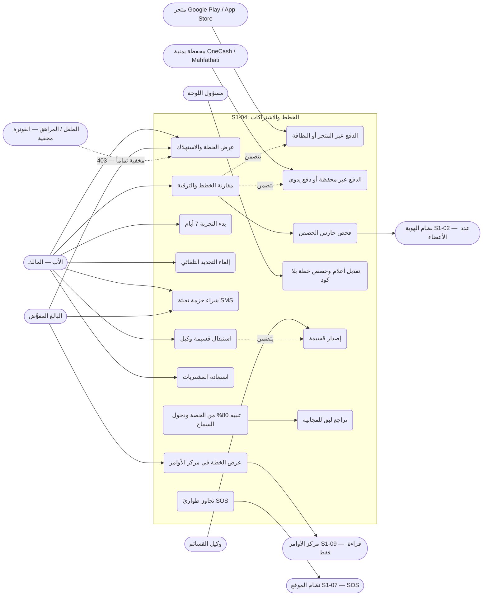
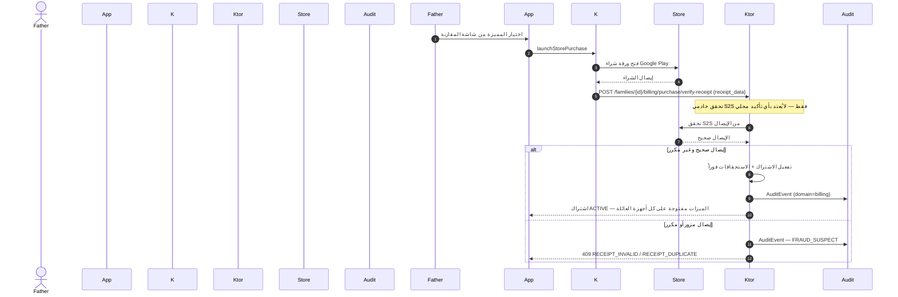
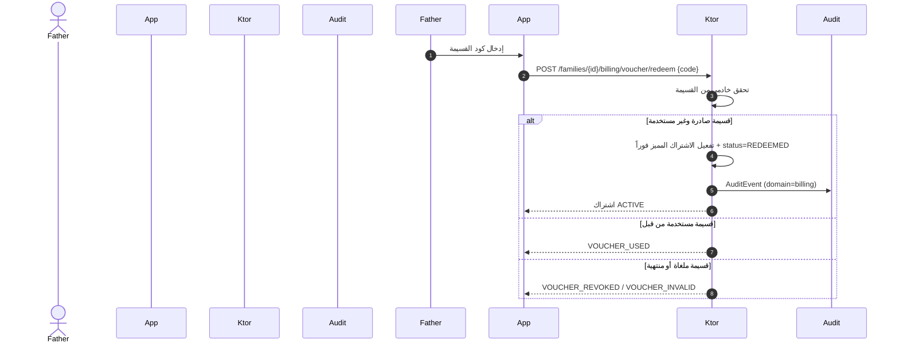
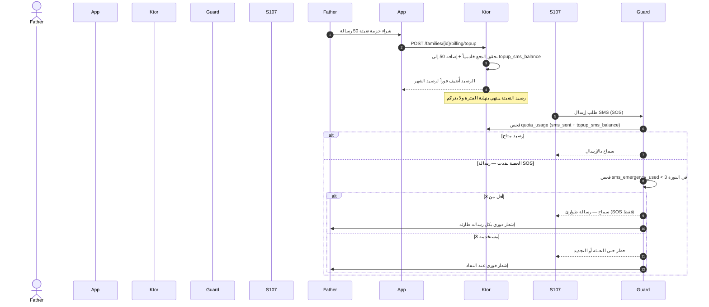
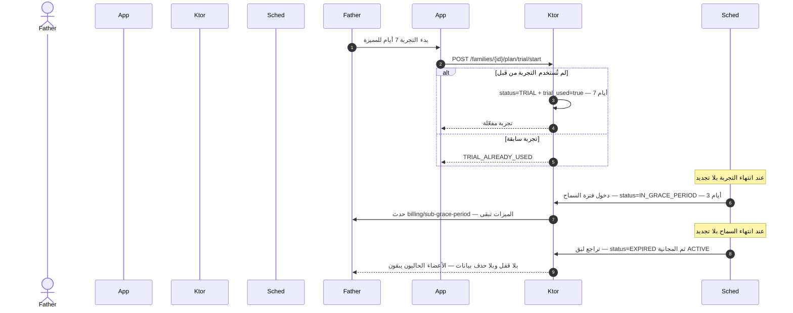
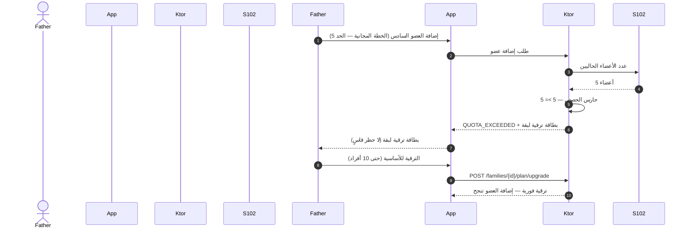
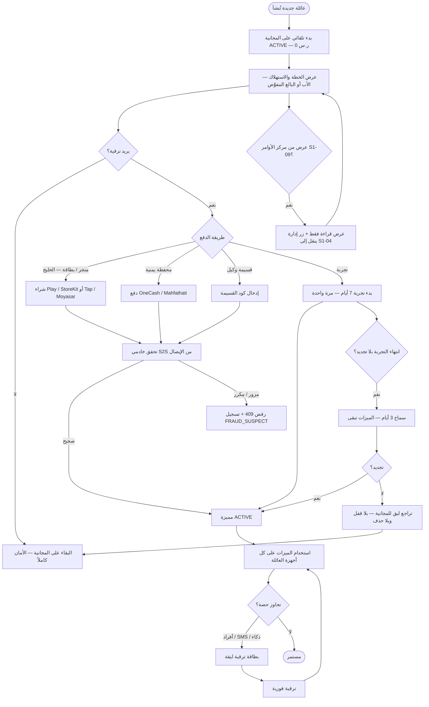
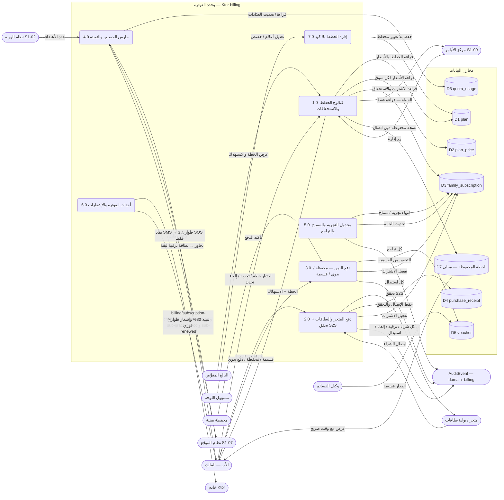

# S1-04: مخططات هندسة البرمجيات (DIAGRAMS)

- **الحالة:** مسودة للمراجعة على GitHub — المواصفة معتمدة بالكامل في التخطيط (حكم المالك 2026-11-06)؛ والمخططات الستة مسودة بانتظار مراجعة المالك على GitHub (لم تُعتمد بعد)
- **المواصفة:** `SPEC.md` (§§1–8 + §10 معتمدة بالكامل في التخطيط، حكم المالك 2026-11-06 · §9 في مرحلة التصميم)
- **القرارات الحاكمة:** Q-025 (قنوات الدفع لعالمين) · Q-055 (الخطط أعلام وحصص بلا كود) · Q-106 (عدّاد SMS وتجاوز الطوارئ) · Q-126 (3 خطط) · Q-127 (أسعار الخليج) · Q-129 (حصص SMS) · Q-130 (تجربة 7 أيام) · Q-131 (سماح 3 أيام) · Q-132 (سعر اليمن — مفتوح، بلا رقم) · Q-012 (ميزانية الذكاء) · Q-098 (الخطة للقراءة فقط في S1-09) · Q-105 (سجل المواقع 7 أيام)
- **الأنواع الستة:** 1. حالات الاستخدام · 2. ERD · 3. التسلسل · 4. تدفق المستخدم · 5. DFD · 6. النشاط
- **الأشكال الموحدة:** مستطيل = جهة خارجية · مستطيل مستدير = عملية · معين = قرار · أسطوانة = مخزن بيانات · خط متقطع = يتضمن / اختياري

## 1. حالات الاستخدام

16 حالة استخدام من السيناريوهات السبعة والمتطلبات (§2/§3): إدارة الاشتراك للأب وحده (`billing.manage` و`billing.voucher.redeem`)، والعرض (`billing.view`) للأب والبالغ المفوَّض حسب القالب، وشراء حزمة التعبئة (`billing.topup.buy`) للأب وحده (المالك)، والفوترة مخفية تماماً عن الأطفال والمراهقين (محاولة وصول مباشر عبر API تردّ 403 — §7)، وحارس الحصص والتجاوز الطارئ والتراجع اللبق عمليات نظام لا أفعال مستخدم.



- ملاحظة: الترقية فورية عند الدفع، والتخفيض يسري بنهاية الفترة المدفوعة (REQ-004)؛ والتجربة مرة واحدة لكل عائلة وغير قابلة للتحويل (§6).
- الأسعار (Q-127): الخليج — المميزة 19.99 ر.س شهرياً / 179.99 سنوياً، الأساسية 9.99 ر.س شهرياً / 89.99 سنوياً (خصم سنوي ~25%)؛ والمجانية 0 ر.س. سعر اليمن بالريال اليمني مفتوح (Q-132) — لم يُحدد بعد، ولا رقم مخترع هنا.

## 2. مخطط قاعدة البيانات (ERD)

الجداول الستة من §5 كما هي، مع ثلاثة مراجع خارجية: العائلة (S1-02)، وعدد الأعضاء من S1-02 لحصة الأفراد، و`AuditEvent` (النواة المشتركة — كل شراء/ترقية/إلغاء/استبدال يُسجَّل فيه domain=billing). ملاحظتان: الخطة المحفوظة وحالة الحصص مخزنان على العميل وليستا جدولَي خادم (§5)، و`family_subscription` اشتراك واحد لكل عائلة (`family_id` UNIQUE + RLS).

```mermaid
erDiagram
    family ||--|| family_subscription : "اشتراك واحد"
    plan ||--o{ family_subscription : "يُشترَك فيها"
    plan ||--o{ plan_price : "أسعارها لكل سوق"
    plan ||--o{ voucher : "قسائمها"
    family ||--o{ purchase_receipt : "إيصالاتها"
    family ||--o{ quota_usage : "عدّاداتها"
    family ||--o{ voucher : "يستبدلها"
    family_subscription ||--o{ AuditEvent : "أحداثها تُسجَّل"
    purchase_receipt ||--o{ AuditEvent : "يُسجَّل"
    voucher ||--o{ AuditEvent : "استبداله يُسجَّل"

    plan {
        string plan_id PK
        string tier_level
        string title_ar
        string description_ar
        string billing_interval
        string flags
        string quotas
        boolean is_active
    }
    plan_price {
        string plan_id PK_FK
        string market
        int price_cents
        string currency
        boolean is_active
    }
    family_subscription {
        string id PK
        string family_id FK_UK
        string plan_id FK
        string status
        string billing_provider
        string provider_subscription_id
        string provider_original_transaction_id
        datetime current_period_start
        datetime current_period_end
        boolean auto_renew
        boolean trial_used
        string purchased_by
    }
    purchase_receipt {
        string id PK
        string family_id FK
        string user_id FK
        string provider
        string product_id
        string receipt_data
        string validation_status
        datetime server_verified_at
        string raw_provider_response
    }
    voucher {
        string voucher_id PK
        string code
        string plan_id FK
        int duration_months
        string status
        string issued_by
        datetime issued_at
        string redeemed_by_family_id FK
        datetime redeemed_at
        datetime expires_at
    }
    quota_usage {
        string family_id PK_FK
        string period PK
        int sms_sent
        int sms_emergency_used
        int ai_calls
        int topup_sms_balance
        datetime updated_at
    }
    family {
        string id PK
    }
    AuditEvent {
        string id PK
    }
```

- `tier_level`: FREE / BASIC / PREMIUM؛ و`billing_interval`: LIFETIME_FREE / MONTHLY / ANNUAL؛ و`status`: ACTIVE / TRIAL / IN_GRACE_PERIOD / EXPIRED / CANCELLED؛ و`billing_provider`: SYSTEM_FREE / GOOGLE_PLAY / APPLE_APP_STORE / WALLET / VOUCHER / MANUAL؛ و`validation_status`: VALIDATED_SUCCESS / FRAUD_SUSPECT / EXPIRED؛ وحالة القسيمة: ISSUED / REDEEMED / REVOKED / EXPIRED (§5).
- `flags` و`quotas` من نوع jsonb — تعديل الأعلام والحصص بلا كود ولا تغيير مخطط (Q-055)؛ و`receipt_data` حمولة مشفرة؛ والمفتاح المركب لعدّاد الاستهلاك `family_id + period` (YYYY-MM) (§5).
- مصفوفة الخطط (§1): المجانية حتى 5 أفراد + 20 SMS شهرياً؛ الأساسية حتى 10 أفراد + 50 SMS؛ المميزة غير محدودة + 100 SMS؛ وسجل المواقع 7 أيام في كل الخطط (Q-105)؛ وميزانية الذكاء: المجانية تحقق المهام فقط، الأساسية تحقق + مساعد محدود، المميزة كاملة.

## 3. التسلسل (Sequence) — من عقود §4

خمسة مخططات، كل واحد لتدفق واحد:

### 3-أ. الترقية عبر المتجر — الخليج (REQ-005/007 — §4)



- لا يُرسَل `father_pin` إطلاقاً في هذا المسار — التحقق من الأب محلي على الجهاز (§4)؛ والإيصالات المكررة تُرفض (409) وتُسجَّل كـ FRAUD_SUSPECT (§6/§7).

### 3-ب. استبدال قسيمة وكيل — اليمن (REQ-006/008 — §4)



- القسيمة لمرة واحدة، قابلة للإلغاء قبل الاستخدام، ولا استرداد لها عبر التطبيق (§3/§6)؛ ومسارات الدفع اليمنية (المحافظ والقسائم) تصميمنا نحن — لا محافظ محلية ولا قسائم وكلاء في أي تطبيق مفكك (ملحق RE).

### 3-ج. نفاد SMS والتعبئة وتجاوز الطوارئ (REQ-009/010/011 — §4/§6)



- الحصص تُفرض على الخادم عند كل استخدام؛ وعرض العميل استرشادي فقط (§6)؛ وتنبيه للأب عند 80% من أي حصة (§6)؛ وحصة SMS حسب الخطة: 20 / 50 / 100 شهرياً (Q-129)؛ وتجاوز الطوارئ 3 رسائل SOS في كل دورة (Q-106).

### 3-د. التجربة ثم السماح ثم التراجع اللبق (REQ-012/013/014 — §4/§6)



- الانتهاء بطابع وقت الخادم فقط — ساعة العميل لا يُعتد بها أبداً (§6)؛ والتجربة مرة واحدة لكل عائلة وغير قابلة للتحويل (§6)؛ والترقية أثناء فترة السماح تنهي السماح فوراً وتفعّل الخطة الجديدة (§7).

### 3-هـ. تجاوز حصة الأفراد وبطاقة الترقية اللبقة (REQ-009 — §2 سيناريو 4-6)



- الأعضاء الحاليون عند التراجع اللبق يبقون فعالين مع حظر إضافة جدد فقط (REQ-014)؛ وحد الأفراد: 5 / 10 / غير محدود (§1).

## 4. تدفق المستخدم (User Flow) — من السيناريوهات السبعة (§2)



- ملاحظة: الفوترة مخفية تماماً عن الأطفال والمراهقين — لا تُعرض ولا تُذكر (§6)؛ والخطة في S1-09 للقراءة فقط (REQ-015).

## 5. مخطط تدفق البيانات (DFD — المستوى 1) — من §4/§5

العمليات مرقمة 1.0–7.0، والمخازن D1–D6 (جداول خادم PostgreSQL). المخزن D7 محفوظ محلياً على الجهاز (للقراءة دون اتصال) وليس جدول خادم.

- **تغطية نقاط §4:** التسلسلات في §3 تغطي التدفقات الأساسية فقط؛ وكل نقطة §4 تظهر هنا على الأقل: `POST /families/{id}/billing/restore` (استعادة المشتريات — تمر عبر P2) · `POST /families/{id}/plan/cancel-renewal` (إلغاء التجديد التلقائي — تمر عبر P5) · `GET /families/{id}/billing/usage` (استهلاك الحصص SMS/أفراد/ذكاء — تُقرأ عبر P4) · `PATCH /admin/plans/{planId}` (تعديل أعلام/حصص الخطة بلا كود، إداري فقط — تمر عبر P7)؛ وبقية النقاط مرسومة في §3 (plans، plan قراءة/ترقية، verify-receipt، voucher/redeem، topup، trial/start).



- ملاحظة: Webhook المتجر للتجديد التلقائي يُعالج idempotent بمفتاح المعاملة — لا ترقية مزدوجة (§7)؛ وفشل التحقق من الإيصال لعطل اتصال بالمتجر يعطي سماحاً مؤقتاً 24 ساعة ثم إعادة محاولة (§7).

## 6. مخطط النشاط (Activity) — دورة حياة الاشتراك

المسارات الخمسة (الأب / التطبيق / الخادم / مزودو الدفع / المجدول) كمسارات متوازية. وحارس الحصص والمجدول يعملان **بالتوازي** مع استخدام التطبيق، والسلامة (SOS والموقع الأساسي والدردشة والمهام) لا تُحجب بأي خطة أبداً.

```mermaid
flowchart LR
    subgraph Father [الأب — المالك]
        direction TB
        F1([عائلة جديدة])
        F2[اختيار خطة أو بدء تجربة]
        F3[الدفع أو إدخال قسيمة]
        F4[شراء تعبئة SMS]
        F5[إلغاء التجديد التلقائي]
        F6([استلام إشعار 80% أو طارئ])
    end
    subgraph App [التطبيق — Flutter + Kotlin]
        direction TB
        A1[بدء تلقائي على المجانية ACTIVE]
        A2[عرض المقارنة والأسعار]
        A3[فتح ورقة شراء المتجر]
        A4[إرسال الإيصال أو القسيمة للخادم]
        A5[عرض الخطة المحفوظة دون اتصال]
        A6[عرض بطاقة ترقية لبقة]
    end
    subgraph Server [الخادم — Ktor billing]
        direction TB
        V1[GET /plans + GET /families/{id}/plan]
        V2[تحقق S2S من الإيصال / القسيمة]
        V3[تفعيل الاشتراك + الاستحقاقات]
        V4[حارس الحصص — أفراد / SMS / ذكاء]
        V5[إصدار أحداث MQTT]
        V6[تسجيل AuditEvent]
    end
    subgraph Provider [مزودو الدفع]
        direction TB
        R1[Google Play / App Store]
        R2[Tap / Moyasar — بطاقات]
        R3[OneCash / Mahfathati — محافظ]
        R4[وكيل — إصدار قسيمة]
    end
    subgraph Sched [المجدول]
        direction TB
        G1[انتهاء التجربة 7 أيام]
        G2[سماح 3 أيام]
        G3[تراجع لبق للمجانية]
        G4[تصفير الحصص ببداية الفترة]
    end

    F1 --> A1
    A1 --> V1
    F2 --> A2
    A2 --> F3
    F3 --> A3
    A3 --> R1
    A3 --> R2
    F3 --> R3
    F3 --> R4
    R1 --> A4
    R2 --> A4
    R3 --> A4
    R4 --> A4
    A4 --> V2
    V2 --> V3
    V3 --> V5
    V3 --> V6
    V3 --> A5
    V4 --> A6
    A6 --> F2
    F4 --> V4
    F5 --> V3
    G1 --> G2
    G2 --> G3
    G3 --> V3
    G4 --> V4
    V5 --> F6
    V4 --> F6
```

- عند انتهاء الفترة دون اتصال بالخادم، تُعرض الخطة المحفوظة مع وقت صريح، ويُتحقق من الانتهاء عند أول اتصال بطابع الخادم (§7)؛ وميزانية ذكاء لكل عائلة حسب خطتها + مفتاح إيقاف، ونفاد الميزانية يوقف مزايا الذكاء دون أن يمس السلامة (REQ-016).
