# S1-04: مخططات هندسة البرمجيات (DIAGRAMS)

- **الحالة:** معتمدة — المخططات الستة معتمدة (حكم المالك 2026-11-08 — D-2، بعد موجة الإصلاح 0e4a3e2..f7da470)؛ والمواصفة معتمدة بالكامل في التخطيط (حكم المالك 2026-11-06)
- **اعتماد المالك بعد إعادة الرسم (Q-289 · Q-445 — 2026-11-19):** المخططات أدناه معتمدة على التصميم المغلق بعد مراجعة المصمم الرئيسي: تُرسم كلها، لا لوحة فوق عرض 1280 (ERD مستثنى)، لا مخالفة شكل، وكل متطلب مذكور في مخطط.
- **المواصفة:** `SPEC.md` (§§1–8 + §10 معتمدة بالكامل في التخطيط، حكم المالك 2026-11-06 · §9 أُغلق تصميمه (Q-420 · Q-421 · Q-422 — 2026-11-18): التفصيل في §9.8)
- **السياق المحدد (Bounded Context):** #11 الفوترة والاشتراكات (Billing & Subscriptions) — `CONTEXT-MAP.md` §2 صف 11
- **القرارات الحاكمة:** Q-001 · Q-025 (قنوات الدفع لعالمين) · Q-055 (الخطط أعلام وحصص بلا كود) · Q-456 (حصة الأدوار المخصصة) · Q-106 (عدّاد SMS وتجاوز الطوارئ) · Q-126 (3 خطط) · Q-127 (أسعار الخليج) · Q-129 (حصص SMS) · Q-130 (تجربة 7 أيام) · Q-131 (سماح 3 أيام) · Q-012 (ميزانية الذكاء) · Q-098 (الخطة للقراءة فقط في S1-09) · Q-105 (سجل المواقع 7 أيام) · Q-163 (تجاوز طوارئ SOS — 3 رسائل بعد نفاد الحصة) · Q-168 (عقد وسيط MQTT) · Q-056 (الموقع الأساسي في المرحلة 1 — خريطة العائلة + SOS) · Q-007 (رفض-يتغلب — المنع يغلب) · Q-260 (مفتاح `billing.plan.edit` — مالك المنصة وحده) · Q-261 (تصديق Basic = 50 رسالة/شهر) · Q-270 (جدول منتج التعبئة — السعر قرار المالك G-S04-08) · Q-271 (تصديق سعر Basic 9.99/89.99) · Q-128 (سعر اليمن المخفَّض) · Q-239 (مرآة SMS) · Q-251 (تأكيد الدفع اليدوي) · Q-252 (فترة الحصة شهر تقويمي) · Q-216 (تنبيه 80%) · Q-335 (المصنف معفى من ميزانية العائلة) · Q-336 (وحدة الذكاء: 300/1,000/3,000) · Q-337 (سقف المنصة $200) · Q-338 (مفتاح إيقاف الذكاء للمسؤول) · Q-339 (تعبئة الخليج 5.99 ر.س) · Q-340 (تعبئة اليمن 250 ر.ي) · Q-341 (اليمن أساسية 300/2,700) · Q-342 (اليمن مميزة 600/5,400) · Q-420 (التوقيت، الأيام الإضافية، نهاية التجربة، التجديد المبكر) · Q-421 (حذف القسائم؛ محفظة جيب) · Q-422 (حذف دفع عند وكيل؛ اليمن بمحافظها وحدها)
- **الأنواع الستة:** 1. حالات الاستخدام · 2. ERD · 3. التسلسل · 4. تدفق المستخدم · 5. DFD · 6. النشاط
- **الأشكال الموحدة:** مستطيل بطرفين مستديرين = طرف خارج العملية المرسومة (مستخدم، نظام مجاور، خدمة، أو الخادم) · مستطيل = شاشة أو خطوة، وفي مخطط تدفق البيانات عملية مرسومة في لوحة أخرى · مستطيل مستدير الزوايا = عملية · معين = قرار · أسطوانة = مخزن بيانات · خط متقطع = يتضمن / اختياري
- **تحديث 2026-11-18 (Q-420 · Q-421):** حُذفت القسائم من كل المخططات (حالتا الاستخدام UC6 وUC14، التسلسلان 3-ب و3-ح، جدولها في ERD، ومخزنها في DFD)، وأضيفت محفظة جيب وجدول `wallet_provider`. الأرقام والحروف المحذوفة لا يُعاد استعمالها. وأحكام Q-420 (الأيام الإضافية عند الترقية، التذكيران، عودة العائلة المدفوعة بعد التجربة، التجديد المبكر) تُرسم في دفعة إعادة المخططات (Q-412)؛ والمرجع فيها حتى ذلك الحين `SPEC.md` §3 و§9.8.
- **تحديث 2026-11-18 (Q-422):** حُذف «دفع عند وكيل» من كل المخططات بأمر المالك: التسلسل 3-ز، وفرعه في تدفق المستخدم، ومزوّده R4 في مخطط النشاط، وقيمة `MANUAL`؛ وUC9 صارت «الدفع عبر محفظة يمنية». الدفع في اليمن بقائمة المحافظ وحدها. الحرف 3-ز والرمز R4 لا يُعاد استعمالهما.
- **رُسم 2026-11-19 (Q-434):** أحكام Q-420 مرسومة الآن: الترقية وسط الفترة مع الأيام الإضافية (REQ-020 — 3-ي و4-ب و5-أ و6-أ)، التجديد المبكر (REQ-004 — 3-ك و4-ب و6-أ)، تذكيرا التجربة والاشتراك الصريح (REQ-021 — 3-د و3-ل و4-ج و6-ب)، ومحافظ اليمن من الخادم (Q-421 — 1-أ و3-و و5-أ و6-أ)؛ وقُسّم تدفق المستخدم (§4) أربع لوحات، وDFD (§5) لوحتين، والنشاط (§6) لوحتين باتجاه TD.

## 1. حالات الاستخدام

17 حالة استخدام (UC1…UC19 بلا UC6 وUC14 المحذوفتين — Q-421) من السيناريوهات السبعة والمتطلبات (§2/§3)، في لوحتين (1-أ لإدارة الاشتراك، و1-ب للعرض والعمليات): إدارة الاشتراك للأب وحده (`billing.manage`)، والعرض (`billing.view`) للأب والبالغ المفوَّض حسب القالب، وشراء حزمة التعبئة (`billing.topup.buy`) للأب وحده (المالك)، والفوترة مخفية تماماً عن الأطفال والمراهقين (محاولة وصول مباشر عبر API تردّ 403 — §7)، وحارس الحصص والتجاوز الطارئ والتراجع اللبق عمليات نظام لا أفعال مستخدم.

**1-أ. إدارة الاشتراك**

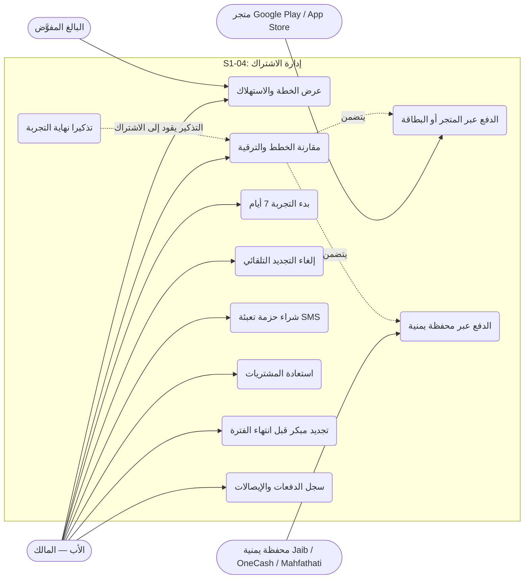

- أُعيد رسمه 2026-11-19 (Q-434 — محتوى وشكل): أُضيفت UC17 (التجديد المبكر) وUC18 (سجل الدفعات والإيصالات) وUC19 (تذكيرا نهاية التجربة)؛ وقُسّمت حالات الاستخدام لوحتين.

**1-ب. العرض والعمليات**

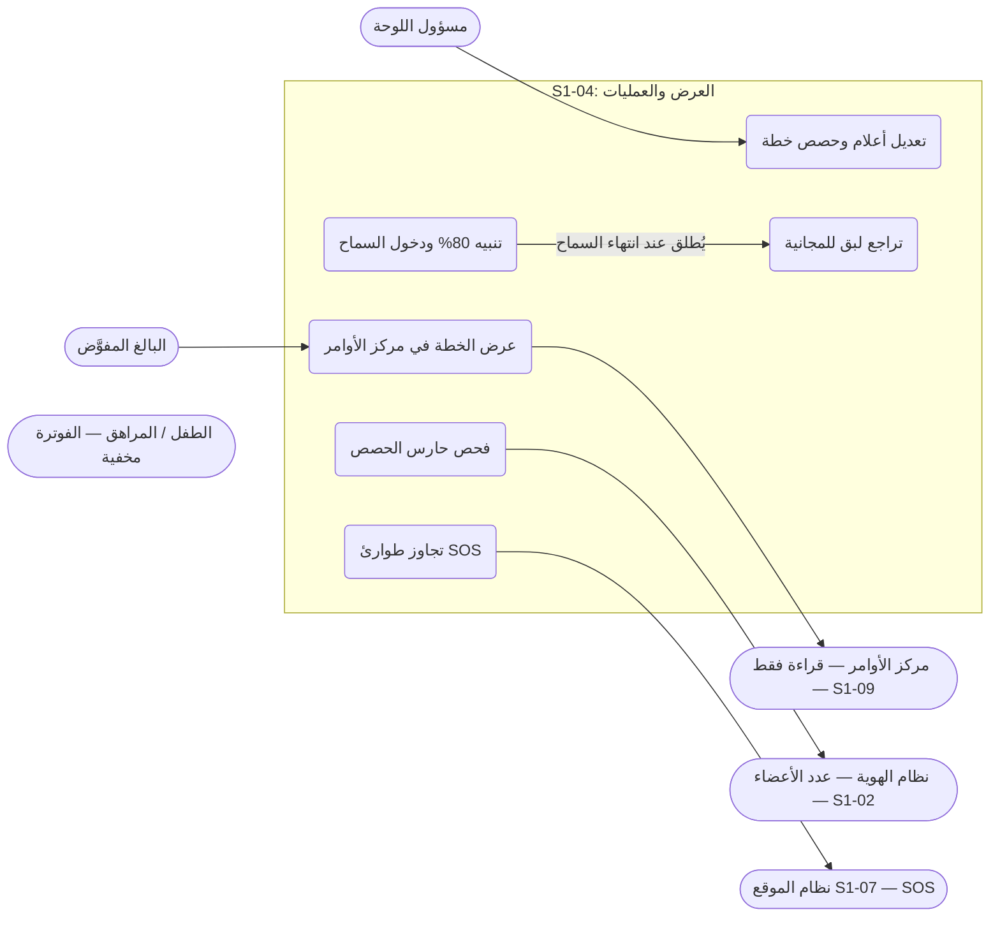

- أُعيد رسمه 2026-11-19 (Q-434 — محتوى وشكل): اللوحة الثانية من تقسيم حالات الاستخدام؛ وقُصّرت تسميات UC13 وUC15.

- ملاحظة: الترقية فورية عند الدفع، والتخفيض يسري بنهاية الفترة المدفوعة (REQ-004)؛ والتجربة مرة واحدة لكل عائلة وغير قابلة للتحويل (§6).
- UC13: تعديل الأعلام والحصص بلا كود (Q-055). UC15: تنبيه عند 80% من أي حصة (Q-216). UC17: التجديد المبكر لمن لا تجديد تلقائي له (REQ-004 · Q-420). UC18: سجل الدفعات يعرض المبلغ (Q-420). UC19: تذكيران قبل نهاية التجربة بيومين وفي يومها الأخير (REQ-021).
- ملاحظة شروط مسبقة (لا تُرسم كتضمين ولا كارتباط): UC2 (المقارنة والترقية) تفترض فحص حارس الحصص (UC11) شرطاً مسبقاً لا ارتباطاً مباشراً.
- ملاحظة إخفاء: الفوترة مخفية تماماً عن الأطفال والمراهقين — لا ارتباط للقاصر بالمخطط؛ والقاعدة نصية: محاولة وصول مباشر عبر API تردّ 403 (§7).
- الأسعار (Q-127 للمميزة · Q-271 للأساسية · REQ-003): الخليج — المميزة 19.99 ر.س شهرياً / 179.99 سنوياً، الأساسية 9.99 ر.س شهرياً / 89.99 سنوياً (خصم سنوي ~25%)؛ والمجانية 0 ر.س. اليمن — الأساسية 300 ر.ي شهرياً / 2,700 سنوياً، المميزة 600 ر.ي شهرياً / 5,400 سنوياً (Q-341 · Q-342 — D-11؛ وQ-132 حُكم بهما).

## 2. مخطط قاعدة البيانات (ERD)

الجداول الثمانية من §5 كما هي، مع ثلاثة مراجع خارجية: العائلة (S1-02)، وعدد الأعضاء من S1-02 لحصة الأفراد، و`AuditEvent` (النواة المشتركة — كل شراء/ترقية/إلغاء يُسجَّل فيه domain=billing). ملاحظتان: الخطة المحفوظة وحالة الحصص مخزنان على العميل وليستا جدولَي خادم (§5)، و`family_subscription` اشتراك واحد لكل عائلة (`family_id` UNIQUE + RLS).

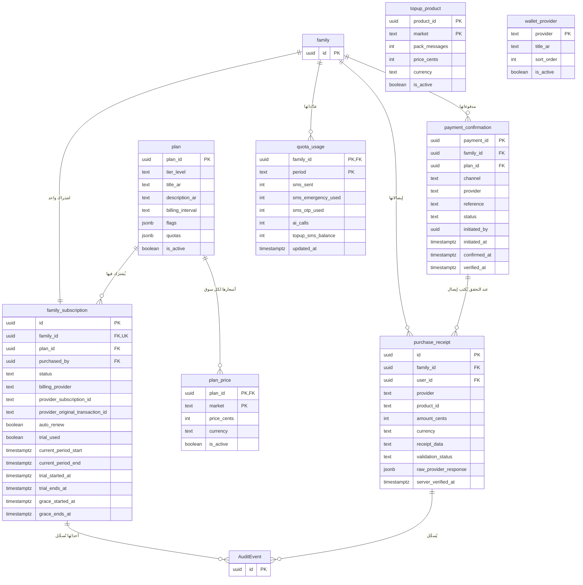

- أُعيد رسمه 2026-11-19 (Q-434 — شكل فقط): رُتّبت الحقول — المفتاح الأساسي أولاً ثم المفاتيح الأجنبية ثم الحقول ثم التواريخ في الآخر — في `family_subscription` و`purchase_receipt`. لا تغيير في المحتوى.

- `tier_level`: FREE / BASIC / PREMIUM؛ و`billing_interval`: LIFETIME_FREE / MONTHLY / ANNUAL؛ و`status`: ACTIVE / TRIAL / IN_GRACE_PERIOD / EXPIRED / CANCELLED؛ و`billing_provider`: SYSTEM_FREE / GOOGLE_PLAY / APPLE_APP_STORE / WALLET؛ و`validation_status`: VALIDATED_SUCCESS / FRAUD_SUSPECT / EXPIRED؛ و`wallet_provider.provider`: JAIB / ONECASH / MAHFATHATI (Q-421 — جدول مستقل بلا علاقة مرسومة: `payment_confirmation.provider` يحمل اسمه)؛ و`purchase_receipt.amount_cents`/`currency` مبلغ الدفعة وعملتها (Q-420)؛ و`payment_confirmation.status`: INITIATED / PENDING_VERIFICATION / VERIFIED / REJECTED؛ و`payment_confirmation.channel`: WALLET (§5 — حُذفت MANUAL بـ Q-422).
- `flags` و`quotas` من نوع jsonb — تعديل الأعلام والحصص بلا كود ولا تغيير مخطط (Q-055)؛ ومن الحصص `max_custom_roles` (الأدوار المخصصة: 0 / 3 / 10 — REQ-022 · Q-456) بلا عمود جديد؛ و`receipt_data` حمولة مشفرة؛ والمفتاح المركب لعدّاد الاستهلاك `family_id + period` (YYYY-MM) (§5) — فترة الحصة شهر تقويمي (Q-252)، مستقلة عن فترة الاشتراك المدفوعة (`current_period_start`/`current_period_end`).
- منتج التعبئة `topup_product` مستوى الكتالوج — يُقرأ عبر `GET /api/v1/plans` لا لكل خطة؛ والمفتاح المركب `product_id + market`؛ وصفوف البذرة محكومة (G-S04-08 أُغلق 2026-11-08 — Q-339 · Q-340): الخليج 5.99 ر.س / اليمن 250 ر.ي لحزمة 50 رسالة.
- مصفوفة الخطط (§1 · REQ-001): المجانية حتى 5 أفراد + 20 SMS شهرياً؛ الأساسية حتى 10 أفراد + 50 SMS؛ المميزة غير محدودة + 100 SMS (Q-261)؛ وسجل المواقع 7 أيام في كل الخطط (Q-105)؛ وميزانية الذكاء (Q-335 · Q-336 — الوحدة = استدعاء ذكاء واحد عبر البوابة؛ والمصنف معفى من ميزانية العائلة): المجانية 300 وحدة/شهر — تحقق المهام فقط؛ الأساسية 1,000 — تحقق + مساعد محدود؛ المميزة 3,000 — كاملة.

## 3. التسلسل (Sequence) — من عقود §4

تسعة مخططات، كل واحد لتدفق واحد: 3-أ، 3-ج، 3-د، 3-هـ، ثم مخطط الدفع اليمني بالمحفظة (3-و، Q-251)، ثم 3-ط، ثم 3-ي (الترقية والأيام الإضافية)، 3-ك (التجديد المبكر)، 3-ل (نهاية التجربة بلا اشتراك). والحرفان 3-ب و3-ح كانا لمخططَي القسيمة وحُذفا معها (Q-421)، والحرف 3-ز كان لمخطط الدفع عند وكيل وحُذف معه (Q-422)؛ ولم يُعد ترقيم الباقي.

### 3-أ. الترقية عبر المتجر — الخليج (REQ-005/007 — §4)

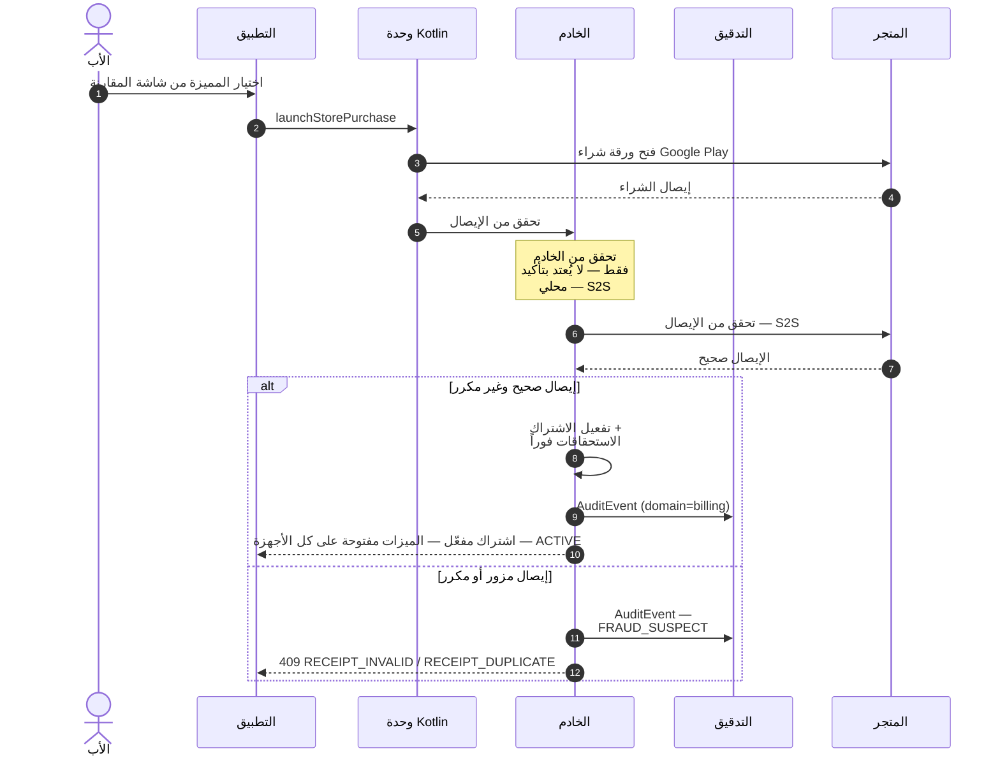
- الرسالة 5: `POST /api/v1/families/{id}/billing/purchase/verify-receipt {receipt_data}`

- أُعيد رسمه 2026-11-19 (Q-434 — شكل فقط): وُحّد ترتيب المشاركين (قاعدة البيانات قبل الخارجية). لا تغيير في المحتوى.

- رُسم 2026-11-19 (Q-440): أُزيلت علامتا الاقتباس عن اسم المشارك وحدة Kotlin.

- لا يُرسَل `father_pin` إطلاقاً في هذا المسار — التحقق من الأب محلي على الجهاز (§4)؛ والإيصالات المكررة تُرفض (409) وتُسجَّل كـ FRAUD_SUSPECT (§6/§7).

### 3-ج. نفاد SMS والتعبئة وتجاوز الطوارئ (REQ-009/010/011 — §4/§6)

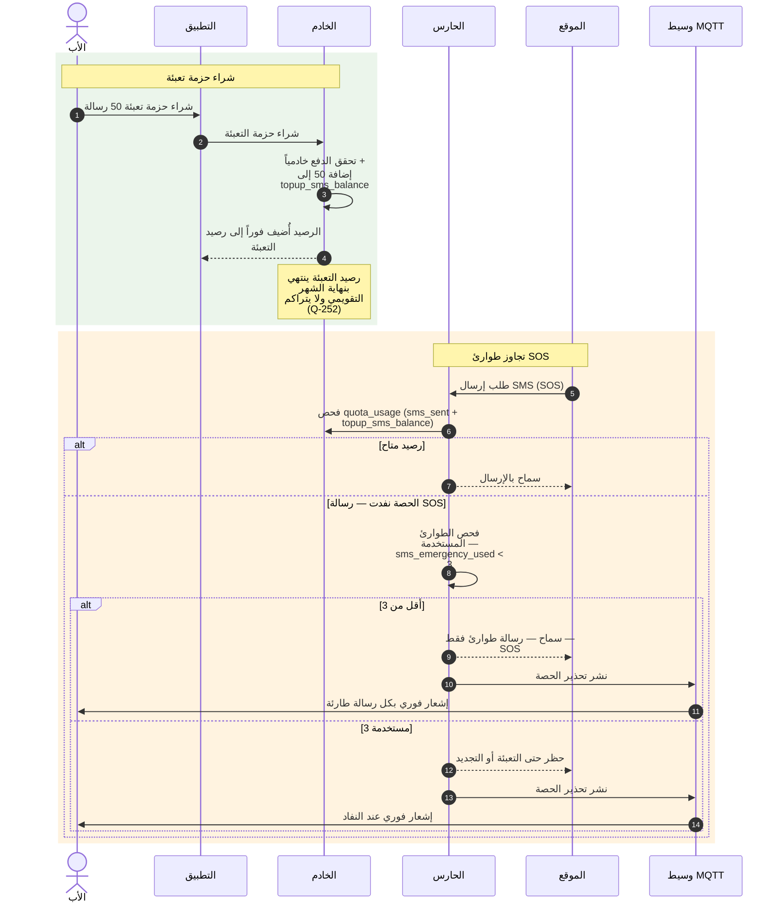
- الرسالة 1: الخليج 5.99 ر.س / اليمن 250 ر.ي (Q-339 · Q-340)
- الرسالة 2: `POST /api/v1/families/{id}/billing/topup`
- الرسالة 8: في الشهر التقويمي (Q-252)
- الرسالة 10: `family/{family_id}/billing/quota-warning`
- الرسالة 13: `family/{family_id}/billing/quota-warning`

- أُعيد رسمه 2026-11-19 (Q-434 — توضيح): «الرصيد أُضيف فوراً إلى رصيد التعبئة» — رصيد تعبئة منفصل (`topup_sms_balance`) لا يصفّر عدّاد الاستخدام؛ ولا تغيير آخر في المحتوى.

- الحصص تُفرض على الخادم عند كل استخدام؛ وعرض العميل استرشادي فقط (§6)؛ وتنبيه للأب عند 80% (Q-216) من أي حصة (§6)؛ وحصة SMS حسب الخطة: 20 / 50 / 100 شهرياً (Q-126 · Q-261 · REQ-019)؛ وتجاوز الطوارئ 3 رسائل SOS في كل شهر تقويمي (Q-106 · Q-252)؛ وسعر حزمة التعبئة من جدول `topup_product` (§5) عبر الكتالوج: الخليج 5.99 ر.س / اليمن 250 ر.ي (Q-339 · Q-340 — G-S04-08 أُغلق).

### 3-د. بدء التجربة وتذكيراها والاشتراك الصريح (REQ-012/021 — §4/§6)

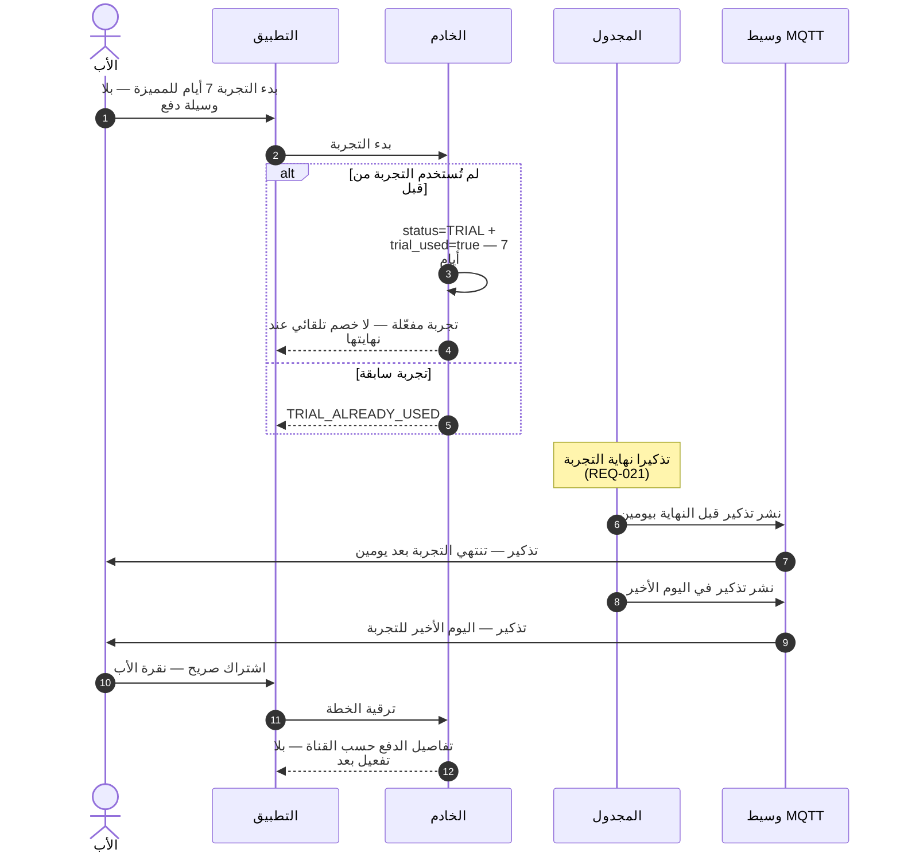
- الرسالة 2: `POST /api/v1/families/{id}/plan/trial/start`
- الرسالة 11: `POST /api/v1/families/{id}/plan/upgrade {plan_id, billing_interval}`

- أُعيد رسمه 2026-11-19 (Q-434 — محتوى): رُسمت أحكام REQ-021 — لا وسيلة دفع عند البدء ولا خصم تلقائي عند النهاية، والتذكيران، والاشتراك نقرة صريحة؛ وانتقلت نهاية التجربة بلا اشتراك إلى 3-ل.
- لا طريقة دفع عند بدء التجربة ولا خصم تلقائي عند نهايتها (REQ-021)؛ والانتهاء بطابع وقت الخادم فقط — ساعة العميل لا يُعتد بها أبداً (§6)؛ والتجربة مرة واحدة لكل عائلة وغير قابلة للتحويل (§6).
- إتمام الاشتراك بعدها في 3-ي (الترقية والأيام الإضافية)؛ ونهاية التجربة بلا اشتراك في 3-ل.

### 3-هـ. تجاوز حصة الأفراد وبطاقة الترقية اللبقة (REQ-009 — §2 سيناريو 4-6)

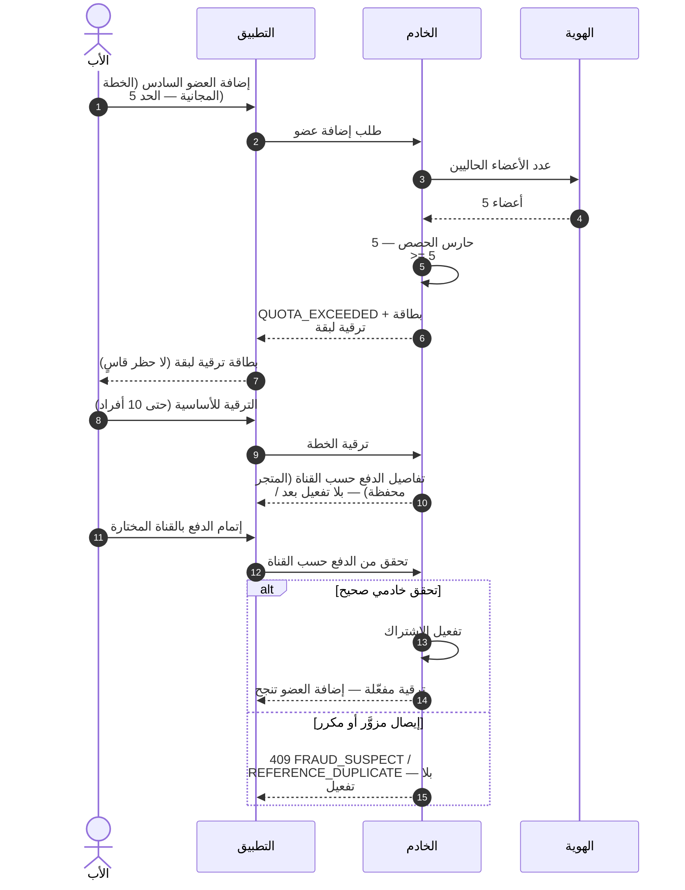
- الرسالة 9: `POST /api/v1/families/{id}/plan/upgrade`
- الرسالة 12: `POST /api/v1/families/{id}/billing/purchase/verify-receipt {provider, receipt_data}` — أو `wallet/confirm`

- الأعضاء الحاليون عند التراجع اللبق يبقون فعالين مع حظر إضافة جدد فقط (REQ-014)؛ وحد الأفراد: 5 / 10 / غير محدود (§1).
- الترقية وسط الفترة والأيام الإضافية في 3-ي (REQ-020).

### 3-و. بدء دفع محفظة يمنية والتحقق منه (REQ-006 — §4/§5 — Q-251)

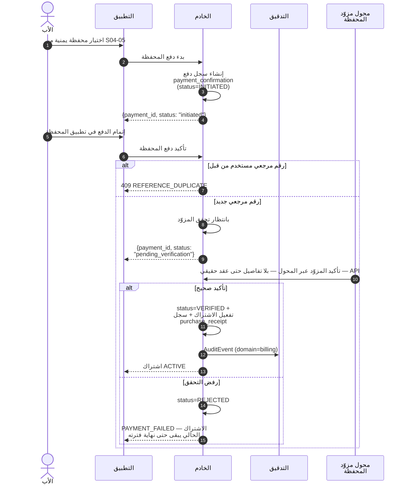
- الرسالة 2: `POST /api/v1/families/{id}/billing/wallet/initiate {plan_id, provider}`
- الرسالة 6: `POST /api/v1/families/{id}/billing/wallet/confirm {payment_id, wallet_reference}`
- الرسالة 8: `status=PENDING_VERIFICATION`

- أُعيد رسمه 2026-11-19 (Q-434 — شكل فقط): وُحّد ترتيب المشاركين (قاعدة البيانات قبل الخارجية). لا تغيير في المحتوى.

- الرقم المرجعي نص معتم ينقله الأب كما يظهر في تطبيق المحفظة — لا يُعتمد دليل دفع حتى تحقق المزوّد عبر `WalletProviderAdapter` (بلا تفاصيل API حتى عقد حقيقي)؛ ولا يُفعَّل الاشتراك قبل `VERIFIED` (REQ-007)؛ وتفاصيل تمرير المبلغ إلى تطبيق المحفظة من العقد الحقيقي — لا تُخترع هنا (§4).

### 3-ط. مفتاح إيقاف الذكاء للمسؤول (Q-338 — D-10 — §4-2)

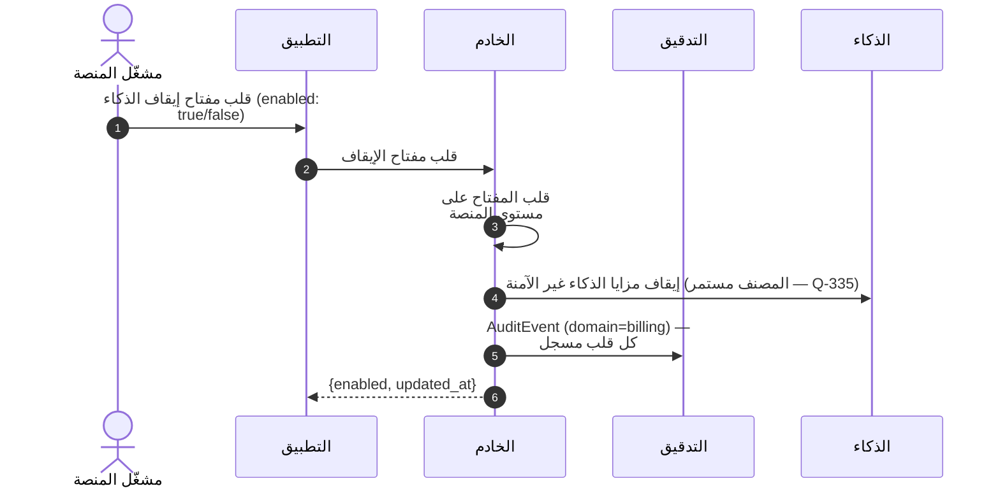
- الرسالة 2: `POST /api/v1/admin/ai/kill-switch` — المفتاح `billing.plan.edit` (Q-260)

- أُعيد رسمه 2026-11-19 (Q-434 — شكل فقط): وُحّد ترتيب المشاركين (قاعدة البيانات قبل الخارجية). لا تغيير في المحتوى.

- وعند بلوغ سقف المنصة الشهري $200 (Q-337) يقلب النظام المفتاح تلقائياً + إشعار المالك؛ والاستئناف يحتاج اعتماداً كتابياً جديداً (Q-013)؛ وتنبيه عند 80% ($160).

### 3-ي. الترقية وسط الفترة والأيام الإضافية (REQ-004/020 — §4)

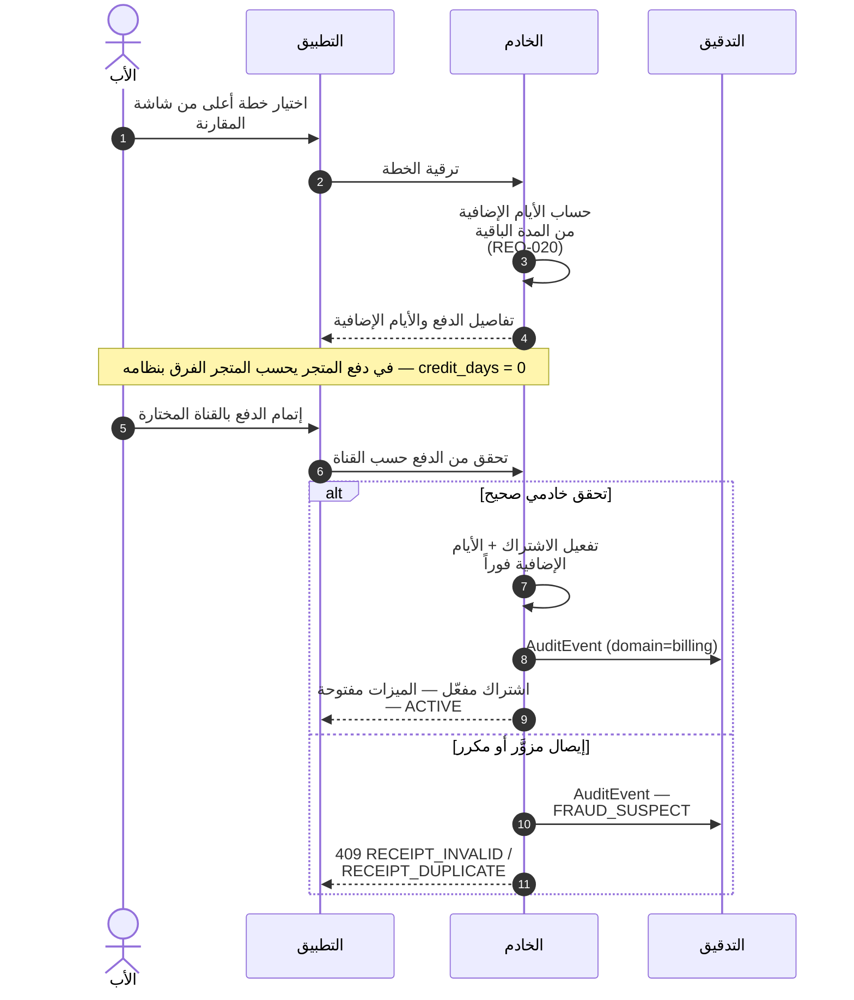
- الرسالة 2: `POST /api/v1/families/{id}/plan/upgrade {plan_id, billing_interval}`
- الرسالة 4: `{plan_id, channel, payment_details, credit_days, period_end_after}`
- الرسالة 6: `POST /api/v1/families/{id}/billing/purchase/verify-receipt {provider, receipt_data}` — أو `wallet/confirm`

- مخطط جديد 2026-11-19 (Q-434): الترقية وسط الفترة والأيام الإضافية (REQ-020).
- القاعدة: قيمة اليوم = سعر الفترة ÷ أيامها (365 للسنوية، 30 للشهرية)؛ والأيام الإضافية = ⌊الأيام الباقية × قيمة يوم القديمة ÷ قيمة يوم الجديدة⌋، يحسبها الخادم وتُعرض قبل الدفع (REQ-020).
- مثال المالك: أساسية سنوية (2,700 ريال) رُقّيت بعد شهرين وباقٍ فيها ما قيمته 2,250؛ على المميزة السنوية (5,400) تصير نحو خمسة أشهر إضافية.
- أمثلة الاختبار (أساسية شهرية وباقٍ لها 30 يوماً): إلى المميزة الشهرية بالمحفظة 15 يوماً؛ إلى السنوية 20 يوماً؛ في الخليج بالبطاقة 14 يوماً.
- الترقية تبدأ فور تأكيد الدفع؛ والتخفيض يسري بنهاية الفترة المدفوعة بلا استرداد (REQ-004). وفي دفع المتجر يحسب المتجر الفرق بنظامه ويُقال ذلك على الشاشة؛ وcredit_days صفر عند الترقية من المجانية.

### 3-ك. التجديد المبكر لمن لا تجديد تلقائي له (REQ-004/013 — §4)

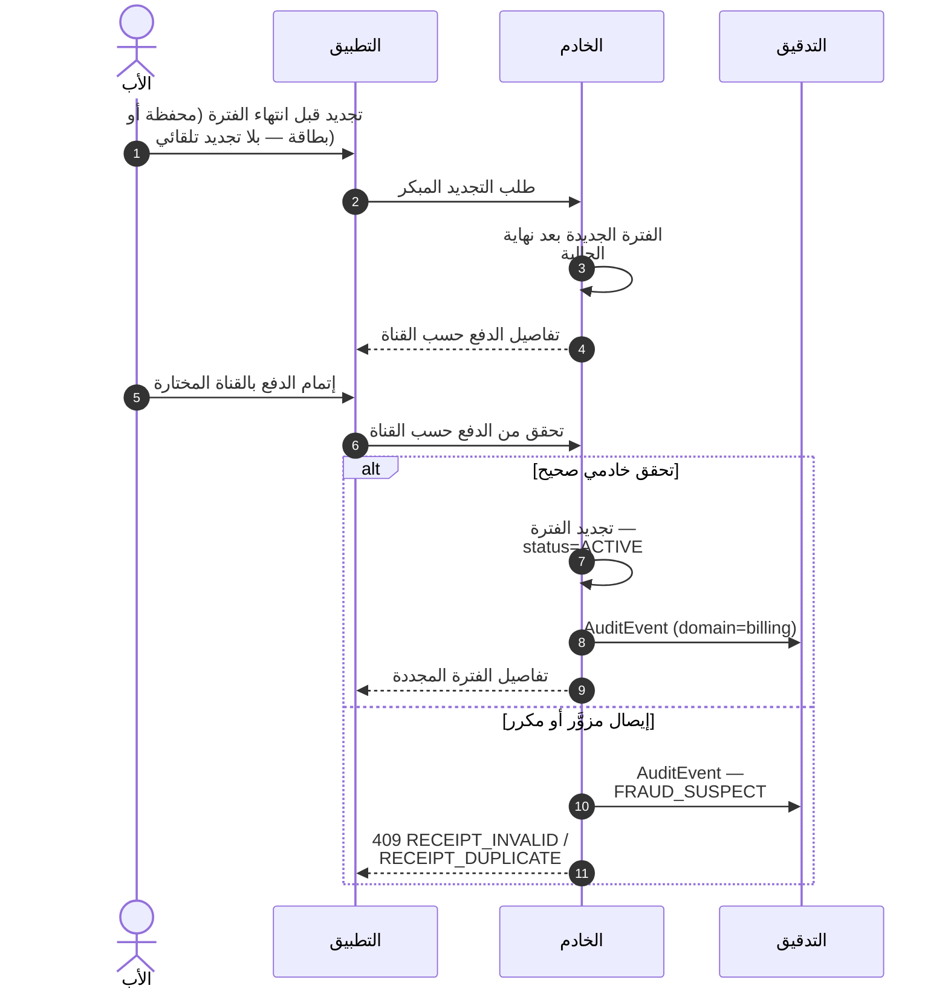
- الرسالة 2: `POST /api/v1/families/{id}/plan/renew {plan_id}` — المفتاح `billing.manage`
- الرسالة 3: `current_period_start` = نهاية الفترة الحالية
- الرسالة 6: `POST /api/v1/families/{id}/billing/purchase/verify-receipt {provider, receipt_data}` — أو `wallet/confirm`
- الرسالة 9: `{plan_id, status: "ACTIVE", current_period_start, current_period_end}`

- مخطط جديد 2026-11-19 (Q-434): التجديد المبكر (Q-420).
- التجديد المبكر لمن لا تجديد تلقائي له (محفظة، بطاقة — Q-420 · Q-422)؛ والفترة الجديدة تبدأ بعد نهاية الحالية. والتجديد التلقائي (المتجر) يتم عبر Webhook المتجر idempotent بمفتاح المعاملة — لا ترقية مزدوجة (§7).

### 3-ل. نهاية التجربة بلا اشتراك — عودة المدفوعة وسماح المجانية (REQ-013/014/021 — §4/§6)

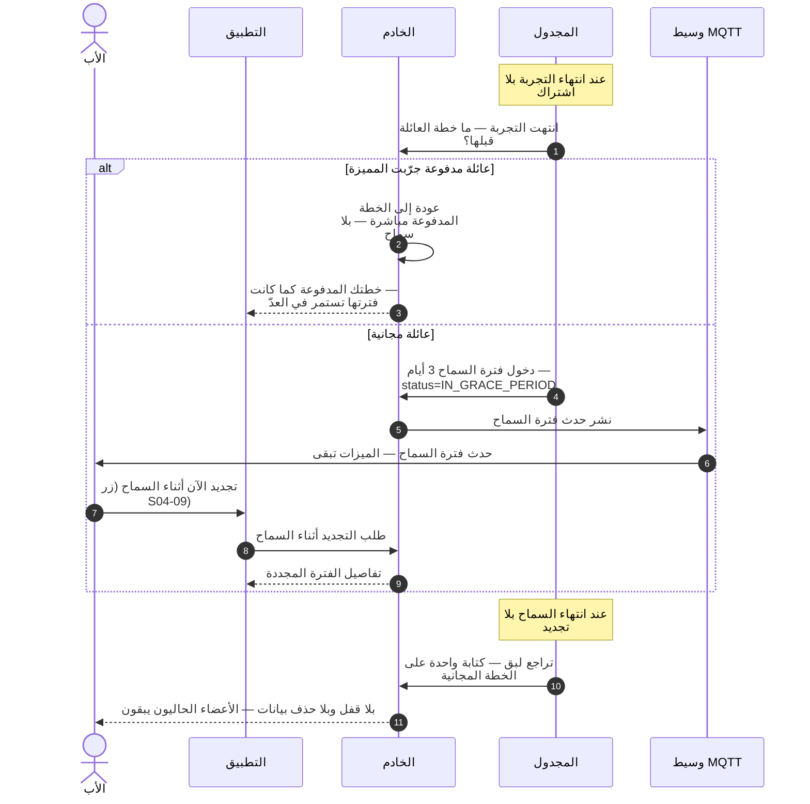
- الرسالة 5: `family/{family_id}/billing/sub-grace-period`
- الرسالة 8: `POST /api/v1/families/{id}/plan/renew {plan_id}` — المفتاح `billing.manage`
- الرسالة 9: `{plan_id, status: "ACTIVE", current_period_start, current_period_end}`
- الرسالة 10: كتابة واحدة: `status=ACTIVE` على الخطة المجانية + `AuditEvent` بانتهاء الخطة المدفوعة

- مخطط جديد 2026-11-19 (Q-434): نهاية التجربة بلا اشتراك (REQ-021 · Q-420).
- إن انتهت الفترة المدفوعة أثناء التجربة دخلت خطتها سماحها هي (Q-420). والترقية أثناء فترة السماح تنهي السماح فوراً وتفعّل الخطة الجديدة (§7).
- الأعضاء الحاليون عند التراجع اللبق يبقون فعالين مع حظر إضافة جدد فقط (REQ-014).

## 4. تدفق المستخدم (User Flow) — من السيناريوهات السبعة (§2)

أربعة تدفقات، كل واحد في لوحة صغيرة تُقرأ من أعلى إلى أسفل. اللوحات بلغة المستخدم فقط؛ وأسماء النقاط والمفاتيح في التسلسلات (§3) لا هنا.

### 4-أ. عرض الخطة واختيارها (REQ-002/015)

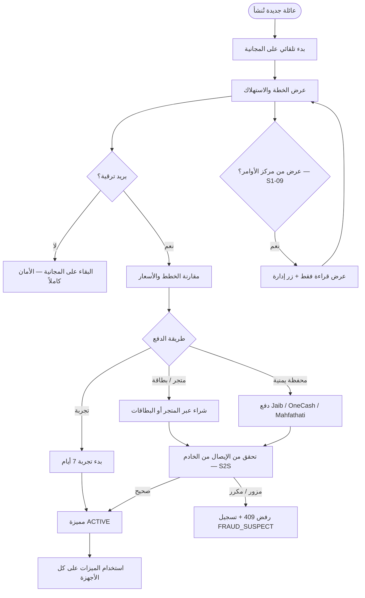

- أُعيد رسمه 2026-11-19 (Q-434 — محتوى وشكل): اللوحة الأولى من تقسيم تدفق المستخدم؛ وقُصّرت التسميات؛ ونُقلت التفاصيل إلى السطور تحت اللوحات.

### 4-ب. الترقية والتجديد المبكر (REQ-004/020)

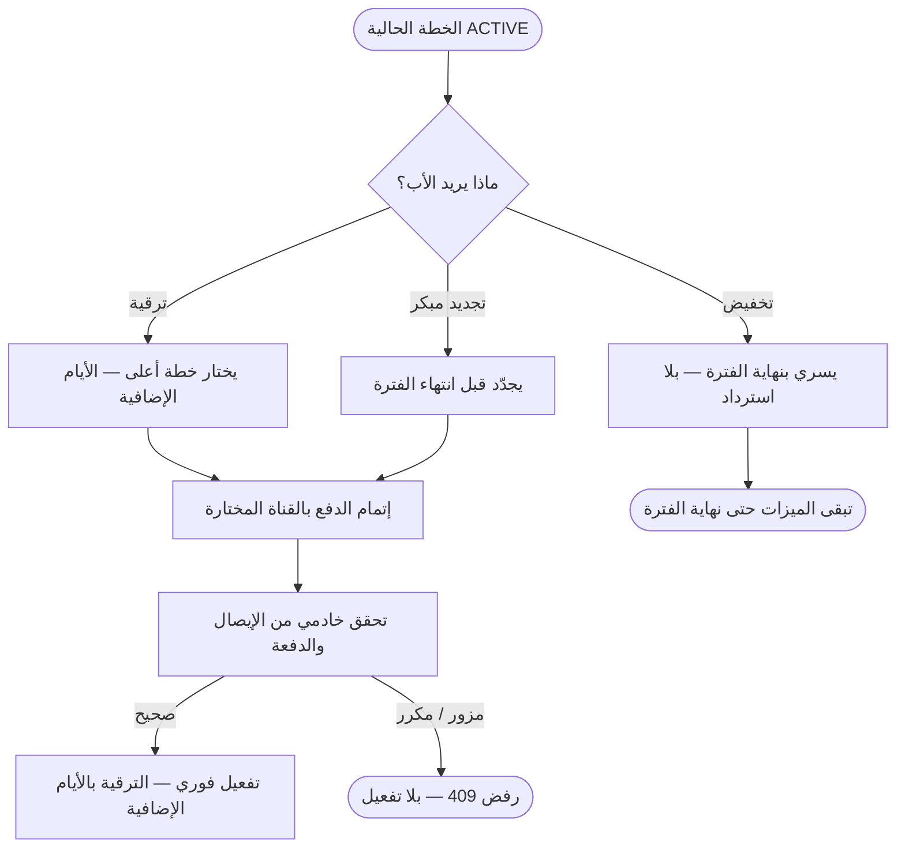

- مخطط جديد 2026-11-19 (Q-434): الترقية وسط الفترة مع الأيام الإضافية (REQ-020) والتجديد المبكر (REQ-004).
- في دفع المتجر يحسب المتجر الفرق بنظامه ويُقال ذلك على الشاشة؛ والترقية تبدأ فور تأكيد الدفع؛ وتُعرض الأيام الإضافية قبل الدفع. وعند التجديد المبكر تبدأ الفترة الجديدة بعد نهاية الحالية؛ والتجديد المبكر لمحفظة أو بطاقة فقط (Q-420 · Q-422).

### 4-ج. التجربة ونهايتها (REQ-012/013/014/021)

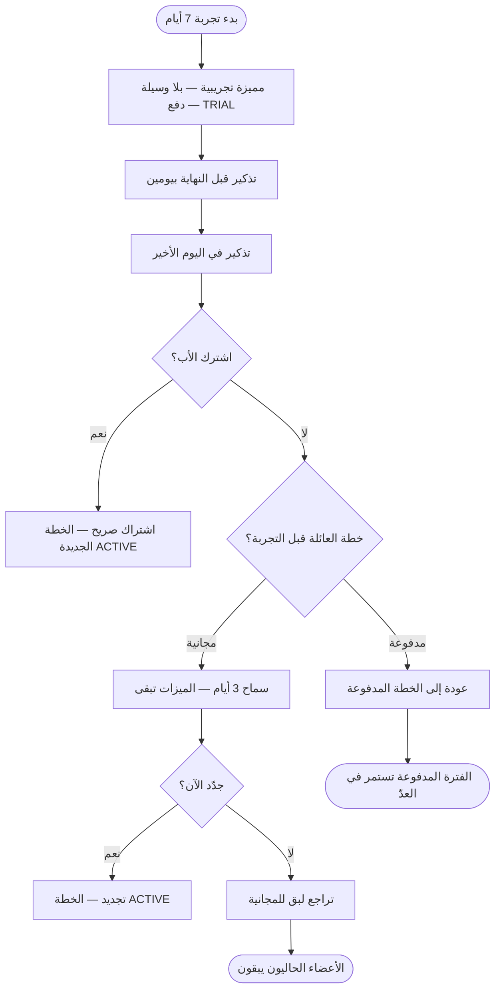

- مخطط جديد 2026-11-19 (Q-434): نهاية التجربة (REQ-021) — التذكيران، والاشتراك الصريح، وعودة العائلة المدفوعة، وسماح المجانية ثم التراجع اللبق.
- إن انتهت الفترة المدفوعة أثناء التجربة دخلت خطتها سماحها هي (Q-420). والتراجع بلا قفل وبلا حذف بيانات.

### 4-د. الحصص والتجاوز (REQ-009/016)

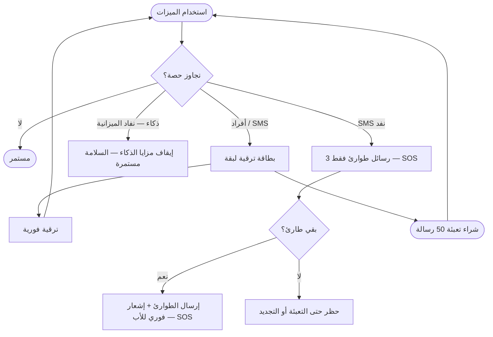

- مخطط جديد 2026-11-19 (Q-434): الحصص والتجاوز الطارئ وتعبئة SMS.
- نفاد ميزانية الذكاء (300/1,000/3,000 وحدة — Q-336) أو مفتاح الإيقاف (Q-338) يوقف مزايا الذكاء دون أن يمس السلامة.

- ملاحظة: الفوترة مخفية تماماً عن الأطفال والمراهقين — لا تُعرض ولا تُذكر (§6)؛ والخطة في S1-09 للقراءة فقط (REQ-015).

## 5. مخطط تدفق البيانات (DFD — المستوى 1) — من §4/§5

العمليات مرقمة 1.0–7.0، والمخازن D1–D6 وD8–D9 (جداول خادم PostgreSQL). المخزن D7 محفوظ محلياً على الجهاز (للقراءة دون اتصال) وليس جدول خادم. ورُسمت على أربع لوحات: 5-أ الكتالوج والدفع، و5-ب الحصص والتعبئة، و5-ج المجدول والأحداث، و5-د العرض دون اتصال؛ والمخزن D3 وAuditEvent مكرران في 5-ج بلا تعريف جديد؛ والعملية P1 مكررة في 5-ج و5-د؛ والمخزن D9 مكرر في 5-ب.

- **تغطية نقاط §4:** التسلسلات في §3 تغطي التدفقات الأساسية فقط؛ وكل نقطة §4 تظهر هنا على الأقل: `POST /api/v1/families/{id}/billing/restore` (استعادة المشتريات — REQ-005 — حافة Father→P2) · `POST /api/v1/families/{id}/plan/cancel-renewal` (إلغاء التجديد التلقائي — تمر عبر P5) · `GET /api/v1/families/{id}/billing/usage` (استهلاك الحصص SMS/أفراد/ذكاء — REQ-017 — حافتا Father→P4 وP4→Father؛ الرد: المستخدم/الحد لكل حصة + الفترة YYYY-MM + رصيد التعبئة + الطوارئ المتبقية) · `PATCH /api/v1/admin/plans/{planId}` (تعديل أعلام/حصص الخطة بلا كود، إداري فقط — حافة Admin→P7 — المفتاح: `billing.plan.edit` — Q-260 — مالك المنصة وحده؛ غيره 403)؛ [تصحيح 2026-11-08 (D-2): كانت النقاط الثلاث الأولى نثراً فقط في هذه الملاحظة؛ رُسمت الآن كحواف.] ونقطتا الدفع اليمني `POST /api/v1/families/{id}/billing/wallet/initiate` و`POST /api/v1/families/{id}/billing/wallet/confirm` تمران عبر P3 (3-و — Q-251؛ وحُذفت `manual/confirm` بـ Q-422)؛ وبقية النقاط مرسومة في §3 (plan ترقية، verify-receipt، topup، trial/start)؛ و`GET /api/v1/plans` و`GET /api/v1/families/{id}/plan` في §6 (V1). والتجديد المبكر `POST /api/v1/families/{id}/plan/renew` (3-ك — REQ-004) عبر P1؛ وتفعيل الاشتراك في P2/P3 يشمل الأيام الإضافية (REQ-020 — 3-ي).

### 5-أ. الكتالوج والدفع

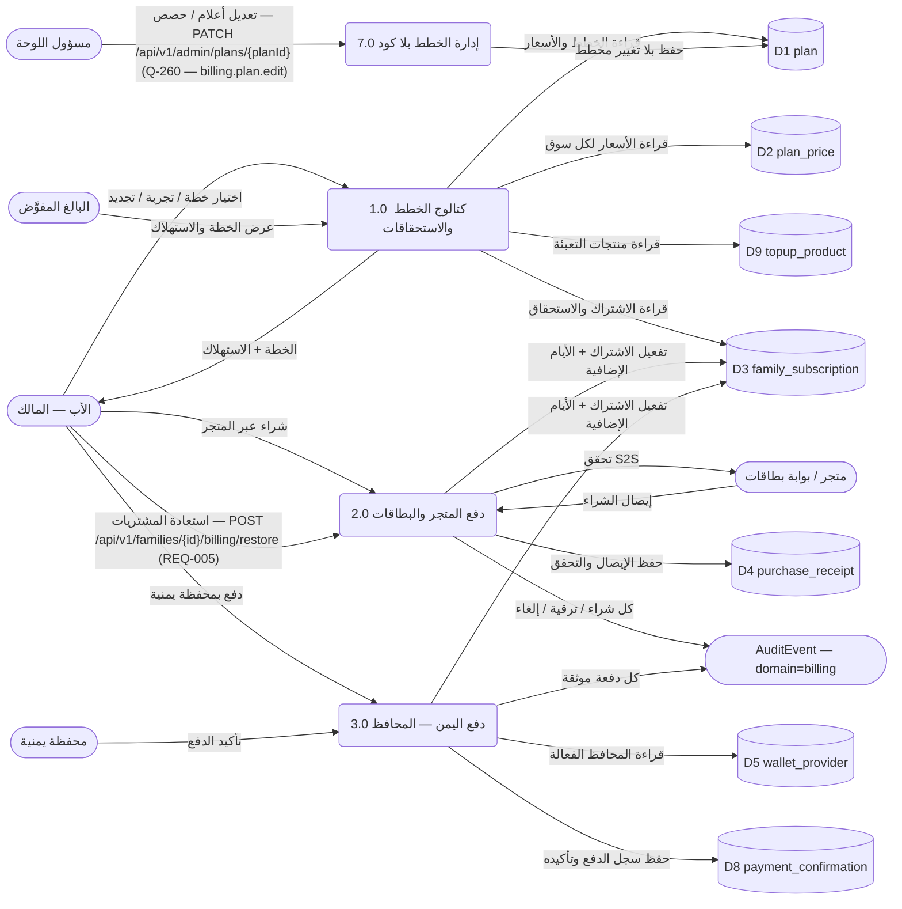

- أُعيد رسمه 2026-11-19 (Q-434 — محتوى وشكل): اللوحة الأولى من تقسيم DFD؛ وتفعيل الاشتراك يشمل الأيام الإضافية (REQ-020)؛ وحافة التجديد المبكر في Father→P1.

### 5-ب. الحصص والتعبئة

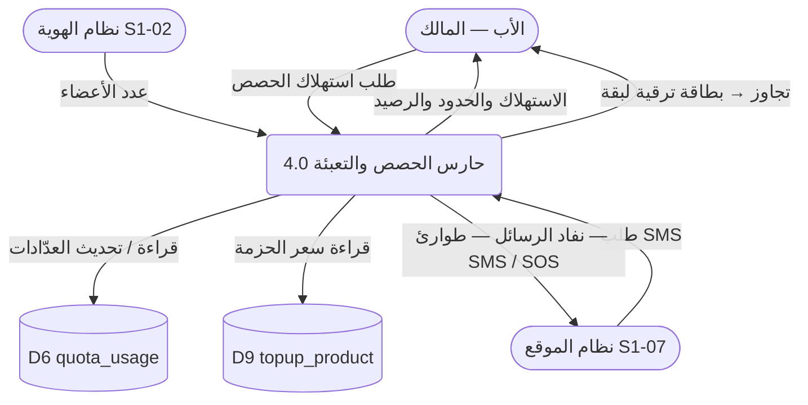

- أُعيد رسمه 2026-11-19 (Q-434 — محتوى وشكل): اللوحة الثانية من تقسيم DFD — الحصص والتعبئة وحدها؛ والمخزن D9 مكرر هنا بلا تعريف جديد؛ وقُصّرت تسميات الحواف.
- أُعيد ترتيبه 2026-11-19 (دفعة الشكل 2): اللوحة عمودية (TD) لا أفقية — انحراف موثّق عن أمر Q-434؛ تسميات الحواف الأفقية كانت مشطوبة بخط السهم في محرك GitHub 10.9.3 (لا خلفية خلف التسمية)، والاتجاه العمودي يزيل الشطب دون حذف أي عقدة أو حافة.
- المسار الكامل لحافة Father→P4: `GET /api/v1/families/{id}/billing/usage` (استهلاك الحصص — REQ-017) — قُصّرت التسمية 2026-11-19 (تنسيق المنسق: تسمية السهم 3 كلمات).

### 5-ج. المجدول والأحداث

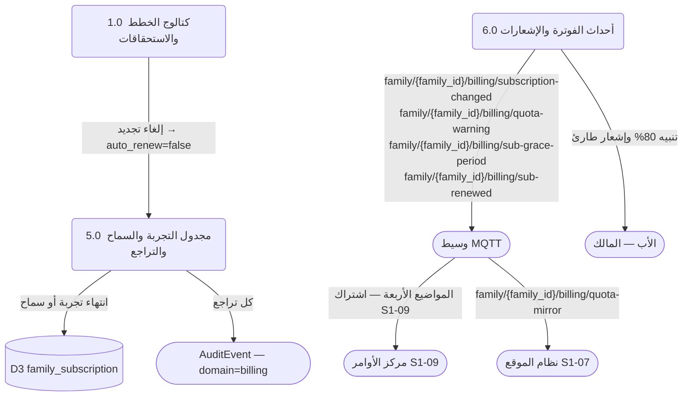

- أُعيد رسمه 2026-11-19 (Q-434 — محتوى وشكل): اللوحة الثالثة من تقسيم DFD — المجدول والأحداث؛ والمخزن D3 وAuditEvent والعملية P1 مكررة هنا بلا تعريف جديد؛ ودُمجت حافتا P5→D3 في واحدة؛ وتسمية حافة المواضيع الأربعة مكسورة على 4 أسطر (نفس المواضيع، نفس الحافة).
- أُعيد ترتيبه 2026-11-19 (دفعة الشكل 2): اللوحة عمودية (TD) لا أفقية — انحراف موثّق عن أمر Q-434؛ تسميات الحواف الأفقية كانت مشطوبة بخط السهم في محرك GitHub 10.9.3 (لا خلفية خلف التسمية)، والاتجاه العمودي يزيل الشطب دون حذف أي عقدة أو حافة؛ وكيان الوسيط صار `MQTT` باسم «وسيط MQTT» الموحّد.

### 5-د. العرض دون اتصال

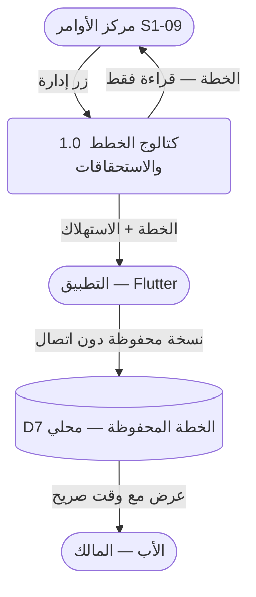

- أُعيد رسمه 2026-11-19 (Q-434 — محتوى وشكل): اللوحة الرابعة من تقسيم DFD — العرض دون اتصال؛ والعملية P1 مكررة هنا بلا تعريف جديد.
- أُعيد ترتيبه 2026-11-19 (دفعة الشكل 2): اللوحة عمودية (TD) لا أفقية — انحراف موثّق عن أمر Q-434؛ العرض الطبيعي 1539 بكسل أفقياً بخمس عقد فقط، والاتجاه العمودي ينزل به تحت الحد دون حذف أي عقدة أو حافة.

- ملاحظة: Webhook المتجر للتجديد التلقائي يُعالج idempotent بمفتاح المعاملة — لا ترقية مزدوجة (§7)؛ وفشل التحقق من الإيصال لعطل اتصال بالمتجر يعطي سماحاً مؤقتاً 24 ساعة (Q-215) ثم إعادة محاولة (§7).

## 6. مخطط النشاط (Activity) — دورة حياة الاشتراك

المسارات الخمسة (الأب / التطبيق / الخادم / مزودو الدفع / المجدول) كمسارات متوازية، على خمس لوحات باتجاه TD: 6-أ الإقلاع واختيار الخطة، و6-ب الدفع عبر المزودين، و6-ج التحقق والتفعيل، و6-د دورة التجربة والسماح، و6-هـ الحصص والتعبئة والإشعارات. وحارس الحصص والمجدول يعملان **بالتوازي** مع استخدام التطبيق، والسلامة (SOS والموقع الأساسي والدردشة والمهام) لا تُحجب بأي خطة أبداً.

### 6-أ. الإقلاع واختيار الخطة

```mermaid
flowchart TD
    subgraph Father [الأب — المالك]
        direction TB
        F1([عائلة جديدة])
        F2[اختيار خطة أو بدء تجربة]
    end
    subgraph App [التطبيق — Flutter + Kotlin]
        direction TB
        A1[بدء تلقائي على المجانية ACTIVE]
        A2[عرض المقارنة والأسعار]
        A7[عرض تأكيد الدفع والأيام الإضافية]
    end
    subgraph Server [الخادم — Ktor billing]
        direction TB
        V1["GET /api/v1/plans<br/>+ GET /api/v1/families/{id}/plan"]
        V8[حساب الأيام الإضافية قبل الدفع]
    end

    F1 --> A1
    A1 --> V1
    F2 --> A2
    A2 --> V8
    V8 --> A7
```

- أُعيد رسمه 2026-11-19 (Q-434 — محتوى وشكل): اللوحة الأولى من تقسيم النشاط وتحويله إلى TD؛ وأُضيف V8 (حساب الأيام الإضافية — REQ-020) وA7 (شاشة تأكيد الدفع)؛ وقُصّرت التسميات.
- أُعيد تقسيمه 2026-11-19 (دفعة الشكل 2): 6-أ القديمة (19 عقدة) قُسّمت ثلاث لوحات 6-أ/6-ب/6-ج.

### 6-ب. الدفع عبر المزودين

```mermaid
flowchart TD
    subgraph Father [الأب — المالك]
        direction TB
        F3[الدفع بالطريقة المختارة]
    end
    subgraph App [التطبيق — Flutter + Kotlin]
        direction TB
        A7x(["عرض تأكيد الدفع والأيام الإضافية — 6-أ"])
        A3[فتح ورقة شراء المتجر]
        A4[إرسال الإيصال أو الرقم المرجعي]
    end
    subgraph Provider [مزودو الدفع]
        direction TB
        R1[Google Play / App Store]
        R2[Tap / Moyasar — بطاقات]
        R3[Jaib / OneCash / Mahfathati — محافظ]
    end

    A7x --> F3
    F3 --> A3
    A3 --> R1
    A3 --> R2
    F3 --> R3
    R1 --> A4
    R2 --> A4
    R3 --> A4
```

- أُعيد تقسيمه 2026-11-19 (دفعة الشكل 2): لوحة الدفع عبر المزودين من 6-أ القديمة؛ وA7x مرجع إلى 6-أ.

### 6-ج. التحقق والتفعيل

```mermaid
flowchart TD
    subgraph Father [الأب — المالك]
        direction TB
        F5[إلغاء التجديد التلقائي]
    end
    subgraph App [التطبيق — Flutter + Kotlin]
        direction TB
        A4x(["إرسال الإيصال أو الرقم المرجعي — 6-ب"])
        A5[عرض الخطة المحفوظة دون اتصال]
    end
    subgraph Server [الخادم — Ktor billing]
        direction TB
        V2[تحقق من الإيصال والدفعة من الخادم — S2S]
        V3[تفعيل الاشتراك + الاستحقاقات]
        V6[تسجيل AuditEvent]
        V7[تعيين auto_renew=false]
    end

    A4x --> V2
    V2 --> V3
    V3 --> V6
    V3 --> A5
    F5 --> V7
```

- أُعيد تقسيمه 2026-11-19 (دفعة الشكل 2): لوحة التحقق والتفعيل من 6-أ القديمة؛ وA4x مرجع إلى 6-ب.

### 6-د. دورة التجربة والسماح

```mermaid
flowchart TD
    subgraph Sched [المجدول]
        direction TB
        G6[تذكير قبل نهاية التجربة بيومين]
        G7[تذكير في اليوم الأخير للتجربة]
        G1[انتهاء التجربة 7 أيام]
        G8[عودة العائلة المدفوعة إلى خطتها]
        G2[سماح 3 أيام]
        G3[تراجع لبق للمجانية]
        G5["انتهاء الفترة المدفوعة بلا تجديد"]
    end
    subgraph Server [الخادم — Ktor billing]
        direction TB
        V3x(["تفعيل الاشتراك + الاستحقاقات — 6-ج"])
    end

    G6 --> G7
    G7 --> G1
    G1 -->|عائلة مدفوعة| G8
    G1 -->|عائلة مجانية| G2
    G8 --> V3x
    G2 --> G3
    G3 --> V3x
    G5 --> G3
```

- أُعيد رسمه 2026-11-19 (Q-434 — محتوى وشكل): أُضيف G6 وG7 (تذكيرا التجربة — REQ-021) وG8 (عودة العائلة المدفوعة — Q-420)؛ وقُصّرت التسميات.
- أُعيد تقسيمه 2026-11-19 (دفعة الشكل 2): لوحة دورة التجربة والسماح من 6-ب القديمة؛ وV3x مرجع إلى 6-ج.

### 6-هـ. الحصص والتعبئة والإشعارات

```mermaid
flowchart TD
    subgraph Sched [المجدول]
        direction TB
        G4["تصفير الحصص أول كل شهر"]
    end
    subgraph Father [الأب — المالك]
        direction TB
        F4[شراء تعبئة SMS]
        F2x(["اختيار خطة أو بدء تجربة — 6-أ"])
        F6(["استلام إشعار 80% أو طارئ"])
    end
    subgraph Server [الخادم — Ktor billing]
        direction TB
        V2x(["تحقق من الإيصال والدفعة من الخادم — 6-ج — S2S"])
        V4[حارس الحصص — أفراد / رسائل / ذكاء — SMS]
        V5[إصدار أحداث MQTT]
    end
    subgraph App [التطبيق — Flutter + Kotlin]
        direction TB
        A6[عرض بطاقة ترقية لبقة]
    end

    G4 --> V4
    F4 --> V2x
    V2x -->|إضافة رصيد التعبئة| V4
    V4 --> A6
    A6 --> F2x
    V5 --> F6
    V4 --> F6
```

- أُعيد تقسيمه 2026-11-19 (دفعة الشكل 2): لوحة الحصص والتعبئة والإشعارات من 6-ب القديمة؛ وV2x وF2x مرجعان إلى 6-ج و6-أ.

- عند انتهاء الفترة دون اتصال بالخادم، تُعرض الخطة المحفوظة مع وقت صريح، ويُتحقق من الانتهاء عند أول اتصال بطابع الخادم (§7)؛ وميزانية ذكاء لكل عائلة حسب خطتها (300/1,000/3,000 وحدة — Q-336) + مفتاح إيقاف، ونفاد الميزانية يوقف مزايا الذكاء دون أن يمس السلامة (REQ-016)؛ وسقف المنصة الشهري $200 (Q-337 — تنبيه 80% / إيقاف صلب 100% لمزايا الذكاء غير الآمنة، والمصنف مستمر)؛ ومفتاح إيقاف المسؤول `POST /api/v1/admin/ai/kill-switch` (Q-338 — مشغّل المنصة وحده، المفتاح `billing.plan.edit` — مرسوم في 3-ط).
- تنبيه 80% (Q-216)؛ وتصفير الحصص أول كل شهر تقويمي (Q-252)؛ وإضافة رصيد التعبئة عند تحقق الدفع (Q-180)؛ وV7 يبقي الميزات حتى نهاية الفترة؛ وانتهاء الفترة بلا تجديد تعني auto_renew=false.
