# S1-04: مخططات هندسة البرمجيات (DIAGRAMS)

- **الحالة:** معتمدة — المخططات الستة معتمدة (حكم المالك 2026-11-08 — D-2، بعد موجة الإصلاح 0e4a3e2..f7da470)؛ والمواصفة معتمدة بالكامل في التخطيط (حكم المالك 2026-11-06)
- **المواصفة:** `SPEC.md` (§§1–8 + §10 معتمدة بالكامل في التخطيط، حكم المالك 2026-11-06 · §9 في مرحلة التصميم)
- **السياق المحدد (Bounded Context):** #11 الفوترة والاشتراكات (Billing & Subscriptions) — `CONTEXT-MAP.md` §2 صف 11
- **القرارات الحاكمة:** Q-001 · Q-025 (قنوات الدفع لعالمين) · Q-055 (الخطط أعلام وحصص بلا كود) · Q-106 (عدّاد SMS وتجاوز الطوارئ) · Q-126 (3 خطط) · Q-127 (أسعار الخليج) · Q-129 (حصص SMS) · Q-130 (تجربة 7 أيام) · Q-131 (سماح 3 أيام) · Q-012 (ميزانية الذكاء) · Q-098 (الخطة للقراءة فقط في S1-09) · Q-105 (سجل المواقع 7 أيام) · Q-163 (تجاوز طوارئ SOS — 3 رسائل بعد نفاد الحصة) · Q-056 (الموقع الأساسي في المرحلة 1 — خريطة العائلة + SOS) · Q-007 (رفض-يتغلب — المنع يغلب) · Q-260 (مفتاح `billing.plan.edit` — مالك المنصة وحده) · Q-258 (إصدار القسائم — مشغّل المنصة حصراً) · Q-261 (تصديق Basic = 50 رسالة/شهر) · Q-270 (جدول منتج التعبئة — السعر قرار المالك G-S04-08) · Q-271 (تصديق سعر Basic 9.99/89.99) · Q-128 (سعر اليمن المخفَّض) · Q-239 (مرآة SMS) · Q-251 (تأكيد الدفع اليدوي) · Q-252 (فترة الحصة شهر تقويمي) · Q-216 (تنبيه 80%) · Q-335 (المصنف معفى من ميزانية العائلة) · Q-336 (وحدة الذكاء: 300/1,000/3,000) · Q-337 (سقف المنصة $200) · Q-338 (مفتاح إيقاف الذكاء للمسؤول) · Q-339 (تعبئة الخليج 5.99 ر.س) · Q-340 (تعبئة اليمن 250 ر.ي) · Q-341 (اليمن أساسية 300/2,700) · Q-342 (اليمن مميزة 600/5,400)
- **الأنواع الستة:** 1. حالات الاستخدام · 2. ERD · 3. التسلسل · 4. تدفق المستخدم · 5. DFD · 6. النشاط
- **الأشكال الموحدة:** مستطيل = جهة خارجية · مستطيل مستدير = عملية · معين = قرار · أسطوانة = مخزن بيانات · خط متقطع = يتضمن / اختياري

## 1. حالات الاستخدام

16 حالة استخدام من السيناريوهات السبعة والمتطلبات (§2/§3): إدارة الاشتراك للأب وحده (`billing.manage` و`billing.voucher.redeem`)، والعرض (`billing.view`) للأب والبالغ المفوَّض حسب القالب، وشراء حزمة التعبئة (`billing.topup.buy`) للأب وحده (المالك)، والفوترة مخفية تماماً عن الأطفال والمراهقين (محاولة وصول مباشر عبر API تردّ 403 — §7)، وحارس الحصص والتجاوز الطارئ والتراجع اللبق عمليات نظام لا أفعال مستخدم.

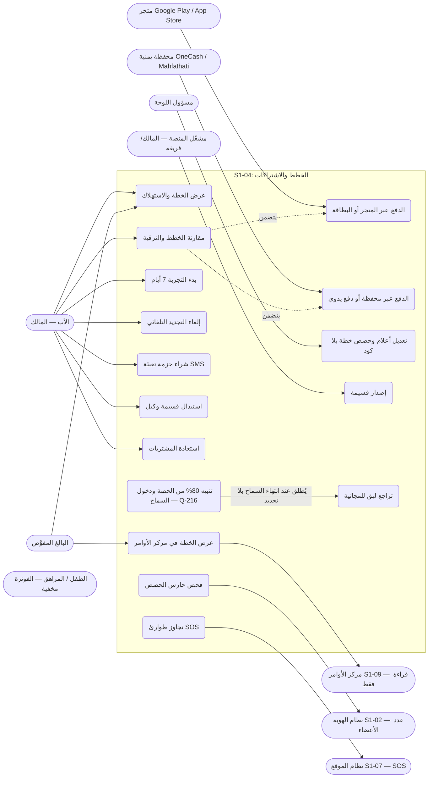

- ملاحظة: الترقية فورية عند الدفع، والتخفيض يسري بنهاية الفترة المدفوعة (REQ-004)؛ والتجربة مرة واحدة لكل عائلة وغير قابلة للتحويل (§6).
- ملاحظة شروط مسبقة (لا تُرسم كتضمين ولا كارتباط): UC6 (استبدال قسيمة) تفترض قسيمة صادرة (UC14) شرطاً مسبقاً لا تضميناً؛ وUC2 (المقارنة والترقية) تفترض فحص حارس الحصص (UC11) شرطاً مسبقاً لا ارتباطاً مباشراً.
- ملاحظة إصدار القسائم (Q-258): UC14 يصدرها مشغّل المنصة حصراً عبر `POST /api/v1/admin/vouchers` بمفتاح `billing.plan.edit` (REQ-018)؛ والعائلات لا تصدر قسائم أبداً في المرحلة 1؛ والتوزيع على الأب عبر وكيل (Q-025) لا الإصدار.
- ملاحظة إخفاء: الفوترة مخفية تماماً عن الأطفال والمراهقين — لا ارتباط للقاصر بالمخطط؛ والقاعدة نصية: محاولة وصول مباشر عبر API تردّ 403 (§7).
- الأسعار (Q-127 للمميزة · Q-271 للأساسية · REQ-003): الخليج — المميزة 19.99 ر.س شهرياً / 179.99 سنوياً، الأساسية 9.99 ر.س شهرياً / 89.99 سنوياً (خصم سنوي ~25%)؛ والمجانية 0 ر.س. اليمن — الأساسية 300 ر.ي شهرياً / 2,700 سنوياً، المميزة 600 ر.ي شهرياً / 5,400 سنوياً (Q-341 · Q-342 — D-11؛ وQ-132 حُكم بهما).

## 2. مخطط قاعدة البيانات (ERD)

الجداول الثمانية من §5 كما هي، مع ثلاثة مراجع خارجية: العائلة (S1-02)، وعدد الأعضاء من S1-02 لحصة الأفراد، و`AuditEvent` (النواة المشتركة — كل شراء/ترقية/إلغاء/استبدال يُسجَّل فيه domain=billing). ملاحظتان: الخطة المحفوظة وحالة الحصص مخزنان على العميل وليستا جدولَي خادم (§5)، و`family_subscription` اشتراك واحد لكل عائلة (`family_id` UNIQUE + RLS).

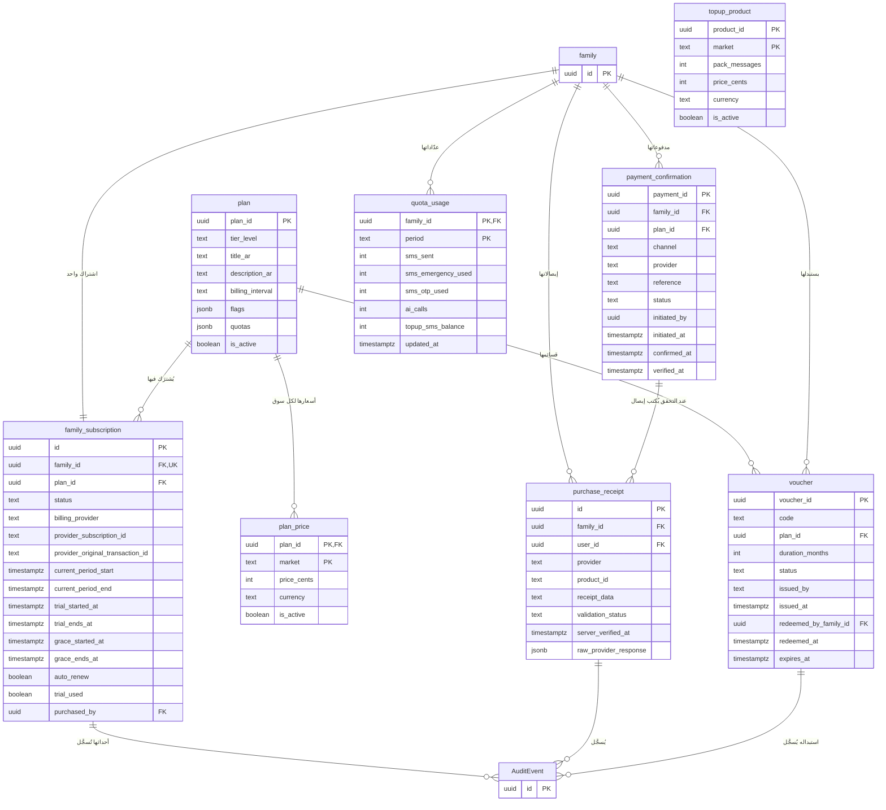

- `tier_level`: FREE / BASIC / PREMIUM؛ و`billing_interval`: LIFETIME_FREE / MONTHLY / ANNUAL؛ و`status`: ACTIVE / TRIAL / IN_GRACE_PERIOD / EXPIRED / CANCELLED؛ و`billing_provider`: SYSTEM_FREE / GOOGLE_PLAY / APPLE_APP_STORE / WALLET / VOUCHER / MANUAL؛ و`validation_status`: VALIDATED_SUCCESS / FRAUD_SUSPECT / EXPIRED؛ وحالة القسيمة: ISSUED / REDEEMED / REVOKED / EXPIRED؛ و`payment_confirmation.status`: INITIATED / PENDING_VERIFICATION / VERIFIED / REJECTED؛ و`payment_confirmation.channel`: WALLET / MANUAL (§5).
- `flags` و`quotas` من نوع jsonb — تعديل الأعلام والحصص بلا كود ولا تغيير مخطط (Q-055)؛ و`receipt_data` حمولة مشفرة؛ والمفتاح المركب لعدّاد الاستهلاك `family_id + period` (YYYY-MM) (§5) — فترة الحصة شهر تقويمي (Q-252)، مستقلة عن فترة الاشتراك المدفوعة (`current_period_start`/`current_period_end`).
- منتج التعبئة `topup_product` مستوى الكتالوج — يُقرأ عبر `GET /api/v1/plans` لا لكل خطة؛ والمفتاح المركب `product_id + market`؛ وصفوف البذرة محكومة (G-S04-08 أُغلق 2026-11-08 — Q-339 · Q-340): الخليج 5.99 ر.س / اليمن 250 ر.ي لحزمة 50 رسالة.
- مصفوفة الخطط (§1 · REQ-001): المجانية حتى 5 أفراد + 20 SMS شهرياً؛ الأساسية حتى 10 أفراد + 50 SMS؛ المميزة غير محدودة + 100 SMS (Q-261)؛ وسجل المواقع 7 أيام في كل الخطط (Q-105)؛ وميزانية الذكاء (Q-335 · Q-336 — الوحدة = استدعاء ذكاء واحد عبر البوابة؛ والمصنف معفى من ميزانية العائلة): المجانية 300 وحدة/شهر — تحقق المهام فقط؛ الأساسية 1,000 — تحقق + مساعد محدود؛ المميزة 3,000 — كاملة.

## 3. التسلسل (Sequence) — من عقود §4

خمسة مخططات، كل واحد لتدفق واحد — زائد مخططا الدفع اليمني (3-و/3-ز، Q-251) ومخطط إصدار القسائم (3-ح، Q-258): ثمانية مخططات بالمجموع.

### 3-أ. الترقية عبر المتجر — الخليج (REQ-005/007 — §4)

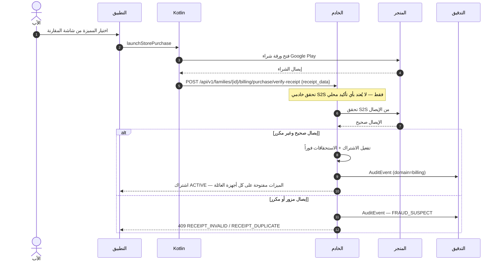

- لا يُرسَل `father_pin` إطلاقاً في هذا المسار — التحقق من الأب محلي على الجهاز (§4)؛ والإيصالات المكررة تُرفض (409) وتُسجَّل كـ FRAUD_SUSPECT (§6/§7).

### 3-ب. استبدال قسيمة وكيل — اليمن (REQ-006/008 — §4)

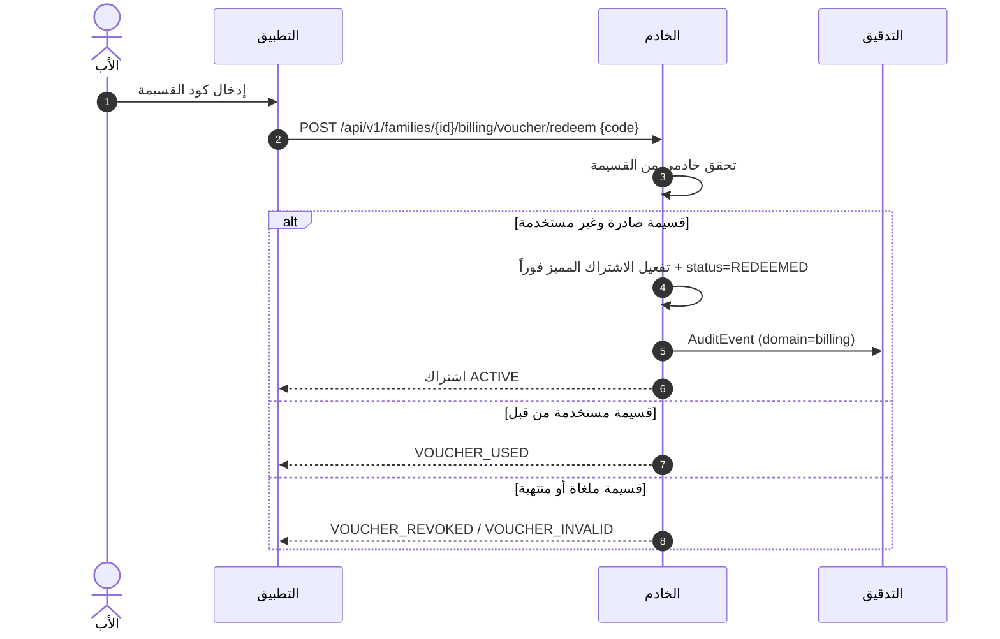

- القسيمة لمرة واحدة، قابلة للإلغاء قبل الاستخدام، ولا استرداد لها عبر التطبيق (§3/§6)؛ ومسارات الدفع اليمنية (المحافظ والقسائم) تصميمنا نحن — لا محافظ محلية ولا قسائم وكلاء في أي تطبيق مفكك (ملحق RE).

### 3-ج. نفاد SMS والتعبئة وتجاوز الطوارئ (REQ-009/010/011 — §4/§6)

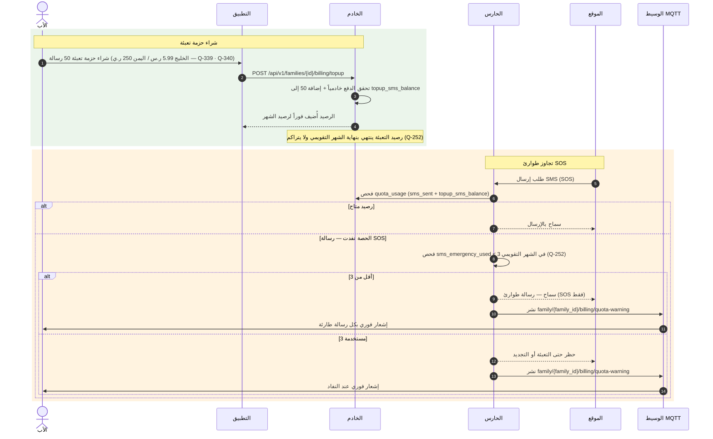

- الحصص تُفرض على الخادم عند كل استخدام؛ وعرض العميل استرشادي فقط (§6)؛ وتنبيه للأب عند 80% (Q-216) من أي حصة (§6)؛ وحصة SMS حسب الخطة: 20 / 50 / 100 شهرياً (Q-126 · Q-261 · REQ-019)؛ وتجاوز الطوارئ 3 رسائل SOS في كل شهر تقويمي (Q-106 · Q-252)؛ وسعر حزمة التعبئة من جدول `topup_product` (§5) عبر الكتالوج: الخليج 5.99 ر.س / اليمن 250 ر.ي (Q-339 · Q-340 — G-S04-08 أُغلق).

### 3-د. التجربة ثم السماح ثم التراجع اللبق (REQ-012/013/014 — §4/§6)

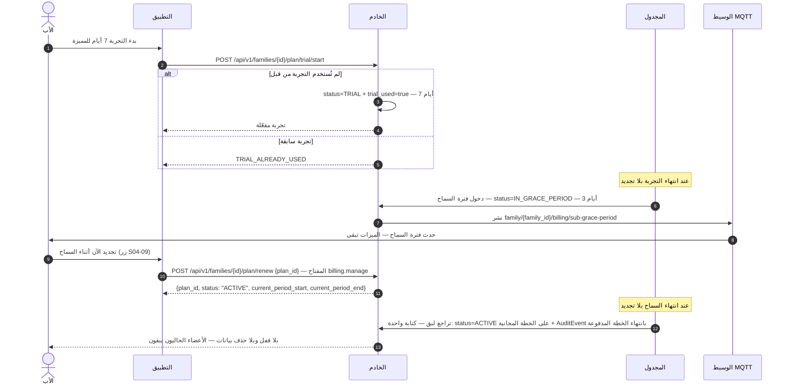

- الانتهاء بطابع وقت الخادم فقط — ساعة العميل لا يُعتد بها أبداً (§6)؛ والتجربة مرة واحدة لكل عائلة وغير قابلة للتحويل (§6)؛ والترقية أثناء فترة السماح تنهي السماح فوراً وتفعّل الخطة الجديدة (§7).

### 3-هـ. تجاوز حصة الأفراد وبطاقة الترقية اللبقة (REQ-009 — §2 سيناريو 4-6)

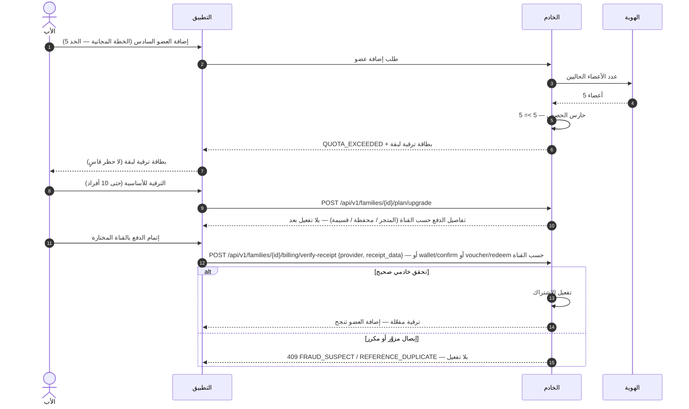

- الأعضاء الحاليون عند التراجع اللبق يبقون فعالين مع حظر إضافة جدد فقط (REQ-014)؛ وحد الأفراد: 5 / 10 / غير محدود (§1).

### 3-و. بدء دفع محفظة يمنية والتحقق منه (REQ-006 — §4/§5 — Q-251)

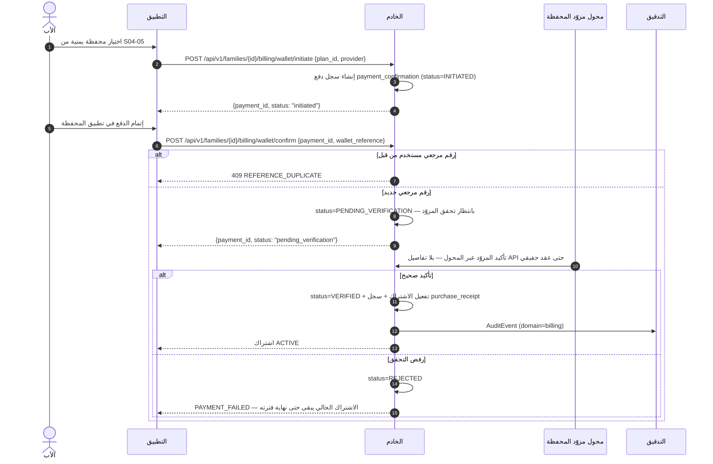

- الرقم المرجعي نص معتم ينقله الأب كما يظهر في تطبيق المحفظة — لا يُعتمد دليل دفع حتى تحقق المزوّد عبر `WalletProviderAdapter` (بلا تفاصيل API حتى عقد حقيقي)؛ ولا يُفعَّل الاشتراك قبل `VERIFIED` (REQ-007)؛ وتفاصيل تمرير المبلغ إلى تطبيق المحفظة من العقد الحقيقي — لا تُخترع هنا (§4).

### 3-ز. تأكيد دفع يدوي مسبق (REQ-006 — §4/§5 — Q-251)

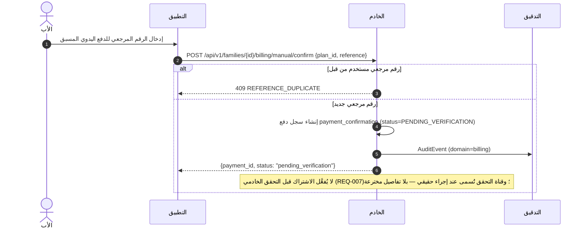

- الدفع اليدوي مسبق: الأب يدفع أولاً خارج التطبيق ثم يؤكد بالرقم المرجعي؛ والسجل يبقى «بانتظار التحقق» حتى يصل التحقق الخادمي؛ ولا تفعيل قبل `VERIFIED` (§4).

### 3-ح. إصدار قسيمة وإلغاؤها — مشغّل المنصة (REQ-018 — §4 — Q-258)

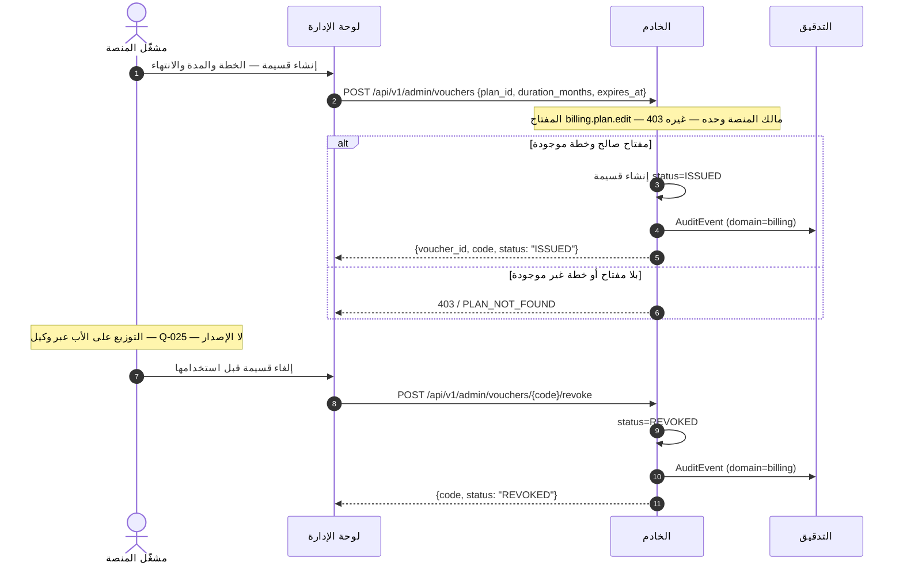

- الإصدار والإلغاء لمشغّل المنصة حصراً؛ والعائلات لا تصدر قسائم أبداً في المرحلة 1 (Q-258)؛ والقسيمة المصدرة `status=ISSUED` قابلة للإلغاء قبل الاستخدام، وتُرفض عند الاستبدال بعد إلغائها (`VOUCHER_REVOKED` — REQ-008)؛ والتوزيع على الأب عبر وكيل لا الإصدار (Q-025).

### 3-ط. مفتاح إيقاف الذكاء للمسؤول (Q-338 — D-10 — §4-2)

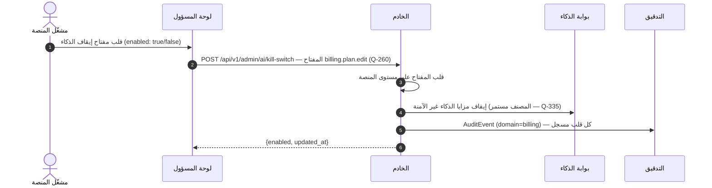

- وعند بلوغ سقف المنصة الشهري $200 (Q-337) يقلب النظام المفتاح تلقائياً + إشعار المالك؛ والاستئناف يحتاج اعتماداً كتابياً جديداً (Q-013)؛ وتنبيه عند 80% ($160).

## 4. تدفق المستخدم (User Flow) — من السيناريوهات السبعة (§2)

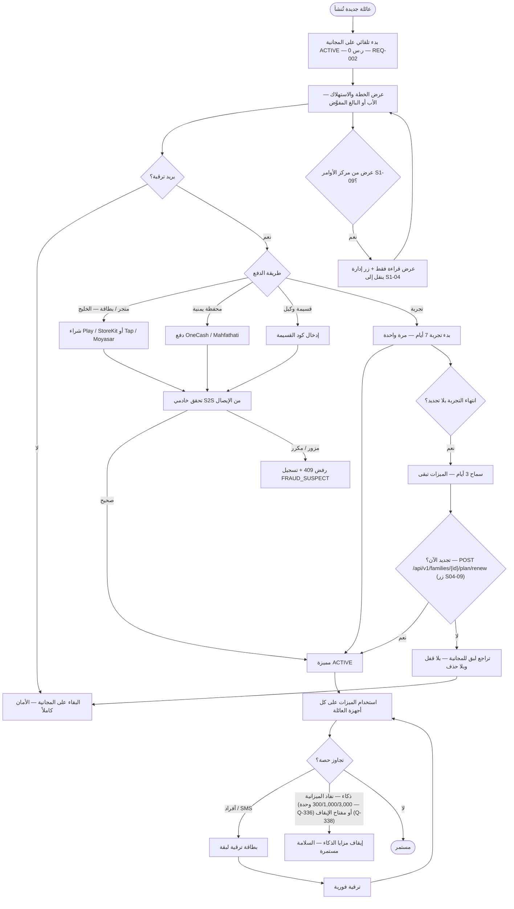

- ملاحظة: الفوترة مخفية تماماً عن الأطفال والمراهقين — لا تُعرض ولا تُذكر (§6)؛ والخطة في S1-09 للقراءة فقط (REQ-015).

## 5. مخطط تدفق البيانات (DFD — المستوى 1) — من §4/§5

العمليات مرقمة 1.0–7.0، والمخازن D1–D6 وD8–D9 (جداول خادم PostgreSQL). المخزن D7 محفوظ محلياً على الجهاز (للقراءة دون اتصال) وليس جدول خادم.

- **تغطية نقاط §4:** التسلسلات في §3 تغطي التدفقات الأساسية فقط؛ وكل نقطة §4 تظهر هنا على الأقل: `POST /api/v1/families/{id}/billing/restore` (استعادة المشتريات — REQ-005 — حافة Father→P2) · `POST /api/v1/families/{id}/plan/cancel-renewal` (إلغاء التجديد التلقائي — تمر عبر P5) · `GET /api/v1/families/{id}/billing/usage` (استهلاك الحصص SMS/أفراد/ذكاء — REQ-017 — حافتا Father→P4 وP4→Father؛ الرد: المستخدم/الحد لكل حصة + الفترة YYYY-MM + رصيد التعبئة + الطوارئ المتبقية) · `PATCH /api/v1/admin/plans/{planId}` (تعديل أعلام/حصص الخطة بلا كود، إداري فقط — حافة Admin→P7 — المفتاح: `billing.plan.edit` — Q-260 — مالك المنصة وحده؛ غيره 403)؛ [تصحيح 2026-11-08 (D-2): كانت النقاط الثلاث الأولى نثراً فقط في هذه الملاحظة؛ رُسمت الآن كحواف.] ونقاط الدفع اليمني الجديدة `POST /api/v1/families/{id}/billing/wallet/initiate` و`POST /api/v1/families/{id}/billing/wallet/confirm` و`POST /api/v1/families/{id}/billing/manual/confirm` تمر عبر P3 (3-و/3-ز — Q-251)؛ وبقية النقاط مرسومة في §3 (plan ترقية، verify-receipt، voucher/redeem، topup، trial/start)؛ و`GET /api/v1/plans` و`GET /api/v1/families/{id}/plan` في §6 (V1).

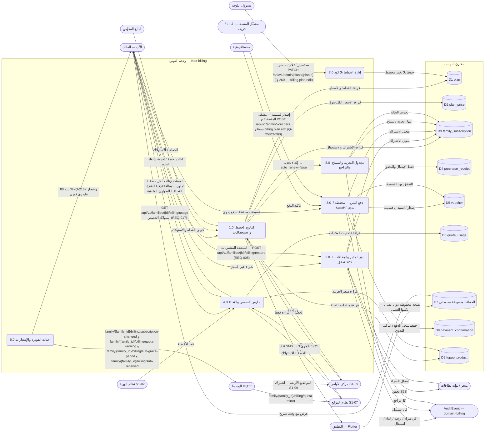

- ملاحظة: Webhook المتجر للتجديد التلقائي يُعالج idempotent بمفتاح المعاملة — لا ترقية مزدوجة (§7)؛ وفشل التحقق من الإيصال لعطل اتصال بالمتجر يعطي سماحاً مؤقتاً 24 ساعة (Q-215) ثم إعادة محاولة (§7).

## 6. مخطط النشاط (Activity) — دورة حياة الاشتراك

المسارات الخمسة (الأب / التطبيق / الخادم / مزودو الدفع / المجدول) كمسارات متوازية. وحارس الحصص والمجدول يعملان **بالتوازي** مع استخدام التطبيق، والسلامة (SOS والموقع الأساسي والدردشة والمهام) لا تُحجب بأي خطة أبداً.

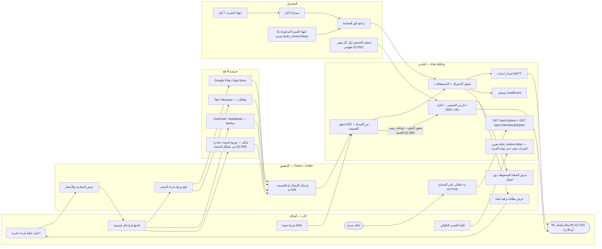

- عند انتهاء الفترة دون اتصال بالخادم، تُعرض الخطة المحفوظة مع وقت صريح، ويُتحقق من الانتهاء عند أول اتصال بطابع الخادم (§7)؛ وميزانية ذكاء لكل عائلة حسب خطتها (300/1,000/3,000 وحدة — Q-336) + مفتاح إيقاف، ونفاد الميزانية يوقف مزايا الذكاء دون أن يمس السلامة (REQ-016)؛ وسقف المنصة الشهري $200 (Q-337 — تنبيه 80% / إيقاف صلب 100% لمزايا الذكاء غير الآمنة، والمصنف مستمر)؛ ومفتاح إيقاف المسؤول `POST /api/v1/admin/ai/kill-switch` (Q-338 — مشغّل المنصة وحده، المفتاح `billing.plan.edit` — مرسوم في 3-ط)؛ وإصدار القسائم لمشغّل المنصة حصراً (Q-258) — التوزيع عبر وكيل لا الإصدار.
