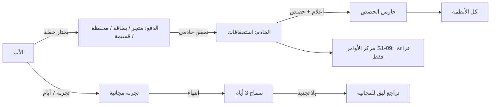
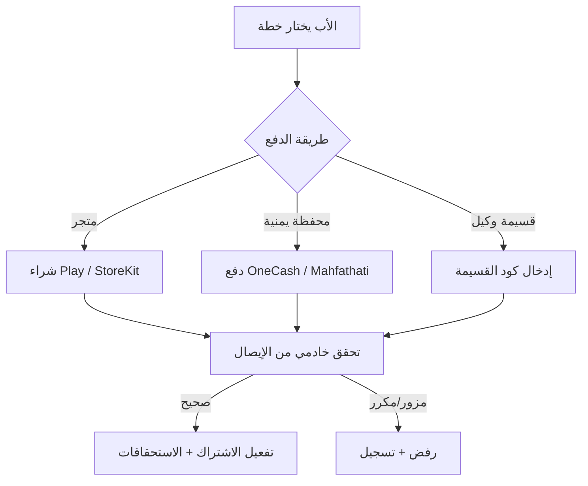
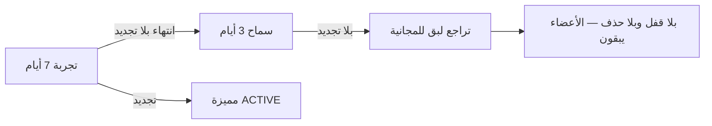

# S1-04: الخطط والاشتراكات (Plans & Subscriptions)

- **الحالة:** approved | **المرحلة:** 1 (نواة الحماية) · **آخر تحديث:** 2026-11-06
- **القرارات الحاكمة:** Q-012 · Q-025 · Q-055 · Q-098 · Q-106 · Q-126 · Q-127 · Q-128 · Q-129 · Q-130 · Q-131 · Q-132 · D-021 · G-006 · G-011
- **حالة المراجعة:** §§1–8 + §10 معتمدة بالكامل في التخطيط (حكم المالك 2026-11-06) · §9 في مرحلة التصميم.
- **الأدلة المرجعية:** المواصفة القديمة S1-04 (مرجع فقط، G-009) · Qustodio (ترخيص خادمي + حارس حصة + 3 مستويات) · FamiSafe (تجربة 7 أيام + تحقق خادمي من الإيصالات) · FamilyWall (مقعد عائلي واحد + قسائم) · Life360 (تدهور لبق)

## 1. الهدف والتحليل والنطاق

**الهدف:** نظام الفوترة: ثلاث خطط (مجانية دائمة + أساسية + مميزة كاملة)، والحصص (أفراد، رسائل SMS، ميزانية ذكاء)، وطرق دفع لعالمين (الخليج: متاجر وبطاقات؛ اليمن: محافظ وقسائم وكلاء ودفع يدوي)، وحزم تعبئة الرسائل، وتجربة مجانية 7 أيام، وفترة سماح 3 أيام، وتراجع لبق عند انتهاء الاشتراك.

**القواعد الثلاث:**

1. **الأمان لا يُحجب أبداً:** SOS والموقع الأساسي والدردشة والمهام مجانية للأبد في كل الخطط — لا خطة تحجب السلامة.
2. **الخطط أعلام وحصص بلا كود (Q-055):** كل خطة أعلام مزايا + حصص؛ وتغيير حصة أو ميزة يتم من لوحة بلا كود.
3. **اشتراك عائلي واحد لعالمين (Q-025):** اشتراك واحد يغطي كل أجهزة العائلة وعبر المنصات؛ والخليج يدفع عبر المتجر أو البطاقات، واليمن عبر المحافظ أو قسيمة وكيل أو دفع يدوي مسبق.

**مصفوفة الخطط (تعريف المستوى الأوسط — Q-126):**

| الميزة | المجانية | الأساسية | المميزة |
|---|---|---|---|
| الأفراد | حتى 5 | حتى 10 | غير محدود |
| رسائل SMS شهرياً | 20 | 50 | 100 |
| تحقق الذكاء من المهام | ✅ | ✅ | ✅ |
| ميزانية الذكاء الشهرية | تحقق المهام فقط | تحقق + مساعد محدود | كاملة |
| سجل المواقع | 7 أيام | 7 أيام | 7 أيام |
| التجربة المجانية | — | — | 7 أيام تجربة |

**الأسعار (Q-127/Q-128):** الخليج 19.99 ر.س شهرياً / 179.99 سنوياً للمميزة؛ وأسعار الأساسية تُحدد مع المواصفة (انظر §3)؛ واليمن سعر محلي مخفّض بالريال يُحدد قبل الإطلاق (Q-132).

**خارج النطاق:** خطط مؤسسية/B2B (المرحلة 6 — سؤال مفتوح Q-149)؛ والفواتير الضريبية التفصيلية (سؤال مفتوح Q-150 — قبل الإطلاق)؛ واشتراك دائم (Lifetime — موجود في FamiSafe لكنه غير محكوم في م1 — سؤال مفتوح Q-151 — قبل الإطلاق).

**المصطلحات:** خطة (مستوى اشتراك: مجانية/أساسية/مميزة) · مستوى (tier) · حصة (حد استهلاك شهري: أفراد/SMS/ذكاء) · اشتراك (ربط عائلة بخطة وفترة) · استحقاق (الميزات المفتوحة فعلاً لعائلة من الخادم) · فترة تجريبية (7 أيام مميزة مجاناً) · فترة سماح (3 أيام بعد الانتهاء قبل التراجع) · تراجع لبق (عودة للمجانية بلا قفل ولا حذف) · تعبئة (شراء حصص SMS إضافية) · قسيمة (كود وكيل يفعّل اشتراكاً).

**ملاحظة إعادة الاستخدام:** الترخيص خادم-المنشأ + الاستحقاقات من الخادم (Qustodio `licenseType/maxDevices`؛ FamilyWall `isPremium`؛ FamiSafe `GET subscription`)؛ وحارس الحصة مع ترقية لبقة (Qustodio `devicesCount > maxDevices`)؛ ومقعد عائلي واحد (FamilyWall + Life360)؛ وتجربة 7 أيام (FamiSafe + Life360)؛ وتدهور لبق عند الانتهاء (Life360)؛ والتحقق الخادمي من الإيصالات؛ والفرع القديم S1-04 (وعد الأمان + التراجع اللبق + سجل الإيصالات).

## 2. سيناريوهات المستخدم

- **4-1 بداية مجانية:** عائلة جديدة تُنشأ فتبدأ تلقائياً على الخطة المجانية (0 ر.س) بحالة ACTIVE — الأمان كاملاً من اليوم الأول.
- **4-2 ترقية عبر المتجر:** الأب في الخليج يرقّي للمميزة من شاشة المقارنة عبر Google Play؛ والخادم يتحقق من الإيصال؛ وتُفتح الميزات فور التحقق على كل أجهزة العائلة.
- **4-3 دفع يمني بقسيمة:** الأب في اليمن يشتري قسيمة من وكيل ويدخل كودها؛ والخادم يتحقق من القسيمة؛ ويُفعَّل الاشتراك المميز فوراً.
- **4-4 نفاد حصص SMS وتعبئة:** تنفد رسائل العائلة (20 في المجانية)؛ والأب يشتري حزمة تعبئة 50 رسالة؛ وتُضاف للرصيد فوراً.
- **4-5 تجربة ثم سماح ثم تراجع:** الأب يبدأ تجربة 7 أيام للمميزة؛ وتنتهي التجربة بلا تجديد؛ وتبقى الميزات 3 أيام سماح؛ ثم تراجع لبق للمجانية — بلا قفل وبلا حذف بيانات، والأعضاء الحاليون يبقون.
- **4-6 تجاوز حصة الأفراد:** الأب يحاول إضافة العضو السادس في المجانية (الحد 5)؛ وتظهر بطاقة ترقية لبقة؛ فيرقّي للأساسية ويضيف العضو.
- **4-7 عرض الخطة في مركز الأوامر:** الأب يرى خطته واستهلاكه (قراءة فقط) في S1-09؛ وينقر "إدارة" فينتقل إلى S1-04.

**مخطط الشراء والتفعيل (سيناريوهات بصرية):**

**مخطط التجربة والسماح والتراجع:**

## 3. المتطلبات الوظيفية

### الخطط
- **REQ-001:** ثلاث خطط (مجانية/أساسية/مميزة) بمصفوفة §1؛ وكل خطة أعلام مزايا + حصص قابلة للتعديل من لوحة بلا كود. [Q-055/Q-126 · DIRECT]
- **REQ-002:** كل عائلة جديدة تبدأ تلقائياً على المجانية بحالة ACTIVE وتكلفة صفر.
- **REQ-003:** أسعار الأساسية: 9.99 ر.س شهرياً / 89.99 سنوياً (خصم سنوي ~25%)؛ وأسعار المميزة 19.99/179.99 (Q-127)؛ وأسعار اليمن بالريال تُحدد قبل الإطلاق (Q-132).
- **REQ-004:** الترقية فورية عند الدفع؛ والتخفيض يسري بنهاية الفترة المدفوعة (لا استرداد جزئي تلقائي).

### الدفع
- **REQ-005:** الخليج: Google Play Billing + بطاقات عبر الويب (Tap/Moyasar). [Q-025 · DIRECT]
- **REQ-006:** اليمن: محافظ (OneCash/Mahfathati) + دفع يدوي مسبق + قسائم وكلاء. [Q-025 · DIRECT]
- **REQ-007:** التحقق من الإيصالات خادمي إلزامي (S2S)؛ ولا يُعتد بأي تأكيد محلي. [Q-025 · DERIVED]
- **REQ-008:** القسيمة: كود لمرة واحدة يُتحقق منه خادمياً ثم يفعّل الاشتراك؛ وقابلة للإلغاء قبل الاستخدام.

### الحصص والتعبئة
- **REQ-009:** حارس الحصص: فحص الأفراد/SMS/ميزانية الذكاء على الخادم عند كل استخدام؛ والتجاوز يردّ ببطاقة ترقية لبقة. [Q-055 · DIRECT]
- **REQ-010:** حزم تعبئة SMS (50 رسالة) تُشترى وتُضاف لرصيد الشهر. [Q-129 · DIRECT]
- **REQ-011:** تجاوز طوارئ: 3 رسائل SOS بعد نفاد الحصة في كل دورة (SOS فقط)؛ والأب يُشعَر فوراً بكل رسالة طارئة وعند النفاد. [Q-106 · DIRECT]

### التجربة والسماح والتراجع
- **REQ-012:** تجربة مجانية 7 أيام للمميزة — مرة واحدة لكل عائلة. [Q-130 · DIRECT]
- **REQ-013:** فترة سماح 3 أيام بعد انتهاء الاشتراك بلا تجديد — الميزات تبقى. [Q-131 · DIRECT]
- **REQ-014:** التراجع اللبق: عودة للمجانية بلا قفل وبلا حذف بيانات؛ والأعضاء الحاليون يبقون فعالين مع حظر إضافة جدد فقط.

### التكامل
- **REQ-015:** الخطة للقراءة فقط في مركز الأوامر S1-09 (الخطة الحالية + الاستهلاك)؛ و"إدارة" تنقل إلى S1-04. [Q-098 · DIRECT]
- **REQ-016:** ميزانية ذكاء لكل عائلة حسب خطتها + مفتاح إيقاف؛ ونفاد الميزانية يوقف مزايا الذكاء دون أن يمس السلامة. [Q-012 · DIRECT]

## 4. الواجهات والعقود

### نقاط الوصول REST
- `GET /plans` — كتالوج الخطط (عام).
- `GET /families/{id}/plan` — الخطة الحالية + الاستهلاك (قراءة فقط؛ وتستخدمه S1-09).
- `POST /families/{id}/plan/upgrade` — بدء ترقية (يعيد تفاصيل الدفع حسب القناة).
- `POST /families/{id}/billing/purchase/verify-receipt` — تحقق خادمي من إيصال المتجر (بلا `father_pin` إطلاقاً — التحقق من الأب محلي على الجهاز؛ وإرسال الـ PIN للخادم ممنوع — إصلاح ثغرة المرجع القديم).
- `POST /families/{id}/billing/voucher/redeem` — استبدال كود قسيمة وكيل.
- `POST /families/{id}/billing/topup` — شراء حزمة تعبئة SMS.
- `GET /families/{id}/billing/usage` — استهلاك الحصص (SMS/أفراد/ذكاء).
- `POST /families/{id}/plan/trial/start` — بدء التجربة 7 أيام.
- `POST /families/{id}/plan/cancel-renewal` — إلغاء التجديد التلقائي.
- `POST /families/{id}/billing/restore` — استعادة المشتريات.
- `PATCH /admin/plans/{planId}` — تعديل أعلام/حصص الخطة من اللوحة بلا كود (إداري فقط).

### أحداث MQTT
- `family/{family_id}/billing/subscription-changed` — تغيّرت الخطة (لكل الأنظمة).
- `family/{family_id}/billing/quota-warning` — حصة على وشك النفاد.
- `family/{family_id}/billing/sub-grace-period` — دخول فترة السماح.
- `family/{family_id}/billing/sub-renewed` — تم التجديد.

### قناة MethodChannel (Kotlin)
- `launchStorePurchase` — فتح ورقة شراء المتجر.
- `getCachedPlan` — الخطة المحفوظة محلياً (دون اتصال).

### رموز الخطأ (`BIL_*`)
`PLAN_NOT_FOUND` · `SUBSCRIPTION_NOT_FOUND` · `RECEIPT_INVALID` · `RECEIPT_DUPLICATE` · `VOUCHER_INVALID` · `VOUCHER_USED` · `VOUCHER_REVOKED` · `QUOTA_EXCEEDED` · `TRIAL_ALREADY_USED` · `PAYMENT_FAILED` — وبصيغة الخطأ الموحدة `{code, message_ar, trace_id}`.

## 5. البيانات — النموذج

**جداول النظام:**
- `plan` — الخطة: `plan_id` · `tier_level` (FREE/BASIC/PREMIUM) · `title_ar` · `description_ar` · `billing_interval` (LIFETIME_FREE/MONTHLY/ANNUAL) · `flags` (jsonb — أعلام المزايا) · `quotas` (jsonb — max_members/sms_monthly/ai_budget_monthly) · `is_active`. (الأعلام والحصص jsonb = تعديل بلا كود ولا تغيير مخطط — Q-055.)
- `plan_price` — سعر الخطة لكل سوق: `plan_id` · `market` (gulf/yemen) · `price_cents` · `currency` (SAR/YER) · `is_active`.
- `family_subscription` — اشتراك العائلة: `id` · `family_id` (UNIQUE + RLS) · `plan_id` · `status` (ACTIVE/TRIAL/IN_GRACE_PERIOD/EXPIRED/CANCELLED) · `billing_provider` (SYSTEM_FREE/GOOGLE_PLAY/APPLE_APP_STORE/WALLET/VOUCHER/MANUAL) · `provider_subscription_id` · `provider_original_transaction_id` · `current_period_start`/`current_period_end` · `auto_renew` · `trial_used` · `purchased_by`.
- `purchase_receipt` — سجل تدقيق مالي: `id` · `family_id` · `user_id` · `provider` · `product_id` · `receipt_data` (حمولة مشفرة) · `validation_status` (VALIDATED_SUCCESS/FRAUD_SUSPECT/EXPIRED) · `server_verified_at` · `raw_provider_response` (jsonb).
- `voucher` — القسيمة: `voucher_id` · `code` (فريد) · `plan_id` · `duration_months` · `status` (ISSUED/REDEEMED/REVOKED/EXPIRED) · `issued_by` (الوكيل) · `issued_at` · `redeemed_by_family_id` · `redeemed_at` · `expires_at`.
- `quota_usage` — عدّاد الاستهلاك (كان مذكوراً بلا تعريف في المرجع القديم — يُعرَّف هنا): `family_id` · `period` (YYYY-MM) · `sms_sent` · `sms_emergency_used` · `ai_calls` · `topup_sms_balance` · `updated_at`. (المفتاح: family_id + period.)

**مراجع:** عدد الأعضاء من S1-02 (لحصة الأفراد)؛ وكل شراء/ترقية/إلغاء/استبدال يُسجَّل في AuditEvent (domain=billing)؛ والخطة تُقرأ في S1-09 عبر `GET /families/{id}/plan`. **مخازن العميل (ليست جداول خادم):** الخطة المحفوظة + حالة الحصص (للقراءة دون اتصال).

## 6. القواعد والصلاحيات

### مفاتيح الصلاحيات (`billing.*`)
- `billing.view` — عرض الخطة والاستهلاك (الأب + البالغ المفوَّض حسب القالب).
- `billing.manage` — إدارة الاشتراك (ترقية/تخفيض/تجربة/إلغاء تجديد) — **الأب وحده (المالك)**.
- `billing.topup.buy` — شراء حزمة تعبئة SMS — **الأب وحده (المالك)**.
- `billing.voucher.redeem` — استبدال قسيمة — **الأب وحده**.

### ثوابت صلبة (لا تُكسر)
- السلامة لا تُحجب بأي خطة أبداً (SOS والموقع الأساسي والدردشة والمهام مجانية للأبد).
- الانتهاء بطابع وقت الخادم فقط — ساعة العميل لا يُعتد بها أبداً (دفاع ضد التلاعب).
- لا يُعتد بأي تأكيد دفع محلي — التحقق خادمي فقط.
- الـ PIN لا يغادر الجهاز أبداً.
- الحصص تُفرض على الخادم؛ وعرض العميل استرشادي فقط.
- اشتراك واحد لكل عائلة.
- التراجع اللبق: بلا قفل وبلا حذف؛ والأعضاء الحاليون يبقون.
- التجربة مرة واحدة لكل عائلة وغير قابلة للتحويل.
- القسيمة لمرة واحدة؛ ولا استرداد لها عبر التطبيق.
- الفوترة مخفية تماماً عن الأطفال والمراهقين (لا تُعرض ولا تُذكر).

### قواعد التشغيل
- الترقية فورية؛ والتخفيض بنهاية الفترة المدفوعة.
- التجديد التلقائي عبر Webhook المتجر؛ واليدوي/القسيمة بلا تجديد تلقائي (تجديد يدوي).
- الحصص تُصفَّر ببداية كل فترة؛ ورصيد التعبئة ينتهي بنهاية الفترة ولا يتراكم.
- تنبيه للأب عند 80% من أي حصة.
- تجاوز الطوارئ 3 رسائل SOS في الدورة (SOS فقط)؛ والأب يُشعَر فوراً بكل رسالة وعند النفاد.
- الإيصالات المكررة تُرفض (409) وتُسجَّل كـ FRAUD_SUSPECT.

## 7. الحالات الحدية والأخطاء

- إيصال مزور أو مكرر → يُرفض (409) ويُسجَّل كـ FRAUD_SUSPECT.
- فشل التحقق من الإيصال لعطل اتصال بالمتجر → سماح مؤقت 24 ساعة ثم إعادة محاولة.
- قسيمة مستخدمة من قبل → VOUCHER_USED.
- قسيمة ملغاة أو منتهية → VOUCHER_REVOKED / VOUCHER_INVALID.
- تجربة ثانية لنفس العائلة → TRIAL_ALREADY_USED.
- تجاوز حصة الأفراد (عضو سادس في المجانية) → QUOTA_EXCEEDED + بطاقة ترقية لبقة.
- نفاد SMS أثناء SOS → 3 رسائل طوارئ (SOS فقط) ثم حظر حتى التعبئة/التجديد.
- فشل الدفع (بطاقة مرفوضة) → PAYMENT_FAILED؛ والاشتراك الحالي يبقى حتى نهاية فترته.
- إلغاء التجديد → الميزات تبقى حتى نهاية الفترة المدفوعة ثم تراجع لبق.
- Webhook متأخر أو مكرر → معالجة idempotent بمفتاح المعاملة (لا ترقية مزدوجة).
- طفل/مراهق يصل للفوترة عبر API مباشرة → 403؛ والقسم مخفي تماماً من قوائمه.
- تغيير الخطة أثناء فترة السماح → الترقية تنهي السماح فوراً وتفعّل الخطة الجديدة.
- انتهاء الفترة دون اتصال بالخادم → الخطة المحفوظة تُعرض مع وقت صريح؛ والتحقق من الانتهاء عند أول اتصال بطابع الخادم.

## 8. معايير القبول

- **ACC-001:** ثلاث خطط بمصفوفة §1؛ وتعديل الأعلام والحصص يتم بلا كود. ← REQ-001
- **ACC-002:** عائلة جديدة تبدأ تلقائياً على المجانية (0 ر.س). ← REQ-002
- **ACC-003:** الأسعار: الأساسية 9.99/89.99؛ والمميزة 19.99/179.99. ← REQ-003
- **ACC-004:** الترقية فورية عند الدفع؛ والتخفيض يسري بنهاية الفترة. ← REQ-004
- **ACC-005:** دفع الخليج عبر المتجر والبطاقات يعمل. ← REQ-005
- **ACC-006:** دفع اليمن (محافظ/يدوي مسبق/قسائم وكلاء) يعمل. ← REQ-006
- **ACC-007:** التحقق من الإيصالات خادمي إلزامي؛ ولا يُعتد بتأكيد محلي. ← REQ-007
- **ACC-008:** القسيمة لمرة واحدة وتُتحقق خادمياً قبل التفعيل. ← REQ-008
- **ACC-009:** حارس الحصص يعمل على الخادم؛ والتجاوز يردّ ببطاقة ترقية لبقة. ← REQ-009
- **ACC-010:** حزمة تعبئة 50 رسالة تُشترى وتُضاف لرصيد الشهر فوراً. ← REQ-010
- **ACC-011:** تجاوز طوارئ 3 رسائل SOS يعمل؛ والأب يُشعَر فوراً. ← REQ-011
- **ACC-012:** تجربة 7 أيام تعمل مرة واحدة لكل عائلة. ← REQ-012
- **ACC-013:** سماح 3 أيام ثم تراجع لبق — بلا قفل وبلا حذف بيانات. ← REQ-013/014
- **ACC-014:** الخطة للقراءة فقط في مركز الأوامر S1-09. ← REQ-015
- **ACC-015:** ميزانية ذكاء لكل عائلة + مفتاح إيقاف؛ ونفاد الميزانية لا يمس السلامة. ← REQ-016

## 9. قائمة الشاشات

في مرحلة التصميم.

## 10. خطة التنفيذ

- **ترتيب البناء:** الجداول + RLS ← كتالوج الخطط + حارس الحصص ← REST + MQTT ← تحقق المتاجر (Play Developer API + App Store Server API) ← مسارات اليمن (محافظ + قسائم + تفعيل يدوي) ← تعبئة + تجاوز طوارئ ← مجدول التجربة/السماح/التراجع ← عرض S1-09 للقراءة فقط ← الشاشات بعد مرحلة التصميم.
- **بذر المفاتيح في السجل المركزي:** مفاتيح `billing.*` الأربعة (§6: `billing.view` · `billing.manage` · `billing.topup.buy` · `billing.voucher.redeem`) تُزرع في جدول `permission_key` المركزي (S1-03 §10-1) وقت النشر — لا منح لمفتاح غير مزروع (S1-03 REQ-009).
- **الوحدات:** وحدة Ktor باسم `billing`؛ وشاشات Flutter للخطط + الخطة المحفوظة؛ ووحدة Kotlin للشراء من المتجر والاستعادة.
- **الاعتماديات:** S1-01 · S1-02 · S1-03 · S1-09 · Q-025 (قنوات الدفع) · Q-055 (أعلام/حصص) · Q-106 (عدّاد SMS) · Q-012 (ميزانية الذكاء) · مختبر Q-027.
- **الاختبارات:** وحدة (حارس الحصص/سماح وتراجع/دورة القسيمة/حساب الأسعار) · تكامل (إيصال Play ← تفعيل؛ قسيمة ← تفعيل؛ تعبئة ← رصيد؛ Webhook ← تجديد؛ تجربة ← سماح ← تراجع) · قبول ACC-001…015 · أمن (إيصال مزور يُرفض؛ والـ PIN لا يُرسَل أبداً).

## ملحق أ: الاستخلاص من الهندسة العكسية (RE)

| المصدر | الآلية المعاد استخدامها | أين تُستخدم |
|---|---|---|
| Qustodio — مستويات وترخيص خادمي (`LicenseType` Free/Trial/Premium + `LicenseSubtype` premium_basic/premium_complete) | 3 مستويات + الترخيص من الخادم لا من العميل | §1/§3/§5 |
| Qustodio — حارس حصة الأجهزة (`license.maxDevices` مقابل `devicesCount` → حوار تجاوز لبق) | حارس الحصص + ترقية لبقة | §3/§6 |
| Qustodio — `activateRetrial` | تجربة قابلة لإعادة التفعيل (معترف بها، غير معتمدة في م1 — التجربة مرة واحدة) | §3 |
| FamiSafe — Premium فقط + SKU دائم + 7 أيام تجربة + أول كوبون + Play Billing 9.1.0 + تحقق خادمي `payment/notify` | نموذج الاشتراك المميز + التجربة + التحقق الخادمي من الإيصالات | §1/§3/§4 |
| FamilyWall — Premium واحد للدائرة كاملة (`CircleInfo.isPremium`) + `Features.java` (شاشة دفع لكل ميزة) + `FizApiPremiumRequiredException` + رموز ترويجية | مقعد عائلي واحد + حاجز الميزات + القسائم | §1/§3/§5 |
| Life360 — 4 مستويات (Free/سيلفر/ذهبي/بلاتيني) + تجربة 7 أيام + تدهور لبق | تدرّج الخطط + التجربة + التراجع اللبق | §1/§3/§6 |
| Telegram — Premium + Stars | نموذج الاشتراك المميز | §1 |
| Quizlet — Plus + Superwall (paywall SDK) | نمط شاشة الدفع | §1 |
| Muslim Pro — Premium + Crescents (عملة افتراضية) | عملة افتراضية (معترف بها، غير معتمدة في م1) | §1 |
| الفرع القديم S1-04 — وعد الأمان + تراجع لبق + تحقق خادمي من الإيصالات + سجل إيصالات | أساس المواصفة — مع إصلاحات: إرسال الـ PIN للخادم حُذف؛ وعدّاد الاستهلاك عُرّف في §5؛ وأسعار متناقضة حُسمت؛ وسجل المواقع 7 أيام (Q-105)؛ وحصة كتالوج الجوائز حُذفت (Q-113) | §1/§3/§4/§5 |

**ملاحظة صدق:** لا محافظ محلية ولا قسائم وكلاء في أي تطبيق مفكك (بحث onecash/mahfathati = صفر) — مسارات الدفع اليمنية تصميمنا نحن؛ ولا RevenueCat ولا Stripe SDK في أي تطبيق.

## أسئلة مفتوحة (من هذه المواصفة)

- Q-132: السعر اليمني المحلي الدقيق لخطتي المميزة (شهري/سنوي) بالريال اليمني — يُحدد قبل الإطلاق (المالك).
