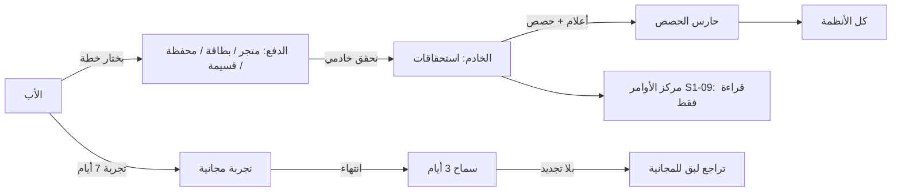
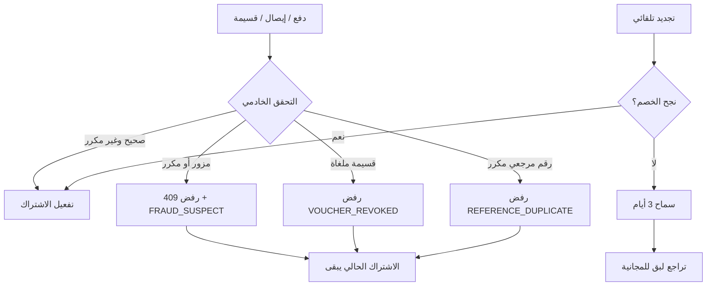
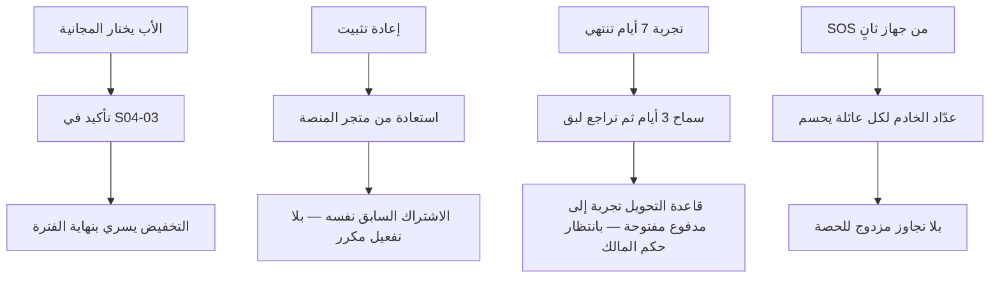
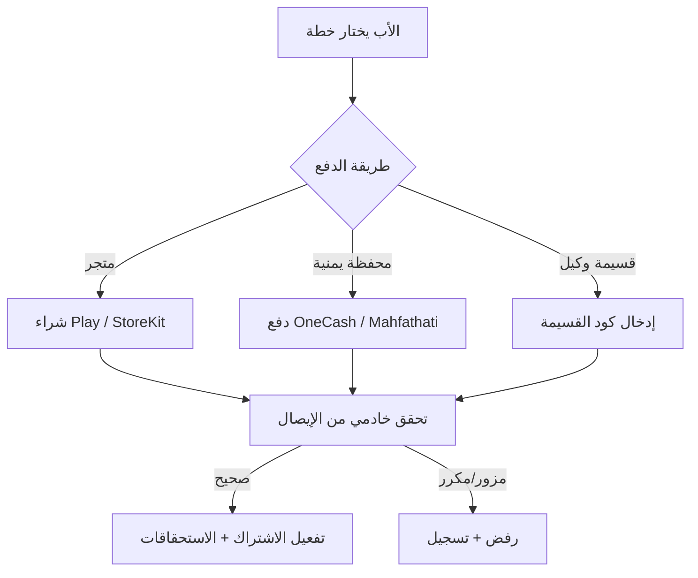
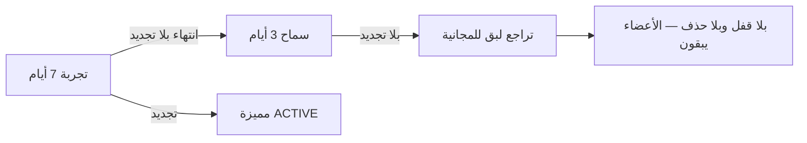

# S1-04: الخطط والاشتراكات (Plans & Subscriptions)

- **الحالة:** approved | **المرحلة:** 1 (نواة الحماية) · **آخر تحديث:** 2026-11-06
- **القرارات الحاكمة:** Q-001 · Q-012 · Q-025 · Q-055 · Q-098 · Q-106 · Q-126 · Q-127 · Q-128 · Q-129 · Q-130 · Q-131 · D-021 · G-006 · G-011 · Q-163 · Q-056 · Q-007 · Q-251 · Q-239
- **حالة المراجعة:** §§1–8 + §10 معتمدة بالكامل في التخطيط (حكم المالك 2026-11-06) · §9 في مرحلة التصميم.
- **الأدلة المرجعية:** المواصفة القديمة S1-04 (مرجع فقط، G-009) · Qustodio (ترخيص خادمي + حارس حصة + 3 مستويات) · FamiSafe (تجربة 7 أيام + تحقق خادمي من الإيصالات) · FamilyWall (مقعد عائلي واحد + قسائم) · Life360 (تدهور لبق)

## 1. الهدف والتحليل والنطاق

**الهدف:** نظام الفوترة: ثلاث خطط (مجانية دائمة + أساسية + مميزة كاملة)، والحصص (أفراد، رسائل SMS، ميزانية ذكاء)، وطرق دفع لعالمين (الخليج: متاجر وبطاقات؛ اليمن: محافظ وقسائم وكلاء ودفع يدوي)، وحزم تعبئة الرسائل، وتجربة مجانية 7 أيام، وفترة سماح 3 أيام، وتراجع لبق عند انتهاء الاشتراك.

**القواعد الثلاث:**

1. **الأمان لا يُحجب أبداً:** SOS والموقع الأساسي والدردشة والمهام مجانية للأبد في كل الخطط — لا خطة تحجب السلامة.
2. **الخطط أعلام وحصص بلا كود (Q-055):** كل خطة أعلام مزايا + حصص؛ وتغيير حصة أو ميزة يتم من لوحة بلا كود.
3. **اشتراك عائلي واحد لعالمين (Q-025):** اشتراك واحد يغطي كل أجهزة العائلة وعبر المنصات؛ والخليج يدفع عبر المتجر أو البطاقات، واليمن عبر المحافظ أو قسيمة وكيل أو دفع يدوي مسبق.

**مصفوفة الخطط (تعريف المستوى الأوسط — Q-126):**

| الميزة | المجانية | الأساسية | المميزة |
|---|---|---|---|
| الأفراد | حتى 5 | حتى 10 | غير محدود |
| رسائل SMS شهرياً | 20 | 50 | 100 |
| تحقق الذكاء من المهام | ✅ | ✅ | ✅ |
| ميزانية الذكاء الشهرية | تحقق المهام فقط | تحقق + مساعد محدود | كاملة |
| سجل المواقع | 7 أيام | 7 أيام | 7 أيام |
| التجربة المجانية | — | — | 7 أيام تجربة |

**الأسعار (Q-127/Q-128):** الخليج 19.99 ر.س شهرياً / 179.99 سنوياً للمميزة؛ وأسعار الأساسية تُحدد مع المواصفة (انظر §3)؛ واليمن سعر محلي مخفّض بالريال يُحدد قبل الإطلاق (Q-132).

**خارج النطاق:** خطط مؤسسية/B2B (المرحلة 6 — سؤال مفتوح Q-149)؛ والفواتير الضريبية التفصيلية (سؤال مفتوح Q-150 — قبل الإطلاق)؛ واشتراك دائم (Lifetime) خارج المرحلة 1 (Q-220) — سؤال مفتوح Q-151 — قبل الإطلاق.

**المصطلحات:** خطة (مستوى اشتراك: مجانية/أساسية/مميزة) · مستوى (tier) · حصة (حد استهلاك شهري: أفراد/SMS/ذكاء) · اشتراك (ربط عائلة بخطة وفترة) · استحقاق (الميزات المفتوحة فعلاً لعائلة من الخادم) · فترة تجريبية (7 أيام مميزة مجاناً) · فترة سماح (3 أيام بعد الانتهاء قبل التراجع) · تراجع لبق (عودة للمجانية بلا قفل ولا حذف) · تعبئة (شراء حصص SMS إضافية) · قسيمة (كود وكيل يفعّل اشتراكاً).

**ملاحظة إعادة الاستخدام:** الترخيص خادم-المنشأ + الاستحقاقات من الخادم (Qustodio `licenseType/maxDevices`؛ FamilyWall `isPremium`؛ FamiSafe `GET subscription`)؛ وحارس الحصة مع ترقية لبقة (Qustodio `devicesCount > maxDevices`)؛ ومقعد عائلي واحد (FamilyWall + Life360)؛ وتجربة 7 أيام (FamiSafe + Life360)؛ وتدهور لبق عند الانتهاء (Life360)؛ والتحقق الخادمي من الإيصالات؛ والفرع القديم S1-04 (وعد الأمان + التراجع اللبق + سجل الإيصالات).



## 2. سيناريوهات المستخدم

- **4-1 بداية مجانية:** عائلة جديدة تُنشأ فتبدأ تلقائياً على الخطة المجانية (0 ر.س) بحالة ACTIVE — الأمان كاملاً من اليوم الأول.
- **4-2 ترقية عبر المتجر:** الأب في الخليج يرقّي للمميزة من شاشة المقارنة عبر Google Play؛ والخادم يتحقق من الإيصال؛ وتُفتح الميزات فور التحقق على كل أجهزة العائلة.
- **4-3 دفع يمني بقسيمة:** الأب في اليمن يشتري قسيمة من وكيل ويدخل كودها؛ والخادم يتحقق من القسيمة؛ ويُفعَّل الاشتراك المميز فوراً.
- **4-4 نفاد حصص SMS وتعبئة:** تنفد رسائل العائلة (20 في المجانية)؛ والأب يشتري حزمة تعبئة 50 رسالة؛ وتُضاف للرصيد فوراً.
- **4-5 تجربة ثم سماح ثم تراجع:** الأب يبدأ تجربة 7 أيام للمميزة؛ وتنتهي التجربة بلا تجديد؛ وتبقى الميزات 3 أيام سماح؛ ثم تراجع لبق للمجانية — بلا قفل وبلا حذف بيانات، والأعضاء الحاليون يبقون.
- **4-6 تجاوز حصة الأفراد:** الأب يحاول إضافة العضو السادس في المجانية (الحد 5)؛ وتظهر بطاقة ترقية لبقة؛ فيرقّي للأساسية ويضيف العضو.
- **4-7 عرض الخطة في مركز الأوامر:** الأب يرى خطته واستهلاكه (قراءة فقط) في S1-09؛ وينقر "إدارة" فينتقل إلى S1-04.
- **4-8 فشل التجديد التلقائي:** ينتهي اشتراك المميزة ويفشل خصم التجديد (بطاقة مرفوضة)؛ ويبقى الاشتراك الحالي حتى نهاية فترته (PAYMENT_FAILED — §7)؛ ثم يدخل سماح 3 أيام؛ فإن لم يُجدَّد تراجع لبق للمجانية.
- **4-9 إيصال مزور أو مكرر:** يصل إيصال مزور أو مكرر للتحقق الخادمي؛ فيُرفض (409 `RECEIPT_INVALID` / `RECEIPT_DUPLICATE`) ويُسجَّل كـ FRAUD_SUSPECT؛ ولا يُفعَّل أي اشتراك.
- **4-10 قسيمة ملغاة:** يدخل الأب كود قسيمة ألغاها الوكيل قبل الاستخدام؛ فيُرفض (`VOUCHER_REVOKED`) بلا تفعيل؛ ويبقى اشتراكه الحالي كما هو.
- **4-11 تخفيض إلى المجانية:** الأب على الأساسية يختار المجانية من S04-02؛ فيؤكد في S04-03؛ فيسري التخفيض بنهاية الفترة المدفوعة (لا استرداد جزئي تلقائي)؛ وتبقى الميزات حتى ذلك الحين.
- **4-12 نهاية التجربة:** تنتهي تجربة 7 أيام؛ والمسار المحكوم الوحيد هو سماح 3 أيام ثم تراجع لبق (REQ-012/013/014) — وقاعدة التحويل تجربة←مدفوع مفتوحة بانتظار حكم المالك (NEW-S104-07 — مبوَّبة): لا خصم تلقائي ولا اشتراك صريح يُفترض هنا.
- **4-13 فشل دفع المحفظة:** يبدأ الأب دفعاً بمحفظة يمنية ثم يفشل التحقق (رقم مرجعي مكرر أو رفض مزوّد)؛ فيُرفض (`REFERENCE_DUPLICATE` / `PAYMENT_FAILED`)؛ ويبقى اشتراكه الحالي حتى نهاية فترته؛ ولا يُفعَّل الاشتراك قبل `VERIFIED` (Q-251).
- **4-14 استعادة بعد إعادة التثبيت:** يعيد الأب تثبيت التطبيق؛ فيستعيد مشترياته من متجر المنصة نفسه (REQ-005)؛ فيُفعَّل اشتراكه السابق نفسه بلا تفعيل مكرر وبلا اشتراك ثانٍ.
- **4-15 حصة على جهازين:** للطفل جهازان مقترنان (Q-230)؛ ويُرسَل SOS من الثاني بعد أن استهلك الأول رسائل الطوارئ الثلاث؛ فيحسم عدّاد الخادم لكل عائلة (Q-239) — بلا تجاوز مزدوج للحصة.

**مخطط مسارات الفشل (سيناريوهات بصرية):**



**مخطط التخفيض والاستعادة والحصة متعددة الأجهزة (سيناريوهات بصرية):**



**مخطط الشراء والتفعيل (سيناريوهات بصرية):**



**مخطط التجربة والسماح والتراجع:**



## 3. المتطلبات الوظيفية

### الخطط
- **REQ-001:** ثلاث خطط (مجانية/أساسية/مميزة) بمصفوفة §1؛ وكل خطة أعلام مزايا + حصص قابلة للتعديل من لوحة بلا كود؛ وكتالوج الخطط يُقرأ عبر `GET /api/v1/plans` (عام — بلا مصادقة): يعيد الخطط الثلاث بأسعار كل سوق وعملته، وسعر اليمن نص «يُحدد قبل الإطلاق» بلا رقم (Q-132)؛ والكتالوج قابل للتخزين المؤقت ويُعرض دون اتصال من النسخة المحفوظة مع عمرها. [Q-055/Q-126 · DIRECT]
- **REQ-002:** كل عائلة جديدة تبدأ تلقائياً على المجانية بحالة ACTIVE وتكلفة صفر. [Q-055/Q-126 · DERIVED]
- **REQ-003:** أسعار الأساسية: 9.99 ر.س شهرياً / 89.99 سنوياً (خصم سنوي ~25%) [محددة في المواصفة — §1]؛ وأسعار المميزة 19.99/179.99 (Q-127)؛ وأسعار اليمن بالريال تُحدد قبل الإطلاق (Q-132).
- **REQ-004:** الترقية فورية عند الدفع؛ والتخفيض يسري بنهاية الفترة المدفوعة (لا استرداد جزئي تلقائي).

### الدفع
- **REQ-005:** الخليج: Google Play Billing + بطاقات عبر الويب (Tap/Moyasar)؛ واستعادة المشتريات من متجر المنصة نفسه (`POST /api/v1/families/{id}/billing/restore` — S04-11): تُعيد تفعيل مشتريات سابقة بلا تفعيل مكرر (idempotent بمفتاح المعاملة — §7). [Q-025 · DIRECT]
- **REQ-006:** اليمن: محافظ (OneCash/Mahfathati) + دفع يدوي مسبق + قسائم وكلاء. [Q-025 · Q-251 · DIRECT]
- **REQ-007:** التحقق الخادمي من المدفوعات (إيصالات المتاجر + قسائم الوكلاء) إلزامي (S2S)؛ ولا يُعتد بأي تأكيد محلي. [Q-025 · Q-217 · DERIVED]
- **REQ-008:** القسيمة: كود لمرة واحدة يُتحقق منه خادمياً ثم يفعّل الاشتراك؛ وقابلة للإلغاء قبل الاستخدام. [Q-025 · DERIVED]

### الحصص والتعبئة
- **REQ-009:** حارس الحصص: فحص الأفراد/SMS/ميزانية الذكاء على الخادم عند كل استخدام؛ والتجاوز يردّ ببطاقة ترقية لبقة. [Q-055 · DIRECT]
- **REQ-010:** حزم تعبئة SMS (50 رسالة) تُشترى وتُضاف لرصيد الشهر. [Q-129 · DIRECT]
- **REQ-011:** تجاوز طوارئ: 3 رسائل SOS بعد نفاد الحصة في كل دورة (SOS فقط)؛ والأب يُشعَر فوراً بكل رسالة طارئة وعند النفاد. [Q-106 · Q-163 · DIRECT]

### التجربة والسماح والتراجع
- **REQ-012:** تجربة مجانية 7 أيام للمميزة — مرة واحدة لكل عائلة. [Q-130 · DIRECT]
- **REQ-013:** فترة سماح 3 أيام بعد انتهاء الاشتراك بلا تجديد — الميزات تبقى؛ وخلال السماح يستطيع الأب التجديد الآن (`POST /api/v1/families/{id}/plan/renew` — S04-09) فيعود الاشتراك ACTIVE فوراً. [Q-131 · DIRECT]
- **REQ-014:** التراجع اللبق: عودة للمجانية بلا قفل وبلا حذف بيانات؛ والأعضاء الحاليون يبقون فعالين مع حظر إضافة جدد فقط. [Q-131 · DERIVED]

### التكامل
- **REQ-015:** الخطة للقراءة فقط في مركز الأوامر S1-09 (الخطة الحالية + الاستهلاك)؛ و"إدارة" تنقل إلى S1-04. [Q-098 · DIRECT]
- **REQ-016:** ميزانية ذكاء لكل عائلة حسب خطتها + مفتاح إيقاف؛ ونفاد الميزانية يوقف مزايا الذكاء دون أن يمس السلامة. [Q-012 · DIRECT]

## 4. الواجهات والعقود

### نقاط الوصول REST

كل نقطة تحمل مفتاحها (R2-S104-04 — §6)؛ وأي نقطة بلا مفتاح مسمى تُذكر صراحةً كعامة أو كمبوَّبة.

- `GET /api/v1/plans` — كتالوج الخطط (**عام — بلا مصادقة**). الرد: `{plans: [{plan_id, tier_level, title_ar, flags, quotas, prices: [{market, price_cents, currency}]}]}`. الأخطاء: بلا أخطاء مسماة (كتالوج عام). (REQ-001.)
- `GET /api/v1/families/{id}/plan` — الخطة الحالية + الاستهلاك (قراءة فقط؛ وتستخدمه S1-09) — المفتاح: `billing.view`. الرد: `{plan_id, tier_level, status, current_period_end, members_used, members_limit, sms_used, sms_limit, topup_sms_balance, sms_emergency_remaining, ai_budget}`. الأخطاء: `SUBSCRIPTION_NOT_FOUND` · `PLAN_NOT_FOUND`. (REQ-015.)
- `POST /api/v1/families/{id}/plan/upgrade` — بدء ترقية (يعيد تفاصيل الدفع حسب القناة) — المفتاح: `billing.manage`. الطلب: `{plan_id, billing_interval (MONTHLY/ANNUAL)}`. الرد: `{plan_id, channel (store/card/wallet/manual/voucher), payment_details}` — وتفاصيل الدفع حسب القناة (من عقد القناة الحقيقي)؛ والتفعيل نفسه لا يتم هنا بل بعد التحقق الخادمي (REQ-007). الأخطاء: `PLAN_NOT_FOUND` · `PAYMENT_FAILED`. (REQ-004.)
- `POST /api/v1/families/{id}/billing/purchase/verify-receipt` — تحقق خادمي من إيصال المتجر (بلا `father_pin` إطلاقاً — التحقق من الأب محلي على الجهاز؛ وإرسال الـ PIN للخادم ممنوع — إصلاح ثغرة المرجع القديم) — المفتاح: `billing.manage`. الطلب: `{provider (GOOGLE_PLAY/APPLE_APP_STORE), receipt_data}` — و`receipt_data` حمولة معتمة من المزوّد بلا شكل مخترع (التحقق من شكلها في مختبر Q-027). الرد: `{validation_status (VALIDATED_SUCCESS/FRAUD_SUSPECT/EXPIRED), plan_id, status}`. الأخطاء: `RECEIPT_INVALID` · `RECEIPT_DUPLICATE` · `SUBSCRIPTION_NOT_FOUND`. (REQ-007.)
- `POST /api/v1/families/{id}/billing/voucher/redeem` — استبدال كود قسيمة وكيل — المفتاح: `billing.voucher.redeem`. الطلب: `{code}`. الرد: `{plan_id, status: "ACTIVE", duration_months, expires_at}`. الأخطاء: `VOUCHER_INVALID` · `VOUCHER_USED` · `VOUCHER_REVOKED`. (REQ-008.)
- `POST /api/v1/families/{id}/billing/topup` — شراء حزمة تعبئة SMS (الحزمة الواحدة المحكومة — 50 رسالة — REQ-010) — المفتاح: `billing.topup.buy`. الطلب: `{channel (store/card/wallet/manual)}` — ويُستكمل الدفع عبر مسار القناة (S04-04/S04-05)؛ وسعر الحزمة من الكتالوج عند وجود جدول المنتج (R2-S104-11 — مبوَّبة — بلا رقم مخترع هنا). الرد: `{added_messages: 50, topup_sms_balance}`. الأخطاء: `PAYMENT_FAILED` · `SUBSCRIPTION_NOT_FOUND`. (REQ-010.)
- `POST /api/v1/families/{id}/billing/wallet/initiate` — بدء دفع محفظة يمنية (الأب وحده — `billing.manage`): ينشئ سجل دفع (`payment_confirmation` — §5) بحالة `INITIATED`؛ المدخل `{plan_id, provider}` حيث `provider` اسم المحفظة فقط (`ONECASH` / `MAHFATHATI`)؛ والمخرج `{payment_id, status: "initiated"}`. الأخطاء: `PLAN_NOT_FOUND` · `PAYMENT_FAILED`. (REQ-006 · Q-251.)
- `POST /api/v1/families/{id}/billing/wallet/confirm` — تأكيد دفع محفظة برقم مرجعي (الأب وحده — `billing.manage`): المدخل `{payment_id, wallet_reference}` — الرقم المرجعي كما يظهر في تطبيق المحفظة (نص معتم ينقله الأب كما هو)؛ والمخرج `{payment_id, status: "pending_verification"}` — الخادم يسجل التأكيد «بانتظار التحقق» ولا يفعّل الاشتراك قبل تحقق المزوّد (Q-251). الأخطاء: `PAYMENT_NOT_FOUND` · `PAYMENT_ALREADY_CONFIRMED` · `REFERENCE_DUPLICATE` · `WALLET_REFERENCE_REQUIRED`. (REQ-006 · Q-251.)
- `POST /api/v1/families/{id}/billing/manual/confirm` — تأكيد دفع يدوي مسبق (الأب وحده — `billing.manage`): المدخل `{plan_id, reference}` — رقم مرجعي معتم كما يقدمه الأب (بلا صيغة مخترعة)؛ والمخرج `{payment_id, status: "pending_verification"}` — الخادم ينشئ سجل دفع «بانتظار التحقق» ولا يفعّل الاشتراك قبل التحقق الخادمي (Q-251). الأخطاء: `PLAN_NOT_FOUND` · `PAYMENT_ALREADY_CONFIRMED` · `REFERENCE_DUPLICATE` · `WALLET_REFERENCE_REQUIRED`. (REQ-006 · Q-251.)
- `GET /api/v1/families/{id}/billing/usage` — استهلاك الحصص (SMS/أفراد/ذكاء) — المفتاح: `billing.view`. الرد: `{period, sms: {sent, limit, otp_used, emergency_used}, members: {used, limit}, ai: {calls, budget}, topup_sms_balance, sms_emergency_remaining}` — و`period` شهر تقويمي (YYYY-MM — Q-252 — فترة الحصة مستقلة عن فترة الاشتراك المدفوعة `current_period_start/end`). الأخطاء: `SUBSCRIPTION_NOT_FOUND`. (REQ-009.)
- `POST /api/v1/families/{id}/plan/trial/start` — بدء التجربة 7 أيام — المفتاح: `billing.manage`. الطلب: `{}`. الرد: `{status: "TRIAL", trial_started_at, trial_ends_at}`. الأخطاء: `TRIAL_ALREADY_USED`. (REQ-012.)
- `POST /api/v1/families/{id}/plan/cancel-renewal` — إلغاء التجديد التلقائي — المفتاح: `billing.manage`. الطلب: `{}`. الرد: `{auto_renew: false, current_period_end}` — والميزات تبقى حتى نهاية الفترة المدفوعة ثم تراجع لبق. الأخطاء: `SUBSCRIPTION_NOT_FOUND`. (REQ-004.)
- `POST /api/v1/families/{id}/billing/restore` — استعادة المشتريات من متجر المنصة نفسه — المفتاح: `billing.manage`. الطلب: `{provider (GOOGLE_PLAY/APPLE_APP_STORE)}` — متجر منصة الجهاز. الرد: `{restored: true, plan_id, status}` — أو `{restored: false}` عند غياب مشتريات سابقة (بلا تفعيل وبلا خطأ)؛ والاستعادة idempotent بمفتاح المعاملة (بلا تفعيل مكرر — §7). الأخطاء: `RECEIPT_INVALID` (إيصال مستعاد غير صالح). (REQ-005.)
- `PATCH /api/v1/admin/plans/{planId}` — تعديل أعلام/حصص الخطة من اللوحة بلا كود (لوحة إدارية خارج التطبيق؛ لا يملك الأب هذا الإجراء) — المفتاح: **بلا مفتاح محكوم — يتطلب حكم مالك (R2-S104-02 — مصعَّد: لا دور إداري ولا مفتاح `admin.*` في النموذج المحكوم)**. الطلب: `{flags?, quotas?}` (jsonb — Q-055). الرد: `{plan_id, flags, quotas}`. الأخطاء: `PLAN_NOT_FOUND` · `VALIDATION_FAILED`. (REQ-001 · Q-055.)
- `POST /api/v1/families/{id}/billing/ai/kill-switch` — قلب مفتاح إيقاف الذكاء (R2-S104-01 — Q-012/Q-221) — المفتاح: `billing.manage` (الأب وحده). الطلب: `{enabled: boolean}`. الرد: `{enabled, updated_at}` — وكل قلب للمفتاح يُسجَّل في `AuditEvent` (domain=billing)؛ والحالة تُكتب في موضع واحد (وحدة الفوترة) وتُقرأ منها بوابة الذكاء (ARCH §6.5)؛ والعميل يقرأ الحالة من `GET .../plan` (لا نسخة عميل مستقلة). الأخطاء: `SUBSCRIPTION_NOT_FOUND` · `VALIDATION_FAILED`. (REQ-016.)
- `POST /api/v1/families/{id}/plan/renew` — تجديد الآن (R2-S104-29 — زر S04-09 «جدّد الآن») — المفتاح: `billing.manage`. الطلب: `{plan_id}` — الخطة نفسها (تجديد الفترة نفسها؛ واختيار خطة أخرى يكون من S04-02). الرد: `{plan_id, status: "ACTIVE", current_period_start, current_period_end}` — بعد إتمام الدفع عبر قناة الخطة (S04-04/S04-05). الأخطاء: `PLAN_NOT_FOUND` · `SUBSCRIPTION_NOT_FOUND` · `PAYMENT_FAILED`. (REQ-013.)

### أحداث MQTT

| الموضوع | QoS | Retained | الحمولة | الناشر | المشترك |
|---|---|---|---|---|---|
| `family/{family_id}/billing/subscription-changed` | 1 | لا | `{family_id, plan_id, tier_level, status, effective_at}` — حالة خطة فقط، بلا أسعار ولا تفاصيل دفع | وحدة الفوترة (Ktor billing) | S1-09 (تحديث العرض)؛ وS1-07 وS1-10 (إعادة قراءة الاستحقاق عبر `GET /families/{id}/plan`) |
| `family/{family_id}/billing/quota-warning` | 1 | لا | `{family_id, quota (members/sms/ai), used, limit, threshold_percent: 80}` — تنبيه 80% (Q-216) | حارس الحصص (Billing) | S1-09 (إشعار الأب) |
| `family/{family_id}/billing/sub-grace-period` | 1 | لا | `{family_id, plan_id, grace_started_at, grace_ends_at}` | المجدول (Billing) | S1-09 (إشعار دخول السماح) |
| `family/{family_id}/billing/sub-renewed` | 1 | لا | `{family_id, plan_id, period_start, period_end, provider}` | وحدة الفوترة (معالج Webhook) | S1-09 |
| `family/{family_id}/billing/quota-mirror` | 1 | نعم | `{quota_balance, sms_emergency_remaining, cycle_end, server_timestamp, mirror_version}` — تُدفع عند كل تغيير في `quota_usage`؛ والمشترك يستبدل مرآته كاملةً باللقطة — الخادم يفوز دائماً | الفوترة `SmsLedger` (Q-239) | كل أجهزة العائلة |

- المصدر: الوسيط §6 — صف «لوحة/تقويم/فوترة»: QoS 1، Retained لا.
- **خصوصية الحمولات:** حمولات الفوترة حالة خطة/استخدام فقط — بلا أسعار ولا تفاصيل دفع ولا أرقام مرجعية؛ وأي حمولة تشمل تفاصيل فوترة تُعد تسرباً في ناقل الأحداث.

### قناة MethodChannel (Kotlin)
- `launchStorePurchase` — فتح ورقة شراء المتجر.
- `getCachedPlan` — الخطة المحفوظة محلياً (دون اتصال).

### رموز الخطأ (`BIL_*`)
`PLAN_NOT_FOUND` · `SUBSCRIPTION_NOT_FOUND` · `RECEIPT_INVALID` · `RECEIPT_DUPLICATE` · `VOUCHER_INVALID` · `VOUCHER_USED` · `VOUCHER_REVOKED` · `QUOTA_EXCEEDED` · `TRIAL_ALREADY_USED` · `PAYMENT_FAILED` · `PAYMENT_NOT_FOUND` · `PAYMENT_ALREADY_CONFIRMED` · `REFERENCE_DUPLICATE` · `WALLET_REFERENCE_REQUIRED` · `VALIDATION_FAILED` (طلب غير صالح — 400 عام) — وبصيغة الخطأ الموحدة `{code, message_ar, trace_id}`.

### التحقق من دفع المحفظة واليدوي (Q-251)

- **محول المزوّد المسمى:** تأكيد المزوّد يصل عبر محول خادمي مسمى `WalletProviderAdapter` (محول مزوّد المحفظة) — واجهة تحقق خادمية بلا أي تفاصيل API للمزوّد حتى عقد حقيقي معه؛ وتفاصيل تمرير المبلغ إلى تطبيق المحفظة (رابط عميق/رمز/تعليمات) من العقد الحقيقي — لا تُخترع هنا.
- **انتقالات الحالة:** `INITIATED` (بدأ الأب الدفع في المحفظة) ← تأكيد الأب بالرقم المرجعي → `PENDING_VERIFICATION` (بانتظار تحقق المزوّد) ← تأكيد المزوّد عبر المحول → `VERIFIED` (يُفعَّل الاشتراك فوراً + سجل `purchase_receipt` بحالة `VALIDATED_SUCCESS` + حدث `subscription-changed`)؛ أو رفض التحقق → `REJECTED` (بلا تفعيل — `PAYMENT_FAILED`).
- **الدفع اليدوي:** السجل يبقى `PENDING_VERIFICATION` حتى يصل التحقق الخادمي عبر قناة تحقق تُسمى عند إجراء حقيقي — بلا تفاصيل مخترعة؛ ولا يُفعَّل الاشتراك قبل `VERIFIED` أبداً (REQ-007: لا يُعتد بأي تأكيد محلي).
- **منع التكرار:** رقم مرجعي مستخدم من قبل → `409 REFERENCE_DUPLICATE`؛ وتأكيد دفع سبق تأكيده → `PAYMENT_ALREADY_CONFIRMED`؛ ورقم مرجعي فارغ → `WALLET_REFERENCE_REQUIRED`؛ وسجل دفع غير موجود → `PAYMENT_NOT_FOUND`.

## 5. البيانات — النموذج

**جداول النظام:**
- `plan` — الخطة: `plan_id` · `tier_level` (FREE/BASIC/PREMIUM) · `title_ar` · `description_ar` · `billing_interval` (LIFETIME_FREE/MONTHLY/ANNUAL) · `flags` (jsonb — أعلام المزايا) · `quotas` (jsonb — max_members/sms_monthly/ai_budget_monthly) · `is_active`. (الأعلام والحصص jsonb = تعديل بلا كود ولا تغيير مخطط — Q-055.)
- `plan_price` — سعر الخطة لكل سوق: `plan_id` · `market` (gulf/yemen) · `price_cents` · `currency` (SAR/YER) · `is_active`. (المفتاح المركب: `plan_id` + `market` — سعر لكل سوق؛ فيتعايش صف خليجي وصف يمني لنفس `plan_id`.)
- `family_subscription` — اشتراك العائلة: `id` · `family_id` (UNIQUE + RLS) · `plan_id` · `status` (ACTIVE/TRIAL/IN_GRACE_PERIOD/EXPIRED/CANCELLED) · `billing_provider` (SYSTEM_FREE/GOOGLE_PLAY/APPLE_APP_STORE/WALLET/VOUCHER/MANUAL) · `provider_subscription_id` (text — معرّف اشتراك معتم من المزوّد) · `provider_original_transaction_id` (text — معرّف معاملة أصلي معتم من المزوّد) · `current_period_start`/`current_period_end` · `trial_started_at`/`trial_ends_at` (nullable — نافذة التجربة 7 أيام — Q-130) · `grace_started_at`/`grace_ends_at` (nullable — نافذة السماح 3 أيام — Q-131) · `auto_renew` · `trial_used` · `purchased_by` (uuid — FK إلى المستخدم (البالغ) الذي اشترى — نفس هوية `purchase_receipt.user_id` — S1-02).
- `purchase_receipt` — سجل تدقيق مالي: `id` · `family_id` · `user_id` · `provider` · `product_id` (text — معرّف منتج معتم من المزوّد) · `receipt_data` (حمولة مشفرة) · `validation_status` (VALIDATED_SUCCESS/FRAUD_SUSPECT/EXPIRED) · `server_verified_at` · `raw_provider_response` (jsonb).
- `voucher` — القسيمة: `voucher_id` · `code` (فريد) · `plan_id` · `duration_months` · `status` (ISSUED/REDEEMED/REVOKED/EXPIRED) · `issued_by` (الوكيل) · `issued_at` · `redeemed_by_family_id` · `redeemed_at` · `expires_at`.
- `quota_usage` — عدّاد الاستهلاك (كان مذكوراً بلا تعريف في المرجع القديم — يُعرَّف هنا): `family_id` · `period` (YYYY-MM) · `sms_sent` (إجمالي SMS الصادرة) · `sms_emergency_used` (SOS فقط) · `sms_otp_used` (رسائل OTP الاحتياطية فقط — منفصل عن SOS) · `ai_calls` · `topup_sms_balance` · `updated_at` · `mirror_version` (عدد صحيح رتيب أحادي لكل عائلة+دورة — يملكه الخادم ويُرفع عند كل تغيير في العدّاد؛ يُسلَّم في لقطة المرآة و`POST .../quota/mirror-sync` — S1-07 §4-1). (المفتاح: family_id + period.) **العدّاد مرجع خادمي لكل عائلة لا لكل جهاز:** `sms_emergency_used` يحسب رسائل الطوارئ الثلاث (Q-163) لكل عائلة في الدورة — تُجمع استخدامات كل أجهزة العائلة بعد إزالة التكرار عند المزامنة، فلا يعيد جهاز ثانٍ (Q-230) صرف ما صرفه الأول (Q-239). ومرآة S1-07 تحمل التقسيم نفسه (OTP مقابل SOS) عند تحديثها — متابعة عبر-أنظمة خارج نطاق هذا التغيير. **فترة الحصة (Q-252):** شهر تقويمي (YYYY-MM) — تُصفَّر الحصص أول كل شهر، وينتهي رصيد التعبئة بنهاية الشهر، وتبدأ دورة رسائل SOS الـ 3 أول الشهر؛ وهي مستقلة عن فترة الاشتراك المدفوعة (`current_period_start`/`current_period_end` في `family_subscription`) التي تتبع تاريخ الفوترة.
- `payment_confirmation` — سجل الدفع/التأكيد اليدوي (Q-251): `payment_id` · `family_id` (RLS) · `plan_id` · `channel` (WALLET/MANUAL — من `billing_provider`) · `provider` (ONECASH/MAHFATHATI — للمحفظة فقط؛ null لليدوي) · `reference` (الرقم المرجعي المعتم كما قدمه الأب — نص كما هو؛ null قبل التأكيد) · `status` (INITIATED/PENDING_VERIFICATION/VERIFIED/REJECTED) · `initiated_by` · `initiated_at` · `confirmed_at` · `verified_at`. (وعند `VERIFIED` يُكتب سجل `purchase_receipt` بحالة `VALIDATED_SUCCESS` — سجل التدقيق المالي.)

**مراجع:** عدد الأعضاء من S1-02 (لحصة الأفراد)؛ وكل شراء/ترقية/إلغاء/استبدال يُسجَّل في AuditEvent (domain=billing)؛ والخطة تُقرأ في S1-09 عبر `GET /api/v1/families/{id}/plan`. **مخازن العميل (ليست جداول خادم):** الخطة المحفوظة + حالة الحصص (للقراءة دون اتصال).

## 6. القواعد والصلاحيات

### مفاتيح الصلاحيات (`billing.*`)
- `billing.view` — عرض الخطة والاستهلاك (الأب + البالغ المفوَّض حسب القالب).
- `billing.manage` — إدارة الاشتراك (ترقية/تخفيض/تجربة/إلغاء تجديد) — **الأب وحده (المالك)**.
- `billing.topup.buy` — شراء حزمة تعبئة SMS — **الأب وحده (المالك)**.
- `billing.voucher.redeem` — استبدال قسيمة — **الأب وحده**.

### ثوابت صلبة (لا تُكسر)
- السلامة لا تُحجب بأي خطة أبداً (SOS والموقع الأساسي والدردشة والمهام مجانية للأبد).
- الانتهاء بطابع وقت الخادم فقط — ساعة العميل لا يُعتد بها أبداً (دفاع ضد التلاعب).
- لا يُعتد بأي تأكيد دفع محلي — التحقق خادمي فقط.
- الـ PIN لا يغادر الجهاز أبداً.
- الحصص تُفرض على الخادم؛ وعرض العميل استرشادي فقط.
- اشتراك واحد لكل عائلة.
- التراجع اللبق: انتقال واحد — الصف يصبح `status=ACTIVE` على الخطة المجانية (`plan_id` = خطة FREE)؛ وانتهاء الخطة المدفوعة يُسجَّل في AuditEvent (لا حالة EXPIRED انتقالية على الصف نفسه — R2-S104-21)؛ وبلا قفل وبلا حذف؛ والأعضاء الحاليون يبقون.
- اشتقاق الحالة من الطوابع (R2-S104-10): `TRIAL` من `trial_started_at`/`trial_ends_at`؛ و`IN_GRACE_PERIOD` من `grace_started_at`/`grace_ends_at`؛ و`current_period_start`/`current_period_end` فترة الاشتراك المدفوعة وحدها — لا تُستخدم لحساب التجربة أو السماح؛ وعند انتهاء التجربة يبدأ السماح بـ `grace_started_at`؛ وعند انتهاء السماح يقع التراجع اللبق.
- التجربة مرة واحدة لكل عائلة وغير قابلة للتحويل.
- القسيمة لمرة واحدة؛ ولا استرداد لها عبر التطبيق.
- الفوترة مخفية تماماً عن الأطفال والمراهقين (لا تُعرض ولا تُذكر).

### قواعد التشغيل
- الترقية فورية؛ والتخفيض بنهاية الفترة المدفوعة.
- التجديد التلقائي عبر Webhook المتجر؛ واليدوي/القسيمة بلا تجديد تلقائي (تجديد يدوي).
- الحصص تُصفَّر أول كل شهر تقويمي (YYYY-MM — Q-252)؛ ورصيد التعبئة ينتهي بنهاية الشهر التقويمي ولا يتراكم.
- تنبيه للأب عند 80% (Q-216) من أي حصة في الشهر التقويمي.
- تجاوز الطوارئ 3 رسائل SOS في كل شهر تقويمي (Q-252 — SOS فقط)؛ والأب يُشعَر فوراً بكل رسالة وعند النفاد.
- الإيصالات المكررة تُرفض (409) وتُسجَّل كـ FRAUD_SUSPECT.
- دفع المحفظة واليدوي (Q-251): البدء والتأكيد للأب وحده (`billing.manage` — بلا مفتاح جديد)؛ والرقم المرجعي نص معتم ينقله الأب كما هو — لا يُعتمد دليل دفع حتى تحقق المزوّد عبر `WalletProviderAdapter` (بلا تفاصيل API حتى عقد حقيقي)؛ ولا يُفعَّل الاشتراك قبل `VERIFIED`؛ ورقم مرجعي مكرر يُرفض (`409 REFERENCE_DUPLICATE`).

## 7. الحالات الحدية والأخطاء

- إيصال مزور أو مكرر → يُرفض (409) ويُسجَّل كـ FRAUD_SUSPECT.
- فشل التحقق من الإيصال لعطل اتصال بالمتجر → سماح مؤقت 24 ساعة (Q-215) ثم إعادة محاولة.
- قسيمة مستخدمة من قبل → VOUCHER_USED.
- قسيمة ملغاة أو منتهية → VOUCHER_REVOKED / VOUCHER_INVALID.
- تجربة ثانية لنفس العائلة → TRIAL_ALREADY_USED.
- تجاوز حصة الأفراد (عضو سادس في المجانية) → QUOTA_EXCEEDED + بطاقة ترقية لبقة.
- نفاد SMS أثناء SOS → 3 رسائل طوارئ (SOS فقط) في الشهر التقويمي ثم حظر حتى التعبئة أو بداية الشهر التقويمي التالي (Q-252).
- فشل الدفع (بطاقة مرفوضة) → PAYMENT_FAILED؛ والاشتراك الحالي يبقى حتى نهاية فترته.
- إلغاء التجديد → الميزات تبقى حتى نهاية الفترة المدفوعة ثم تراجع لبق.
- Webhook متأخر أو مكرر → معالجة idempotent بمفتاح المعاملة (لا ترقية مزدوجة).
- طفل/مراهق يصل للفوترة عبر API مباشرة → 403؛ والقسم مخفي تماماً من قوائمه.
- تغيير الخطة أثناء فترة السماح → الترقية تنهي السماح فوراً وتفعّل الخطة الجديدة.
- انتهاء الفترة دون اتصال بالخادم → الخطة المحفوظة تُعرض مع وقت صريح؛ والتحقق من الانتهاء عند أول اتصال بطابع الخادم.

## 8. معايير القبول

- **ACC-001:** ثلاث خطط بمصفوفة §1؛ وتعديل الأعلام والحصص يتم بلا كود. ← REQ-001
- **ACC-002:** عائلة جديدة تبدأ تلقائياً على المجانية (0 ر.س). ← REQ-002
- **ACC-003:** الأسعار: الأساسية 9.99/89.99؛ والمميزة 19.99/179.99. ← REQ-003
- **ACC-004:** الترقية فورية عند الدفع؛ والتخفيض يسري بنهاية الفترة. ← REQ-004
- **ACC-005:** دفع الخليج عبر المتجر: شراء عبر Google Play ← تحقق خادمي من الإيصال ← تفعيل ACTIVE؛ وشراء ببطاقة عبر الويب ← تحقق خادمي ← تفعيل ACTIVE؛ وإيصال مزوَّر ← 409 FRAUD_SUSPECT بلا تفعيل؛ وإيصال مكرر ← 409 بلا تفعيل ثانٍ. ← REQ-005/007
- **ACC-006:** دفع اليمن: دفع محفظة (OneCash/Mahfathati) ← تأكيد برقم مرجعي ← حالة pending_verification (بلا تفعيل) ← تحقق المزوّد ← تفعيل ACTIVE؛ وتأكيد يدوي مسبق ← pending_verification بلا تفعيل قبل التحقق الخادمي VERIFIED؛ ورقم مرجعي مكرر ← 409 REFERENCE_DUPLICATE. ← REQ-006/007
- **ACC-007:** التحقق من الإيصالات خادمي إلزامي؛ ولا يُعتد بتأكيد محلي. ← REQ-007
- **ACC-008:** القسيمة لمرة واحدة وتُتحقق خادمياً قبل التفعيل. ← REQ-008
- **ACC-009:** حارس الحصص يعمل على الخادم؛ والتجاوز يردّ ببطاقة ترقية لبقة. ← REQ-009
- **ACC-010:** حزمة تعبئة 50 رسالة تُشترى وتُضاف لرصيد الشهر فوراً. ← REQ-010
- **ACC-011:** تجاوز طوارئ 3 رسائل SOS يعمل؛ والأب يُشعَر فوراً. ← REQ-011
- **ACC-012:** تجربة 7 أيام تعمل مرة واحدة لكل عائلة. ← REQ-012
- **ACC-013a:** سماح 3 أيام بعد انتهاء الاشتراك بلا تجديد — الميزات تبقى؛ والتجديد أثناء السماح يعود ACTIVE فوراً. ← REQ-013
- **ACC-013b:** بعد السماح بلا تجديد: تراجع لبق للمجانية بكتابة واحدة (ACTIVE على المجانية + AuditEvent بانتهاء الخطة المدفوعة) — بلا قفل وبلا حذف بيانات؛ والأعضاء الحاليون يبقون. ← REQ-014
- **ACC-014:** الخطة للقراءة فقط في مركز الأوامر S1-09. ← REQ-015
- **ACC-015:** ميزانية ذكاء لكل عائلة + مفتاح إيقاف؛ ونفاد الميزانية لا يمس السلامة. ← REQ-016
- **ACC-016:** استعادة المشتريات بعد إعادة التثبيت تعيد تفعيل الاشتراك السابق نفسه بلا تفعيل مكرر وبلا اشتراك ثانٍ؛ واستعادة بلا مشتريات سابقة تعيد حالة صادقة بلا تفعيل. ← REQ-005
- **ACC-017:** كتالوج `GET /api/v1/plans` يعيد الخطط الثلاث بأسعار السوق المطلوب (الخليج بالريال السعودي؛ اليمن نص «يُحدد قبل الإطلاق» بلا رقم) بلا مصادقة؛ والنسخة المحفوظة تُعرض دون اتصال مع عمرها. ← REQ-001

## 9. قائمة الشاشات

**الحالة:** مسودة (drafted) — للمراجعة الصباحية؛ لا اعتماد ليلاً.


## قيود صريحة (تسري على كل شاشات هذا النظام)

- **Q-042 / Q-044:** بلا خط عربي نهائي وبلا درجات ألوان 50–950 نهائية — المسودات البصرية على رموز نظام التصميم الحالية فقط (DS-BR / DS-CL)، والقيد مسجَّل.
- **Q-043:** لا شعار SVG ولا شخصية مرشد مخترعة — علامة نصية «عائلتي» بألوان الشعار (DS-BR) كبديل مؤقت في رأس الشاشات، والفجوة مسجَّلة (G-S04-06).
- **Q-045:** التصميم للهاتف أولاً؛ والحد الأدنى على اللوحي «عدم الكسر» (S-001) — النطاق الكامل للوحي/الطيّ بطاقة صباحية.
- **Q-046:** بلا سياسة تحليلات للأطفال — لا أحداث تحليلية في أي شاشة هنا أصلاً؛ والفوترة مخفية تماماً عن الأطفال والمراهقين (SPEC §6)، فلا شاشة في هذا النظام يراها طفل أو مراهق.
- **Q-157:** لا هدف «24 ساعة» في أي شاشة — لا قائمة إعداد أولي زمنية هنا.
- **Q-201:** لا شاشة حذف/تصدير في هذا النظام — القيد لا ينطبق مباشرةً؛ وسجل الإيصالات للقراءة والتدقيق فقط، ولا حذف له من الواجهة.
- **Q-070:** العربية أولاً RTL؛ وكل نص أدناه مصدر ترجمة بمفتاح `screens.<screen-id>.<element>` (DS-MC-01) — لا نص مخترع داخل الشيفرة.
- **سلامة لا تُحجب:** SOS والموقع الأساسي والدردشة والمهام مجانية للأبد في كل الخطط (SPEC §1/§6) — لا شاشة تحجب السلامة بخطة.
- **سعر اليمن مفتوح بلا رقم (Q-132):** أي سعر يمني يظهر في الواجهة يعرض نص «يُحدد قبل الإطلاق» فقط — بلا رقم مخترع.


### 9.1 فهرس الشاشات

| المعرف | الاسم | الوضع | الأدوار المستهدفة | الغرض | REQ | معايير DS |
|---|---|---|---|---|---|---|
| S04-01 | حالة الخطة والاستهلاك | أهل | الأب (مالك)؛ البالغ المفوَّض (عرض فقط، `billing.view`) | عرض الخطة الحالية والاستهلاك والميزانية والتنبيهات، ونقطة الدخول لكل إجراءات الفوترة | REQ-001/002/009/011/015/016 | DS-CC-05، DS-CM-09، DS-ST-01، DS-ST-05، DS-RT-02 |
| S04-02 | عرض الخطط والمقارنة | أهل | الأب وحده (`billing.manage`) | مقارنة الخطط الثلاث بأسعارها وحصصها واختيار خطة | REQ-001/003 | DS-SE-03، DS-MC-04، DS-RT-07، DS-TY-02 |
| S04-03 | تأكيد تغيير الخطة (ترقية/تخفيض) | أهل | الأب وحده (`billing.manage`) | تأكيد الترقية الفورية أو التخفيض بنهاية الفترة | REQ-004 | DS-SE-05، DS-MC-03، DS-ST-02، DS-CM-01 |
| S04-04 | الدفع عبر المتجر أو البطاقة (الخليج) | أهل | الأب وحده (`billing.manage`) | إتمام الدفع عبر Google Play / App Store أو بطاقة عبر الويب، مع التحقق الخادمي | REQ-005/007 | DS-ST-02، DS-ST-05، DS-MC-03، DS-NV-03 |
| S04-05 | الدفع اليمني: محفظة أو دفع يدوي | أهل | الأب وحده (`billing.manage`) | الدفع عبر محفظة يمنية أو تسجيل دفع يدوي مسبق | REQ-006 | DS-ST-02، DS-ST-05، DS-MC-03، DS-RT-04 |
| S04-06 | استبدال قسيمة وكيل | أهل | الأب وحده (`billing.voucher.redeem`) | إدخال كود قسيمة لمرة واحدة وتفعيل الاشتراك | REQ-006/008 | DS-CM-01، DS-ST-02، DS-MC-03، DS-RT-04 |
| S04-07 | تعبئة SMS | أهل | الأب وحده (`billing.topup.buy`) | شراء حزمة تعبئة وإظهار الرصيد وتجاوز الطوارئ | REQ-010/011 | DS-CM-09، DS-ST-02، DS-MC-04، DS-CC-04 |
| S04-08 | التجربة المجانية | أهل | الأب وحده (`billing.manage`) | بدء تجربة 7 أيام للمميزة مرة واحدة لكل عائلة | REQ-012 | DS-SE-05، DS-MC-04، DS-ST-02 |
| S04-09 | فترة السماح والتراجع اللبق | أهل | الأب (مالك)؛ البالغ المفوَّض (عرض فقط، `billing.view`) | إظهار حالة السماح والتراجع اللبق بلا قفل وبلا حذف | REQ-013/014 | DS-ST-01، DS-MC-04، DS-CC-04، DS-ST-07 |
| S04-10 | بطاقة الترقية اللبقة | أهل | الأب (مالك)؛ البالغ المفوَّض (يُعرض له «اطلب من الأب») | ورقة تظهر عند تجاوز حصة (أفراد/SMS/ذكاء) بلا حظر قاسٍ | REQ-009 | DS-CM-09، DS-MC-04، DS-ST-02، DS-SE-10 |
| S04-11 | إدارة الاشتراك: إلغاء التجديد واستعادة المشتريات | أهل | الأب وحده (`billing.manage`) | إلغاء التجديد التلقائي واستعادة مشتريات المتجر | REQ-004 | DS-SE-05، DS-ST-02، DS-MC-03، DS-CM-01 |
| S04-12 | سجل الإيصالات (قراءة فقط) | أهل | الأب وحده (`billing.manage`) | سجل إيصالات الشراء للقراءة فقط: المزوّد + حالة التحقق + وقت التحقق الخادمي + مرجع الإيصال مقنَّع | REQ-007 | DS-ST-02، DS-ST-05 |

- **عدد الشاشات:** 12 شاشة، كلها وضع أهل؛ ولا شاشة واحدة يراها طفل أو مراهق (SPEC §6: الفوترة مخفية تماماً عن الأطفال والمراهقين — DS-CH-02، DS-CM-09).
- **الدخول:** من مركز الإعدادات، قسم «الخطة والفوترة» (settings-patterns §2، القسم 9)؛ ومن ويدجت الخطة في S1-09 (قراءة فقط + زر «إدارة» ينقل إلى S04-01 — REQ-015)؛ ومن بطاقة الترقية اللبقة S04-10 حيث تظهر.

### 9.2 تفصيل الشاشات

#### S04-01 — حالة الخطة والاستهلاك

- **الحقول الرئيسية:** اسم الخطة الحالية (مجانية/أساسية/مميزة)؛ الحالة (`ACTIVE`/`TRIAL`/`IN_GRACE_PERIOD`/`EXPIRED`/`CANCELLED`)؛ نهاية الفترة الحالية (بطابع الخادم)؛ عدّاد الأفراد (الحالي/الحد: 5 / 10 / غير محدود)؛ عدّاد SMS الشهري (المُرسَل/الحصة: 20 / 50 / 100) + رصيد التعبئة؛ رسائل الطوارئ المتبقية (من 3 في الشهر التقويمي — Q-252)؛ ميزانية الذكاء حسب الخطة (تحقق المهام فقط / تحقق + مساعد محدود / كاملة) + مفتاح إيقاف الذكاء؛ تنبيه اقتراب 80% (Q-216) من أي حصة؛ زر «عرض الخطط»؛ زر «إدارة الاشتراك»؛ رابط سجل الإيصالات (قراءة فقط).
- **التنقل:** من: ويدجت الخطة في S1-09 (REQ-015) / مركز الإعدادات «الخطة والفوترة» / S04-10. إلى: S04-02 (عرض الخطط) / S04-07 (تعبئة) / S04-11 (إدارة الاشتراك) / S04-08 (التجربة، إن لم تُستخدم) / S04-12 (سجل الإيصالات).
- **الحالات (DS-ST):** تحميل — هيكل Skeleton من الكاش المحلي فوراً (DS-ST-01، DS-CC-08)؛ فارغة — لا تنطبق (كل عائلة لها خطة تلقائياً — REQ-002)؛ خطأ — بطاقة خطأ داخل الشاشة مع إعادة محاولة وباقي الشاشة يعمل (DS-ST-06)؛ بلا اتصال — عرض الخطة المحفوظة مع وقت صريح وعمر البيانات (DS-ST-05)؛ نجاح — تحديث العدّادات + Snackbar قصير عند أي تغيير (DS-ST-01)؛ جزئي — فشل عدّاد واحد (مثلاً الذكاء) لا يعطّل بقية الشاشة (DS-ST-06).
- **وايرفريم ASCII:**
```
┌──────────────────────────────┐
│ عائلتي    [الخطة والفوترة]   │
│ خطتك الحالية: المميزة        │
│ الحالة: فعّالة حتى [تاريخ]  │
│ ┌─────────┬─────────┬──────┐ │
│ │ الأفراد │  SMS    │ ذكاء │ │
│ │ 4 / 10  │ 32 / 50 │ كاملة│ │
│ └─────────┴─────────┴──────┘ │
│ رصيد التعبئة: 50 رسالة       │
│ رسائل الطوارئ المتبقية: 3    │
│ [عرض الخطط] [تعبئة SMS]      │
│ [إدارة الاشتراك]             │
└──────────────────────────────┘
```
- **رموز DS المستخدمة:** DS-CC-05، DS-CM-09، DS-ST-01، DS-ST-05، DS-ST-06، DS-RT-02، DS-MC-01.
- **النصوص الدقيقة (مصدر الترجمة):**
  - `screens.s04-01.title` — «الخطة والفوترة»
  - `screens.s04-01.current_plan` — «خطتك الحالية»
  - `screens.s04-01.members_used` — «الأفراد»
  - `screens.s04-01.sms_used` — «رسائل SMS هذا الشهر»
  - `screens.s04-01.topup_balance` — «رصيد التعبئة»
  - `screens.s04-01.emergency_left` — «رسائل الطوارئ المتبقية»
  - `screens.s04-01.ai_budget` — «ميزانية الذكاء»
  - `screens.s04-01.view_plans` — «عرض الخطط»
  - `screens.s04-01.offline_note` — «معروضة من نسخة محفوظة؛ سنحدّثها عند الاتصال»

#### S04-02 — عرض الخطط والمقارنة

- **المصدر:** REQ-001/REQ-003 + DS-SE-03/DS-MC-04/DS-RT-07/DS-TY-02.
- **الحقول الرئيسية:** جدول مقارنة الخطط الثلاث (الأفراد 5 / 10 / غير محدود؛ SMS 20 / 50 / 100؛ ميزانية الذكاء؛ سجل المواقع 7 أيام في كل الخطط)؛ الأسعار: المجانية 0 ر.س؛ الأساسية 9.99 ر.س شهرياً / 89.99 سنوياً (خصم سنوي ~25%)؛ المميزة 19.99 ر.س شهرياً / 179.99 سنوياً؛ سعر اليمن: نص «يُحدد قبل الإطلاق» بلا رقم (Q-132)؛ مبدّل شهري/سنوي؛ شارة «خطتك الحالية»؛ زر اختيار لكل خطة (الأساسية/المميزة)؛ زر «اختر المجانية» يوجَّه إلى تأكيد التخفيض في S04-03 (التأكيد إلزامي — لا تخفيض مباشر من هنا)؛ ملاحظة «السلامة مجانية للأبد في كل الخطط».
- **التنقل:** من: S04-01 / S04-10. إلى: S04-03 (تأكيد التغيير) / S04-08 (التجربة، للمميزة فقط) / رجوع إلى S04-01.
- **الحالات (DS-ST):** تحميل — Skeleton لجدول المقارنة (DS-ST-01)؛ فارغة — لا تنطبق (الكتالوج ثابت من `GET /api/v1/plans`)؛ خطأ — فشل تحميل الكتالوج: حالة كاملة مع إعادة محاولة (DS-ST-02)؛ بلا اتصال — عرض الكتالوج المحفوظ مع عمره (DS-ST-05)؛ نجاح — عرض المقارنة كاملة؛ جزئي — فشل سعر سوق واحد يُظهر السوق الآخر مع ملاحظة (DS-ST-06).
- **وايرفريم ASCII:**
```
┌──────────────────────────────┐
│ عائلتي    [الخطط]            │
│ [شهري | سنوي — وفّر ~25%]    │
│ ┌──────┬───────┬─────────┐   │
│ │مجانية│أساسية │ مميزة   │   │
│ │0 ر.س │ 9.99  │ 19.99   │   │
│ │5 أفراد│10 أفراد│بلا حد │   │
│ │20 SMS│50 SMS │100 SMS  │   │
│ └──────┴───────┴─────────┘   │
│ السلامة مجانية للأبد          │
│ [اختر المميزة] [جرّب 7 أيام] │
│ [اختر المجانية] → تأكيد S04-03│
└──────────────────────────────┘
```
- **رموز DS المستخدمة:** DS-SE-03، DS-MC-04، DS-RT-07، DS-TY-02، DS-CL-02، DS-ST-01.
- **النصوص الدقيقة (مصدر الترجمة):**
  - `screens.s04-02.title` — «الخطط»
  - `screens.s04-02.monthly` — «شهري»
  - `screens.s04-02.annual` — «سنوي»
  - `screens.s04-02.annual_saving` — «وفّر ~25% مع السنوي»
  - `screens.s04-02.current_plan_badge` — «خطتك الحالية»
  - `screens.s04-02.safety_note` — «السلامة مجانية للأبد في كل الخطط: SOS والموقع والدردشة والمهام»
  - `screens.s04-02.yemen_price` — «سعر اليمن يُحدد قبل الإطلاق»
  - `screens.s04-02.choose` — «اختر هذه الخطة»
  - `screens.s04-02.choose_free` — «اختر المجانية»

#### S04-03 — تأكيد تغيير الخطة (ترقية/تخفيض)

- **المصدر:** REQ-004 + DS-SE-05/DS-MC-03/DS-ST-02/DS-CM-01.
- **الحقول الرئيسية:** الخطة الحالية ← الخطة الجديدة؛ أثر التغيير بلغة صريحة (الترقية فورية عند الدفع؛ التخفيض يسري بنهاية الفترة المدفوعة بلا استرداد جزئي تلقائي)؛ السعر والفترة؛ طريقة الدفع المختارة (تُنقل إلى S04-04 أو S04-05 أو S04-06)؛ زر تأكيد واحد («رقِّ الآن» / «خفّض بنهاية الفترة»)؛ زر إلغاء.
- **التنقل:** من: S04-02 / S04-10. إلى: S04-04 (متجر/بطاقة) / S04-05 (محفظة/يدوي) / S04-06 (قسيمة) / رجوع إلى S04-02.
- **الحالات (DS-ST):** تحميل — مؤشر في زر التأكيد مع منع النقر المزدوج (DS-CM-01)؛ فارغة — لا تنطبق؛ خطأ — فشل بدء الترقية: Snackbar مع إعادة محاولة (DS-ST-02، DS-MC-03)؛ بلا اتصال — زر التأكيد معطّل بشرح صادق (لا بدء ترقية دون خادم — DS-ST-05)؛ نجاح — انتقال لمسار الدفع المختار.
- **وايرفريم ASCII:**
```
┌──────────────────────────────┐
│ [تأكيد تغيير الخطة]          │
│ من: الأساسية → إلى: المميزة  │
│ الترقية فورية عند الدفع       │
│ السعر: 19.99 ر.س شهرياً      │
│ طريقة الدفع: [متجر ▾]        │
│ [رقِّ الآن]   [إلغاء]        │
└──────────────────────────────┘
```
- **رموز DS المستخدمة:** DS-SE-05، DS-MC-03، DS-ST-02، DS-CM-01، DS-RT-02.
- **النصوص الدقيقة (مصدر الترجمة):**
  - `screens.s04-03.title` — «تأكيد تغيير الخطة»
  - `screens.s04-03.upgrade_immediate` — «الترقية فورية عند الدفع»
  - `screens.s04-03.downgrade_end` — «التخفيض يسري بنهاية الفترة المدفوعة»
  - `screens.s04-03.confirm_upgrade` — «رقِّ الآن»
  - `screens.s04-03.confirm_downgrade` — «خفّض بنهاية الفترة»

#### S04-04 — الدفع عبر المتجر أو البطاقة (الخليج)

- **الحقول الرئيسية:** ملخص الخطة والسعر؛ خيارا القناة: Google Play / App Store (حسب المنصة) أو بطاقة عبر الويب (Tap/Moyasar)؛ زر «ادفع عبر المتجر» (يفتح ورقة شراء المتجر عبر `launchStorePurchase`)؛ حقل بطاقة (عبر الويب فقط)؛ حالة التحقق الخادمي («نتحقق من الإيصال…» — التحقق خادمي S2S فقط، ولا يُعتد بأي تأكيد محلي — REQ-007)؛ نتيجة الدفع.
- **التنقل:** من: S04-03. إلى: S04-01 (عند نجاح التفعيل) / رجوع إلى S04-03.
- **الحالات (DS-ST):** تحميل — حالة «نتحقق من الإيصال» مع نص يوضح الوضع بعد تجاوز 2 ثانية (DS-MT-08)؛ فارغة — لا تنطبق؛ خطأ — `PAYMENT_FAILED` (بطاقة مرفوضة): «تعذّر الدفع؛ اشتراكك الحالي يبقى حتى نهاية فترته» + إعادة محاولة (DS-ST-02)؛ `RECEIPT_INVALID` / `RECEIPT_DUPLICATE`: رفض مع تسجيل، بلا رموز تقنية ظاهرة (DS-ST-02، DS-ST-08)؛ بلا اتصال — الدفع معطّل بشرح؛ وفشل التحقق لعطل اتصال بالمتجر: سماح مؤقت 24 ساعة (Q-215) ثم إعادة محاولة (SPEC §7)؛ نجاح — تفعيل فوري + Snackbar «تمت الترقية».
- **وايرفريم ASCII:**
```
┌──────────────────────────────┐
│ [الدفع — الخليج]             │
│ المميزة — 19.99 ر.س شهرياً   │
│ (•) Google Play              │
│ ( ) بطاقة عبر الويب          │
│ [ادفع عبر المتجر]            │
│ نتحقق من الإيصال من الخادم…  │
└──────────────────────────────┘
```
- **رموز DS المستخدمة:** DS-ST-02، DS-ST-05، DS-MC-03، DS-NV-03، DS-ST-08، DS-MT-08.
- **النصوص الدقيقة (مصدر الترجمة):**
  - `screens.s04-04.title` — «الدفع»
  - `screens.s04-04.pay_store` — «ادفع عبر المتجر»
  - `screens.s04-04.pay_card` — «ادفع بالبطاقة»
  - `screens.s04-04.verifying` — «نتحقق من الإيصال من الخادم…»
  - `screens.s04-04.payment_failed` — «تعذّر الدفع؛ اشتراكك الحالي يبقى حتى نهاية فترته»
  - `screens.s04-04.receipt_rejected` — «لم نتمكن من تأكيد هذا الإيصال؛ جرّب مرة أخرى أو تواصل مع الدعم»

#### S04-05 — الدفع اليمني: محفظة أو دفع يدوي

- **المصدر:** REQ-006 + DS-ST-02/DS-ST-05/DS-MC-03/DS-RT-04.
- **الحقول الرئيسية:** ملخص الخطة والسعر (سعر اليمن: نص «يُحدد قبل الإطلاق» بلا رقم — Q-132)؛ خيارا القناة: محفظة (OneCash / Mahfathati) أو دفع يدوي مسبق؛ زر «ادفع بالمحفظة» (يبدأ الدفع عبر `POST .../billing/wallet/initiate` — Q-251)؛ حقل «الرقم المرجعي من المحفظة» + زر «تأكيد الدفع» (يؤكد الأب بالرقم المرجعي عبر `POST .../billing/wallet/confirm` — الخادم يسجله «بانتظار التحقق»)؛ وحقل مرجعي مماثل للدفع اليدوي المسبق (`POST .../billing/manual/confirm`)؛ حالة التأكيد: «بانتظار التحقق» حتى تحقق المزوّد عبر المحول — ولا تفعيل قبل التحقق.
- **التنقل:** من: S04-03. إلى: S04-01 (عند نجاح التفعيل) / رجوع إلى S04-03.
- **الحالات (DS-ST):** تحميل — انتظار تأكيد المحفظة؛ **بانتظار التحقق:** بعد تأكيد الأب بالرقم المرجعي تظهر حالة «بانتظار التحقق» — لا يُفعَّل الاشتراك قبل تحقق المزوّد عبر المحول (Q-251)؛ فارغة — لا تنطبق؛ خطأ — فشل الدفع: رسالة + إعادة محاولة (DS-ST-02)؛ رقم مرجعي مكرر: `REFERENCE_DUPLICATE` — «هذا الرقم المرجعي مستخدم من قبل»؛ بلا اتصال — الدفع معطّل بشرح (DS-ST-05)؛ نجاح — تفعيل فوري بعد التحقق + Snackbar «تمت الترقية».
- **وايرفريم ASCII:**
```
┌──────────────────────────────┐
│ [الدفع — اليمن]              │
│ المميزة — سعر اليمن يُحدد     │
│ قبل الإطلاق                   │
│ (•) محفظة OneCash            │
│ ( ) محفظة Mahfathati         │
│ ( ) دفع يدوي مسبق            │
│ [ادفع بالمحفظة]              │
└──────────────────────────────┘
```
- **رموز DS المستخدمة:** DS-ST-02، DS-ST-05، DS-MC-03، DS-RT-04، DS-ST-08.
- **النصوص الدقيقة (مصدر الترجمة):**
  - `screens.s04-05.title` — «الدفع في اليمن»
  - `screens.s04-05.pay_wallet` — «ادفع بالمحفظة»
  - `screens.s04-05.wallet_reference` — «الرقم المرجعي من المحفظة»
  - `screens.s04-05.confirm_payment` — «تأكيد الدفع»
  - `screens.s04-05.pending_verification` — «بانتظار التحقق من المزوّد»
  - `screens.s04-05.reference_duplicate` — «هذا الرقم المرجعي مستخدم من قبل»
  - `screens.s04-05.manual` — «دفع يدوي مسبق»
  - `screens.s04-05.yemen_price` — «سعر اليمن يُحدد قبل الإطلاق»

#### S04-06 — استبدال قسيمة وكيل

- **المصدر:** REQ-006/REQ-008 + DS-CM-01/DS-ST-02/DS-MC-03/DS-RT-04.
- **الحقول الرئيسية:** حقل كود القسيمة (أرقام وحروف معزولة LTR — DS-RT-04)؛ زر «استبدال»؛ نتيجة الاستبدال: تفعيل فوري عند قسيمة صادرة غير مستخدمة؛ الخطة المفعَّلة بالكود ومدتها (من `duration_months`)؛ ملاحظة «القسيمة لمرة واحدة؛ ولا استرداد لها عبر التطبيق».
- **التنقل:** من: S04-03 / S04-01. إلى: S04-01 (عند نجاح التفعيل) / بقاء في الشاشة عند الخطأ.
- **الحالات (DS-ST):** تحميل — مؤشر في زر الاستبدال مع منع النقر المزدوج؛ فارغة — حقل فارغ يعرض تلميحاً («أدخل كود القسيمة») (DS-ST-07)؛ خطأ — `VOUCHER_USED`: «هذه القسيمة مستخدمة من قبل»؛ `VOUCHER_REVOKED` / `VOUCHER_INVALID`: «هذه القسيمة ملغاة أو غير صالحة» — خطأ مضمَّن بجانب الحقل، بلا رموز تقنية (DS-ST-02، DS-MC-03)؛ بلا اتصال — الاستبدال معطّل بشرح (DS-ST-05)؛ نجاح — تفعيل الاشتراك فوراً + Snackbar «تم تفعيل اشتراكك».
- **وايرفريم ASCII:**
```
┌──────────────────────────────┐
│ [استبدال قسيمة]              │
│ كود القسيمة: [________]      │
│ [استبدال]                    │
│ القسيمة لمرة واحدة؛ ولا       │
│ استرداد لها عبر التطبيق       │
└──────────────────────────────┘
```
- **رموز DS المستخدمة:** DS-CM-01، DS-ST-02، DS-MC-03، DS-RT-04، DS-ST-07.
- **النصوص الدقيقة (مصدر الترجمة):**
  - `screens.s04-06.title` — «استبدال قسيمة»
  - `screens.s04-06.code_hint` — «أدخل كود القسيمة»
  - `screens.s04-06.redeem` — «استبدال»
  - `screens.s04-06.used` — «هذه القسيمة مستخدمة من قبل»
  - `screens.s04-06.invalid` — «هذه القسيمة ملغاة أو غير صالحة»
  - `screens.s04-06.once_note` — «القسيمة لمرة واحدة؛ ولا استرداد لها عبر التطبيق»

#### S04-07 — تعبئة SMS

- **الحقول الرئيسية:** الرصيد الحالي (الحصة الشهرية 20 / 50 / 100 + رصيد التعبئة)؛ حزمة التعبئة: 50 رسالة (حزمة واحدة محكومة — REQ-010)؛ سعر الحزمة: بلا رقم محكوم — يُعرض من كتالوج الخطة (`GET /api/v1/plans`) ولا يُخترع هنا (فجوة G-S04-08 إن لم يظهر في الكتالوج)؛ زر «اشترِ حزمة 50 رسالة»؛ عدّاد رسائل الطوارئ (3 في الشهر التقويمي — SOS فقط — Q-252)؛ تنبيه 80% (Q-216) من الحصة؛ ملاحظة «رصيد التعبئة ينتهي بنهاية الشهر التقويمي ولا يتراكم».
- **التنقل:** من: S04-01 / S04-10. إلى: S04-04 أو S04-05 (إتمام الدفع حسب السوق) / رجوع إلى S04-01.
- **الحالات (DS-ST):** تحميل — Skeleton للرصيد؛ فارغة — رصيد صفر: حالة فارغة مع إجراء «اشترِ حزمة» (DS-ST-07)؛ خطأ — فشل الشراء: Snackbar + إعادة محاولة (DS-ST-02)؛ بلا اتصال — الشراء معطّل بشرح؛ الرصيد من الكاش مع عمره (DS-ST-05)؛ نجاح — «أُضيفت 50 رسالة إلى رصيد هذا الشهر فوراً».
- **وايرفريم ASCII:**
```
┌──────────────────────────────┐
│ [تعبئة SMS]                  │
│ رصيدك هذا الشهر: 12 / 50     │
│ رصيد التعبئة: 0               │
│ رسائل الطوارئ المتبقية: 3    │
│ ┌──────────────────────────┐ │
│ │ حزمة 50 رسالة            │ │
│ │ [اشترِ الحزمة]           │ │
│ └──────────────────────────┘ │
│ رصيد التعبئة ينتهي بنهاية     │
│ الشهر التقويمي ولا يتراكم     │
└──────────────────────────────┘
```
- **رموز DS المستخدمة:** DS-CM-09، DS-ST-02، DS-MC-04، DS-CC-04، DS-ST-07.
- **النصوص الدقيقة (مصدر الترجمة):**
  - `screens.s04-07.title` — «تعبئة SMS»
  - `screens.s04-07.buy_pack` — «اشترِ حزمة 50 رسالة»
  - `screens.s04-07.added` — «أُضيفت 50 رسالة إلى رصيد هذا الشهر فوراً»
  - `screens.s04-07.no_rollover` — «رصيد التعبئة ينتهي بنهاية الشهر التقويمي ولا يتراكم»
  - `screens.s04-07.emergency_left` — «رسائل الطوارئ المتبقية»

#### S04-08 — التجربة المجانية

- **الحقول الرئيسية:** وصف التجربة: 7 أيام للمميزة، مرة واحدة لكل عائلة (REQ-012)؛ ما تفتحه التجربة (كل مزايا المميزة)؛ تاريخ انتهاء التجربة بعد البدء؛ زر «ابدأ تجربتي 7 أيام»؛ ملاحظة «بعد التجربة: 3 أيام سماح ثم تراجع لبق بلا قفل وبلا حذف»؛ حالة «استُخدمت التجربة من قبل» إن كان `trial_used` صحيحاً (زر معطّل بشرح صادق).
- **التنقل:** من: S04-02 / S04-01. إلى: S04-01 (عند بدء التجربة — الحالة TRIAL) / رجوع.
- **الحالات (DS-ST):** تحميل — مؤشر في زر البدء؛ فارغة — لا تنطبق؛ خطأ — `TRIAL_ALREADY_USED`: «استخدمت عائلتك التجربة من قبل» — حالة صادقة لا خطأ تقني (DS-ST-02)؛ بلا اتصال — البدء معطّل بشرح (DS-ST-05)؛ نجاح — «بدأت تجربتك؛ المميزة مفعّلة 7 أيام».
- **وايرفريم ASCII:**
```
┌──────────────────────────────┐
│ [التجربة المجانية]           │
│ جرّب المميزة 7 أيام مجاناً   │
│ مرة واحدة لكل عائلة           │
│ بعدها: 3 أيام سماح ثم تراجع   │
│ لبق بلا قفل وبلا حذف          │
│ [ابدأ تجربتي 7 أيام]         │
└──────────────────────────────┘
```
- **رموز DS المستخدمة:** DS-SE-05، DS-MC-04، DS-ST-02، DS-ST-05.
- **النصوص الدقيقة (مصدر الترجمة):**
  - `screens.s04-08.title` — «التجربة المجانية»
  - `screens.s04-08.start` — «ابدأ تجربتي 7 أيام»
  - `screens.s04-08.once` — «مرة واحدة لكل عائلة»
  - `screens.s04-08.already_used` — «استخدمت عائلتك التجربة من قبل»
  - `screens.s04-08.after_trial` — «بعد التجربة: 3 أيام سماح ثم تراجع لبق بلا قفل وبلا حذف»

#### S04-09 — فترة السماح والتراجع اللبق

- **المصدر:** REQ-013/REQ-014 + DS-ST-01/DS-MC-04/DS-CC-04/DS-ST-07.
- **الحقول الرئيسية:** الحالة الحالية (`IN_GRACE_PERIOD` أو تراجع للمجانية)؛ الأيام المتبقية في السماح (3 أيام)؛ نص الطمأنة: «الميزات تبقى» أثناء السماح؛ «بلا قفل وبلا حذف بيانات؛ والأعضاء الحاليون يبقون» عند التراجع؛ ما يُحظر فقط: إضافة أعضاء جدد فوق حد المجانية؛ زر «جدّد الآن» (يستدعي `POST /api/v1/families/{id}/plan/renew` — تجديد الخطة نفسها لفترة جديدة مع خطوة دفع حسب القناة؛ لا مجرد تنقل إلى S04-02)؛ زر «ترقية» (ينهي السماح فوراً ويُفعّل الخطة الجديدة — SPEC §7).
- **التنقل:** من: إشعار دخول السماح (`family/{family_id}/billing/sub-grace-period`) / S04-01. إلى: S04-02 (تجديد/ترقية) / S04-01.
- **الحالات (DS-ST):** تحميل — Skeleton؛ فارغة — لا تنطبق (تظهر فقط عند دخول السماح أو بعد التراجع)؛ خطأ — فشل تحميل الحالة: بطاقة خطأ + إعادة محاولة (DS-ST-02)؛ بلا اتصال — عرض الحالة المحفوظة مع وقت صريح (DS-ST-05)؛ نجاح — عرض حالة السماح/التراجع كاملة؛ جزئي — لا ينطبق.
- **وايرفريم ASCII:**
```
┌──────────────────────────────┐
│ [فترة السماح]                │
│ بقي من السماح: 3 أيام        │
│ الميزات تبقى كما هي           │
│ [جدّد الآن]  [ترقية]         │
│ ──────────────────────────── │
│ بعد السماح: تراجع لبق         │
│ للمجانية — بلا قفل وبلا حذف   │
│ والأعضاء الحاليون يبقون       │
└──────────────────────────────┘
```
- **رموز DS المستخدمة:** DS-ST-01، DS-MC-04، DS-CC-04، DS-ST-07، DS-ST-05.
- **النصوص الدقيقة (مصدر الترجمة):**
  - `screens.s04-09.title` — «فترة السماح»
  - `screens.s04-09.features_stay` — «الميزات تبقى كما هي»
  - `screens.s04-09.graceful` — «تراجع لبق للمجانية — بلا قفل وبلا حذف بيانات، والأعضاء الحاليون يبقون»
  - `screens.s04-09.renew_now` — «جدّد الآن»

#### S04-10 — بطاقة الترقية اللبقة

- **المصدر:** REQ-009 + DS-CM-09/DS-MC-04/DS-ST-02/DS-SE-10.
- **الحقول الرئيسية:** سبب الظهور (تجاوز حصة الأفراد / SMS / ميزانية الذكاء)؛ نص لبق بلا حظر قاسٍ؛ زر «عرض الخطط» (إلى S04-02)؛ زر «لاحقاً» (إغلاق بلا عقوبة)؛ للبالغ المفوَّض: «اطلب من الأب» بدل زر الترقية (لا `billing.manage` له)؛ شارة `requires_upgrade` الموحدة (DS-ST-03).
- **التنقل:** من: أي شاشة يظهر فيها التجاوز (إضافة عضو سادس في المجانية — سيناريو 4-6؛ نفاد SMS؛ نفاد ميزانية الذكاء). إلى: S04-02 / إغلاق.
- **الحالات (DS-ST):** تحميل — لا تنطبق (تظهر على حدث تجاوز جاهز)؛ فارغة — لا تنطبق؛ خطأ — لا تنطبق (البطاقة نفسها ليست خطأ)؛ بلا اتصال — تظهر من حارس الحصص المحلي الاسترشادي مع ملاحظة أن الفرض على الخادم (DS-ST-05)؛ نجاح — ظهور البطاقة + إجراء واحد واضح (DS-ST-07).
- **وايرفريم ASCII:**
```
┌──────────────────────────────┐
│ ┌ بطاقة ترقية لبقة ────────┐ │
│ │ وصلت عائلتك إلى حد الأفراد│ │
│ │ في الخطة المجانية (5)    │ │
│ │ [عرض الخطط]  [لاحقاً]    │ │
│ └──────────────────────────┘ │
└──────────────────────────────┘
```
- **رموز DS المستخدمة:** DS-CM-09، DS-MC-04، DS-ST-02، DS-SE-10، DS-ST-03.
- **النصوص الدقيقة (مصدر الترجمة):**
  - `screens.s04-10.members_limit` — «وصلت عائلتك إلى حد الأفراد في خطتك الحالية»
  - `screens.s04-10.view_plans` — «عرض الخطط»
  - `screens.s04-10.later` — «لاحقاً»
  - `screens.s04-10.ask_father` — «اطلب من الأب»

#### S04-11 — إدارة الاشتراك: إلغاء التجديد واستعادة المشتريات

- **الحقول الرئيسية:** حالة التجديد التلقائي (`auto_renew`)؛ زر «إلغاء التجديد التلقائي» مع شرح الأثر: «الميزات تبقى حتى نهاية الفترة المدفوعة ثم تراجع لبق»؛ زر «استعادة المشتريات» (يستدعي `POST /api/v1/families/{id}/billing/restore` — استعادة من متجر المنصة نفسه؛ idempotent بمفتاح المعاملة؛ بلا تفعيل مكرر — REQ-005)؛ ملاحظة «التجديد اليدوي/القسيمة بلا تجديد تلقائي — تجديد يدوي»؛ رابط سجل الإيصالات (قراءة فقط).
- **التنقل:** من: S04-01. إلى: S04-01 (بعد الإلغاء/الاستعادة) / S04-12 (سجل الإيصالات).
- **الحالات (DS-ST):** تحميل — مؤشر في الزر؛ فارغة — لا تنطبق؛ خطأ — فشل الإلغاء أو الاستعادة: Snackbar + إعادة محاولة (DS-ST-02)؛ بلا اتصال — الإجراءان معطّلان بشرح (DS-ST-05)؛ نجاح — «أُلغي التجديد؛ ميزاتك تبقى حتى نهاية الفترة» / «استُعيدت مشترياتك».
- **وايرفريم ASCII:**
```
┌──────────────────────────────┐
│ [إدارة الاشتراك]             │
│ التجديد التلقائي: مفعّل       │
│ [إلغاء التجديد التلقائي]      │
│ الميزات تبقى حتى نهاية        │
│ الفترة المدفوعة               │
│ [استعادة المشتريات]           │
└──────────────────────────────┘
```
- **رموز DS المستخدمة:** DS-SE-05، DS-ST-02، DS-MC-03، DS-CM-01، DS-ST-05.
- **النصوص الدقيقة (مصدر الترجمة):**
  - `screens.s04-11.title` — «إدارة الاشتراك»
  - `screens.s04-11.cancel_renewal` — «إلغاء التجديد التلقائي»
  - `screens.s04-11.cancel_note` — «الميزات تبقى حتى نهاية الفترة المدفوعة»
  - `screens.s04-11.restore` — «استعادة المشتريات»
  - `screens.s04-11.restored` — «استُعيدت مشترياتك»

#### S04-12 — سجل الإيصالات (قراءة فقط)

- **الحقول الرئيسية:** قائمة إيصالات الشراء من `purchase_receipt` (§5) للقراءة فقط: المزوّد (`provider`)؛ حالة التحقق (`validation_status`)؛ وقت التحقق الخادمي (`server_verified_at`)؛ مرجع الإيصال مقنَّع (لا يُعرض كاملاً ولا بيانات دفع). (REQ-007.) — والتفصيل التصميمي الكامل في مرحلة التصميم.
- **التنقل:** من: S04-01 / S04-11. إلى: S04-01 / رجوع.
- **الحالات (DS-ST):** تحميل — هيكل Skeleton (DS-ST-01)؛ فارغة — «لا إيصالات بعد» (DS-ST-02)؛ خطأ — بطاقة خطأ مع إعادة محاولة (DS-ST-06)؛ بلا اتصال — عرض آخر نسخة محفوظة مع وقت صريح (DS-ST-05).
- **رموز DS المستخدمة:** DS-ST-01، DS-ST-02، DS-ST-05، DS-ST-06.
- **النصوص الدقيقة (مصدر الترجمة):**
  - `screens.s04-12.title` — «سجل الإيصالات»
  - `screens.s04-12.empty` — «لا إيصالات بعد»

### 9.3 سطح التحكم (Q-092)

#### (أ) جرد التحكمات

| `control_key` | النوع | القيمة الافتراضية | القيم المتاحة | من يتحكم |
|---|---|---|---|---|
| `billing.plan.tier` | `choice` | الخطة الحالية؛ وعائلة جديدة تبدأ مجانية (REQ-002) | FREE / BASIC / PREMIUM | الأب وحده (`billing.manage`) |
| `billing.payment.channel` | `choice` | حسب السوق: الخليج متجر/بطاقة؛ اليمن محفظة/يدوي/قسيمة (Q-025) | google_play / app_store / card / wallet / manual / voucher | الأب وحده (`billing.manage`) |
| `billing.topup.buy` | `action` | — (إجراء لحظي) | حزمة 50 رسالة (REQ-010) | الأب وحده (`billing.topup.buy`) |
| `billing.voucher.redeem` | `action` | — (إجراء لحظي) | كود لمرة واحدة (REQ-008) | الأب وحده (`billing.voucher.redeem`) |
| `billing.trial.start` | `action` | — (إجراء لحظي، مرة واحدة) | تجربة 7 أيام للمميزة (REQ-012) | الأب وحده (`billing.manage`) |
| `billing.auto_renew` | `action` (إلغاء) | تجديد تلقائي عبر المتجر؛ واليدوي/القسيمة بلا تجديد تلقائي (SPEC §6) | مفعّل / ملغى | الأب وحده (`billing.manage`) |
| `billing.ai.kill_switch` | `toggle` | مفعّل افتراضياً (Q-221 — أُغلقت G-S04-02؛ الميزانية حسب الخطة — REQ-016) | مفعّل (الذكاء يعمل ضمن الميزانية) / موقوف | الأب وحده (Q-012: مفتاح إيقاف + شفافية كاملة للأب) |
| `billing.view` | `read` | — | عرض الخطة والاستهلاك | الأب + البالغ المفوَّض حسب القالب |

#### (ب) العرض المزدوج

- **سريع (بطاقات بنقرة واحدة):** ويدجت الخطة في S1-09 (حجم s — DS-CC-04 §4.1: استخدام الحدود + تنبيه اقتراب الحد؛ قراءة فقط + زر «إدارة»)؛ وبطاقة الترقية اللبقة S04-10 (تظهر عند التجاوز بلا حظر قاسٍ)؛ وتنبيه 80% (Q-216) من أي حصة (SPEC §6).
- **متقدم (شجرة + سجل):** صفحة S04-01 كاملة في مركز الإعدادات (قسم «الخطة والفوترة» — settings-patterns §2)؛ وسجل الإيصالات (قراءة فقط — `purchase_receipt`)؛ وسجل التدقيق (كل شراء/ترقية/إلغاء/استبدال في AuditEvent — domain=billing)؛ ولا سجل تضارب هنا (لا تعديل متزامن محكوم لهذا النظام).

#### (ج) من يتحكم بماذا

- **الأب (المالك):** كل شيء — ترقية/تخفيض/تجربة/إلغاء تجديد/تعبئة/قسيمة/مفتاح إيقاف الذكاء.
- **البالغ المفوَّض:** عرض فقط (`billing.view`) — يرى الخطة والاستهلاك في S04-01 وفي S1-09؛ ولا زر شراء ولا ترقية يظهر له فعّالاً (بطاقة S04-10 تعرض له «اطلب من الأب»).
- **الطفل/المراهق:** لا شيء — الفوترة مخفية تماماً (SPEC §6؛ DS-CH-02؛ DS-CM-09: `FosPlanLimitBanner` لا يظهر للأطفال والمراهقين).

#### (د) مصفوفة التوفر الصادقة — Android مقابل iOS (Q-005)

| التحكم | Android | iOS | ملاحظة الصدق |
|---|---|---|---|
| شراء عبر المتجر | Google Play Billing | App Store (StoreKit) | قناة المتجر حسب المنصة (REQ-005) |
| بطاقة عبر الويب (Tap/Moyasar) | متاح | متاح | قناة ويب لا تعتمد على المنصة |
| محفظة يمنية / دفع يدوي / قسيمة | متاح | متاح | تحقق خادمي، لا يعتمد على المنصة (REQ-006/008) |
| استعادة المشتريات | من Google Play | من App Store | الاستعادة من متجر المنصة نفسها |
| عرض الخطة والاستهلاك | متاح | متاح | قراءة من الخادم + نسخة محفوظة دون اتصال |
| مفتاح إيقاف الذكاء | متاح | متاح | تحكم خادمي |

### 9.4 خريطة قوالب العرض (Q-090)

| الشاشة | `minimal` (دون 7) | `standard` طفل (7–12) | `standard` مراهق (13–17) | ما يُخفى |
|---|---|---|---|---|
| S04-01…S04-12 (كل شاشات النظام) | لا يرى | لا يرى | لا يرى | كل شاشات الفوترة مخفية تماماً عن الأطفال والمراهقين — لا تُعرض ولا تُذكر (SPEC §6)؛ ومحاولة وصول مباشر عبر API تردّ 403 (SPEC §7) |

- **القاعدة:** هذا النظام بكامله للأب وحده (والعرض للبالغ المفوَّض) — لا شاشة فيه لأي قالب طفل أو مراهق، ولا أيقونة ولا رابط ولا ذكر للفوترة في تجربة الطفل (DS-CH-02).

### 9.5 جدول تغطية REQ

| REQ | الشاشة/الشاشات | ملاحظة |
|---|---|---|
| REQ-001 | S04-01، S04-02 | مصفوفة الخطط + أعلام وحصص بلا كود |
| REQ-002 | S04-01 | بداية تلقائية على المجانية |
| REQ-003 | S04-02 | الأسعار المحكومة كاملة؛ وسعر اليمن نص بلا رقم (Q-132) |
| REQ-004 | S04-03، S04-11 | ترقية فورية؛ تخفيض بنهاية الفترة؛ إلغاء التجديد |
| REQ-005 | S04-04، S04-11 (الاستعادة) | الخليج: متجر + بطاقات؛ والاستعادة من متجر المنصة نفسه بلا تفعيل مكرر |
| REQ-006 | S04-05، S04-06 | اليمن: محافظ + يدوي + قسائم |
| REQ-007 | S04-04، S04-06، S04-12 | التحقق خادمي؛ وسجل الإيصالات للقراءة فقط في S04-12 |
| REQ-008 | S04-06 | قسيمة لمرة واحدة + تحقق خادمي |
| REQ-009 | S04-01، S04-10 | حارس الحصص + بطاقة ترقية لبقة |
| REQ-010 | S04-07 | حزمة تعبئة 50 رسالة |
| REQ-011 | S04-01، S04-07 | 3 رسائل SOS بعد نفاد الحصة + إشعار فوري للأب |
| REQ-012 | S04-08 | تجربة 7 أيام مرة واحدة |
| REQ-013 | S04-09 | سماح 3 أيام |
| REQ-014 | S04-09 | تراجع لبق بلا قفل وبلا حذف |
| REQ-015 | S04-01 | الخطة للقراءة فقط في S1-09؛ و«إدارة» تنقل إلى S04-01 |
| REQ-016 | S04-01 | ميزانية ذكاء + مفتاح إيقاف؛ ونفادها لا يمس السلامة |

- **المغطاة:** 16 من 16. **بلا واجهة:** 0.
- **حالات استخدام DIAGRAMS §1 بلا واجهة في التطبيق (ليست REQ):** UC13 تعديل أعلام/حصص خطة بلا كود — لوحة إدارية خارج التطبيق (`PATCH /api/v1/admin/plans/{planId}`)؛ UC14 إصدار قسيمة — قناة وكيل خارج التطبيق؛ UC11 حارس الحصص وUC12 تجاوز الطوارئ وUC16 التراجع اللبق — عمليات نظام تظهر آثارها في S04-01/S04-07/S04-09/S04-10 لا شاشات مستقلة لها.

**خلاصة التغطية:** 12 شاشة؛ 16 REQ مغطاة؛ 0 بلا واجهة؛ المجموع 16 REQ.

### 9.6 فجوات مسجلة (بمالك + بوابة)

| الفجوة | المالك | البوابة | الأثر على §9 |
|---|---|---|---|
| G-S04-01: سعر اليمن الدقيق (Q-132) بلا رقم | المالك | قبل الإطلاق | S04-02/S04-05 تعرضان نص «يُحدد قبل الإطلاق» فقط |
| G-S04-02: الافتراضي لمفتاح إيقاف الذكاء — **مغلقة — مفعّل افتراضياً (Q-221: الذكاء يعمل افتراضياً؛ والأب يستطيع إيقافه)** | حوكمة | — | S04-01 يعرض المفتاح مفعّلاً افتراضياً |
| G-S04-03: خطط B2B (Q-149) والفواتير الضريبية (Q-150) والاشتراك الدائم (Q-151) | المالك | قبل الإطلاق | خارج النطاق — لا شاشات لها |
| G-S04-04: Q-201 (استشارة PDPL) بوابته «قبل التصميم» وما زال مفتوحاً | المالك | قبل التصميم | لا شاشة حذف/تصدير في هذا النظام؛ والقيد مسجَّل هنا لا مطبَّق تخميناً |
| G-S04-05: هدف «24 ساعة» (Q-157) بلا مصدر | حوكمة | مرحلة التصميم | لا هدف زمني في أي شاشة |
| G-S04-06: أصول الشعار والمرشد (Q-043) + الخط النهائي (Q-042) + درجات الألوان (Q-044) | المستخدم / تصميم | قبل التنفيذ البصري / نظام التصميم | علامة نصية «عائلتي» بألوان DS-BR فقط |
| G-S04-07: آلية تأكيد الدفع اليدوي المسبق — **مغلقة — حُسمت بـ Q-251 (2026-11-08)**: الأب يؤكد برقم مرجعي (`POST .../billing/manual/confirm` و`POST .../billing/wallet/confirm`)؛ والخادم يسجل «بانتظار التحقق» (`PENDING_VERIFICATION`)؛ وتأكيد المزوّد عبر محول مسمى `WalletProviderAdapter` بلا تفاصيل حتى عقد حقيقي؛ ولا تفعيل قبل `VERIFIED` | حوكمة | **مغلقة — Q-251** | S04-05 تعرض حقل الرقم المرجعي وحالة «بانتظار التحقق» |
| G-S04-08: سعر حزمة تعبئة SMS غير محكوم في SPEC (REQ-010 يثبت الحزمة 50 رسالة بلا سعر) | حوكمة | قبل التنفيذ | S04-07 يعرض السعر من كتالوج الخطة فقط؛ وإن غاب يظهر نص بلا رقم |
| G-S04-09: توقيت الترقية/التخفيض (REQ-004: ترقية فورية عند الدفع؛ تخفيض بنهاية الفترة المدفوعة بلا استرداد جزئي) بلا مصدر محكوم — سؤال مفتوح | المالك | قبل التنفيذ | S04-03 يعرض التأكيد بالنص الحالي بلا مصدر محكوم |

### 9.7 مصطلحات واجهة جديدة (Q-158 — تُضاف إلى مسودة المسرد)

«الخطة والفوترة» · «رصيد التعبئة» · «رسائل الطوارئ» · «ميزانية الذكاء» · «مفتاح إيقاف الذكاء» · «فترة السماح» · «التراجع اللبق» · «بطاقة الترقية اللبقة» · «استبدال قسيمة» · «استعادة المشتريات» · «إلغاء التجديد التلقائي».

## 10. خطة التنفيذ

- **ترتيب البناء:** الجداول + RLS ← كتالوج الخطط + حارس الحصص ← REST + MQTT ← تحقق المتاجر (Play Developer API + App Store Server API) ← مسارات اليمن (محافظ + قسائم + تفعيل يدوي) ← تعبئة + تجاوز طوارئ ← مجدول التجربة/السماح/التراجع ← عرض S1-09 للقراءة فقط ← الشاشات بعد مرحلة التصميم.
- **بذر المفاتيح في السجل المركزي:** مفاتيح `billing.*` الأربعة (§6: `billing.view` · `billing.manage` · `billing.topup.buy` · `billing.voucher.redeem`) تُزرع في جدول `permission_key` المركزي (S1-03 §10-1) وقت النشر — لا منح لمفتاح غير مزروع (S1-03 REQ-009)؛ وكل فحص صلاحية يمر بمحرك S1-03 (رفض-يتغلب — Q-007): الغموض يُحسم لصالح الحماية (Q-191).
- **الوحدات:** وحدة Ktor باسم `billing`؛ وشاشات Flutter للخطط + الخطة المحفوظة؛ ووحدة Kotlin للشراء من المتجر والاستعادة.
- **الاعتماديات:** S1-01 · S1-02 · S1-03 · S1-09 · S1-07 (مستهلك حصة SMS — REQ-017) · Q-025 (قنوات الدفع) · Q-055 (أعلام/حصص) · Q-106 (عدّاد SMS) · Q-012 (ميزانية الذكاء) · مختبر Q-027.
- **ملاحظة (تحقق 2026-11-08 — B1/R2-S104-36):** S1-08 بلا اعتماد على الفوترة — غربلة `S1-04|billing|quota|OTP|SMS` في S1-08 SPEC لم تجد إلا OTP مصادقة استرداد قناة الوالدين، لا فوترة/حصص.
- **الاختبارات:** وحدة (حارس الحصص/سماح وتراجع/دورة القسيمة/حساب الأسعار) · تكامل (إيصال Play ← تفعيل؛ قسيمة ← تفعيل؛ تعبئة ← رصيد؛ Webhook ← تجديد؛ تجربة ← سماح ← تراجع؛ استعادة ← تفعيل بلا تكرار) · قبول ACC-001…017 (ACC-013 منقسمة إلى ACC-013a/013b) · أمن (إيصال مزور يُرفض؛ والـ PIN لا يُرسَل أبداً).

## ملحق أ: الاستخلاص من الهندسة العكسية (RE)

| المصدر | الآلية المعاد استخدامها | أين تُستخدم |
|---|---|---|
| Qustodio — مستويات وترخيص خادمي (`LicenseType` Free/Trial/Premium + `LicenseSubtype` premium_basic/premium_complete) | 3 مستويات + الترخيص من الخادم لا من العميل | §1/§3/§5 |
| Qustodio — حارس حصة الأجهزة (`license.maxDevices` مقابل `devicesCount` → حوار تجاوز لبق) | حارس الحصص + ترقية لبقة | §3/§6 |
| Qustodio — `activateRetrial` | تجربة قابلة لإعادة التفعيل (معترف بها، غير معتمدة في م1 — التجربة مرة واحدة) | §3 |
| FamiSafe — Premium فقط + SKU دائم + 7 أيام تجربة + أول كوبون + Play Billing 9.1.0 + تحقق خادمي `payment/notify` | نموذج الاشتراك المميز + التجربة + التحقق الخادمي من الإيصالات | §1/§3/§4 |
| FamilyWall — Premium واحد للدائرة كاملة (`CircleInfo.isPremium`) + `Features.java` (شاشة دفع لكل ميزة) + `FizApiPremiumRequiredException` + رموز ترويجية | مقعد عائلي واحد + حاجز الميزات + القسائم | §1/§3/§5 |
| Life360 — 4 مستويات (Free/سيلفر/ذهبي/بلاتيني) + تجربة 7 أيام + تدهور لبق | تدرّج الخطط + التجربة + التراجع اللبق | §1/§3/§6 |
| الفرع القديم S1-04 — وعد الأمان + تراجع لبق + تحقق خادمي من الإيصالات + سجل إيصالات | أساس المواصفة — مع إصلاحات: إرسال الـ PIN للخادم حُذف؛ وعدّاد الاستهلاك عُرّف في §5؛ وأسعار متناقضة حُسمت؛ وسجل المواقع 7 أيام (Q-105)؛ وحصة كتالوج الجوائز حُذفت (Q-113) | §1/§3/§4/§5 |

**ملاحظة صدق:** لا محافظ محلية ولا قسائم وكلاء في أي تطبيق مفكك (بحث onecash/mahfathati = صفر) — مسارات الدفع اليمنية تصميمنا نحن؛ ولا RevenueCat ولا Stripe SDK في أي تطبيق.

## أسئلة مفتوحة (من هذه المواصفة)

- Q-132: السعر اليمني المحلي الدقيق لخطتي المميزة (شهري/سنوي) بالريال اليمني — يُحدد قبل الإطلاق (المالك).
