# S1-05: مخططات هندسة البرمجيات (DIAGRAMS)

- **الحالة:** مسودة للمراجعة على GitHub — المواصفة معتمدة بالكامل في التخطيط؛ والمخططات الستة مسودة بانتظار مراجعة المالك على GitHub (لم تُعتمد بعد)
- **المواصفة:** `SPEC.md` (§§1–8 + §10 معتمدة بالكامل في التخطيط · §9 في مرحلة التصميم)
- **السياق المحدد (Bounded Context):** #9 إدارة العائلة (Family Management) — `CONTEXT-MAP.md` §2 صف 9
- **القرارات الحاكمة:** Q-001 · Q-003 · Q-064 · Q-107 · Q-108 · Q-109 · D-012 · Q-009 · Q-110 · Q-111 · Q-112 · Q-113 · Q-114 · Q-116 · Q-117 · Q-118 · Q-119 · Q-054 · Q-167 · Q-115 · Q-007 (رفض-يتغلب — المنع يغلب)
- **الأنواع الستة:** 1. حالات الاستخدام · 2. ERD · 3. التسلسل · 4. تدفق المستخدم · 5. DFD · 6. النشاط
- **الأشكال الموحدة:** مستطيل = جهة خارجية · مستطيل مستدير = عملية · معين = قرار · أسطوانة = مخزن بيانات · خط متقطع = يتضمن / اختياري

## 1. حالات الاستخدام

13 حالة استخدام من السيناريوهات الثمانية والمتطلبات (§2/§3): الأب يملك كل القرارات (المنح المباشر، إسناد مهمة بدلاً من المنح، ضبط المعاملات، تجميد السلسلة)؛ والبالغ المفوَّض يعمل حسب القالب (S1-03)؛ والطفل يرى محفظته فقط ويطلب ويصرف؛ والمراهق **لا** محفظة له إطلاقاً (Q-109) فيظهر كجهة مرفوضة؛ والكسب يأتي من أي نظام مسجَّل عبر عقد عام (Q-118)؛ والفرض نفسه محرك S1-10 لا S1-05 (REQ-015).

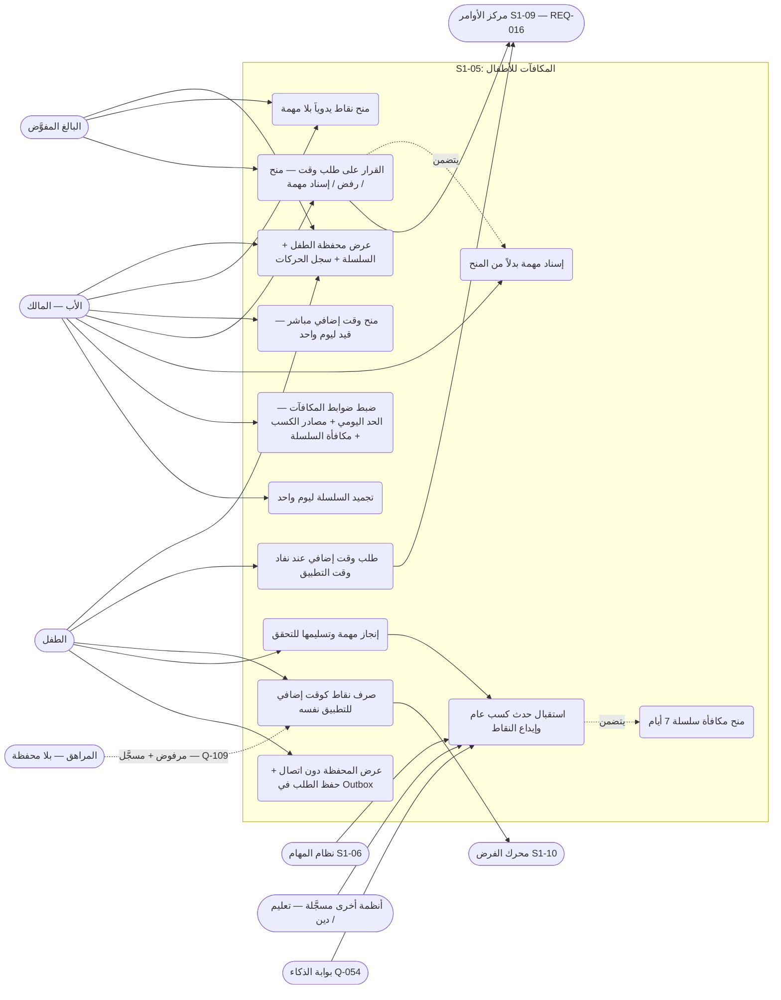

- المصدر: §2 (السيناريوهات 5-1…5-8) · §3 (REQ-001…REQ-018 — ومنها REQ-017/REQ-018 عقد التحقق Q-167: المفتاح `agent.task.verify` + البوابة + السجل + التراجع) · §6 (مفاتيح `rewards.*`)؛ وUC1 يغطي REQ-002 (الرصيد + سجل الحركات ظاهران للطفل وللأب).
- `rewards.settings.edit` و`rewards.streak.freeze` للأب وحده (مالك العائلة) — §6؛ وبقية المفاتيح للأب + البالغ المفوَّض حسب القالب.
- UC9 يستهلك حدود S1-10 وأرصدته ولا يملك الفرض (REQ-015)؛ وUC8/UC4 يظهران في بطاقة "يتطلب انتباهك" في S1-09 (REQ-014). وودجة S1-09 (REQ-016) تعرض الرصيد + السلسلة + الطلبات المعلقة.

## 2. مخطط قاعدة البيانات (ERD)

الجداول الخمسة من §5 كما هي، مع ثلاثة مراجع خارجية موثقة في §5: عضوية الطفل (S1-02)، و`AuditEvent` (النواة المشتركة، domain=rewards)، والعائلة (حاملة `family_id` + RLS). ملاحظتان: مرآة المحفظة في Drift وOutbox مخزنان محليان على الجهاز (ليستا جدولَي خادم)؛ و`enabled_sources` من نوع jsonb في §5 وتظهر هنا كسلسلة نصية لأن مخطط ERD لا يميز jsonb.

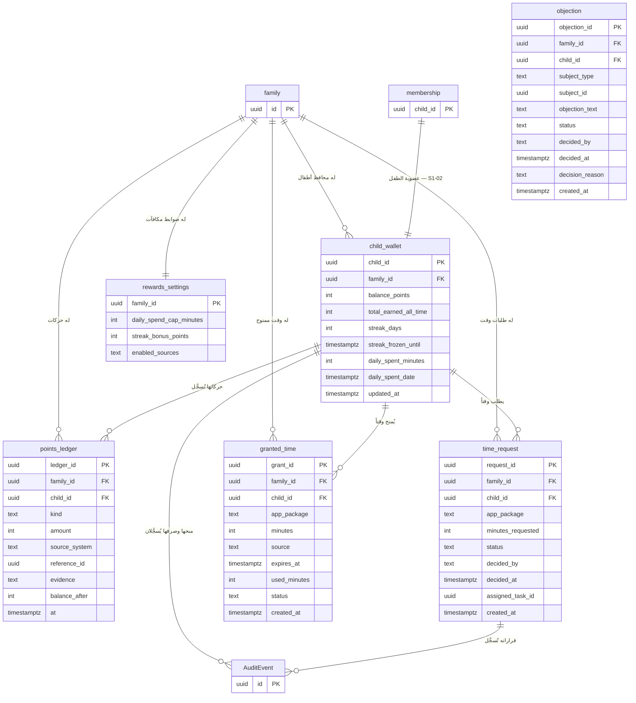

- المصدر: §5 كاملاً (الجداول الخمسة وحقولها) · §6 (الثوابت الصلبة).
- `balance_points` لا يقل عن صفر أبداً — والفرض على الخادم لا على العميل (§6)؛ و`kind` في `points_ledger` إحدى: TASK_COMPLETED / STREAK_BONUS / MANUAL_GRANT / TIME_REDEEMED / TIME_GRANTED (§5)؛ و`status` في `time_request` إحدى: PENDING / APPROVED / REJECTED / TASK_ASSIGNED (§5)؛ و`status` في `granted_time` إحدى: ACTIVE / EXPIRED / EXHAUSTED (§5)؛ و`source` في `granted_time` إحدى: REDEEM / GRANT (§5).
- القيم الافتراضية المحكومة: `daily_spend_cap_minutes` = 60 دقيقة (Q-114) · `streak_bonus_points` = 50 نقطة (قابلة للتغيير من الأب — §5) · `enabled_sources` افتراضياً كل الأنظمة المسجلة (Q-118).
- لا محفظة للمراهقين إطلاقاً (Q-109) — فلا صف `child_wallet` لمراهق؛ وكل جدول يحمل `family_id` + عزل RLS (عائلة واحدة لكل حساب في المرحلة 1).

## 3. التسلسل (Sequence) — من عقود §4

سبعة مخططات، كل واحد لتدفق واحد — والتدفق السادس (3-و) قيد تعويضي لإلغاء التحقق، والسابع (3-ز) اعتراض الطفل (REQ-018):

- **نقاط القراءة في §4 (لا تسلسل مستقل لها — قراءات مباشرة):** `GET /api/v1/families/{id}/children/{childId}/wallet` (الرصيد + السلسلة + الطلبات المعلقة) · `GET /api/v1/families/{id}/children/{childId}/wallet/ledger` (سجل حركات المحفظة) · `GET /api/v1/families/{id}/rewards/settings` (ضوابط الأب) · `PATCH /api/v1/families/{id}/rewards/settings` (ضبط المعاملات — UC6).

- النقل مزدوج (Q-209): الخادم ينشر `family/{family_id}/tasks.completed` و`family/{family_id}/tasks.verification-revoked` على MQTT (QoS 1) بجانب الحدث الداخلي — لا يُحذف التسليم الداخلي.

### 3-أ. كسب نقاط عبر تحقق الذكاء (REQ-004 / REQ-005 — §4: `family/{family_id}/tasks.completed`)

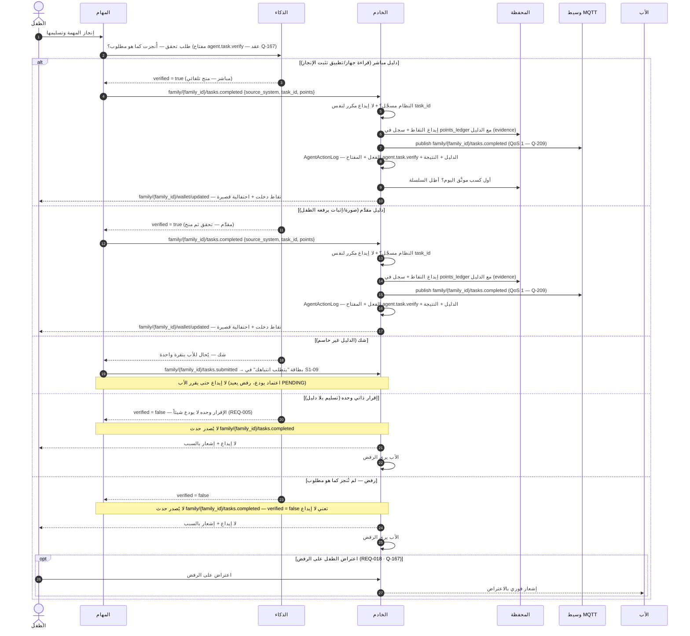

- تسليم الطفل الذاتي وحده لا يودع شيئاً (REQ-005/Q-110)؛ وإيداع مكرر لنفس `task_id` + `source_system` يعيد الإيداع الأصلي بلا مضاعفة (§7)؛ وحدث كسب من نظام غير مسجَّل يُرفض ويُسجَّل في التدقيق (§7/REQ-004).

### 3-ب. صرف نقاط كوقت إضافي (REQ-008 / REQ-009 / REQ-010 — §4: `POST /api/v1/families/{id}/children/{childId}/wallet/redeem`)

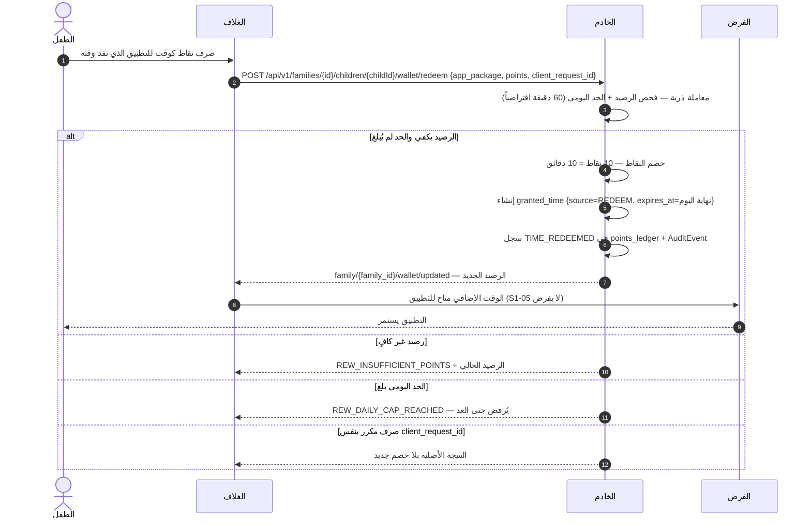

- سعر الصرف ثابت 1:1 (Q-111)؛ والصرف على التطبيق الذي نفد وقته تحديداً (Q-116)؛ والوقت المصروف ينتهي بنهاية اليوم وما لم يُستخدم لا يُسترد — النقاط نفسها لا تنتهي (Q-112/REQ-009 · Q-183)؛ والحد اليومي يُفرض على الخادم (Q-114).

### 3-ج. طلب وقت إضافي وقرار الأب (REQ-012 / REQ-013 / REQ-014 — §4: `POST /api/v1/families/{id}/children/{childId}/time-requests` + `POST /api/v1/families/{id}/children/{childId}/time-requests/{requestId}/decide`)

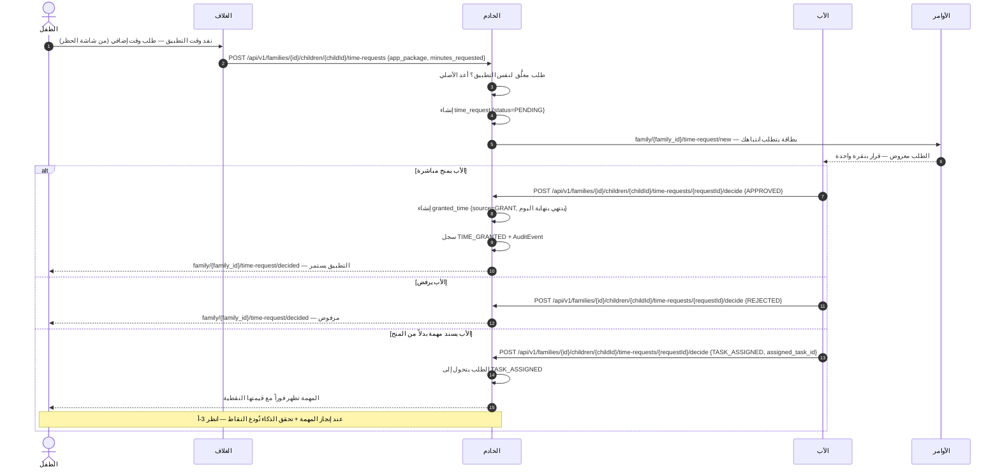

- طلب مكرر لنفس التطبيق وهو معلَّق يعيد الطلب الأصلي — لا طلبان معلَّقان لنفس التطبيق (§7)؛ والقرار على طلب سبق القرار عليه يعيد النتيجة الأصلية (`ALREADY_DECIDED` — §7)؛ والمنح المباشر قيد ليوم واحد وينتهي بنهايته (REQ-011).

### 3-د. منح يدوي من الأب + تجميد السلسلة (REQ-006 / REQ-007 / REQ-011 — §4: `POST /api/v1/families/{id}/children/{childId}/wallet/grant` + `POST /api/v1/families/{id}/children/{childId}/streak/freeze`)

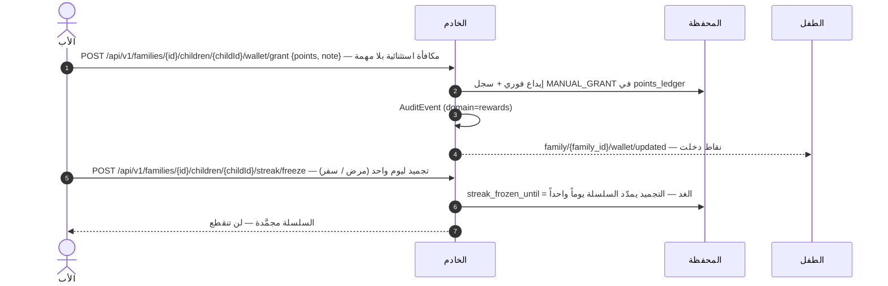

- المنح اليدوي بلا مهمة (Q-107/REQ-006)؛ والتجميد بإذن الأب فقط وليوم واحد في كل مرة (§6)؛ والتجميد بعد انقطاع السلسلة لا يعيدها (§7)؛ وسلسلة 7 أيام تكسب مكافأة السلسلة (50 نقطة افتراضياً — §5) مع شارة (§2: 5-5).

### 3-هـ. العمل دون اتصال والمزامنة (REQ-003 — §4: `getCachedWallet` + `queueTimeRequest`)

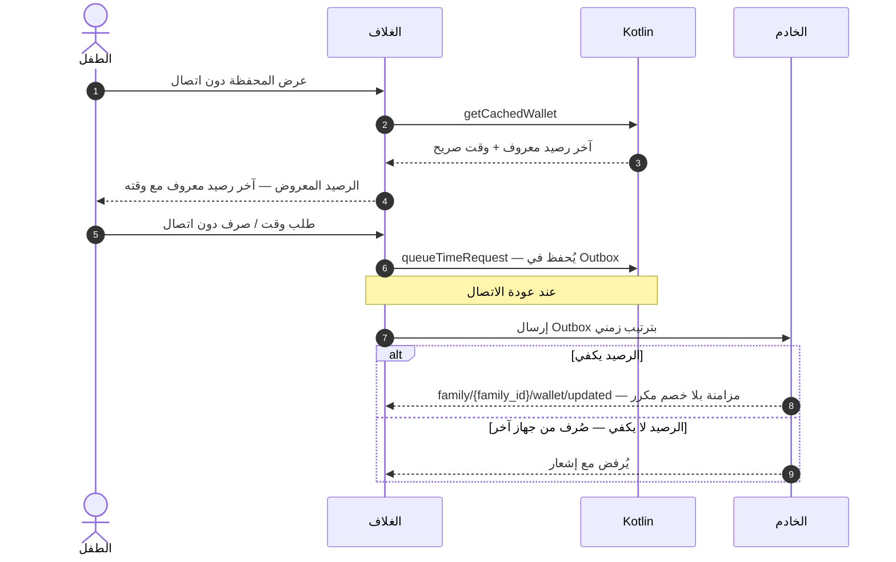

- المحفظة تعمل دون اتصال (مخزن محلي Drift) وتُزامَن عند عودة الاتصال عبر Outbox بلا خصم مكرر (REQ-003/Q-064)؛ والرصيد المعروض دون اتصال هو آخر رصيد معروف مع وقت صريح (§6).

### 3-و. إلغاء تحقق — قيد تعويضي يعكس الإيداع (REQ-007/§6 — §4: `family/{family_id}/tasks.verification-revoked`)

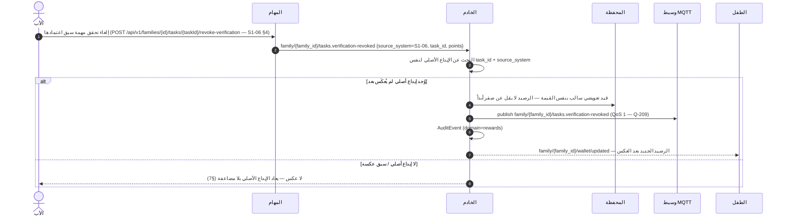

- الاشتراك في `family/{family_id}/tasks.verification-revoked` إلزامي: إلغاء التحقق في S1-06 يعوَّض الإيداع في S1-05 (S1-06 SPEC §4 `revoke-verification` و§6)؛ والقيد التعويضي سالب بنفس قيمة الإيداع الأصلي، والرصيد لا يقل عن صفر أبداً (§6)؛ وإلغاء مكرر لنفس `task_id` لا يعكس مرتين (§7 — نفس قاعدة عدم التكرار في 3-أ).

### 3-ز. اعتراض الطفل على منح أو رفض + تراجع S1-05 (REQ-018 — §4)

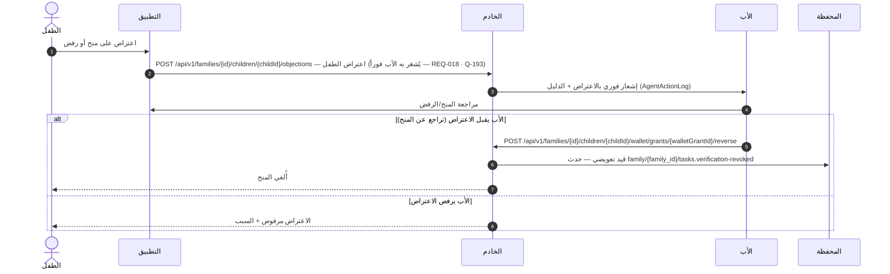

## 4. تدفق المستخدم (User Flow) — من السيناريوهات الثمانية (§2)

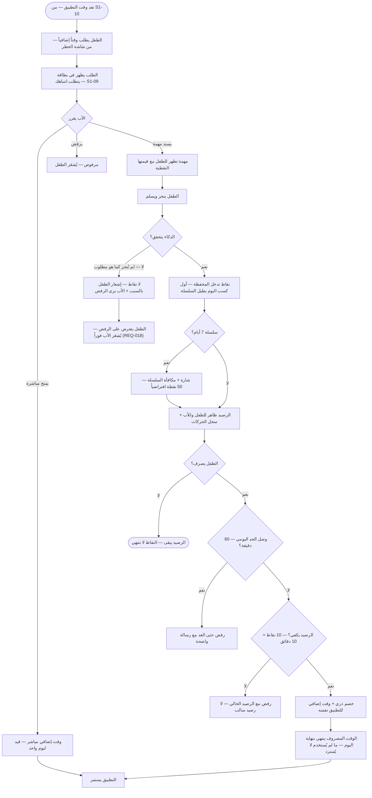

- المصدر: §2 (5-1…5-8) · §3 (REQ-001…REQ-014 + REQ-018) · §7 (الحالات الحدية).
- مساران جانبيان لا يظهران في التدفق الرئيسي: منح الأب الفوري 20 نقطة بلا مهمة (5-6) وتجميد السلسلة يوماً واحداً بإذن الأب عند المرض/السفر (5-5) — انظر 3-د؛ ومراهق يحاول الكسب أو الصرف يُرفض ويُسجَّل (Q-109) قبل أي خطوة في التدفق.

## 5. مخطط تدفق البيانات (DFD — المستوى 1) — من §4/§5

العمليات مرقمة 1.0–6.0، والمخازن D1–D5 جداول الخادم من §5، وD6–D7 مخزنان محليان على الجهاز (موثقان في §5: مرآة Drift + Outbox). كل منح/صرف/قرار يُسجَّل في AuditEvent (domain=rewards — §5).

- **تغطية نقاط §4:** التسلسلات في §3 تغطي التدفقات الأساسية فقط؛ وكل نقطة §4 تظهر هنا على الأقل: نقاط القراءة `GET /api/v1/families/{id}/children/{childId}/wallet` و`GET /api/v1/families/{id}/children/{childId}/wallet/ledger` و`GET /api/v1/families/{id}/rewards/settings` و`PATCH /api/v1/families/{id}/rewards/settings` مذكورة في §3 (تُقرأ عبر P2/P6)؛ وبقية النقاط مرسومة في §3 (grant، redeem، time-requests، decide، streak/freeze)؛ ونقطة `POST …/wallet/grants/{walletGrantId}/reverse` (REQ-018 · Q-167) مرسومة في 3-ز؛ ونقطة `POST …/children/{childId}/objections` (REQ-018 · Q-193) مرسومة في 3-ز.

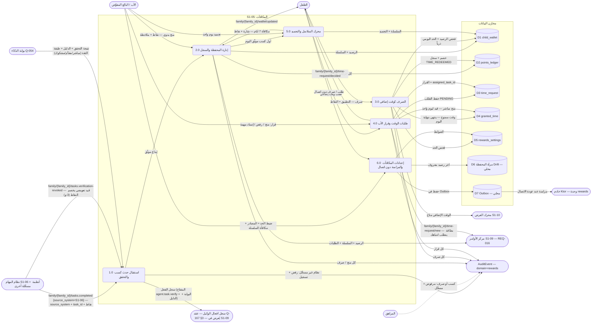

- المصدر: §4 (REST + MQTT + MethodChannel) · §5 (الجداول الخمسة + مخزنا العميل) · §6 (الصلاحيات والثوابت).
- S1-05 يستهلك حدود S1-10 وأرصدته ولا يملك الفرض (REQ-015) — فلا عملية فرض في هذا المخطط؛ والفرض والحظر يبقيان في S1-10.

## 6. مخطط النشاط (Activity) — دورة حياة المحفظة

المسارات الخمسة (الطفل / الأب / خادم المكافآت / الذكاء / محرك S1-10) كمسارات متوازية. والأنشطة الخلفية (انتهاء الوقت المصروف بنهاية اليوم — Q-183، انقطاع السلسلة في يوم بلا كسب) تعمل **بالتوازي** مع استخدام التطبيق.

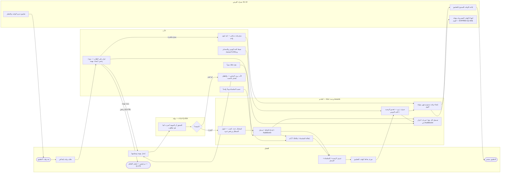

- المصدر: §2 (دورة المحفظة وحلقة §2 البصرية) · §3 (REQ-001…REQ-018) · §6/§7 (الثوابت والحالات الحدية).
- ملاحظتان: يوم بلا كسب يقطع السلسلة إلا إذا جُمّدت، والتجميد بعد انقطاعها لا يعيدها (§7)؛ وتغيير الحد اليومي أثناء اليوم يطبق فوراً على ما تبقى من اليوم وما صُرف قبله لا يُسترجع (§7).
- إلغاء التحقق (S1-06) يصدر `family/{family_id}/tasks.verification-revoked` فيعوَّض الإيداع بقيد سالب — انظر التسلسل 3-و.
- كل منح/صرف/قرار مسجَّل في التدقيق (ACC-015)؛ ولا نقاط للمراهقين إطلاقاً (Q-109)؛ والصرف كوقت فقط في المرحلة 1 — لا كتالوج جوائز (Q-113).
