# S1-05: مخططات هندسة البرمجيات (DIAGRAMS)

- **الحالة:** معتمدة — المخططات الستة معتمدة (حكم المالك 2026-11-08 — D-2، بعد موجة الإصلاح 0e4a3e2..f7da470)؛ والمواصفة معتمدة بالكامل في التخطيط
- **المواصفة:** `SPEC.md` (§§1–8 + §10 معتمدة بالكامل في التخطيط · §9 في مرحلة التصميم)
- **إعادة الرسم 2026-11-19 (Q-434) على التصميم المعتمد (Q-414 · Q-419):** الرسم والنص متطابقان. ما تغيّر: (1) حالات الاستخدام صارت 17 على لوحتين: اعتراض الطفل والقرار فيه، وإلغاء الإيداع في يومه، وتحذير التعارض قبل المنح؛ والمراهق يطلب وقتاً ويصله المنح المباشر وإن كان بلا محفظة؛ (2) التسلسل 3-أ قُسّم إلى لوحتين، و3-ج أُعيد رسمه: تحذير الأب إن كان الابن في وقت نوم أو مدرسة أو وضع سارٍ (Q-419)، وسقوط الطلب المعلّق عند منتصف الليل؛ (3) تسلسل جديد 3-ح: الرصيد المجمّد عند 13 ومنح الوقت منه؛ (4) تدفق المستخدم قُسّم إلى ثلاث لوحات وأُضيف إليه سقوط الطلب والتحذير وقرار الاعتراض؛ (5) DFD قُسّم إلى لوحتين وأُضيف إليه فحص حالة الطفل قبل المنح وإلغاء الإيداع في يومه؛ (6) النشاط صار TD على لوحتين وأُضيف إليه التحذير قبل المنح المباشر؛ (7) ERD: ترتيب الحقول موحّد، وتسميات العلاقات فعل قصير، وملاحظتا التجميد عند 13 وسقوط الطلب. ملاحظة: هذا الملف لم يحمل أسطر «تنبيه» مؤرخة، فسُجّل الرسم هنا وفي سطور «أُعيد رسمه» تحت كل مخطط.
- **السياق المحدد (Bounded Context):** #9 إدارة العائلة (Family Management) — `CONTEXT-MAP.md` §2 صف 9
- **القرارات الحاكمة:** Q-001 · Q-003 · Q-064 · Q-107 · Q-108 · Q-109 · D-012 · Q-009 · Q-110 · Q-111 · Q-112 · Q-113 · Q-114 · Q-116 · Q-117 · Q-118 · Q-119 · Q-054 · Q-167 · Q-115 · Q-007 (رفض-يتغلب — المنع يغلب)
- **الأنواع الستة:** 1. حالات الاستخدام · 2. ERD · 3. التسلسل · 4. تدفق المستخدم · 5. DFD · 6. النشاط
- **الأشكال الموحدة:** مستطيل = جهة خارجية · مستطيل مستدير = عملية · معين = قرار · أسطوانة = مخزن بيانات · خط متقطع = يتضمن / اختياري

## 1. حالات الاستخدام

17 حالة استخدام من السيناريوهات الثلاثة عشر والمتطلبات (§2/§3) والتصميم المعتمد (§9-8): الأب يملك كل القرارات (المنح المباشر، إسناد مهمة بدلاً من المنح، ضبط المعاملات، تجميد السلسلة، القرار في الاعتراض، إلغاء الإيداع في يومه)؛ والبالغ المفوَّض يعمل حسب القالب (S1-03)؛ والطفل يرى محفظته فقط ويطلب ويصرف ويعترض؛ والمراهق **لا** محفظة له إطلاقاً (Q-109) فيظهر كجهة مرفوضة في الصرف، لكنه يطلب وقتاً ويصله المنح المباشر (Q-414) وتبقى له قناة الاعتراض/النقاش بلا نقاط؛ والكسب يأتي من أي نظام مسجَّل عبر عقد عام (Q-118)؛ والفرض نفسه محرك S1-10 لا S1-05 (REQ-015).

الحالات السبع عشرة على ثلاث لوحات ليُقرأ كل خط: الأولى لما يفعله الأب والبالغ، والثانية لما يفعله الطفل والمراهق، والثالثة لما تفعله الأنظمة المجاورة.

### 1-أ. حالات الاستخدام — الأب والبالغ

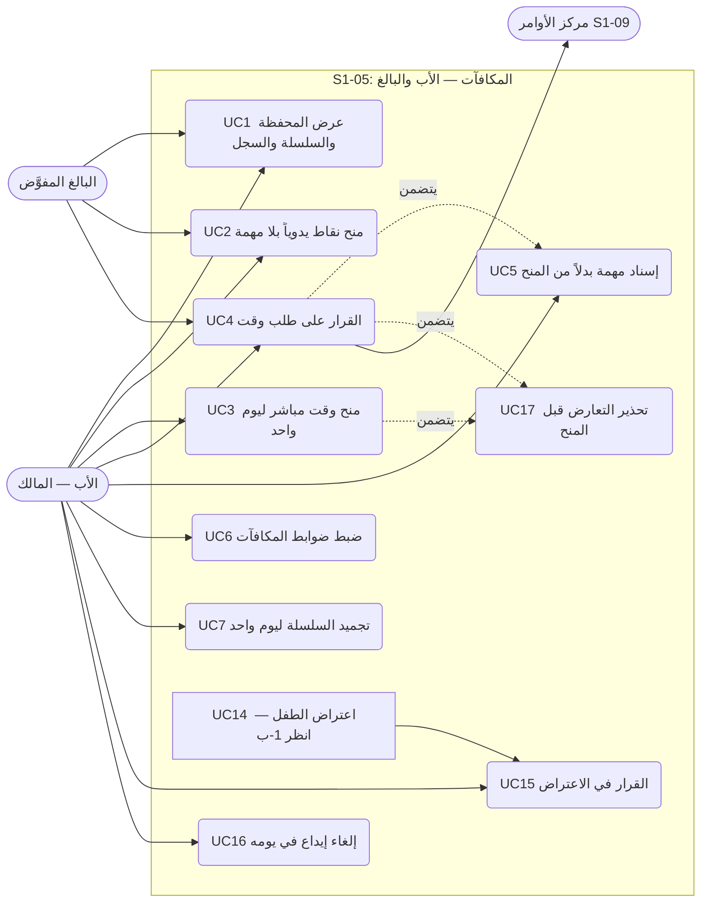

### 1-ب. حالات الاستخدام — الطفل والمراهق

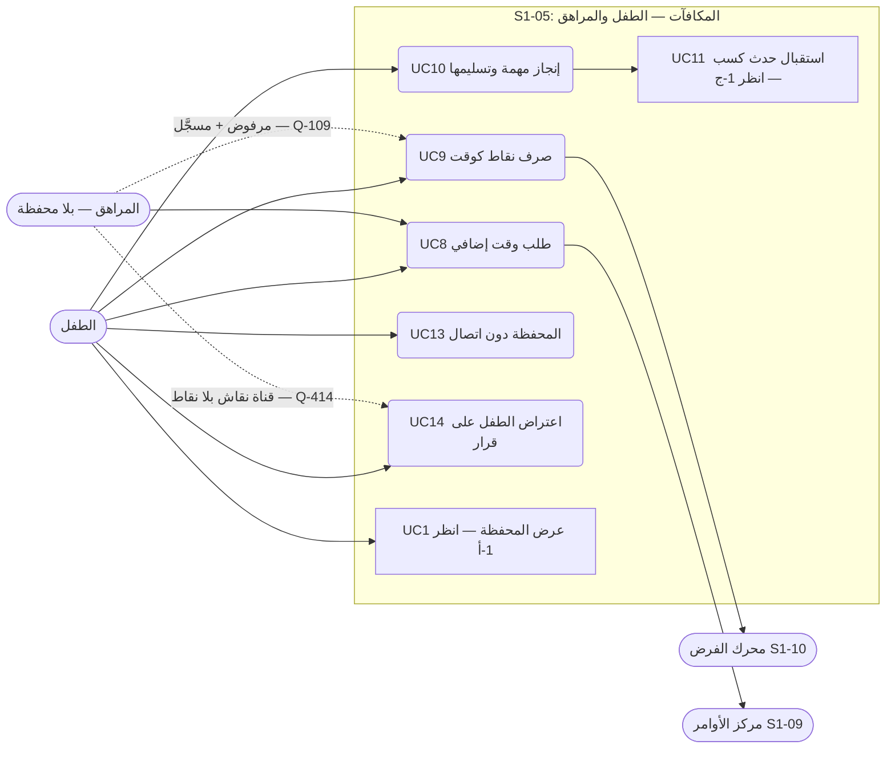

- أُعيد رسمه 2026-11-19 (Q-434 — Q-414 · Q-419): الحالات 13 ← 17 على لوحتين؛ وأُضيفت UC14 (اعتراض الطفل) وUC15 (القرار في الاعتراض: قبول يعيد الحق، رفض بسبب يقرؤه الطفل) وUC16 (إلغاء الإيداع في يومه فقط) وUC17 (تحذير التعارض قبل المنح — نوم / مدرسة / وضع سارٍ)؛ والمراهق يطلب وقتاً (UC8) ويصله المنح المباشر بلا محفظة وبلا نقاط (REQ-011)؛ وقُصّرت التسميات إلى 5 كلمات. والعقد والأسهم قبل التقسيم وبعده: 22 عقدة/25 سهماً ← 29 عقدة/33 سهماً (الزيادة: UC14–UC17 الأربع + عقدتان مرجعيتان UC1x وUC14x + تكرار S109 في 1-أ).
- أُعيد تقسيمه 2026-11-19 (دفعة الشكل 2): 1-ب قُسّمت لوحتين (1-ب الطفل والمراهق، 1-ج الأنظمة والكسب)؛ والعقد والأسهم 29/33 ← 31/34 (الزيادة: مرجعا UC10x وUC11x + تكرار حافة UC10→UC11 في اللوحتين).

### 1-ج. حالات الاستخدام — الأنظمة والكسب

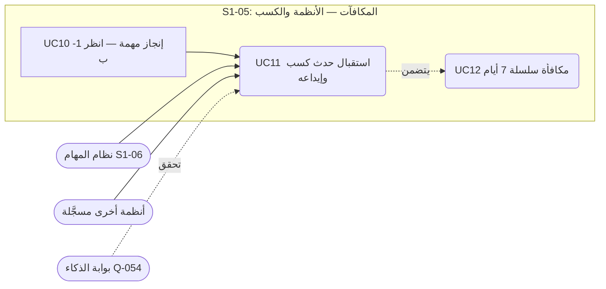

- أُعيد تقسيمه 2026-11-19 (دفعة الشكل 2): لوحة الأنظمة والكسب من 1-ب القديمة؛ وUC10x مرجع إلى 1-ب.

- المصدر: §2 (السيناريوهات 5-1…5-13) · §3 (REQ-001…REQ-018 — ومنها REQ-017/REQ-018 عقد التحقق Q-167: المفتاح `agent.task.verify` + البوابة + السجل + التراجع) · §6 (مفاتيح `rewards.*`)؛ وUC1 يغطي REQ-002 (الرصيد + سجل الحركات ظاهران للطفل وللأب).
- `rewards.settings.edit` و`rewards.streak.freeze` للأب وحده (مالك العائلة) — §6؛ وبقية المفاتيح للأب + البالغ المفوَّض حسب القالب.
- UC9 يستهلك حدود S1-10 وأرصدته ولا يملك الفرض (REQ-015)؛ وUC8/UC4 يظهران في بطاقة "يتطلب انتباهك" في S1-09 (REQ-014). وودجة S1-09 (REQ-016) تعرض الرصيد + السلسلة + الطلبات المعلقة.
- UC13: عرض المحفظة دون اتصال؛ والطلب والصرف والاعتراض دون اتصال تُحفظ في Outbox (3-هـ). وUC4 يقرر منحاً أو رفضاً أو إسناد مهمة؛ والمنح المباشر (UC3) يصل المراهق أيضاً (REQ-011 · Q-414)؛ وعند بلوغ 13 تتجمّد المحفظة: الرصيد محفوظ بلا مصادرة ولا كسب ولا صرف، وللأب أن يمنح وقتاً منه (REQ-011 · Q-414 · Q-237) — انظر 3-ح.

## 2. مخطط قاعدة البيانات (ERD)

الجداول السبعة من §5 كما هي، مع ثلاثة مراجع خارجية موثقة في §5: عضوية الطفل (S1-02)، و`AuditEvent` (النواة المشتركة، domain=rewards)، والعائلة (حاملة `family_id` + RLS). ملاحظتان: مرآة المحفظة في Drift وOutbox مخزنان محليان على الجهاز (ليستا جدولَي خادم)؛ و`enabled_sources` من نوع jsonb في §5 وتظهر هنا كسلسلة نصية لأن مخطط ERD لا يميز jsonb.

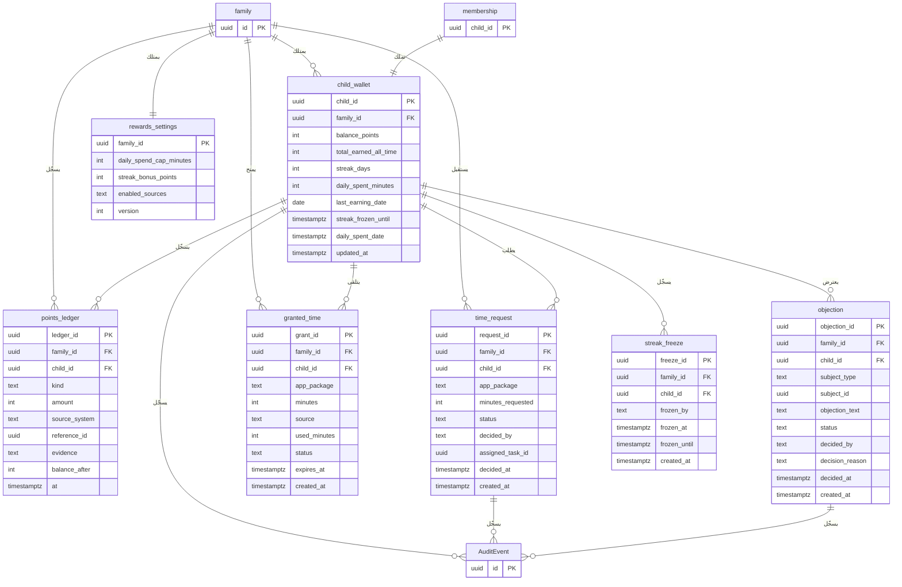

- المصدر: §5 كاملاً (الجداول السبعة وحقولها) · §6 (الثوابت الصلبة).
- `balance_points` لا يقل عن صفر أبداً — والفرض على الخادم لا على العميل (§6)؛ و`kind` في `points_ledger` إحدى: TASK_COMPLETED / STREAK_BONUS / MANUAL_GRANT / TIME_REDEEMED / TIME_GRANTED / REVERSAL (قيد تعويضي — §5)؛ و`status` في `time_request` إحدى: PENDING / APPROVED / REJECTED / TASK_ASSIGNED (§5)؛ والطلب المعلّق يسقط عند منتصف الليل بتوقيت العائلة (Q-414): حالة تُشتق من الوقت ولا تُخزَّن؛ و`status` في `granted_time` إحدى: ACTIVE / EXPIRED / EXHAUSTED (§5)؛ و`source` في `granted_time` إحدى: REDEEM / GRANT (§5)؛ و`version` في `rewards_settings` عداد نسخة للتفاؤل (§5 — 409 `REW_VERSION_CONFLICT`).
- القيم الافتراضية المحكومة: `daily_spend_cap_minutes` = 60 دقيقة (Q-114) · `streak_bonus_points` = 50 نقطة (مصدَّقة افتراضياً — Q-276 — قابلة للتغيير من الأب — §5) · `enabled_sources` افتراضياً كل الأنظمة المسجلة (Q-118).
- لا محفظة للمراهقين إطلاقاً (Q-109) — فلا صف `child_wallet` لمراهق؛ وكل جدول يحمل `family_id` + عزل RLS (عائلة واحدة لكل حساب في المرحلة 1).
- عند بلوغ 13 تتجمّد المحفظة (Q-237 · Q-414): `balance_points` محفوظ بلا مصادرة، بلا كسب ولا صرف؛ وللأب أن يمنح وقتاً منه (REQ-011) — انظر 3-ح.
- أُعيد رسمه 2026-11-19 (Q-434): ترتيب الحقول موحّد في كل الجداول (أساسي، أجنبية، حقول، تواريخ في الآخر)؛ وتسميات العلاقات فعل قصير بصيغة واحدة؛ وأُضيفت ملاحظتا التجميد عند 13 وسقوط الطلب المعلّق عند منتصف الليل. والجداول والحقول والعلاقات نفسها قبل وبعد.

## 3. التسلسل (Sequence) — من عقود §4

تسعة مخططات، كل واحد لتدفق واحد — و3-أ على لوحتين (3-أ-1 الدليل المباشر والمقدَّم، و3-أ-2 الشك والإقرار والرفض)، والتدفق السابع (3-و) قيد تعويضي لإلغاء التحقق، والثامن (3-ز) اعتراض الطفل (REQ-018)، والتاسع (3-ح) تجمّد المحفظة عند 13 ومنح الوقت من الرصيد المجمّد (Q-414):

- **نقاط القراءة في §4 (لا تسلسل مستقل لها — قراءات مباشرة):** `GET /api/v1/families/{id}/children/{childId}/wallet` (الرصيد + السلسلة + الطلبات المعلقة) · `GET /api/v1/families/{id}/children/{childId}/wallet/ledger` (سجل حركات المحفظة) · `GET /api/v1/families/{id}/rewards/settings` (ضوابط الأب) · `PATCH /api/v1/families/{id}/rewards/settings` (ضبط المعاملات — UC6).

- النقل مزدوج (Q-209): الخادم ينشر `family/{family_id}/tasks.completed` و`family/{family_id}/tasks.verification-revoked` على MQTT (QoS 1) بجانب الحدث الداخلي — لا يُحذف التسليم الداخلي.

### 3-أ-1. كسب نقاط عبر تحقق الذكاء — الدليل المباشر والمقدَّم (REQ-004 / REQ-005 — §4: `family/{family_id}/tasks.completed`)

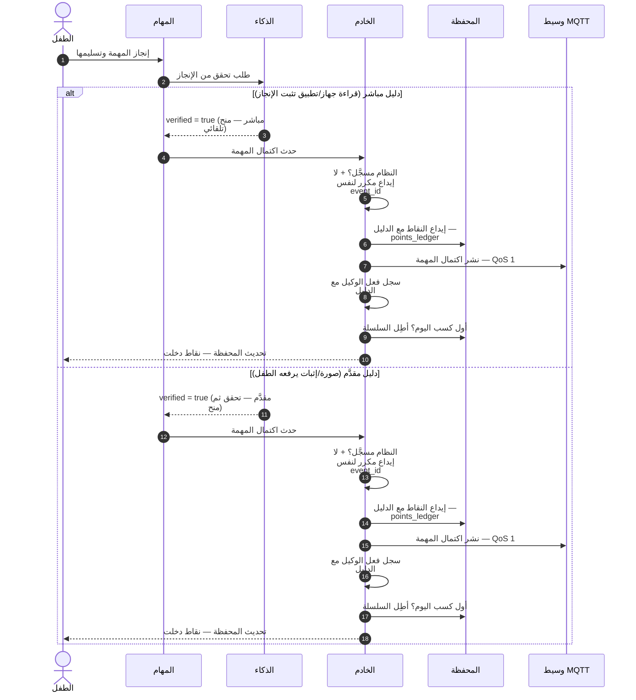
- الرسالة 2: أُنجزت كما هو مطلوب؟ (مفتاح `agent.task.verify` — عقد Q-167)
- الرسالة 4: `family/{family_id}/tasks.completed {event_id, task_id, occurrence_id, source_system=S1-06, reward_points, verified_by}`
- الرسالة 6: سجل في `points_ledger` مع الدليل (`evidence`)
- الرسالة 7: `publish family/{family_id}/tasks.completed (QoS 1 — Q-209)`
- الرسالة 8: `AgentActionLog` — الفعل + المفتاح `agent.task.verify` + الدليل + النتيجة
- الرسالة 9: عدم تكرار: `event_id` (§7)
- الرسالة 10: `family/{family_id}/wallet/updated` — نقاط دخلت + احتفالية قصيرة
- الرسالة 12: `family/{family_id}/tasks.completed {event_id, task_id, occurrence_id, source_system=S1-06, reward_points, verified_by}`
- الرسالة 14: سجل في `points_ledger` مع الدليل (`evidence`)
- الرسالة 15: `publish family/{family_id}/tasks.completed (QoS 1 — Q-209)`
- الرسالة 16: `AgentActionLog` — الفعل + المفتاح `agent.task.verify` + الدليل + النتيجة
- الرسالة 17: عدم تكرار: `event_id` (§7)
- الرسالة 18: `family/{family_id}/wallet/updated` — نقاط دخلت + احتفالية قصيرة

### 3-أ-2. كسب نقاط عبر تحقق الذكاء — لا إيداع: شك أو إقرار أو رفض (REQ-004 / REQ-005 — §4)

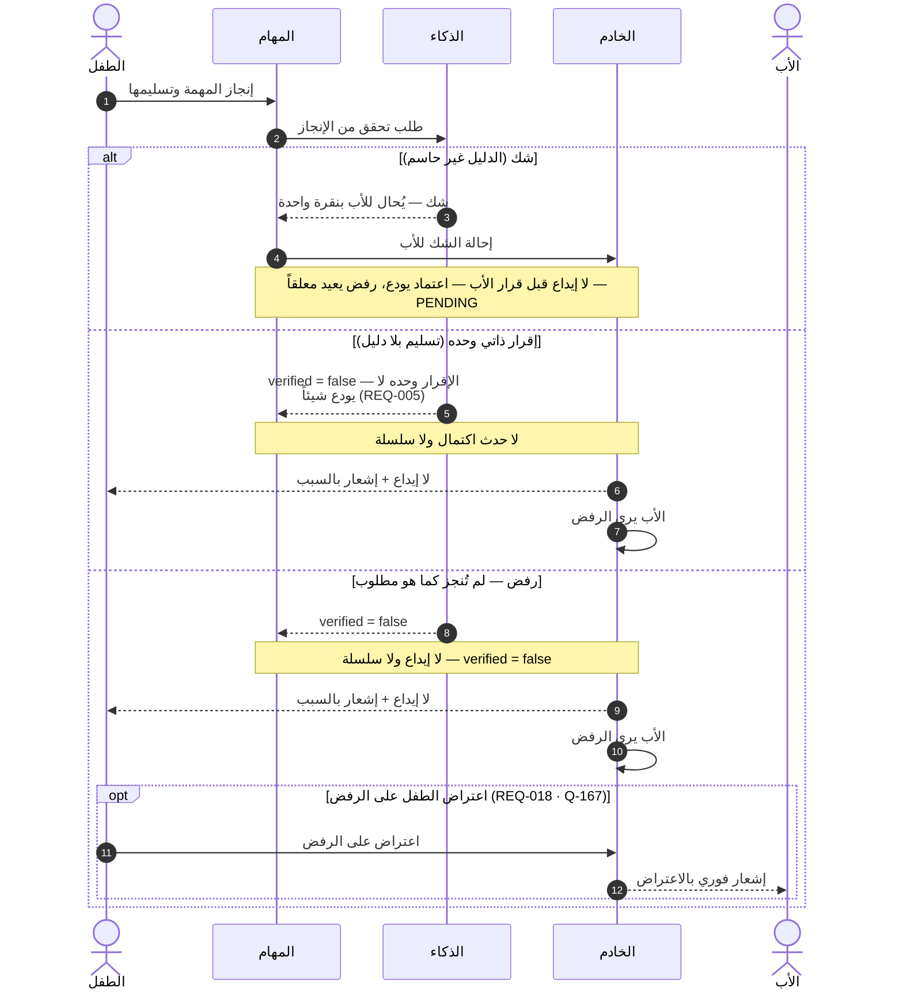
- الرسالة 2: أُنجزت كما هو مطلوب؟ (مفتاح `agent.task.verify` — عقد Q-167)
- الرسالة 4: `family/{family_id}/tasks.submitted` → بطاقة "يتطلب انتباهك" في S1-09
- ملاحظة: ولا سلسلة بلا إيداع.
- ملاحظة: لا يُصدر حدث `family/{family_id}/tasks.completed`.
- ملاحظة: لا يُصدر حدث `family/{family_id}/tasks.completed`؛ `verified = false` تعني لا إيداع ولا سلسلة.

- أُعيد رسمه 2026-11-19 (Q-434): قُسّم 3-أ إلى لوحتين (كان 7 مشاركين و29 رسالة): 3-أ-1 الدليل المباشر والمقدَّم (6 مشاركين، 18 رسالة)، و3-أ-2 الشك والإقرار والرفض مع اعتراض الطفل (5 مشاركين، 13 رسالة). والرسائل نفسها قبل التقسيم وبعده.

- تسليم الطفل الذاتي وحده لا يودع شيئاً (REQ-005/Q-110)؛ وإيداع مكرر لنفس `event_id` يعيد الإيداع الأصلي بلا مضاعفة (§7)؛ وحدث كسب من نظام غير مسجَّل يُرفض ويُسجَّل في التدقيق (§7/REQ-004).

### 3-ب. صرف نقاط كوقت إضافي (REQ-008 / REQ-009 / REQ-010 — §4: `POST /api/v1/families/{id}/children/{childId}/wallet/redeem`)

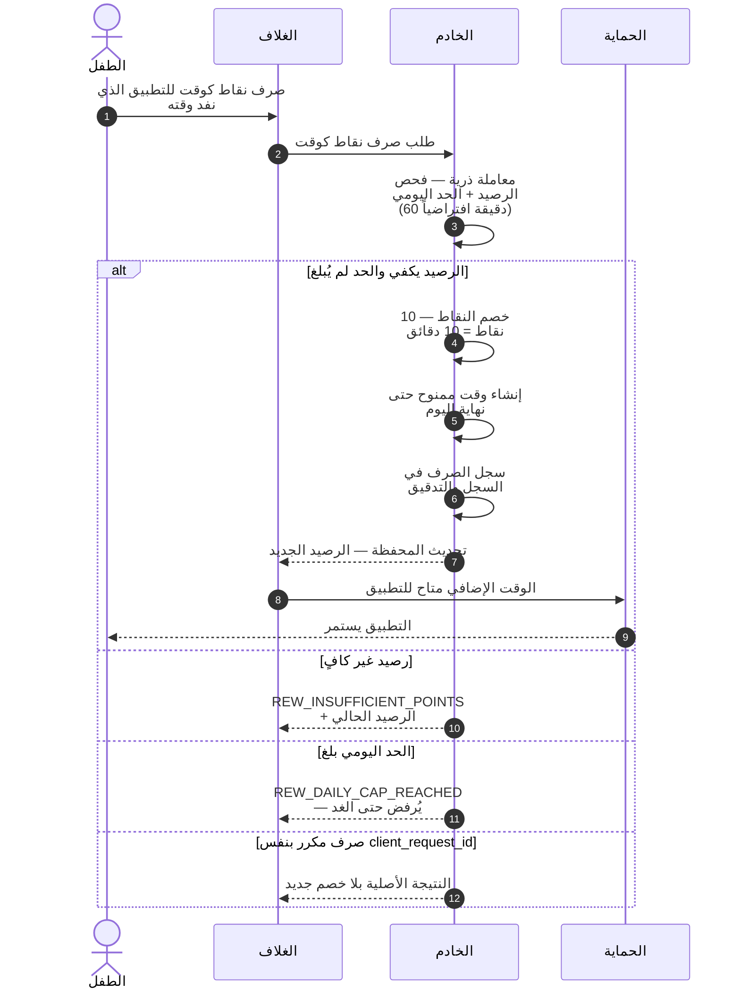
- الرسالة 2: `POST /api/v1/families/{id}/children/{childId}/wallet/redeem {app_package, points, client_request_id}` — `points` بمضاعفات 10 (الحد الأدنى 10، والحد الأقصى = الرصيد — Q-273)
- الرسالة 5: `granted_time {source=REDEEM, expires_at=نهاية اليوم}`
- الرسالة 6: `TIME_REDEEMED` في `points_ledger` + `AuditEvent`
- الرسالة 7: `family/{family_id}/wallet/updated` — الرصيد الجديد
- الرسالة 8: S1-05 لا يفرض.

- سعر الصرف ثابت 1:1 للأبد في المرحلة 1 (Q-111 · Q-279)؛ والصرف بخطوات ثابتة 10 نقاط: الحد الأدنى 10، والحد الأقصى = الرصيد، ومبلغ ليس من مضاعفات 10 يُرفض بـ `REW_VALIDATION_FAILED` (Q-273)؛ والصرف على التطبيق الذي نفد وقته تحديداً (Q-116)؛ والوقت المصروف ينتهي بنهاية اليوم وما لم يُستخدم لا يُسترد — النقاط نفسها لا تنتهي (Q-112/REQ-009 · Q-183)؛ والحد اليومي يُفرض على الخادم (Q-114)؛ والحد اليومي هنا حد الوقت الإضافي كله: المنح المباشر (مصدر GRANT) يزيد `daily_spent_minutes` ويستهلك الحد مثل الصرف (Q-272 — §6).

### 3-ج. طلب وقت إضافي وقرار الأب (REQ-011 / REQ-012 / REQ-013 / REQ-014 — §4: `POST /api/v1/families/{id}/children/{childId}/time-requests` + `POST /api/v1/families/{id}/children/{childId}/time-requests/{requestId}/decide`)

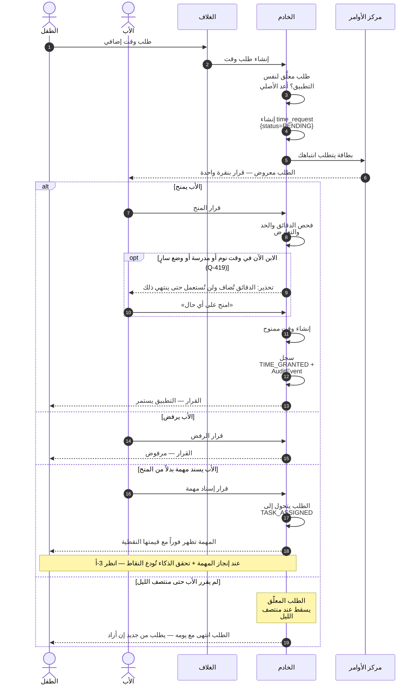
- الرسالة 1: نفد وقت التطبيق (10 / 15 / 30 دقيقة بقدر ما يسمح الحد)
- الرسالة 2: `POST /api/v1/families/{id}/children/{childId}/time-requests {app_package, minutes_requested}`
- الرسالة 5: `family/{family_id}/time-request/new`
- الرسالة 7: `POST /api/v1/families/{id}/children/{childId}/time-requests/{requestId}/decide {APPROVED, minutes}`
- الرسالة 8: الدقائق > 0 و≤ المتبقي من الحد اليومي؟ (Q-274 — وإلا `REW_DAILY_CAP_REACHED` أو `REW_VALIDATION_FAILED`) + الابن في نوم/مدرسة/وضع سارٍ؟
- الرسالة 11: `granted_time {source=GRANT, minutes, ينتهي بنهاية اليوم}` — والمنح يزيد `daily_spent_minutes` (Q-272)
- الرسالة 13: `family/{family_id}/time-request/decided` — التطبيق يستمر
- الرسالة 14: `POST /api/v1/families/{id}/children/{childId}/time-requests/{requestId}/decide {REJECTED}`
- الرسالة 15: `family/{family_id}/time-request/decided` — مرفوض
- الرسالة 16: `POST /api/v1/families/{id}/children/{childId}/time-requests/{requestId}/decide {TASK_ASSIGNED, assigned_task_id}`
- ملاحظة: بتوقيت العائلة — حالة تُشتق من الوقت ولا تُخزَّن.

- أُعيد رسمه 2026-11-19 (Q-434 — Q-414 · Q-419): تحذير التعارض قبل المنح (opt داخل فرع المنح: إن كان الابن في نوم/مدرسة/وضع سارٍ يُحذَّر الأب ويختار «امنح على أي حال» أو «لا تمنح الآن» فينتهي بلا منح)؛ وسقوط الطلب المعلّق عند منتصف الليل؛ والمراهق يطلب وقتاً أيضاً؛ ومدد الطلب السريعة 10 / 15 / 30 دقيقة. والرسائل 16 ← 19 (5 مشاركين).

- طلب مكرر لنفس التطبيق وهو معلَّق يعيد الطلب الأصلي — لا طلبان معلَّقان لنفس التطبيق (§7)؛ والقرار على طلب سبق القرار عليه يعيد النتيجة الأصلية (`ALREADY_DECIDED` — §7)؛ والمنح المباشر قيد ليوم واحد وينتهي بنهايته (REQ-011)؛ والمنح المباشر يُحسب ضمن الحد اليومي (Q-272)؛ والدقائق الممنوحة يحددها الأب: أي دقائق أكبر من صفر ولا تتجاوز المتبقي من الحد اليومي (Q-274). والمراهق يطلب وقتاً ويصله المنح مع أنه بلا محفظة وبلا نقاط (Q-109 · Q-414). وتحذير التعارض لا يغيّر حساب المنح (REQ-011 — Q-419).

### 3-د. منح يدوي من الأب + تجميد السلسلة (REQ-006 / REQ-007 / REQ-011 — §4: `POST /api/v1/families/{id}/children/{childId}/wallet/grant` + `POST /api/v1/families/{id}/children/{childId}/streak/freeze`)

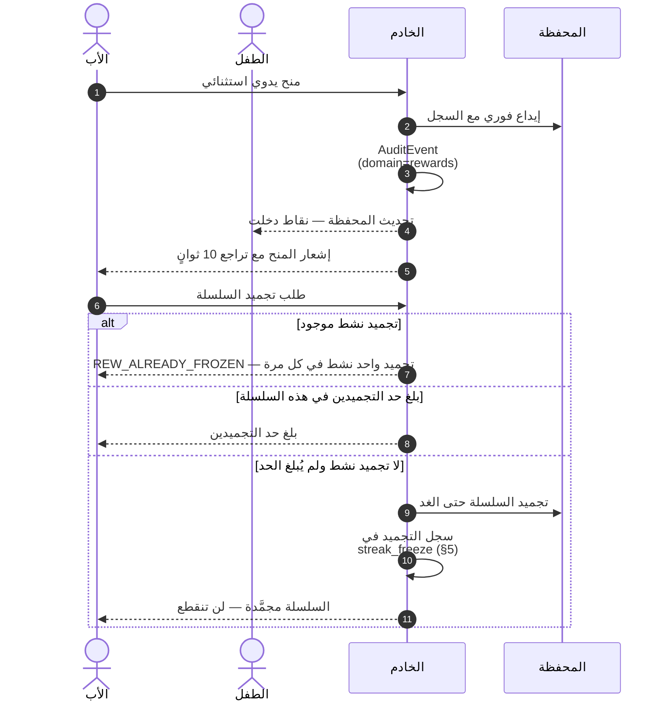
- الرسالة 1: `POST /api/v1/families/{id}/children/{childId}/wallet/grant {points ≤ 60, note}` — مكافأة استثنائية بلا مهمة (Q-278)
- الرسالة 2: سجل `MANUAL_GRANT` في `points_ledger`
- الرسالة 4: `family/{family_id}/wallet/updated` — نقاط دخلت
- الرسالة 5: `Snackbar` «منحت `{child}` `{points}` نقطة» (Q-275 — العكس السريع عبر S05-09 بقيد تعويضي — REQ-018)
- الرسالة 6: `POST /api/v1/families/{id}/children/{childId}/streak/freeze` — تجميد ليوم واحد (مرض / سفر)
- الرسالة 8: `REW_FREEZE_LIMIT_REACHED` — تجميدان كحد أقصى لكل سلسلة (Q-278)
- الرسالة 9: `streak_frozen_until` = الغد — التجميد يمدّد السلسلة يوماً واحداً

- أُعيد رسمه 2026-11-19 (Q-434 — شكل فقط): ترتيب المشاركين موحّد (المستخدم، ثم التطبيق، ثم الخادم، ثم قاعدة البيانات). والرسائل نفسها قبل وبعد.

- المنح اليدوي بلا مهمة (Q-107/REQ-006) وبحد أقصى 60 نقطة في المرة (Q-278)؛ والتجميد بإذن الأب فقط وليوم واحد في كل مرة (§6) وتجميدان كحد أقصى لكل سلسلة (Q-278)؛ والتجميد بعد انقطاع السلسلة لا يعيدها (§7)؛ وسلسلة 7 أيام تكسب مكافأة السلسلة (50 نقطة افتراضياً — §5 — Q-276) مع شارة فضية؛ والشارات: فضية 7 أيام، ذهبية 30 يوماً، ماسية 90 يوماً (Q-277 — §2: 5-5).

### 3-هـ. العمل دون اتصال والمزامنة (REQ-003 — §4: `getCachedWallet` + `queueTimeRequest` + `queueRedeem` + `queueObjection`)

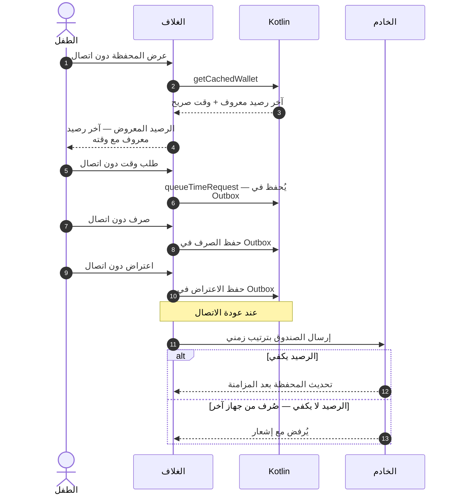
- الرسالة 8: `queueRedeem {app_package, points, client_request_id}` — مفتاح عدم التكرار `client_request_id` (آلية S1-01)
- الرسالة 10: `queueObjection {subject_type, subject_id, objection_text}`
- الرسالة 11: إرسال `Outbox` بترتيب زمني.
- الرسالة 12: `family/{family_id}/wallet/updated` — مزامنة بلا خصم مكرر

- المحفظة تعمل دون اتصال (مخزن محلي Drift) وتُزامَن عند عودة الاتصال عبر Outbox بلا خصم مكرر (REQ-003/Q-064)؛ والرصيد المعروض دون اتصال هو آخر رصيد معروف مع وقت صريح (§6).

### 3-و. إلغاء تحقق — قيد تعويضي يعكس الإيداع (REQ-018/§6 — §4: `family/{family_id}/tasks.verification-revoked`)

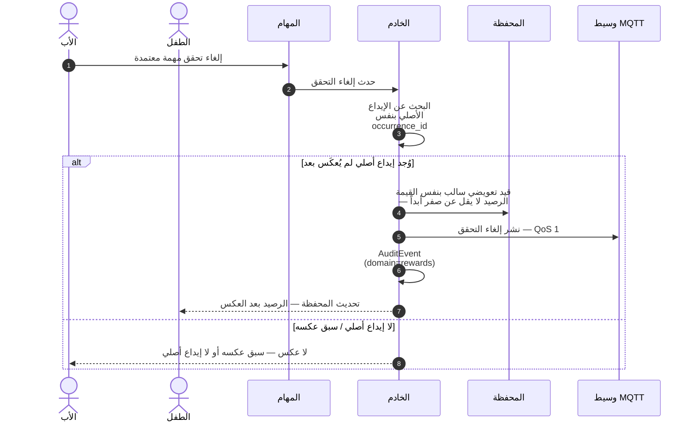
- الرسالة 1: `POST /api/v1/families/{id}/tasks/{taskId}/occurrences/{occurrenceId}/revoke-verification` (S1-06 §4)
- الرسالة 2: `family/{family_id}/tasks.verification-revoked {event_id, task_id, occurrence_id, revoked_by, at}` — حمولة الناشر (S1-06 §4)
- الرسالة 5: `publish family/{family_id}/tasks.verification-revoked (QoS 1 — Q-209)`
- الرسالة 7: `family/{family_id}/wallet/updated` — الرصيد الجديد بعد العكس
- الرسالة 8: وتُعاد نتيجة العكس الأصلية إن وُجدت بلا خصم ثانٍ (§7 — عملية عكس واحدة)

- أُعيد رسمه 2026-11-19 (Q-434 — شكل فقط): ترتيب المشاركين موحّد (المستخدم، ثم التطبيق، ثم الخادم، ثم قاعدة البيانات، ثم الخارجية). والرسائل نفسها قبل وبعد.

- الاشتراك في `family/{family_id}/tasks.verification-revoked` إلزامي: إلغاء التحقق في S1-06 يعوَّض الإيداع في S1-05 (S1-06 SPEC §4 `revoke-verification` و§6)؛ والقيد التعويضي سالب بنفس قيمة الإيداع الأصلي، والرصيد لا يقل عن صفر أبداً (§6)؛ وإلغاء مكرر لنفس `occurrence_id` لا يعكس مرتين (§7 — نفس قاعدة عدم التكرار في 3-أ)؛ ومسارا العكس (S1-06 `revoke-verification` وS1-05 `reverse`) يكتبان قيداً تعويضياً واحداً لنفس الإيداع — لا قيدين (§6)؛ و`reverse` على منح كسب مهمة يتبع `revoke-verification` في S1-06 (اليوم نفسه + إعادة PENDING — Q-254).

### 3-ز. اعتراض الطفل على منح أو رفض + تراجع S1-05 (REQ-018 — §4)

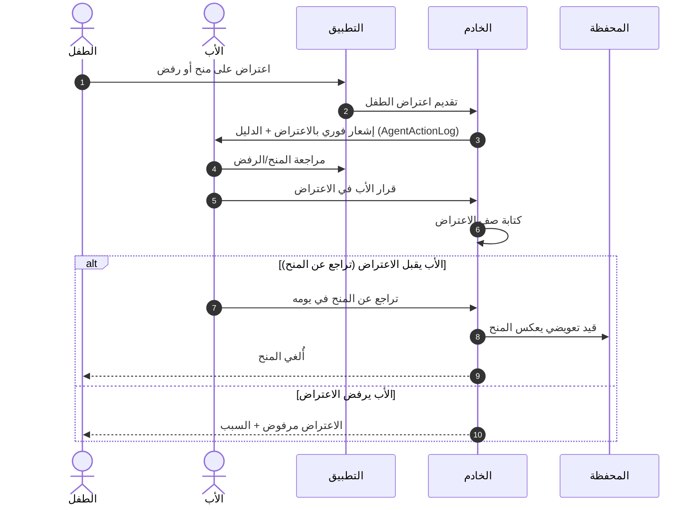
- الرسالة 2: `POST /api/v1/families/{id}/children/{childId}/objections` — اعتراض الطفل (يُشعَر به الأب فوراً — REQ-018 · Q-193)
- الرسالة 5: `POST /api/v1/families/{id}/children/{childId}/objections/{objectionId}/decide {ACCEPTED | REJECTED, reason?}`
- الرسالة 6: `status / decided_by / decided_at / decision_reason`
- الرسالة 7: `POST /api/v1/families/{id}/children/{childId}/wallet/grants/{walletGrantId}/reverse` — في يومه فقط
- الرسالة 8: لمنح كسب مهمة: عبر `revoke-verification` في S1-06 (اليوم نفسه — Q-254)؛ ولمنح غير مهام: محاسبي محلي بلا حدث

- أُعيد رسمه 2026-11-19 (Q-434 — Q-414): التراجع عن المنح (reverse) في يوم الإيداع نفسه فقط ويتطلب اتصالاً (§4 · Q-414)؛ وترتيب المشاركين موحّد (المستخدم، ثم التطبيق، ثم الخادم، ثم قاعدة البيانات).

### 3-ح. تجمّد المحفظة عند بلوغ 13 ومنح الوقت من الرصيد المجمّد (REQ-011 · Q-237 · Q-414)

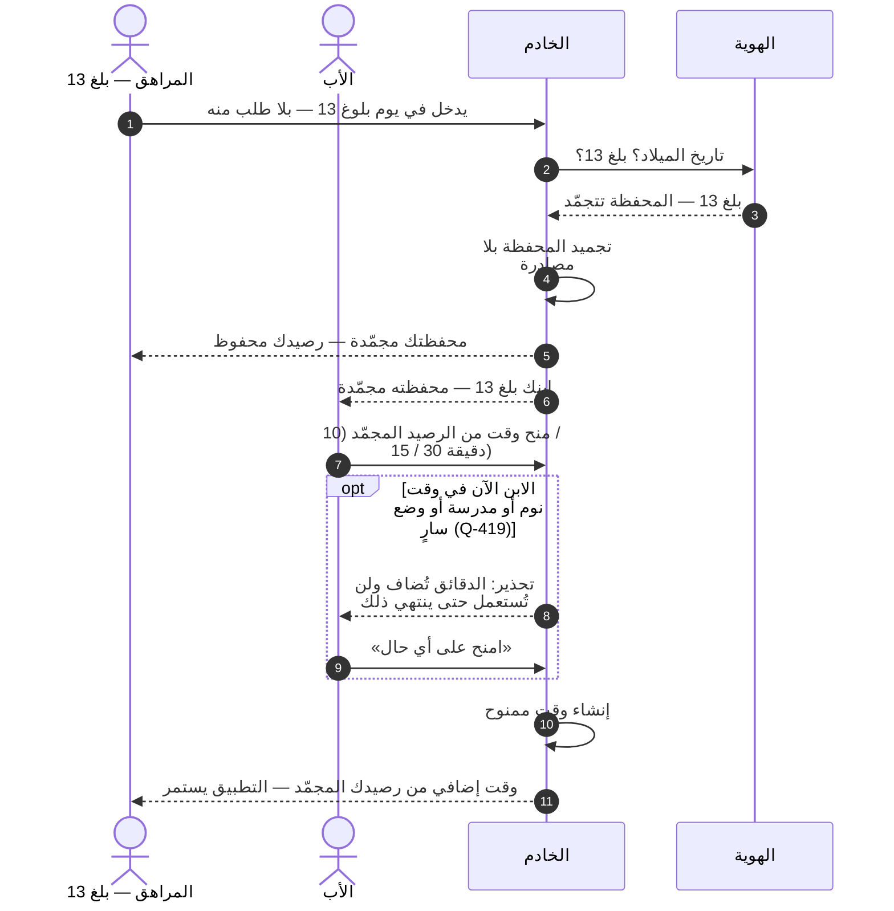
- الرسالة 4: الرصيد محفوظ بلا مصادرة — لا كسب ولا صرف ولا سلسلة
- الرسالة 10: `granted_time {source=GRANT, minutes, ينتهي بنهاية اليوم}`

- أُضيف 2026-11-19 (Q-434 — Q-237 · Q-414): عند بلوغ 13 تتجمّد المحفظة: الرصيد محفوظ بلا مصادرة، بلا كسب ولا صرف ولا سلسلة؛ وللأب أن يمنح وقتاً منه (REQ-011)؛ والمنح من الرصيد المجمّد كالمنح المباشر: يُحسب ضمن الحد اليومي (Q-272) ويخضع لتحذير التعارض (Q-419)؛ والمراهق بلا محفظة إطلاقاً بعد التجميد (Q-109). (4 مشاركين، 10 رسائل.)

## 4. تدفق المستخدم (User Flow) — من السيناريوهات الثلاثة عشر (§2)

### 4-أ. طلب الوقت وقرار الأب

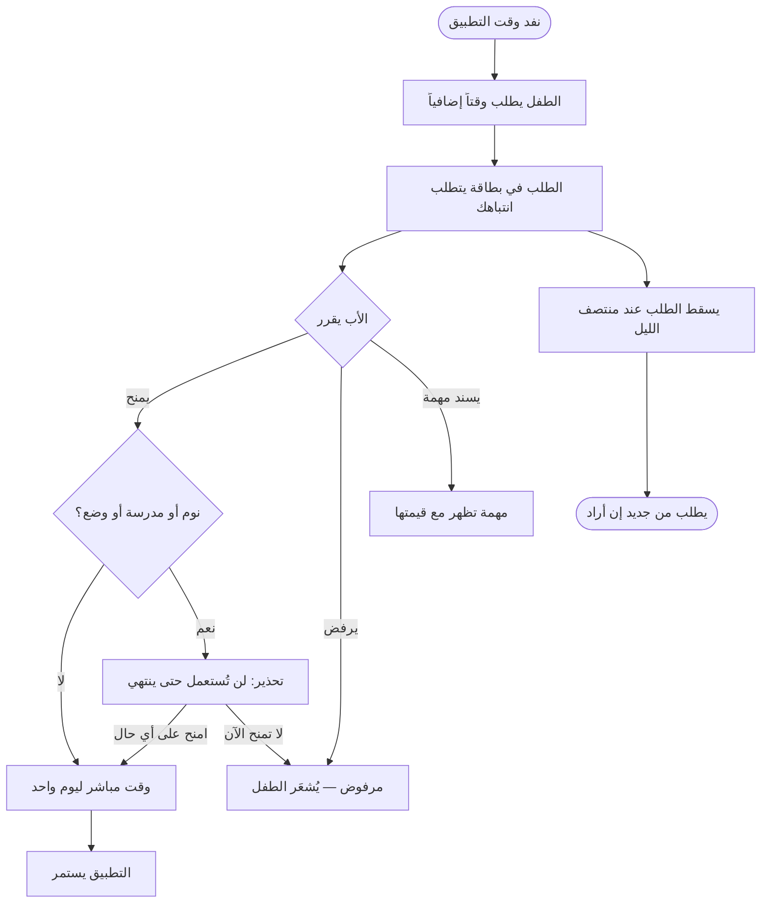

### 4-ب. من الإنجاز إلى المحفظة

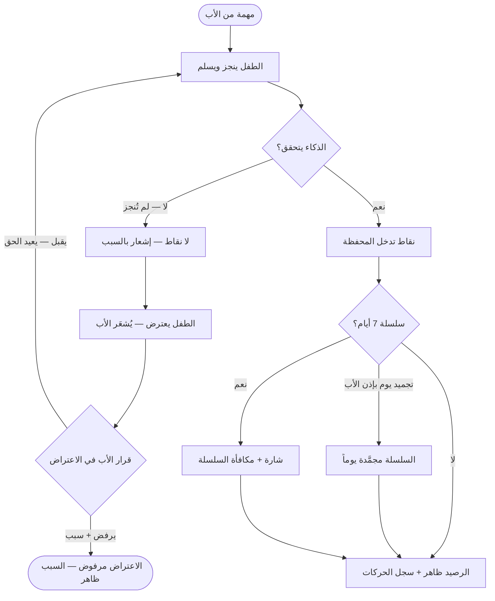

### 4-ج. الصرف

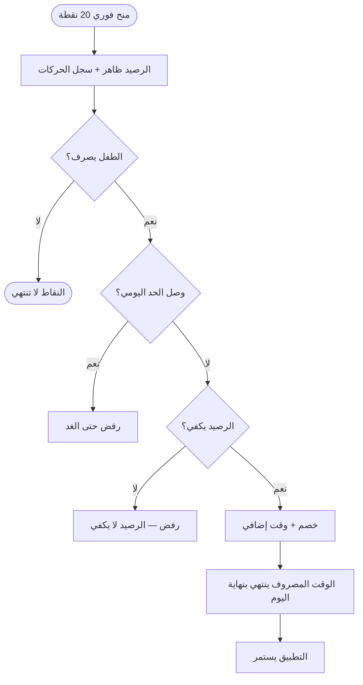

- أُعيد رسمه 2026-11-19 (Q-434 — Q-414 · Q-419): قُسّم التدفق الواحد (27 عقدة/29 سهماً) إلى ثلاث لوحات TD: 4-أ طلب الوقت وقرار الأب (12 عقدة/13 سهماً، وأُضيف معيّن التحذير قبل المنح وفرع سقوط الطلب عند منتصف الليل)، و4-ب من الإنجاز إلى المحفظة (12 عقدة/14 سهماً، وأُضيف قرار الأب في الاعتراض: قبول يعيد الحق، رفض بسبب يقرؤه الطفل)، و4-ج الصرف (11 عقدة/10 أسهم). والمسارات نفسها قبل التقسيم وبعده.

- المصدر: §2 (5-1…5-13) · §3 (REQ-001…REQ-014 + REQ-018) · §7 (الحالات الحدية).
- المساران الجانبيان مرسومان في التدفق: المنح الفوري 20 نقطة بلا مهمة (5-6) مدخل جانبي إلى المحفظة في 4-ج، وتجميد السلسلة يوماً واحداً بإذن الأب عند المرض/السفر (5-5) فرع من قرار السلسلة في 4-ب — والتفصيل التسلسلي في 3-د؛ ومراهق يحاول الكسب أو الصرف يُرفض ويُسجَّل (Q-109) قبل أي خطوة في التدفق؛ ومكافأة السلسلة 50 نقطة افتراضياً والشارات: فضية 7 أيام، ذهبية 30 يوماً، ماسية 90 يوماً (Q-277)؛ والصرف 10 نقاط = 10 دقائق والحد اليومي 60 دقيقة افتراضياً (Q-414)؛ وبداية التدفق من S1-10 (نفد وقت التطبيق).

## 5. مخطط تدفق البيانات (DFD — المستوى 1) — من §4/§5

العمليات مرقمة 1.0–6.0، والمخازن D1–D5 وD8 جداول الخادم من §5، وD6–D7 مخزنان محليان على الجهاز (موثقان في §5: مرآة Drift + Outbox). كل منح/صرف/قرار يُسجَّل في AuditEvent (domain=rewards — §5). والمخطط على سبع لوحات LR، لوحة لكل عملية (أو لكل وجه من عملية واحدة): 5-أ استقبال حدث الكسب (P1)، و5-ب إدارة المحفظة والسجل (P2)، و5-ج السلاسل والتجميد (P5)، و5-د الصرف كوقت إضافي (P3)، و5-هـ طلب الوقت وقرار الأب (P4)، و5-و الاعتراض والتحذير قبل المنح (P4)، و5-ز الإعدادات والمزامنة (P6)؛ والعقدة المشتركة تُكرَّر باسمها مع مرجع اللوحة الأخرى. والحمولات الكاملة للتدفقات في §3 و§4.

- **تغطية نقاط §4:** التسلسلات في §3 تغطي التدفقات الأساسية فقط؛ وكل نقطة §4 تظهر هنا على الأقل: نقاط القراءة `GET /api/v1/families/{id}/children/{childId}/wallet` و`GET /api/v1/families/{id}/children/{childId}/wallet/ledger` و`GET /api/v1/families/{id}/rewards/settings` و`PATCH /api/v1/families/{id}/rewards/settings` مذكورة في §3 (تُقرأ عبر P2/P6)؛ وبقية النقاط مرسومة في §3 (grant، redeem، time-requests، decide، streak/freeze)؛ ونقطة `POST …/wallet/grants/{walletGrantId}/reverse` (REQ-018 · Q-167) مرسومة في 3-ز؛ ونقطة `POST …/children/{childId}/objections` (REQ-018 · Q-193) مرسومة في 3-ز؛ ونقطة `POST …/objections/{objectionId}/decide` (REQ-018) مرسومة في 3-ز وتكتب في D8.

### 5-أ. استقبال حدث الكسب

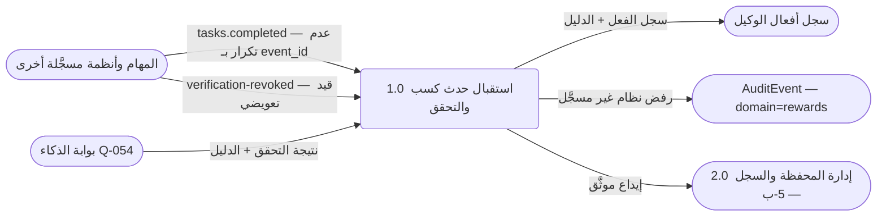

- أُعيد تقسيمه 2026-11-19 (دفعة الشكل 2): لوحة استقبال حدث الكسب من 5-أ القديمة؛ وP2x مرجع إلى 5-ب.

### 5-ب. إدارة المحفظة والسجل

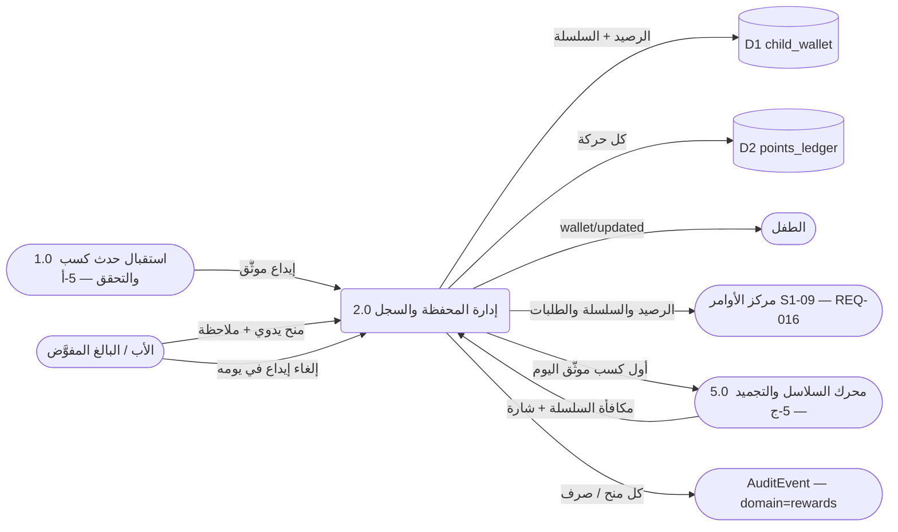

- أُعيد تقسيمه 2026-11-19 (دفعة الشكل 2): لوحة إدارة المحفظة والسجل من 5-أ القديمة؛ وP1x مرجع إلى 5-أ وP5x مرجع إلى 5-ج.

### 5-ج. السلاسل والتجميد

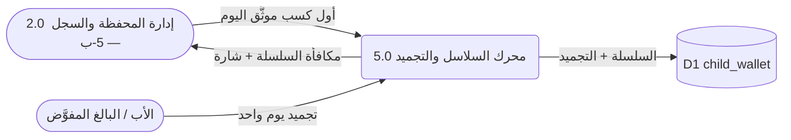

- أُعيد تقسيمه 2026-11-19 (دفعة الشكل 2): لوحة السلاسل والتجميد من 5-أ القديمة؛ وP2x مرجع إلى 5-ب.

### 5-د. الصرف كوقت إضافي

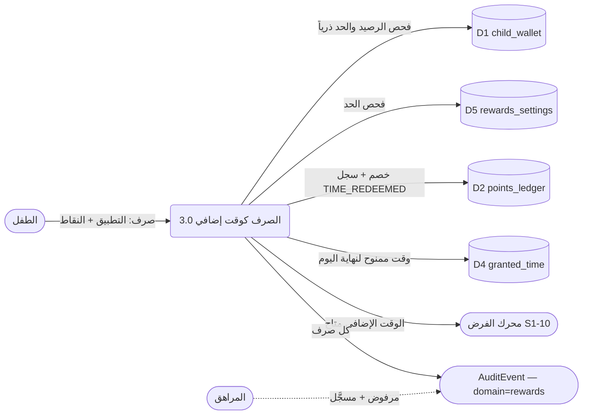

- أُعيد تقسيمه 2026-11-19 (دفعة الشكل 2): لوحة الصرف كوقت إضافي من 5-ب القديمة؛ وحافة المراهق المرفوضة هنا لأن الرفض في الصرف (Q-109).

### 5-هـ. طلب الوقت وقرار الأب

```mermaid
flowchart LR
    Child([الطفل])
    Father([الأب / البالغ المفوَّض])
    P4(4.0 طلبات الوقت وقرار الأب)
    D3[(D3 time_request)]
    D1[(D1 child_wallet)]
    D4[(D4 granted_time)]
    S109([مركز الأوامر S1-09 — REQ-016])
    Audit([AuditEvent — domain=rewards])

    Child -->|طلب وقت إضافي| P4
    P4 -->|حفظ الطلب PENDING| D3
    P4 -->|بطاقة يتطلب انتباهك| S109
    Father -->|قرار على الطلب| P4
    P4 -->|القرار + assigned_task_id| D3
    P4 -->|فحص المتبقي قبل المنح| D1
    P4 -->|منح مباشر ليوم واحد| D4
    P4 -->|"time-request/decided"| Child
    P4 -->|كل قرار| Audit
```

- أُعيد تقسيمه 2026-11-19 (دفعة الشكل 2): لوحة طلب الوقت وقرار الأب من 5-ب القديمة (وجه الطلب والقرار من P4).

### 5-و. الاعتراض والتحذير قبل المنح

```mermaid
flowchart LR
    Child([الطفل])
    Father([الأب / البالغ المفوَّض])
    S110([محرك الفرض S1-10])
    P4x(["4.0 طلبات الوقت وقرار الأب — 5-هـ"])
    D8[(D8 objection)]
    P2x(["2.0 إدارة المحفظة والسجل — 5-ب"])
    Audit([AuditEvent — domain=rewards])

    Child -->|اعتراض على القرار| P4x
    P4x -->|حفظ الاعتراض PENDING| D8
    Father -->|قرار على الاعتراض| P4x
    P4x -->|القرار + السبب| D8
    P4x -->|قبول الاعتراض يعكس المنح| P2x
    P4x -->|كل قرار| Audit
    S110 -->|حالة الطفل الآن| P4x
    P4x -->|تحذير قبل المنح| Father
```

- أُعيد تقسيمه 2026-11-19 (دفعة الشكل 2): لوحة الاعتراض والتحذير قبل المنح من 5-ب القديمة (وجه الاعتراض والتحذير من P4)؛ وP4x مرجع إلى 5-هـ وP2x مرجع إلى 5-ب.

### 5-ز. الإعدادات والمزامنة

```mermaid
flowchart TD
    Father([الأب / البالغ المفوَّض])
    Child([الطفل])
    P6(6.0 إعدادات المكافآت والمزامنة)
    D5[(D5 rewards_settings)]
    D6[(D6 مرآة المحفظة — محلي — Drift)]
    D7[(D7 Outbox — محلي)]
    Ktor([خادم المكافآت — Ktor])

    Father -->|ضبط الحد والمصادر والمكافأة| P6
    P6 -->|الضوابط| D5
    P6 -->|آخر رصيد معروف| D6
    Child -->|طلب أو صرف| P6
    P6 -->|حفظ في Outbox| D7
    D7 -->|مزامنة عند عودة الاتصال| Ktor
```

- أُعيد تقسيمه 2026-11-19 (دفعة الشكل 2): لوحة الإعدادات والمزامنة من 5-ب القديمة.

- أُعيد رسمه 2026-11-19 (Q-434 — Q-414 · Q-419): قُسّم المخطط الواحد (24 عقدة/44 سهماً) إلى لوحتين LR مع subgraph يجمّع كل طرف (خارجي / عمليات / مخازن وسجلات) بترتيب واحد في اللوحتين: 5-أ الكسب والإيداع والسلاسل (12 عقدة/17 سهماً)، و5-ب الصرف والطلبات والقرارات (19 عقدة/30 سهماً)؛ وأُضيفت ثلاثة أسهم: S110→P4 حالة الطفل (نوم/مدرسة/وضع سارٍ) وP4→Father تحذير قبل المنح (Q-419)، وFather→P2 إلغاء إيداع في يومه (Q-414)؛ وقُصّرت التسميات (الحمولات الكاملة في §3 و§4). والتدفقات نفسها قبل التقسيم وبعده. (ملاحظة فحص العين: النسخة الأولى بلا subgraph رُسمت وفشلت — شبكة متشابكة يصعب قراءتها؛ فأُعيدت بالـsubgraph حسب §3-4.)

## 6. مخطط النشاط (Activity) — دورة حياة المحفظة

المسارات الخمسة (الطفل / الأب / خادم المكافآت / الذكاء / محرك S1-10) كمسارات متوازية. والأنشطة الخلفية (انتهاء الوقت المصروف بنهاية اليوم — Q-183، انقطاع السلسلة في يوم بلا كسب) تعمل **بالتوازي** مع استخدام التطبيق.

ثلاث لوحات TD: 6-أ طلب الوقت وقرار الأب، و6-ب الإنجاز والتحقق والإيداع، و6-ج المحفظة والصرف والاعتراض؛ والعقد المشتركة (C3، C4، V5، V6، F1) مراجع باسمها ولوحتها. والأنشطة الخلفية (انتهاء الوقت المصروف بنهاية اليوم — Q-183، انقطاع السلسلة في يوم بلا كسب) تعمل **بالتوازي** مع استخدام التطبيق.

### 6-أ. طلب الوقت وقرار الأب

```mermaid
flowchart TD
    E1([محرك الفرض يطبق الحدود والحظر — S1-10])
    C1([نفد وقت التطبيق])
    C2[طلب وقت إضافي]
    F1[قرار على الطلب]
    V5a{نوم أو مدرسة أو وضع؟}
    F3b{امنح على أي حال؟}
    F3[منح وقت مباشر]
    C7([مرفوض — يُشعَر الطفل])
    V5[وقت ممنوح لنهاية اليوم]
    C3x(["إنجاز مهمة وتسليمها — 6-ب"])

    E1 --> C1
    C1 --> C2
    C2 --> F1
    F1 -->|يسند مهمة| C3x
    F1 -->|يمنح مباشرة| V5a
    V5a -->|لا| F3
    V5a -->|نعم — تحذير| F3b
    F3b -->|نعم| F3
    F3b -->|لا| C7
    F1 -->|يرفض| C7
    F3 --> V5
```

- أُعيد تقسيمه 2026-11-19 (دفعة الشكل 2): لوحة طلب الوقت وقرار الأب من 6-أ القديمة؛ وC3x مرجع إلى 6-ب.

### 6-ب. الإنجاز والتحقق والإيداع

```mermaid
flowchart TD
    C3[إنجاز مهمة وتسليمها]
    A1[التحقق أن المهمة أُنجزت]
    A2{النتيجة؟}
    V1[استقبال حدث كسب]
    F6[الأب يرى الرفض]
    V2[إيداع النقاط + سجل]
    V3[إطالة السلسلة ومكافأتها]
    C4[عرض الرصيد والسلسلة والسجل]
    F2[منح نقاط يدوياً]
    F4[تجميد السلسلة يوماً]
    V6[تسجيل كل منح وصرف وقرار]
    F1x(["قرار على الطلب — 6-أ"])

    C3 --> A1
    A1 --> A2
    A2 -->|أُنجزت| V1
    A2 -->|لم تُنجز| F6
    F6 --> C3
    V1 --> V2
    V2 --> V3
    V2 --> C4
    V3 --> C4
    F2 --> V2
    F4 --> V3
    V2 --> V6
    F1x --> V6
```

- أُعيد تقسيمه 2026-11-19 (دفعة الشكل 2): لوحة الإنجاز والتحقق والإيداع من 6-أ القديمة؛ وF1x مرجع إلى 6-أ.

### 6-ج. المحفظة والصرف والاعتراض

```mermaid
flowchart TD
    C4x(["عرض الرصيد والسلسلة والسجل — 6-ب"])
    C5[صرف نقاط كوقت للتطبيق]
    V4[صرف ذري يفحص الرصيد والحد]
    V5x(["وقت ممنوح لنهاية اليوم — 6-أ"])
    E2[إتاحة الوقت الممنوح]
    C6([التطبيق يستمر])
    E3[انتهاء الوقت المصروف بنهاية اليوم]
    C8[اعتراض على منح أو رفض]
    F7[قرار على الاعتراض]
    V7[قيد تعويضي يعكس المنح]
    V6[تسجيل كل منح وصرف وقرار]
    F5[ضبط الحد والمصادر والمكافأة]

    C4x --> C5
    C5 --> V4
    V4 --> V5x
    V5x --> E2
    E2 --> C6
    V5x --> E3
    C8 --> F7
    F7 -->|يقبل الاعتراض| V7
    F7 -->|يرفض + السبب| C4x
    V7 --> C4x
    V7 --> V6
    V4 --> V6
    F5 --> V4
```

- أُعيد تقسيمه 2026-11-19 (دفعة الشكل 2): لوحة المحفظة والصرف والاعتراض من 6-ب القديمة؛ وC4x وV5x مرجعان إلى 6-ب و6-أ.

- أُعيد رسمه 2026-11-19 (Q-434 — Q-414 · Q-419): صار المخطط TD على لوحتين بدل LR بخمسة مسارات (27 عقدة/34 سهماً ← 6-أ 20 عقدة/24 سهماً و6-ب 12 عقدة/13 سهماً)؛ وأُضيف معيّن التحذير قبل المنح المباشر (V5a) مع تأكيد «امنح على أي حال؟» (F3b)؛ وسقوط الطلب عند منتصف الليل في 3-ج و4-أ. والقيد التعويضي (V7) يكتب في الإيداع V2 في 6-أ؛ ورفض الأب للطلب (Q-179) يُشعَر به الطفل؛ وانتهاء الوقت المصروف EXPIRED بنهاية اليوم (Q-183).

- المصدر: §2 (دورة المحفظة وحلقة §2 البصرية) · §3 (REQ-001…REQ-018) · §6/§7 (الثوابت والحالات الحدية).
- ملاحظتان: يوم بلا كسب يقطع السلسلة إلا إذا جُمّدت، والتجميد بعد انقطاعها لا يعيدها (§7)؛ وتغيير الحد اليومي أثناء اليوم يطبق فوراً على ما تبقى من اليوم وما صُرف قبله لا يُسترجع (§7).
- إلغاء التحقق (S1-06) يصدر `family/{family_id}/tasks.verification-revoked` فيعوَّض الإيداع بقيد سالب — انظر التسلسل 3-و.
- كل منح/صرف/قرار مسجَّل في التدقيق (ACC-015)؛ ولا نقاط للمراهقين إطلاقاً (Q-109)؛ والصرف كوقت فقط في المرحلة 1 — لا كتالوج جوائز (Q-113).
