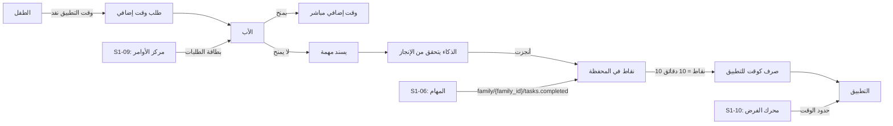
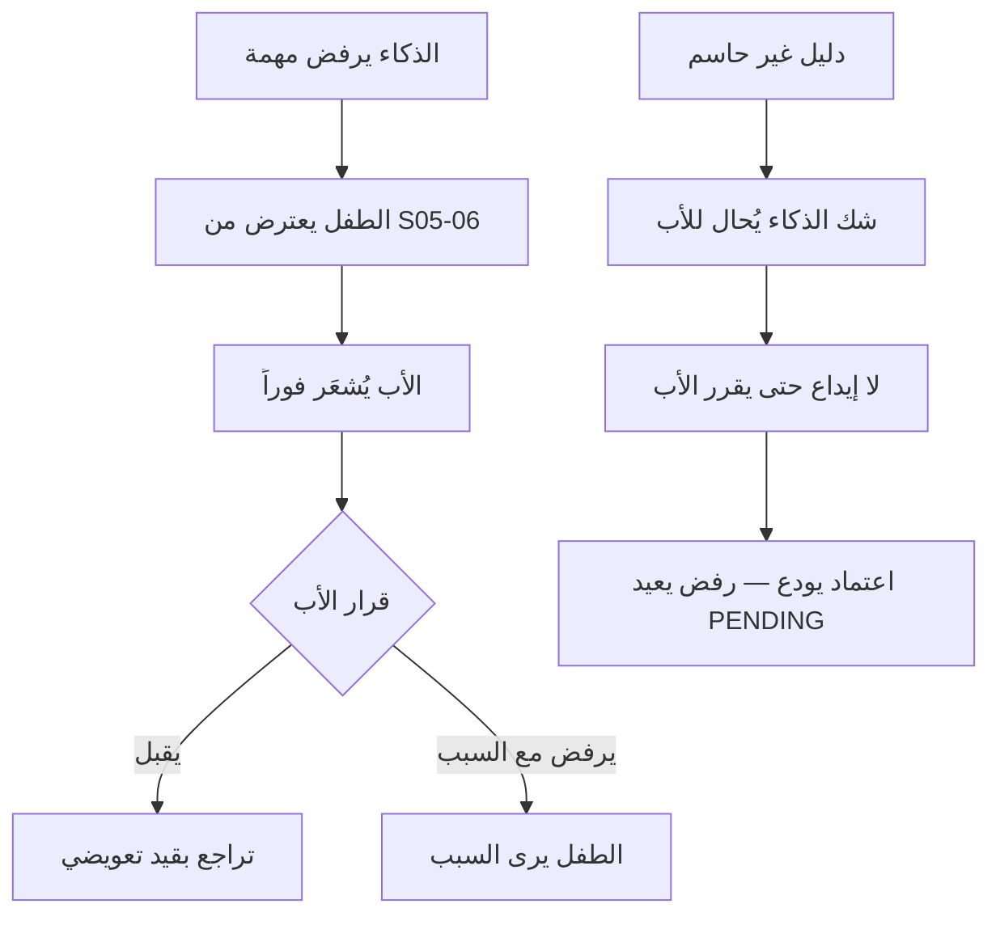
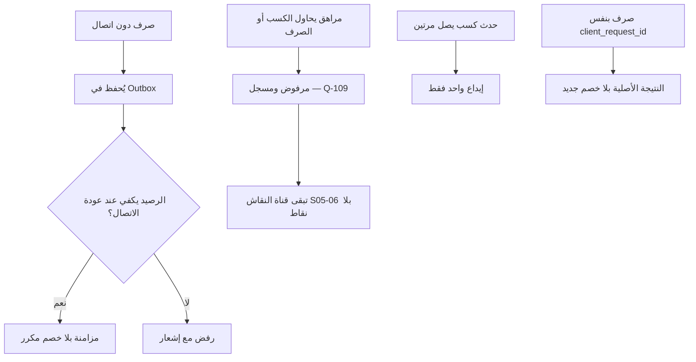
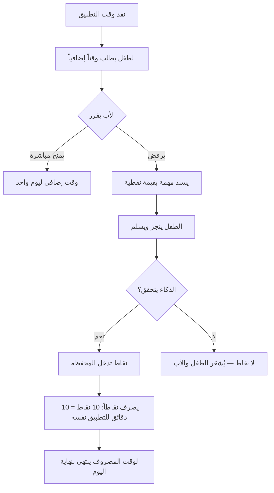
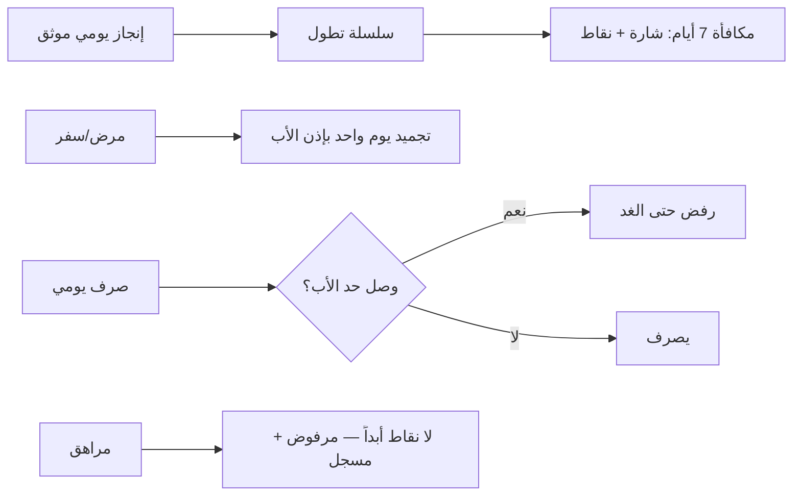

# S1-05: المكافآت للأطفال (Rewards for Children)

- **الحالة:** approved | **المرحلة:** 1 (نواة الحماية) · **آخر تحديث:** 2026-11-06
- **القرارات الحاكمة:** Q-001 · Q-003 · Q-054 · Q-064 · Q-107 · Q-108 · Q-109 · Q-110 · Q-111 · Q-112 · Q-113 · Q-114 · Q-115 · Q-116 · Q-117 · Q-118 · Q-119 · D-021 · G-011 · Q-183 · Q-185 · D-012 · Q-009 · Q-167 · Q-007 · Q-193 · Q-189 · Q-237 · Q-243 · Q-272 · Q-273
- **حالة المراجعة:** §§1–8 + §10 معتمدة بالكامل في التخطيط (حكم المالك 2026-11-06) · §9 في مرحلة التصميم.
- **الأدلة المرجعية:** المواصفة القديمة S1-05 (مرجع فقط، G-009) · Qustodio (Extra Time + حصص لكل تطبيق) · Quizlet (سلاسل وشارات) · FamilyWall (إسناد المهام) · FamiSafe (تمديد حتى منتصف الليل)

## 1. الهدف والتحليل والنطاق

**الهدف:** محرك التحفيز في المنصة — محفظة نقاط واحدة لكل طفل، النقاط فيها عملة تُصرف كوقت إضافي لاستخدام التطبيقات. الطفل يكسب النقاط بإنجاز المهام (يتحقق منها الذكاء) أو بمنح الأب، ويصرفها حين ينفد وقت تطبيق ليستمر فيه.

**القواعد الثلاث:**
1. **النقاط عملة وقت:** 10 نقاط = 10 دقائق (Q-111)؛ والصرف على التطبيق الذي نفد وقته تحديداً (Q-116)؛ والوقت المصروف ينتهي بنهاية اليوم (Q-112).
2. **الأب يملك القرار:** المنح المباشر أو إسناد مهمة بدلاً من المنح؛ والذكاء يعمل بتفويضه وحده (Q-003/Q-110) — يتحقق ويمنح، والأب يراجع ويلغي.
3. **الصدق في الرصيد:** محفظة واحدة لكل طفل يجمع فيها كل الرصيد (Q-117)؛ ولا نقاط للمراهقين إطلاقاً (Q-109)؛ وحد صرف يومي يحدده الأب (Q-114).

**المرونة إلزامية (Q-003 — أضيف بتعديل 2026-11-06):** كل معامل في هذا النظام قابل للضبط من الأب (الحد اليومي للصرف، مصادر الكسب المفعّلة، مكافأة السلسلة، المنح اليدوي، التجميد)؛ وسعر الصرف ثابت 1:1 كما حُكم (Q-111) ما لم يغيّره المالك.

**مصدر المهام عام (Q-118 — أضيف بتعديل 2026-11-06):** أي نظام (التعليم، الدين، غيرهما) يستطيع إسناد مهام تُكسب نقاطاً في محفظة S1-05؛ وعقد الكسب عام لا مرتبط بـ S1-06 وحدها؛ وإنشاء المهام يبقى ملك النظام المُسند.

**نموذجنا الخاص والفريد والديناميكي (Q-119 — أضيف بتعديل 2026-11-06):** ندمج كل هذه الآليات (وقت Qustodio الإضافي + حصصه لكل تطبيق + سلاسل Quizlet + إسناد FamilyWall + انتهاء FamiSafe) ونخرج بنموذجنا الخاص والفريد والديناميكي — محفظة موحدة + كسب عام من أي نظام + صرف كوقت لتطبيق محدد + تحقق ذكاء + مرونة الأب في كل معامل.

**دورة المحفظة:**
1. لكل تطبيق وقت استخدام (من S1-10 — Q-178)؛ وإذا اكتمل يطلب الطفل من الأب.
2. الأب يمنح وقتاً إضافياً مباشرة — أو لا يمنح ويسند له مهمة.
3. ينجز الطفل المهمة؛ الذكاء يتحقق أنها أُنجزت كما هو مطلوب فيمنح النقاط.
4. النقاط تدخل المحفظة؛ ويصرفها الطفل كوقت إضافي للتطبيق.
5. السلاسل اليومية تكافئ الاستمرارية (Q-108)؛ والتجميد يوم واحد بإذن الأب.

**الدورة الكاملة في المرحلة 1 (Q-115):** تأجيل الفرع القديم ملغى — كل خطوات الدورة أعلاه في المرحلة 1.

**خارج النطاق:**
- ربط مباشر بالبطاقات البنكية والحسابات الحقيقية (S5-06).
- إنشاء المهام وجداولها اليومية (S1-06 — عقد الحدث `family/{family_id}/tasks.completed` فقط).
- كتالوج الجوائز المعنوية/المادية (مؤجل — Q-113: الوقت فقط في المرحلة 1).
- فرض حدود الوقت والحظر (محرك S1-10 — مواصفته معتمدة (Q-146)؛ S1-05 يستهلك حدوده وأرصدته ولا يملك الفرض).

**مصطلحات:**
- **محفظة (Wallet):** رصيد نقاط واحد لكل طفل يجمع كل ما يكسبه.
- **نقطة (Point):** وحدة الكسب؛ 10 نقاط = 10 دقائق وقت إضافي.
- **سلسلة (Streak):** أيام متتالية من الإنجاز؛ تكافئ الاستمرارية.
- **تجميد (Freeze):** إيقاف عدّ السلسلة ليوم واحد بإذن الأب (مرض/سفر).
- **صرف (Redeem):** تحويل نقاط إلى دقائق وقت إضافي لتطبيق محدد.
- **مهمة (Task):** عمل يسنده الأب (من S1-06) وله قيمة نقطية.
- **تحقق الذكاء (AI Verification):** الذكاء يتحقق أن المهمة أُنجزت كما هو مطلوب ثم يمنح النقاط (Q-110) — **بمعايير ملزمة (Q-167):** الدليل المباشر يمنح تلقائياً، والدليل المقدَّم يتحقق ثم يمنح (والشك يُحال للأب)، والإقرار الذاتي وحده لا يودع شيئاً، وكل منح قابل للتراجع من الأب.

**ملاحظة إعادة الاستخدام (RE):** منح الوقت الإضافي كقيد يومي + معادلة المتاح + تدفق الطلب ← الموافقة من Qustodio (Extra Time)؛ السلاسل والشارات من Quizlet؛ إسناد المهام من FamilyWall؛ الدورة الكاملة (نفاد ← طلب ← منح أو مهمة ← تحقق AI ← نقاط ← صرف كوقت لتطبيق محدد) تركيب جديد من عندنا.



## 2. سيناريوهات المستخدم

- **5-1 إنجاز مهمة وكسب نقاط:** أحمد يكمل واجباً منزلياً (من S1-06)؛ الذكاء يتحقق أنه أُنجز كما هو مطلوب؛ 15 نقطة تدخل محفظته فوراً مع احتفالية قصيرة.
- **5-2 نفاد الوقت ومنح مباشر:** ينفد وقت لعبة أحمد؛ يطلب من أبيه وقتاً إضافياً؛ الأب يمنح 30 دقيقة مباشرة من مركز الأوامر؛ تستمر اللعبة.
- **5-3 رفض المنح وإسناد مهمة:** الأب لا يمنح الوقت؛ يسند لأحمد مهمة (ترتيب الغرفة)؛ ينجزها أحمد؛ الذكاء يتحقق؛ 10 نقاط تدخل المحفظة؛ يصرفها أحمد كوقت إضافي للعبة (10 نقاط = 10 دقائق).
- **5-4 مهمة من نظام آخر:** مهمة من نظام الدين (حفظ آية) أو التعليم (مراجعة درس) تُكسب نقاطاً في المحفظة نفسها — عقد الكسب عام (Q-118)؛ فالنقاط تجمع من كل الأنظمة في محفظة واحدة.
- **5-5 سلسلة وتجميد:** أحمد يحافظ على سلسلة 7 أيام فيكسب شارة فضية + نقاط مكافأة السلسلة؛ ويمرض يوماً فيجمّد الأب السلسلة فلا تنقطع.
- **5-6 منح فوري من الأب:** الأب يمنح أحمد 20 نقطة فوراً (مكافأة استثنائية على سلوك حسن) بلا مهمة.
- **5-7 حد الصرف اليومي:** أحمد صرف 60 دقيقة إضافية اليوم (الحد الذي حدده الأب)؛ يحاول صرف المزيد فيُرفض حتى الغد مع رسالة واضحة.
- **5-8 انتهاء الوقت المصروف:** أحمد صرف 20 نقطة كوقت إضافي لكنه استخدم منها 10 دقائق فقط؛ الـ 10 المتبقية تنتهي بنهاية اليوم ولا تُسترد (النقاط نفسها لا تنتهي — الوقت المصروف وحده ينتهي).
- **5-9 اعتراض ثم تراجع:** يرفض الذكاء مهمة أحمد؛ فيعترض أحمد من S05-06؛ ويُشعَر الأب فوراً؛ فيقبل الأب الاعتراض فيتراجع عن المنح بقيد تعويضي (REQ-018)؛ أو يرفضه مع السبب فيرى أحمد السبب.
- **5-10 صرف دون اتصال ثم تعارض:** يصرف أحمد نقاطاً دون اتصال فيُحفظ الصرف في Outbox؛ وعند عودة الاتصال إن كان الرصيد لا يكفي (صُرف من جهاز آخر) يُرفض الصرف مع إشعار؛ وإن كفى يُزامَن بلا خصم مكرر.
- **5-11 مراهق يحاول الكسب أو الصرف:** مراهق (13–17) يحاول كسب نقاط أو صرفها؛ فيُرفض (لا محفظة للمراهقين — Q-109) ويُسجَّل؛ وتبقى له قناة الاعتراض/النقاش في S05-06 بلا نقاط.
- **5-12 شك الذكاء يُحال للأب:** يقدّم أحمد دليلاً غير حاسم لمهمة؛ فيشك الذكاء ويُحيل الأمر للأب بنقرة واحدة (REQ-005/Q-167)؛ ولا إيداع حتى يقرر الأب (اعتماد يودع، رفض يعيد PENDING).
- **5-13 إيداع وصرف مكرران:** يصل حدث كسب واحد مرتين (إعادة تسليم MQTT) فيُودع مرة واحدة فقط (نفس `task_id` + `source_system` — §7)؛ ويُعاد إرسال صرف بنفس `client_request_id` فيُعاد نتيجته الأصلية بلا خصم جديد.

**مخطط الاعتراض والتراجع والشك (سيناريوهات بصرية):**



**مخطط دون اتصال والمراهق والتكرار (سيناريوهات بصرية):**



**مخطط حلقة المحفظة (§2 — بصري):**



**مخطط السلسلة والحد (§2 — بصري):**



## 3. المتطلبات الوظيفية

### المحفظة
- **REQ-001:** محفظة واحدة لكل طفل يجمع فيها كل الرصيد؛ والرصيد لا يقل عن صفر أبداً. [Q-117 · DIRECT]
- **REQ-002:** الرصيد ظاهر للطفل وللأب في كل وقت (مع سجل الحركات). [Q-117 · DIRECT]
- **REQ-003:** المحفظة تعمل دون اتصال (مخزن محلي) وتُزامَن عند عودة الاتصال عبر Outbox بلا خصم مكرر. [Q-064 · DERIVED]

### الكسب
- **REQ-004:** عقد كسب عام: أي نظام (S1-06، التعليم، الدين، غيرهما) يصدر حدث الكسب (`family/{family_id}/tasks.completed`) الذي يحمل `source_system` + المهمة + قيمة النقاط؛ وS1-05 يقبل الحدث من أي نظام مسجَّل. [Q-118 · DIRECT]
- **REQ-005:** لا تُودع نقطة قبل التحقق: الذكاء يتحقق أن المهمة أُنجزت كما هو مطلوب ثم يمنح النقاط؛ وتسليم الطفل الذاتي وحده لا يودع شيئاً. **معايير التحقق الملزمة (Q-167):** الدليل المباشر يمنح تلقائياً؛ والدليل المقدَّم يتحقق ثم يمنح (والشك يُحال للأب بنقرة)؛ وكل منح يذكر دليله في السجل. [Q-110 · Q-167 · DIRECT]
- **REQ-006:** الأب يمنح نقاطاً فورية يدوياً (مكافأة استثنائية) بلا مهمة. [Q-107 · DIRECT]
- **REQ-007:** محرك سلاسل يومية: يوم إنجاز متتالٍ يطيل السلسلة؛ ومكافأة سلسلة عند 7 أيام؛ وتجميد السلسلة ليوم واحد بإذن الأب فقط. [Q-108 · DIRECT]

### الصرف
- **REQ-008:** الصرف كوقت إضافي للتطبيق الذي نفد وقته تحديداً؛ وسعر الصرف ثابت: 10 نقاط = 10 دقائق؛ والصرف بخطوات ثابتة 10 نقاط: الحد الأدنى 10 نقاط، والحد الأقصى = الرصيد (Q-273). [Q-111/Q-116 · DIRECT] [Q-273]
- **REQ-009:** الوقت المصروف ينتهي بنهاية اليوم؛ وما لم يُستخدم منه لا يُسترد (النقاط نفسها لا تنتهي). و«نهاية اليوم» = منتصف الليل بالتوقيت المحلي للعائلة — مصدره حقل `family.time_zone` (IANA — S1-02 §5)؛ ويُختار عند إنشاء العائلة من جهاز المالك بموافقة الأب، ولا يُشتق من `region` أبداً (Q-264). [Q-112 · DIRECT] [Q-183 · Q-264]
- **REQ-010:** حد صرف يومي يحدده الأب (افتراضي 60 دقيقة إضافية)؛ والصرف فوقه يُرفض مع رسالة واضحة؛ والمنح المباشر من الأب يُحسب ضمن الحد نفسه (Q-272). [Q-114 · DIRECT] [Q-272]
- **REQ-011:** الأب يمنح وقتاً إضافياً مباشرة بلا نقاط (من مركز الأوامر)؛ والمنح قيد ليوم واحد (نمط Qustodio)؛ والمنح يُحسب ضمن الحد اليومي (Q-272 — REQ-010). [Q-107 · DERIVED] [Q-272]

### الطلب
- **REQ-012:** عند نفاد وقت التطبيق يطلب الطفل وقتاً إضافياً من الأب (من شاشة الحظر). [Q-107 · DERIVED]
- **REQ-013:** الأب يرفض المنح فيسند مهمة بدلاً منه؛ والمهمة تظهر للطفل فوراً مع قيمتها النقطية. [Q-115/Q-118 · DIRECT]
- **REQ-014:** طلبات الوقت الإضافي تظهر في بطاقة "يتطلب انتباهك" في S1-09؛ والأب يقرر بنقرة واحدة (منح/رفض/إسناد مهمة). [S1-09 REQ-017 · DERIVED] (حمولة البطاقة في §4.)

### التكامل
- **REQ-015:** فرض حدود الوقت والحظر محرك S1-10 (مواصفته معتمدة (Q-146))؛ وS1-05 يستهلك حدوده وأرصدته (المتبقي) ولا يملك الفرض. [S1-10 · DERIVED]
- **REQ-016:** ودجة S1-09 تعرض رصيد المحفظة + السلسلة + الطلبات المعلقة. [S1-09 REQ-001/002 · DERIVED] (حمولة الودجة في §4.)
- **REQ-017:** كل فعل ذكاء في المكافآت يمر بمفتاح قدرة `agent.*` ممنوح + بوابة موافقته (عقد التحقق Q-167)؛ ومنح النقاط بتحقق المهام هو الاستثناء الوحيد المصرَّح به من قاعدة «لا يكافئ الوكيل من تلقاء نفسه» — مقصور على `agent.task.verify` وقابل للتراجع. [Q-167 · DIRECT]
- **REQ-018:** التراجع عن منح ذكاء: الأب يلغي أي منح ذكاء عبر `POST /api/v1/families/{id}/children/{childId}/wallet/grants/{walletGrantId}/reverse` فيُخصم بقيد تعويضي (حدث `family/{family_id}/tasks.verification-revoked`)؛ واعتراض الطفل على منح أو رفض يُرسَل عبر `POST /api/v1/families/{id}/children/{childId}/objections` (الموضوع منح محدد `grantId` أو قرار تحقق؛ والنص إدخال محدود) فيُسجَّل ويُشعَر به الأب فوراً عبر تنبيه S1-09 القائم (Q-193). [Q-167 · Q-193 · DIRECT]

## 4. الواجهات والعقود

### نقاط الوصول REST

كل عملية تحمل مفتاحها الذري (§6 — S1-03 REQ-009: لا عملية بلا مفتاح).

- `GET /api/v1/families/{id}/children/{childId}/wallet` — الرصيد + السلسلة + الطلبات المعلقة — المفتاح: `rewards.wallet.view`. الرد: `{child_id, balance_points, streak_days, pending_requests: [{request_id, app_package, minutes_requested, status}]}`. الأخطاء: `REW_WALLET_NOT_FOUND`.
- `POST /api/v1/families/{id}/children/{childId}/wallet/grant` — منح يدوي من الأب (نقاط + ملاحظة) — المفتاح: `rewards.grant.create`. الطلب: `{points (int > 0), note?}`. الرد: `{ledger_id, balance_points}`. الأخطاء: `REW_VALIDATION_FAILED` (نقاط ≤ 0) · `REW_WALLET_NOT_FOUND`.
- `POST /api/v1/families/{id}/children/{childId}/wallet/grants/{walletGrantId}/reverse` — الأب يلغي منح ذكاء (قيد تعويضي يخصم النقاط — REQ-018 · Q-167) — المفتاح: `rewards.grant.reverse`. الطلب: `{}`. الرد: `{reversal_ledger_id, balance_points}`. و`{walletGrantId}` هو `points_ledger.ledger_id` للإيداع الأصلي (لا `granted_time.grant_id` — انظر §5)؛ والقيد التعويضي يربط بالإيداع الأصلي (`reference_id` = `ledger_id` الأصلي)؛ والعكس المكرر لنفس المنح يُعاد نتيجته الأصلية بلا خصم ثانٍ (§6/§7). الأخطاء: `REW_GRANT_NOT_FOUND`.
- `POST /api/v1/families/{id}/children/{childId}/objections` — الطفل يعترض على منح أو رفض — المفتاح: `rewards.objection.create`. الطلب: `{subject_type (grant | verification_decision), subject_id, objection_text}` — ويُسجَّل الاعتراض ويُشعَر الأب فوراً عبر تنبيه S1-09 (REQ-018 · Q-193). الرد: `{objection_id, status: "PENDING", created_at}`. الأخطاء: `REW_VALIDATION_FAILED` (نوع موضوع غير صالح أو نص فارغ) · `REW_GRANT_NOT_FOUND` (موضوع المنح غير موجود).
- `POST /api/v1/families/{id}/children/{childId}/objections/{objectionId}/decide` — الأب يقرر على الاعتراض (قبول → تراجع عن المنح؛ رفض → مع السبب) — المفتاح: `rewards.objection.decide`. الطلب: `{decision (ACCEPTED | REJECTED), reason?}` — و`reason` إلزامي عند REJECTED (يُكتب في `decision_reason` — §5). الرد: `{objection_id, status, decided_by, decided_at, decision_reason}`. والقرار يكتب صف `objection` نفسه (لا يستدعي العكس فقط)؛ وعند القبول يُنفَّذ التراجع عبر `POST .../wallet/grants/{walletGrantId}/reverse` (انظر 3-ز). الأخطاء: `REW_OBJECTION_NOT_FOUND` · `REW_ALREADY_DECIDED` (تُعاد النتيجة الأصلية).
- `POST /api/v1/families/{id}/children/{childId}/wallet/redeem` — صرف نقاط كوقت إضافي لتطبيق محدد — المفتاح: `rewards.wallet.redeem`. الطلب: `{app_package, points (int > 0), client_request_id}` — ومبلغ الصرف `points` عدد صحيح بمضاعفات 10 (10، 20، 30، …)؛ والحد الأدنى 10 نقاط، والحد الأقصى = الرصيد الحالي (Q-273)؛ ومبلغ ليس من مضاعفات 10 أو أقل من 10 يُرفض بـ `REW_VALIDATION_FAILED`؛ والسعر 1:1 محكوم (Q-111). الرد: `{grant_id, minutes, expires_at (نهاية اليوم), balance_points}`. الأخطاء: `REW_INSUFFICIENT_POINTS` · `REW_DAILY_CAP_REACHED` · `REW_INVALID_APP` · `REW_VALIDATION_FAILED` (مبلغ ليس من مضاعفات 10 أو أقل من 10) · `REW_WALLET_NOT_FOUND`.
- `GET /api/v1/families/{id}/children/{childId}/wallet/ledger` — سجل حركات المحفظة — المفتاح: `rewards.ledger.view`. الرد: `{entries: [{ledger_id, kind, amount, source_system, reference_id, evidence, balance_after, at}]}` — مرتبة بالأحدث أولاً. الأخطاء: `REW_WALLET_NOT_FOUND`.
- `POST /api/v1/families/{id}/children/{childId}/time-requests` — الطفل يطلب وقتاً إضافياً (التطبيق + الدقائق المطلوبة) — المفتاح: `rewards.time_request.create`. الطلب: `{app_package, minutes_requested (int > 0)}`. الرد: `{request_id, status: "PENDING", created_at}` — وطلب معلَّق لنفس التطبيق وهو معلَّق يُعاد الطلب الأصلي (§7). الأخطاء: `REW_INVALID_APP` · `REW_VALIDATION_FAILED`.
- `POST /api/v1/families/{id}/children/{childId}/time-requests/{requestId}/decide` — الأب يقرر: منح / رفض / إسناد مهمة (تُنشأ المهمة عبر `S1-06 POST /api/v1/families/{id}/tasks` بقيمة نقطية يحددها الأب — REQ-013) — المفتاح: `rewards.time_request.decide`. الطلب: `{decision (APPROVED | REJECTED | TASK_ASSIGNED), assigned_task_id?}` — وبلا حقل دقائق في القرار: الدقائق الممنوحة مفتوحة (R2-S105-09 — بانتظار حكم المالك — لا يُفترض هنا أن المنح يساوي المطلوب أو يختلف عنه). الرد: `{request_id, status, decided_by, decided_at}` — وعند المنح يُنشأ `granted_time` (مصدر GRANT). الأخطاء: `REW_REQUEST_NOT_FOUND` · `REW_ALREADY_DECIDED` (تُعاد النتيجة الأصلية).
- `POST /api/v1/families/{id}/children/{childId}/streak/freeze` — الأب يجمّد السلسلة ليوم واحد — المفتاح: `rewards.streak.freeze`. الطلب: `{}`. الرد: `{streak_frozen_until}` — ويُسجَّل التجميد في `streak_freeze` (§5). الأخطاء: `REW_ALREADY_FROZEN` (تجميد ثانٍ أثناء تجميد نشط).
- `GET /api/v1/families/{id}/rewards/settings` — ضوابط الأب (الحد اليومي، مصادر الكسب المفعّلة، مكافأة السلسلة) — المفتاح: `rewards.settings.view`. الرد: `{daily_spend_cap_minutes, streak_bonus_points, enabled_sources}`. الأخطاء: بلا أخطاء مسماة.
- `PATCH /api/v1/families/{id}/rewards/settings` — الأب يضبط المعاملات — المفتاح: `rewards.settings.edit`. الطلب: `{daily_spend_cap_minutes?, streak_bonus_points?, enabled_sources?, version}` — و`version` النسخة المتوقعة (تفاؤل — §5)؛ والرد: `{daily_spend_cap_minutes, streak_bonus_points, enabled_sources, version}` (تزيد `version` عند كل PATCH ناجح). الأخطاء: `REW_VERSION_CONFLICT` · `REW_VALIDATION_FAILED`.

### عقد بطاقة «يتطلب انتباهك» وودجة S1-09 (R2-S105-21)

- **حمولة البطاقة** (S1-09 REQ-017): `{request_id, child_id, app_package, minutes_requested, status, created_at}` — من `time_request` (§5)؛ والمستهلك S1-09 (بطاقة «يتطلب انتباهك» — REQ-014).
- **حمولة الودجة** (S1-09 REQ-001/002): `{balance_points, streak_days, pending_requests_count}` — من `GET .../wallet`؛ والمستهلك S1-09 (ودجة المكافآت — REQ-016).
- العقد يُعرَّف مرة واحدة هنا (جانب المنتج — S1-05)؛ وS1-09 تشير إليه (جانب المستهلك).

### أحداث MQTT

| الموضوع | QoS | Retained | الحمولة | الناشر | المشترك |
|---|---|---|---|---|---|
| `family/{family_id}/wallet/updated` | 1 | لا | `{child_id, balance_points, ledger_id, at}` | وحدة المكافآت (Ktor rewards) | التطبيق (واجهة المحفظة — 3-أ/3-ب) |
| `family/{family_id}/time-request/new` | 1 | لا | `{request_id, child_id, app_package, minutes_requested, created_at}` | وحدة المكافآت | S1-09 (بطاقة «يتطلب انتباهك» — REQ-014) |
| `family/{family_id}/time-request/decided` | 1 | لا | `{request_id, decision (APPROVED/REJECTED/TASK_ASSIGNED), decided_by, decided_at}` | وحدة المكافآت | التطبيق (الطفل — حالة الطلب)؛ وS1-09 (إزالة البطاقة) |
| `family/{family_id}/time/granted` | 1 | نعم | `{child_id, minutes_granted, source (redeem/grant/decision), granted_at}` — دقائق ممنوحة تدخل في «الإضافي» لحساب المتبقي (S1-10 REQ-002) | وحدة المكافآت (Ktor rewards) | التطبيق (واجهة الطفل — المتبقي)؛ وS1-10 (حساب المتبقي — REQ-002) |
| `family/{family_id}/tasks.completed` | 1 | لا | `{source_system, task_id, points}` — حدث الكسب العام الذي تستهلكه المحفظة (من أي نظام مسجَّل) | النظام المُسند (S1-06 أولاً — Q-118) | S1-05 (مستهلك الكسب — REQ-004) |
| `family/{family_id}/tasks.verification-revoked` | 1 | لا | `{source_system, task_id, points}` — إلغاء تحقق (قيد تعويضي يخصم النقاط المودعة) | S1-06 (`revoke-verification`) | S1-05 (قيد تعويضي — REQ-018) |
| `family/{family_id}/tasks.submitted` | 1 | لا | `{event_id, task_id, occurrence_id, submitted_by, submitted_at, proof_ref?}` — معرَّفة مرة واحدة في S1-06 §4 (الناشر) — لا تكرار هنا | S1-06 (الخادم) | S1-09 (بطاقة «يتطلب انتباهك») — حدث مرجعي في تسلسل 3-أ (فرع الشك)؛ وS1-05 لا يستهلكه (لا إيداع حتى يقرر الأب) |

- المصدر: الوسيط §6 — صف «الأحداث»: QoS 1، Retained لا.

### قناة MethodChannel (Kotlin)
- `getCachedWallet` — رصيد المحفظة المحفوظ محلياً (دون اتصال).
- `queueTimeRequest` — طلب وقت إضافي دون اتصال (يُحفظ في Outbox ويُرسَل عند عودة الاتصال).
- `queueRedeem` — صرف دون اتصال: يُحفظ `{app_package, points, client_request_id}` في Outbox؛ ومفتاح عدم التكرار هو `client_request_id` نفسه — يُرسَل في ترويسة `Idempotency-Key` عند تفريغ Outbox (آلية S1-01 نفسها — S1-01 §4.2 `POST /shell/outbox/flush` + `command_id` لكل أمر — S1-01 §4.3؛ ولا آلية ثانية مختلفة في هذا النظام)؛ وعند عودة الاتصال إن كان الرصيد لا يكفي يُرفض مع إشعار؛ والصرف المكرر بنفس المفتاح يُعاد نتيجته الأصلية بلا خصم جديد. (وقد عرّف S1-01 مفتاح عدم التكرار لكل حدث — NEW-S101-07: `idempotency_key`؛ و`client_request_id` في `queueRedeem` هو قيمة ذلك المفتاح لهذا الحدث.)
- `queueObjection` — اعتراض دون اتصال: يُحفظ `{subject_type, subject_id, objection_text}` في Outbox ويُرسَل عند عودة الاتصال؛ ويُشعَر الأب عند وصوله لا قبلها (S05-06).

### رموز الخطأ (`REW_*`)

جدول قانوني واحد: الرمز + العملية التي ترفعه + تعيين HTTP. لا رمز عارٍ خارج هذا الجدول.

| الرمز | يرفعه | HTTP |
|---|---|---|
| `REW_WALLET_NOT_FOUND` | `GET .../wallet` · `GET .../wallet/ledger` · `POST .../wallet/grant` · `POST .../wallet/redeem` (بلا صف محفظة) | 404 |
| `REW_INSUFFICIENT_POINTS` | `POST .../wallet/redeem` (رصيد غير كافٍ — بلا رصيد سالب أبداً) | 409 |
| `REW_DAILY_CAP_REACHED` | `POST .../wallet/redeem` (بلغ الحد اليومي — يُرفض حتى الغد) | 409 |
| `REW_REQUEST_NOT_FOUND` | `POST .../time-requests/{requestId}/decide` (طلب غير موجود) | 404 |
| `REW_ALREADY_DECIDED` | `POST .../time-requests/{requestId}/decide` · `POST .../objections/{objectionId}/decide` (قرار مكرر — تُعاد النتيجة الأصلية) | 409 |
| `REW_INVALID_APP` | `POST .../wallet/redeem` · `POST .../time-requests` (تطبيق غير موجود أو غير خاضع للحد) | 400 |
| `REW_EARNING_NOT_VERIFIED` | مستهلك حدث `tasks.completed` يرفض إيداعاً بلا تحقق صالح (REQ-005 — حدث، بلا HTTP) | — (حدث) |
| `REW_TIME_EXPIRED` | محرك S1-10 عند تطبيق وقت ممنوح منتهٍ (`granted_time` الحالة EXPIRED — REQ-009/REQ-015 — بلا HTTP في هذا النظام) | — (S1-10) |
| `REW_GRANT_NOT_FOUND` | `POST .../wallet/grants/{walletGrantId}/reverse` · `POST .../objections` (منح موضوع غير موجود) | 404 |
| `REW_OBJECTION_NOT_FOUND` | `POST .../objections/{objectionId}/decide` (اعتراض غير موجود) | 404 |
| `REW_ALREADY_FROZEN` | `POST .../streak/freeze` (تجميد ثانٍ أثناء تجميد نشط) | 409 |
| `REW_VERSION_CONFLICT` | `PATCH .../rewards/settings` (نسخة قديمة — §5 `version`) | 409 |
| `REW_VALIDATION_FAILED` | أي endpoint (حقول غير صالحة: نقاط ≤ 0، مبلغ صرف ليس من مضاعفات 10 أو أقل من 10، نوع موضوع غير صالح، نص فارغ) | 400 |

- وبصيغة الخطأ الموحدة `{code, message_ar, trace_id}`.

## 5. البيانات — النموذج

**جداول النظام (تحمل `family_id` + RLS):**
- `child_wallet` — محفظة الطفل: `child_id` (PK) · `family_id` · `balance_points` (≥ 0) · `total_earned_all_time` · `streak_days` · `last_earning_date` (date — تاريخ آخر كسب موثَّق؛ مصدر حقيقة «أول كسب في اليوم» — §6) · `streak_frozen_until` (nullable) · `daily_spent_minutes` (دقائق الوقت الإضافي في اليوم — مصدرا REDEEM وGRANT معاً؛ انظر §6 — Q-272) · `daily_spent_date` (تاريخ اليوم الذي يخصه العدّاد — حد اليوم = منتصف الليل بالتوقيت المحلي للعائلة — Q-183) · `updated_at`.
- `points_ledger` — سجل كل حركة: `ledger_id` · `family_id` · `child_id` · `kind` (TASK_COMPLETED / STREAK_BONUS / MANUAL_GRANT / TIME_REDEEMED / TIME_GRANTED / REVERSAL — قيد تعويضي يعكس إيداعاً) · `amount` (+/−) · `source_system` (nullable — النظام الذي جاءت منه النقاط، Q-118) · `reference_id` (task_id / request_id — ولصفوف REVERSAL: `ledger_id` الإيداع الأصلي) · `evidence` (text, nullable — الدليل؛ null لصفوف العكس/القيد التعويضي، Q-185) · `balance_after` · `at`.
- `time_request` — طلب وقت إضافي: `request_id` · `family_id` · `child_id` · `app_package` · `minutes_requested` · `status` (PENDING / APPROVED / REJECTED / TASK_ASSIGNED) · `decided_by` · `decided_at` · `assigned_task_id` (nullable) · `created_at`.
- `objection` — اعتراض الطفل على منح أو رفض: `objection_id` · `family_id` · `child_id` · `subject_type` (`grant` / `verification_decision`) · `subject_id` · `objection_text` (إدخال محدود للطفل) · `status` (PENDING / ACCEPTED / REJECTED) · `decided_by` · `decided_at` · `decision_reason` (nullable — سبب الرفض) · `created_at` (Q-193).
- `granted_time` — الوقت الممنوح: `grant_id` · `family_id` · `child_id` · `app_package` · `minutes` · `source` (REDEEM من النقاط / GRANT منح مباشر من الأب) · `expires_at` (نهاية اليوم) · `used_minutes` · `status` (ACTIVE / EXPIRED / EXHAUSTED) · `created_at`. (`grant_id` هنا معرّف الوقت الممنوح (دقائق لتطبيق) — لا يُستخدم في العكس؛ ومعرّف العكس `{walletGrantId}` هو `points_ledger.ledger_id` للإيداع الأصلي — انظر §4.)
- `rewards_settings` — ضوابط الأب: `family_id` (PK) · `daily_spend_cap_minutes` (افتراضي 60) · `streak_bonus_points` (افتراضي 50 — قابل للتغيير من الأب) · `enabled_sources` (jsonb — الأنظمة المسموح لها بالكسب، افتراضي: كل الأنظمة المسجلة) · `version` (int — عداد نسخة للتفاؤل؛ يزيد عند كل PATCH ناجح؛ وPATCH يحمل `version` المتوقعة — 409 `REW_VERSION_CONFLICT` عند عدم التطابق).
- `streak_freeze` — سجل التجميد: `freeze_id` · `family_id` · `child_id` · `frozen_by` · `frozen_at` · `frozen_until` · `created_at`. (كل تجميد يُسجَّل هنا — §6؛ والحد الأقصى لعدد التجميدات في فترة مفتوح — R2-S105-20.)

**مراجع:** عضوية الطفل من S1-02 (membership)؛ حدود التطبيقات والمتبقي من محرك S1-10 (مواصفته معتمدة (Q-146))؛ كل منح/صرف/قرار يُسجَّل في AuditEvent (domain=rewards). **مخازن العميل (ليست جداول خادم):** مرآة المحفظة في Drift + Outbox للطلبات دون اتصال.

## 6. القواعد والصلاحيات

### مفاتيح الصلاحيات (`rewards.*`)
- `rewards.wallet.view` — عرض محفظة الطفل (الأب + البالغ المفوَّض حسب القالب؛ والطفل يرى محفظته فقط).
- `rewards.grant.create` — منح نقاط يدوي (الأب + البالغ المفوَّض حسب القالب).
- `rewards.time_request.decide` — القرار على طلبات الوقت (الأب + البالغ المفوَّض حسب القالب).
- `rewards.settings.edit` — تعديل ضوابط النظام (الأب وحده — مالك العائلة).
- `rewards.streak.freeze` — تجميد السلسلة (الأب وحده).
- `rewards.ledger.view` — عرض سجل الحركات (الأب + البالغ المفوَّض حسب القالب).
- `rewards.grant.reverse` — إلغاء منح ذكاء بقيد تعويضي (الأب وحده).
- `rewards.objection.create` — اعتراض الطفل على منح أو رفض (الطفل — اعتراضاته هو فقط).
- `rewards.objection.decide` — القرار على الاعتراض (الأب وحده).
- `rewards.wallet.redeem` — صرف نقاط كوقت إضافي (الطفل — محفظته فقط).
- `rewards.time_request.create` — طلب وقت إضافي (الطفل — طلباته هو فقط).
- `rewards.settings.view` — عرض ضوابط المكافآت (الأب وحده).

### ثوابت صلبة (لا تُكسر)
- الرصيد لا يقل عن صفر أبداً — والفرض على الخادم لا على العميل.
- لا نقاط للمراهقين إطلاقاً (Q-109) — المحفظة للأطفال فقط؛ وعند بلوغ 13 تُجمَّد محفظة الطفل (انظر قواعد التشغيل — Q-237).
- الوقت المصروف ينتهي بنهاية اليوم ولا يُسترد (Q-112)؛ والنقاط نفسها لا تنتهي.
- لا تُودع نقطة قبل تحقق الذكاء (Q-110) — تسليم الطفل الذاتي وحده لا يودع شيئاً.
- الأب يرى كل شيء؛ والطفل يرى محفظته فقط؛ ولا يرى أي طفل محفظة طفل آخر.
- أحداث الكسب تُقبل من الأنظمة المسجلة فقط (Q-118) — أي `source_system` غير مسجَّل يُرفض.
- الحد اليومي للصرف يُفرض على الخادم (Q-114).
- محاسبة الحد اليومي (Q-114 · Q-272): `daily_spent_minutes` يزيد بدقائق الصرف من النقاط (مصدر REDEEM في `granted_time`) وبدقائق المنح المباشر من الأب (مصدر GRANT) — الحد على الوقت الإضافي كله لا على الصرف وحده؛ والكاتبان الوحيدان للعدّاد معاملتا الصرف والمنح الذريتان؛ وحد اليوم = منتصف الليل بالتوقيت المحلي للعائلة (Q-183)؛ ويوم فيه صرف 30 دقيقة + منح مباشر 30 دقيقة يعرض «صرفت اليوم: 60 من 60 دقيقة».

### قواعد التشغيل
- الصرف ذرّي: فحص الرصيد + الخصم في معاملة واحدة؛ والصرف المكرر بنفس `client_request_id` يُعاد نتيجته الأصلية بلا خصم جديد.
- السلسلة: أول كسب موثَّق في اليوم يطيل السلسلة — يُحسم بـ `last_earning_date`: كسب تاريخه ≠ `last_earning_date` يطيل السلسلة يوماً ويحدّث `last_earning_date` إلى تاريخ اليوم (حد اليوم = منتصف الليل بالتوقيت المحلي للعائلة — Q-183)؛ والكاتب الوحيد للحقل معاملة الإيداع نفسها؛ وإيداع مكرر لنفس المهمة لا يطيل السلسلة مرتين؛ والتجميد يمدّدها يوماً واحداً بإذن الأب في كل مرة.
- التجميد: كل تجميد يُسجَّل في `streak_freeze` (§5 — من جمّد ومتى)؛ وتجميد ثانٍ أثناء تجميد نشط يُرفض (`REW_ALREADY_FROZEN`)؛ والحد الأقصى لعدد التجميدات في فترة مفتوح (R2-S105-20 — بانتظار حكم المالك) — لا رقم يُفترض هنا.
- المنح المباشر من الأب قيد ليوم واحد وينتهي بنهايته (نمط Qustodio).
- عند إسناد مهمة بدلاً من المنح: الطلب يتحول إلى TASK_ASSIGNED؛ وعند إنجاز المهمة + تحقق الذكاء تُودع النقاط ويُشعَر الطفل ليصرفها.
- دون اتصال: الصرف والطلب والاعتراض يُحفظون في Outbox (`queueRedeem` / `queueTimeRequest` / `queueObjection` — §4.3)؛ والرصيد المعروض هو آخر رصيد معروف مع وقت صريح.
- عملية عكس واحدة (R2-S105-14): كل عكس — من S1-06 (`revoke-verification`) أو من S1-05 (`reverse`) — يكتب قيداً تعويضياً واحداً (`kind=REVERSAL`) مرتبطاً بالإيداع الأصلي (`reference_id` = `ledger_id` الأصلي)؛ والعكس المكرر لنفس الإيداع يُعاد نتيجته الأصلية بلا خصم ثانٍ؛ ومفتاح عدم التكرار للإيداع نفسه (`task_id` + `source_system`).
- عند بلوغ 13 تُجمَّد محفظة الطفل (`child_wallet` — Q-237): يبقى `balance_points` محفوظاً بلا مصادرة لكنه غير قابل للكسب أو الصرف، ويُشعَر الأب بالتجميد، ويرى الأب الرصيد المجمَّد؛ وتحويل الرصيد اختياري بقرار الأب وحده. ويتم التجميد تبعاً لتغير الدور (S1-03 يعالج حدث `member.turned-teen`)؛ ويُشعَر الأب عبر إشعار تغير الدور (S1-03 REQ-003) — وS1-05 ليس مشتركاً في الحدث (Q-189).

## 7. الحالات الحدية والأخطاء

- صرف بلا رصيد كافٍ → يُرفض مع الرصيد الحالي (`REW_INSUFFICIENT_POINTS`)؛ ولا رصيد سالب أبداً.
- صرف مكرر بنفس `client_request_id` → تُعاد النتيجة الأصلية بلا خصم جديد.
- عكس مكرر لنفس المنح → تُعاد نتيجة العكس الأصلية بلا خصم ثانٍ (§6 — عملية عكس واحدة).
- تجميد ثانٍ أثناء تجميد نشط → يُرفض (`REW_ALREADY_FROZEN`)؛ والحد الأقصى لعدد التجميدات مفتوح (R2-S105-20).
- حدث كسب من نظام غير مسجَّل → يُرفض ويُسجَّل في التدقيق.
- تحقق الذكاء يرفض المهمة (لم تُنجز كما هو مطلوب) → لا إيداع + إشعار الطفل بالسبب + الأب يرى الرفض.
- الطفل يطلب وقتاً لتطبيق غير موجود أو غير خاضع للحد → INVALID_APP.
- طلب مكرر لنفس التطبيق وهو معلّق → يُعاد الطلب الأصلي (لا طلبان معلّقان لنفس التطبيق).
- الأب يقرر طلباً سبق القرار عليه → ALREADY_DECIDED وتُعاد النتيجة الأصلية.
- يوم بلا كسب → تنقطع السلسلة (إلا إذا جُمّدت)؛ والتجميد بعد انقطاعها لا يعيدها.
- الوقت الممنوح ينتهي بنهاية اليوم → الحالة EXPIRED؛ وما تبقى منه لا يُسترد.
- مراهق يحاول كسب أو صرف نقاط → مرفوض (لا محفظة للمراهقين) ويُسجَّل.
- طفل يبلغ 13 ولديه رصيد في المحفظة → تُجمَّد المحفظة: الرصيد يبقى محفوظاً بلا مصادرة لكنه غير قابل للكسب أو الصرف، ويُشعَر الأب بالتجميد، وتحويل الرصيد اختياري بقرار الأب وحده (Q-237 — انظر §6 قواعد التشغيل).
- دون اتصال: صرف يُحفظ في Outbox عبر `queueRedeem` (بمفتاح عدم التكرار `client_request_id` — آلية S1-01 — §4.3)؛ وعند عودة الاتصال إن كان الرصيد لا يكفي (صُرف من جهاز آخر) → يُرفض مع إشعار.
- تغيير الحد اليومي من الأب أثناء اليوم → يطبق فوراً على ما تبقى من اليوم؛ وما صُرف قبله لا يُسترجع.
- إيداع مكرر لنفس المهمة (نفس `task_id` + `source_system`) → يُعاد الإيداع الأصلي بلا مضاعفة.
- منح مباشر 30 دقيقة ثم صرف 30 دقيقة → «صرفت اليوم» 60 من 60 دقيقة؛ والمنح المباشر يستهلك الحد اليومي مثل الصرف (Q-272 — §6).

## 8. معايير القبول

- **ACC-001:** محفظة واحدة لكل طفل، والرصيد لا يقل عن صفر أبداً. ← REQ-001
- **ACC-002:** الرصيد + سجل الحركات ظاهران للطفل وللأب في كل وقت. ← REQ-002
- **ACC-003:** المحفظة تعمل دون اتصال وتُزامَن عند عودة الاتصال بلا خصم مكرر. ← REQ-003
- **ACC-004:** حدث كسب من أي نظام مسجَّل يُقبل ويُودع؛ ومن نظام غير مسجَّل يُرفض ويُسجَّل. ← REQ-004
- **ACC-005:** لا تُودع نقطة قبل تحقق الذكاء؛ وتسليم الطفل الذاتي وحده لا يودع شيئاً. ← REQ-005
- **ACC-006:** منح يدوي من الأب يودع النقاط فوراً في المحفظة. ← REQ-006
- **ACC-007:** سلسلة 7 أيام تكسب مكافأة السلسلة؛ والتجميد ليوم واحد بإذن الأب فقط. ← REQ-007
- **ACC-008:** الصرف 10 نقاط = 10 دقائق، للتطبيق الذي نفد وقته تحديداً؛ وبخطوات ثابتة 10 نقاط (الحد الأدنى 10، والحد الأقصى = الرصيد — Q-273)؛ ومبلغ ليس من مضاعفات 10 يُرفض. ← REQ-008
- **ACC-009:** الوقت المصروف ينتهي بنهاية اليوم؛ وما لم يُستخدم لا يُسترد. ← REQ-009
- **ACC-010:** الحد اليومي يُفرض على الخادم؛ والصرف فوقه يُرفض مع رسالة واضحة؛ والمنح المباشر يُحسب ضمن الحد (Q-272) — فمنح 60 دقيقة ثم صرف يُرفض حتى الغد. ← REQ-010
- **ACC-011:** منح مباشر من الأب قيد ليوم واحد وينتهي بنهايته؛ ويُحسب ضمن الحد اليومي (Q-272). ← REQ-011
- **ACC-012:** طلب وقت يظهر في بطاقة S1-09؛ والأب يقرر بنقرة (منح/رفض/إسناد مهمة)؛ والمهمة المسندة تودع نقاطها عند تحقق الذكاء. ← REQ-012/013/014
- **ACC-013:** فرض حدود الوقت والحظر محرك S1-10؛ وS1-05 يستهلك حدوده وأرصدته فقط. ← REQ-015
- **ACC-014:** ودجة S1-09 تعرض رصيد المحفظة + السلسلة + الطلبات المعلقة. ← REQ-016
- **ACC-015:** كل منح/صرف/قرار مسجَّل في التدقيق (domain=rewards). ← §5
- **ACC-016:** مفتاح قدرة `agent.*` (Q-167) يعمل بموجب العقد المحدد في §6 (فحص صلاحية + حد الميزانية + إيقاف)؛ وتفحصات ملاحظة: منح ذكاء بلا مفتاح صالح يُرفض؛ وطلب فوق الميزانية يُرفض؛ والإيقاف يمنع كل إصدار جديد. ← REQ-017
- **ACC-017:** كل عكس يكتب قيداً تعويضياً واحداً (`kind=REVERSAL`) مرتبطاً بالإيداع الأصلي؛ وعكس مكرر يُعاد نتيجته بلا خصم ثانٍ؛ والاعتراض يُشعَر الأب فوراً (تنبيه S1-09). ← REQ-018

## 9. قائمة الشاشات

**الحالة:** مسودة (drafted) — للمراجعة الصباحية؛ لا اعتماد ليلاً.

**المصادر الحاكمة لهذه المسودة:** `SPEC.md` §§1–8 + §10 (معتمدة في التخطيط) · `DIAGRAMS.md` §1 (حالات الاستخدام UC1–UC13) · قالب المواصفة `templates/system-spec.md:37` (Q-091) · قائمة قبول المسودات `design-draft-acceptance.md` · نظام التصميم `design-system/` (128 معيار DS).

## قيود صريحة (تُقرأ قبل أي شاشة)

- **Q-042 / Q-044:** بلا خط عربي نهائي وبلا درجات ألوان 50–950 نهائية — كل الرموز البصرية في هذه المسودة على رموز DS الحالية فقط (أسماء الرموز، بلا قيم لونية أو خطوط مخترعة).
- **Q-043:** لا شعار SVG ولا شخصية مرشد مخترعة — العلامة في كل شاشة نصية «عائلتي» بألوان الشعار (DS-BR) فقط؛ والفجوة مسجلة (فجوة G-05-7).
- **Q-045:** التصميم للهاتف أولاً؛ والحد الأدنى على اللوحي «لا ينكسر» (S-001) — النطاق الكامل للوحي/الطيّ بطاقة صباحية، لا يُصمَّم هنا.
- **Q-046:** بلا سياسة تحليلات للأطفال — لا أحداث تحليلية في أي شاشة طفل في هذا النظام إلا «بلا بيانات شخصية» (QUALITY-GATES §2)؛ ولا حدث تحليلي مسمى في أي شاشة أدناه.
- **Q-157:** لا هدف «24 ساعة» في أي شاشة — قائمة الإعداد الأولي (DS-CC-10) بلا هدف زمني حتى يُحسم.
- **Q-201:** لا شاشة حذف/تصدير في هذا النظام (إلغاء المنح قيد تعويضي لا حذف بيانات — REQ-018)؛ فالقيد «قابل للتغيير بعد استشارة PDPL» لا ينطبق على أي شاشة أدناه، ويُسجَّل هنا لعدم الانطباق لا للتجاهل.
- **C3-1 (حُسم — Q-183):** «نهاية اليوم» في REQ-009 (الوقت المصروف ينتهي بنهاية اليوم) وREQ-011 (المنح المباشر قيد ليوم واحد) = **منتصف الليل بالتوقيت المحلي للعائلة** (حكم المالك 2026-11-07، الخيار أ)؛ كل شاشة تعرض وقتاً منتهياً تعرض «ينتهي منتصف الليل». فجوة G-05-1 **مغلقة**.
- **Q-070:** العربية أولاً RTL في كل شاشة؛ وكل نص أدناه من مفاتيح الترجمة (`screens.<screen-id>.<element>`) لا نص مخترع داخل الشاشة.
- **لا شعار ولا تميمة مخترعين؛ ولا يُكتب في هذه المسودة أي حكم اعتماد أو تحقق.**

## 1. فهرس الشاشات

| المعرف | الاسم | الوضع | الأدوار المستهدفة | الغرض | REQ | معايير DS |
|---|---|---|---|---|---|---|
| S05-01 | محفظة الطفل | طفل | child (مالك المحفظة)؛ الأب والبالغ المفوَّض (عرض) | عرض الرصيد والسلسلة وسجل الحركات | REQ-001، REQ-002، REQ-003، REQ-005 | DS-CH-03، DS-CH-07، DS-ST-01، DS-ST-05، DS-ST-11، DS-RT-01، DS-MC-05 |
| S05-02 | صرف وقت إضافي | طفل | child | صرف نقاط كوقت للتطبيق الذي نفد وقته | REQ-008، REQ-009، REQ-010 | DS-CH-02، DS-CH-04، DS-CH-07، DS-ST-02، DS-MC-03 |
| S05-03 | طلب وقت إضافي | طفل | child | طلب وقت من الأب عند نفاد وقت التطبيق + حالة الطلب | REQ-012 | DS-CH-05، DS-CH-07، DS-ST-05، DS-MC-05 |
| S05-04 | منح يدوي من الأب | أهل | الأب + البالغ المفوَّض حسب القالب | منح نقاط فورية بلا مهمة | REQ-006 | DS-SE-05، DS-CM-02، DS-MC-03، DS-ST-07 |
| S05-05 | السلاسل اليومية | طفل + أهل | child (عرض)؛ الأب (تجميد) | عرض السلسلة والشارة ومكافأة 7 أيام؛ تجميد يوم واحد | REQ-007 | DS-CH-10، DS-MT-05، DS-ST-01، DS-MC-05 |
| S05-06 | اعتراض الطفل | طفل + مراهق + أهل | child (يعترض)؛ teen (قناة نقاش بلا نقاط)؛ الأب (يراجع) | اعتراض الطفل على منح أو رفض، وإشعار الأب فوراً؛ وللمراهق قناة نقاش بلا نقاط | REQ-018، REQ-005 | DS-CH-07، DS-CH-09، DS-ST-10، DS-MC-05 |
| S05-07 | ضوابط المكافآت | أهل | الأب وحده | ضبط الحد اليومي ومصادر الكسب ومكافأة السلسلة (سطح التحكم) | REQ-010 | DS-SE-01، DS-SE-02، DS-SE-03، DS-CM-02 |
| S05-08 | القرار على طلب وقت — بطاقة «يتطلب انتباهك» (عبر S1-09) | أهل | الأب + البالغ المفوَّض حسب القالب | منح / رفض / إسناد مهمة بنقرة واحدة | REQ-011، REQ-013، REQ-014 | DS-CC-02، DS-CC-03، DS-CC-04، DS-CM-11 |
| S05-09 | مراجعة منح وإلغاؤه | أهل | الأب وحده | مراجعة منح ذكاء وإلغاؤه بقيد تعويضي | REQ-018 | DS-SE-12، DS-CM-12، DS-ST-04، DS-MC-04 |

- عدد الشاشات: **9** (8 شاشات أصلية في S1-05 + شاشة S05-08 التي تعيش في S1-09 وتُعرض هنا كمرجع عبر-نظامي — بيتها في §9 لـ S1-09).
- كل شاشة ≥ 1 REQ + ≥ 1 معيار DS (قائمة القبول 1).
- المراهق (teen): بلا محفظة إطلاقاً (Q-109) — لا يرى شاشات المحفظة S05-01…S05-05؛ **ويرى S05-06 بصيغة المراهق: قناة اعتراض/نقاش بلا نقاط** (انظر خريطة القوالب §9.4)؛ ومحاولته الوصول إلى شاشة محفظة تعرض حالة صادقة.

## 2. تفصيل الشاشات

### S05-01 — محفظة الطفل

- **الوضع:** طفل (عرض الطفل) / أهل (عرض الأب والبالغ المفوَّض — نفس الشاشة بملف تجربة مختلف).
- **الأدوار:** `child` (مالك المحفظة فقط)؛ `owner` + `adult` المفوَّض (`rewards.wallet.view` + `rewards.ledger.view`).
- **الغرض:** الرصيد ظاهر للطفل وللأب في كل وقت مع سجل الحركات والسلسلة (REQ-002).
- **الحقول الرئيسية:** الرصيد الحالي (`balance_points`، لا يقل عن صفر — REQ-001)؛ السلسلة (`streak_days`)؛ إجمالي ما كُسب (`total_earned_all_time`)؛ سجل الحركات (`points_ledger`: النوع TASK_COMPLETED / STREAK_BONUS / MANUAL_GRANT / TIME_REDEEMED / TIME_GRANTED / REVERSAL + المبلغ + المصدر `source_system` + الرصيد بعد الحركة + الوقت)؛ حالة الاتصال وعمر آخر رصيد معروف (دون اتصال — REQ-003).
- **التنقل:** من: تبويب «مكافآتي» في وضع الطفل (DS-NV-03: جدول تنقل child)؛ من ودجة المكافآت في S1-09 (DS-CC-04)؛ من شاشة صرف الوقت S05-02 (رجوع). إلى: S05-02 (صرف)؛ S05-05 (السلاسل)؛ S05-03 (طلب وقت)؛ تفصيل حركة (ورقة سفلية تعرض الدليل `evidence` — REQ-005).
- **الحالات (DS-ST):**
  - تحميل: Skeleton بشكل الرصيد والسجل (DS-ST-01)؛ يُعرض الكاش المحلي فوراً ثم يُحدَّث (DS-ST-05).
  - فارغة: رصيد صفر بلا حركات — «لم تكسب نقاطاً بعد» + إجراء «شاهد مهامك» (DS-ST-07)؛ ليست خطأ.
  - خطأ: فشل تحميل السجل — بطاقة خطأ داخل الشاشة مع إعادة محاولة، والرصيد يبقى ظاهراً (DS-ST-06).
  - بلا اتصال: بانر هادئ + آخر رصيد معروف مع وقته الصريح (DS-ST-05)؛ والكتابة (صرف/طلب) تتجمع في Outbox بشارة «ستُرسل عند الاتصال» (REQ-003).
  - نجاح: إيداع جديد — احتفالية قصيرة قابلة للتخطي (DS-MT-05) + تحديث الرصيد.
  - وضع النطاق المنخفض (Q-064): شارة «وضع منخفض» + زر «مزامنة الآن» + محتوى غير محمّل بحالة «بانتظار المزامنة» (DS-ST-11).
  - حالة صادقة للمراهق: `not_delegated` — «لا محفظة للمراهقين» (Q-109) بلا إجراء صرف؛ ورصيد الطفل المجمَّد عند بلوغ 13 يبقى محفوظاً بلا مصادرة لكنه غير قابل للصرف (Q-237).
- **وايرفريم ASCII:**
```
+--------------------------------------------------+
| عائلتي                        [أيقونة مزامنة]    |
+--------------------------------------------------+
|  [صورة الطفل]  أحمد                              |
|  رصيدك:  [ 45 نقطة ]   (أيقونة نجمة)             |
|  السلسلة: 5 أيام  [أيقونة شعلة]  > التفاصيل      |
+--------------------------------------------------+
|  [ اصرف وقتاً ]        [ اطلب وقتاً ]             |
+--------------------------------------------------+
|  سجل الحركات                                     |
|  +15  واجب منزلي  •  اليوم  •  الرصيد بعدها: 45  |
|  +20  منح من بابا  •  أمس  •  الرصيد بعدها: 30   |
|  -10  وقت إضافي للعبة  •  أمس  •  الرصيد: 10     |
+--------------------------------------------------+
|  (دون اتصال: بانر «آخر تحديث قبل 5 دقائق»)        |
+--------------------------------------------------+
```
- **رموز DS المستخدمة (أسماء فقط):** `FosRewardCard`، `FosCard`، `FosButton.primary`، `FosButton.secondary`، `FosSkeleton`، `FosEmptyState`، `FosErrorState`، `FosStatusBanner`، `FosAvatar`، `FosBadge`، `motion.celebrate`، `motion.fast` — ومعايير DS-CH-03 (أهداف لمس ≥ 56dp للطفل) وDS-CH-07 وDS-ST-01 وDS-ST-05 وDS-ST-11 وDS-RT-01 وDS-MC-05.
- **النصوص الدقيقة (مصدر الترجمة — مفاتيح `screens.s05-01.<element>`):**
  - `screens.s05-01.title`: «محفظتي»
  - `screens.s05-01.balance_label`: «رصيدك من النقاط»
  - `screens.s05-01.balance_value`: «{points} نقطة»
  - `screens.s05-01.streak_label`: «سلسلتك: {days} أيام»
  - `screens.s05-01.ledger_title`: «سجل الحركات»
  - `screens.s05-01.empty_title`: «لم تكسب نقاطاً بعد»
  - `screens.s05-01.empty_action`: «شاهد مهامك»
  - `screens.s05-01.offline_banner`: «أنت دون اتصال — هذا آخر رصيد معروف قبل {time}»
  - `screens.s05-01.teen_no_wallet`: «لا محفظة للمراهقين»
  - `screens.s05-01.earn_celebration`: «أحسنت! كسبت {points} نقطة»

### S05-02 — صرف وقت إضافي

- **الوضع:** طفل.
- **الأدوار:** `child` فقط (`rewards.wallet.view` ضمني للصرف على محفظته).
- **الغرض:** صرف نقاط كوقت إضافي للتطبيق الذي نفد وقته تحديداً، بسعر ثابت 10 نقاط = 10 دقائق (REQ-008).
- **الحقول الرئيسية:** التطبيق الذي نفد وقته (`app_package` — من S1-10، لا يختاره الطفل)؛ الرصيد الحالي؛ مبلغ الصرف بالنقاط بخطوات ثابتة 10 (الحد الأدنى 10، والحد الأقصى = الرصيد — Q-273)؛ ويساوي الدقائق 1:1 (Q-111)؛ الوقت المصروف المتبقي اليوم مقابل الحد اليومي (افتراضي 60 دقيقة — REQ-010)؛ ويشمل عدّاد «صرفت اليوم» المنح المباشر أيضاً (Q-272)؛ تاريخ انتهاء الوقت المصروف «نهاية اليوم» (= منتصف الليل بالتوقيت المحلي للعائلة — Q-183).
- **التنقل:** من: S05-01؛ من شاشة الحظر في S1-10 عند نفاد الوقت (REQ-012/§2: 5-2). إلى: S05-01 (بعد الصرف)؛ إلى S05-03 (إن لم يكفِ الرصيد — «اطلب من بابا»).
- **الحالات (DS-ST):**
  - تحميل: مؤشر داخل زر الصرف مع منع النقر المزدوج (DS-CM-01).
  - فارغة: لا تنطبق (الشاشة لا تُفتح بلا تطبيق نافد) — يُذكر صراحةً.
  - خطأ: رصيد غير كافٍ — `REW_INSUFFICIENT_POINTS` مترجمة «نقاطك لا تكفي — رصيدك الحالي {points}» + إجراء «اطلب من بابا» (DS-ST-02، DS-MC-03)؛ والرصيد لا يقل عن صفر أبداً.
  - خطأ المبلغ: مبلغ ليس من مضاعفات 10 أو أقل من 10 — `REW_VALIDATION_FAILED` مترجمة «الصرف بخطوات 10 نقاط — الحد الأدنى 10 نقاط» (DS-ST-02، DS-MC-03).
  - خطأ الحد: `REW_DAILY_CAP_REACHED` — «وصلت حدك اليوم ({cap} دقيقة) — يمكنك الصرف غداً» (REQ-010) بلا زر صرف.
  - بلا اتصال: الصرف يُحفظ في Outbox بشارة «ستُرسل عند الاتصال»؛ وعند عودة الاتصال إن كان الرصيد لا يكفي يُرفض مع إشعار (DS-ST-05).
  - نجاح: خصم ذري + «أصبح لديك {minutes} دقيقة إضافية في {app}» + الرصيد الجديد؛ والوقت المصروف ينتهي بنهاية اليوم (منتصف الليل بالتوقيت المحلي للعائلة — Q-183) وما لم يُستخدم لا يُسترد (REQ-009).
- **وايرفريم ASCII:**
```
+--------------------------------------------------+
|  < رجوع            صرف وقت إضافي                  |
+--------------------------------------------------+
|  [أيقونة التطبيق]  لعبة أحمد                     |
|  نفد وقتها اليوم                                 |
+--------------------------------------------------+
|  رصيدك: 45 نقطة                                  |
|  ستصرف: [ 10 نقاط ] = 10 دقائق                   |
|  (10 نقاط = 10 دقائق — سعر ثابت)                 |
+--------------------------------------------------+
|  صرفت اليوم: 20 من 60 دقيقة (حد بابا)             |
+--------------------------------------------------+
|  [ اصرف 10 دقائق ]                               |
|  الوقت المصروف ينتهي بنهاية اليوم                 |
+--------------------------------------------------+
```
- **رموز DS المستخدمة (أسماء فقط):** `FosButton.primary`، `FosButton.tertiary`، `FosCard`، `FosInlineError`، `FosSnackbar`، `FosProgress` — ومعايير DS-CH-02 (بلا شاشة دفع/سعر في تجربة الطفل — الصرف نقاط لا مال) وDS-CH-04 (بلا قفل مفاجئ عند انتهاء الوقت) وDS-CH-07 وDS-ST-02 وDS-MC-03.
- **النصوص الدقيقة (مفاتيح `screens.s05-02.<element>`):**
  - `screens.s05-02.title`: «صرف وقت إضافي»
  - `screens.s05-02.app_ran_out`: «نفد وقت {app} اليوم»
  - `screens.s05-02.rate_note`: «10 نقاط = 10 دقائق»
  - `screens.s05-02.spend_action`: «اصرف {minutes} دقيقة»
  - `screens.s05-02.insufficient`: «نقاطك لا تكفي — رصيدك الحالي {points} نقطة»
  - `screens.s05-02.invalid_amount`: «الصرف بخطوات 10 نقاط — الحد الأدنى 10 نقاط»
  - `screens.s05-02.cap_reached`: «وصلت حدك اليوم ({cap} دقيقة) — يمكنك الصرف غداً»
  - `screens.s05-02.expiry_note`: «الوقت المصروف ينتهي بنهاية اليوم، وما لم يُستخدم منه لا يُسترد»
  - `screens.s05-02.success`: «أصبح لديك {minutes} دقيقة إضافية في {app}»

### S05-03 — طلب وقت إضافي

- **الوضع:** طفل.
- **الأدوار:** `child` فقط.
- **الغرض:** طلب وقت إضافي من الأب عند نفاد وقت التطبيق، من شاشة الحظر (REQ-012) + عرض حالة الطلب (بانتظار/مقبول/مرفوض/أُسندت مهمة).
- **الحقول الرئيسية:** التطبيق (`app_package`)؛ الدقائق المطلوبة (`minutes_requested`)؛ حالة الطلب PENDING / APPROVED / REJECTED / TASK_ASSIGNED؛ المهمة المسندة بدلاً من المنح (إن وُجدت — `assigned_task_id` + قيمتها النقطية).
- **التنقل:** من: شاشة الحظر في S1-10 (REQ-012)؛ من S05-02 (رصيد غير كافٍ)؛ من زر «اطلب من بابا» في S05-01. إلى: S05-01 (حالة الطلب)؛ إلى مهمة S1-06 (إن أُسندت مهمة — REQ-013).
- **الحالات (DS-ST):**
  - تحميل: مؤشر في زر الإرسال + منع التكرار (طلب معلّق واحد لنفس التطبيق — §7).
  - فارغة: لا طلبات سابقة — تُعرض الشاشة كنموذج طلب لا كقائمة (لا حالة فارغة للقائمة هنا).
  - خطأ: تطبيق غير خاضع للحد — `INVALID_APP` مترجمة «هذا التطبيق ليس له حد وقت» (DS-ST-02).
  - بلا اتصال: الطلب يُحفظ في Outbox (`queueTimeRequest` — §4) ويُرسَل عند عودة الاتصال (DS-ST-05).
  - نجاح/انتظار: حالة `pending_approval` — «أرسلنا طلبك لبابا! ننتظر ردّه» (DS-CH-05، DS-MC-04)؛ وعند القرار تتحول بحركة لطيفة وإشعار (DS-MT-06/§6.3).
- **وايرفريم ASCII:**
```
+--------------------------------------------------+
|  < رجوع            اطلب وقتاً إضافياً              |
+--------------------------------------------------+
|  [أيقونة التطبيق]  لعبة أحمد                     |
|  كم دقيقة تريد؟                                   |
|  [ 10 ]  [ 20 ]  [ 30 ]   (دقائق)                 |
|  (خيارات الدقائق هنا أزرار اختيار فقط —          |
|   بلا مصدر محكوم لقيمها؛ انظر فجوة G-05-2)        |
+--------------------------------------------------+
|  [ أرسل الطلب لبابا ]                             |
+--------------------------------------------------+
|  حالة طلبك: ننتظر ردّ بابا...                     |
+--------------------------------------------------+
```
- **رموز DS المستخدمة (أسماء فقط):** `FosButton.primary`، `FosChip`، `FosCard`، `FosSnackbar` — ومعايير DS-CH-05 (حالة الانتظار وقرارها بنبرة مناسبة) وDS-CH-07 وDS-ST-05 وDS-MC-05.
- **النصوص الدقيقة (مفاتيح `screens.s05-03.<element>`):**
  - `screens.s05-03.title`: «اطلب وقتاً إضافياً»
  - `screens.s05-03.minutes_label`: «كم دقيقة تريد؟»
  - `screens.s05-03.send_action`: «أرسل الطلب لبابا»
  - `screens.s05-03.pending`: «أرسلنا طلبك لبابا! ننتظر ردّه»
  - `screens.s05-03.approved`: «وافق بابا! يمكنك اللعب الآن»
  - `screens.s05-03.rejected`: «لم يوافق بابا هذه المرة»
  - `screens.s05-03.task_assigned`: «أسند لك بابا مهمة بدلاً من الوقت — أكملها لتكسب نقاطاً»

### S05-04 — منح يدوي من الأب

- **الوضع:** أهل.
- **الأدوار:** `owner` + `adult` المفوَّض حسب القالب (`rewards.grant.create`).
- **الغرض:** الأب يمنح نقاطاً فورية يدوياً بلا مهمة — مكافأة استثنائية (REQ-006).
- **الحقول الرئيسية:** الطفل المستهدف (مبدّل أفراد)؛ عدد النقاط (إدخال رقمي)؛ ملاحظة (`note` — §4)؛ تأكيد قبل الإيداع (الإجراء يودع فوراً — ACC-006).
- **التنقل:** من: S05-01 (عرض الأب — زر «امنح نقاطاً»)؛ من S05-08 (قرار على طلب — بديل المنح المباشر؟ لا — المنح المباشر وقت لا نقاط؛ المنح اليدوي هنا مستقل). إلى: S05-01 (الرصيد بعد الإيداع)؛ إلى S05-09 (سجل المنح).
- **الحالات (DS-ST):**
  - تحميل: مؤشر في زر المنح + منع النقر المزدوج.
  - فارغة: لا تنطبق (نموذج لا قائمة) — يُذكر صراحةً.
  - خطأ: تحقق — قيمة غير صالحة (صفر أو سالبة) خطأ مضمَّن بجانب الحقل (DS-ST-02: `REW_VALIDATION_FAILED`).
  - بلا اتصال: المنح يحتاج الخادم — يُعطَّل بشرح صادق (لا Outbox للمنح في §4 — لا نقطة `queueGrant` محكومة)؛ فجوة؟ لا — السلوك المحكوم: المنح إجراء خادم؛ دون اتصال يظهر معطّلاً مع شرح. يُسجَّل كسلوك لا كفجوة.
  - نجاح: إيداع فوري + Snackbar «منحت {child} {points} نقطة» + تراجع فوري 10 ثوانٍ (DS-MT-07) حيث ينطبق التراجع على الإجراء (التراجع المحكوم للمنح هو عبر S05-09 — REQ-018؛ تراجع Snackbar هنا للإجراء البسيط فقط ولا يلغي الإيداع بلا قيد تعويضي).
- **وايرفريم ASCII:**
```
+--------------------------------------------------+
|  < رجوع            منح نقاط يدوياً                 |
+--------------------------------------------------+
|  الطفل: [ أحمد  ▾ ]                               |
|  عدد النقاط: [ ______ ] نقطة                      |
|  ملاحظة (اختيارية): [ ______________ ]            |
+--------------------------------------------------+
|  [ امنح النقاط ]                                  |
|  تُودع النقاط فوراً في محفظة الطفل                |
+--------------------------------------------------+
```
- **رموز DS المستخدمة (أسماء فقط):** `FosTextField`، `FosMemberPicker`، `FosButton.primary`، `FosSnackbar`، `FosInlineError` — ومعايير DS-SE-05 (تغييرات الخطورة العالية تتطلب step-up — المنح اليدوي إجراء أبوي؛ الـ step-up هنا Parent Gate حيث ينطبق بحسب S1-01) وDS-CM-02 وDS-MC-03 وDS-ST-07 (لا تنطبق حالة فارغة — مسجلة).
- **النصوص الدقيقة (مفاتيح `screens.s05-04.<element>`):**
  - `screens.s05-04.title`: «امنح نقاطاً يدوياً»
  - `screens.s05-04.child_label`: «الطفل»
  - `screens.s05-04.points_label`: «عدد النقاط»
  - `screens.s05-04.note_label`: «ملاحظة (اختيارية)»
  - `screens.s05-04.grant_action`: «امنح النقاط»
  - `screens.s05-04.success`: «منحت {child} {points} نقطة»
  - `screens.s05-04.invalid_points`: «أدخل عدد نقاط صحيحاً أكبر من صفر»
  - `screens.s05-04.offline_note`: «المنح يحتاج اتصالاً — سيُتاح عند عودة الاتصال»

### S05-05 — السلاسل اليومية

- **الوضع:** طفل (عرض) + أهل (تجميد).
- **الأدوار:** `child` (يرى سلسلته)؛ `owner` فقط للتجميد (`rewards.streak.freeze` — الأب وحده §6).
- **الغرض:** عرض السلسلة (`streak_days`) والشارة ومكافأة 7 أيام (50 نقطة افتراضياً — §5)؛ وتجميد السلسلة ليوم واحد بإذن الأب فقط (REQ-007).
- **الحقول الرئيسية:** عدد أيام السلسلة؛ الشارة الحالية (شارة فضية عند 7 أيام — §2: 5-5)؛ مكافأة السلسلة (50 نقطة افتراضياً — قابل للتغيير من الأب عبر S05-07)؛ حالة التجميد (`streak_frozen_until`)؛ زر «جمّد السلسلة ليوم واحد» (للأب فقط).
- **التنقل:** من: S05-01 (السلسلة). إلى: S05-01؛ إلى S05-07 (تغيير مكافأة السلسلة — للأب).
- **الحالات (DS-ST):**
  - تحميل: Skeleton لعدّاد السلسلة.
  - فارغة: سلسلة صفر (لا كسب موثَّق بعد) — «ابدأ سلسلتك اليوم بإنجاز مهمة!» + إجراء «شاهد مهامك» (DS-ST-07).
  - خطأ: فشل تحميل السلسلة — بطاقة خطأ مع إعادة محاولة (DS-ST-06).
  - بلا اتصال: آخر سلسلة معروفة مع وقتها (DS-ST-05).
  - نجاح: مكافأة 7 أيام — احتفال كبير قابل للتخطي (DS-MT-05) + «شارة فضية + 50 نقطة».
  - حالة صادقة: تجميد بعد انقطاع السلسلة لا يعيدها (§7) — يُعرض «السلسلة انقطعت — التجميد لا يعيدها» بلا زر تجميد مضلل.
- **وايرفريم ASCII:**
```
+--------------------------------------------------+
|  < رجوع            سلسلتي                         |
+--------------------------------------------------+
|   [شعلة]  5 أيام متتالية                         |
|   ● ● ● ● ● ○ ○   (أيام الأسبوع)                 |
+--------------------------------------------------+
|  عند 7 أيام: شارة فضية + 50 نقطة                 |
+--------------------------------------------------+
|  (للأب فقط) [ جمّد السلسلة ليوم واحد ]            |
|  التجميد للمرض أو السفر — مرة واحدة في كل مرة     |
+--------------------------------------------------+
```
- **رموز DS المستخدمة (أسماء فقط):** `FosRewardCard`، `FosRewardCelebration`، `FosButton.secondary`، `FosCard`، `FosEmptyState` — ومعايير DS-CH-10 (بلا أنماط استمرار قسري — لا عدّاد ضغط) وDS-MT-05 (احتفال قابل للتخطي وللضبط/الكتم من الأهل) وDS-ST-01 وDS-MC-05.
- **النصوص الدقيقة (مفاتيح `screens.s05-05.<element>`):**
  - `screens.s05-05.title`: «سلسلتي»
  - `screens.s05-05.days_label`: «{days} أيام متتالية»
  - `screens.s05-05.bonus_note`: «عند 7 أيام: شارة فضية + {points} نقطة»
  - `screens.s05-05.freeze_action`: «جمّد السلسلة ليوم واحد»
  - `screens.s05-05.freeze_note`: «التجميد للمرض أو السفر — مرة واحدة في كل مرة»
  - `screens.s05-05.empty_title`: «ابدأ سلسلتك اليوم بإنجاز مهمة!»
  - `screens.s05-05.broken_note`: «السلسلة انقطعت — التجميد لا يعيدها»
  - `screens.s05-05.bonus_earned`: «أحسنت! 7 أيام متتالية — شارة فضية و{points} نقطة»

### S05-06 — اعتراض الطفل

- **الوضع:** طفل (يعترض) + مراهق (يعترض كقناة نقاش بلا نقاط) + أهل (يراجع الاعتراض).
- **الأدوار:** `child` (يعترض على منح أو رفض)؛ `teen` (يعترض كقناة نقاش بلا نقاط — Q-109)؛ `owner` (يراجع — يُشعَر فوراً — REQ-018).
- **الغرض:** اعتراض الطفل على منح أو رفض يُشعَر به الأب فوراً؛ والأب يقبل الاعتراض (تراجع عن المنح) أو يرفضه مع السبب (DIAGRAMS 3-ز). وللمراهق: القناة نفسها بصيغة نقاش بلا نقاط (child-mode-ui §9) — يُسمَع اعتراضه ويُناقَش، بلا منح يُتراجع عنه.
- **الحقول الرئيسية:** موضوع الاعتراض (منح/رفض محدد — `grantId` أو قرار تحقق)؛ نص الاعتراض (إدخال محدود للطفل — child-mode-ui §5)؛ الدليل (`AgentActionLog` — يُعرض للأب)؛ قرار الأب (قبول → تراجع؛ رفض → السبب).
- **التنقل:** من: S05-01 (تفصيل حركة — «اعترض»)؛ من إشعار رفض تحقق (S1-06/DIAGRAMS 3-أ). إلى: S05-01 (بعد القرار)؛ إلى S05-09 (للأب — تنفيذ التراجع).
- **الحالات (DS-ST):**
  - تحميل: مؤشر في زر الإرسال.
  - فارغة: لا اعتراضات سابقة للطفل — الشاشة نموذج اعتراض (لا قائمة).
  - خطأ: فشل إرسال الاعتراض — Snackbar مع إعادة محاولة (DS-ST-02).
  - بلا اتصال: الاعتراض يُحفظ في Outbox ويُرسَل عند عودة الاتصال (DS-ST-05)؛ ويُشعَر الأب عند وصوله لا قبلها — يُعرض ذلك بصدق للطفل.
  - نجاح: «وصل اعتراضك لبابا» + حالة بانتظار القرار (DS-MC-04: `pending_approval`).
  - أخطاء الأطفال الحرجة تُنشئ إشعاراً للأب (DS-ST-10).
- **وايرفريم ASCII:**
```
+--------------------------------------------------+
|  < رجوع            اعترض على قرار                 |
+--------------------------------------------------+
|  القرار: رفض مهمة «ترتيب الغرفة»                  |
|  السبب المسجل: الصورة غير واضحة                   |
+--------------------------------------------------+
|  قل لبابا ما حدث:                                |
|  [ ______________________________ ]               |
+--------------------------------------------------+
|  [ أرسل اعتراضي ]                                 |
|  سيصل اعتراضك لبابا فوراً                         |
+--------------------------------------------------+
```
- **رموز DS المستخدمة (أسماء فقط):** `FosTextField`، `FosButton.primary`، `FosCard`، `FosSnackbar` — ومعايير DS-CH-07 (رسائل بلا لوم ولا تخويف) وDS-CH-09 (تعمل على جهاز 2GB واتصال ضعيف) وDS-ST-10 وDS-MC-05.
- **النصوص الدقيقة (مفاتيح `screens.s05-06.<element>`):**
  - `screens.s05-06.title`: «اعترض على قرار»
  - `screens.s05-06.reason_label`: «قل لبابا ما حدث»
  - `screens.s05-06.send_action`: «أرسل اعتراضي»
  - `screens.s05-06.sent`: «وصل اعتراضك لبابا»
  - `screens.s05-06.accepted`: «قبل بابا اعتراضك — أُلغي المنح»
  - `screens.s05-06.rejected`: «لم يقبل بابا الاعتراض — {reason}»

### S05-07 — ضوابط المكافآت

- **الوضع:** أهل.
- **الأدوار:** `owner` وحده (`rewards.settings.edit` — الأب وحده §6).
- **الغرض:** ضبط معاملات النظام (سطح التحكم — Q-092): الحد اليومي للصرف، مصادر الكسب المفعّلة، مكافأة السلسلة (REQ-010 + §5).
- **الحقول الرئيسية:** الحد اليومي للصرف (`daily_spend_cap_minutes` — افتراضي 60)؛ مكافأة السلسلة (`streak_bonus_points` — افتراضي 50)؛ مصادر الكسب المفعّلة (`enabled_sources` — افتراضي: كل الأنظمة المسجلة)؛ شدة الاحتفال (`rewards.celebration_level`: كامل/خفيف/صامت — motion §5؛ بلا افتراضي محكوم — فجوة G-05-4).
- **التنقل:** من: مركز الإعدادات في S1-09 (DS-NV-06: هيكل مركز الإعدادات)؛ من S05-01 (عرض الأب — «إعدادات المكافآت»)؛ من S05-05 (تغيير مكافأة السلسلة). إلى: S05-01؛ إلى سجل التدقيق (S1-09).
- **الحالات (DS-ST):**
  - تحميل: Skeleton لصفوف الإعدادات.
  - فارغة: لا تنطبق (كل تحكم له قيمة افتراضية محكومة) — يُذكر صراحةً.
  - خطأ: تعارض نسخة `REW_VERSION_CONFLICT` — عرض الفرق وخيارات بلا فقدان صامت (DS-ST-04).
  - بلا اتصال: التغييرات تُحفظ وتُسوّى عند عودة الاتصال (DS-ST-05)؛ وتغيير الحد أثناء اليوم يطبق فوراً على ما تبقى من اليوم وما صُرف قبله لا يُسترجع (§7) — يُعرض ذلك نصاً في الشاشة.
  - نجاح: تغيير ظاهر + Snackbar مع تراجع فوري 10 ثوانٍ (DS-MT-07)؛ وكل تغيير ينتج `AuditEntry` (DS-SE-12).
- **وايرفريم ASCII:**
```
+--------------------------------------------------+
|  < رجوع            ضوابط المكافآت                  |
+--------------------------------------------------+
|  الحد اليومي للصرف                                |
|  [ 60 دقيقة ]  (يحدده الأب)                       |
|  يطبق فوراً على ما تبقى من اليوم                  |
+--------------------------------------------------+
|  مكافأة السلسلة (7 أيام)                          |
|  [ 50 نقطة ]                                      |
+--------------------------------------------------+
|  مصادر الكسب المفعّلة                             |
|  [✓] المهام  [✓] التعليم  [✓] الدين              |
+--------------------------------------------------+
|  شدة الاحتفال: [ كامل ▾ ]                         |
+--------------------------------------------------+
```
- **رموز DS المستخدمة (أسماء فقط):** `FosSettingRow`، `FosProvenanceChip`، `FosEffectiveValueSheet`، `FosSlider`، `FosStepper`، `FosCheckbox`، `FosDropdown`، `FosSnackbar` — ومعايير DS-SE-01 (الصفحة تتولد من `control_registry` و§9 بلا شيفرة خاصة) وDS-SE-02 وDS-SE-03 (القيمة الفعالة + شارة المصدر + «لماذا؟») وDS-CM-02.
- **النصوص الدقيقة (مفاتيح `screens.s05-07.<element>`):**
  - `screens.s05-07.title`: «ضوابط المكافآت»
  - `screens.s05-07.cap_label`: «الحد اليومي للصرف»
  - `screens.s05-07.cap_unit`: «{minutes} دقيقة»
  - `screens.s05-07.cap_note`: «يطبق فوراً على ما تبقى من اليوم، وما صُرف قبله لا يُسترجع»
  - `screens.s05-07.bonus_label`: «مكافأة السلسلة (7 أيام)»
  - `screens.s05-07.sources_label`: «مصادر الكسب المفعّلة»
  - `screens.s05-07.celebration_label`: «شدة الاحتفال»
  - `screens.s05-07.saved`: «حُفظت الضوابط»

### S05-08 — القرار على طلب وقت — بطاقة «يتطلب انتباهك» (عبر S1-09)

- **الوضع:** أهل.
- **الأدوار:** `owner` + `adult` المفوَّض حسب القالب (`rewards.time_request.decide`).
- **الغرض:** طلبات الوقت الإضافي تظهر في بطاقة «يتطلب انتباهك» في S1-09؛ والأب يقرر بنقرة واحدة: منح / رفض / إسناد مهمة (REQ-014) — والمنح المباشر وقت قيد ليوم واحد (REQ-011)، وإسناد المهمة بدلاً من المنح (REQ-013).
- **ملاحظة البيت:** هذه الشاشة **تعيش في S1-09** (بطاقة «يتطلب انتباهك» + ودجة الموافقات — DS-CC-04)؛ تُسجَّل هنا لأن REQ-011/013/014 تُغطَّى عبرها، وبيتها التفصيلي في §9 لـ S1-09.
- **الحقول الرئيسية:** الطفل والطلب (التطبيق + الدقائق المطلوبة)؛ أولوية P2 في طابور الانتباه (DS-CC-03: طلبات الموافقة درجة P2)؛ أزرار القرار الثلاثة (منح / رفض / إسناد مهمة — `FosApprovalCard`)؛ عند إسناد مهمة: اختيار المهمة + قيمتها النقطية (تُنشأ عبر `S1-06 POST /api/v1/families/{id}/tasks` — §4)؛ حالة الطلب بعد القرار.
- **التنقل:** من: بطاقة «يتطلب انتباهك» في مركز الأوامر S1-09 (DS-CC-02/03)؛ من إشعار `family/{family_id}/time-request/new` (MQTT). إلى: S05-01 (الرصيد بعد القرار)؛ إلى إنشاء مهمة في S1-06 (عند إسناد مهمة)؛ إلى S05-04 (منح نقاط بدلاً من الوقت — مسار بديل).
- **الحالات (DS-ST):**
  - تحميل: Skeleton للبطاقة.
  - فارغة: لا طلبات معلقة — «لا شيء يحتاج انتباهك» (DS-ST-07؛ states §2.2: لا شيء يحتاج انتباهك).
  - خطأ: طلب سبق القرار عليه — `ALREADY_DECIDED` وتُعاد النتيجة الأصلية (§7) — تُعرض النتيجة الأصلية لا خطأ (DS-ST-02).
  - بلا اتصال: القراءة من الكاش؛ والقرار يحتاج الخادم — يُعطَّل بشرح (DS-ST-05).
  - نجاح: القرار بنقرة واحدة + اختفاء البطاقة من كل الأجهزة عند الإقرار (DS-CC-02).
- **وايرفريم ASCII:**
```
+--------------------------------------------------+
|  يتطلب انتباهك                         [بطاقة]    |
+--------------------------------------------------+
|  [صورة] أحمد يطلب وقتاً إضافياً                   |
|  لعبة أحمد — 30 دقيقة                             |
+--------------------------------------------------+
|  [ امنح 30 دقيقة ]  [ ارفض ]  [ أسند مهمة ]       |
|  المنح المباشر قيد ليوم واحد                      |
+--------------------------------------------------+
```
- **رموز DS المستخدمة (أسماء فقط):** `FosNeedsAttentionCard`، `FosApprovalCard`، `FosApprovalActionBar`، `FosWidgetCard`، `FosSnackbar` — ومعايير DS-CC-02 (عناصر P0/P2 تتصدر ولا يمكن إخفاؤها) وDS-CC-03 (ترتيب الأولويات) وDS-CC-04 (حالات الويدجت الصادقة) وDS-CM-11.
- **النصوص الدقيقة (مفاتيح `screens.s05-08.<element>`):**
  - `screens.s05-08.title`: «يتطلب انتباهك»
  - `screens.s05-08.request_label`: «{child} يطلب وقتاً إضافياً»
  - `screens.s05-08.grant_action`: «امنح {minutes} دقيقة»
  - `screens.s05-08.reject_action`: «ارفض»
  - `screens.s05-08.assign_action`: «أسند مهمة بدلاً من ذلك»
  - `screens.s05-08.grant_note`: «المنح المباشر قيد ليوم واحد»
  - `screens.s05-08.empty_title`: «لا شيء يحتاج انتباهك»
  - `screens.s05-08.already_decided`: «سُبق القرار على هذا الطلب — هذه النتيجة الأصلية»

### S05-09 — مراجعة منح وإلغاؤه

- **الوضع:** أهل.
- **الأدوار:** `owner` وحده (التراجع عن منح ذكاء — REQ-018).
- **الغرض:** الأب يراجع أي منح ذكاء (مع دليله من `AgentActionLog` — Q-167) ويلغيه بقيد تعويضي يخصم النقاط (حدث `family/{family_id}/tasks.verification-revoked`)؛ والرصيد لا يقل عن صفر أبداً.
- **الحقول الرئيسية:** المنح محل المراجعة (`grantId` + النقاط + المصدر + المهمة + الدليل `evidence`)؛ زر «ألغِ هذا المنح» (تأكيد يشرح الأثر — DS-MC-04/§4.4)؛ نتيجة الإلغاء (القيد التعويضي في السجل).
- **التنقل:** من: S05-01 (تفصيل حركة — «مراجعة»)؛ من S05-06 (اعتراض مقبول). إلى: S05-01 (الرصيد بعد العكس).
- **الحالات (DS-ST):**
  - تحميل: Skeleton لتفصيل المنح.
  - فارغة: لا منح ذكاء سابق — «لا منح لمراجعته» (DS-ST-07).
  - خطأ: لا إيداع أصلي أو سبق عكسه — «لا عكس — سبق عكس هذا المنح» (DIAGRAMS 3-و) بلا خصم مكرر (DS-ST-02).
  - بلا اتصال: الإلغاء يحتاج الخادم — يُعطَّل بشرح (DS-ST-05).
  - نجاح: قيد تعويضي سالب بنفس القيمة + «أُلغي المنح» + الرصيد الجديد.
- **وايرفريم ASCII:**
```
+--------------------------------------------------+
|  < رجوع            مراجعة منح                      |
+--------------------------------------------------+
|  منح ذكاء: +15 نقطة                              |
|  المهمة: واجب منزلي  •  الدليل: صورة الواجب       |
+--------------------------------------------------+
|  [ ألغِ هذا المنح ]                               |
|  سيُخصم 15 نقطة بقيد تعويضي — ولا يقل الرصيد      |
|  عن صفر أبداً                                     |
+--------------------------------------------------+
```
- **رموز DS المستخدمة (أسماء فقط):** `FosAuditTimeline`، `FosButton.destructive`، `FosDialog`، `FosCard`، `FosSnackbar` — ومعايير DS-SE-12 (كل تغيير ينتج `AuditEntry`) وDS-CM-12 (أحداث التدقيق بصياغة مبسطة — `FosAuditTimeline`) وDS-ST-04 (تعارض/تكرار بلا فقدان صامت) وDS-MC-04.
- **النصوص الدقيقة (مفاتيح `screens.s05-09.<element>`):**
  - `screens.s05-09.title`: «مراجعة منح»
  - `screens.s05-09.evidence_label`: «الدليل»
  - `screens.s05-09.reverse_action`: «ألغِ هذا المنح»
  - `screens.s05-09.reverse_note`: «سيُخصم {points} نقطة بقيد تعويضي — ولا يقل الرصيد عن صفر أبداً»
  - `screens.s05-09.reversed`: «أُلغي المنح»
  - `screens.s05-09.already_reversed`: «لا عكس — سبق عكس هذا المنح»
  - `screens.s05-09.empty_title`: «لا منح لمراجعته»

## 3. سطح التحكم (Q-092)

### (أ) جرد التحكمات

| `control_key` | النوع | القيمة الافتراضية | القيم المتاحة | المصدر |
|---|---|---|---|---|
| `rewards.daily_spend_cap_minutes` | number (دقائق) | 60 دقيقة | يحددها الأب؛ بلا حد أعلى محكوم (فجوة G-05-3) | SPEC §5 (`rewards_settings`) · REQ-010 · Q-114 |
| `rewards.streak_bonus_points` | number (نقاط) | 50 نقطة | يحددها الأب | SPEC §5 · REQ-007 |
| `rewards.enabled_sources` | list (أنظمة مسجلة) | كل الأنظمة المسجلة | الأنظمة المسجلة فقط؛ غير المسجَّل يُرفض ويُسجَّل (§7) | SPEC §5 · REQ-004 · Q-118 |
| `rewards.manual_grant` | action (منح نقاط) — ليس مفتاح صلاحية | بلا افتراضي (إجراء لا قيمة) | نقاط يحددها الأب في كل منح؛ بلا خيارات سريعة محكومة (فجوة G-05-2) | SPEC §4 (`POST .../wallet/grant`) · REQ-006 |
| `rewards.streak_freeze` | action (تجميد يوم واحد) — ليس مفتاح صلاحية | بلا افتراضي (إجراء لا قيمة) | يوم واحد في كل مرة؛ بإذن الأب فقط | SPEC §4 (`POST .../streak/freeze`) · REQ-007 |
| `rewards.celebration_level` | choice | بلا افتراضي محكوم (فجوة G-05-4) | كامل / خفيف / صامت | motion-and-feedback.md §5 |

- كل تحكم يعرض القيمة الفعالة + شارة المصدر + زر «لماذا؟» (DS-SE-03)؛ وكل تغيير ينتج `AuditEntry` (DS-SE-12)؛ والتغيير يُكتب في الطبقة المناسبة مع تراجع فوري 10 ثوانٍ (DS-MT-07).
- **ما ليس تحكماً في هذا النظام:** سعر الصرف 10 نقاط = 10 دقائق ثابت 1:1 (Q-111) — ليس تحكماً ولا يُضبط من S05-07؛ وقاعدة «لا نقاط للمراهقين» (Q-109) ثابت صلب لا تحكم؛ و«النقاط لا تنتهي» ثابت صلب؛ وتعريف «نهاية اليوم» (Q-183) لا تحكم.

### (ب) العرض المزدوج

- **سريع (بطاقات بنقرة واحدة):** في S05-01 (عرض الأب) وفي S05-08: بطاقة «امنح نقاطاً» (تفتح S05-04)؛ بطاقة «جمّد السلسلة» (S05-05)؛ بطاقة «الحد اليومي: 60 دقيقة» (تفتح S05-07). البطاقات السريعة هنا إجراءات لا قوالب Q-089 (قوالب Q-089 قوالب صلاحيات في S1-03، لا قوالب مكافآت) — يُسجَّل ذلك صراحةً لتجنب الخلط.
- **متقدم:** صفحة S05-07 الكاملة (كل التحكمات + «لماذا؟» + سجل التدقيق عبر `FosAuditTimeline`)؛ ولا سجل تضارب في هذا النظام (لا تعارض تحكمات محكوم — يُسجَّل صراحةً: لا `conflict log` لأن التحكمات لا تتعارض فيما بينها بحسب SPEC).

### (ج) من يتحكم بماذا

| التحكم | الأب (owner) | البالغ المفوَّض (حسب القالب) | الطفل | المراهق |
|---|---|---|---|---|
| `rewards.daily_spend_cap_minutes` | يضبط (`rewards.settings.edit`) | لا | لا | لا |
| `rewards.streak_bonus_points` | يضبط | لا | لا | لا |
| `rewards.enabled_sources` | يضبط | لا | لا | لا |
| `rewards.manual_grant` (إجراء إعدادات — ليس مفتاح صلاحية) | يمنح | يمنح حسب القالب (`rewards.grant.create`) | لا | لا |
| `rewards.streak_freeze` (إجراء إعدادات — ليس مفتاح صلاحية) | يجمّد وحده (`rewards.streak.freeze`) | لا | لا | لا |
| `rewards.celebration_level` | يضبط | لا | لا (يستفيد فقط) | لا |
| القرار على طلب وقت | يقرر | يقرر حسب القالب (`rewards.time_request.decide`) | يطلب فقط | لا محفظة |

### (د) مصفوفة التوفر الصادقة — Android مقابل iOS (Q-005)

| التحكم / الأثر | Android | iOS | المصدر |
|---|---|---|---|
| ضبط الضوابط (S05-07) — خادم | متاح | متاح | إعدادات خادم، لا فرض جهاز |
| منح نقاط / قرار طلب — خادم | متاح | متاح | نقاط REST في §4 |
| عرض المحفظة دون اتصال (Drift + Outbox) | متاح | متاح | Flutter + Drift (REQ-003) |
| تطبيق الوقت الممنوح/المصروف على التطبيق (الفرض) | كامل عبر محرك S1-10 | بحسب قيود النظام — يعرض حالة صادقة (DS-CH-08) | Q-005 · S1-10 (REQ-015: الفرض محرك S1-10) |
| سلوك iOS الدقيق لتطبيق الوقت | — | بلا مصدر محكوم — فجوة G-05-5 | — |

## 4. خريطة قوالب العرض (Q-090)

> لبنة Q-090 لهذا النظام. القالب يحدَّد بسنة الميلاد (S1-02 REQ-013): دون 7 → `minimal`؛ 7–12 → `standard` طفل؛ 13–17 → `standard` مراهق (بلا محفظة — Q-109).

| الشاشة | `minimal` (دون 7) | `standard` طفل (7–12) | `standard` مراهق (13–17) |
|---|---|---|---|
| S05-01 محفظة الطفل | يراها: رصيد كبلاطات وصور (نجوم) بلا نص تقريباً (DS-CH-03)؛ السلسلة كصور؛ **يُخفى:** سجل الحركات التفصيلي (أرقام + مصادر)؛ لا إدخال مفتوح | يراها كاملة: رصيد + سلسلة + سجل حركات مبسط | **لا يراها إطلاقاً** — حالة صادقة «لا محفظة للمراهقين» (Q-109) |
| S05-02 صرف وقت | يراها: بلاطات كبيرة لاختيار الدقائق بالصور؛ السعر كصورة (10 نجوم = 10 دقائق)؛ **يُخفى:** الأرقام التفصيلية للحد اليومي | يراها كاملة | **لا يراها** (بلا محفظة) |
| S05-03 طلب وقت | يراها: زر «اطلب من بابا» كبير + صوت؛ **يُخفى:** اختيار الدقائق الرقمي (يطلب والأب يحدد) | يراها كاملة (اختيار الدقائق) | **لا يراها** |
| S05-04 منح يدوي | **لا يراها** (شاشة أهل) | **لا يراها** | **لا يراها** |
| S05-05 السلاسل | يراها: عدّاد صور (شعلة + أيام مصورة)؛ **يُخفى:** نص مكافأة السلسلة التفصيلي | يراها كاملة | **لا يراها** (بلا سلسلة نقاط) |
| S05-06 اعتراض الطفل | يراها: زر «شيء ما أزعجني» بصورة وصوت (child-mode-ui §6)؛ **يُخفى:** حقل النص المفتوح (لا إدخال مفتوح في `minimal` — child-mode-ui §5) | يراها كاملة (نص محدود) | يراها بصيغة المراهق: قناة اعتراض/نقاش (child-mode-ui §9) — بلا نقاط |
| S05-07 ضوابط المكافآت | **لا يراها** (أهل) | **لا يراها** | **لا يراها** |
| S05-08 القرار على طلب | **لا يراها** (أهل) | **لا يراها** | **لا يراها** |
| S05-09 مراجعة منح | **لا يراها** (أهل) | **لا يراها** | **لا يراها** |

- **ما يُخفى عن `minimal` عموماً:** كل رقم تفصيلي (سجل الحركات، الحد اليومي الرقمي)؛ كل إدخال مفتوح؛ كل نص تقني؛ الخروج والإعدادات عبر Parent Gate فقط (DS-CH-01، DS-NV-05).
- **ما يُخفى عن `standard` مراهق عموماً:** كل شاشات المحفظة والنقاط والسلاسل (Q-109)؛ ويبقى له الاعتراض كقناة نقاش بلا نقاط.

## 5. تغطية REQ

| REQ | الشاشة/الشاشات | ملاحظة |
|---|---|---|
| REQ-001 | S05-01 | محفظة واحدة، رصيد ≥ صفر |
| REQ-002 | S05-01 | الرصيد + السجل ظاهران |
| REQ-003 | S05-01 (حالة دون اتصال) | دون اتصال + مزامنة — الصرف/الطلب دون اتصال في S05-02/S05-03 |
| REQ-004 | **بلا واجهة** | عقد كسب عام — قبول حدث خادم من أنظمة مسجلة؛ لا واجهة للقبول نفسه — أثره مرئي في سجل S05-01 (عمود المصدر `source_system`) |
| REQ-005 | S05-01 (الدليل في تفصيل الحركة) + S05-06 (الرفض/الشك) | لا إيداع قبل التحقق — التحقق نفسه ذكاء بلا واجهة؛ حالاته مرئية هنا |
| REQ-006 | S05-04 | منح يدوي |
| REQ-007 | S05-05 | سلاسل + تجميد — مكافأة السلسلة تُضبط في S05-07 |
| REQ-008 | S05-02 | صرف للتطبيق نفسه 1:1 |
| REQ-009 | S05-02 (ملاحظة الانتهاء) | انتهاء الوقت بنهاية اليوم — مُعرَّف (Q-183): ينتهي منتصف الليل بالتوقيت المحلي للعائلة — تُعرض الساعة |
| REQ-010 | S05-02 (العرض) + S05-07 (الضبط) | حد صرف يومي (افتراضي 60) |
| REQ-011 | S05-08 | منح مباشر قيد ليوم واحد — قيد C3-1 يسري هنا أيضاً |
| REQ-012 | S05-03 | طلب وقت من شاشة الحظر — شاشة الحظر نفسها في S1-10 |
| REQ-013 | S05-08 (القرار) | رفض → إسناد مهمة — إنشاء المهمة نفسها في S1-06 |
| REQ-014 | S05-08 (عبر S1-09) | بطاقة «يتطلب انتباهك» |
| REQ-015 | **بلا واجهة** | الفرض محرك S1-10 — فرض جهاز/خادم في S1-10؛ S1-05 يستهلك حدوده وأرصدته فقط |
| REQ-016 | **بلا واجهة في S1-05** | ودجة S1-09 — الودجة تعيش في S1-09 (DS-CC-04: ودجة المكافآت)؛ تُعرض عبر S05-08 كمرجع فقط |
| REQ-017 | **بلا واجهة** | عقد تحقق `agent.task.verify` — عقد بوابة ومفتاح قدرة؛ الأثر مرئي في `AgentActionLog` المعروض في S1-09 (S1-09 REQ-018) وفي S05-09 |
| REQ-018 | S05-06 (الاعتراض) + S05-09 (التراجع) | تراجع عن منح + اعتراض |

**خلاصة التغطية:** 9 شاشة؛ 14 REQ مغطاة؛ 4 بلا واجهة (REQ-004، REQ-015، REQ-016، REQ-017)؛ المجموع 18 REQ.

- **المغطاة: 14 من 18. بلا واجهة: 4 (REQ-004، REQ-015، REQ-016، REQ-017) — كلها بأسباب صريحة أعلاه. صفر REQ بلا شاشة وبلا تسجيل.**

## 6. فجوات مسجلة (بمالك + بوابة — لا تخمين)

| الفجوة | المالك | البوابة |
|---|---|---|
| G-05-1: تعريف «نهاية اليوم» (C3-1) — الساعة التي ينتهي عندها الوقت المصروف/المنح (REQ-009/REQ-011) | حوكمة | **مغلقة — حُسمت بـ Q-183 (2026-11-07)** |
| G-05-2: خيارات الدقائق السريعة في طلب الوقت (S05-03) — بلا مصدر محكوم لقيمها | تصميم | مرحلة التصميم |
| G-05-3: حد أعلى للحد اليومي للصرف — بلا مصدر محكوم | حوكمة | قبل التنفيذ (المرحلة 1) |
| G-05-4: الافتراضي لشدة الاحتفال `rewards.celebration_level` — بلا مصدر محكوم | تصميم | مرحلة التصميم |
| G-05-5: سلوك iOS الدقيق لتطبيق الوقت الممنوح/المصروف — بلا مصدر محكوم | بنية / S1-10 | قبل تنفيذ المرحلة 1 |
| G-05-6: فئات الشارات بعد شارة 7 أيام الفضية — بلا مصدر محكوم (سيناريو 5-5 يسمي الفضية فقط) | تصميم | مرحلة التصميم |
| G-05-7: أصول الشعار (Q-043/B-001) وشخصية المرشد (B-002) — العلامة النصية «عائلتي» بديل مؤقت | المستخدم | قبل التنفيذ البصري |

## 7. ملاحظات تتبع

- **مصطلحات واجهة جديدة لـ Q-158 (المسرد الكامل):** «محفظتي»، «سلسلتي»، «صرف وقت»، «اطلب وقتاً»، «منح يدوي»، «جمّد السلسلة»، «اعترض على قرار»، «ضوابط المكافآت» — كلها من مفاتيح الترجمة أعلاه؛ تُضاف إلى مسودة المسرد قبل الاستخدام (DS-MC-02).
- **الأرقام المحكومة المستخدمة فقط:** 10 نقاط = 10 دقائق (Q-111)؛ حد الصرف الافتراضي 60 دقيقة (Q-114)؛ مكافأة السلسلة 50 نقطة (§5)؛ سلسلة 7 أيام (REQ-007)؛ شارة فضية (سيناريو 5-5)؛ تراجع فوري 10 ثوانٍ (DS-MT-07)؛ 5 محاولات Parent Gate → قفل 5 دقائق (S1-01 — للخروج من وضع الطفل فقط، لا شاشة هنا).
- **ما لا ينطبق على أي شاشة (مسجل لا منسي):** لا شاشة دفع/ترقية/سعر في أي تجربة طفل (DS-CH-02)؛ لا تحليلات في شاشات الأطفال (Q-046)؛ لا هدف 24 ساعة (Q-157)؛ لا حذف/تصدير (Q-201).

## 10. خطة التنفيذ

- **ترتيب البناء:** الجداول + RLS ← REST + MQTT (مستهلك حدث الكسب) ← منطق المحفظة (صرف ذرّي + سجل + محرك سلاسل) ← ربط تحقق الذكاء (هيكل Q-054) ← دون اتصال (Drift + Outbox + MethodChannel) ← تكامل ودجة S1-09 وبطاقة الطلبات ← الشاشات بعد مرحلة التصميم.
- **بذر المفاتيح في السجل المركزي:** مفاتيح `rewards.*` الاثنا عشر (§6: `rewards.wallet.view` · `rewards.grant.create` · `rewards.time_request.decide` · `rewards.settings.edit` · `rewards.streak.freeze` · `rewards.ledger.view` · `rewards.grant.reverse` · `rewards.objection.create` · `rewards.objection.decide` · `rewards.wallet.redeem` · `rewards.time_request.create` · `rewards.settings.view`) تُزرع في جدول `permission_key` المركزي (S1-03 §10-1) وقت النشر — لا منح لمفتاح غير مزروع (S1-03 REQ-009)؛ وكل فحص صلاحية يمر بمحرك S1-03 (رفض-يتغلب — Q-007): الغموض يُحسم لصالح الحماية (Q-191). **ملاحظة مزامنة:** زُامنت بذرة S1-03 §10-1 وسجل `permission_key` المركزي (12 — المجموع 93) في تمريرة العدّ النهائية (R2-S108-10/R2-S110-22/23/24) — لا يُبنى منح على مفتاح جديد قبل زرعه.
- **الوحدات:** وحدة Ktor باسم `rewards`؛ وشاشات Flutter للمحفظة والطلبات + مرآة Drift؛ ووحدة Kotlin للمزامنة الخلفية والـ Outbox.
- **الاعتماديات:** S1-10 (محرك الفرض + حدود التطبيقات — مواصفته معتمدة (Q-146)) · S1-02 (العضوية) · S1-03 (مفاتيح الصلاحيات) · S1-09 (الودجة + بطاقة الطلبات) · S1-06 (عقد `family/{family_id}/tasks.completed` — أول مصدر كسب) · Q-022 (MQTT) · Q-054 (هيكل بوابة الذكاء) · مختبر Q-027.
- **الاختبارات:** وحدة (صرف ذرّي/عدم تكرار/محرك سلاسل/انتهاء الوقت) · تكامل (حدث كسب ← إيداع؛ طلب ← قرار ← إيداع؛ مزامنة دون اتصال) · قبول ACC-001…017 · دون اتصال (اليمن).

## ملحق أ: الاستخلاص من الهندسة العكسية (RE)

| المصدر المفكك | الآلية المعاد استخدامها | أين تُستخدم في المواصفة |
|---|---|---|
| Qustodio — Extra Time (`ducks/extraTime.ts` + `screenTime.ts:200-207`) | الطفل يطلب وقتاً إضافياً ← الأب يوافق على دقائق؛ والمنح قيد ليوم واحد ينتهي بنهايته؛ والصيغة: المتاح = الحد اليومي + الإضافي − المستهلك؛ وإضافة POST / إزالة PUT مع واجهة متفائلة وتراجع | §1 (دورة المحفظة) · §3 REQ-011/012/014 · §4 |
| Qustodio — نموذج الحصة لكل تطبيق (`TimeQuotaDto` + `AppRuleDto`) | حصة يومية إجمالية لكل يوم أسبوع + حد لكل تطبيق (ALLOW/BLOCK/LIMIT ودقائق لكل تطبيق)؛ والمتبقي = الحصة + الإضافي − المستهلك؛ وتحذير قبل 5 دقائق؛ وحظر فوري عند النفاد؛ وتسلسل الفرض: النوم > المدرسة > نفاد الحصة؛ ودون اتصال: نبضة خصم كل 60 ثانية + إعادة ضبط منتصف الليل | §1 · §3 REQ-008/015 · §5 (`granted_time`) |
| Quizlet — السلاسل والشارات (`usecase/streaks/*` + `remote/model/achievements/*`) | سلاسل يومية/أسبوعية من سجل تواريخ الخادم + 7 فئات شارات + شاشة احتفال + إشعار كسب | §3 REQ-007 · §5 (`child_wallet.streak_days`) |
| FamilyWall — إسناد المهام (قوائم مشتركة + `list_items` بالإسناد والإنجاز) | نمط إسناد مهمة لعضو + إنجازها — بلا نقاط وبلا موافقة أب في المصدر (النمط وحده هو المعاد استخدامه) | §1 · §3 REQ-004/013 |
| FamiSafe — تمديد مؤقت حتى منتصف الليل (`screen_limit_dialog_tip` + `ScreenTimeV5Bean.java`) | تمديد مؤقت ينتهي منتصف الليل (ليس رصيداً — "Bonus Time" علامة خطة/ترويج لا رصيد) | §3 REQ-009 (انتهاء الوقت المصروف بنهاية اليوم) |

**ملاحظة صدق:** الحلقة الكاملة (محفظة موحدة + كسب من أي نظام + صرف كوقت لتطبيق محدد + تحقق ذكاء) تركيب جديد — لا سابقة لها في تطبيق واحد. وادعاء الفرع القديم أن نموذج النقاط "مستخرج" من FamilyWall غير صحيح (FamilyWall بلا نقاط/محفظة إطلاقاً).

## أسئلة مفتوحة (من هذه المواصفة)

لا أسئلة مفتوحة خارج فجوات §9.6 — الفجوات المفتوحة: G-05-2 (خيارات الدقائق السريعة — تصميم/مرحلة التصميم)؛ G-05-3 (حد أعلى للصرف اليومي — حوكمة/قبل التنفيذ)؛ G-05-4 (افتراضي شدة الاحتفال — تصميم/مرحلة التصميم)؛ G-05-5 (سلوك iOS لتطبيق الوقت — بنية/S1-10/قبل تنفيذ المرحلة 1)؛ G-05-6 (فئات الشارات بعد الفضية — تصميم/مرحلة التصميم)؛ G-05-7 (أصول الشعار والمرشد — المستخدم/قبل التنفيذ البصري). (G-05-1 مغلقة — Q-183.)
