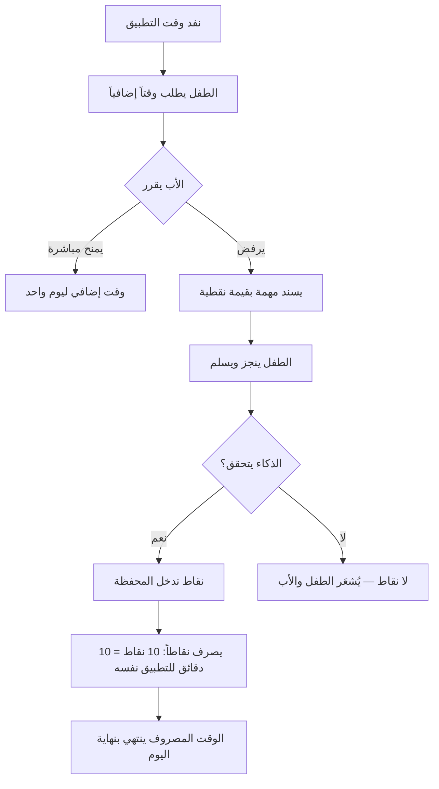
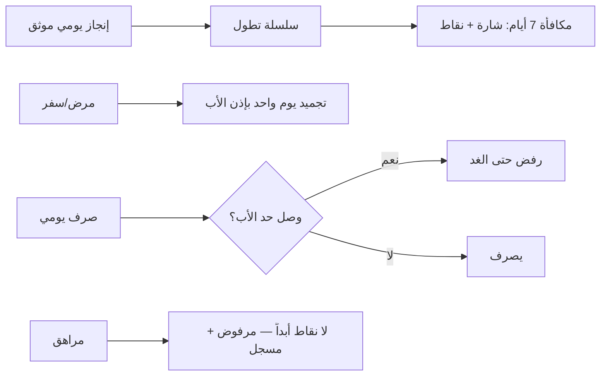

# S1-05: المكافآت للأطفال (Rewards for Children) — المواصفة

- **النظام:** S1-05 (السابع في تسلسل التنفيذ الملزم بحسب D-027)
- **المرحلة:** المرحلة 1 — النواة الأساسية
- **حالة المراجعة:** §§1–8 + §10 معتمدة بالكامل في التخطيط (حكم المالك 2026-11-06) · §9 في مرحلة التصميم.

## 1. الهدف والتحليل والنطاق

**الهدف:** محرك التحفيز في المنصة — محفظة نقاط واحدة لكل طفل، النقاط فيها عملة تُصرف كوقت إضافي لاستخدام التطبيقات. الطفل يكسب النقاط بإنجاز المهام (يتحقق منها الذكاء) أو بمنح الأب، ويصرفها حين ينفد وقت تطبيق ليستمر فيه.

**القواعد الثلاث:**
1. **النقاط عملة وقت:** 10 نقاط = 10 دقائق (Q-111)؛ والصرف على التطبيق الذي نفد وقته تحديداً (Q-116)؛ والوقت المصروف ينتهي بنهاية اليوم (Q-112).
2. **الأب يملك القرار:** المنح المباشر أو إسناد مهمة بدلاً من المنح؛ والذكاء يعمل بتفويضه وحده (Q-003/Q-110) — يتحقق ويمنح، والأب يراجع ويلغي.
3. **الصدق في الرصيد:** محفظة واحدة لكل طفل يجمع فيها كل الرصيد (Q-117)؛ ولا نقاط للمراهقين إطلاقاً (Q-109)؛ وحد صرف يومي يحدده الأب (Q-114).

**المرونة إلزامية (Q-003 — أضيف بتعديل 2026-11-06):** كل معامل في هذا النظام قابل للضبط من الأب (الحد اليومي للصرف، مصادر الكسب المفعّلة، مكافأة السلسلة، المنح اليدوي، التجميد)؛ وسعر الصرف ثابت 1:1 كما حُكم (Q-111) ما لم يغيّره المالك.

**مصدر المهام عام (Q-118 — أضيف بتعديل 2026-11-06):** أي نظام (التعليم، الدين، غيرهما) يستطيع إسناد مهام تُكسب نقاطاً في محفظة S1-05؛ وعقد الكسب عام لا مرتبط بـ S1-06 وحدها؛ وإنشاء المهام يبقى ملك النظام المُسند.

**نموذجنا الخاص والفريد والديناميكي (Q-119 — أضيف بتعديل 2026-11-06):** ندمج كل هذه الآليات (وقت Qustodio الإضافي + حصصه لكل تطبيق + سلاسل Quizlet + إسناد FamilyWall + انتهاء FamiSafe) ونخرج بنموذجنا الخاص والفريد والديناميكي — محفظة موحدة + كسب عام من أي نظام + صرف كوقت لتطبيق محدد + تحقق ذكاء + مرونة الأب في كل معامل.

**دورة المحفظة:**
1. لكل تطبيق وقت استخدام (من S1-01)؛ وإذا اكتمل يطلب الطفل من الأب.
2. الأب يمنح وقتاً إضافياً مباشرة — أو لا يمنح ويسند له مهمة.
3. ينجز الطفل المهمة؛ الذكاء يتحقق أنها أُنجزت كما هو مطلوب فيمنح النقاط.
4. النقاط تدخل المحفظة؛ ويصرفها الطفل كوقت إضافي للتطبيق.
5. السلاسل اليومية تكافئ الاستمرارية (Q-108)؛ والتجميد يوم واحد بإذن الأب.

**خارج النطاق:**
- ربط مباشر بالبطاقات البنكية والحسابات الحقيقية (S5-06).
- إنشاء المهام وجداولها اليومية (S1-06 — عقد الحدث `tasks.completed` فقط).
- كتالوج الجوائز المعنوية/المادية (مؤجل — Q-113: الوقت فقط في المرحلة 1).
- فرض حدود الوقت والحظر (محرك S1-01 — S1-05 يستهلك حدوده وأرصدته ولا يملك الفرض).

**مصطلحات:**
- **محفظة (Wallet):** رصيد نقاط واحد لكل طفل يجمع كل ما يكسبه.
- **نقطة (Point):** وحدة الكسب؛ 10 نقاط = 10 دقائق وقت إضافي.
- **سلسلة (Streak):** أيام متتالية من الإنجاز؛ تكافئ الاستمرارية.
- **تجميد (Freeze):** إيقاف عدّ السلسلة ليوم واحد بإذن الأب (مرض/سفر).
- **صرف (Redeem):** تحويل نقاط إلى دقائق وقت إضافي لتطبيق محدد.
- **مهمة (Task):** عمل يسنده الأب (من S1-06) وله قيمة نقطية.
- **تحقق الذكاء (AI Verification):** الذكاء يتحقق أن المهمة أُنجزت كما هو مطلوب ثم يمنح النقاط (Q-110).

**ملاحظة إعادة الاستخدام (RE):** منح الوقت الإضافي كقيد يومي + معادلة المتاح + تدفق الطلب ← الموافقة من Qustodio (Extra Time)؛ السلاسل والشارات من Quizlet؛ إسناد المهام من FamilyWall؛ الدورة الكاملة (نفاد ← طلب ← منح أو مهمة ← تحقق AI ← نقاط ← صرف كوقت لتطبيق محدد) تركيب جديد من عندنا.

## 2. سيناريوهات المستخدم

- **5-1 إنجاز مهمة وكسب نقاط:** أحمد يكمل واجباً منزلياً (من S1-06)؛ الذكاء يتحقق أنه أُنجز كما هو مطلوب؛ 15 نقطة تدخل محفظته فوراً مع احتفالية قصيرة.
- **5-2 نفاد الوقت ومنح مباشر:** ينفد وقت لعبة أحمد؛ يطلب من أبيه وقتاً إضافياً؛ الأب يمنح 30 دقيقة مباشرة من مركز الأوامر؛ تستمر اللعبة.
- **5-3 رفض المنح وإسناد مهمة:** الأب لا يمنح الوقت؛ يسند لأحمد مهمة (ترتيب الغرفة)؛ ينجزها أحمد؛ الذكاء يتحقق؛ 10 نقاط تدخل المحفظة؛ يصرفها أحمد كوقت إضافي للعبة (10 نقاط = 10 دقائق).
- **5-4 مهمة من نظام آخر:** مهمة من نظام الدين (حفظ آية) أو التعليم (مراجعة درس) تُكسب نقاطاً في المحفظة نفسها — عقد الكسب عام (Q-118)؛ فالنقاط تجمع من كل الأنظمة في محفظة واحدة.
- **5-5 سلسلة وتجميد:** أحمد يحافظ على سلسلة 7 أيام فيكسب شارة فضية + نقاط مكافأة السلسلة؛ ويمرض يوماً فيجمّد الأب السلسلة فلا تنقطع.
- **5-6 منح فوري من الأب:** الأب يمنح أحمد 20 نقطة فوراً (مكافأة استثنائية على سلوك حسن) بلا مهمة.
- **5-7 حد الصرف اليومي:** أحمد صرف 60 دقيقة إضافية اليوم (الحد الذي حدده الأب)؛ يحاول صرف المزيد فيُرفض حتى الغد مع رسالة واضحة.
- **5-8 انتهاء الوقت المصروف:** أحمد صرف 20 نقطة كوقت إضافي لكنه استخدم منها 10 دقائق فقط؛ الـ 10 المتبقية تنتهي بنهاية اليوم ولا تُسترد (النقاط نفسها لا تنتهي — الوقت المصروف وحده ينتهي).

**مخطط حلقة المحفظة (§2 — بصري):**

**مخطط السلسلة والحد (§2 — بصري):**

## 3. المتطلبات الوظيفية

### المحفظة
- **REQ-001:** محفظة واحدة لكل طفل يجمع فيها كل الرصيد؛ والرصيد لا يقل عن صفر أبداً. [Q-117 · DIRECT]
- **REQ-002:** الرصيد ظاهر للطفل وللأب في كل وقت (مع سجل الحركات). [Q-117 · DIRECT]
- **REQ-003:** المحفظة تعمل دون اتصال (مخزن محلي) وتُزامَن عند عودة الاتصال عبر Outbox بلا خصم مكرر. [Q-064 · DERIVED]

### الكسب
- **REQ-004:** عقد كسب عام: أي نظام (S1-06، التعليم، الدين، غيرهما) يصدر حدث كسب يحمل `source_system` + المهمة + قيمة النقاط؛ وS1-05 يقبل الحدث من أي نظام مسجَّل. [Q-118 · DIRECT]
- **REQ-005:** لا تُودع نقطة قبل التحقق: الذكاء يتحقق أن المهمة أُنجزت كما هو مطلوب ثم يمنح النقاط؛ وتسليم الطفل الذاتي وحده لا يودع شيئاً. [Q-110 · DIRECT]
- **REQ-006:** الأب يمنح نقاطاً فورية يدوياً (مكافأة استثنائية) بلا مهمة. [Q-107 · DIRECT]
- **REQ-007:** محرك سلاسل يومية: يوم إنجاز متتالٍ يطيل السلسلة؛ ومكافأة سلسلة عند 7 أيام؛ وتجميد السلسلة ليوم واحد بإذن الأب فقط. [Q-108 · DIRECT]

### الصرف
- **REQ-008:** الصرف كوقت إضافي للتطبيق الذي نفد وقته تحديداً؛ وسعر الصرف ثابت: 10 نقاط = 10 دقائق. [Q-111/Q-116 · DIRECT]
- **REQ-009:** الوقت المصروف ينتهي بنهاية اليوم؛ وما لم يُستخدم منه لا يُسترد (النقاط نفسها لا تنتهي). [Q-112 · DIRECT]
- **REQ-010:** حد صرف يومي يحدده الأب (افتراضي 60 دقيقة إضافية)؛ والصرف فوقه يُرفض مع رسالة واضحة. [Q-114 · DIRECT]
- **REQ-011:** الأب يمنح وقتاً إضافياً مباشرة بلا نقاط (من مركز الأوامر)؛ والمنح قيد ليوم واحد (نمط Qustodio). [Q-107 · DERIVED]

### الطلب
- **REQ-012:** عند نفاد وقت التطبيق يطلب الطفل وقتاً إضافياً من الأب (من شاشة الحظر). [Q-107 · DERIVED]
- **REQ-013:** الأب يرفض المنح فيسند مهمة بدلاً منه؛ والمهمة تظهر للطفل فوراً مع قيمتها النقطية. [Q-118 · DIRECT]
- **REQ-014:** طلبات الوقت الإضافي تظهر في بطاقة "يتطلب انتباهك" في S1-09؛ والأب يقرر بنقرة واحدة (منح/رفض/إسناد مهمة). [S1-09 · DERIVED]

### التكامل
- **REQ-015:** فرض حدود الوقت والحظر محرك S1-01؛ وS1-05 يستهلك حدوده وأرصدته (المتبقي) ولا يملك الفرض. [S1-01 · DERIVED]
- **REQ-016:** ودجة S1-09 تعرض رصيد المحفظة + السلسلة + الطلبات المعلقة. [S1-09 · DERIVED]

## 4. الواجهات والعقود

### نقاط الوصول REST
- `GET /families/{id}/children/{childId}/wallet` — الرصيد + السلسلة + الطلبات المعلقة.
- `POST /families/{id}/children/{childId}/wallet/grant` — منح يدوي من الأب (نقاط + ملاحظة).
- `POST /families/{id}/children/{childId}/wallet/redeem` — صرف نقاط كوقت إضافي لتطبيق محدد (بمفتاح عدم تكرار `client_request_id`).
- `GET /families/{id}/children/{childId}/wallet/ledger` — سجل حركات المحفظة.
- `POST /families/{id}/children/{childId}/time-requests` — الطفل يطلب وقتاً إضافياً (التطبيق + الدقائق المطلوبة).
- `POST /families/{id}/time-requests/{requestId}/decide` — الأب يقرر: منح / رفض / إسناد مهمة.
- `POST /families/{id}/children/{childId}/streak/freeze` — الأب يجمّد السلسلة ليوم واحد.
- `GET /families/{id}/rewards/settings` — ضوابط الأب (الحد اليومي، مصادر الكسب المفعّلة، مكافأة السلسلة).
- `PATCH /families/{id}/rewards/settings` — الأب يضبط المعاملات.

### أحداث MQTT
- `wallet/updated` — تغيّر الرصيد (إيداع/خصم/منح).
- `time-request/new` — طلب وقت إضافي جديد (للأب فوراً).
- `time-request/decided` — قرار الأب على الطلب.
- `earning/completed` — **حدث كسب عام يُستهلك** (من أي نظام: `source_system` + المهمة + قيمة النقاط + تحقق الذكاء).

### قناة MethodChannel (Kotlin)
- `getCachedWallet` — رصيد المحفظة المحفوظ محلياً (دون اتصال).
- `queueTimeRequest` — طلب وقت إضافي دون اتصال (يُحفظ في Outbox ويُرسَل عند عودة الاتصال).

### رموز الخطأ (`REW_*`)
`WALLET_NOT_FOUND` · `INSUFFICIENT_POINTS` · `DAILY_CAP_REACHED` · `REQUEST_NOT_FOUND` · `ALREADY_DECIDED` · `INVALID_APP` · `EARNING_NOT_VERIFIED` · `TIME_EXPIRED` — وبصيغة الخطأ الموحدة `{code, message_ar, trace_id}`.

## 5. البيانات — النموذج

**جداول النظام (تحمل `family_id` + RLS):**
- `child_wallet` — محفظة الطفل: `child_id` (PK) · `family_id` · `balance_points` (≥ 0) · `total_earned_all_time` · `streak_days` · `streak_frozen_until` (nullable) · `daily_spent_minutes` · `daily_spent_date` · `updated_at`.
- `points_ledger` — سجل كل حركة: `ledger_id` · `family_id` · `child_id` · `kind` (TASK_COMPLETED / STREAK_BONUS / MANUAL_GRANT / TIME_REDEEMED / TIME_GRANTED) · `amount` (+/−) · `source_system` (nullable — النظام الذي جاءت منه النقاط، Q-118) · `reference_id` (task_id / request_id) · `balance_after` · `at`.
- `time_request` — طلب وقت إضافي: `request_id` · `family_id` · `child_id` · `app_package` · `minutes_requested` · `status` (PENDING / APPROVED / REJECTED / TASK_ASSIGNED) · `decided_by` · `decided_at` · `assigned_task_id` (nullable) · `created_at`.
- `granted_time` — الوقت الممنوح: `grant_id` · `family_id` · `child_id` · `app_package` · `minutes` · `source` (REDEEM من النقاط / GRANT منح مباشر من الأب) · `expires_at` (نهاية اليوم) · `used_minutes` · `status` (ACTIVE / EXPIRED / EXHAUSTED) · `created_at`.
- `rewards_settings` — ضوابط الأب: `family_id` (PK) · `daily_spend_cap_minutes` (افتراضي 60) · `streak_bonus_points` (افتراضي 50 — قابل للتغيير من الأب) · `enabled_sources` (jsonb — الأنظمة المسموح لها بالكسب، افتراضي: كل الأنظمة المسجلة).

**مراجع:** عضوية الطفل من S1-02 (membership)؛ حدود التطبيقات والمتبقي من محرك S1-01؛ كل منح/صرف/قرار يُسجَّل في AuditEvent (domain=rewards). **مخازن العميل (ليست جداول خادم):** مرآة المحفظة في Drift + Outbox للطلبات دون اتصال.

## 6. القواعد والصلاحيات

### مفاتيح الصلاحيات (`rewards.*`)
- `rewards.wallet.view` — عرض محفظة الطفل (الأب + البالغ المفوَّض حسب القالب؛ والطفل يرى محفظته فقط).
- `rewards.grant.create` — منح نقاط يدوي (الأب + البالغ المفوَّض حسب القالب).
- `rewards.time-request.decide` — القرار على طلبات الوقت (الأب + البالغ المفوَّض حسب القالب).
- `rewards.settings.edit` — تعديل ضوابط النظام (الأب وحده — مالك العائلة).
- `rewards.streak.freeze` — تجميد السلسلة (الأب وحده).
- `rewards.ledger.view` — عرض سجل الحركات (الأب + البالغ المفوَّض حسب القالب).

### ثوابت صلبة (لا تُكسر)
- الرصيد لا يقل عن صفر أبداً — والفرض على الخادم لا على العميل.
- لا نقاط للمراهقين إطلاقاً (Q-109) — المحفظة للأطفال فقط.
- الوقت المصروف ينتهي بنهاية اليوم ولا يُسترد (Q-112)؛ والنقاط نفسها لا تنتهي.
- لا تُودع نقطة قبل تحقق الذكاء (Q-110) — تسليم الطفل الذاتي وحده لا يودع شيئاً.
- الأب يرى كل شيء؛ والطفل يرى محفظته فقط؛ ولا يرى أي طفل محفظة طفل آخر.
- أحداث الكسب تُقبل من الأنظمة المسجلة فقط (Q-118) — أي `source_system` غير مسجَّل يُرفض.
- الحد اليومي للصرف يُفرض على الخادم (Q-114).

### قواعد التشغيل
- الصرف ذرّي: فحص الرصيد + الخصم في معاملة واحدة؛ والصرف المكرر بنفس `client_request_id` يُعاد نتيجته الأصلية بلا خصم جديد.
- السلسلة: أول كسب موثَّق في اليوم يطيل السلسلة؛ والتجميد يمدّدها يوماً واحداً بإذن الأب في كل مرة.
- المنح المباشر من الأب قيد ليوم واحد وينتهي بنهايته (نمط Qustodio).
- عند إسناد مهمة بدلاً من المنح: الطلب يتحول إلى TASK_ASSIGNED؛ وعند إنجاز المهمة + تحقق الذكاء تُودع النقاط ويُشعَر الطفل ليصرفها.
- دون اتصال: الصرف والطلب يُحفظان في Outbox؛ والرصيد المعروض هو آخر رصيد معروف مع وقت صريح.

## 7. الحالات الحدية والأخطاء

- صرف بلا رصيد كافٍ → يُرفض مع الرصيد الحالي (INSUFFICIENT_POINTS)؛ ولا رصيد سالب أبداً.
- صرف مكرر بنفس `client_request_id` → تُعاد النتيجة الأصلية بلا خصم جديد.
- حدث كسب من نظام غير مسجَّل → يُرفض ويُسجَّل في التدقيق.
- تحقق الذكاء يرفض المهمة (لم تُنجز كما هو مطلوب) → لا إيداع + إشعار الطفل بالسبب + الأب يرى الرفض.
- الطفل يطلب وقتاً لتطبيق غير موجود أو غير خاضع للحد → INVALID_APP.
- طلب مكرر لنفس التطبيق وهو معلّق → يُعاد الطلب الأصلي (لا طلبان معلّقان لنفس التطبيق).
- الأب يقرر طلباً سبق القرار عليه → ALREADY_DECIDED وتُعاد النتيجة الأصلية.
- يوم بلا كسب → تنقطع السلسلة (إلا إذا جُمّدت)؛ والتجميد بعد انقطاعها لا يعيدها.
- الوقت الممنوح ينتهي بنهاية اليوم → الحالة EXPIRED؛ وما تبقى منه لا يُسترد.
- مراهق يحاول كسب أو صرف نقاط → مرفوض (لا محفظة للمراهقين) ويُسجَّل.
- دون اتصال: صرف يُحفظ في Outbox؛ وعند عودة الاتصال إن كان الرصيد لا يكفي (صُرف من جهاز آخر) → يُرفض مع إشعار.
- تغيير الحد اليومي من الأب أثناء اليوم → يطبق فوراً على ما تبقى من اليوم؛ وما صُرف قبله لا يُسترجع.
- إيداع مكرر لنفس المهمة (نفس `task_id` + `source_system`) → يُعاد الإيداع الأصلي بلا مضاعفة.

## 8. معايير القبول

- **ACC-001:** محفظة واحدة لكل طفل، والرصيد لا يقل عن صفر أبداً. ← REQ-001
- **ACC-002:** الرصيد + سجل الحركات ظاهران للطفل وللأب في كل وقت. ← REQ-002
- **ACC-003:** المحفظة تعمل دون اتصال وتُزامَن عند عودة الاتصال بلا خصم مكرر. ← REQ-003
- **ACC-004:** حدث كسب من أي نظام مسجَّل يُقبل ويُودع؛ ومن نظام غير مسجَّل يُرفض ويُسجَّل. ← REQ-004
- **ACC-005:** لا تُودع نقطة قبل تحقق الذكاء؛ وتسليم الطفل الذاتي وحده لا يودع شيئاً. ← REQ-005
- **ACC-006:** منح يدوي من الأب يودع النقاط فوراً في المحفظة. ← REQ-006
- **ACC-007:** سلسلة 7 أيام تكسب مكافأة السلسلة؛ والتجميد ليوم واحد بإذن الأب فقط. ← REQ-007
- **ACC-008:** الصرف 10 نقاط = 10 دقائق، للتطبيق الذي نفد وقته تحديداً. ← REQ-008
- **ACC-009:** الوقت المصروف ينتهي بنهاية اليوم؛ وما لم يُستخدم لا يُسترد. ← REQ-009
- **ACC-010:** الحد اليومي يُفرض على الخادم؛ والصرف فوقه يُرفض مع رسالة واضحة. ← REQ-010
- **ACC-011:** منح مباشر من الأب قيد ليوم واحد وينتهي بنهايته. ← REQ-011
- **ACC-012:** طلب وقت يظهر في بطاقة S1-09؛ والأب يقرر بنقرة (منح/رفض/إسناد مهمة)؛ والمهمة المسندة تودع نقاطها عند تحقق الذكاء. ← REQ-012/013/014
- **ACC-013:** فرض حدود الوقت والحظر محرك S1-01؛ وS1-05 يستهلك حدوده وأرصدته فقط. ← REQ-015
- **ACC-014:** ودجة S1-09 تعرض رصيد المحفظة + السلسلة + الطلبات المعلقة. ← REQ-016
- **ACC-015:** كل منح/صرف/قرار مسجَّل في التدقيق (domain=rewards). ← §5

## 9. قائمة الشاشات

في مرحلة التصميم.

## 10. خطة التنفيذ

- **ترتيب البناء:** الجداول + RLS ← REST + MQTT (مستهلك حدث الكسب) ← منطق المحفظة (صرف ذرّي + سجل + محرك سلاسل) ← ربط تحقق الذكاء (هيكل Q-054) ← دون اتصال (Drift + Outbox + MethodChannel) ← تكامل ودجة S1-09 وبطاقة الطلبات ← الشاشات بعد مرحلة التصميم.
- **الوحدات:** وحدة Ktor باسم `rewards`؛ وشاشات Flutter للمحفظة والطلبات + مرآة Drift؛ ووحدة Kotlin للمزامنة الخلفية والـ Outbox.
- **الاعتماديات:** S1-01 (محرك الفرض + حدود التطبيقات) · S1-02 (العضوية) · S1-03 (مفاتيح الصلاحيات) · S1-09 (الودجة + بطاقة الطلبات) · S1-06 (عقد `tasks.completed` — أول مصدر كسب) · Q-022 (MQTT) · Q-054 (هيكل بوابة الذكاء) · مختبر Q-027.
- **الاختبارات:** وحدة (صرف ذرّي/عدم تكرار/محرك سلاسل/انتهاء الوقت) · تكامل (حدث كسب ← إيداع؛ طلب ← قرار ← إيداع؛ مزامنة دون اتصال) · قبول ACC-001…015 · دون اتصال (اليمن).

## ملحق إعادة الاستخدام (RE)

| المصدر المفكك | الآلية المعاد استخدامها | أين تُستخدم في المواصفة |
|---|---|---|
| Qustodio — Extra Time (`ducks/extraTime.ts` + `screenTime.ts:200-207`) | الطفل يطلب وقتاً إضافياً ← الأب يوافق على دقائق؛ والمنح قيد ليوم واحد ينتهي بنهايته؛ والصيغة: المتاح = الحد اليومي + الإضافي − المستهلك؛ وإضافة POST / إزالة PUT مع واجهة متفائلة وتراجع | §1 (دورة المحفظة) · §3 REQ-011/012/014 · §4 |
| Qustodio — نموذج الحصة لكل تطبيق (`TimeQuotaDto` + `AppRuleDto`) | حصة يومية إجمالية لكل يوم أسبوع + حد لكل تطبيق (ALLOW/BLOCK/LIMIT ودقائق لكل تطبيق)؛ والمتبقي = الحصة + الإضافي − المستهلك؛ وتحذير قبل 5 دقائق؛ وحظر فوري عند النفاد؛ وتسلسل الفرض: النوم > المدرسة > نفاد الحصة؛ ودون اتصال: نبضة خصم كل 60 ثانية + إعادة ضبط منتصف الليل | §1 · §3 REQ-008/015 · §5 (`granted_time`) |
| Quizlet — السلاسل والشارات (`usecase/streaks/*` + `remote/model/achievements/*`) | سلاسل يومية/أسبوعية من سجل تواريخ الخادم + 7 فئات شارات + شاشة احتفال + إشعار كسب | §3 REQ-007 · §5 (`child_wallet.streak_days`) |
| FamilyWall — إسناد المهام (قوائم مشتركة + `list_items` بالإسناد والإنجاز) | نمط إسناد مهمة لعضو + إنجازها — بلا نقاط وبلا موافقة أب في المصدر (النمط وحده هو المعاد استخدامه) | §1 · §3 REQ-004/013 |
| FamiSafe — تمديد مؤقت حتى منتصف الليل (`screen_limit_dialog_tip` + `ScreenTimeV5Bean.java`) | تمديد مؤقت ينتهي منتصف الليل (ليس رصيداً — "Bonus Time" علامة خطة/ترويج لا رصيد) | §3 REQ-009 (انتهاء الوقت المصروف بنهاية اليوم) |

**ملاحظة صدق:** الحلقة الكاملة (محفظة موحدة + كسب من أي نظام + صرف كوقت لتطبيق محدد + تحقق ذكاء) تركيب جديد — لا سابقة لها في تطبيق واحد. وادعاء الفرع القديم أن نموذج النقاط "مستخرج" من FamilyWall غير صحيح (FamilyWall بلا نقاط/محفظة إطلاقاً).

## أسئلة مفتوحة (من هذه المواصفة)

لا أسئلة مفتوحة.
