# S1-06: مخططات هندسة البرمجيات (DIAGRAMS)

- **الحالة:** مسودة للمراجعة على GitHub — المواصفة معتمدة بالكامل في التخطيط؛ والمخططات الستة مسودة بانتظار مراجعة المالك على GitHub (لم تُعتمد بعد)
- **المواصفة:** `SPEC.md` (§§1–8 + §10 معتمدة بالكامل في التخطيط)
- **السياق المحدد (Bounded Context):** #9 إدارة العائلة (Family Management) — `CONTEXT-MAP.md` §2 صف 9
- **القرارات الحاكمة:** Q-001 · Q-109 · Q-110 · Q-118 · Q-120 · Q-121 · Q-122 · Q-123 · Q-124 · Q-125 · Q-064 · Q-054 · Q-058 · Q-022 · Q-167 · Q-007 (رفض-يتغلب — المنع يغلب)
- **الأنواع الستة:** 1. حالات الاستخدام · 2. ERD · 3. التسلسل · 4. تدفق المستخدم · 5. DFD · 6. النشاط
- **الأشكال الموحدة:** مستطيل = جهة خارجية · مستطيل مستدير = عملية · معين = قرار · أسطوانة = مخزن بيانات · خط متقطع = يتضمن / اختياري

## 1. حالات الاستخدام

14 حالة استخدام من السيناريوهات السبعة والمتطلبات (§2/§3): الأب والبالغ المفوَّض ينشئان المهام ويلغيانها، الطفل والمراهق يسلّمان، الذكاء يتحقق والأب احتياطي، والمحفظة (S1-05) ومركز الأوامر (S1-09) ممثلان كجهات خارجية. وإسناد مهمة بدلاً من منح الوقت (6-6) هو نفس حالة إنشاء المهمة، لا حالة مستقلة.

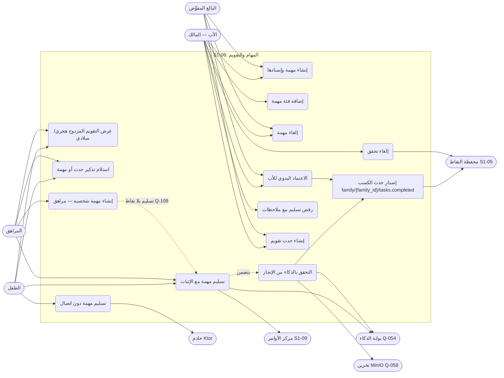

- ملاحظة: إلغاء التحقق (UC8) للأب وحده (§6 `tasks.revoke`)، وإضافة الفئة (UC2) للأب وحده (§6 `tasks.category.create`) — البالغ المفوَّض لا يملكهما. والمهمة الشخصية للمراهق (UC12) تُسلَّم وتُسجَّل منجزة بلا نقاط ولا يصدر عنها حدث كسب (§7).

## 2. مخطط قاعدة البيانات (ERD)

الجداول الأربعة من §5 كما هي، مع أربعة مراجع خارجية: العضوية (`membership` — S1-02)، و`points_ledger` (S1-05)، و`AuditEvent` (النواة المشتركة)، وصور الإثبات في MinIO (Q-058). ملاحظتان: مرآة Drift والـ Outbox مخزنان محليان على الجهاز (SQLite) وليسا جدولَي خادم (§5)، ونسخ المهام المتكررة محسوبة عند الطلب لا صفوفاً مادية (REQ-010) فلا جدول للنسخ. كل جدول يحمل `family_id` + عزل RLS (D-021).

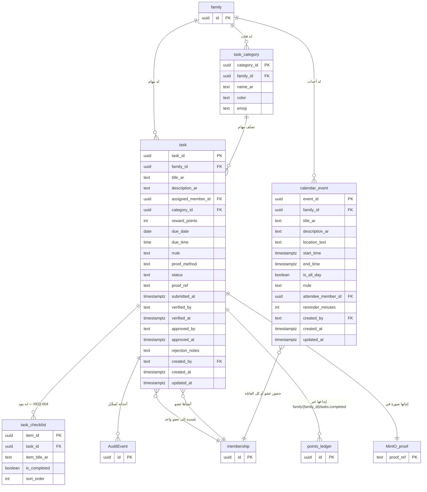

- ملاحظة: `reward_points` افتراضي 10 و≥ 0، و0 دائماً لمهام المراهقين (Q-109 — تُفرض صفراً على الخادم)؛ و`status` أربع قيم فقط: PENDING / SUBMITTED_BY_CHILD / APPROVED / CANCELLED (§5)؛ و`family_id` في `task_category` يكون NULL للفئات الأربع الافتراضية العامة (منزل/مدرسة/صلاة وقرآن/عناية ذاتية — REQ-002) وقيمةً لفئة أضافها الأب لعائلته (§5)؛ و`rrule` في `task` و`calendar_event` قاعدة iCalendar خام تشمل `byDay` و`byMonthDay` و`interval` و`endDate`/`endOccurence` و`exdate` و`rdate` (REQ-010 · ملحق RE)؛ و`reminder_minutes` في `calendar_event` افتراضي 60 والخيارات 15/30/60 دقيقة أو يوم (REQ-014). و`MinIO_proof` مرجع غير جدولي إلى تخزين كائنات (MinIO) لا جدول في قاعدة البيانات.

## 3. التسلسل (Sequence) — من عقود §4

سبعة مخططات، كل واحد لتدفق واحد:

- النقل مزدوج (Q-209): الخادم ينشر `family/{family_id}/tasks.completed` و`family/{family_id}/tasks.verification-revoked` على MQTT (QoS 1) بجانب الحدث الداخلي إلى S1-05 — لا يُحذف التسليم الداخلي.

### 3-أ. إنشاء مهمة وإسنادها (REQ-001/002/003 — §4)

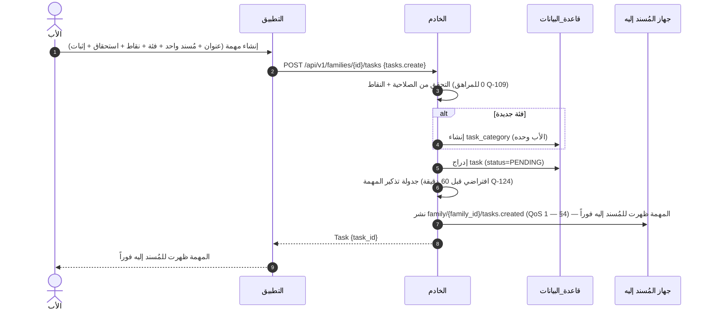

### 3-ب. التسليم والتحقق بالذكاء — نجاح (REQ-006/007 — §4)

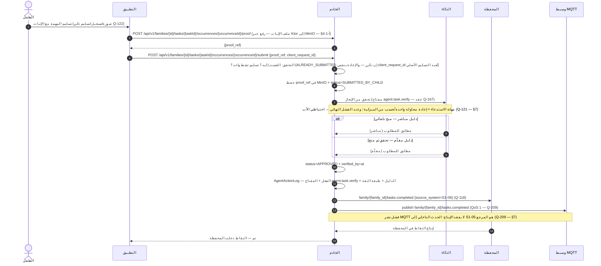

- لا تُودع نقطة قبل التحقق (Q-110) — التسليم الذاتي وحده لا يودع شيئاً (§6).

### 3-ج. الذكاء لا يستطيع التحقق — الاعتماد اليدوي للأب (REQ-008 — §4)

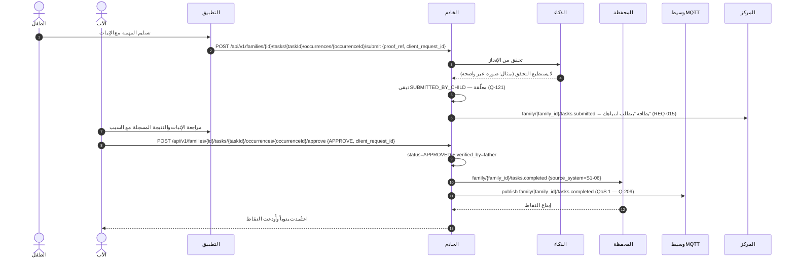

- ملاحظة: الذكاء "لا يستطيع التحقق" (Q-121) يختلف عن "يرفض الإنجاز" (§7): الرفض لعدم المطابقة لا يودع شيئاً ويُشعَر الطفل بالسبب، والأب يرى الرفض وقد يعتمد يدوياً فيتجاوز الرفض ويُودع النقاط.

### 3-د. الرفض مع ملاحظات وإلغاء تحقق (REQ-009 — §4)

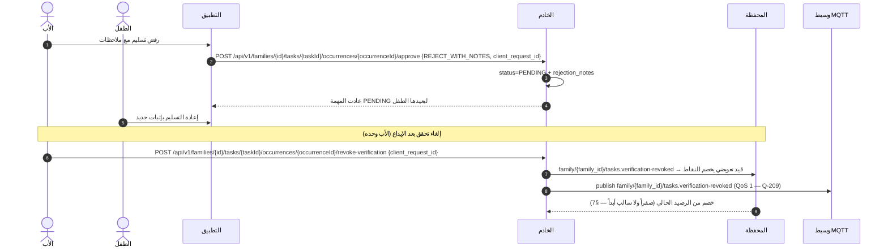

### 3-هـ. التكرار RRULE وحدث التقويم والتذكير (REQ-010/011/012/013/014 — §4)

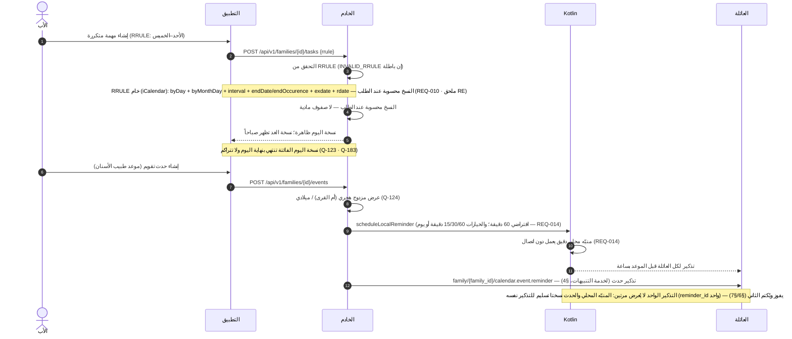

- تذكير حدث في الماضي يُتجاهل بصمت والحدث نفسه يبقى (§7)؛ وعرض التقويم 3 أشهر مقدماً كحد أقصى (REQ-010).

### 3-و. التسليم دون اتصال (REQ-016 — §4)

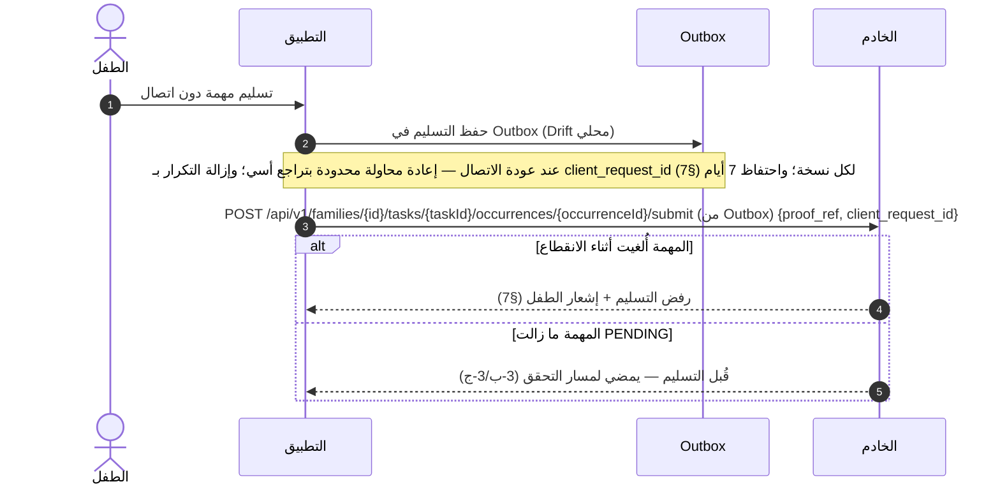

### 3-ز. شك الذكاء — إحالة للأب بنقرة واحدة (REQ-017 — عقد Q-167 §4)

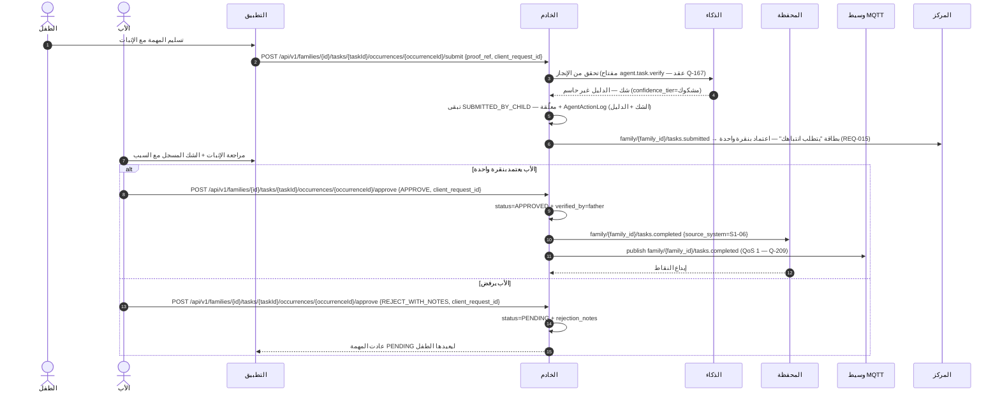

## 4. تدفق المستخدم (User Flow) — من السيناريوهات السبعة (§2)

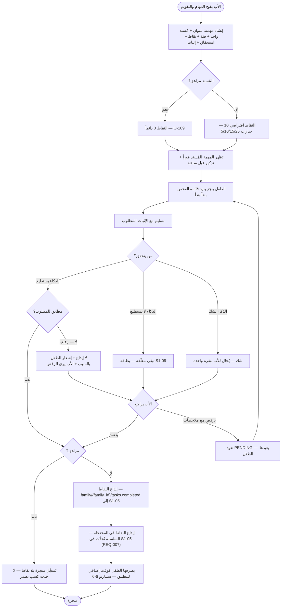

- ملاحظة: مسار "مهمة بدلاً من منح الوقت" (6-6) هو نفس دورة الحياة أعلاه: الأب يرفض المنح ويسند مهمة (10 نقاط) فينجزها الطفل فيصرف نقاطها كوقت للعبة عبر S1-05. والمهمة الشخصية للمراهق (6-7) تمر بنفس التدفق لكنها تنتهي عند "منجزة بلا نقاط".

## 5. مخطط تدفق البيانات (DFD — المستوى 1) — من §4/§5

العمليات مرقمة 1.0–6.0، والمخازن D1–D4 جداول خادم (PostgreSQL). المخزنان المحليان (مرآة Drift + Outbox) على الجهاز (SQLite) وليسا جدولَي خادم. والمخازن الخارجية: `points_ledger` (S1-05) و`AuditEvent` (النواة) وMinIO (Q-058).

- **تغطية نقاط §4:** التسلسلات في §3 تغطي التدفقات الأساسية فقط؛ وكل نقطة §4 تظهر هنا على الأقل: `GET /api/v1/families/{id}/tasks` و`GET /api/v1/families/{id}/tasks/{taskId}` و`PATCH /api/v1/families/{id}/tasks/{taskId}` (قراءة/تعديل مهمة — تمر عبر P1) · `DELETE /api/v1/families/{id}/tasks/{taskId}` (إلغاء مهمة — REQ-005، تمر عبر P1) · `GET /api/v1/families/{id}/task-categories` و`POST /api/v1/families/{id}/task-categories` (الفئات — REQ-002، تمر عبر P1) · `GET /api/v1/families/{id}/events` و`PATCH /api/v1/families/{id}/events/{eventId}` و`DELETE /api/v1/families/{id}/events/{eventId}` (أحداث التقويم — تمر عبر P5)؛ و`POST .../occurrences/{occurrenceId}/proof` و`PATCH .../tasks/{taskId}/checklist/{itemId}` (رفع إثبات + تبديل بند — تمر عبر P2)؛ وبقية النقاط مرسومة في §3 (tasks إنشاء، submit، approve، revoke-verification، events إنشاء).

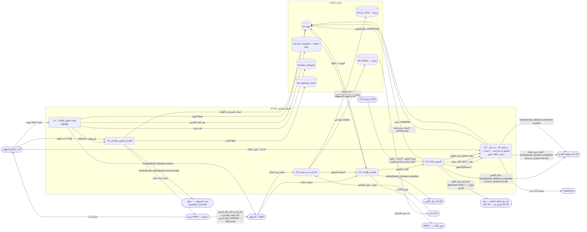

## 6. مخطط النشاط (Activity) — دورة حياة المهمة والتقويم

المسارات الخمسة (الأب / الطفل / الذكاء / الخادم / المحفظة ومركز الأوامر) كمسارات متوازية. ومسار التقويم والتذكير يعمل **بالتوازي** مع دورة حياة المهمة.

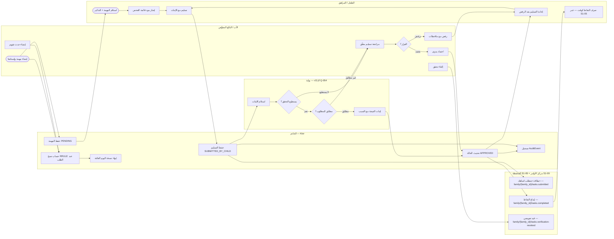

- ملاحظة: نسخة اليوم الفائتة تنتهي بنهاية اليوم ولا تتراكم أبداً (Q-123 · Q-183)؛ وتظهر نسخة الغد صباحاً (§2 مخطط التكرار). والمراهق يمر بنفس المسارات لكن إيداعه صفر نقاط ولا حدث كسب يصدر (§7).
