# S1-06: مخططات هندسة البرمجيات (DIAGRAMS)

- **الحالة:** معتمدة — المخططات الستة معتمدة (حكم المالك 2026-11-08 — D-2، بعد موجة الإصلاح 0e4a3e2..f7da470)؛ والمواصفة معتمدة بالكامل في التخطيط
- **المواصفة:** `SPEC.md` (§§1–8 + §10 معتمدة بالكامل في التخطيط)
- **السياق المحدد (Bounded Context):** #9 إدارة العائلة (Family Management) — `CONTEXT-MAP.md` §2 صف 9
- **القرارات الحاكمة:** Q-001 · Q-109 · Q-110 · Q-118 · Q-120 · Q-121 · Q-122 · Q-123 · Q-124 · Q-125 · Q-064 · Q-054 · Q-058 · Q-022 · Q-167 · Q-007 (رفض-يتغلب — المنع يغلب) · Q-280 · Q-281 · Q-183 · Q-209 · Q-253 · Q-254 · Q-282
- **الأنواع الستة:** 1. حالات الاستخدام · 2. ERD · 3. التسلسل · 4. تدفق المستخدم · 5. DFD · 6. النشاط
- **الأشكال الموحدة:** مستطيل = جهة خارجية · مستطيل مستدير = عملية · معين = قرار · أسطوانة = مخزن بيانات · خط متقطع = يتضمن / اختياري
- **إعادة الرسم 2026-11-19 (Q-434) على التصميم المعتمد (Q-415 · Q-419):** الرسم والنص متطابقان. ما تغيّر: (1) حالات الاستخدام صارت 18 على لوحتين: المساعد بدرجاته الثلاث وضبط تفويضه وقبول اقتراحه أو صرفه، وتحذير التعارض عند الحفظ؛ (2) ERD: جدولا المساعد `task_suggestion` و`task_agent_delegation` وحقل `task.created_by_type`؛ (3) التسلسل 3-ج قُسّم إلى لوحتين و3-ز قُسّم إلى لوحتين، وتسلسلان جديدان 3-ط (المساعد بدرجاته الثلاث) و3-ي (تحذير التعارض عند الحفظ)؛ (4) تدفق المستخدم قُسّم إلى لوحتين وأُضيف إليه معيّن التعارض وبطاقة التحذير وإعادة التسليم إلى البالغ بعد الرفض؛ (5) DFD قُسّم إلى لوحتين وأُضيف إليه اقتراح المساعد والتفويض وحفظ بوسم «متعارض»؛ (6) النشاط صار TD على ثلاث لوحات وأُضيف إليه التفويض والاقتراح والتعارض وإلغاء التحقق في يومه. ملاحظة: هذا الملف لم يحمل أسطر «تنبيه» مؤرخة، فسُجّل الرسم هنا وفي سطور «أُعيد رسمه» تحت كل مخطط.

## 1. حالات الاستخدام

18 حالة استخدام من السيناريوهات السبعة والمتطلبات (§2/§3): الأب والبالغ المفوَّض ينشئان المهام ويلغيانها، الطفل والمراهق يسلّمان، الذكاء يتحقق والأب احتياطي، والمحفظة (S1-05) ومركز الأوامر (S1-09) ممثلان كجهات خارجية. وإسناد مهمة بدلاً من منح الوقت (6-6) هو نفس حالة إنشاء المهمة، لا حالة مستقلة. والمساعد (REQ-018 · Q-415) بثلاث درجات: لا يُعدّ، يقترح، يسند ضمن حدود يضبطها الأب.

### 1-أ. حالات الاستخدام — الأب والبالغ والمساعد

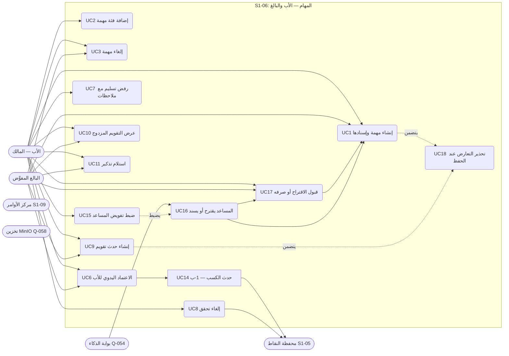

### 1-ب. حالات الاستخدام — الطفل والمراهق والأنظمة

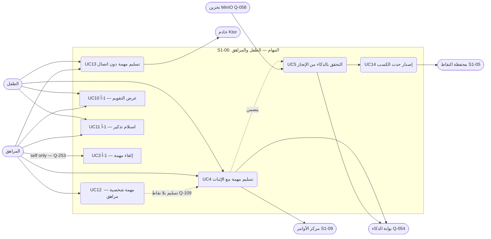

- أُعيد رسمه 2026-11-19 (Q-434 — REQ-018 · Q-415 · Q-419): الحالات 14 ← 18 على لوحتين؛ وأُضيفت UC15 (ضبط تفويض المساعد — المالك وحده) وUC16 (المساعد يقترح أو يسند ضمن الحدود) وUC17 (قبول الاقتراح أو صرفه) وUC18 (تحذير التعارض عند الحفظ — يتضمنه إنشاء المهمة وإنشاء الحدث)؛ وقُصّرت التسميات إلى 5 كلمات. والعقد والأسهم قبل التقسيم وبعده: 23 عقدة/35 سهماً ← 35 عقدة/47 سهماً (الزيادة: UC15–UC18 الأربع + عقد مرجعية UC14x وUC10x وUC11x وUC3x + تكرار AI وS105 وS109 وMinIO في اللوحتين).

- ملاحظة: إلغاء التحقق (UC8) للأب وحده (§6 `tasks.revoke`)، وإضافة الفئة (UC2) للأب وحده (§6 `tasks.category.create`) — البالغ المفوَّض لا يملكهما. والمهمة الشخصية للمراهق (UC12) تُسلَّم وتُسجَّل منجزة بلا نقاط ولا يصدر عنها حدث كسب (§7). وإلغاء المهمة (UC3) للأب لأي مهمة، وللمراهق لمهامه التي أنشأها بنفسه فقط (Q-253)؛ وإلغاء مهمة لا يودع نقاطاً، ولا يكسر السلسلة ولا يقدّمها؛ وإلغاء مهمة معتمدة يُصدر `verification-revoked` + حالة CANCELLED (REQ-005 — مرسوم في §6).
- المساعد (REQ-018 · Q-415): ضبط التفويض (UC15) للمالك وحده؛ ودرجاته ثلاث: لا يُعدّ، يقترح (يقرر الأب)، يسند ضمن الحدود (أقصى نقاط 5/10/15، 1–3 مهام لكل طفل في اليوم، والمُسند إليهم يحددهم الأب)؛ وكل اقتراح يظهر سببه وأساسه؛ والمساعد لا يلغي ولا يعدّل، ولا يمنح نقاطاً بلا مهمة، ولا يسند مهمة إثباتها شهادة، ولا يقرأ رسائل أو صوراً؛ وإلغاء التحقق (UC8) في يومه فقط وللمالك وحده ويتطلب اتصالاً (Q-415). وتحذير التعارض (UC18 · Q-419) عند حفظ المهمة أو الحدث: بطاقة واحدة بثلاثة مخارج (عدّل / إصلاح جاهز / احفظ كما هو بوسم «متعارض»).

## 2. مخطط قاعدة البيانات (ERD)

الجداول الستة من §5 كما هي، مع أربعة مراجع خارجية: العضوية (`membership` — S1-02)، و`points_ledger` (S1-05)، و`AuditEvent` (النواة المشتركة)، وصور الإثبات في MinIO (Q-058). و`family` جذر تجميع مالك للجداول الستة وليس مرجعاً خارجياً، فلا يدخل في عدّ المراجع الأربعة. ملاحظتان: مرآة Drift والـ Outbox مخزنان محليان على الجهاز (SQLite) وليسا جدولَي خادم (§5)، ونسخ المهام المتكررة محسوبة عند الطلب لا صفوفاً مادية (REQ-010) فلا جدول للنسخ. كل جدول يحمل `family_id` + عزل RLS (D-021).

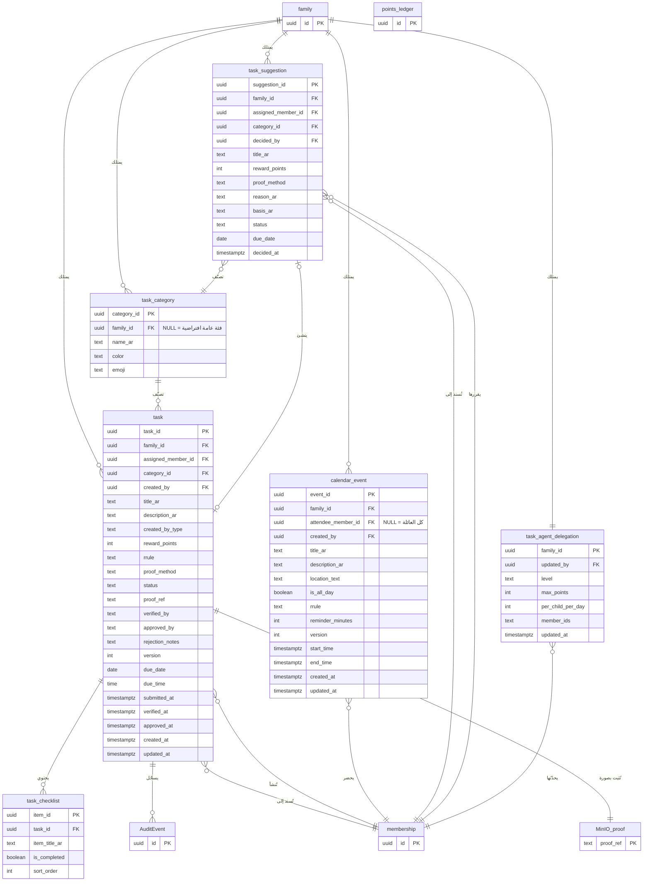

- ملاحظة: `reward_points` افتراضي 10 و≥ 0، و0 دائماً لمهام المراهقين (Q-109 — تُفرض صفراً على الخادم)؛ و`status` أربع قيم فقط: PENDING / SUBMITTED_BY_CHILD / APPROVED / CANCELLED (§5)؛ و`family_id` في `task_category` يكون NULL للفئات الأربع الافتراضية العامة (منزل/مدرسة/صلاة وقرآن/عناية ذاتية — REQ-002) وقيمةً لفئة أضافها الأب لعائلته (§5)؛ و`rrule` في `task` و`calendar_event` قاعدة iCalendar خام تشمل `byDay` و`byMonthDay` و`interval` و`endDate`/`endOccurrence` و`exdate` و`rdate` (REQ-010 · ملحق RE)؛ و`reminder_minutes` في `calendar_event` افتراضي 60 والخيارات 15/30/60 دقيقة أو يوم (REQ-014). و`MinIO_proof` مرجع غير جدولي إلى تخزين كائنات (MinIO) لا جدول في قاعدة البيانات. والإيداع في المحفظة (`points_ledger`) يصل عبر حدث `family/{family_id}/tasks.completed` (REQ-007) لا عبر علاقة قاعدة بيانات — فلا حافة ERD بين `task` و`points_ledger`.
- المساعد (REQ-018 · Q-415 · §5): `task.created_by_type` إحدى member / agent — تمييز المهمة التي أعدّها المساعد؛ و`task_suggestion` اقتراح واحد (سبب `reason_ar` وأساس `basis_ar` ظاهران للأب دائماً)، وحالته إحدى NEW / ACCEPTED / DISMISSED؛ و`task_agent_delegation` صف واحد لكل عائلة (مفتاحه `family_id`) يحمل درجة التفويض `level` إحدى OFF / SUGGEST / ASSIGN وحدوده `max_points` إحدى 5/10/15 و`per_child_per_day` من 1 إلى 3 و`member_ids` قائمة معرّفات الأعضاء المسموح إسناد المهام إليهم؛ وقبول الاقتراح ينشئ صف `task` — لا مفتاح أجنبي مخزَّن بينهما، فالرابط عملية لا علاقة قاعدة بيانات.
- أُعيد رسمه 2026-11-19 (Q-434 — REQ-018 · Q-415): أُضيف جدولا المساعد وحقل `task.created_by_type`؛ وترتيب الحقول موحّد في كل الجداول (أساسي، أجنبية، حقول، تواريخ في الآخر)؛ وتسميات العلاقات فعل قصير بصيغة واحدة. والجداول 4 ← 6 (11 جدولاً مع المراجع).

## 3. التسلسل (Sequence) — من عقود §4

اثنا عشر مخططاً، كل واحد لتدفق واحد — و3-ج على لوحتين (3-ج-1 لا يستطيع التحقق، و3-ج-2 يرفض لعدم المطابقة)، و3-ز على لوحتين (3-ز-1 الشك والإحالة، و3-ز-2 قرار الأب بعد الشك)، و3-ط المساعد بدرجاته الثلاث (REQ-018 · Q-415)، و3-ي تحذير التعارض عند حفظ المهمة أو الحدث (Q-419):

- النقل مزدوج (Q-209): الخادم ينشر `family/{family_id}/tasks.completed` و`family/{family_id}/tasks.verification-revoked` على MQTT (QoS 1) بجانب الحدث الداخلي إلى S1-05 — لا يُحذف التسليم الداخلي.

- **تغطية REQ في التسلسل:** المخططات الاثنا عشر تغطي REQ-001…REQ-018 كلها: REQ-005 له مخططه 3-ح؛ وREQ-004 (قائمة الفحص) مغطى في ERD (§2 — جدول `task_checklist`) وDFD (D2 `task_checklist`) و§4 (نقطتا التسليم: `checklist_completed` في حمولة `submit` و`PATCH .../tasks/{taskId}/checklist/{itemId}`)، لا كحمولة في 3-ب — فـ 3-ب تسلّم `{proof_ref, client_request_id}` فقط؛ وREQ-015 يظهر كحافة `tasks.submitted` إلى S1-09 في 3-ج/3-ز؛ وREQ-018 (المساعد) له مخططه 3-ط.

### 3-أ. إنشاء مهمة وإسنادها (REQ-001/002/003 — §4)

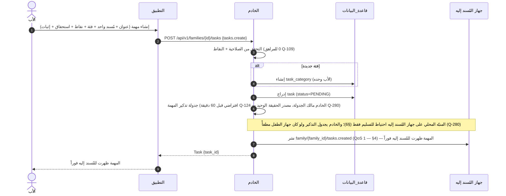

### 3-ب. التسليم والتحقق بالذكاء — نجاح (REQ-006/007 — §4)

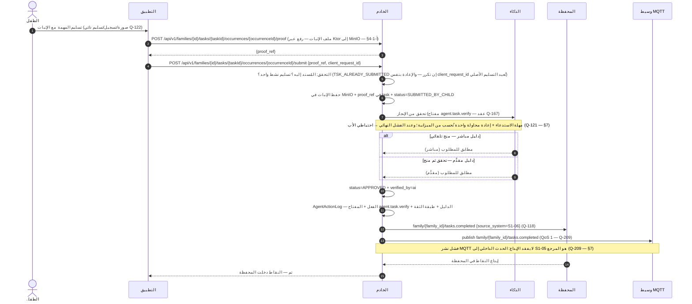

- لا تُودع نقطة قبل التحقق (Q-110) — التسليم الذاتي وحده لا يودع شيئاً (§6).

### 3-ج-1. الذكاء لا يستطيع التحقق — الاعتماد اليدوي للأب (REQ-008 — §4)

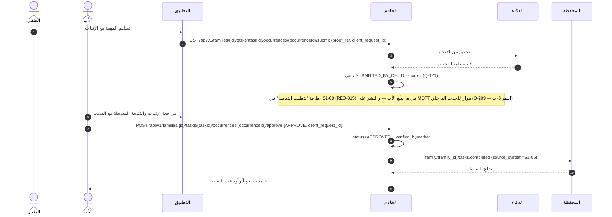

### 3-ج-2. الذكاء يرفض الإنجاز — اعتماد يدوي يتجاوز الرفض (REQ-008 — §4)

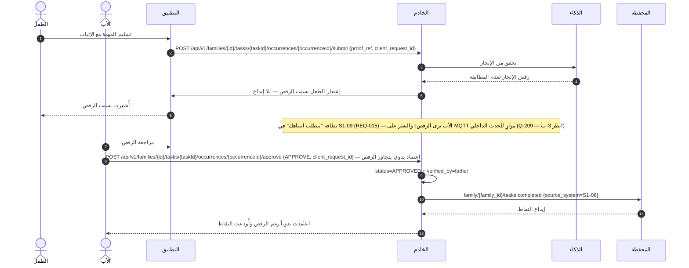

- أُعيد رسمه 2026-11-19 (Q-434): قُسّم 3-ج إلى لوحتين (كان 8 مشاركين و24 رسالة): 3-ج-1 لا يستطيع التحقق (6 مشاركين، 11 رسالة)، و3-ج-2 يرفض لعدم المطابقة (6 مشاركين، 12 رسالة). وبطاقة S1-09 والنشر على MQTT صارا ملاحظتين (المحتوى نفسه في §3 أعلاه و3-ب). والرسائل نفسها قبل التقسيم وبعده.

- ملاحظة: الذكاء "لا يستطيع التحقق" (Q-121) يختلف عن "يرفض الإنجاز" (§7): الرفض لعدم المطابقة لا يودع شيئاً ويُشعَر الطفل بالسبب، والأب يرى الرفض وقد يعتمد يدوياً فيتجاوز الرفض ويُودع النقاط.

### 3-د. الرفض مع ملاحظات وإلغاء تحقق (REQ-009 — §4)

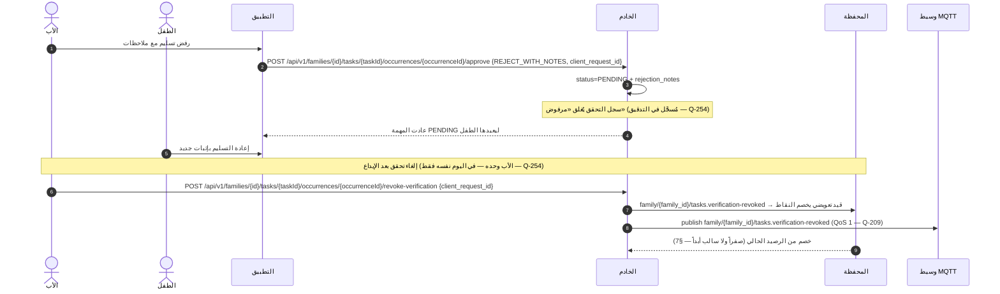

### 3-هـ. التكرار RRULE وحدث التقويم والتذكير (REQ-010/011/012/013/014 — §4)

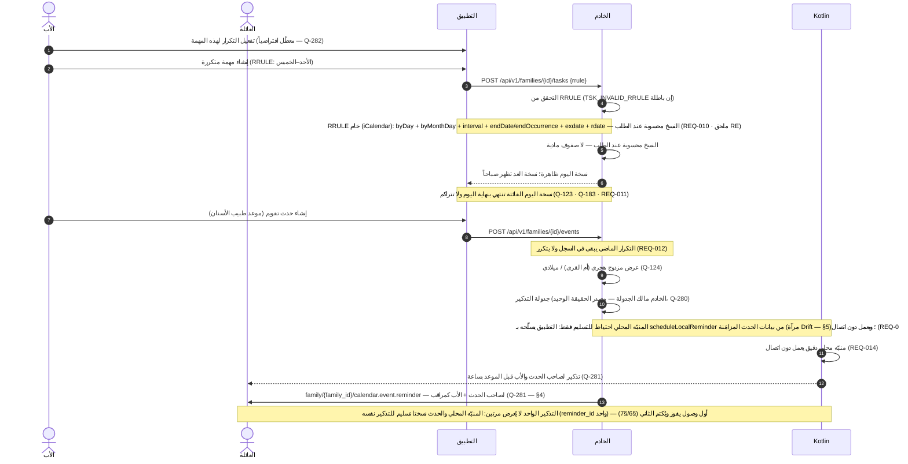

- تذكير حدث في الماضي يُتجاهل بصمت والحدث نفسه يبقى (§7)؛ وعرض التقويم 3 أشهر مقدماً كحد أقصى (REQ-010)؛ والتكرار معطّل افتراضياً ويُفعَّل صراحةً لكل مهمة (Q-282).

### 3-و. التسليم دون اتصال (REQ-016 — §4)

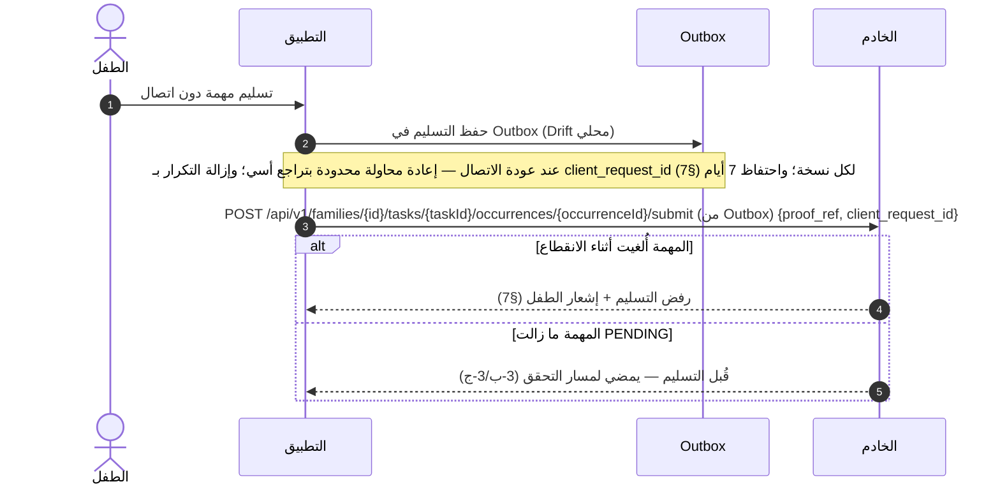

### 3-ز-1. شك الذكاء — إحالة للأب بنقرة واحدة (REQ-017 — عقد Q-167 §4)

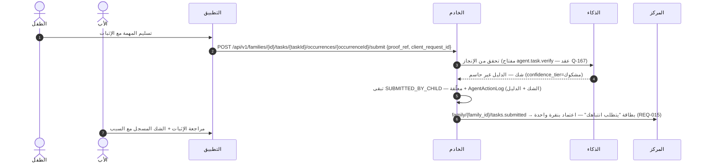

### 3-ز-2. قرار الأب بعد الشك — اعتماد أو رفض (REQ-017 — عقد Q-167 §4)

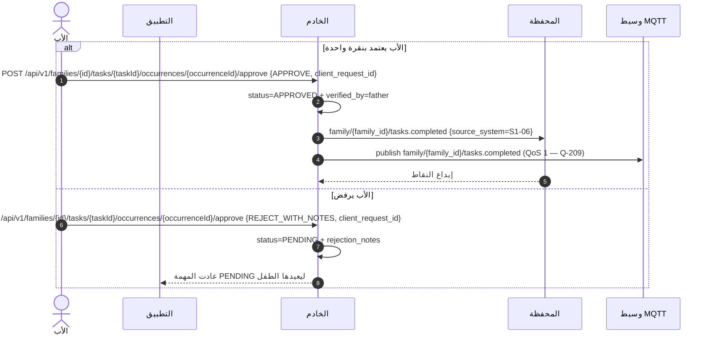

- أُعيد رسمه 2026-11-19 (Q-434): قُسّم 3-ز إلى لوحتين (كان 8 مشاركين و15 رسالة): 3-ز-1 الشك والإحالة (6 مشاركين، 7 رسائل)، و3-ز-2 قرار الأب بعد الشك (5 مشاركين، 8 رسائل). والرسائل نفسها قبل التقسيم وبعده.

### 3-ح. إلغاء مهمة (REQ-005 — §4)

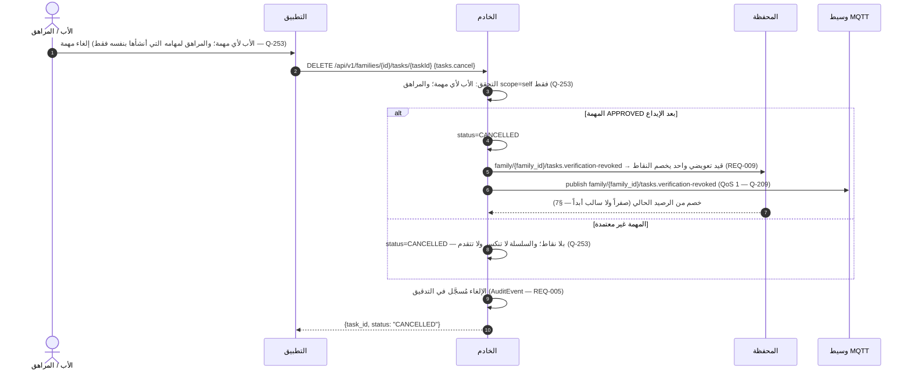

### 3-ط. المساعد بدرجاته الثلاث — تفويض واقتراح وإسناد (REQ-018 · Q-415 — §4)

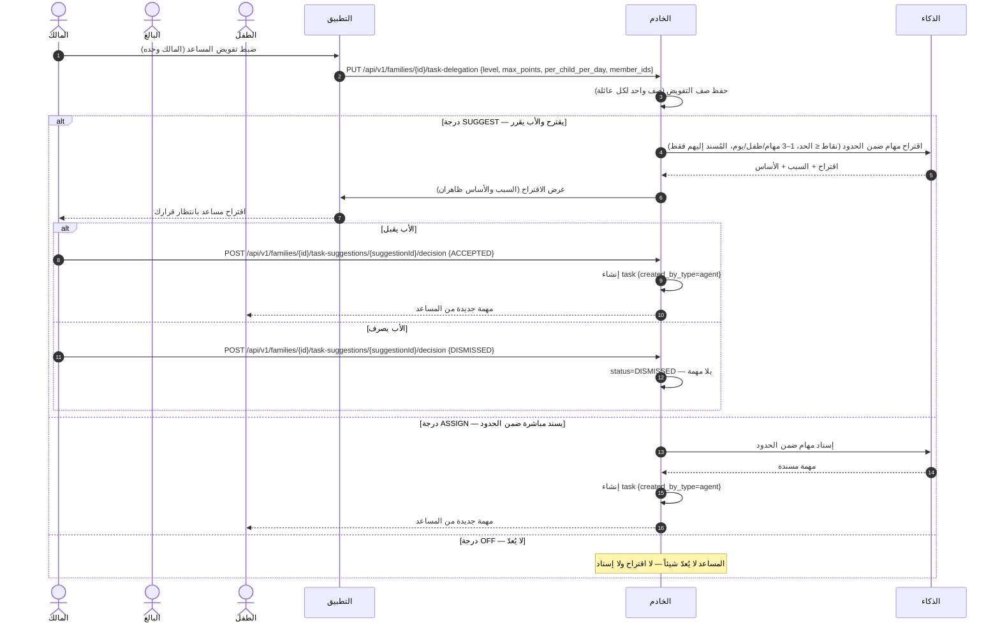

- أُضيف 2026-11-19 (Q-434 — REQ-018 · Q-415): درجات المساعد الثلاث (OFF / SUGGEST / ASSIGN) يضبطها المالك وحده؛ وحدود الإسناد: أقصى نقاط 5/10/15، و1–3 مهام لكل طفل في اليوم، والمُسند إليهم يحددهم الأب؛ وكل اقتراح يظهر سببه وأساسه؛ والمساعد لا يلغي ولا يعدّل، ولا يمنح نقاطاً بلا مهمة، ولا يسند مهمة إثباتها شهادة، ولا يقرأ رسائل أو صوراً. (6 مشاركين، 16 رسالة.)

### 3-ي. تحذير التعارض عند حفظ المهمة أو الحدث (Q-419 — §4)

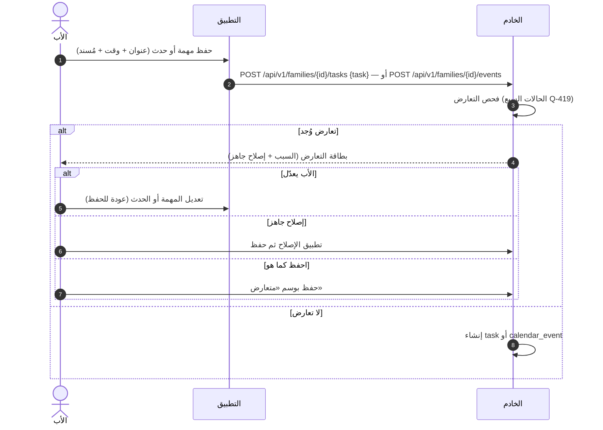

- أُضيف 2026-11-19 (Q-434 — Q-419): بطاقة تعارض واحدة عند الحفظ بثلاثة مخارج: «عدّل هذا» / زر إصلاح جاهز / «احفظ كما هو» بوسم «متعارض»؛ والحالات السبع المفحوصة: (1) حد تطبيق > الحصة اليومية، (2) «مسموح دائماً» لا يفتح في النوم/المدرسة، (3) وقت إضافي والابن في نوم/مدرسة/وضع سارٍ — انظر S1-05 3-ج، (4) مهمة/حدث داخل نوم/مدرسة — إلا مهام فئة المدرسة وأحداث وقت المدرسة، (5) حدثان لنفس الشخص بفارق < ساعة، (6) تطبيق محظور وموقعه مفتوح في مرشح الويب أو العكس، (7) وضع مخصّص يفتح تطبيقاً محظوراً أو ترتيب يفتح تطبيقات في النوم/المدرسة. (3 مشاركين، 8 رسائل.)

## 4. تدفق المستخدم (User Flow) — من السيناريوهات السبعة (§2)

### 4-أ. إنشاء مهمة

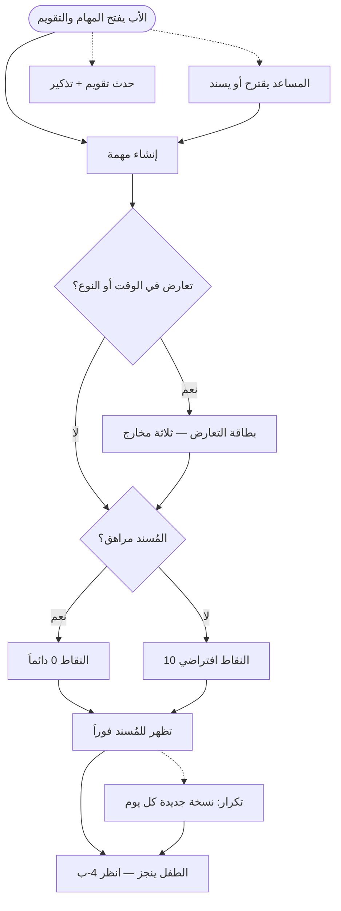

### 4-ب. تسليم المهمة والتحقق

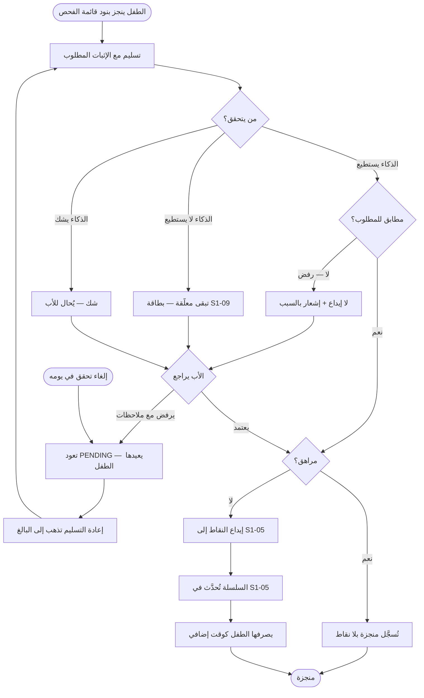

- أُعيد رسمه 2026-11-19 (Q-434 — REQ-018 · Q-415 · Q-419): قُسّم التدفق الواحد (23 عقدة/29 سهماً) إلى لوحتين TD: 4-أ إنشاء مهمة (12 عقدة/15 سهماً، وأُضيف معيّن التعارض وبطاقته ومدخل المساعد)، و4-ب تسليم المهمة والتحقق (17 عقدة/21 سهماً، وأُضيفت إعادة التسليم إلى البالغ بعد الرفض — Q-415 — ومدخل إلغاء التحقق في يومه). والمسارات نفسها قبل التقسيم وبعده.

- ملاحظة: مسار "مهمة بدلاً من منح الوقت" (6-6) هو نفس دورة الحياة أعلاه: الأب يرفض المنح ويسند مهمة (10 نقاط) فينجزها الطفل فيصرف نقاطها كوقت للعبة عبر S1-05. والمهمة الشخصية للمراهق (6-7) تمر بنفس التدفق لكنها تنتهي عند "منجزة بلا نقاط". والمساران الجانبيان: 6-4 (التكرار — نسخة جديدة كل يوم، REQ-010) فرع من عرض المهمة إلى الإنجاز، و6-5 (حدث التقويم والتذكير — REQ-012/Q-281) مدخل جانبي من البداية؛ فالتدفق يغطي السيناريوهات السبعة. وخيارات النقاط 5/10/15/25 والافتراضي 10 (REQ-003)؛ والتذكير قبل ساعة (Q-281)؛ وإعادة التسليم بعد الرفض تذهب إلى البالغ لا إلى الذكاء (Q-415)؛ وإلغاء التحقق في يومه فقط وللمالك وحده ويتطلب اتصالاً (Q-415)؛ وبطاقة التعارض عند الحفظ بثلاثة مخارج (Q-419 — انظر 3-ي).

## 5. مخطط تدفق البيانات (DFD — المستوى 1) — من §4/§5

العمليات مرقمة 1.0–6.0، والمخازن D1–D4 وD7–D8 جداول خادم (PostgreSQL). المخزنان المحليان (مرآة Drift D5 + Outbox D6) على الجهاز (SQLite) وليسا جدولَي خادم. والمخازن الخارجية: `points_ledger` (S1-05) و`AuditEvent` (النواة) وMinIO (Q-058). والمخطط على لوحتين LR مع subgraph يجمّع كل طرف (خارجي / عمليات / مخازن) بترتيب واحد في اللوحتين: 5-أ إنشاء المهام والفئات والتفويض، و5-ب التسليم والتحقق والمراجعة والتقويم ودون اتصال؛ والعقد المشتركة (P1، D1، الأب، الطفل، AI) تتكرر بالاسم. والحمولات الكاملة في §3 و§4.

- **تغطية نقاط §4:** التسلسلات في §3 تغطي التدفقات الأساسية فقط؛ وكل نقطة §4 مذكورة هنا على الأقل: `GET /api/v1/families/{id}/tasks` و`GET /api/v1/families/{id}/tasks/{taskId}` و`PATCH /api/v1/families/{id}/tasks/{taskId}` (قراءة/تعديل مهمة — تمر عبر P1) · `DELETE /api/v1/families/{id}/tasks/{taskId}` (إلغاء مهمة — REQ-005، تمر عبر P1) · `GET /api/v1/families/{id}/task-categories` و`POST /api/v1/families/{id}/task-categories` (الفئات — REQ-002، تمر عبر P1) · `GET /api/v1/families/{id}/events` و`PATCH /api/v1/families/{id}/events/{eventId}` و`DELETE /api/v1/families/{id}/events/{eventId}` (أحداث التقويم — تمر عبر P5)؛ و`POST .../occurrences/{occurrenceId}/proof` و`PATCH .../tasks/{taskId}/checklist/{itemId}` (رفع إثبات + تبديل بند — تمر عبر P2)؛ والنقاط الخمس (إنشاء مهمة، submit، approve، revoke-verification، إنشاء حدث) مفصلة في §3 ومذكورة هنا بالإحالة لا مرسومة في مخطط DFD نفسه.

### 5-أ. إنشاء المهام والفئات والتفويض

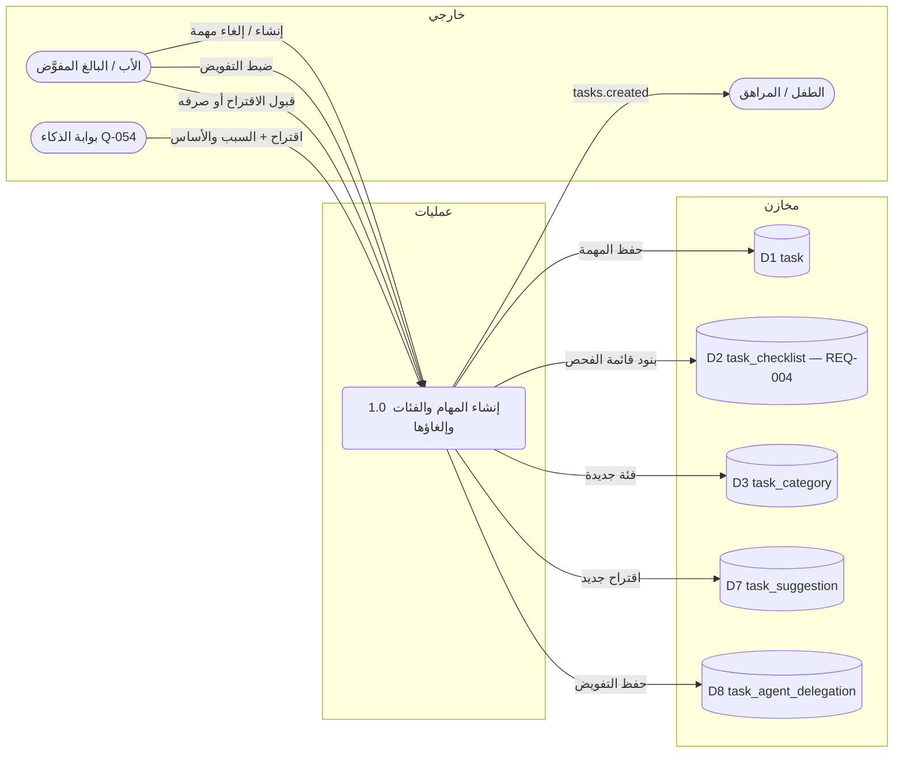

### 5-ب. التسليم والتحقق والمراجعة والتقويم ودون اتصال

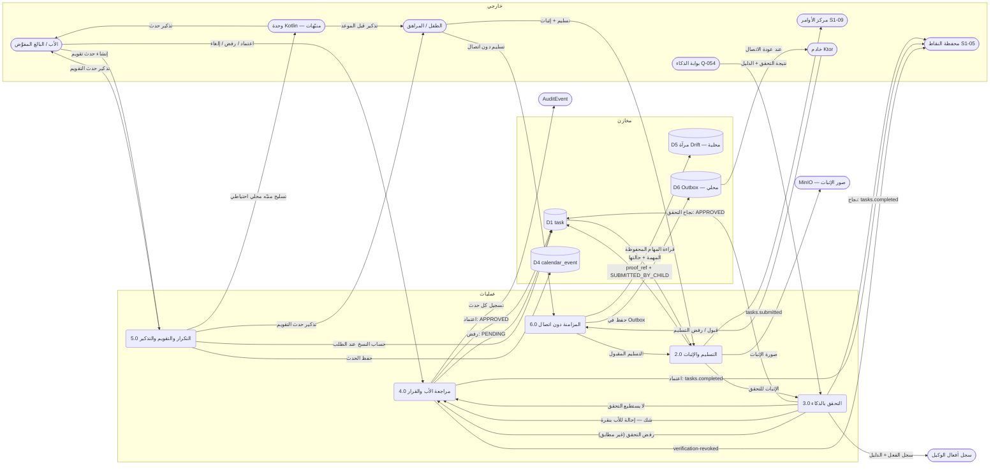

- أُعيد رسمه 2026-11-19 (Q-434 — REQ-018 · Q-415 · Q-419): قُسّم المخطط الواحد (22 عقدة/39 سهماً) إلى لوحتين LR مع subgraph يجمّع كل طرف بترتيب واحد: 5-أ إنشاء المهام والفئات والتفويض (9 عقد/10 أسهم)، و5-ب التسليم والتحقق والمراجعة والتقويم ودون اتصال (19 عقدة/33 سهماً)؛ وأُضيفت خمسة أسهم: ضبط التفويض (المالك وحده) وقبول الاقتراح أو صرفه واقتراح المساعد وحفظ الاقتراح في D7 وحفظ التفويض في D8؛ وحافة P1→P5 (RRULE) صارت قراءة P5 للنسخ من D1 — النسخ محسوبة عند الطلب لا صفوفاً (§5)؛ وفحص التعارض عند الحفظ في P1 (مهمة) وP5 (حدث) بوسم «متعارض» (Q-419 — انظر 3-ي)؛ وقُصّرت التسميات (الحمولات الكاملة في §3 و§4). والتدفقات نفسها قبل التقسيم وبعده.

## 6. مخطط النشاط (Activity) — دورة حياة المهمة والتقويم

المسارات الخمسة (الأب / الطفل / الذكاء / الخادم / المحفظة ومركز الأوامر) كمسارات متوازية. ومسار التقويم والتذكير يعمل **بالتوازي** مع دورة حياة المهمة.

ثلاث لوحات TD: 6-أ إنشاء المهمة (بالغ ومساعد)، و6-ب التسليم والتحقق، و6-ج مراجعة الأب والإلغاء؛ والعقد المشتركة (C1، C3، F2، V3، W2) تتكرر بالاسم في اللوحات. ومسار التقويم والتذكير يعمل **بالتوازي** مع دورة حياة المهمة.

### 6-أ. إنشاء المهمة — بالغ ومساعد

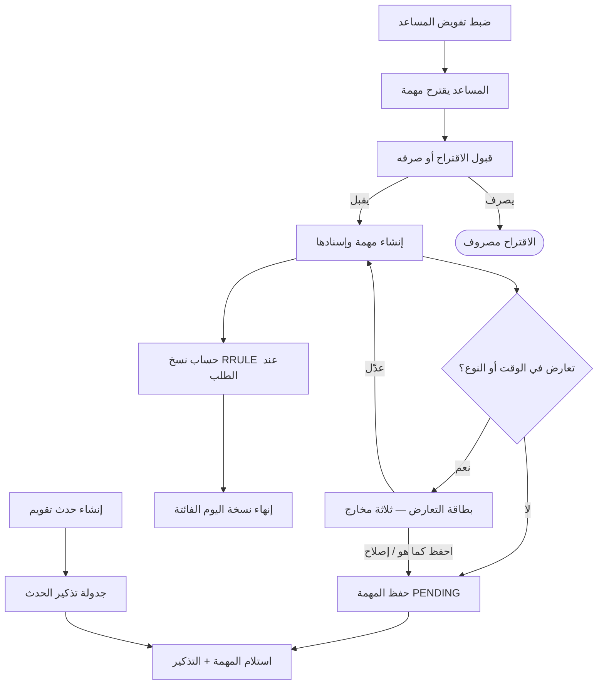

### 6-ب. التسليم والتحقق

```mermaid
flowchart TD
    C1[استلام المهمة + التذكير] --> C2[إنجاز بنود قائمة الفحص]
    C2 --> C3[تسليم مع الإثبات]
    C3 --> V2[حفظ التسليم SUBMITTED_BY_CHILD]
    V2 --> W1[بطاقة «يتطلب انتباهك»]
    V2 --> A1[استلام الإثبات]
    A1 --> A2{يستطيع التحقق؟}
    A2 -->|لا يستطيع| F2[مراجعة تسليم معلّق]
    A2 -->|نعم| A3{مطابق للمطلوب؟}
    A3 -->|مطابق| A4[إثبات النتيجة مع السبب]
    A3 -->|غير مطابق| N1[إشعار الطفل بسبب رفض الذكاء]
    N1 --> F2
    A4 --> V3[تحديث الحالة APPROVED]
    V3 --> W2[إيداع النقاط]
    V2 --> V6[تسجيل AuditEvent]
    V3 --> V6
    W2 --> C5[صرف النقاط كوقت]
```

### 6-ج. مراجعة الأب والإلغاء

```mermaid
flowchart TD
    F2[مراجعة تسليم معلّق] --> F3{القرار؟}
    F3 -->|يعتمد| F4[اعتماد يدوي]
    F3 -->|يرفض| F5[رفض مع ملاحظات]
    F4 --> V3[تحديث الحالة APPROVED]
    V3 --> W2[إيداع النقاط]
    V3 --> V6[تسجيل AuditEvent]
    F5 --> C4[إعادة التسليم بعد الرفض]
    C4 --> C3x["C3 إعادة التسليم — 6-ب"]
    C3x --> F2
    F6[إلغاء تحقق] --> W3[قيد تعويضي]
    F6 --> V7[إعادة الحالة إلى PENDING]
    V7 --> C4
    F8[إلغاء مهمة] --> V8[حالة CANCELLED — بلا نقاط]
    F8 -->|إن كانت معتمدة| W3
```

- أُعيد رسمه 2026-11-19 (Q-434 — REQ-018 · Q-415 · Q-419): صار المخطط TD على ثلاث لوحات بدل LR بخمسة مسارات (30 عقدة/33 سهماً ← 6-أ 13 عقدة/14 سهماً و6-ب 15 عقدة/16 سهماً و6-ج 14 عقدة/14 سهماً)؛ وأُضيفت عقد المساعد (F9 التفويض، A5 الاقتراح، F10 القبول/الصرف) ومعيّن التعارض وبطاقته (F9a/F11)؛ وإعادة التسليم بعد الرفض تذهب إلى البالغ لا إلى الذكاء (Q-415)؛ وإلغاء التحقق في يومه فقط وللمالك وحده ويتطلب اتصالاً (Q-415). ومواضيع الأحداث: W1 ‏`family/{family_id}/tasks.submitted`‏، وW2 ‏`family/{family_id}/tasks.completed`‏، وW3 ‏`family/{family_id}/tasks.verification-revoked`‏.

- ملاحظة: نسخة اليوم الفائتة تنتهي بنهاية اليوم ولا تتراكم أبداً (Q-123 · Q-183)؛ وتظهر نسخة الغد صباحاً (§2 مخطط التكرار). والمراهق يمر بنفس المسارات لكن إيداعه صفر نقاط ولا حدث كسب يصدر (§7). وإنهاء نسخة اليوم الفائتة (REQ-011)؛ وجدولة تذكير الحدث خادمية — الخادم مالك الجدولة (Q-280)؛ وإلغاء مهمة: الأب لأي مهمة والمراهق لمهامه التي أنشأها بنفسه فقط (Q-253)، وإلغاء مهمة معتمدة بلا نقاط والسلسلة لا تنكسر ولا تتقدم.
