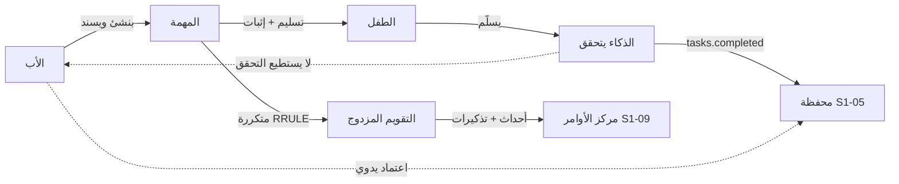
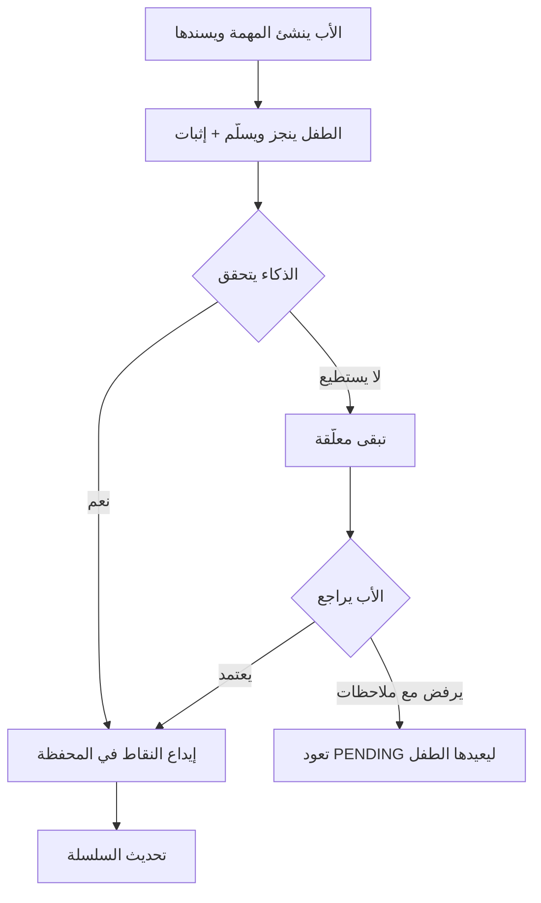
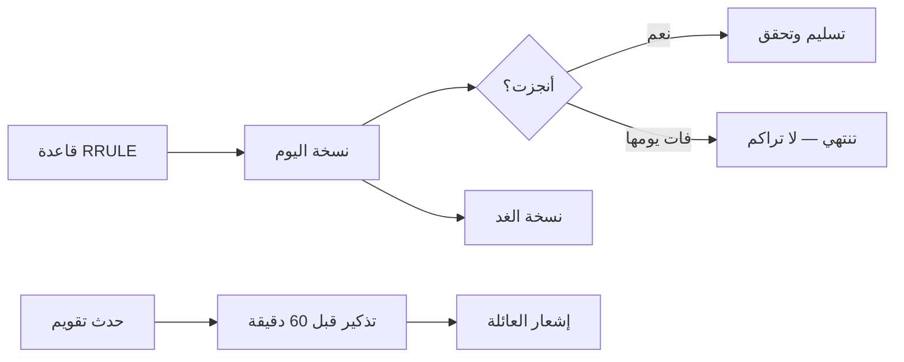

# S1-06: المهام والتقويم (Tasks & Calendar)

- **الحالة:** approved | **المرحلة:** 1 (نواة الحماية) · **آخر تحديث:** 2026-11-06
- **القرارات الحاكمة:** Q-054 · Q-058 · Q-064 · Q-109 · Q-110 · Q-118 · Q-120 · Q-121 · Q-122 · Q-123 · Q-124 · Q-125 · D-021 · G-011
- **حالة المراجعة:** §§1–8 + §10 معتمدة بالكامل في التخطيط (حكم المالك 2026-11-06) · §9 في مرحلة التصميم.
- **الأدلة المرجعية:** المواصفة القديمة S1-06 (مرجع فقط، G-009) · FamilyWall (قوائم مشتركة + إسناد + RRULE + تذكير موحد) · Qustodio (حساب الأسبوع الدائري)

## 1. الهدف والتحليل والنطاق

**الهدف:** محرك الإنجاز اليومي للعائلة: الأب يسند مهاماً لأطفاله، والطفل ينجزها، والذكاء يتحقق من إنجازها، فتدخل النقاط محفظته. وإلى جانبه تقويم عائلي مزدوج (هجري/ميلادي) بالأحداث والتذكيرات.

**القواعد الثلاث:**

1. **الذكاء هو المتحقق، والأب هو الاحتياطي:** الذكاء يتحقق أن المهمة أُنجزت كما هو مطلوب ثم يمنح النقاط (Q-110)؛ وإذا لم يستطع الذكاء التحقق تبقى المهمة معلّقة حتى يعتمدها الأب يدوياً (Q-121)؛ والأب يراجع ويلغي دائماً.
2. **مهامنا أول مصدر كسب، والعقد عام:** مهام S1-06 تصدر حدث `tasks.completed` الذي تقبله المحفظة (Q-118)؛ ومهام التعليم والدين تأتي لاحقاً من أنظمتها المالكة بالعقد نفسه — إنشاء المهام يبقى ملك النظام المُسند.
3. **لا تراكم ولا نقاط للمراهقين:** نسخة اليوم الفائتة من مهمة متكررة تنتهي ولا تتراكم (Q-123)؛ ومهام المراهقين تحمل صفر نقاط (Q-109).

**خارج النطاق:** إنشاء مهام الأنظمة الأخرى (ملك أنظمتها، Q-118)؛ المحفظة نفسها (S1-05 — S1-06 يصدر الحدث فقط)؛ فرض حدود الوقت والحظر (محرك S1-10 — مواصفته معتمدة (Q-146))؛ مهام التعليم والدين التفصيلية (مرحلتا 3 و4).

**المصطلحات:** مهمة (عمل مسند لعضو مع قيمة نقطية وتاريخ استحقاق) · نسخة (وقوع واحد من مهمة متكررة في يوم محدد) · تكرار RRULE (قاعدة التكرار بصيغة iCalendar) · إثبات (دليل الإنجاز: صورة/تسجيل/تسليم ذاتي) · تسليم (إعلان الطفل إنجاز المهمة) · تحقق (تأكيد الذكاء أو الأب أن الإنجاز مطابق للمطلوب) · حدث تقويم (موعد عائلي بوقت ومكان) · تذكير (تنبيه قبل حدث أو مهمة).

**ملاحظة إعادة الاستخدام:** FamilyWall (قوائم مشتركة + إسناد لعدة أشخاص + إنجاز ذاتي بعلامة + تكرار RRULE كامل + تذكير موحد بمنبّه دقيق)؛ والفرع القديم S1-06 (الاعتماد ثنائي الخطوة — يُعاد بناؤه حول Q-110 — وعقد `tasks.completed` وأفق توليد 3 أشهر والتقويم المزدوج). ولا تطبيق يتحقق آلياً من الإنجاز أو يربط المهام بنقاط — التحقق بالذكاء وربط المهام بالمحفظة تركيب جديد من عندنا.

## 2. سيناريوهات المستخدم

- **6-1 إنشاء مهمة وإسنادها:** الأب ينشئ مهمة (حل الواجب المدرسي) لابنه أحمد — 15 نقطة، تستحق اليوم، والإثبات صورة الواجب؛ تظهر المهمة لأحمد فوراً مع تذكير قبل ساعة.
- **6-2 إنجاز وتحقق ذكاء:** أحمد يحل الواجب ويسلّمه مع صورة؛ الذكاء يتحقق أنه أُنجز كما هو مطلوب؛ 15 نقطة تدخل محفظته فوراً وتطول سلسلته.
- **6-3 الذكاء لا يستطيع التحقق:** صورة أحمد غير واضحة؛ الذكاء لا يتحقق؛ تبقى المهمة معلّقة؛ الأب يراجع الصورة ويعتمدها يدوياً؛ تُودع النقاط.
- **6-4 مهمة متكررة:** مهمة ترتيب الغرفة تتكرر أيام الدراسة (الأحد–الخميس)؛ أحمد يفوّت يوم الاثنين فتنتهي نسخة الاثنين ولا تتراكم؛ وتظهر نسخة الثلاثاء صباحاً.
- **6-5 حدث عائلي وتذكير:** الأب يضيف موعد طبيب الأسنان للعائلة (التاريخ الهجري والميلادي ظاهران معاً)؛ يصل تذكير لكل العائلة قبل الموعد بساعة.
- **6-6 مهمة بدلاً من منح الوقت:** أحمد يطلب وقتاً إضافياً للعبة؛ الأب يرفض المنح ويسند مهمة (ترتيب الغرفة — 10 نقاط)؛ ينجزها أحمد؛ الذكاء يتحقق؛ 10 نقاط تدخل المحفظة فيصرفها كوقت للعبة.
- **6-7 مهمة شخصية لمراهق:** سارة (15 سنة) تنشئ لنفسها مهمة (مراجعة درس)؛ تنجزها وتسلّمها؛ تُسجَّل منجزة **بلا نقاط** (Q-109).

**مخطط دورة حياة المهمة (أضيف بتعديل 2026-11-06 — سيناريوهات بصرية بأمر المالك):**

**مخطط التكرار والتقويم:**

## 3. المتطلبات الوظيفية

### المهام
- **REQ-001:** إنشاء مهمة: عنوان + مُسنَد إليه واحد + فئة + قيمة نقطية + تاريخ/وقت استحقاق + طريقة إثبات؛ والإنشاء للأب + البالغ المفوَّض حسب القالب + المراهق لنفسه (`scope=self` — سيناريو 6-7). [Q-086/Q-120/Q-122 · DIRECT]
- **REQ-002:** فئات المهام: الأربع الافتراضية (منزل/مدرسة/صلاة وقرآن/عناية ذاتية) + الأب يضيف فئاته بحرية. [Q-125 · DIRECT]
- **REQ-003:** قيمة النقاط يحددها الأب عند الإنشاء (افتراضي 10؛ خيارات سريعة 5/10/15/25)؛ ومهام المراهقين صفر نقاط دائماً. [Q-109 · DIRECT]
- **REQ-004:** بنود قائمة فحص فرعية داخل المهمة (اختيارية) — تُنجز بنداً بنداً. [FamilyWall · DERIVED]
- **REQ-005:** إلغاء المهمة في أي وقت (الأب أو المفوَّض) → الحالة CANCELLED؛ ولا نقاط لمهمة ملغاة.

### التسليم والتحقق
- **REQ-006:** الطفل يسلّم المهمة مع الإثبات المطلوب (صورة/تسجيل/تسليم ذاتي حسب ما حدده الأب). [Q-122 · DIRECT]
- **REQ-007:** الذكاء يتحقق من الإنجاز؛ وعند النجاح يصدر حدث `tasks.completed` (يحمل `source_system=S1-06`) إلى المحفظة. [Q-110/Q-118 · DIRECT]
- **REQ-008:** إذا لم يستطع الذكاء التحقق تبقى المهمة معلّقة لاعتماد الأب اليدوي. [Q-121 · DIRECT]
- **REQ-009:** الأب يرفض تسليماً مع ملاحظات → تعود المهمة إلى PENDING ليعيدها الطفل؛ ويراجع أي تحقق ويلغيه.

### التكرار
- **REQ-010:** التكرار بقاعدة RRULE خام (iCalendar)؛ والنسخ محسوبة عند الطلب لا صفوفاً مادية؛ وعرض التقويم 3 أشهر مقدماً كحد أقصى.
- **REQ-011:** نسخة اليوم الفائتة تنتهي بنهاية اليوم ولا تتراكم؛ وتظهر نسخة الغد. [Q-123 · DIRECT]

### التقويم والتذكير
- **REQ-012:** أحداث تقويم عائلية: عنوان + وقت + مكان + حضور (عضو محدد أو كل العائلة).
- **REQ-013:** عرض مزدوج هجري/ميلادي (تقويم أم القرى) في كل تاريخ. [Q-124 · DIRECT]
- **REQ-014:** تذكير افتراضي قبل الموعد بـ 60 دقيقة؛ والخيارات 15/30/60 دقيقة أو يوم؛ والتنبيه محلي دقيق يعمل دون اتصال. [Q-124 · DIRECT]

### التكامل
- **REQ-015:** `tasks.submitted` → بطاقة "يتطلب انتباهك" في S1-09؛ و`tasks.completed` → محفظة S1-05. [S1-09/S1-05 · DERIVED]
- **REQ-016:** دون اتصال أولاً: مخزن Drift محلي + Outbox؛ والتسليم دون اتصال يُحفظ ويُرسَل عند عودة الاتصال. [Q-064 · DERIVED]
- **REQ-017:** تحقق المهام بالذكاء يمر بعقد التحقق (Q-167): كل تحقق يستخدم مفتاح `agent.task.verify` الممنوح + بوابة موافقته؛ ومعايير التحقق (الدليل المباشر يمنح تلقائياً؛ والدليل المقدَّم يتحقق ثم يمنح؛ والشك يُحال للأب بنقرة واحدة؛ والإقرار الذاتي وحده لا يودع شيئاً) من عقد التحقق §4 وS1-05 REQ-005؛ وكل تحقق يُسجَّل في `AgentActionLog` (يُعرض في S1-09 — S1-09 REQ-018)؛ والتراجع عبر `POST /families/{id}/tasks/{taskId}/revoke-verification` (REQ-009). [Q-167 · DIRECT]

## 4. الواجهات والعقود

### نقاط الوصول REST
- `POST /families/{id}/tasks` — إنشاء مهمة.
- `GET /families/{id}/tasks?date&assignee&status` — قائمة المهام.
- `GET /families/{id}/tasks/{taskId}` — مهمة واحدة.
- `PATCH /families/{id}/tasks/{taskId}` — تعديل مهمة.
- `DELETE /families/{id}/tasks/{taskId}` — إلغاء مهمة.
- `POST /families/{id}/tasks/{taskId}/submit` — الطفل يسلّم المهمة مع الإثبات.
- `POST /families/{id}/tasks/{taskId}/approve` — اعتماد الأب اليدوي (قرار: APPROVE / REJECT_WITH_NOTES).
- `POST /families/{id}/tasks/{taskId}/revoke-verification` — الأب يلغي تحققاً (ويعوَّض الإيداع في S1-05).
- `POST /families/{id}/events` — إنشاء حدث تقويم.
- `GET /families/{id}/events?from&to` — قائمة الأحداث (3 أشهر كحد أقصى).
- `PATCH /families/{id}/events/{eventId}` — تعديل حدث.
- `DELETE /families/{id}/events/{eventId}` — إلغاء حدث.
- `GET /families/{id}/task-categories` — قائمة الفئات.
- `POST /families/{id}/task-categories` — الأب يضيف فئة.

### أحداث MQTT
- `family/{family_id}/tasks.submitted` — تسليم جديد (لبطاقة S1-09).
- `family/{family_id}/tasks.completed` — حدث كسب عام (للمحفظة S1-05؛ يحمل `source_system=S1-06`).
- `family/{family_id}/tasks.verification-revoked` — إلغاء تحقق (لتعويض الإيداع في S1-05).
- `family/{family_id}/calendar.event.reminder` — تذكير حدث (لخدمة التنبيهات).

### قناة MethodChannel (Kotlin)
- `scheduleLocalReminder` — جدولة منبّه محلي دقيق (دون اتصال).
- `getTodayTasks` — مهام اليوم المحفوظة محلياً (دون اتصال).

### رموز الخطأ (`TSK_*`)
`TASK_NOT_FOUND` · `EVENT_NOT_FOUND` · `NOT_ASSIGNEE` · `ALREADY_SUBMITTED` · `VERIFICATION_FAILED` · `INVALID_RRULE` · `INVALID_PROOF` · `CATEGORY_EXISTS` — وبصيغة الخطأ الموحدة `{code, message_ar, trace_id}`.

## 5. البيانات — النموذج

**جداول النظام (تحمل `family_id` + RLS):**
- `task` — المهمة: `task_id` · `family_id` · `title_ar` · `description_ar` · `assigned_member_id` (مُسنَد واحد، NOT NULL) · `category_id` · `reward_points` (افتراضي 10، ≥ 0؛ و0 للمراهقين) · `due_date` · `due_time` · `rrule` (nullable) · `proof_method` (photo/recording/self) · `status` (PENDING / SUBMITTED_BY_CHILD / APPROVED / CANCELLED) · `proof_ref` (إثبات التسليم — MinIO) · `submitted_at` · `verified_by` (ai/father) · `verified_at` · `approved_by/at` · `rejection_notes` · `created_by` · timestamps.
- `task_checklist` — بنود فرعية: `item_id` · `task_id` (FK + CASCADE) · `item_title_ar` · `is_completed` · `sort_order`.
- `task_category` — الفئة: `category_id` · `family_id` (NULL = فئة عامة افتراضية من الأربع؛ وقيمة = فئة أضافها الأب لعائلته) · `name_ar` · `color` · `emoji`.
- `calendar_event` — حدث التقويم: `event_id` · `family_id` · `title_ar` · `description_ar` · `location_text` · `start_time`/`end_time` · `is_all_day` · `rrule` (nullable) · `attendee_member_id` (NULL = كل العائلة) · `reminder_minutes` (افتراضي 60) · `created_by` · timestamps.

**مراجع:** عضوية الأعضاء من S1-02؛ حدث `tasks.completed` يودع في `points_ledger` (S1-05)؛ وكل إنشاء/تسليم/تحقق/اعتماد/رفض/إلغاء يُسجَّل في AuditEvent (domain=tasks)؛ وصور الإثبات في MinIO (Q-058). **مخازن العميل (ليست جداول خادم):** مرآة Drift للمهام والأحداث (تشمل حالة CANCELLED وكل الحقول — إصلاح انحراف الفرع القديم) + Outbox للتسليم دون اتصال.

## 6. القواعد والصلاحيات

### مفاتيح الصلاحيات (`tasks.*`)
- `tasks.create` — إنشاء المهام (الأب + البالغ المفوَّض حسب القالب + المراهق لنفسه (`scope=self`)).
- `tasks.view` — عرض المهام (الأب يرى الكل؛ والطفل يرى مهامه فقط؛ والمفوَّض حسب القالب).
- `tasks.submit` — تسليم المهمة (الطفل/المراهق — مهامه فقط).
- `tasks.approve` — الاعتماد اليدوي (الأب + البالغ المفوَّض حسب القالب).
- `tasks.revoke` — إلغاء تحقق (الأب وحده).
- `tasks.cancel` — إلغاء مهمة (الأب + البالغ المفوَّض حسب القالب).
- `tasks.category.create` — إضافة فئة (الأب وحده).
- `calendar.event.create` — إنشاء أحداث التقويم (الأب + البالغ المفوَّض حسب القالب).
- `calendar.view` — عرض التقويم (كل الأعضاء).

### ثوابت صلبة (لا تُكسر)
- لا نقاط لمهام المراهقين إطلاقاً (Q-109) — النقاط تُفرض صفراً على الخادم.
- لا تُودع نقطة قبل التحقق (Q-110) — التسليم الذاتي وحده لا يودع شيئاً.
- الأب يرى كل المهام؛ والطفل يرى مهامه فقط (وأحداث العائلة).
- نسخة اليوم الفائتة تنتهي ولا تتراكم أبداً (Q-123).
- قيمة نقاط المهمة ثابتة عند الإنشاء؛ وتغييرها بعد التسليم ممنوع.
- تسليم نشط واحد لكل نسخة مهمة — لا تسليمان معاً.
- حدث الكسب يحمل `source_system=S1-06` دائماً (Q-118).
- أحداث التقويم لا تخرج من العائلة أبداً.

### قواعد التشغيل
- التسليم يظهر فوراً في بطاقة "يتطلب انتباهك" في S1-09.
- نتيجة تحقق الذكاء تُسجَّل مع السبب؛ والأب يراها قبل أن يعترض أو يلغي.
- الرفض مع ملاحظات يعيد المهمة إلى PENDING؛ ويستطيع الطفل إعادة التسليم.
- إلغاء تحقق بعد الإيداع يصدر `tasks.verification-revoked` → قيد تعويضي في S1-05 يخصم النقاط.
- النسخ المتكررة محسوبة؛ ونسخة اليوم وحدها قابلة للتسليم.
- التذكيرات منبّهات محلية دقيقة؛ وتعمل دون اتصال.
- التواريخ الهجرية من تقويم أم القرى؛ وإن تعذّر التحويل يظهر الميلادي مع ملاحظة.

## 7. الحالات الحدية والأخطاء

- تسليم مهمة غير مُسندة إليه → NOT_ASSIGNEE.
- تسليم مكرر لنفس النسخة وهي معلّقة → ALREADY_SUBMITTED ويُعاد التسليم الأصلي.
- الذكاء يرفض الإنجاز (غير مطابق للمطلوب) → لا إيداع + إشعار الطفل بالسبب + الأب يرى الرفض.
- الأب يعتمد مهمة رفضها الذكاء → الاعتماد اليدوي يتجاوز الرفض ويُودع النقاط.
- إلغاء مهمة بعد تسليمها وقبل التحقق → CANCELLED؛ والتسليم يُلغى ولا إيداع.
- تعديل نقاط مهمة بعد تسليمها → مرفوض (النقاط ثابتة عند الإنشاء).
- تسليم نسخة الأمس بعد انتهائها → مرفوض (النسخة منتهية)؛ وتظهر نسخة اليوم.
- دون اتصال: تسليم يُحفظ في Outbox؛ وعند عودة الاتصال إن أُلغيت المهمة أثناء الانقطاع → يُرفض التسليم مع إشعار.
- صورة إثبات تالفة أو غير قابلة للقراءة → INVALID_PROOF؛ والطفل يُطلب منه إعادة التسليم.
- حدث تقويم بقاعدة RRULE غير صالحة → INVALID_RRULE؛ ويُرفض الإنشاء.
- تذكير حدث في الماضي → لا تذكير (يُتجاهل بصمت)؛ والحدث نفسه يبقى.
- مراهق يسلّم مهمة → تُسجَّل منجزة بلا نقاط؛ ولا حدث كسب يصدر.
- إلغاء تحقق بعد أن صرف الطفل النقاط → القيد التعويضي يخصم من الرصيد الحالي؛ وإن كان الرصيد لا يكفي يصبح صفراً ولا سالب أبداً.

## 8. معايير القبول

- **ACC-001:** إنشاء مهمة بكل حقولها (الأب + البالغ المفوَّض + المراهق لنفسه). ← REQ-001
- **ACC-002:** الفئات الأربع الافتراضية موجودة؛ والأب يضيف فئاته. ← REQ-002
- **ACC-003:** نقاط المهمة افتراضي 10؛ ومهام المراهقين صفر دائماً. ← REQ-003
- **ACC-004:** بنود قائمة الفحص تُنجز بنداً بنداً. ← REQ-004
- **ACC-005:** إلغاء مهمة → CANCELLED؛ ولا نقاط لمهمة ملغاة. ← REQ-005
- **ACC-006:** التسليم يتم مع الإثبات المطلوب. ← REQ-006
- **ACC-007:** الذكاء يتحقق من الإنجاز → `tasks.completed` يحمل `source_system=S1-06` → إيداع النقاط في المحفظة. ← REQ-007
- **ACC-008:** الذكاء لا يستطيع التحقق → المهمة معلّقة لاعتماد الأب اليدوي. ← REQ-008
- **ACC-009:** الرفض مع ملاحظات → المهمة تعود PENDING؛ ويستطيع الطفل إعادة التسليم. ← REQ-009
- **ACC-010:** التكرار RRULE يعمل؛ والنسخ محسوبة؛ وعرض التقويم 3 أشهر. ← REQ-010
- **ACC-011:** نسخة اليوم الفائتة تنتهي ولا تتراكم. ← REQ-011
- **ACC-012:** أحداث عائلية تعمل؛ والتاريخ معروض هجرياً وميلادياً معاً. ← REQ-012/013
- **ACC-013:** تذكير افتراضي 60 دقيقة + الخيارات؛ والمنبّه المحلي يعمل دون اتصال. ← REQ-014
- **ACC-014:** `tasks.submitted` يظهر في بطاقة S1-09؛ و`tasks.completed` يودع في المحفظة. ← REQ-015
- **ACC-015:** دون اتصال: Drift + Outbox؛ والتسليم يُرسَل عند عودة الاتصال. ← REQ-016

## 9. قائمة الشاشات

في مرحلة التصميم.

## 10. خطة التنفيذ

- **ترتيب البناء:** الجداول + RLS ← REST + MQTT (إصدار `tasks.completed`) ← دورة حياة المهمة (إنشاء/تسليم/تحقق/اعتماد/إلغاء) ← ربط تحقق الذكاء (هيكل Q-054 + معالجة الإثبات) ← محرك RRULE + محول هجري ← دون اتصال (Drift + Outbox + منبّهات محلية) ← تكامل بطاقة S1-09 ومحفظة S1-05 ← الشاشات بعد مرحلة التصميم.
- **بذر المفاتيح في السجل المركزي:** مفاتيح `tasks.*`/`calendar.*` التسعة (§6: `tasks.create` · `tasks.view` · `tasks.submit` · `tasks.approve` · `tasks.revoke` · `tasks.cancel` · `tasks.category.create` · `calendar.event.create` · `calendar.view`) تُزرع في جدول `permission_key` المركزي (S1-03 §10-1) وقت النشر — لا منح لمفتاح غير مزروع (S1-03 REQ-009).
- **الوحدات:** وحدة Ktor باسم `tasks`؛ وشاشات Flutter للمهام والتقويم + مرآة Drift؛ ووحدة Kotlin للمزامنة الخلفية والمنبّهات الدقيقة.
- **الاعتماديات:** S1-01 · S1-02 · S1-03 · S1-09 · S1-05 (مستهلك `tasks.completed`) · Q-022 (MQTT) · Q-054 (هيكل بوابة الذكاء) · Q-167 (عقد تحقق الذكاء — REQ-017) · Q-058 (MinIO لصور الإثبات) · مختبر Q-027.
- **الاختبارات:** وحدة (نسخ RRULE/انتهاء النسخة/عدم تكرار/صفر نقاط للمراهقين) · تكامل (تسليم ← تحقق ← إيداع؛ احتياطي الأب؛ إلغاء تحقق ← قيد تعويضي؛ تسليم دون اتصال) · قبول ACC-001…015 · دون اتصال (اليمن).

## ملحق أ: الاستخلاص من الهندسة العكسية (RE)

| المصدر المفكك | الآلية المعاد استخدامها | أين تُستخدم في المواصفة |
|---|---|---|
| FamilyWall — القوائم المشتركة (`TaskListBean` + `TaskListTypeEnum`) | قوائم بأنواع (TODO/تسوق/أخرى) + مشاركة لأعضاء أو للجميع + حقوق لكل قائمة + عدّادات (الإجمالي/المتبقي) | §1 · §3 REQ-002 · §5 |
| FamilyWall — الإسناد (`AssigneeBean`) | إسناد لعدة أشخاص أو "للجميع" أو "بلا إسناد"؛ وعرض المهمة بلون العضو المُسند | §1 · §3 REQ-001 |
| FamilyWall — الإنجاز الذاتي (`TaskBean` + `ITaskApi.markCompleted`) | إنجاز بعلامة بوليانية + تاريخ + من أنجز؛ والتراجع عنه بنفس الدالة — كخطوة تسليم أولى لا كاعتماد نهائي | §1 · §3 REQ-006 |
| FamilyWall — التكرار الكامل (`RecurrencyDescriptor`) | نموذج iCalendar كامل: `rrule` + `byDay` + `byMonthDay` + `interval` + `endDate`/`endOccurence` + `exdate` + `rdate` | §3 REQ-010 · §5 |
| FamilyWall — التذكير الموحد (`ReminderBean` + `ReminderBroadcastReceiver`) | تذكير موحد للمهام والأحداث (قيمة + وحدة يوم/ساعة/دقيقة + نوع) بمنبّه محلي دقيق (AlarmManager + `SCHEDULE_EXACT_ALARM`) | §3 REQ-014 · §4 |
| FamilyWall — الاقتراحات والمزامنة (`getTaskSuggestions` + `listforSync`) | اقتراحات عناصر من الخادم (قبول/رفض) + مزامنة دلتا برمز + معرّف عملية عميل لمنع التكرار | §3 REQ-016 · §4 |
| Qustodio — حساب الأسبوع الدائري (`routines.ts`) | دقيقة الأسبوع 0–10080 + كشف تعارضات + تسلسل حسم (نوم > مدرسة > حصة) — جدولة لا مهام | §3 REQ-010 (محرك التكرار) |
| الفرع القديم S1-06 (فكرة بعد المراجعة) | الاعتماد ثنائي الخطوة (يُعاد بناؤه حول Q-110) + عقد `tasks.completed` + أفق توليد 3 أشهر + التقويم المزدوج | §1 · §3 · §4 |

**ملاحظة صدق:** التحقق بالذكاء وربط المهام بالنقاط وحالة المهمة ذات الأربع مراحل والفئات والقيم النقطية تركيب جديد — لا سابقة له في أي تطبيق؛ فـ FamilyWall يكتفي بعلامة إنجاز ذاتية بلا اعتماد، وادعاء الفرع القديم أن الاعتماد "مستخرج" من FamilyWall غير صحيح.

## أسئلة مفتوحة (من هذه المواصفة)

لا أسئلة مفتوحة.
