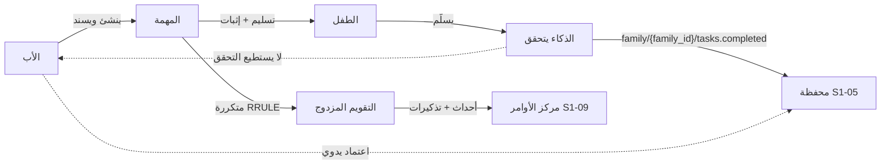
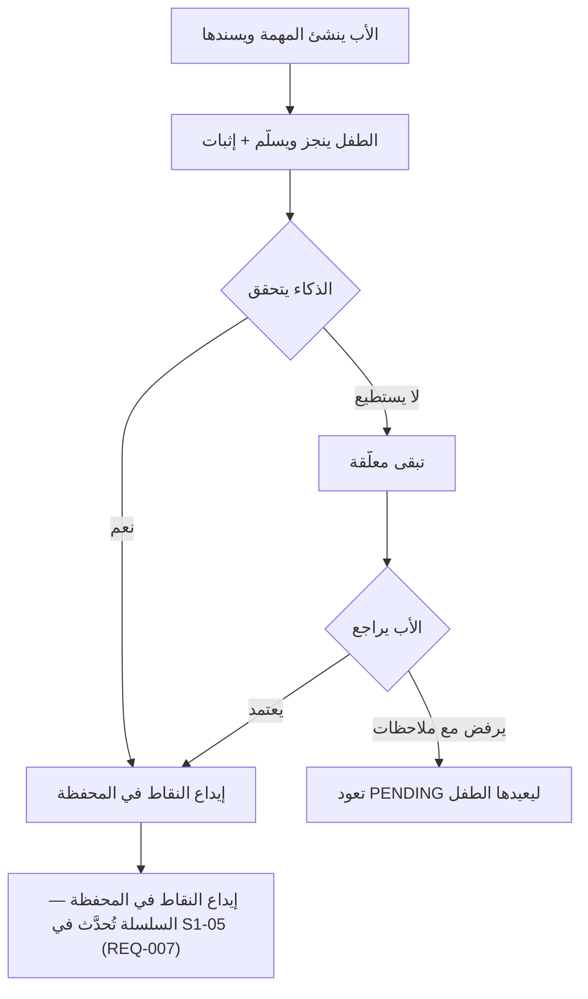
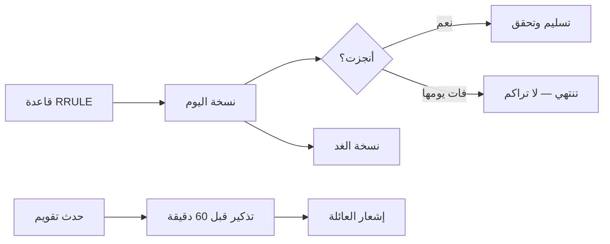

# S1-06: المهام والتقويم (Tasks & Calendar)

- **الحالة:** approved | **المرحلة:** 1 (نواة الحماية) · **آخر تحديث:** 2026-11-06
- **القرارات الحاكمة:** Q-001 · Q-054 · Q-058 · Q-064 · Q-109 · Q-110 · Q-118 · Q-120 · Q-121 · Q-122 · Q-123 · Q-124 · Q-125 · D-021 · G-011 · Q-183 · Q-167 · Q-007
- **حالة المراجعة:** §§1–8 + §10 معتمدة بالكامل في التخطيط (حكم المالك 2026-11-06) · §9 في مرحلة التصميم.
- **الأدلة المرجعية:** المواصفة القديمة S1-06 (مرجع فقط، G-009) · FamilyWall (قوائم مشتركة + إسناد + RRULE + تذكير موحد) · Qustodio (حساب الأسبوع الدائري)

## 1. الهدف والتحليل والنطاق

**الهدف:** محرك الإنجاز اليومي للعائلة: الأب يسند مهاماً لأطفاله، والطفل ينجزها، والذكاء يتحقق من إنجازها، فتدخل النقاط محفظته. وإلى جانبه تقويم عائلي مزدوج (هجري/ميلادي) بالأحداث والتذكيرات.

**القواعد الثلاث:**

1. **الذكاء هو المتحقق، والأب هو الاحتياطي:** الذكاء يتحقق أن المهمة أُنجزت كما هو مطلوب ثم يمنح النقاط (Q-110)؛ وإذا لم يستطع الذكاء التحقق تبقى المهمة معلّقة حتى يعتمدها الأب يدوياً (Q-121)؛ والأب يراجع ويلغي دائماً.
2. **مهامنا أول مصدر كسب، والعقد عام:** مهام S1-06 تصدر حدث `family/{family_id}/tasks.completed` الذي تقبله المحفظة (Q-118)؛ ومهام التعليم والدين تأتي لاحقاً من أنظمتها المالكة بالعقد نفسه — إنشاء المهام يبقى ملك النظام المُسند.
3. **لا تراكم ولا نقاط للمراهقين:** نسخة اليوم الفائتة من مهمة متكررة تنتهي ولا تتراكم (Q-123)؛ ومهام المراهقين تحمل صفر نقاط (Q-109).

**خارج النطاق:** إنشاء مهام الأنظمة الأخرى (ملك أنظمتها، Q-118)؛ المحفظة نفسها (S1-05 — S1-06 يصدر الحدث فقط)؛ فرض حدود الوقت والحظر (محرك S1-10 — مواصفته معتمدة (Q-146))؛ مهام التعليم والدين التفصيلية (مرحلتا 3 و4).

**المصطلحات:** مهمة (عمل مسند لعضو مع قيمة نقطية وتاريخ استحقاق) · نسخة (وقوع واحد من مهمة متكررة في يوم محدد) · تكرار RRULE (قاعدة التكرار بصيغة iCalendar) · إثبات (دليل الإنجاز: صورة/تسجيل/تسليم ذاتي) · تسليم (إعلان الطفل إنجاز المهمة) · تحقق (تأكيد الذكاء أو الأب أن الإنجاز مطابق للمطلوب) · حدث تقويم (موعد عائلي بوقت ومكان) · تذكير (تنبيه قبل حدث أو مهمة).

**ملاحظة إعادة الاستخدام:** FamilyWall (قوائم مشتركة + إسناد لعدة أشخاص + إنجاز ذاتي بعلامة + تكرار RRULE كامل + تذكير موحد بمنبّه دقيق)؛ والفرع القديم S1-06 (الاعتماد ثنائي الخطوة — يُعاد بناؤه حول Q-110 — وعقد `family/{family_id}/tasks.completed` وأفق توليد 3 أشهر والتقويم المزدوج). ولا تطبيق يتحقق آلياً من الإنجاز أو يربط المهام بنقاط — التحقق بالذكاء وربط المهام بالمحفظة تركيب جديد من عندنا.



## 2. سيناريوهات المستخدم

- **6-1 إنشاء مهمة وإسنادها:** الأب ينشئ مهمة (حل الواجب المدرسي) لابنه أحمد — 15 نقطة، تستحق اليوم، والإثبات صورة الواجب؛ تظهر المهمة لأحمد فوراً مع تذكير قبل ساعة.
- **6-2 إنجاز وتحقق ذكاء:** أحمد يحل الواجب ويسلّمه مع صورة؛ الذكاء يتحقق أنه أُنجز كما هو مطلوب؛ 15 نقطة تدخل محفظته فوراً وتُحدَّث سلسلته في المحفظة (S1-05 REQ-007 — S1-06 لا يحدّث السلسلة بنفسه).
- **6-3 الذكاء لا يستطيع التحقق:** صورة أحمد غير واضحة؛ الذكاء لا يتحقق؛ تبقى المهمة معلّقة؛ الأب يراجع الصورة ويعتمدها يدوياً؛ تُودع النقاط.
- **6-4 مهمة متكررة:** مهمة ترتيب الغرفة تتكرر أيام الدراسة (الأحد–الخميس)؛ أحمد يفوّت يوم الاثنين فتنتهي نسخة الاثنين ولا تتراكم؛ وتظهر نسخة الثلاثاء صباحاً.
- **6-5 حدث عائلي وتذكير:** الأب يضيف موعد طبيب الأسنان للعائلة (التاريخ الهجري والميلادي ظاهران معاً)؛ يصل تذكير لكل العائلة قبل الموعد بساعة.
- **6-6 مهمة بدلاً من منح الوقت:** أحمد يطلب وقتاً إضافياً للعبة؛ الأب يرفض المنح ويسند مهمة (ترتيب الغرفة — 10 نقاط)؛ ينجزها أحمد؛ الذكاء يتحقق؛ 10 نقاط تدخل المحفظة فيصرفها كوقت للعبة.
- **6-7 مهمة شخصية لمراهق:** سارة (15 سنة) تنشئ لنفسها مهمة (مراجعة درس)؛ تنجزها وتسلّمها؛ تُسجَّل منجزة **بلا نقاط** (Q-109).

**مخطط دورة حياة المهمة (أضيف بتعديل 2026-11-06 — سيناريوهات بصرية بأمر المالك):**



**مخطط التكرار والتقويم:**



## 3. المتطلبات الوظيفية

### المهام
- **REQ-001:** إنشاء مهمة: عنوان + مُسنَد إليه واحد + فئة + قيمة نقطية + تاريخ/وقت استحقاق + طريقة إثبات؛ والإنشاء للأب + البالغ المفوَّض حسب القالب + المراهق لنفسه (`scope=self` — سيناريو 6-7). [Q-086/Q-120/Q-122 · DIRECT]
- **REQ-002:** فئات المهام: الأربع الافتراضية (منزل/مدرسة/صلاة وقرآن/عناية ذاتية) + الأب يضيف فئاته بحرية. [Q-125 · DIRECT]
- **REQ-003:** قيمة النقاط يحددها الأب عند الإنشاء (افتراضي 10؛ خيارات سريعة 5/10/15/25)؛ ومهام المراهقين صفر نقاط دائماً. [Q-109 · DIRECT]
- **REQ-004:** بنود قائمة فحص فرعية داخل المهمة (اختيارية) — تُنجز بنداً بنداً. [FamilyWall · DERIVED]
- **REQ-005:** إلغاء المهمة في أي وقت (الأب أو المفوَّض) → الحالة CANCELLED؛ ولا نقاط لمهمة ملغاة. وإلغاء مهمة APPROVED بعد الإيداع يُصدر `family/{family_id}/tasks.verification-revoked` (مسار التعويض نفسه كإلغاء التحقق — REQ-009) → قيد تعويضي واحد في S1-05 يخصم النقاط؛ والرصيد صفراً ولا سالب أبداً.

### التسليم والتحقق
- **REQ-006:** الطفل يسلّم المهمة مع الإثبات المطلوب (صورة/تسجيل/تسليم ذاتي حسب ما حدده الأب). [Q-122 · DIRECT]
- **REQ-007:** الذكاء يتحقق من الإنجاز؛ وعند النجاح يصدر حدث `family/{family_id}/tasks.completed` (يحمل `source_system=S1-06`) إلى المحفظة. ويُستثنى المراهق: مهمة المراهق تُسجَّل منجزة بلا نقاط ولا يصدر عنها حدث كسب إطلاقاً (Q-109 — §7). [Q-110/Q-118 · DIRECT]
- **REQ-008:** إذا لم يستطع الذكاء التحقق تبقى المهمة معلّقة لاعتماد الأب اليدوي. [Q-121 · DIRECT]
- **REQ-009:** الأب يرفض تسليماً مع ملاحظات → تعود المهمة إلى PENDING ليعيدها الطفل؛ ويراجع أي تحقق ويلغيه.

### التكرار
- **REQ-010:** التكرار بقاعدة RRULE خام (iCalendar)؛ والنسخ محسوبة عند الطلب لا صفوفاً مادية؛ وعرض التقويم 3 أشهر مقدماً كحد أقصى. [FamilyWall `RecurrencyDescriptor` · DERIVED]
- **REQ-011:** نسخة اليوم الفائتة تنتهي بنهاية اليوم ولا تتراكم؛ وتظهر نسخة الغد. و«نهاية اليوم» = منتصف الليل بالتوقيت المحلي للعائلة. [Q-123 · DIRECT] [Q-183]

### التقويم والتذكير
- **REQ-012:** أحداث تقويم عائلية: عنوان + وقت + مكان + حضور (عضو محدد أو كل العائلة). وتكرار الأحداث بقاعدة RRULE خام نفسها (REQ-010): النسخ محسوبة عند الطلب لا صفوفاً مادية؛ ولا تنطبق قاعدة انتهاء نسخة اليوم (Q-123) على الأحداث — وقوع الحدث الماضي يبقى في السجل ولا يُعاد.
- **REQ-013:** عرض مزدوج هجري/ميلادي (تقويم أم القرى) في كل تاريخ. [Q-124 · DIRECT]
- **REQ-014:** تذكير افتراضي قبل الموعد بـ 60 دقيقة؛ والخيارات 15/30/60 دقيقة أو يوم؛ والتنبيه محلي دقيق يعمل دون اتصال. [Q-124 · DIRECT]

### التكامل
- **REQ-015:** `family/{family_id}/tasks.submitted` → بطاقة "يتطلب انتباهك" في S1-09؛ و`family/{family_id}/tasks.completed` → محفظة S1-05. [S1-09/S1-05 · DERIVED]
- **REQ-016:** دون اتصال أولاً: مخزن Drift محلي + Outbox؛ والتسليم دون اتصال يُحفظ ويُرسَل عند عودة الاتصال. [Q-064 · DERIVED]
- **REQ-017:** تحقق المهام بالذكاء يمر بعقد التحقق (Q-167): كل تحقق يستخدم مفتاح `agent.task.verify` الممنوح + بوابة موافقته؛ ومعايير التحقق (الدليل المباشر يمنح تلقائياً؛ والدليل المقدَّم يتحقق ثم يمنح؛ والشك يُحال للأب بنقرة واحدة؛ والإقرار الذاتي وحده لا يودع شيئاً) من عقد التحقق §4 وS1-05 REQ-005؛ وكل تحقق يُسجَّل في `AgentActionLog` (يُعرض في S1-09 — S1-09 REQ-018)؛ والتراجع عبر `POST /api/v1/families/{id}/tasks/{taskId}/revoke-verification` (REQ-009). [Q-167 · DIRECT]

## 4. الواجهات والعقود

### نقاط الوصول REST
- `POST /api/v1/families/{id}/tasks` — إنشاء مهمة.
- `GET /api/v1/families/{id}/tasks?date&assignee&status` — قائمة المهام.
- `GET /api/v1/families/{id}/tasks/{taskId}` — مهمة واحدة.
- `PATCH /api/v1/families/{id}/tasks/{taskId}` — تعديل مهمة.
- `DELETE /api/v1/families/{id}/tasks/{taskId}` — إلغاء مهمة.
- `POST /api/v1/families/{id}/tasks/{taskId}/submit` — الطفل يسلّم المهمة مع الإثبات.
- `POST /api/v1/families/{id}/tasks/{taskId}/approve` — اعتماد الأب اليدوي (قرار: APPROVE / REJECT_WITH_NOTES).
- `POST /api/v1/families/{id}/tasks/{taskId}/revoke-verification` — الأب يلغي تحققاً (ويعوَّض الإيداع في S1-05).
- `POST /api/v1/families/{id}/events` — إنشاء حدث تقويم.
- `GET /api/v1/families/{id}/events?from&to` — قائمة الأحداث (3 أشهر كحد أقصى).
- `PATCH /api/v1/families/{id}/events/{eventId}` — تعديل حدث.
- `DELETE /api/v1/families/{id}/events/{eventId}` — إلغاء حدث.
- `GET /api/v1/families/{id}/task-categories` — قائمة الفئات.
- `POST /api/v1/families/{id}/task-categories` — الأب يضيف فئة.

### أحداث MQTT

| الموضوع | QoS | Retained | الوصف |
|---|---|---|---|
| `family/{family_id}/tasks.submitted` | 1 | لا | تسليم جديد (لبطاقة S1-09) |
| `family/{family_id}/tasks.completed` | 1 | لا | حدث كسب عام (للمحفظة S1-05؛ يحمل `source_system=S1-06`) |
| `family/{family_id}/tasks.verification-revoked` | 1 | لا | إلغاء تحقق (لتعويض الإيداع في S1-05) |
| `family/{family_id}/calendar.event.reminder` | 1 | لا | تذكير حدث (لخدمة التنبيهات) |

- المصدر: الوسيط §6 — صف «الأحداث» وصف «لوحة/تقويم/فوترة»: QoS 1، Retained لا.

### قناة MethodChannel (Kotlin)
- `scheduleLocalReminder` — جدولة منبّه محلي دقيق (دون اتصال).
- `getTodayTasks` — مهام اليوم المحفوظة محلياً (دون اتصال).

### رموز الخطأ (`TSK_*`)
`TASK_NOT_FOUND` · `EVENT_NOT_FOUND` · `NOT_ASSIGNEE` · `ALREADY_SUBMITTED` · `VERIFICATION_FAILED` · `INVALID_RRULE` · `INVALID_PROOF` · `CATEGORY_EXISTS` — وبصيغة الخطأ الموحدة `{code, message_ar, trace_id}`.

## 5. البيانات — النموذج

**جداول النظام (تحمل `family_id` + RLS):**
- `task` — المهمة: `task_id` · `family_id` · `title_ar` · `description_ar` · `assigned_member_id` (مُسنَد واحد، NOT NULL) · `category_id` · `reward_points` (افتراضي 10، ≥ 0؛ و0 للمراهقين) · `due_date` · `due_time` · `rrule` (nullable) · `proof_method` (photo/recording/self) · `status` (PENDING / SUBMITTED_BY_CHILD / APPROVED / CANCELLED) · `proof_ref` (إثبات التسليم — MinIO) · `submitted_at` · `verified_by` (ai/father) · `verified_at` · `approved_by` · `approved_at` · `rejection_notes` · `created_by` · `created_at` · `updated_at`.
- `task_checklist` — بنود فرعية: `item_id` · `task_id` (FK + CASCADE) · `item_title_ar` · `is_completed` · `sort_order`.
- `task_category` — الفئة: `category_id` · `family_id` (NULL = فئة عامة افتراضية من الأربع؛ وقيمة = فئة أضافها الأب لعائلته) · `name_ar` · `color` · `emoji`.
- `calendar_event` — حدث التقويم: `event_id` · `family_id` · `title_ar` · `description_ar` · `location_text` · `start_time`/`end_time` · `is_all_day` · `rrule` (nullable) · `attendee_member_id` (NULL = كل العائلة) · `reminder_minutes` (افتراضي 60) · `created_by` · `created_at` · `updated_at`.

**مراجع:** عضوية الأعضاء من S1-02؛ حدث `family/{family_id}/tasks.completed` يودع في `points_ledger` (S1-05)؛ وكل إنشاء/تسليم/تحقق/اعتماد/رفض/إلغاء يُسجَّل في AuditEvent (domain=tasks)؛ وصور الإثبات في MinIO (Q-058). **مخازن العميل (ليست جداول خادم):** مرآة Drift للمهام والأحداث (تشمل حالة CANCELLED وكل الحقول — إصلاح انحراف الفرع القديم) + Outbox للتسليم دون اتصال.

## 6. القواعد والصلاحيات

### مفاتيح الصلاحيات (`tasks.*`)
- `tasks.create` — إنشاء المهام (الأب + البالغ المفوَّض حسب القالب + المراهق لنفسه (`scope=self`)).
- `tasks.view` — عرض المهام (الأب يرى الكل؛ والطفل يرى مهامه فقط؛ والمفوَّض حسب القالب).
- `tasks.submit` — تسليم المهمة (الطفل/المراهق — مهامه فقط).
- `tasks.approve` — الاعتماد اليدوي (الأب + البالغ المفوَّض حسب القالب).
- `tasks.revoke` — إلغاء تحقق (الأب وحده).
- `tasks.cancel` — إلغاء مهمة (الأب + البالغ المفوَّض حسب القالب).
- `tasks.category.create` — إضافة فئة (الأب وحده).
- `calendar.event.create` — إنشاء أحداث التقويم (الأب + البالغ المفوَّض حسب القالب).
- `calendar.view` — عرض التقويم (كل الأعضاء).

### ثوابت صلبة (لا تُكسر)
- لا نقاط لمهام المراهقين إطلاقاً (Q-109) — النقاط تُفرض صفراً على الخادم.
- لا تُودع نقطة قبل التحقق (Q-110) — التسليم الذاتي وحده لا يودع شيئاً.
- الأب يرى كل المهام؛ والطفل يرى مهامه فقط (وأحداث العائلة).
- نسخة اليوم الفائتة تنتهي ولا تتراكم أبداً (Q-123).
- قيمة نقاط المهمة ثابتة عند الإنشاء؛ وتغييرها بعد التسليم ممنوع.
- تسليم نشط واحد لكل نسخة مهمة — لا تسليمان معاً.
- حدث الكسب يحمل `source_system=S1-06` دائماً (Q-118).
- أحداث التقويم لا تخرج من العائلة أبداً.

### قواعد التشغيل
- التسليم يظهر فوراً في بطاقة "يتطلب انتباهك" في S1-09.
- نتيجة تحقق الذكاء تُسجَّل مع السبب؛ والأب يراها قبل أن يعترض أو يلغي.
- الرفض مع ملاحظات يعيد المهمة إلى PENDING؛ ويستطيع الطفل إعادة التسليم.
- إلغاء تحقق بعد الإيداع يصدر `family/{family_id}/tasks.verification-revoked` → قيد تعويضي في S1-05 يخصم النقاط.
- إلغاء مهمة APPROVED بعد الإيداع يصدر المسار التعويضي نفسه (`family/{family_id}/tasks.verification-revoked` → قيد تعويضي واحد في S1-05)؛ والحالة تصبح CANCELLED؛ والرصيد صفراً ولا سالب أبداً.
- التذكير الواحد لا يُعرض مرتين: المنبّه المحلي وحدث `family/{family_id}/calendar.event.reminder` نسختا تسليم للتذكير نفسه لا تذكيران؛ وكل تذكير يحمل `reminder_id` (معرّف الحدث/المهمة + تاريخ الوقوع + الإزاحة بالدقائق)؛ وأول وصول يفوز ويُكتم الثاني بنفس `reminder_id` على الجهاز. (بغض النظر عن مالك الجدولة — سؤال مفتوح R2-S106-06، B2.)
- النسخ المتكررة محسوبة؛ ونسخة اليوم وحدها قابلة للتسليم.
- التذكيرات منبّهات محلية دقيقة؛ وتعمل دون اتصال.
- التواريخ الهجرية من تقويم أم القرى؛ وإن تعذّر التحويل يظهر الميلادي مع ملاحظة.

## 7. الحالات الحدية والأخطاء

- تسليم مهمة غير مُسندة إليه → NOT_ASSIGNEE.
- تسليم مكرر لنفس النسخة وهي معلّقة → ALREADY_SUBMITTED ويُعاد التسليم الأصلي.
- الذكاء يرفض الإنجاز (غير مطابق للمطلوب) → لا إيداع + إشعار الطفل بالسبب + الأب يرى الرفض.
- الأب يعتمد مهمة رفضها الذكاء → الاعتماد اليدوي يتجاوز الرفض ويُودع النقاط.
- إلغاء مهمة بعد تسليمها وقبل التحقق → CANCELLED؛ والتسليم يُلغى ولا إيداع.
- إلغاء مهمة APPROVED بعد الإيداع → CANCELLED + قيد تعويضي واحد عبر `family/{family_id}/tasks.verification-revoked` (مسار إلغاء التحقق نفسه)؛ والرصيد صفراً ولا سالب أبداً.
- تعديل نقاط مهمة بعد تسليمها → مرفوض (النقاط ثابتة عند الإنشاء).
- تسليم نسخة الأمس بعد انتهائها → مرفوض (النسخة منتهية)؛ وتظهر نسخة اليوم.
- دون اتصال: تسليم يُحفظ في Outbox؛ وعند عودة الاتصال إن أُلغيت المهمة أثناء الانقطاع → يُرفض التسليم مع إشعار.
- صورة إثبات تالفة أو غير قابلة للقراءة → INVALID_PROOF؛ والطفل يُطلب منه إعادة التسليم.
- حدث تقويم بقاعدة RRULE غير صالحة → INVALID_RRULE؛ ويُرفض الإنشاء.
- تذكير حدث في الماضي → لا تذكير (يُتجاهل بصمت)؛ والحدث نفسه يبقى.
- مراهق يسلّم مهمة → تُسجَّل منجزة بلا نقاط؛ ولا حدث كسب يصدر.
- إلغاء تحقق بعد أن صرف الطفل النقاط → القيد التعويضي يخصم من الرصيد الحالي؛ وإن كان الرصيد لا يكفي يصبح صفراً ولا سالب أبداً.

## 8. معايير القبول

- **ACC-001:** إنشاء مهمة بكل حقولها (الأب + البالغ المفوَّض + المراهق لنفسه). ← REQ-001
- **ACC-002:** الفئات الأربع الافتراضية موجودة؛ والأب يضيف فئاته. ← REQ-002
- **ACC-003:** نقاط المهمة افتراضي 10؛ ومهام المراهقين صفر دائماً. ← REQ-003
- **ACC-004:** بنود قائمة الفحص تُنجز بنداً بنداً. ← REQ-004
- **ACC-005:** إلغاء مهمة → CANCELLED؛ ولا نقاط لمهمة ملغاة. ← REQ-005
- **ACC-006:** التسليم يتم مع الإثبات المطلوب. ← REQ-006
- **ACC-007:** الذكاء يتحقق من الإنجاز → `family/{family_id}/tasks.completed` يحمل `source_system=S1-06` → إيداع النقاط في المحفظة. ← REQ-007
- **ACC-008:** الذكاء لا يستطيع التحقق → المهمة معلّقة لاعتماد الأب اليدوي. ← REQ-008
- **ACC-009:** الرفض مع ملاحظات → المهمة تعود PENDING؛ ويستطيع الطفل إعادة التسليم. ← REQ-009
- **ACC-010:** التكرار RRULE يعمل؛ والنسخ محسوبة؛ وعرض التقويم 3 أشهر. ← REQ-010
- **ACC-011:** نسخة اليوم الفائتة تنتهي ولا تتراكم. ← REQ-011
- **ACC-012:** أحداث عائلية تعمل؛ والتاريخ معروض هجرياً وميلادياً معاً. ← REQ-012/013
- **ACC-013:** تذكير افتراضي 60 دقيقة + الخيارات؛ والمنبّه المحلي يعمل دون اتصال. ← REQ-014
- **ACC-014:** `family/{family_id}/tasks.submitted` يظهر في بطاقة S1-09؛ و`family/{family_id}/tasks.completed` يودع في المحفظة. ← REQ-015
- **ACC-015:** دون اتصال: Drift + Outbox؛ والتسليم يُرسَل عند عودة الاتصال. ← REQ-016

## 9. قائمة الشاشات

**الحالة:** مسودة (drafted) — للمراجعة الصباحية؛ لا اعتماد ليلاً.

**المصادر الحاكمة لهذه المسودة:** `SPEC.md` §§1–8 + §10 (معتمدة في التخطيط) · `DIAGRAMS.md` §1 (حالات الاستخدام UC1–UC14) · قالب المواصفة `templates/system-spec.md:37` (Q-091) · قائمة قبول المسودات `design-draft-acceptance.md` · نظام التصميم `design-system/` (128 معيار DS).

## قيود صريحة (تُقرأ قبل أي شاشة)

- **Q-042 / Q-044:** بلا خط عربي نهائي وبلا درجات ألوان 50–950 نهائية — كل الرموز البصرية في هذه المسودة على رموز DS الحالية فقط (أسماء الرموز، بلا قيم لونية أو خطوط مخترعة).
- **Q-043:** لا شعار SVG ولا شخصية مرشد مخترعة — العلامة في كل شاشة نصية «عائلتي» بألوان الشعار (DS-BR) فقط؛ والفجوة مسجلة (فجوة G-06-6).
- **Q-045:** التصميم للهاتف أولاً؛ والحد الأدنى على اللوحي «لا ينكسر» (S-001) — النطاق الكامل للوحي/الطيّ بطاقة صباحية، لا يُصمَّم هنا.
- **Q-046:** بلا سياسة تحليلات للأطفال — لا أحداث تحليلية في أي شاشة طفل في هذا النظام إلا «بلا بيانات شخصية» (QUALITY-GATES §2)؛ ولا حدث تحليلي مسمى في أي شاشة أدناه.
- **Q-157:** لا هدف «24 ساعة» في أي شاشة — قائمة الإعداد الأولي (DS-CC-10) بلا هدف زمني حتى يُحسم.
- **Q-201:** لا شاشة حذف/تصدير في هذا النظام (إلغاء المهمة تغيير حالة إلى CANCELLED لا حذف بيانات — REQ-005)؛ فالقيد «قابل للتغيير بعد استشارة PDPL» لا ينطبق على أي شاشة أدناه، ويُسجَّل هنا لعدم الانطباق لا للتجاهل.
- **C3-1 (حُسم — Q-183):** «نهاية اليوم» في REQ-011 (نسخة اليوم الفائتة تنتهي بنهاية اليوم) = **منتصف الليل بالتوقيت المحلي للعائلة** (حكم المالك 2026-11-07، الخيار أ)؛ كل شاشة تعرض نسخة منتهية تعرض «انتهت منتصف الليل». فجوة G-06-1 **مغلقة**. (ملاحظة: REQ-011 هنا هو نظير S1-05 REQ-009 في بطاقة C3-1 نفسها.)
- **Q-070:** العربية أولاً RTL في كل شاشة؛ وكل نص أدناه من مفاتيح الترجمة (`screens.<screen-id>.<element>`) لا نص مخترع داخل الشاشة.
- **لا شعار ولا تميمة مخترعين؛ ولا يُكتب في هذه المسودة أي حكم اعتماد أو تحقق.**

## 1. فهرس الشاشات

| المعرف | الاسم | الوضع | الأدوار المستهدفة | الغرض | REQ | معايير DS |
|---|---|---|---|---|---|---|
| S06-01 | قائمة المهام | طفل + أهل | child (مهامه فقط)؛ teen (مهامه)؛ الأب والبالغ المفوَّض (الكل) | عرض مهام اليوم وحالاتها | REQ-003، REQ-011، REQ-016 | DS-CH-03، DS-ST-01، DS-ST-05، DS-ST-11، DS-NV-04 |
| S06-02 | إنشاء مهمة | أهل + مراهق | الأب + البالغ المفوَّض؛ المراهق لنفسه (`scope=self`) | إنشاء مهمة وإسنادها بحقولها الكاملة | REQ-001، REQ-002، REQ-003، REQ-010 | DS-CM-02، DS-SE-06، DS-MC-03، DS-SP-06 |
| S06-03 | تفصيل مهمة وتسليمها | طفل + أهل | child/teen (تسليم مهامهما)؛ الأب (عرض) | عرض المهمة وبنود قائمة الفحص والتسليم مع الإثبات | REQ-004، REQ-005، REQ-006، REQ-007، REQ-011، REQ-016 | DS-CH-07، DS-ST-02، DS-ST-05، DS-MC-05 |
| S06-04 | مراجعة الاعتماد/الرفض | أهل | الأب + البالغ المفوَّض (`tasks.approve`) | اعتماد يدوي أو رفض مع ملاحظات أو إلغاء تحقق | REQ-005، REQ-008، REQ-009 | DS-CC-03، DS-CM-11، DS-ST-04، DS-MC-04 |
| S06-05 | فئات المهام | أهل | الأب وحده (`tasks.category.create`) | عرض الفئات الأربع الافتراضية وإضافة فئات | REQ-002 | DS-SE-01، DS-CM-02، DS-MC-02 |
| S06-06 | التقويم | طفل + أهل | الجميع (`calendar.view`) | عرض مزدوج هجري/ميلادي (أم القرى) حتى 3 أشهر | REQ-010، REQ-013 | DS-RT-03، DS-RT-07، DS-ST-01، DS-SP-04 |
| S06-07 | حدث تقويم | أهل + طفل | الأب + البالغ المفوَّض (إنشاء)؛ الجميع (عرض) | إنشاء حدث وعرضه: عنوان + وقت + مكان + حضور | REQ-012، REQ-014 | DS-CM-02، DS-RT-03، DS-MC-03 |
| S06-08 | التذكير | طفل + أهل | الأب + البالغ المفوَّض (ضبط)؛ الطفل/المراهق (استلام) | اختيار وقت التذكير وعرض التذكيرات | REQ-014 | DS-ST-05، DS-MT-06، DS-MC-04، DS-SE-01 |
| S06-09 | ضوابط المهام والتقويم | أهل | الأب وحده | ضبط إنشاء المهام والفئات والتذكير (سطح التحكم) | REQ-002، REQ-003، REQ-014 | DS-SE-01، DS-SE-02، DS-SE-03، DS-CM-02 |

- عدد الشاشات: **9**.
- كل شاشة ≥ 1 REQ + ≥ 1 معيار DS (قائمة القبول 1).
- الفئات الأربع الافتراضية (REQ-002): منزل / مدرسة / صلاة وقرآن / عناية ذاتية — تظهر في S06-02 وS06-05 وS06-09.

## 2. تفصيل الشاشات

### S06-01 — قائمة المهام

- **الوضع:** طفل + أهل (ملف تجربة مختلف لكل دور).
- **الأدوار:** `child` (مهامه فقط)؛ `teen` (مهامه)؛ `owner` + `adult` المفوَّض (كل المهام — `tasks.view`).
- **الغرض:** عرض مهام اليوم وحالاتها الأربع (PENDING / SUBMITTED_BY_CHILD / APPROVED / CANCELLED — §5)؛ ونسخة اليوم الفائتة تنتهي ولا تتراكم (REQ-011).
- **الحقول الرئيسية:** عنوان المهمة؛ المُسند إليه (لون العضو — RE FamilyWall)؛ الفئة؛ قيمة النقاط (صفر دائماً للمراهق — Q-109)؛ تاريخ/وقت الاستحقاق؛ الحالة؛ مرشح (اليوم/الكل/الحالة)؛ شارة «منتهية» على نسخة الأمس الفائتة (انتهت منتصف الليل بالتوقيت المحلي للعائلة — Q-183).
- **التنقل:** من: تبويب الرئيسية في وضع الطفل («مهام اليوم» — child-mode-ui §3.2)؛ من ودجة المهام في S1-09 (DS-CC-04)؛ من S06-06 (التقويم — يوم محدد). إلى: S06-03 (تفصيل مهمة)؛ S06-02 (إنشاء — للأب)؛ S06-06 (التقويم).
- **الحالات (DS-ST):**
  - تحميل: Skeleton بشكل بطاقات المهام؛ يُعرض الكاش المحلي فوراً (DS-ST-05).
  - فارغة: «أنهيت كل المهام!» + احتفال خفيف للأطفال (states §2.2)؛ وللأب الفارغ إجراء «أنشئ مهمة» (DS-ST-07).
  - خطأ: فشل تحميل القائمة — بطاقة خطأ مع إعادة محاولة، وباقي الشاشة يعمل (DS-ST-06).
  - بلا اتصال: القراءة من مرآة Drift المحلية (`getTodayTasks` — §4) + بانر هادئ (DS-ST-05).
  - نجاح: تحديث الحالة بحركة لطيفة عند اعتماد مهمة (DS-MT-06/§6.3).
  - وضع النطاق المنخفض (Q-064): شارة «وضع منخفض» + زر «مزامنة الآن» (DS-ST-11).
- **وايرفريم ASCII:**
```
+--------------------------------------------------+
| عائلتي                        [مزامنة الآن]       |
+--------------------------------------------------+
|  مهام اليوم — الثلاثاء                            |
|  [ اليوم ▾ ]  [ الكل ]  [ المنجزة ]               |
+--------------------------------------------------+
|  [✓] ترتيب الغرفة  •  منزل  •  10 نقاط  •  اليوم |
|  [ ] حل الواجب المدرسي  •  مدرسة  •  15 نقطة      |
|  […] حفظ آية  •  صلاة وقرآن  •  10 نقاط  •  منتهية|
+--------------------------------------------------+
|  (للأب)  [ + أنشئ مهمة ]                          |
+--------------------------------------------------+
```
- **رموز DS المستخدمة (أسماء فقط):** `FosCard`، `FosListTile`، `FosChip`، `FosButton.primary`، `FosSkeleton`، `FosEmptyState`، `FosErrorState`، `FosStatusBanner` — ومعايير DS-CH-03 (أهداف لمس ≥ 56dp للطفل) وDS-ST-01 وDS-ST-05 وDS-ST-11 وDS-NV-04 (التبويبات تحفظ حالتها ومواضع التمرير).
- **النصوص الدقيقة (مفاتيح `screens.s06-01.<element>`):**
  - `screens.s06-01.title`: «مهام اليوم»
  - `screens.s06-01.empty_title`: «أنهيت كل المهام!»
  - `screens.s06-01.empty_parent_action`: «أنشئ مهمة»
  - `screens.s06-01.points_value`: «{points} نقطة»
  - `screens.s06-01.teen_zero_points`: «بلا نقاط»
  - `screens.s06-01.expired_badge`: «منتهية»
  - `screens.s06-01.offline_banner`: «أنت دون اتصال — هذه مهام محفوظة محلياً»
  - `screens.s06-01.create_action`: «أنشئ مهمة»

### S06-02 — إنشاء مهمة

- **الوضع:** أهل (الأب/المفوَّض) + مراهق لنفسه.
- **الأدوار:** `owner` + `adult` المفوَّض (`tasks.create`)؛ `teen` لنفسه فقط (`scope=self` — سيناريو 6-7).
- **الغرض:** إنشاء مهمة: عنوان + مُسنَد إليه واحد + فئة + قيمة نقطية + تاريخ/وقت استحقاق + طريقة إثبات (REQ-001)؛ والتكرار RRULE (REQ-010).
- **الحقول الرئيسية:** العنوان (`title_ar`)؛ الوصف (`description_ar` — اختياري)؛ المُسند إليه واحد (NOT NULL — §5)؛ الفئة (الأربع الافتراضية + فئات الأب — REQ-002)؛ قيمة النقاط (افتراضي 10؛ خيارات سريعة 5/10/15/25 — REQ-003؛ وصفر دائماً للمراهق — Q-109)؛ تاريخ/وقت الاستحقاق؛ طريقة الإثبات (صورة/تسجيل/تسليم ذاتي — Q-122)؛ التكرار (قاعدة RRULE خام — REQ-010)؛ بنود قائمة فحص فرعية (اختيارية — REQ-004)؛ التذكير (افتراضي قبل 60 دقيقة — سيناريو 6-1 + DIAGRAMS 3-أ).
- **التنقل:** من: S06-01 (للأب)؛ من S05-08 (إسناد مهمة بدلاً من منح الوقت — REQ-013/S1-05)؛ من S06-06 (يوم في التقويم). إلى: S06-01 (المهمة ظهرت للمُسند فوراً)؛ إلى S06-05 (إضافة فئة جديدة أثناء الإنشاء).
- **الحالات (DS-ST):**
  - تحميل: مؤشر في زر الإنشاء + منع النقر المزدوج.
  - فارغة: لا تنطبق (نموذج لا قائمة) — يُذكر صراحةً.
  - خطأ: تحقق — خطأ مضمَّن بجانب الحقل (`VALIDATION_FAILED`)؛ RRULE غير صالحة — `INVALID_RRULE` بجانب حقل التكرار (DS-ST-02)؛ فئة مكررة — `CATEGORY_EXISTS`.
  - بلا اتصال: الإنشاء يحتاج الخادم — يُعطَّل بشرح صادق (لا نقطة إنشاء دون اتصال محكومة في §4 — فجوة G-06-7).
  - نجاح: «أُنشئت المهمة وظهرت لـ {child} فوراً» + Snackbar.
  - المراهق لنفسه: حقل النقاط مخفي ومثبت صفراً (لا يُعرض كخيار)؛ وحقل المُسند إليه مثبت على نفسه.
- **وايرفريم ASCII:**
```
+--------------------------------------------------+
|  < رجوع            أنشئ مهمة                       |
+--------------------------------------------------+
|  العنوان: [ حل الواجب المدرسي ]                   |
|  مُسندة إلى: [ أحمد ▾ ]                           |
|  الفئة: [ مدرسة ▾ ]   النقاط: [5][10][15][25]     |
|  الاستحقاق: [ اليوم  6:00 م ▾ ]                   |
|  الإثبات: (•) صورة  ( ) تسجيل  ( ) تسليم ذاتي     |
|  التكرار: [ بلا تكرار ▾ ]  التذكير: [ قبل ساعة ▾ ]|
|  بنود قائمة فحص (اختيارية): [ + أضف بنداً ]       |
+--------------------------------------------------+
|  [ أنشئ المهمة ]                                   |
+--------------------------------------------------+
```
- **رموز DS المستخدمة (أسماء فقط):** `FosTextField`، `FosMemberPicker`، `FosDropdown`، `FosDateTimePicker`، `FosDurationPicker`، `FosChip`، `FosRadio`، `FosButton.primary`، `FosInlineError`، `FosBottomSheet` — ومعايير DS-CM-02 (`FosSettingRow` — لا؛ الحقول هنا `FosTextField`/`FosDropdown` — المعيار المستشهد به DS-SP-06: لوحة المفاتيح لا تحجب الحقل النشط أو زر الإرسال) وDS-SE-06 (المحررات المعقدة بحفظ صريح وتحذير مغادرة) وDS-MC-03 وDS-SP-06.
- **النصوص الدقيقة (مفاتيح `screens.s06-02.<element>`):**
  - `screens.s06-02.title`: «أنشئ مهمة»
  - `screens.s06-02.title_label`: «العنوان»
  - `screens.s06-02.assignee_label`: «مُسندة إلى»
  - `screens.s06-02.category_label`: «الفئة»
  - `screens.s06-02.points_label`: «قيمة النقاط»
  - `screens.s06-02.due_label`: «تاريخ ووقت الاستحقاق»
  - `screens.s06-02.proof_label`: «طريقة الإثبات»
  - `screens.s06-02.proof_photo`: «صورة»
  - `screens.s06-02.proof_recording`: «تسجيل»
  - `screens.s06-02.proof_self`: «تسليم ذاتي»
  - `screens.s06-02.recurrence_label`: «التكرار»
  - `screens.s06-02.reminder_label`: «التذكير»
  - `screens.s06-02.checklist_label`: «بنود قائمة فحص (اختيارية)»
  - `screens.s06-02.create_action`: «أنشئ المهمة»
  - `screens.s06-02.success`: «أُنشئت المهمة وظهرت لـ {child} فوراً»
  - `screens.s06-02.invalid_rrule`: «قاعدة التكرار غير صالحة»
  - `screens.s06-02.teen_points_note`: «مهام المراهقين بلا نقاط»

### S06-03 — تفصيل مهمة وتسليمها

- **الوضع:** طفل + أهل.
- **الأدوار:** `child`/`teen` (تسليم مهامهما فقط — `tasks.submit`)؛ `owner` + `adult` المفوَّض (عرض — `tasks.view`).
- **الغرض:** عرض المهمة وبنود قائمة الفحص (تُنجز بنداً بنداً — REQ-004)؛ والطفل يسلّم المهمة مع الإثبات المطلوب (REQ-006)؛ وعرض نتيجة تحقق الذكاء (REQ-007).
- **الحقول الرئيسية:** العنوان والوصف والفئة والنقاط والاستحقاق؛ بنود قائمة الفحص (`task_checklist` + حالة كل بند)؛ طريقة الإثبات المطلوبة؛ زر التسليم + إرفاق الإثبات (صورة/تسجيل/تسليم ذاتي)؛ حالة المهمة؛ نتيجة التحقق (مطابق/لا يستطيع/شك/مرفوض + السبب)؛ ملاحظات الرفض (`rejection_notes` — REQ-009).
- **التنقل:** من: S06-01 (بطاقة مهمة)؛ من S06-06 (نسخة يوم في التقويم). إلى: S06-01 (بعد التسليم)؛ إلى S05-01 (بعد الإيداع — عرض النقاط)؛ إلى S06-04 (للأب — مراجعة تسليم معلّق).
- **الحالات (DS-ST):**
  - تحميل: Skeleton لتفصيل المهمة.
  - فارغة: لا بنود قائمة فحص — تُخفى القسم كاملاً (لا حالة فارغة معروضة)؛ وتُسجَّل هنا.
  - خطأ: تسليم مكرر — `ALREADY_SUBMITTED` ويُعاد التسليم الأصلي (§7)؛ إثبات تالف — `INVALID_PROOF` + «أعد التسليم بإثبات جديد» (DS-ST-02)؛ تسليم مهمة غير مُسندة إليه — `NOT_ASSIGNEE`.
  - بلا اتصال: التسليم يُحفظ في Outbox ويُرسَل عند عودة الاتصال (REQ-016)؛ وإن أُلغيت المهمة أثناء الانقطاع يُرفض التسليم مع إشعار (§7 — DS-ST-05).
  - نجاح: التسليم → حالة `SUBMITTED_BY_CHILD` + «وصل تسليمك — ننتظر التحقق»؛ وعند نجاح التحقق «تم — النقاط دخلت محفظتك» (REQ-007).
  - حالة صادقة: تسليم نسخة الأمس بعد انتهائها مرفوض — «انتهت نسخة الأمس — هذه نسخة اليوم» (REQ-011 + Q-183).
- **وايرفريم ASCII:**
```
+--------------------------------------------------+
|  < رجوع            حل الواجب المدرسي               |
+--------------------------------------------------+
|  مدرسة  •  15 نقطة  •  تستحق اليوم 6:00 م         |
+--------------------------------------------------+
|  بنود قائمة الفحص:                                |
|  [✓] حل التمارين  [ ] مراجعة الدرس                |
+--------------------------------------------------+
|  الإثبات المطلوب: صورة الواجب                     |
|  [ التقط صورة ]  [ اختر من المعرض ]               |
+--------------------------------------------------+
|  [ سلّم المهمة ]                                   |
+--------------------------------------------------+
```
- **رموز DS المستخدمة (أسماء فقط):** `FosCard`، `FosCheckbox`، `FosButton.primary`، `FosButton.secondary`، `FosSnackbar`، `FosSkeleton`، `FosInlineError` — ومعايير DS-CH-07 (رسائل بلا لوم) وDS-ST-02 وDS-ST-05 وDS-MC-05.
- **النصوص الدقيقة (مفاتيح `screens.s06-03.<element>`):**
  - `screens.s06-03.title`: «تفاصيل المهمة»
  - `screens.s06-03.checklist_title`: «بنود قائمة الفحص»
  - `screens.s06-03.proof_required`: «الإثبات المطلوب: {method}»
  - `screens.s06-03.submit_action`: «سلّم المهمة»
  - `screens.s06-03.submitted`: «وصل تسليمك — ننتظر التحقق»
  - `screens.s06-03.approved`: «تم — النقاط دخلت محفظتك»
  - `screens.s06-03.invalid_proof`: «الإثبات غير قابل للقراءة — أعد التسليم بإثبات جديد»
  - `screens.s06-03.already_submitted`: «سبق أن سلّمت هذه المهمة — هذا تسليمك الأصلي»
  - `screens.s06-03.expired_instance`: «انتهت نسخة الأمس — هذه نسخة اليوم»
  - `screens.s06-03.rejection_notes_label`: «ملاحظات بابا»

### S06-04 — مراجعة الاعتماد/الرفض

- **الوضع:** أهل.
- **الأدوار:** `owner` + `adult` المفوَّض (`tasks.approve` للاعتماد/الرفض؛ `tasks.revoke` للأب وحده لإلغاء التحقق).
- **الغرض:** الأب يراجع تسليماً معلّقاً (الذكاء لا يستطيع التحقق — REQ-008؛ أو شك — REQ-017) فيعتمد يدوياً أو يرفض مع ملاحظات فتعود المهمة PENDING (REQ-009)؛ ويراجع أي تحقق ويلغيه (REQ-009/REQ-017).
- **الحقول الرئيسية:** الإثبات المقدَّم (صورة من MinIO — Q-058)؛ نتيجة تحقق الذكاء المسجلة مع السبب وطبقة الثقة (مباشر/مقدَّم/مشكوك — Q-167)؛ أزرار القرار (اعتماد / رفض مع ملاحظات / إلغاء تحقق — للأب وحده)؛ حقل ملاحظات الرفض.
- **التنقل:** من: بطاقة «يتطلب انتباهك» في S1-09 (`family/{family_id}/tasks.submitted` — REQ-015)؛ من S06-03 (للأب). إلى: S06-01 (بعد القرار)؛ إلى S05-01 (بعد الإيداع — الأب يرى النقاط).
- **الحالات (DS-ST):**
  - تحميل: Skeleton للإثبات والقرار.
  - فارغة: لا تسليمات معلّقة — «لا تسليمات تنتظر مراجعتك» (DS-ST-07).
  - خطأ: تعارض كتابة `VERSION_CONFLICT` — عرض الفرق بلا فقدان صامت (DS-ST-04)؛ إلغاء تحقق سبق إلغاؤه — تُعاد النتيجة الأصلية.
  - بلا اتصال: القرار يحتاج الخادم — يُعطَّل بشرح (DS-ST-05).
  - نجاح: اعتماد يدوي → `family/{family_id}/tasks.completed` → إيداع النقاط؛ رفض → PENDING + إشعار الطفل بالملاحظات (DS-MC-04).
- **وايرفريم ASCII:**
```
+--------------------------------------------------+
|  < رجوع            مراجعة تسليم                    |
+--------------------------------------------------+
|  المهمة: حل الواجب المدرسي — أحمد                 |
|  [صورة الإثبات]                                   |
|  نتيجة الذكاء: لا يستطيع التحقق — الصورة غير      |
|  واضحة                                            |
+--------------------------------------------------+
|  ملاحظات الرفض (عند الرفض): [ __________ ]        |
+--------------------------------------------------+
|  [ اعتمد يدوياً ]  [ ارفض مع ملاحظات ]            |
|  (للأب وحده) [ ألغِ هذا التحقق ]                  |
+--------------------------------------------------+
```
- **رموز DS المستخدمة (أسماء فقط):** `FosApprovalCard`، `FosApprovalActionBar`، `FosButton.primary`، `FosButton.secondary`، `FosButton.destructive`، `FosTextField`، `FosSnackbar` — ومعايير DS-CC-03 (ترتيب الأولويات — التسليمات المعلقة P2) وDS-CM-11 (`FosApprovalCard`) وDS-ST-04 وDS-MC-04.
- **النصوص الدقيقة (مفاتيح `screens.s06-04.<element>`):**
  - `screens.s06-04.title`: «مراجعة تسليم»
  - `screens.s06-04.ai_result_label`: «نتيجة الذكاء»
  - `screens.s06-04.ai_cannot_verify`: «لا يستطيع الذكاء التحقق — {reason}»
  - `screens.s06-04.approve_action`: «اعتمد يدوياً»
  - `screens.s06-04.reject_action`: «ارفض مع ملاحظات»
  - `screens.s06-04.revoke_action`: «ألغِ هذا التحقق»
  - `screens.s06-04.rejection_notes_label`: «ملاحظات الرفض»
  - `screens.s06-04.empty_title`: «لا تسليمات تنتظر مراجعتك»
  - `screens.s06-04.approved`: «اعتُمدت يدوياً وأُودعت النقاط»
  - `screens.s06-04.rejected`: «عادت المهمة ليعيدها {child}»

### S06-05 — فئات المهام

- **الوضع:** أهل.
- **الأدوار:** `owner` وحده (`tasks.category.create` — الأب وحده §6)؛ العرض للبالغ المفوَّض ضمن S06-02 (اختيار فئة) بلا إضافة.
- **الغرض:** عرض الفئات الأربع الافتراضية (منزل/مدرسة/صلاة وقرآن/عناية ذاتية — REQ-002)؛ والأب يضيف فئاته بحرية.
- **الحقول الرئيسية:** قائمة الفئات (الاسم + اللون + الرمز — `task_category` §5)؛ شارة «افتراضية» على الأربع؛ نموذج إضافة فئة (اسم + لون + رمز)؛ عدّاد مهام كل فئة.
- **التنقل:** من: S06-02 (إضافة فئة أثناء الإنشاء)؛ من S06-09 (ضوابط المهام). إلى: S06-02.
- **الحالات (DS-ST):**
  - تحميل: Skeleton لقائمة الفئات.
  - فارغة: لا تنطبق — الأربع الافتراضية موجودة دائماً (ACC-002) — يُذكر صراحةً.
  - خطأ: فئة مكررة — `CATEGORY_EXISTS` بجانب حقل الاسم (DS-ST-02).
  - بلا اتصال: الإضافة تحتاج الخادم — تُعطَّل بشرح (DS-ST-05).
  - نجاح: إضافة فئة + Snackbar «أُضيفت فئة {name}».
- **وايرفريم ASCII:**
```
+--------------------------------------------------+
|  < رجوع            فئات المهام                     |
+--------------------------------------------------+
|  [🏠] منزل (افتراضية)        3 مهام               |
|  [🎒] مدرسة (افتراضية)       5 مهام               |
|  [🕌] صلاة وقرآن (افتراضية)  2 مهام               |
|  [💛] عناية ذاتية (افتراضية) 1 مهمة               |
|  [🌱] حديقة (فئتي)           0 مهام               |
+--------------------------------------------------+
|  اسم الفئة: [ ________ ]  [ أضف فئة ]              |
+--------------------------------------------------+
```
- **رموز DS المستخدمة (أسماء فقط):** `FosCard`، `FosListTile`، `FosTextField`، `FosButton.primary`، `FosBadge`، `FosSnackbar` — ومعايير DS-SE-01 (الصفحة تتولد من السجل) وDS-CM-02 وDS-MC-02 (المصطلحات من المسرد — أسماء الفئات الأربع محكومة في REQ-002).
- **النصوص الدقيقة (مفاتيح `screens.s06-05.<element>`):**
  - `screens.s06-05.title`: «فئات المهام»
  - `screens.s06-05.default_badge`: «افتراضية»
  - `screens.s06-05.category_home`: «منزل»
  - `screens.s06-05.category_school`: «مدرسة»
  - `screens.s06-05.category_prayer`: «صلاة وقرآن»
  - `screens.s06-05.category_selfcare`: «عناية ذاتية»
  - `screens.s06-05.add_label`: «اسم الفئة»
  - `screens.s06-05.add_action`: «أضف فئة»
  - `screens.s06-05.added`: «أُضيفت فئة {name}»
  - `screens.s06-05.exists_error`: «هذه الفئة موجودة بالفعل»

### S06-06 — التقويم

- **الوضع:** طفل + أهل.
- **الأدوار:** الجميع (`calendar.view` — كل الأعضاء).
- **الغرض:** عرض مزدوج هجري/ميلادي (تقويم أم القرى) في كل تاريخ (REQ-013)؛ وعرض نسخ المهام المتكررة (محسوبة عند الطلب — REQ-010) حتى 3 أشهر مقدماً كحد أقصى.
- **الحقول الرئيسية:** شبكة الشهر (ميلادي + هجري معاً لكل يوم)؛ أحداث اليوم؛ نسخ مهام اليوم (مع حالة كل نسخة)؛ مبدّل شهر (حتى 3 أشهر مقدماً)؛ بداية الأسبوع من الإعداد (`locale.week_start` — DS-RT-02).
- **التنقل:** من: تبويب الرئيسية (ودجة المهام والتقويم — DS-CC-04)؛ من S06-01 (أيقونة التقويم). إلى: S06-07 (تفصيل/إنشاء حدث)؛ S06-03 (تفصيل مهمة في يوم)؛ S06-02 (إنشاء مهمة في يوم).
- **الحالات (DS-ST):**
  - تحميل: Skeleton لشبكة الشهر.
  - فارغة: شهر بلا أحداث وبلا مهام — «لا أحداث في هذا الشهر» + إجراء «أضف حدثاً» (للأب) (DS-ST-07).
  - خطأ: تعذّر التحويل الهجري — يظهر الميلادي مع ملاحظة (قاعدة تشغيل §6 — DS-ST-02).
  - بلا اتصال: القراءة من مرآة Drift المحلية (DS-ST-05).
  - نجاح: لا تنطبق حالة نجاح خاصة — العرض نفسه هو النجاح؛ يُذكر صراحةً.
- **وايرفريم ASCII:**
```
+--------------------------------------------------+
| عائلتي              التقويم        [ < شهر > ]    |
+--------------------------------------------------+
|  جمادى الآخرة 1448  •  نوفمبر 2026                |
+--------------------------------------------------+
|  أحد  اثن  ثلا  أرب  خمي  جمع  سبت                |
|   1    2    3    4    5    6    7                  |
|  15   16   17   18   19   20   21                  |
|  (كل يوم: ميلادي + هجري صغيراً تحته)              |
+--------------------------------------------------+
|  اليوم: موعد طبيب الأسنان 10:00 ص • ترتيب الغرفة  |
+--------------------------------------------------+
```
- **رموز DS المستخدمة (أسماء فقط):** `FosCard`، `FosListTile`، `FosDateTimePicker`، `FosEmptyState`، `FosStatusBanner` — ومعايير DS-RT-03 (تغيير لغة الفرد يغير التقويم فوراً) وDS-RT-07 (الجداول الزمنية تتبع الاتجاه) وDS-ST-01 وDS-SP-04 (عرض صحيح في Compact وMedium وExpanded).
- **النصوص الدقيقة (مفاتيح `screens.s06-06.<element>`):**
  - `screens.s06-06.title`: «التقويم»
  - `screens.s06-06.empty_title`: «لا أحداث في هذا الشهر»
  - `screens.s06-06.add_event_action`: «أضف حدثاً»
  - `screens.s06-06.hijri_fallback`: «تعذّر التحويل الهجري — يُعرض التاريخ الميلادي»
  - `screens.s06-06.today_label`: «اليوم»

### S06-07 — حدث تقويم

- **الوضع:** أهل (إنشاء) + طفل (عرض).
- **الأدوار:** `owner` + `adult` المفوَّض (`calendar.event.create`)؛ الجميع للعرض (`calendar.view`).
- **الغرض:** إنشاء حدث تقويم عائلي (عنوان + وقت + مكان + حضور — REQ-012) وعرضه؛ والتذكير الافتراضي قبل الموعد بـ 60 دقيقة (REQ-014 — التفصيل في S06-08).
- **الحقول الرئيسية:** العنوان؛ الوصف؛ المكان (`location_text`)؛ وقت البداية/النهاية (+ طوال اليوم `is_all_day`)؛ الحضور (عضو محدد أو كل العائلة — `attendee_member_id` NULL = كل العائلة)؛ التكرار RRULE (اختياري)؛ التذكير (افتراضي 60 دقيقة — يفتح S06-08).
- **التنقل:** من: S06-06 (يوم أو حدث)؛ من S06-01 (حدث قادم). إلى: S06-06؛ إلى S06-08 (اختيار التذكير).
- **الحالات (DS-ST):**
  - تحميل: Skeleton لتفصيل الحدث.
  - فارغة: لا تنطبق (نموذج/تفصيل) — يُذكر صراحةً.
  - خطأ: RRULE غير صالحة — `INVALID_RRULE`؛ حدث غير موجود — `EVENT_NOT_FOUND` (DS-ST-02).
  - بلا اتصال: العرض من الكاش؛ والإنشاء/التعديل يحتاج الخادم — يُعطَّل بشرح (DS-ST-05).
  - نجاح: «أُضيف الحدث» + تذكير مجدول (منبّه محلي دقيق يعمل دون اتصال — REQ-014).
- **وايرفريم ASCII:**
```
+--------------------------------------------------+
|  < رجوع            حدث جديد / تفاصيل حدث          |
+--------------------------------------------------+
|  العنوان: [ موعد طبيب الأسنان ]                   |
|  التاريخ: [ 12 جمادى الآخرة 1448 • 3 ديسمبر 2026 ]|
|  الوقت: [ 10:00 ص ] إلى [ 11:00 ص ]               |
|  المكان: [ عيادة الأسنان ]                        |
|  الحضور: [ كل العائلة ▾ ]                         |
|  التذكير: [ قبل ساعة ▾ ]                          |
+--------------------------------------------------+
|  [ احفظ الحدث ]                                    |
+--------------------------------------------------+
```
- **رموز DS المستخدمة (أسماء فقط):** `FosTextField`، `FosDateTimePicker`، `FosMemberPicker`، `FosDropdown`، `FosButton.primary`، `FosInlineError` — ومعايير DS-CM-02 وDS-RT-03 (التاريخان معاً) وDS-MC-03.
- **النصوص الدقيقة (مفاتيح `screens.s06-07.<element>`):**
  - `screens.s06-07.title_new`: «حدث جديد»
  - `screens.s06-07.title_detail`: «تفاصيل الحدث»
  - `screens.s06-07.title_label`: «العنوان»
  - `screens.s06-07.location_label`: «المكان»
  - `screens.s06-07.attendees_label`: «الحضور»
  - `screens.s06-07.attendees_all`: «كل العائلة»
  - `screens.s06-07.reminder_label`: «التذكير»
  - `screens.s06-07.save_action`: «احفظ الحدث»
  - `screens.s06-07.saved`: «أُضيف الحدث»
  - `screens.s06-07.invalid_rrule`: «قاعدة التكرار غير صالحة»
  - `screens.s06-07.not_found`: «هذا الحدث غير موجود»

### S06-08 — التذكير

- **الوضع:** طفل + أهل.
- **الأدوار:** `owner` + `adult` المفوَّض (ضبط التذكير لكل حدث/مهمة)؛ `child`/`teen` (استلام التذكير — لا ضبط).
- **الغرض:** اختيار وقت التذكير قبل الموعد: افتراضي 60 دقيقة؛ والخيارات 15/30/60 دقيقة أو يوم (REQ-014)؛ والتنبيه محلي دقيق يعمل دون اتصال؛ وعرض التذكيرات المجدولة.
- **الحقول الرئيسية:** خيارات التذكير (15/30/60 دقيقة/يوم — REQ-014)؛ التذكير الحالي للحدث/المهمة؛ قائمة التذكيرات القادمة (للأب)؛ حالة المنبّه المحلي.
- **التنقل:** من: S06-07 (حقل التذكير)؛ من S06-02 (تذكير المهمة)؛ من إشعار تذكير (يفتح الحدث/المهمة). إلى: S06-07؛ S06-02؛ S06-03 (المهمة المذكَّرة).
- **الحالات (DS-ST):**
  - تحميل: مؤشر خفيف في ورقة الاختيار.
  - فارغة: لا تذكيرات قادمة — «لا تذكيرات قادمة» (DS-ST-07).
  - خطأ: تذكير حدث في الماضي يُتجاهل بصمت والحدث نفسه يبقى (§7) — لا خطأ معروض؛ يُسجَّل هنا كسلوك.
  - بلا اتصال: المنبّه المحلي الدقيق يعمل دون اتصال (`scheduleLocalReminder` — §4) (DS-ST-05).
  - نجاح: «سيصلك تذكير قبل الموعد بساعة» + إشعار في وقته (DS-MT-06: حالات SOS والتنبيه الحرج — لا ينطبق على التذكير العادي؛ التذكير لافتة عادية 3–5 ثوانٍ — motion §6.4).
- **وايرفريم ASCII:**
```
+--------------------------------------------------+
|  التذكير                        [ إغلاق ]         |
+--------------------------------------------------+
|  ذكّرني قبل الموعد بـ:                            |
|  (•) 15 دقيقة  ( ) 30 دقيقة                       |
|  (•) 60 دقيقة (افتراضي)  ( ) يوم كامل             |
+--------------------------------------------------+
|  [ حفظ التذكير ]                                   |
+--------------------------------------------------+
```
- **رموز DS المستخدمة (أسماء فقط):** `FosBottomSheet`، `FosRadio`، `FosButton.primary`، `FosSnackbar` — ومعايير DS-ST-05 (دون اتصال: المنبّه المحلي يعمل) وDS-MT-06 (لا ينطبق نمط SOS هنا — مسجل) وDS-MC-04 (صياغة الحالات الصادقة) وDS-SE-01 (الصفحة تتولد من السجل حيث تنطبق).
- **النصوص الدقيقة (مفاتيح `screens.s06-08.<element>`):**
  - `screens.s06-08.title`: «التذكير»
  - `screens.s06-08.remind_before`: «ذكّرني قبل الموعد بـ»
  - `screens.s06-08.option_15`: «15 دقيقة»
  - `screens.s06-08.option_30`: «30 دقيقة»
  - `screens.s06-08.option_60`: «60 دقيقة»
  - `screens.s06-08.option_day`: «يوم كامل»
  - `screens.s06-08.save_action`: «حفظ التذكير»
  - `screens.s06-08.saved`: «سيصلك تذكير قبل الموعد بـ {value}»
  - `screens.s06-08.empty_title`: «لا تذكيرات قادمة»

### S06-09 — ضوابط المهام والتقويم

- **الوضع:** أهل.
- **الأدوار:** `owner` وحده (إضافة الفئات `tasks.category.create` + ضبط الافتراضيات — الأب وحده بحسب §6؛ والبالغ المفوَّض ينشئ مهاماً ولا يضبط الافتراضيات).
- **الغرض:** ضبط إنشاء المهام والفئات والتذكير (سطح التحكم — Q-092): قيمة النقاط الافتراضية، الفئات، التذكير الافتراضي.
- **الحقول الرئيسية:** قيمة النقاط الافتراضية للمهمة (افتراضي 10 — REQ-003)؛ الفئات (رابط إلى S06-05)؛ التذكير الافتراضي (60 دقيقة — REQ-014)؛ طريقة الإثبات الافتراضية — دليل مباشر من الجهاز إن دعم نوع المهمة ذلك، وإلا دليل مقدَّم؛ والإقرار الذاتي وحده ليس افتراضياً أبداً (Q-228 — أُغلقت G-06-2).
- **التنقل:** من: مركز الإعدادات في S1-09 (DS-NV-06)؛ من S06-05؛ من S06-02 (رابط «الافتراضيات»). إلى: S06-05؛ S06-01.
- **الحالات (DS-ST):**
  - تحميل: Skeleton لصفوف الإعدادات.
  - فارغة: لا تنطبق (كل تحكم له قيمة افتراضية محكومة) — يُذكر صراحةً.
  - خطأ: تعارض نسخة `VERSION_CONFLICT` — عرض الفرق بلا فقدان صامت (DS-ST-04).
  - بلا اتصال: التغييرات تُحفظ وتُسوّى عند عودة الاتصال (DS-ST-05).
  - نجاح: تغيير ظاهر + Snackbar مع تراجع فوري 10 ثوانٍ (DS-MT-07)؛ وكل تغيير ينتج `AuditEntry` (DS-SE-12).
- **وايرفريم ASCII:**
```
+--------------------------------------------------+
|  < رجوع            ضوابط المهام والتقويم           |
+--------------------------------------------------+
|  قيمة النقاط الافتراضية                           |
|  [ 10 نقاط ]  (خيارات سريعة: 5/10/15/25)          |
+--------------------------------------------------+
|  التذكير الافتراضي                                |
|  [ قبل 60 دقيقة ▾ ]                               |
+--------------------------------------------------+
|  الفئات  [ إدارة الفئات > ]                        |
+--------------------------------------------------+
|  طريقة الإثبات الافتراضية: دليل مباشر (Q-228)     |
|  إن دعم نوع المهمة ذلك، وإلا دليل مقدَّم          |
+--------------------------------------------------+
```
- **رموز DS المستخدمة (أسماء فقط):** `FosSettingRow`، `FosProvenanceChip`، `FosEffectiveValueSheet`، `FosStepper`، `FosDropdown`، `FosSnackbar`، `FosAvailabilityBadge` — ومعايير DS-SE-01 وDS-SE-02 وDS-SE-03 وDS-CM-02.
- **النصوص الدقيقة (مفاتيح `screens.s06-09.<element>`):**
  - `screens.s06-09.title`: «ضوابط المهام والتقويم»
  - `screens.s06-09.default_points_label`: «قيمة النقاط الافتراضية»
  - `screens.s06-09.default_reminder_label`: «التذكير الافتراضي»
  - `screens.s06-09.categories_label`: «الفئات»
  - `screens.s06-09.manage_categories`: «إدارة الفئات»
  - `screens.s06-09.default_proof_label`: «طريقة الإثبات الافتراضية»
  - `screens.s06-09.saved`: «حُفظت الضوابط»

## 3. سطح التحكم (Q-092)

### (أ) جرد التحكمات

| `control_key` | النوع | القيمة الافتراضية | القيم المتاحة | المصدر |
|---|---|---|---|---|
| `tasks.default_points` | number (نقاط) | 10 | خيارات سريعة 5/10/15/25 (REQ-003)؛ وصفر دائماً للمراهقين (Q-109) | SPEC §5 (`task.reward_points`) · REQ-003 |
| `tasks.categories` | list (فئات) | الأربع الافتراضية: منزل/مدرسة/صلاة وقرآن/عناية ذاتية | فئات يضيفها الأب بحرية (REQ-002) | SPEC §5 (`task_category`) · REQ-002 |
| `tasks.reminder_default_minutes` | choice (دقائق) | 60 دقيقة | 15/30/60 دقيقة أو يوم (REQ-014) | SPEC §5 (`calendar_event.reminder_minutes`) · REQ-014 |
| `tasks.default_proof_method` | choice | دليل مباشر من الجهاز إن دعم نوع المهمة ذلك، وإلا دليل مقدَّم (Q-228 — أُغلقت G-06-2) | صورة/تسجيل/تسليم ذاتي (Q-122 — لكل مهمة لا كافتراضي نظام) | REQ-001/REQ-006 |
| `tasks.recurrence_enabled` | toggle | بلا قيمة محكومة | مفعّل/معطَّل لكل مهمة عند الإنشاء (RRULE — REQ-010) | REQ-010 |

- كل تحكم يعرض القيمة الفعالة + شارة المصدر + زر «لماذا؟» (DS-SE-03)؛ وكل تغيير ينتج `AuditEntry` (DS-SE-12)؛ والتغيير يُكتب في الطبقة المناسبة مع تراجع فوري 10 ثوانٍ (DS-MT-07).
- **ما ليس تحكماً في هذا النظام:** العرض المزدوج هجري/ميلادي (REQ-013 — ثابت في كل تاريخ، لا يُضبط)؛ وانتهاء نسخة اليوم الفائتة (REQ-011 — قاعدة ثابتة)؛ وصفر نقاط للمراهقين (Q-109 — ثابت صلب)؛ وثبات قيمة النقاط عند الإنشاء (قاعدة تشغيل §6 — لا تحكم).

### (ب) العرض المزدوج

- **سريع (بطاقات بنقرة واحدة):** في S06-01 (عرض الأب): بطاقة «أنشئ مهمة» (تفتح S06-02 بقيم افتراضية)؛ وبطاقة «راجع التسليمات المعلقة» (تفتح S06-04). البطاقات السريعة هنا إجراءات لا قوالب Q-089 (قوالب Q-089 قوالب صلاحيات في S1-03، لا قوالب مهام) — يُسجَّل ذلك صراحةً لتجنب الخلط.
- **متقدم:** صفحة S06-09 الكاملة (كل التحكمات + «لماذا؟» + سجل التدقيق عبر `FosAuditTimeline`)؛ ولا سجل تضارب في هذا النظام (لا تعارض تحكمات محكوم — يُسجَّل صراحةً: لا `conflict log` لأن التحكمات لا تتعارض فيما بينها بحسب SPEC).

### (ج) من يتحكم بماذا

| التحكم | الأب (owner) | البالغ المفوَّض (حسب القالب) | الطفل | المراهق |
|---|---|---|---|---|
| `tasks.default_points` | يضبط | لا (ينشئ بالقيم الافتراضية) | لا | لا (مهامه صفر دائماً) |
| `tasks.categories` | يضيف وحده (`tasks.category.create`) | لا — يختار من القائمة فقط | لا | لا |
| `tasks.reminder_default_minutes` | يضبط | يضبط لكل حدث/مهمة ينشئها | لا (يستلم فقط) | لا (يستلم فقط) |
| `tasks.default_proof_method` | يضبط (الافتراضي محكوم Q-228) | — | لا | لا |
| إنشاء مهمة / إلغاؤها | ينشئ ويلغي | ينشئ ويلغي حسب القالب | لا | ينشئ لنفسه فقط |
| الاعتماد/الرفض/إلغاء التحقق | يعتمد ويرفض؛ ويلغي التحقق وحده | يعتمد ويرفض حسب القالب؛ لا يلغي تحققاً | لا | لا |

### (د) مصفوفة التوفر الصادقة — Android مقابل iOS (Q-005)

| التحكم / الأثر | Android | iOS | المصدر |
|---|---|---|---|
| ضبط الضوابط (S06-09) — خادم | متاح | متاح | إعدادات خادم، لا فرض جهاز |
| إنشاء/تسليم/اعتماد المهام — خادم | متاح | متاح | نقاط REST في §4 |
| عرض التقويم والمهام دون اتصال (Drift + Outbox) | متاح | متاح | Flutter + Drift (REQ-016) |
| المنبّه المحلي الدقيق للتذكير | كامل عبر `AlarmManager` + `SCHEDULE_EXACT_ALARM` (RE FamilyWall) | بحسب قيود النظام — يعرض حالة صادقة (DS-CH-08) | REQ-014 · RE FamilyWall |
| سلوك iOS الدقيق للمنبّه المحلي | — | بلا مصدر محكوم — فجوة G-06-3 | — |

## 4. خريطة قوالب العرض (Q-090)

> لبنة Q-090 لهذا النظام. القالب يحدَّد بسنة الميلاد (S1-02 REQ-013): دون 7 → `minimal`؛ 7–12 → `standard` طفل؛ 13–17 → `standard` مراهق.

| الشاشة | `minimal` (دون 7) | `standard` طفل (7–12) | `standard` مراهق (13–17) |
|---|---|---|---|
| S06-01 قائمة المهام | يراها: مهام اليوم كبطاقات مصورة بلا نص تقريباً (child-mode-ui §3.1: بلاطات كبيرة + صوت)؛ **يُخفى:** المرشحات والنقاط الرقمية وتواريخ الاستحقاق النصية | يراها كاملة: مهام + نقاط + استحقاق + مرشحات | يراها كاملة بلا نقاط (قيمة النقاط مخفية/صفر — Q-109) |
| S06-02 إنشاء مهمة | **لا يراها** (الإنشاء للأب/المفوَّض/المراهق) | **لا يراها** | يراها لنفسه فقط (`scope=self`)؛ حقل النقاط مخفي ومثبت صفراً؛ حقل المُسند إليه مثبت على نفسه |
| S06-03 تفصيل مهمة وتسليمها | يراها: المهمة مصورة + زر تسليم كبير بالصوت؛ **يُخفى:** بنود قائمة الفحص النصية الطويلة ونتيجة التحقق النصية (تُقرأ صوتاً)؛ الإثبات بالصورة فقط | يراها كاملة | يراها كاملة بلا نقاط |
| S06-04 مراجعة الاعتماد/الرفض | **لا يراها** (أهل) | **لا يراها** | **لا يراها** |
| S06-05 فئات المهام | **لا يراها** (أهل) | **لا يراها** | **لا يراها** (يرى الفئة كوسم في مهمته فقط) |
| S06-06 التقويم | يراها: اليوم الحالي مصوراً (شمس/قمر) + أحداث اليوم كصور؛ **يُخفى:** شبكة الشهر الكاملة والتاريخ الهجري النصي | يراها كاملة: شهر مزدوج هجري/ميلادي | يراها كاملة |
| S06-07 حدث تقويم | يراها عرضاً فقط: الحدث مصوراً؛ **يُخفى:** حقول الإنشاء كلها | يراها عرضاً فقط | يراها عرضاً فقط |
| S06-08 التذكير | يراها استلاماً فقط: التذكير يصله صوتاً وصورة؛ **يُخفى:** اختيار وقت التذكير | يراها استلاماً فقط | يراها استلاماً فقط |
| S06-09 ضوابط المهام والتقويم | **لا يراها** (أهل) | **لا يراها** | **لا يراها** |

- **ما يُخفى عن `minimal` عموماً:** كل نص تقني وكل رقم تفصيلي؛ كل إدخال مفتوح؛ شبكة الشهر الكاملة؛ الخروج والإعدادات عبر Parent Gate فقط (DS-CH-01، DS-NV-05).
- **ما يُخفى عن `standard` مراهق عموماً:** كل قيمة نقطية (مهامه صفر دائماً — Q-109)؛ وضبط الضوابط والفئات (للأب وحده).

## 5. تغطية REQ

| REQ | الشاشة/الشاشات | ملاحظة |
|---|---|---|
| REQ-001 | S06-02 | إنشاء مهمة بحقولها — المراهق لنفسه في S06-02 بصيغة `scope=self` |
| REQ-002 | S06-05 (الإدارة) + S06-02 (الاختيار) + S06-09 (الضبط) | الفئات الأربع + إضافة الأب |
| REQ-003 | S06-01، S06-02، S06-09 | قيمة النقاط (افتراضي 10؛ 5/10/15/25) — صفر للمراهقين في S06-02/S06-01 |
| REQ-004 | S06-03 | بنود قائمة فحص فرعية — تُنجز بنداً بنداً في S06-03 |
| REQ-005 | S06-04 (قرار الإلغاء) + S06-03 (عرض الحالة) | إلغاء المهمة → CANCELLED — الإلغاء إجراء أبوي في S06-04 |
| REQ-006 | S06-03 | تسليم مع الإثبات |
| REQ-007 | S06-03 (عرض نتيجة التحقق) | تحقق الذكاء → `family/{family_id}/tasks.completed` — التحقق نفسه ذكاء بلا واجهة؛ نتيجته مرئية هنا |
| REQ-008 | S06-04 | الذكاء لا يستطيع → معلّقة للاعتماد اليدوي |
| REQ-009 | S06-04 | رفض مع ملاحظات → PENDING + إلغاء تحقق |
| REQ-010 | S06-02 (حقل التكرار) + S06-06 (عرض النسخ حتى 3 أشهر) | تكرار RRULE + عرض 3 أشهر |
| REQ-011 | S06-01 (شارة «منتهية») + S06-03 (رفض تسليم نسخة منتهية) | نسخة اليوم الفائتة تنتهي ولا تتراكم — مُعرَّف (Q-183): تنتهي منتصف الليل بالتوقيت المحلي للعائلة — تُعرض الساعة |
| REQ-012 | S06-07 | أحداث تقويم عائلية |
| REQ-013 | S06-06 | عرض مزدوج هجري/ميلادي (أم القرى) — التاريخان معاً في S06-07 أيضاً |
| REQ-014 | S06-08 (الاختيار) + S06-07 (حقل التذكير) + S06-09 (الافتراضي) | تذكير افتراضي 60 + خيارات 15/30/60/يوم — المنبّه المحلي الدقيق يعمل دون اتصال |
| REQ-015 | **بلا واجهة في S1-06** | `family/{family_id}/tasks.submitted` → S1-09؛ `family/{family_id}/tasks.completed` → S1-05 — الأحداث تُستهلك في S1-09 (بطاقة «يتطلب انتباهك») وفي S1-05 (المحفظة)؛ والأثر مرئي عبر S06-04/S06-03 |
| REQ-016 | S06-01 (قراءة محلية) + S06-03 (تسليم دون اتصال) | دون اتصال (Drift + Outbox) |
| REQ-017 | **بلا واجهة** | عقد تحقق Q-167 (`agent.task.verify` + `AgentActionLog`) — عقد بوابة ومفتاح قدرة؛ الأثر مرئي في `AgentActionLog` المعروض في S1-09 (S1-09 REQ-018) وحالة الشك في S06-04 |

**خلاصة التغطية:** 9 شاشة؛ 15 REQ مغطاة؛ 2 بلا واجهة (REQ-015، REQ-017)؛ المجموع 17 REQ.

- **المغطاة: 15 من 17. بلا واجهة: 2 (REQ-015، REQ-017) — كلاهما بأسباب صريحة أعلاه. صفر REQ بلا شاشة وبلا تسجيل.**

## 6. فجوات مسجلة (بمالك + بوابة — لا تخمين)

| الفجوة | المالك | البوابة |
|---|---|---|
| G-06-1: تعريف «نهاية اليوم» (C3-1) — الساعة التي تنتهي عندها نسخة اليوم الفائتة (REQ-011) | حوكمة | **مغلقة — حُسمت بـ Q-183 (2026-11-07)** |
| G-06-2: طريقة الإثبات الافتراضية عند إنشاء مهمة — **مغلقة — حُسمت بـ Q-228 (2026-11-07)**: دليل مباشر من الجهاز إن دعم نوع المهمة ذلك، وإلا دليل مقدَّم؛ والإقرار الذاتي وحده ليس افتراضياً أبداً | تصميم | — |
| G-06-3: سلوك iOS الدقيق للمنبّه المحلي الدقيق — بلا مصدر محكوم | بنية | قبل تنفيذ المرحلة 1 |
| G-06-4: حد أقصى لعدد بنود قائمة الفحص في المهمة — بلا مصدر محكوم | تصميم | مرحلة التصميم |
| G-06-5: حد أقصى لعدد الفئات التي يضيفها الأب — بلا مصدر محكوم | تصميم | مرحلة التصميم |
| G-06-6: أصول الشعار (Q-043/B-001) وشخصية المرشد (B-002) — العلامة النصية «عائلتي» بديل مؤقت | المستخدم | قبل التنفيذ البصري |
| G-06-7: إنشاء مهمة دون اتصال — بلا نقطة محكومة في §4 (الإنشاء معطَّل بشرح حتى مصدر محكوم) | حوكمة | قبل التنفيذ (المرحلة 1) |

## 7. ملاحظات تتبع

- **مصطلحات واجهة جديدة لـ Q-158 (المسرد الكامل):** «مهام اليوم»، «أنشئ مهمة»، «سلّم المهمة»، «مراجعة تسليم»، «فئات المهام»، «التقويم»، «حدث جديد»، «التذكير»، «ضوابط المهام والتقويم»، «منتهية» — كلها من مفاتيح الترجمة أعلاه؛ تُضاف إلى مسودة المسرد قبل الاستخدام (DS-MC-02).
- **الأرقام المحكومة المستخدمة فقط:** قيمة النقاط افتراضي 10 وخيارات 5/10/15/25 (REQ-003)؛ التذكير افتراضي 60 دقيقة وخيارات 15/30/60 دقيقة أو يوم (REQ-014)؛ عرض التقويم 3 أشهر مقدماً كحد أقصى (REQ-010)؛ تراجع فوري 10 ثوانٍ (DS-MT-07)؛ 5 محاولات Parent Gate → قفل 5 دقائق (S1-01 — للخروج من وضع الطفل فقط، لا شاشة هنا).
- **ما لا ينطبق على أي شاشة (مسجل لا منسي):** لا شاشة دفع/ترقية/سعر في أي تجربة طفل (DS-CH-02)؛ لا تحليلات في شاشات الأطفال (Q-046)؛ لا هدف 24 ساعة (Q-157)؛ لا حذف/تصدير (Q-201)؛ نمط SOS (DS-MT-06) لا ينطبق على التذكير العادي (S06-08 — مسجل صراحةً).

## 10. خطة التنفيذ

- **ترتيب البناء:** الجداول + RLS ← REST + MQTT (إصدار `family/{family_id}/tasks.completed`) ← دورة حياة المهمة (إنشاء/تسليم/تحقق/اعتماد/إلغاء) ← ربط تحقق الذكاء (هيكل Q-054 + معالجة الإثبات) ← محرك RRULE + محول هجري ← دون اتصال (Drift + Outbox + منبّهات محلية) ← تكامل بطاقة S1-09 ومحفظة S1-05 ← الشاشات بعد مرحلة التصميم.
- **بذر المفاتيح في السجل المركزي:** مفاتيح `tasks.*`/`calendar.*` التسعة (§6: `tasks.create` · `tasks.view` · `tasks.submit` · `tasks.approve` · `tasks.revoke` · `tasks.cancel` · `tasks.category.create` · `calendar.event.create` · `calendar.view`) تُزرع في جدول `permission_key` المركزي (S1-03 §10-1) وقت النشر — لا منح لمفتاح غير مزروع (S1-03 REQ-009)؛ وكل فحص صلاحية يمر بمحرك S1-03 (رفض-يتغلب — Q-007): الغموض يُحسم لصالح الحماية (Q-191).
- **الوحدات:** وحدة Ktor باسم `tasks`؛ وشاشات Flutter للمهام والتقويم + مرآة Drift؛ ووحدة Kotlin للمزامنة الخلفية والمنبّهات الدقيقة.
- **الاعتماديات:** S1-01 · S1-02 · S1-03 · S1-09 · S1-05 (مستهلك `family/{family_id}/tasks.completed`) · S1-10 (شاشة الحظر — صرف الوقت المكتسب، سيناريو 6-6) · Q-022 (MQTT) · Q-054 (هيكل بوابة الذكاء) · Q-167 (عقد تحقق الذكاء — REQ-017) · Q-058 (MinIO لصور الإثبات) · مختبر Q-027.
- **الاختبارات:** وحدة (نسخ RRULE/انتهاء النسخة/عدم تكرار/صفر نقاط للمراهقين) · تكامل (تسليم ← تحقق ← إيداع؛ احتياطي الأب؛ إلغاء تحقق ← قيد تعويضي؛ تسليم دون اتصال) · قبول ACC-001…015 · دون اتصال (اليمن).

## ملحق أ: الاستخلاص من الهندسة العكسية (RE)

| المصدر المفكك | الآلية المعاد استخدامها | أين تُستخدم في المواصفة |
|---|---|---|
| FamilyWall — القوائم المشتركة (`TaskListBean` + `TaskListTypeEnum`) | قوائم بأنواع (TODO/تسوق/أخرى) + مشاركة لأعضاء أو للجميع + حقوق لكل قائمة + عدّادات (الإجمالي/المتبقي) | §1 · §3 REQ-002 · §5 |
| FamilyWall — الإسناد (`AssigneeBean`) | إسناد لعدة أشخاص أو "للجميع" أو "بلا إسناد"؛ وعرض المهمة بلون العضو المُسند | §1 · §3 REQ-001 |
| FamilyWall — الإنجاز الذاتي (`TaskBean` + `ITaskApi.markCompleted`) | إنجاز بعلامة بوليانية + تاريخ + من أنجز؛ والتراجع عنه بنفس الدالة — كخطوة تسليم أولى لا كاعتماد نهائي | §1 · §3 REQ-006 |
| FamilyWall — التكرار الكامل (`RecurrencyDescriptor`) | نموذج iCalendar كامل: `rrule` + `byDay` + `byMonthDay` + `interval` + `endDate`/`endOccurence` + `exdate` + `rdate` | §3 REQ-010 · §5 |
| FamilyWall — التذكير الموحد (`ReminderBean` + `ReminderBroadcastReceiver`) | تذكير موحد للمهام والأحداث (قيمة + وحدة يوم/ساعة/دقيقة + نوع) بمنبّه محلي دقيق (AlarmManager + `SCHEDULE_EXACT_ALARM`) | §3 REQ-014 · §4 |
| FamilyWall — الاقتراحات والمزامنة (`getTaskSuggestions` + `listforSync`) | مزامنة دلتا (نمط `listforSync`) مجسدة كمخزن Drift محلي + Outbox؛ واقتراحات `getTaskSuggestions` **غير مستخدمة — لا REQ يطبقها** | §3 REQ-016 · §4 |
| الفرع القديم S1-06 (فكرة بعد المراجعة) | الاعتماد ثنائي الخطوة (يُعاد بناؤه حول Q-110) + عقد `family/{family_id}/tasks.completed` + أفق توليد 3 أشهر + التقويم المزدوج | §1 · §3 · §4 |

ملاحظة: حساب الأسبوع الدائري (`routines.ts`) مُعاد توطينه في ملحق S1-10 (REQ-006) — جدولة فرض لا مهام.

**ملاحظة صدق:** التحقق بالذكاء وربط المهام بالنقاط وحالة المهمة ذات الأربع مراحل والفئات والقيم النقطية تركيب جديد — لا سابقة له في أي تطبيق؛ فـ FamilyWall يكتفي بعلامة إنجاز ذاتية بلا اعتماد، وادعاء الفرع القديم أن الاعتماد "مستخرج" من FamilyWall غير صحيح.

## أسئلة مفتوحة (من هذه المواصفة)

لا أسئلة مفتوحة.
