# S1-07: مخططات هندسة البرمجيات (DIAGRAMS)

- **الحالة:** معتمدة — المخططات الستة معتمدة (حكم المالك 2026-11-08 — D-2، بعد موجة الإصلاح 0e4a3e2..f7da470)؛ والمواصفة معتمدة بالكامل في التخطيط (حكم المالك 2026-11-06)
- **المواصفة:** `SPEC.md` (§§1–8 + §10 معتمدة بالكامل في التخطيط، حكم المالك 2026-11-06) · §9 أُغلق تصميمه مع بنود محمولة — Q-408 وQ-409، 2026-11-17؛ ورُسمت البنود المحمولة 2026-11-19 (Q-434)
- **تنبيه 2026-11-17 (Q-408):** المخططات أدناه لم تُعَد رسماً بعد إغلاق التصميم؛ يرسمها وكيل آخر بأمر المالك (Q-404). ما يلزم مراجعته فيها: (1) رؤية الطفل والمراهق لموقع إخوتهما صار لها تحكم عند الأب («ما يراه الأبناء») بلا مفتاح ولا عقد بعد (G-S107-06)؛ (2) جهات الطوارئ التي يديرها الأب أرقام خارجية فقط، والبالغون مستلمون دائماً؛ (3) حذف جهة الطوارئ تأكيد ثم تراجع؛ (4) المكان يُعرض عنواناً من الخريطة، ولا أماكن مسمّاة ولا سور جغرافي (المرحلة 5 — Q-056)؛ (5) LO-01 فيها مبدّل أفراد وبطاقة فرد قبل الانتقال إلى LO-02. — رُسم كل بند 2026-11-19 (Q-434): (1) UC17 و3-ك و4-ب و5-ج و§2؛ (2) 3-و و§2 و5-ب و4-ج؛ (3) 3-و و4-ج؛ (4) 4-أ وملاحظة §4؛ (5) 4-أ.
- **تنبيه 2026-11-17 (Q-409):** أُضيفت إلى المواصفة REQ-019…REQ-023 ولم يُرسم منها شيء هنا (Q-404). ما يلزم رسمه: (1) الكبار على الخريطة ومفتاح «مشاركة موقعي» (حالات استخدام وتدفق)؛ (2) طلب «حدّث الآن» وردّ الجهاز ومهلته (تسلسل)؛ (3) جدولا `location_visibility` و`location_sharing` وحقلا `coords_expire_at` و`expires_at` في `sos_alert` (ERD)؛ (4) مهمة حذف الاستغاثات المغلقة (نشاط)؛ (5) «ما يراه الأبناء» صار يشمل الوالدين وهو للمالك وحده بلا مفتاح. — رُسم كل بند 2026-11-19 (Q-434): (1) UC15 و3-ي و4-أ و4-ج و5-ج؛ (2) UC16 و3-ط و5-أ و6-أ؛ (3) §2؛ (4) UC19 و3-ل و5-ج و6-ب؛ (5) UC17/UC18 و3-ك و4-ب و5-ج.
- **السياق المحدد (Bounded Context):** #4 الموقع والسلامة (Location & Safety) — `CONTEXT-MAP.md` §2 صف 4
- **القرارات الحاكمة:** Q-001 · Q-003 · Q-007 · Q-020 · Q-056 · Q-061 · Q-064 · Q-067 · Q-101 · Q-102 · Q-103 · Q-104 · Q-105 · Q-106 · Q-129 · Q-136 · Q-138 · Q-160 · Q-161 · Q-163 · Q-166 · Q-168 · Q-283 · Q-284 · Q-285 · Q-286 · Q-287 · Q-288 · Q-408 · Q-409 · Q-411 · Q-416 · Q-424 · D-021 · D-023 · D-038 · G-006 · G-011
- **الأنواع الستة:** 1. حالات الاستخدام · 2. ERD · 3. التسلسل · 4. تدفق المستخدم · 5. DFD · 6. النشاط
- **الأشكال الموحدة:** مستطيل = جهة خارجية · مستطيل مستدير = عملية · معين = قرار · أسطوانة = مخزن بيانات · خط متقطع = يتضمن / اختياري

## 1. حالات الاستخدام

19 حالة استخدام من السيناريوهات الستة والمتطلبات (§2/§3) + حالتا REQ-017/REQ-018 (UC13/UC14) + خمس من REQ-019…REQ-022 (UC15…UC19 — Q-409): الأب يرى كل المواقع الدقيقة (طفلاً ومراهقاً)، والبالغ المفوَّض يرى حسب منحِه فقط، والكبار على الخريطة حسب مشاركتهم (REQ-019)، والطفل يعمل دون اتصال. زر SOS على أجهزة الأبناء فقط (Q-416)؛ والبالغ يستقبل الاستغاثة ويؤكدها ويحلّها ولا يرسلها من التطبيق. وزر SOS يأتي من الغلاف (S1-01)، والرؤية تُصفّى بمنح S1-03، وتنبيهات SOS وودجة الخريطة المصغرة تُسلَّمان إلى S1-09.

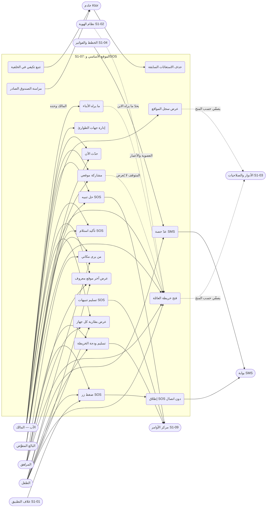

- ملاحظة: UC9 (التتبع التكيفي) فعل نظامي لا يطلقه المستخدم — 5 دقائق عند السكون، ودقيقة عند الحركة (REQ-004 · Q-101). وUC13 فعل نظامي على جهاز الطفل (العدّ من مرآة الحصة المحلية دون اتصال — REQ-017)؛ وUC14 يختلف عن UC6 (تأكيد الاستلام) — الحل فعل منفصل بمفتاح `location.sos.resolve` (Q-160). وUC19 مهمة مجدولة على الخادم (REQ-022).
- ملاحظة: الطفل والمراهق يريان مكانهما فقط افتراضاً؛ ومن يظهر لهما من إخوتهما ووالديهما يقرره المالك في «ما يراه الأبناء» (UC17 — REQ-021)، اتجاهاً واحداً، والمكان الحالي فقط بلا بطارية ولا سجل. والبالغ يستقبل الاستغاثة ويؤكدها ويحلّها ولا يرسلها من التطبيق (Q-416). ومدخل «أحتاج مساعدة» عند الطفل والمراهق يفضي إلى الوالدين أو إلى الاستغاثة وليس بديلاً عن زرها (Q-424).
- خريطة المتطلبات إلى الحالات: REQ-011 ← UC1؛ REQ-002 ← UC2؛ REQ-003 ← UC3؛ REQ-007 ← UC4؛ REQ-009 ← UC5؛ REQ-008 ← UC6؛ REQ-013 ← UC7؛ REQ-010 ← UC8؛ REQ-004/005 ← UC9؛ REQ-006 ← UC10؛ REQ-015 ← UC11؛ REQ-016 ← UC12؛ REQ-017 ← UC13؛ REQ-018 ← UC14؛ REQ-019 ← UC15؛ REQ-020 ← UC16؛ REQ-021 ← UC17/UC18؛ REQ-022 ← UC19؛ REQ-023 ← UC1 (العنوان بسلّمه في العرض).
- أُعيد رسمه 2026-11-19 (Q-434 — محتوى وشكل): أُضيفت UC15…UC19 (Q-409)؛ وحُذف سهما الأب والبالغ إلى UC4 — زر SOS على أجهزة الأبناء فقط (Q-416)؛ وصارت UC1 لكل الأفراد (REQ-019)؛ وقُصّرت كل التسميات إلى 5 كلمات فأقل ونُقلت أرقام REQ إلى خريطة المتطلبات أعلاه؛ ورُتّبت العقد بترتيب القراءة.

## 2. مخطط قاعدة البيانات (ERD)

الجداول الستة من §5/§5-6 كما هي، مع أربعة مراجع خارجية: العضوية (S1-02)، وتنبيهات S1-09 (`alert`، النوع `sos`)، و`AuditEvent` (النواة المشتركة، النطاق `location`). ملاحظتان: بلاطات الخرائط دون اتصال (MBTiles) ونقاط الصندوق الصادر مخزنان عميل لا جداول خادم (§5-5)، و`last_known_location` صف واحد لكل عضو (PK = `member_id`). كل جدول يحمل `family_id` + عزل RLS (D-021)، وسجل المواقع يُحذف تلقائياً بعد 7 أيام (REQ-014). و`last_known_location.expires_at` = آخر قراءة + 7 أيام — يُحذف تلقائياً (Q-166). و`emergency_contact.member_id` قابل للفراغ — NULL لرقم خارجي يضيفه الأب صراحةً (Q-287)؛ والخارجية تستلم SOS دون تتبع مستمر. والاستغاثة المغلقة تبقى 90 يوماً ثم تُحذف، وإحداثياتها تُمحى بعد 7 أيام من إغلاقها (REQ-022 — `coords_expire_at` و`expires_at` في `sos_alert`).

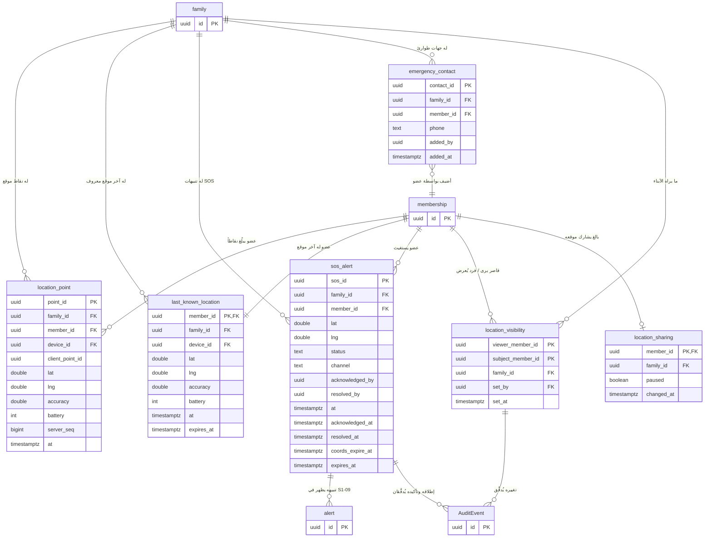

- أُعيد رسمه 2026-11-19 (Q-434 — محتوى وشكل): جدولا `location_visibility` و`location_sharing` (REQ-019/021) وحقلا `coords_expire_at` و`expires_at` في `sos_alert` (REQ-022)؛ وحُذفت علاقة «بالغ جهة طوارئ» — جهة الطوارئ رقم خارجي فقط (Q-408)؛ وأُضيفت علاقة تدقيق لتغيير الرؤية (REQ-021)؛ ورُتّبت الحقول في كل جدول: المفتاح الأساسي، ثم الأجنبية، ثم الحقول، ثم التواريخ في الآخر.

## 3. التسلسل (Sequence) — من عقود §4

ثلاثة عشر مخططاً، كل واحد لتدفق واحد (3-د قُسّم إلى 3-د1 و3-د2 لأن رسائله تجاوزت 20 — Q-434):
- **عقد MQTT (Q-168 — الإحالة الصريحة إلى `docs/family-os/governance/architecture/MQTT-BROKER-SPEC.md`):** الوسيط Eclipse Mosquitto 2.x — عقدة واحدة في المرحلة 1 — TLS 1.2+ على المنفذ 8883 + mTLS (شهادة خادم + شهادة جهاز)؛ وSOS (`family/{family_id}/sos/new` + الإقرار) QoS 1 + إقرار إلزامي؛ والموقع الحي (`family/{family_id}/location/updated`) QoS 0؛ وبلا QoS 2؛ والعزل ببادئة `family/{family_id}/` + ACL خادمي؛ والشهادات سنتان مع تجديد تلقائي وإبطال فوري. لا `command_id` في هذا النظام — الأوامر ملك S1-10 (§4-3).

### 3-أ. التتبع التكيفي — الإبلاغ عن نقطة موقع (REQ-004/005/006 — §4-1 + §4-3)

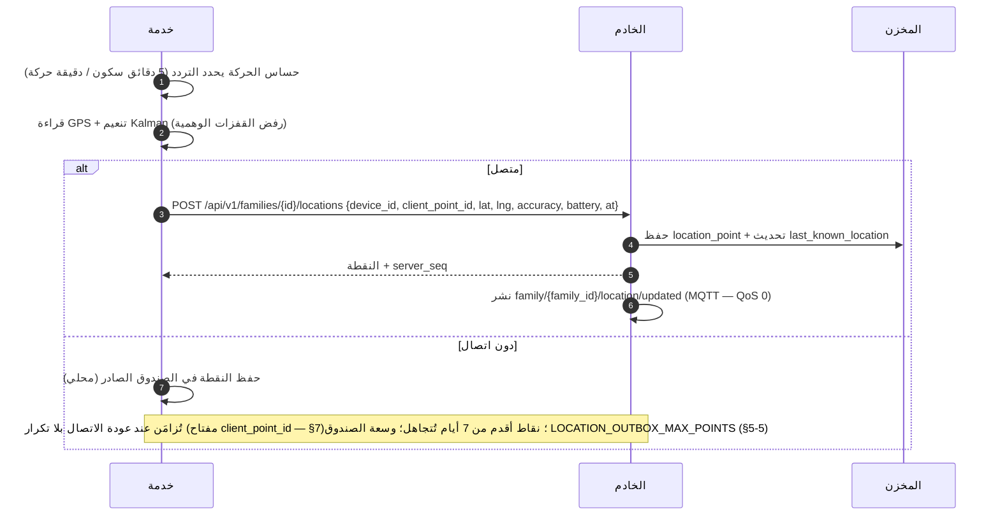

- بطارية منخفضة جداً تقلّل تردد التتبع تلقائياً إلى كل `LOW_BATTERY_CADENCE_MIN` دقيقة دون `LOW_BATTERY_THRESHOLD_PCT` (§7-8 — قيمتا مختبر Q-027)؛ ولا تنبيه بطارية منخفضة في المرحلة 1 — عرض فقط (§6-3). و«الحركة» كما عرّفها REQ-004 (عتبات سرعة/إزاحة/تثبيت — قيم مختبر Q-027)؛ ومعيار رفض Kalman كما في REQ-005.

### 3-ب. خريطة العائلة — قراءة آخر المواقع (REQ-001/002/003/011/012 — §4-1)

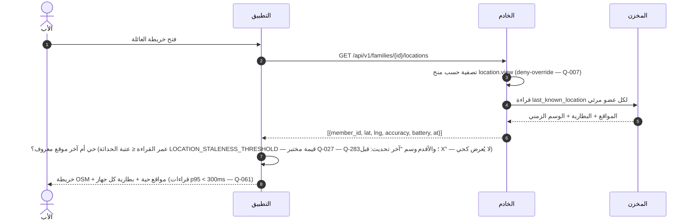

- الأب يرى الموقع الدقيق لكل قاصر — طفلاً كان أو مراهقاً (Q-102)؛ والبالغ المفوَّض يرى حسب منحِه فقط (REQ-012).
- الكبار على الخريطة (REQ-019): البالغ يظهر بمكانه الحالي ما لم يوقف «مشاركة موقعي» — والمتوقف يظهر «أوقف مشاركة موقعه» بلا موقع ولا موقع قديم؛ والابن يرى بالغاً فقط إن أظهره له المالك في «ما يراه الأبناء» (REQ-021)؛ ولا سجل تنقل للبالغ.
- عتبة الحداثة (Q-283): الحي = جديد ضمن `LOCATION_STALENESS_THRESHOLD` (قيمة مختبر Q-027، ≥ 5 دقائق — أبطأ تردد تتبع)؛ والأقدم «آخر موقع معروف منذ X» ولا يُقدَّم كحي أبداً (REQ-003).
- قناة المنصة (§4-3): `startLocationService()` تشغّل خدمة الموقع في الخلفية (التتبع التكيفي)؛ و`getLastKnownLocation() → {lat, lng, accuracy, battery, at}` تقرأ آخر موقع مخزن مع دقته وبطاريته؛ و`triggerSos()` مرسومة في 3-ج.
- حد قراءات p95 < 300ms مصدره **Q-061 في ARCHITECTURE.md** — نص S1-07 SPEC يذكر SOS <10s فقط (REQ-008)؛ والقيمة صحيحة per Q-061.

### 3-ج. SOS متصل — تنبيه في أقل من 10 ثوانٍ (REQ-007/008 — §4-1 + §4-2 + §4-3)

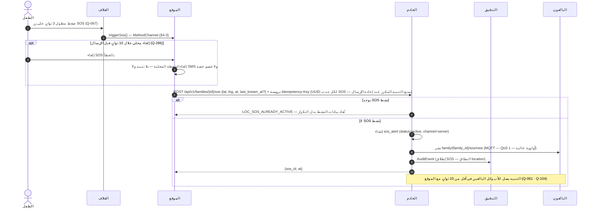

- SOS لا يُحجب بأي صلاحية (Q-067 · §6-2)؛ ومفتاح `location.sos.trigger` باقٍ لكل الأدوار في السجل (§6-1)، والواجهة تعرض الزر على أجهزة الأبناء فقط (Q-416).
- نافذة إلغاء SOS 10 ثوانٍ (Q-286): تلغي الضغطة المحلية فقط قبل الإرسال؛ وبعد الإرسال لا يلغي SOS إلا الأب عبر الحل (REQ-018).
- بلا إصلاح GPS جديد (Q-288): يُرسَل SOS فوراً بآخر موقع معروف موسوماً «آخر موقع منذ X» (`last_known_at` في الحمولة) مع استمرار محاولة الإصلاح — لا يُحجب SOS على GPS أبداً.

### 3-د1. SOS دون اتصال — الحصة متبقية (REQ-009/017 — §4-1 + §6-3)

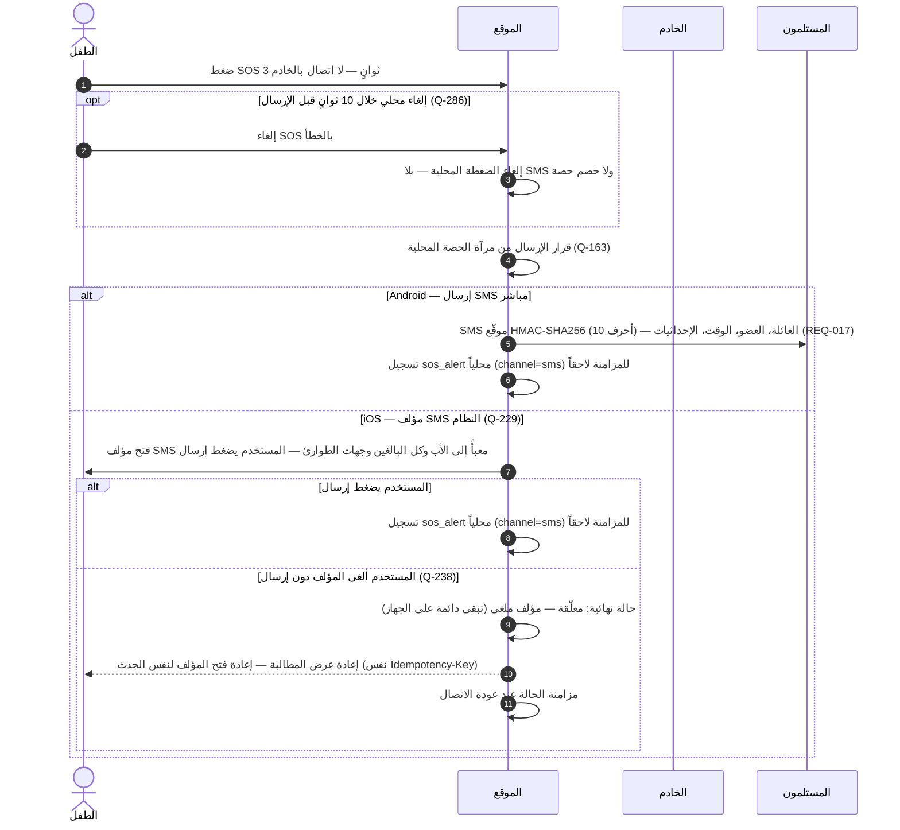

### 3-د2. SOS دون اتصال — الطوارئ الثلاث والنفاد (REQ-009/017 — §4-1 + §6-3)

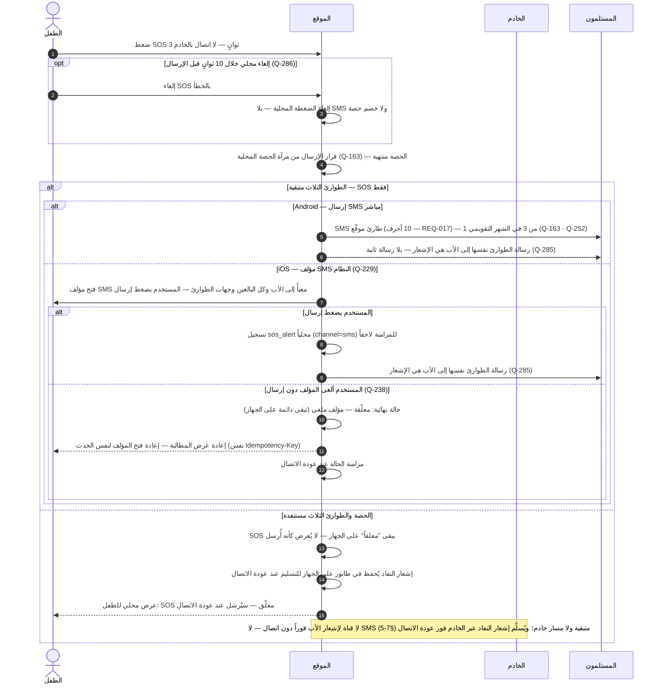

- أُعيد رسمه 2026-11-19 (Q-434 — شكل فقط): قُسّم 3-د (22 رسالة) إلى 3-د1 (11 رسالة) و3-د2 (15 رسالة)؛ والرسائل والعقد نفسها قبل التقسيم وبعده.

- كل SMS صادر يُحسب من حصة الخطة (Q-055)؛ الحصص: مجانية 20 رسالة/شهر، أساسية 50 رسالة/شهر (Q-261 — تصديق)، مميزة 100 رسالة/شهر، تعبئة 50 رسالة منفصلة عن حصة الأساسية (Q-129 · REQ-017)؛ والتعبئة وشراء الحزم عبر S1-04 (REQ-017 · Q-106)؛ وتجاوز الطوارئ الثلاث لا يُمنح إلا لـ SOS — لا OTP ولا غيره (§6-2)؛ وقرار الإرسال دون اتصال من مرآة الحصة المحلية، وكل SMS استغاثة موقّع HMAC-SHA256 (مقتطع إلى 10 أحرف) بمفتاح الجهاز فوق (العائلة، العضو، الوقت، الإحداثيات) ويتحقق تطبيق الأب من التوقيع قبل العرض (REQ-017 · Q-163).
- **المصالحة عند عودة الاتصال (§7):** SOS أُرسل عبر SMS يُصالح بإعادة `POST /api/v1/families/{id}/sos` بنفس `Idempotency-Key` — صف `sos_alert` واحد (`channel=sms`) وخصم حصة واحد؛ ولا تنبيه ثانٍ.
- **ملكية النقل دون اتصال (Q-234): S1-07 يملك النقل؛ الغلاف يسلّم `sos_triggered` إلى S1-07 فوراً**؛ والصندوق الصادر (Outbox) مخزن تأجيل لا نقل بديل — S1-07 وحده يقرر الوسيلة (SMS مباشر عند توفر الحصة، أو تسجيل الحدث في Outbox بأولوية قصوى للمزامنة عند عودة الاتصال) — لا نقلان بديلان بلا مالك.
- **إلغاء المؤلف على iOS (Q-238):** مسار المؤلف (فتح المؤلف + فرع الإلغاء بحالته النهائية المسماة «معلّقة — مؤلف ملغى») ينطبق على فرع الحصة المتبقية وعلى فرع الطوارئ الثلاث معاً — SMS الطارئ على iOS يمر بالمؤلف نفسه؛ وإعادة المحاولة تعيد فتح المؤلف لنفس حدث SOS (نفس `Idempotency-Key`) فلا SOS ثانٍ مكرر ولا لافتة «فشل SOS».
- **حد الإشعار دون اتصال (صريح):** عند استنفاد الحصة + الطوارئ الثلاث لا توجد أي قناة لإشعار الأب "فوراً" — فإشعار النفاد يُحفَظ في طابور على الجهاز ويُسلَّم عند عودة الاتصال، ويُعرض محلياً للطفل فقط. (الحد نفسه خطر مقبول موثَّق بحكم المالك — Q-163.)
- **مستلمو SMS دون اتصال (Q-138):** نفس مجموعة المستلمين — الأب + كل البالغين + جهات الطوارئ.
- **إشعار الأب وعدّاد الطوارئ (Q-285):** الأب يُخطر فوراً بكل رسالة طارئة تُرسل — متصلاً دفع فوري من الخادم (لا يستهلك من الثلاث)؛ ودون اتصال رسالة الطوارئ نفسها إلى الأب هي الإشعار (بلا رسالة ثانية)؛ وعدّاد ظاهر في التطبيق (LO-03/LO-06) يعرض المتبقي من الثلاث من مرآة الحصة المحلية (`sms_emergency_remaining` — §5-5).
- **نافذة الإلغاء (Q-286):** كما في 3-ج — تلغي الضغطة المحلية فقط قبل الإرسال؛ وبعد إرسال SMS لا يلغي SOS إلا الأب عبر الحل (REQ-018).
- **بلا إصلاح GPS جديد (Q-288):** كما في 3-ج — يُرسَل SOS فوراً بآخر موقع معروف موسوماً بعمره (في SMS نفسه دون اتصال) مع استمرار محاولة الإصلاح — لا يُحجب على GPS.

### 3-هـ. تأكيد استلام SOS وحلّه (REQ-008/REQ-018 — §4-1 + §4-2)

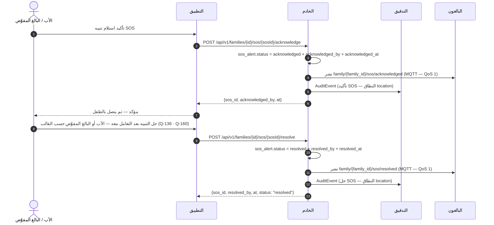

- SOS بالخطأ (ضغط عرضي): الأب يؤكد أو يلغي عبر نقطة الحل `POST /api/v1/families/{id}/sos/{sosId}/resolve` (الأب + البالغ المفوَّض حسب القالب — Q-136)؛ والحالة تصبح `resolved` ويتوقف التصعيد؛ والإلغاء يُسجَّل في التدقيق (§7-10).

### 3-و. إدارة جهات الطوارئ — أرقام خارجية (REQ-010 — §4-1 — Q-408)

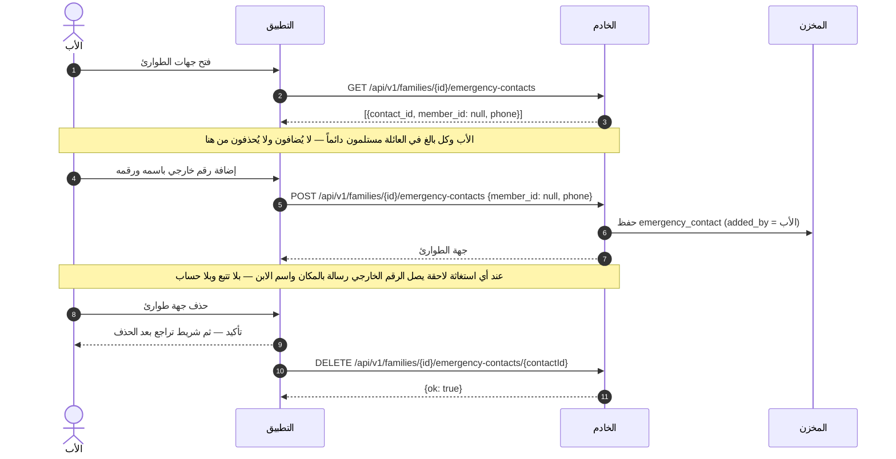

- أُعيد رسمه 2026-11-19 (Q-434 — محتوى): جهة الطوارئ رقم خارجي فقط (`member_id` فارغ — Q-287)؛ والبالغون في العائلة مستلمون دائماً بحكم عضويتهم (Q-408)؛ والحذف تأكيد ثم شريط تراجع.

- إدارة جهات الطوارئ للأب فقط (`location.emergency.manage` — §6-1). الجهة رقم خارجي يضيفه الأب صراحةً (`member_id` فارغ — Q-287)، والبالغون في العائلة مستلمون دائماً بحكم عضويتهم (Q-408).

### 3-ز. سجل المواقع — 7 أيام (REQ-013/014 — §4-1)

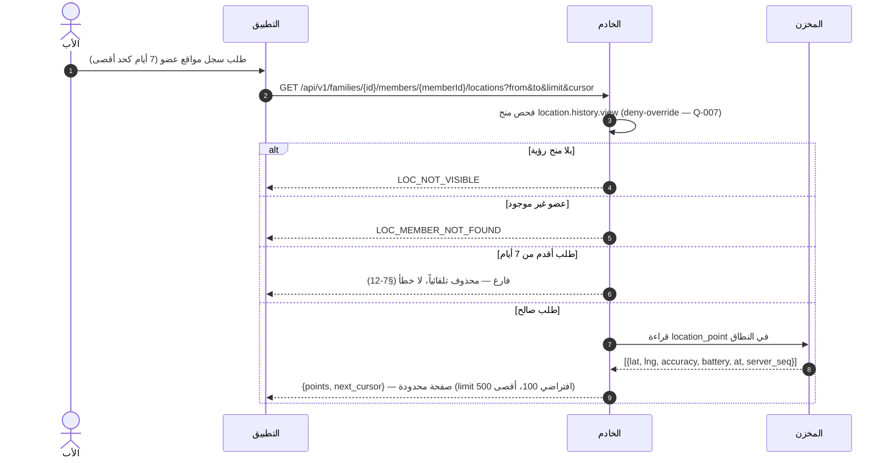

- سجل التنقل للقاصر فقط (REQ-013/014): لا سجل للبالغ — مكانه الحالي فقط (REQ-019).

### 3-ح. سلم تصعيد SOS — مهلة إقرار 5 دقائق + 5 دفعات إعادة كحد أقصى بتراجع (5/10/20/30/30 دقيقة) ثم الحالة النهائية (REQ-018 — §6-3 — Q-284)

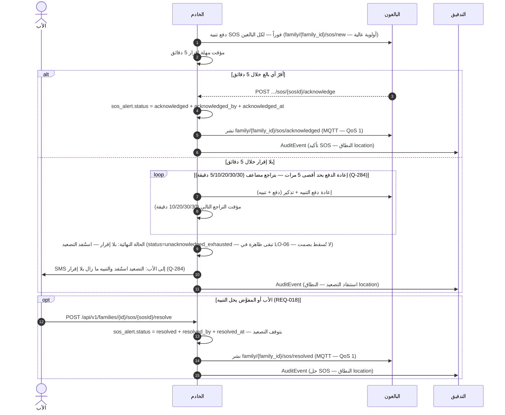

- **الحالة النهائية (Q-284):** بعد 5 دفعات إعادة بلا إقرار يدخل التنبيه `unacknowledged_exhausted` «بلا إقرار — استُنفد التصعيد»؛ وتبقى ظاهرة في LO-06 ولا تُسقط بصمت؛ ويُرسل SMS إلى الأب؛ والحل (REQ-018) ما زال ممكناً منها.

- أُعيد رسمه 2026-11-19 (Q-434 — شكل فقط): رُتّب المشاركون بالترتيب الموحد (المستخدم، ثم التطبيق، ثم الخادم، ثم قاعدة البيانات، ثم الخارجية)؛ والرسائل نفسها قبل الترتيب وبعده.

### 3-ط. «حدّث الآن» — قراءة فورية بنتيجة صادقة (REQ-020 — §4-1 + §4-2 — Q-409)

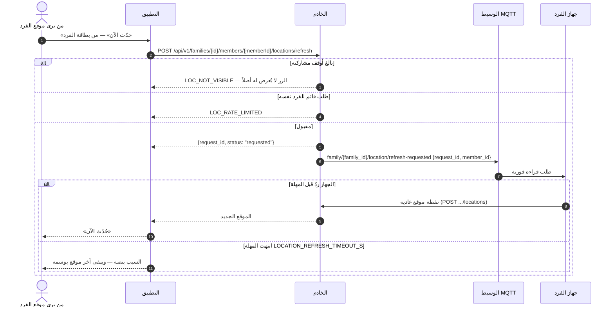

- مفتاح `location.view`. طلب واحد قائم لكل فرد. والسبب عند انتهاء المهلة: جهازه بلا اتصال، أو مغلق، أو لم يتصل بعد، أو iPhone قد لا يرد حتى يُفتح التطبيق. ويُرفض الطلب والمشاهد دون اتصال. والفعل نفسه معروض في مركز التحكم بنوع «فعل» (S1-09 REQ-008 — Q-425).

### 3-ي. «مشاركة موقعي» للبالغ (REQ-019 — §4-1 — Q-409)

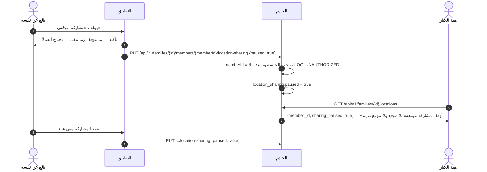

- لا سجل تنقل للبالغ: المكان الحالي فقط. القاصر لا يملك هذا المفتاح، والأب يراه دائماً (REQ-011).

### 3-ك. «ما يراه الأبناء» — قرار المالك وحده (REQ-021 — §4-1 — Q-409)

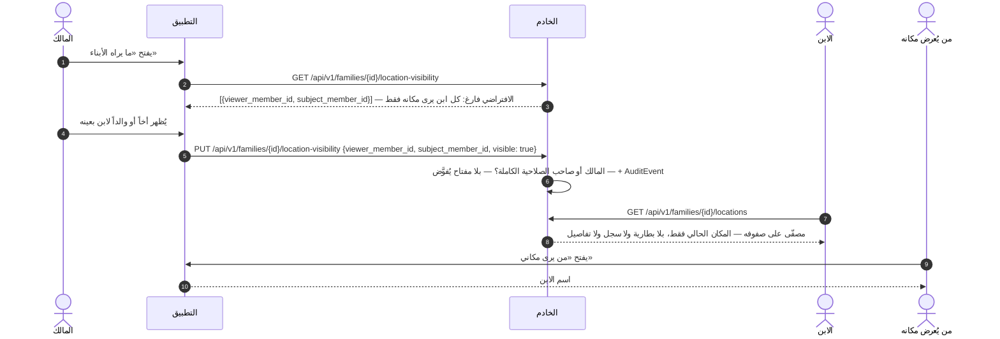

- الإظهار اتجاه واحد لا متبادل. وإظهار بالغ لابن لا يعمل والبالغ موقف مشاركته (REQ-019). التغيير يحتاج اتصالاً.

### 3-ل. حفظ الاستغاثات السابقة (REQ-022 — §5-6 — Q-409)

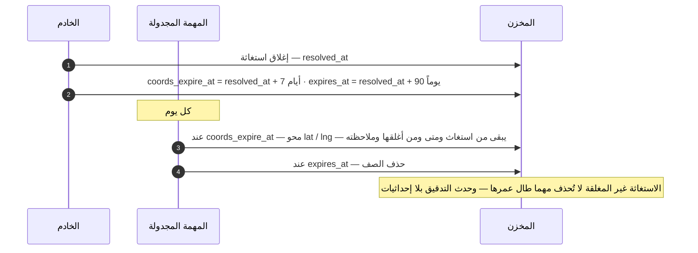

- الشاشة تذكر المدتين بنص صريح (90 يوماً للقائمة و7 أيام للمكان).

- رُسم 2026-11-19 (Q-434 — محتوى): التسلسلات 3-ط و3-ي و3-ك و3-ل جديدة من REQ-020/019/021/022 (Q-409)؛ وترتيب المشاركين فيها بالترتيب الموحد للمشروع.

## 4. تدفق المستخدم (User Flow) — من السيناريوهات الستة (§2) والتصميم المعتمد (§9-8 · §9-9)

ثلاث لوحات: 4-أ الخريطة للبالغ، 4-ب الخريطة للابن وSOS، 4-ج التحكم.

### 4-أ. الخريطة — بالغ

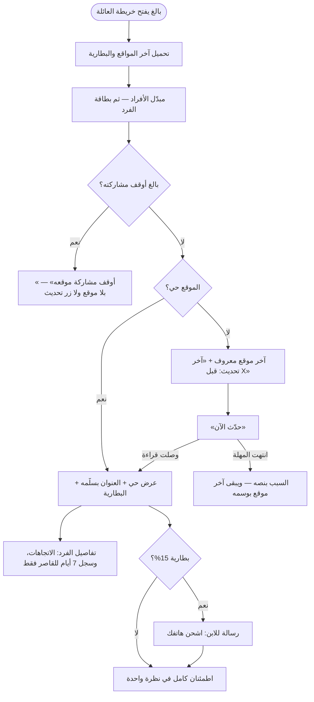

### 4-ب. الخريطة — ابن، وSOS

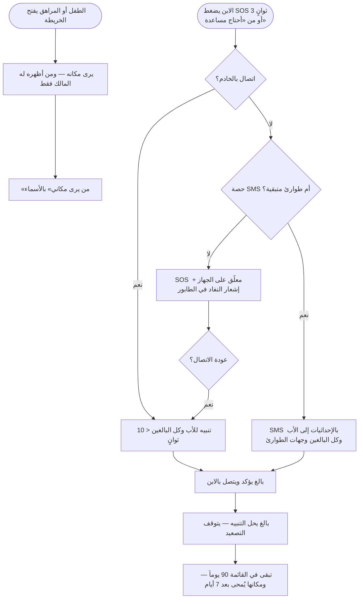

### 4-ج. التحكم — المالك والبالغ

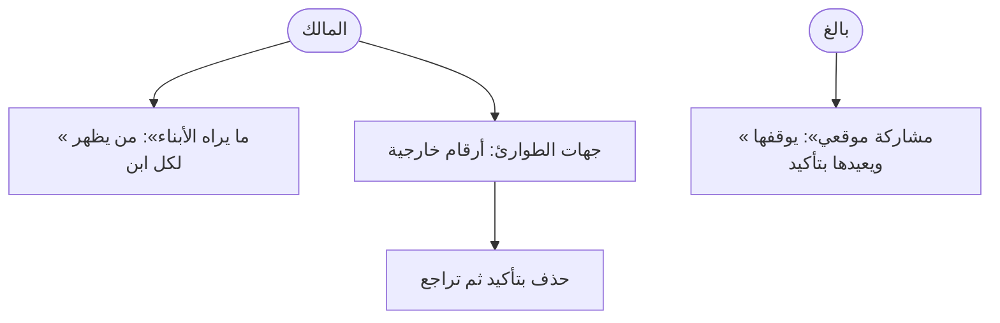

- ملاحظة: بطارية 15% هي عتبة البطارية المنخفضة المحكومة (`LOW_BATTERY_THRESHOLD_PCT` = 15% — Q-027)؛ ولا تنبيه بطارية منخفضة في المرحلة 1 (§6-3). [تصحيح 2026-11-08 (D-2): كانت «لا عتبة تنبيه محددة في المواصفة» قبل Q-027.]
- بلا إصلاح GPS جديد (Q-288): يُرسَل SOS فوراً بآخر موقع معروف موسوماً «آخر موقع منذ X» — لا يُحجب على GPS.
- لا زر استغاثة في وضع الأهل (Q-416): البالغ يستقبل ويؤكد ويحلّ. والمكان يُعرض عنواناً من الخريطة بسلّمه (REQ-023): لا إحداثيات خام في الواجهة، ولا أماكن مسمّاة ولا سور جغرافي في المرحلة 1 (Q-056).
- «الموقع حي؟» تعني عمر القراءة ضمن عتبة الحداثة (Q-283 — 15 دقيقة)؛ والأقدم «آخر موقع معروف منذ X» ولا يُقدَّم كحي أبداً (REQ-003).
- أُعيد رسمه 2026-11-19 (Q-434 — محتوى وشكل): قُسّم مخطط واحد (22 عقدة) إلى ثلاث لوحات (14 + 13 + 6 عقدة)؛ والجديد: مبدّل الأفراد وبطاقة الفرد، وفرع المشاركة المتوقفة، و«حدّث الآن» بنتيجته وسببه، والعنوان بسلّمه بلا إحداثيات، و«من يرى مكاني»، وحفظ الاستغاثة 90 يوماً ومحو مكانها بعد 7 أيام، ولوحة التحكم (ما يراه الأبناء وجهات الطوارئ ومشاركة موقعي)؛ والمسار السعيد في كل لوحة عمود واحد مستقيم.

## 5. مخطط تدفق البيانات (DFD — المستوى 1) — من §4/§5

ثلاث لوحات: 5-أ التتبع والخريطة والسجل، 5-ب SOS والتصعيد وجهات الطوارئ، 5-ج الرؤية والمشاركة والاستبقاء.

العمليات مرقمة 1.0–9.0، والمخازن D1–D6 جداول خادم (PostgreSQL) + ثلاثة مخازن عميل (C1–C3) على الجهاز. **كل عملية موسومة: جهاز / خادم** — وكل أحداث MQTT ينشرها الخادم (Ktor) نيابة عن العمليات (مطابقةً للتسلسلات §3 وQ-168 — لا نشر مباشر من عمليات الجهاز)؛ وتنبيهات SOS وودجة الخريطة المصغرة تُسلَّمان إلى S1-09 (REQ-015/016).

- **تغطية نقاط §4:** كل نقاط §4-1 مرسومة في §3 (locations قراءة/إبلاغ/سجل/تحديث فوري، sos إطلاق/تأكيد/حلّ، emergency-contacts قراءة/إضافة/حذف، location-sharing، location-visibility)؛ والتسلسلات تغطي التدفقات الأساسية فقط.

### 5-أ. التتبع والخريطة والسجل

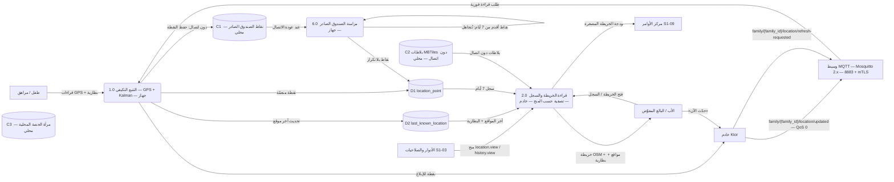

### 5-ب. SOS والتصعيد وجهات الطوارئ

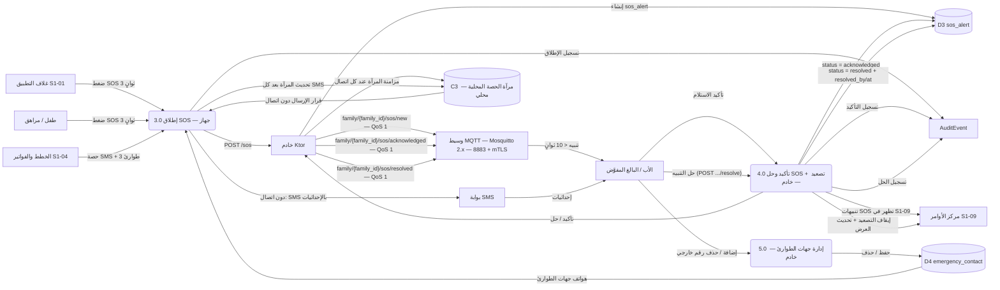

### 5-ج. الرؤية والمشاركة والاستبقاء

```mermaid
flowchart LR
    Father[المالك]
    Adult2[بالغ]
    Ktor[خادم Ktor]
    Audit[AuditEvent]
    P7(7.0 «ما يراه الأبناء» — خادم)
    P8(8.0 «مشاركة موقعي» — خادم)
    P9(9.0 مهمة استبقاء الاستغاثات — خادم)
    D3[(D3 sos_alert)]
    D5[(D5 location_visibility)]
    D6[(D6 location_sharing)]

    Father -->|قرار الرؤية لكل ابن| P7
    P7 -->|حفظ قواعد الرؤية| D5
    P7 -->|تسجيل التغيير| Audit
    Ktor -->|قراءة قواعد الرؤية| D5
    Adult2 -->|إيقاف / استئناف المشاركة| P8
    P8 -->|حفظ الحالة| D6
    Ktor -->|قراءة حالة المشاركة| D6
    Ktor -->|كل يوم: استغاثات مغلقة| P9
    P9 -->|محو الإحداثيات بعد 7 أيام| D3
    P9 -->|حذف الصف بعد 90 يوماً| D3
```

- **SOS دون اتصال (Q-163):** مرآة الحصة المحلية تحسم SMS قبل الإرسال — ولا فحص خادمي دون اتصال؛ وSMS موقّع بمفتاح الجهاز (HMAC-SHA256) فوق (العائلة، العضو، الوقت، الإحداثيات) — وتطبيق الأب يتحقق من التوقيع قبل عرض التنبيه (REQ-017).
- مرآة الحصة المحلية (C3): الرصيد + الطوارئ الثلاث + نهاية الشهر التقويمي (Q-252).
- أُعيد رسمه 2026-11-19 (Q-434 — محتوى وشكل): قُسّم مخطط واحد (25 عقدة / 43 سهماً) إلى ثلاث لوحات (5-أ: 14 عقدة / 19 سهماً؛ 5-ب: 15 عقدة / 27 سهماً؛ 5-ج: 10 عقد / 10 أسهم)؛ والجديد: «حدّث الآن» في 5-أ (REQ-020)، والعمليات 7.0–9.0 والمخزنان D5 وD6 في 5-ج (REQ-019/021/022)؛ وجهات الطوارئ في 5-ب أرقام خارجية فقط (Q-408)؛ والجهات الخارجية صارت مستطيلات حسب «الأشكال الموحدة» في الترويسة (كانت أقواساً)؛ وبلا subgraph — الاستثناء المثبت في S1-01 (Q-434): الـsubgraph يباعد العقد ويطيل الأسهم فيفسد القراءة.

## 6. مخطط النشاط (Activity) — دورة حياة الموقع وSOS

لوحتان TD: 6-أ التتبع والخريطة و«حدّث الآن»، 6-ب SOS والتصعيد والاستبقاء. والمسارات الأربعة (جهاز الطفل / وحدة Kotlin / الخادم / الأب والبالغون) كمسارات متوازية. والتتبع التكيفي يعمل **بالتوازي** مع استخدام التطبيق، وSOS له مساران (متصل / SMS) يلتقيان عند التأكيد.

### 6-أ. التتبع والخريطة و«حدّث الآن»

```mermaid
flowchart TD
    subgraph Device [جهاز الطفل]
        direction TB
        U1([فتح التطبيق])
        U4([إغلاق / فقدان الاتصال])
    end
    subgraph Kotlin [وحدة Kotlin — خدمة الموقع]
        direction TB
        K1[قراءة GPS كل 5 دقائق سكون / دقيقة حركة]
        K2[تنعيم Kalman — رفض القفزات الوهمية]
        K3{اتصال؟}
        K4[إرسال النقطة إلى الخادم]
        K5[حفظ النقطة في الصندوق الصادر]
        K6[مزامنة الصندوق عند عودة الاتصال]
        K8[طلب «حدّث الآن» — قراءة فورية]
    end
    subgraph Server [الخادم — Ktor]
        direction TB
        V1[حفظ location_point + تحديث last_known_location]
        V2["نشر family/{family_id}/location/updated"]
        V4[حذف سجل أقدم من 7 أيام تلقائياً]
        V7[طلب «حدّث الآن» — دفع عبر الوسيط]
    end
    subgraph Parent [الأب / البالغون]
        direction TB
        F1[فتح خريطة العائلة]
        F2{"الموقع حي؟ (عمر ≤ عتبة الحداثة — Q-283)"}
        F3[عرض حي + بطارية]
        F4[عرض آخر موقع معروف بوسم صادق]
        F7[إدارة جهات الطوارئ]
        F8[«حدّث الآن»]
    end

    U1 --> K1
    K1 --> K2
    K2 --> K3
    K3 -->|نعم| K4
    K3 -->|لا| K5
    K4 --> V1
    V1 --> V2
    K5 --> K6
    K6 --> K4
    V1 --> V4
    U4 --> K5
    F8 --> V7
    V7 --> K8
    K8 --> K4
    F1 --> F2
    F2 -->|نعم| F3
    F2 -->|لا| F4
    F1 --> F7
```

### 6-ب. SOS والتصعيد والاستبقاء

```mermaid
flowchart TD
    subgraph Device [جهاز الطفل]
        direction TB
        U2[ضغط SOS 3 ثوانٍ]
    end
    subgraph Kotlin [وحدة Kotlin — خدمة الموقع]
        direction TB
        K7[إطلاق SOS: triggerSos]
    end
    subgraph Server [الخادم — Ktor]
        direction TB
        V3[إنشاء sos_alert + نشر sos/new]
        V5[تأكيد SOS + نشر sos/acknowledged]
        V6[حل SOS + نشر sos/resolved]
        V8[مهمة الاستبقاء — يومياً]
        V9[محو إحداثيات المغلقة بعد 7 أيام]
        V10[حذف المغلقة بعد 90 يوماً]
    end
    subgraph Parent [الأب / البالغون]
        direction TB
        F5[استلام تنبيه SOS < 10 ثوانٍ]
        F6[تأكيد الاستلام والاتصال بالطفل]
    end

    U2 --> K7
    K7 --> V3
    V3 --> F5
    V3 -->|إعادة الدفع ×5| V3
    F5 --> F6
    F6 --> V5
    V5 --> V6
    V8 --> V9
    V8 --> V10
```

- SOS دون اتصال لا يظهر في هذا المخطط كمسار خادم: الجهاز يرسل SMS بالإحداثيات مباشرة إلى هواتف الأب وكل البالغين وجهات الطوارئ (Q-138) (Q-103) ثم يُزامَن التنبيه عند عودة الاتصال — انظر التسلسلين 3-د1 و3-د2.
- وعند استنفاد الحصة + الطوارئ الثلاث يُحفظ إشعار النفاد في الطابور ويُعرض محلياً للطفل فقط — لا إشعار فوري للأب دون اتصال (انظر 3-د2)؛ ومستلمو SMS دون اتصال هم نفس المجموعة — الأب + كل البالغين + جهات الطوارئ (Q-138).
- التصعيد (Q-284): إعادة الدفع بحد أقصى 5 مرات بتراجع 5/10/20/30/30 دقيقة؛ ثم الحالة النهائية «بلا إقرار — استُنفد التصعيد» الظاهرة في LO-06 مع SMS إلى الأب — بلا إسقاط صامت؛ وحلّ التنبيه يوقف التصعيد.
- عند إعادة الفتح بعد الإغلاق القسري، يعود المستخدم لنفس الشاشة والمدخلات (نمط S1-01 §7)؛ ونقاط الصندوق الصادر أقدم من 7 أيام تُتجاهل عند المزامنة (§7-13).
- أُعيد رسمه 2026-11-19 (Q-434 — محتوى وشكل): من LR إلى TD وقُسّم مخطط واحد (28 عقدة / 23 سهماً) إلى لوحتين (6-أ: 23 عقدة / 18 سهماً؛ 6-ب: 14 عقدة / 9 أسهم)؛ والجديد: «حدّث الآن» (6-أ — REQ-020) ومهمة الاستبقاء (6-ب — REQ-022: محو الإحداثيات بعد 7 أيام وحذف الصف بعد 90 يوماً)؛ وحُذفت عقدة «فعل دون اتصال» المكررة مع حفظ الصندوق (K5)؛ والمسارات بقيت lanes في subgraph (بنية النشاط نفسها).
