# S1-07: مخططات هندسة البرمجيات (DIAGRAMS)

- **الحالة:** مسودة للمراجعة على GitHub — المواصفة معتمدة بالكامل في التخطيط (حكم المالك 2026-11-06)؛ والمخططات الستة مسودة بانتظار مراجعة المالك على GitHub (لم تُعتمد بعد)
- **المواصفة:** `SPEC.md` (§§1–8 + §10 معتمدة بالكامل في التخطيط، حكم المالك 2026-11-06) · §9 في مرحلة التصميم
- **السياق المحدد (Bounded Context):** #4 الموقع والسلامة (Location & Safety) — `CONTEXT-MAP.md` §2 صف 4
- **القرارات الحاكمة:** Q-001 · Q-003 · Q-007 · Q-020 · Q-056 · Q-061 · Q-064 · Q-067 · Q-101 · Q-102 · Q-103 · Q-104 · Q-105 · Q-106 · D-021 · D-023 · D-038 · G-006 · G-011
- **الأنواع الستة:** 1. حالات الاستخدام · 2. ERD · 3. التسلسل · 4. تدفق المستخدم · 5. DFD · 6. النشاط
- **الأشكال الموحدة:** مستطيل = جهة خارجية · مستطيل مستدير = عملية · معين = قرار · أسطوانة = مخزن بيانات · خط متقطع = يتضمن / اختياري

## 1. حالات الاستخدام

12 حالة استخدام من السيناريوهات الستة والمتطلبات (§2/§3): الأب يرى كل المواقع الدقيقة (طفلاً ومراهقاً)، البالغ المفوَّض يرى حسب منحِه فقط، كل الأدوار تضغط SOS (لا يُحجب أبداً)، والطفل يعمل دون اتصال. وزر SOS يأتي من الغلاف (S1-01)، والرؤية تُصفّى بمنح S1-03، وتنبيهات SOS وودجة الخريطة المصغرة تُسلَّمان إلى S1-09.

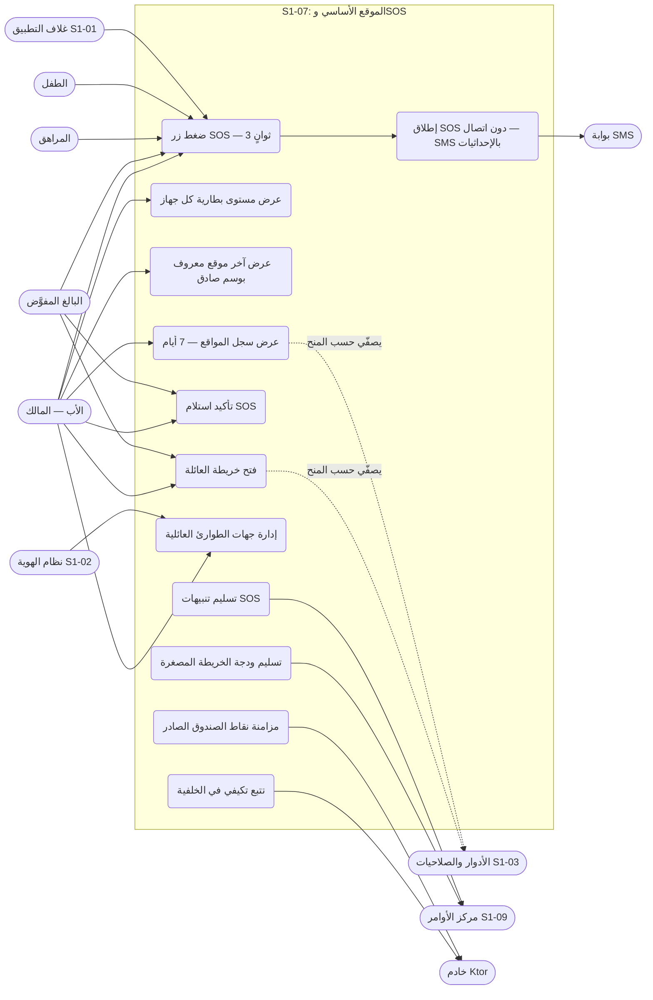

- ملاحظة: UC9 (التتبع التكيفي) فعل نظامي لا يطلقه المستخدم — 5 دقائق عند السكون، ودقيقة عند الحركة (REQ-004 · Q-101).

## 2. مخطط قاعدة البيانات (ERD)

الجداول الأربعة من §5 كما هي، مع ثلاثة مراجع خارجية: العضوية (S1-02)، وتنبيهات S1-09 (`alert`، النوع `sos`)، و`AuditEvent` (النواة المشتركة، النطاق `location`). ملاحظتان: بلاطات الخرائط دون اتصال (MBTiles) ونقاط الصندوق الصادر مخزنان عميل لا جداول خادم (§5-5)، و`last_known_location` صف واحد لكل عضو (PK = `member_id`). كل جدول يحمل `family_id` + عزل RLS (D-021)، وسجل المواقع يُحذف تلقائياً بعد 7 أيام (REQ-014). و`last_known_location.expires_at` = آخر قراءة + 7 أيام — يُحذف تلقائياً (Q-166).

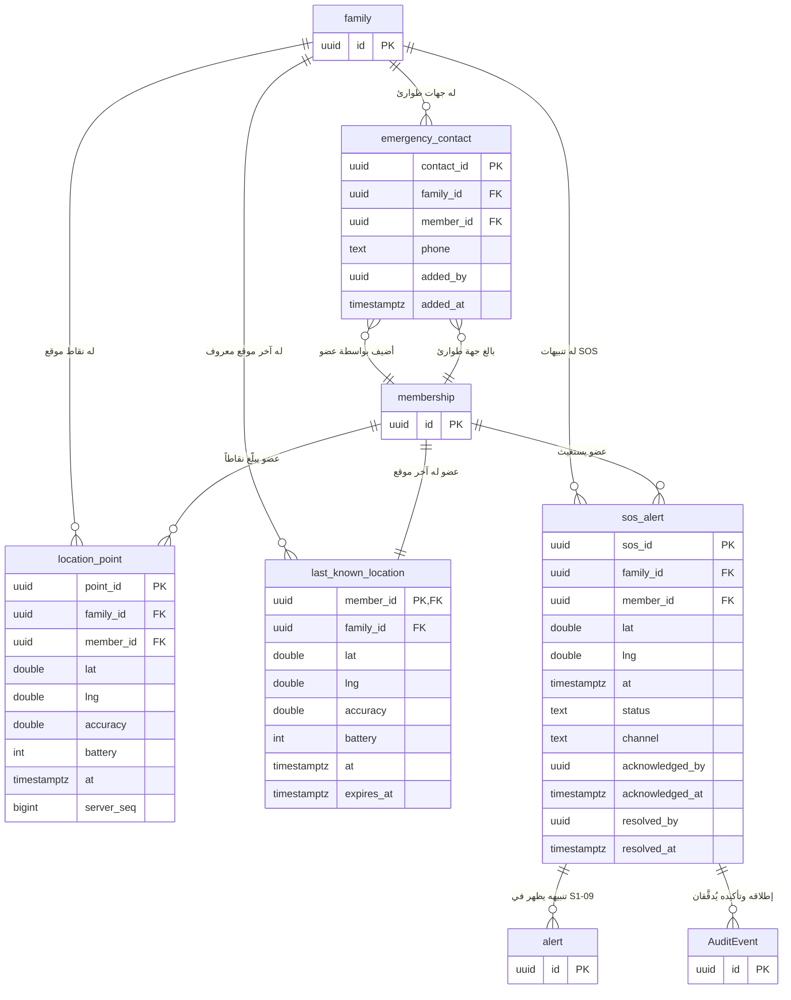

## 3. التسلسل (Sequence) — من عقود §4

ثمانية مخططات، كل واحد لتدفق واحد:
- **عقد MQTT (Q-168 — الإحالة الصريحة إلى `docs/family-os/governance/architecture/MQTT-BROKER-SPEC.md`):** الوسيط Eclipse Mosquitto 2.x — عقدة واحدة في المرحلة 1 — TLS 1.2+ على المنفذ 8883 + mTLS (شهادة خادم + شهادة جهاز)؛ وSOS (`family/{family_id}/sos/new` + الإقرار) QoS 1 + إقرار إلزامي؛ والموقع الحي (`family/{family_id}/location/updated`) QoS 0؛ وبلا QoS 2؛ والعزل ببادئة `family/{family_id}/` + ACL خادمي؛ والشهادات سنتان مع تجديد تلقائي وإبطال فوري. لا `command_id` في هذا النظام — الأوامر ملك S1-10 (§4-3).

### 3-أ. التتبع التكيفي — الإبلاغ عن نقطة موقع (REQ-004/005/006 — §4-1 + §4-3)

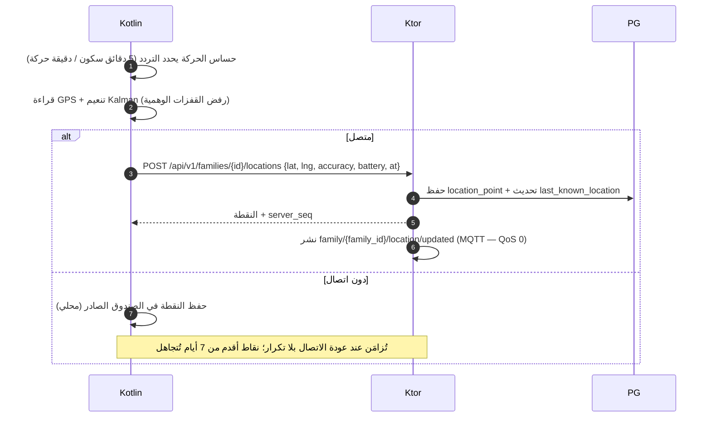

- بطارية منخفضة جداً تقلّل تردد التتبع تلقائياً لحفظ ما تبقى للطوارئ (§7-8)؛ ولا تنبيه بطارية منخفضة في المرحلة 1 — عرض فقط (§6-3).

### 3-ب. خريطة العائلة — قراءة آخر المواقع (REQ-001/002/003/011/012 — §4-1)

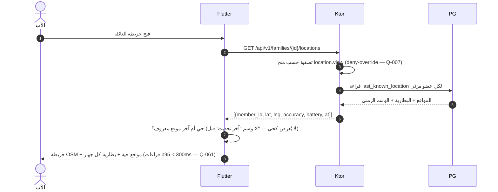

- الأب يرى الموقع الدقيق لكل قاصر — طفلاً كان أو مراهقاً (Q-102)؛ والبالغ المفوَّض يرى حسب منحِه فقط (REQ-012).
- قناة المنصة (§4-3): `startLocationService()` تشغّل خدمة الموقع في الخلفية (التتبع التكيفي)؛ و`getLastKnownLocation() → {lat, lng, at}` تقرأ آخر موقع مخزن؛ و`triggerSos()` مرسومة في 3-ج (سطر 208).
- حد قراءات p95 < 300ms مصدره **Q-061 في ARCHITECTURE.md** — نص S1-07 SPEC يذكر SOS <10s فقط (REQ-008)؛ والقيمة صحيحة per Q-061.

### 3-ج. SOS متصل — تنبيه في أقل من 10 ثوانٍ (REQ-007/008 — §4-1 + §4-2 + §4-3)

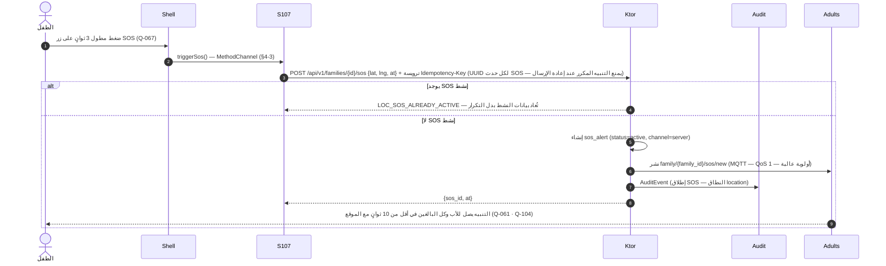

- SOS متاح لكل الأدوار دائماً ولا يُحجب بأي صلاحية (Q-067 · §6-2)؛ ومفتاح `location.sos.trigger` لكل الأدوار — حتى الطفل (§6-1).

### 3-د. SOS دون اتصال — SMS بالإحداثيات (REQ-009/017 — §4-1 + §6-3)

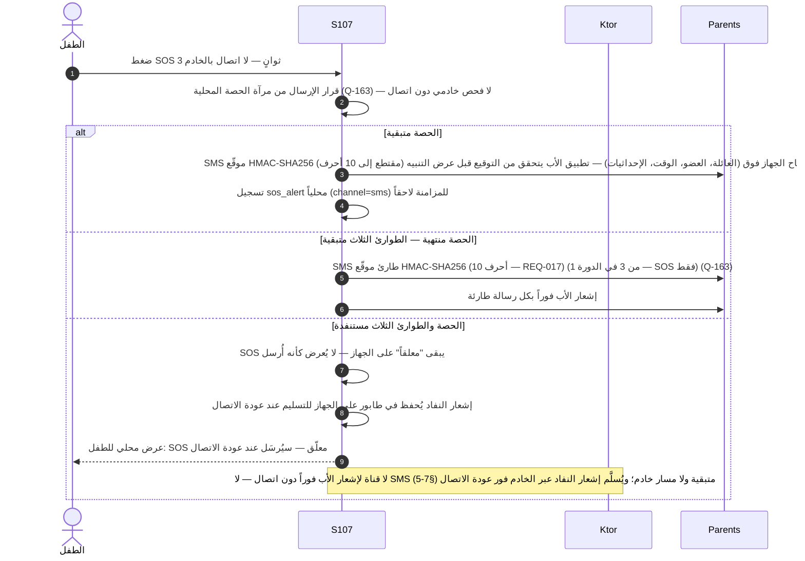

- كل SMS صادر يُحسب من حصة الخطة (Q-055)؛ الحصص: مجانية 20 رسالة/شهر، مميزة 100 رسالة/شهر، تعبئة 50 رسالة (Q-129 · REQ-017)؛ والتعبئة وشراء الحزم عبر S1-04 (REQ-017 · Q-106)؛ وتجاوز الطوارئ الثلاث لا يُمنح إلا لـ SOS — لا OTP ولا غيره (§6-2)؛ وقرار الإرسال دون اتصال من مرآة الحصة المحلية، وكل SMS استغاثة موقّع HMAC-SHA256 (مقتطع إلى 10 أحرف) بمفتاح الجهاز فوق (العائلة، العضو، الوقت، الإحداثيات) ويتحقق تطبيق الأب من التوقيع قبل العرض (REQ-017 · Q-163).
- **حد الإشعار دون اتصال (صريح):** عند استنفاد الحصة + الطوارئ الثلاث لا توجد أي قناة لإشعار الأب "فوراً" — فإشعار النفاد يُحفَظ في طابور على الجهاز ويُسلَّم عند عودة الاتصال، ويُعرض محلياً للطفل فقط. (الحد نفسه خطر مقبول موثَّق بحكم المالك — Q-163.)
- **مستلمو SMS دون اتصال (Q-138):** نفس مجموعة المستلمين — الأب + كل البالغين + جهات الطوارئ.

### 3-هـ. تأكيد استلام SOS (REQ-008 — §4-1 + §4-2)

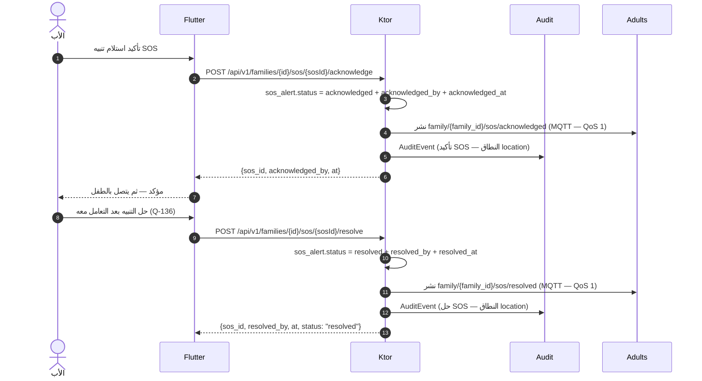

- SOS بالخطأ (ضغط عرضي): الأب يؤكد أو يلغي عبر نقطة الحل `POST /api/v1/families/{id}/sos/{sosId}/resolve` (الأب + البالغ المفوَّض حسب القالب — Q-136)؛ والحالة تصبح `resolved` ويتوقف التصعيد؛ والإلغاء يُسجَّل في التدقيق (§7-10).

### 3-و. إدارة جهات الطوارئ العائلية (REQ-010 — §4-1)

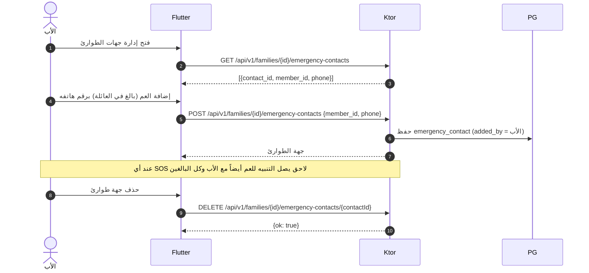

- إدارة جهات الطوارئ للأب فقط (`location.emergency.manage` — §6-1)؛ وجهة محذوفة أو مبدّلة الرقم لا يصلها SOS لاحق (§7-11).

### 3-ز. سجل المواقع — 7 أيام (REQ-013/014 — §4-1)

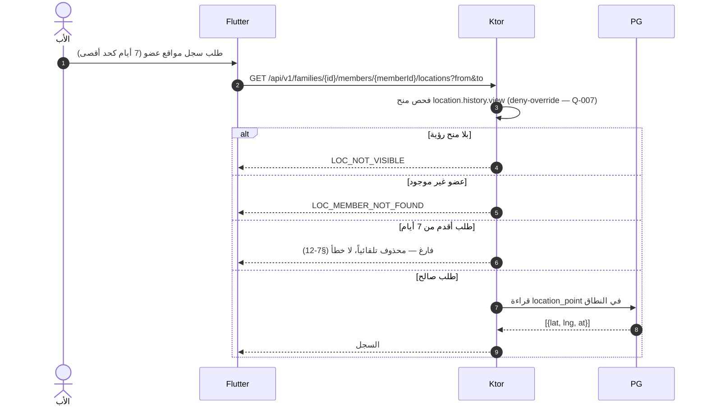

### 3-ح. سلم تصعيد SOS — مهلة إقرار 5 دقائق وإعادة دفع حتى الإقرار أو الحل (REQ-018 — §6-3)

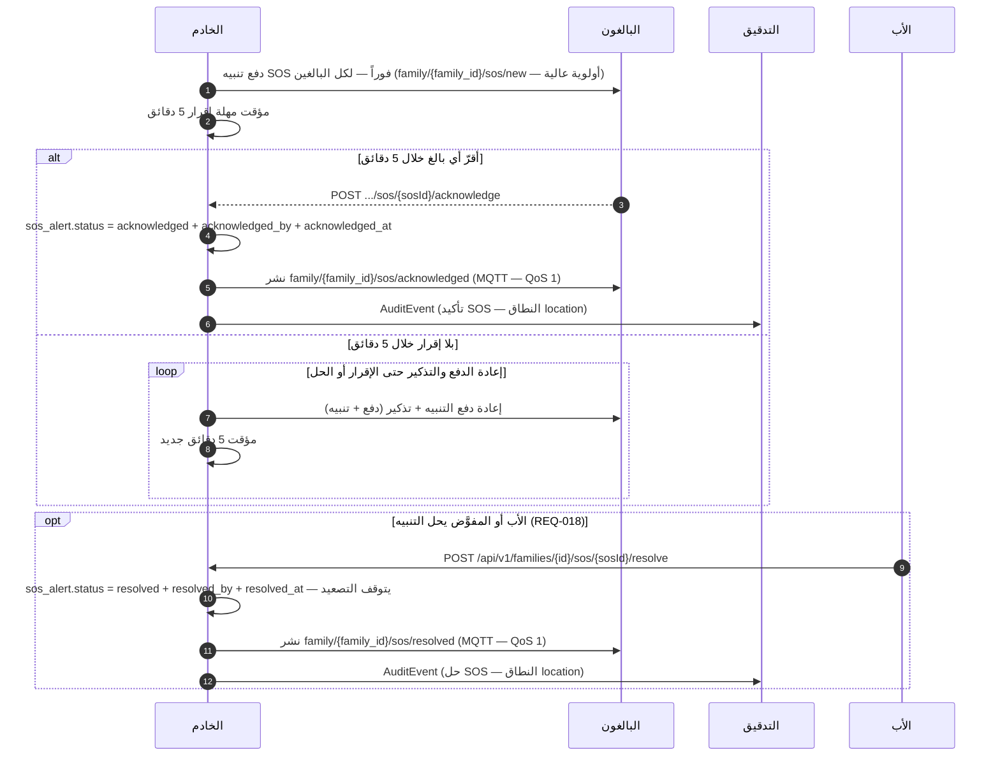

## 4. تدفق المستخدم (User Flow) — من السيناريوهات الستة (§2)

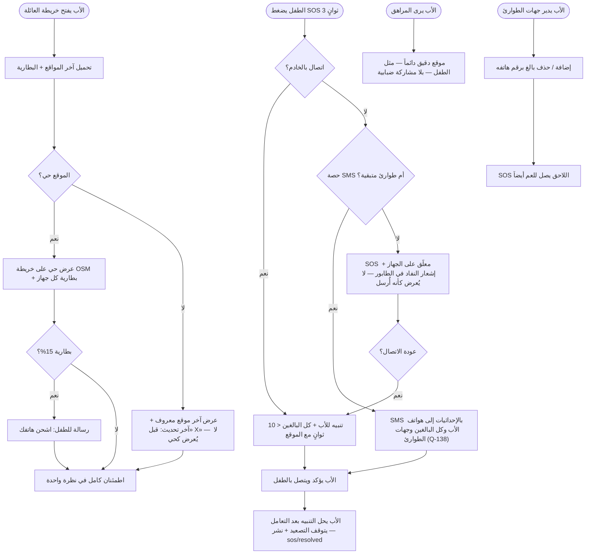

- ملاحظة: بطارية 15% مثال من السيناريو 7-1 — لا عتبة تنبيه محددة في المواصفة؛ ولا تنبيه بطارية منخفضة في المرحلة 1 (§6-3).

## 5. مخطط تدفق البيانات (DFD — المستوى 1) — من §4/§5

العمليات مرقمة 1.0–6.0، والمخازن D1–D4 جداول خادم (PostgreSQL) + ثلاثة مخازن عميل (C1–C3) على الجهاز. الأحداث MQTT تنشر من 1.0 و3.0 و4.0؛ وتنبيهات SOS وودجة الخريطة المصغرة تُسلَّمان إلى S1-09 (REQ-015/016).

- **تغطية نقاط §4:** كل نقاط §4-1 التسع مرسومة في §3 (locations قراءة/إبلاغ/سجل، sos إطلاق/تأكيد/حلّ، emergency-contacts قراءة/إضافة/حذف)؛ والتسلسلات تغطي التدفقات الأساسية فقط.

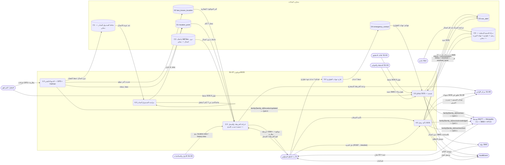

## 6. مخطط النشاط (Activity) — دورة حياة الموقع وSOS

المسارات الأربعة (جهاز الطفل / وحدة Kotlin / الخادم / الأب والبالغون) كمسارات متوازية. والتتبع التكيفي يعمل **بالتوازي** مع استخدام التطبيق، وSOS له مساران (متصل / SMS) يلتقيان عند التأكيد.

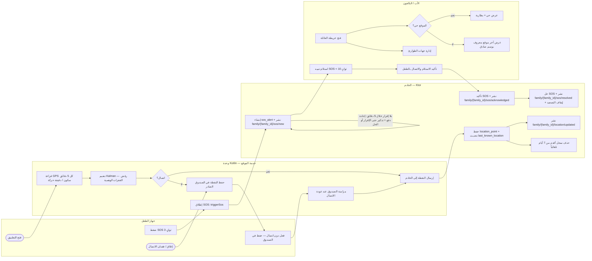

- SOS دون اتصال لا يظهر في هذا المخطط كمسار خادم: الجهاز يرسل SMS بالإحداثيات مباشرة إلى هواتف الأب وكل البالغين وجهات الطوارئ (Q-138) (Q-103) ثم يُزامَن التنبيه عند عودة الاتصال — انظر التسلسل 3-د.
- وعند استنفاد الحصة + الطوارئ الثلاث يُحفظ إشعار النفاد في الطابور ويُعرض محلياً للطفل فقط — لا إشعار فوري للأب دون اتصال (انظر 3-د)؛ ومستلمو SMS دون اتصال هم نفس المجموعة — الأب + كل البالغين + جهات الطوارئ (Q-138).
- عند إعادة الفتح بعد الإغلاق القسري، يعود المستخدم لنفس الشاشة والمدخلات (نمط S1-01 §7)؛ ونقاط الصندوق الصادر أقدم من 7 أيام تُتجاهل عند المزامنة (§7-13).
