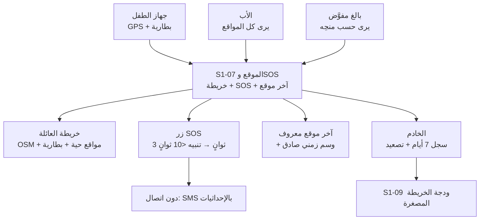
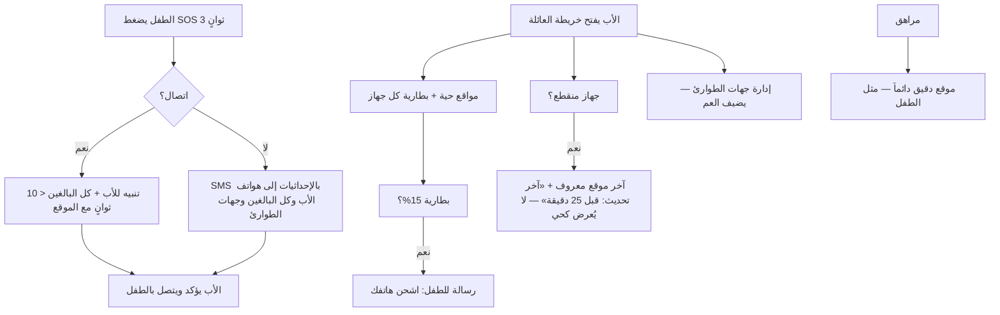

# S1-07: الموقع الأساسي وSOS (Basic Location & SOS)

- **الحالة:** approved | **المرحلة:** 1 (نواة الحماية) · **آخر تحديث:** 2026-11-17
- **القرارات الحاكمة:** Q-001 · Q-003 · Q-007 · Q-020 · Q-055 · Q-056 · Q-061 · Q-064 · Q-067 · Q-101 · Q-102 · Q-103 · Q-104 · Q-105 · Q-106 · Q-129 · Q-136 · Q-138 · Q-160 · Q-161 · Q-163 · Q-166 · Q-229 · Q-233 · Q-234 · Q-238 · Q-239 · Q-283 · Q-284 · Q-285 · Q-286 · Q-287 · Q-288 · D-021 · D-023 · D-038 · G-006 · G-011 · Q-344 · Q-408 · Q-409
- **حالة المراجعة:** §§1–8 + §10 معتمدة بالكامل في التخطيط (حكم المالك 2026-11-06) · §9 **أُغلق تصميمه مع بنود محمولة (Q-408 — 2026-11-17)**: التفصيل في §9-8. ثم أُغلقت ست فجوات بأمر المالك (Q-409 — 2026-11-17): §9-9؛ وأُضيفت REQ-019…REQ-023.
- **الأدلة المرجعية:** المواصفة القديمة S1-07 (مرجع فقط، G-009) · Deep-dives: Life360 (تنعيم Kalman + توفير البطارية + SOS) · FamilyWall (خريطة الأسرة) · S1-01 (معتمد) · S1-02 (معتمد) · S1-03 (معتمد) · S1-09 (معتمد)

## 1. الهدف والتحليل والنطاق

الموقع الأساسي وSOS هو **درع الأمان الطارئ وركيزة الاطمئنان** للعائلة: خريطة عائلية تعرض مواقع الأفراد الحية ومستوى بطارياتهم، وآخر موقع معروف بصدق عند انقطاع الاتصال، وزر استغاثة SOS يصل للأب وكل البالغين في أقل من 10 ثوانٍ عند الاتصال الطبيعي (Q-061) — ودون اتصال يُرسَل SMS بالإحداثيات بأفضل جهد بلا وعد زمني.

**التحليل (لماذا هذا النظام):** الأب يحتاج أن يعرف أين أطفاله الآن، وأن يصله نداء استغاثتهم فوراً مهما كانت الشبكة. بدون موقع حي يبقى الاطمئنان تخميناً، وبدون SOS دون اتصال يفشل النظام في اللحظة التي يُحتاج فيها أكثر (اليمن). لذلك S1-07 يبني الموقع على ثلاث قواعد: التتبع التكيفي الموفر للبطارية، والصدق في آخر موقع معروف، ومسار SOS لا يعتمد على الإنترنت وحده.

**داخل النطاق:**
- خريطة العائلة التفاعلية (OSM — Q-020) + مواقع الأفراد الحية + مستوى البطارية.
- آخر موقع معروف بوسم زمني صادق (لا يُعرض كأنه حي).
- زر SOS (ضغط مطول 3 ثوانٍ — Q-067) + مسار تصعيد + جهات طوارئ عائلية.
- تتبع تكيفي: كل 5 دقائق عند السكون، وكل دقيقة عند الحركة (Q-101).
- SOS دون اتصال: مسار بديل عبر SMS بالإحداثيات إلى هواتف الأب وكل البالغين وجهات الطوارئ (Q-103 · Q-138).
- سجل مواقع 7 أيام + آخر موقع معروف (Q-105) — ويُحذف آخر موقع معروف بعد 7 أيام من آخر قراءة (Q-166).

**خارج النطاق (أنظمة أخرى):**
- السياج الجغرافي الكامل وتنبيهات الدخول/الخروج (المرحلة 5 — Q-056). [أُعيد تأكيده 2026-11-17 (Q-408): ومعه تسمية الأماكن («البيت»، «المدرسة») — لا تُعرَّف في المرحلة 1، والمكان يُكتب عنواناً من الخريطة.]
- كشف حوادث السيارات وقياس سرعة القيادة (نظام لاحق — سؤال مفتوح Q-147، المرحلة 5).
- تكامل خدمات الطوارئ الرسمية 911/999 (مرحلة لاحقة — سؤال مفتوح Q-148، المرحلة 5).

**يعتمد على:** S1-01 (الغلاف — زر SOS الدائم) + S1-02 (العضوية) + S1-03 (الأدوار والصلاحيات — من يرى ماذا) + S1-09 (ودجة الخريطة المصغرة في مركز الأوامر).

**المصطلحات:** خريطة العائلة (family map) · آخر موقع معروف (last known location) · SOS · تصعيد (escalation) · جهات طوارئ (emergency contacts) · تتبع تكيفي (adaptive tracking) · مرشح كالمان (Kalman Filter).

**من التطبيقات المفككة (§1):** نمط Life360 — تنعيم مسار GPS بمرشح Kalman Filter (منع القفزات الوهمية) + توفير بطارية تكيفي (خفض التردد عند السكون) + بروتوكول SOS؛ ونمط FamilyWall — شاشة خريطة الأسرة التجميعية. نأخذ منهما أن **الموقع دقيق وموفر للبطارية معاً**: لا قفزات وهمية على الخريطة، ولا بطارية تُستنزف.

**رسم توضيحي — أين يُستخدم الموقع وSOS (للفهم السريع):**

## 2. سيناريوهات المستخدم

### 7-1: الأب يفتح خريطة العائلة ويرى أطفاله وبطارياتهم
- **الممثل:** الأب (المالك). **السياق:** مساءً، يريد الاطمئنان على مكان أطفاله.
- **التدفق:** 1) الأب يفتح خريطة العائلة. 2) يرى مواقع أطفاله الحية على الخريطة (OSM) مع مستوى بطارية كل جهاز. 3) يرى أن بطارية جهاز ابنه 15% فيرسل له رسالة ليشحن هاتفه. **النتيجة:** اطمئنان كامل في نظرة واحدة — المكان والبطارية معاً.

### 7-2: الطفل يضغط SOS فيصل التنبيه للأب وكل البالغين في أقل من 10 ثوانٍ
- **الممثل:** الطفل. **السياق:** الطفل في موقف خطر ويحتاج والديه فوراً.
- **التدفق:** 1) الطفل يضغط زر SOS في الغلاف ضغطاً مطولاً 3 ثوانٍ. 2) يصل التنبيه للأب وكل البالغين في العائلة في أقل من 10 ثوانٍ (Q-061) مع موقع الطفل لحظتها. 3) الأب يؤكد استلام التنبيه ويتصل بالطفل. **النتيجة:** استغاثة تصل قبل فوات الأوان.

### 7-3: SOS دون إنترنت — الإحداثيات تصل عبر SMS
- **الممثل:** الطفل. **السياق:** الطفل في منطقة بلا إنترنت ويضغط SOS.
- **التدفق:** 1) الطفل يضغط SOS ولا يوجد اتصال بالخادم. 2) الجهاز يرسل SMS بالإحداثيات مباشرة إلى هواتف الأب وكل البالغين وجهات الطوارئ (Q-103 · Q-138). 3) الأب يفتح الإحداثيات في الخريطة ويعرف مكان الطفل. **النتيجة:** الاستغاثة لا تعتمد على الإنترنت وحده — تعمل في أسوأ شبكة.

### 7-4: دون اتصال — آخر موقع معروف بوسم صادق
- **الممثل:** الأب. **السياق:** جهاز الطفل انقطع اتصاله منذ 25 دقيقة.
- **التدفق:** 1) الأب يفتح الخريطة. 2) يرى آخر موقع معروف للطفل مع وسم "آخر تحديث: قبل 25 دقيقة" — لا يُعرض كأنه حي — مثال على عرض «آخر موقع معروف» لا حي (REQ-003 — Q-283). 3) نقاط الموقع المحفوظة محلياً في الصندوق الصادر تُزامَن عند عودة الاتصال. **النتيجة:** صدق كامل — الأب يعرف ما هو حي وما هو قديم.

### 7-5: موقع المراهق الدقيق مرئي للأب دائماً
- **الممثل:** الأب + المراهق. **السياق:** المراهق في طريقه إلى المدرسة.
- **التدفق:** 1) الأب يفتح الخريطة. 2) يرى موقع المراهق الدقيق (مثل الطفل — Q-102). 3) لا مشاركة ضبابية ولا إخفاء: المراهق قاصر وحمايته أولاً. **النتيجة:** إشراف كامل على كل قاصر — طفلاً كان أو مراهقاً.

### 7-6: الأب يدير جهات الطوارئ العائلية
- **الممثل:** الأب. **السياق:** الأب يريد إضافة عمه كجهة طوارئ.
- **التدفق:** 1) الأب يفتح إدارة جهات الطوارئ. 2) يضيف عمه (بالغ في العائلة) برقم هاتفه. 3) عند أي SOS لاحق يصل التنبيه للعم أيضاً مع الأب وكل البالغين. ويجوز للأب إضافة رقم خارجي (جار موثوق) بالطريقة نفسها — يستلم SOS دون تتبع مستمر (Q-287). **النتيجة:** شبكة أمان عائلية أوسع من الوالدين وحدهما.

**مخطط السيناريوهات (§2 — بصري):**

## 3. المتطلبات الوظيفية

### الخريطة
- **REQ-001:** خريطة عائلية تفاعلية (OSM — Q-020) تعرض مواقع الأفراد الحية. وقراءات الخريطة p95 < 300ms (Q-061 — تُقاس في مختبر Q-027). [Q-020 · DIRECT] [توضيح 2026-11-17 (Q-408): «الأفراد» في التصميم المغلق هم الأبناء. ظهور الأب والبالغين على خريطة غيرهم محمول بلا حكم (G-S107-07). والمشاهد يرى نقطة موقعه هو من هاتفه، ولا تُرسَل لأحد.] [تعديل 2026-11-17 (Q-409) — يسود على توضيح Q-408 قبله: «الأفراد» كل أفراد العائلة، الأبناء والكبار (REQ-019). والخريطة تُسحب بالإصبع وتُكبَّر بإصبعين.]
- **REQ-002:** مستوى بطارية كل جهاز ظاهر مع موقعه. [§2 · DERIVED]
- **REQ-003:** آخر موقع معروف يعرض مع وسم زمني صريح — ولا يُعرض كأنه حي أبداً. والموقع «حي» فقط إن كان عمر قراءته ضمن عتبة الحداثة (`LOCATION_STALENESS_THRESHOLD` — قيمة مختبر Q-027 — Q-283)؛ والأقدم يُعرض «آخر موقع معروف منذ X» ولا يُقدَّم كحي أبداً. ويجب أن تكون العتبة ≥ أبطأ تردد تتبع (5 دقائق عند السكون — REQ-004) وإلا وُسم كل موقع ساكن قديماً. وقراءة بدقة أسوأ من عتبة الدقة السيئة (`POOR_ACCURACY_THRESHOLD_M` — قيمة مختبر Q-027) تُعرض دائرة عدم يقين بنصف قطر يساوي الدقة المُبلَّغة، لا نقطة دقيقة وهمية (§7-6). [§2 · Q-283 · DERIVED] **[قيم مختبر Q-027 — 2026-11-08 (اعتماد المالك):** `LOCATION_STALENESS_THRESHOLD` = 15 دقيقة (≥ أبطأ تردد تتبع 5 د؛ Q-283 اقترح 15 نقطة بداية)؛ `POOR_ACCURACY_THRESHOLD_M` = 50 م (GPS 3–10 م في الهواء الطلق؛ 10–50 جيد؛ 50–200 خشن). قيم تخطيطية مؤصلة؛ تُعاد قياسها في المختبر على أجهزة حقيقية ومسارات GPS مسجلة عند التنفيذ.] [توضيح 2026-11-17 (Q-408): مع الوسم الزمني يُكتب سبب التقادم بكلمة مفهومة (جهازه بلا اتصال، مغلق، iPhone، أنت دون اتصال)، في قائمة الخريطة وفي صفحة الفرد.]

### التتبع
- **REQ-004:** تحديث تكيفي: كل 5 دقائق عند السكون، وكل دقيقة عند الحركة. و«الحركة» = سرعة مستمرة فوق عتبة السرعة (`MOVING_SPEED_THRESHOLD_MPS`) أو إزاحة فوق عتبة الإزاحة (`MOVING_DISPLACEMENT_M`) داخل نافذة القياس (`MOVING_WINDOW_S`)؛ والانتقال إلى تردد الدقيقة يتطلب حركة مستمرة مدة التثبيت (`MOVING_DEBOUNCE_S`)، والعودة إلى 5 دقائق تتطلب سكوناً مستمراً مدة العودة (`STILL_DEBOUNCE_S`) — والقيم الخمس قيم مختبر Q-027 (المالك: مختبر Q-027؛ البوابة: قبل التنفيذ). وعلى iOS: حدود التتبع الخلفي الدقيقة توثَّق من وثائق Apple نفسها في التصميم (بلا أرقام مخترعة — Q-265)؛ ويُعرض للأب بصدق «مقيّد بنظام iOS — آخر موقع معروف منذ X». [Q-101 · Q-265 · DIRECT] **[قيم مختبر Q-027 — 2026-11-08 (اعتماد المالك):** `MOVING_SPEED_THRESHOLD_MPS` = 1.0 م/ث (المشي ~1.4 م/ث؛ فوق ضجيج الانجراف عند السكون)؛ `MOVING_DISPLACEMENT_M` = 20 م؛ `MOVING_WINDOW_S` = 60 ث؛ `MOVING_DEBOUNCE_S` = 60 ث؛ `STILL_DEBOUNCE_S` = 300 ث. قيم تخطيطية مؤصلة؛ تُعاد قياسها في المختبر على أجهزة حقيقية ومسارات GPS مسجلة عند التنفيذ.]
- **REQ-005:** تنعيم مسار GPS بمرشح Kalman Filter — بلا قفزات وهمية على الخريطة. ومعيار الرفض: تُرفض القراءة إن تجاوز ابتكارها (الفرق بين القراءة والتوقع) بوابة الابتكار (`KALMAN_INNOVATION_GATE` — بمضاعفات الانحراف المعياري) أو تجاوزت سرعتها الضمنية السرعة القصوى المعقولة (`KALMAN_MAX_PLAUSIBLE_SPEED_MPS`) أو كانت دقتها أسوأ من الحد الأدنى للقبول (`KALMAN_MIN_ACCURACY_M`) — والقيم الثلاث قيم مختبر Q-027 (المالك: مختبر Q-027؛ البوابة: قبل التنفيذ)؛ والقراءة المرفوضة تُتجاهل ولا تُحفظ (§7-7). [Life360 · DIRECT] **[قيم مختبر Q-027 — 2026-11-08 (اعتماد المالك):** `KALMAN_INNOVATION_GATE` = 5σ (r²/S ≤ 25)؛ `KALMAN_MAX_PLAUSIBLE_SPEED_MPS` = 50 م/ث (180 كم/س — فوق أقصى سرعة طريق)؛ `KALMAN_MIN_ACCURACY_M` = 30 م (الممارسة الشائعة 20–30 م). قيم تخطيطية مؤصلة؛ تُعاد قياسها في المختبر على أجهزة حقيقية ومسارات GPS مسجلة عند التنفيذ.]
- **REQ-006:** دون اتصال: نقاط الموقع تُحفظ في الصندوق الصادر وتُزامَن عند عودة الاتصال (بلا تكرار). [Q-064 · DIRECT] [S1-01 REQ-009 · DERIVED]

### SOS
- **REQ-007:** زر SOS بضغط مطول 3 ثوانٍ (في الغلاف — Q-067). ونافذة إلغاء 10 ثوانٍ (Q-286): زر «إلغاء SOS بالخطأ» في LO-03 يلغي الضغطة المحلية فقط قبل الإرسال؛ وبعد الإرسال لا يلغي SOS إلا الأب عبر الحل (REQ-018). [Q-067 · Q-286 · DIRECT]
- **REQ-008:** تنبيه SOS يصل للأب وكل البالغين في أقل من 10 ثوانٍ مع موقع المستغيث لحظتها. وإن تعذّر إصلاح GPS جديد يُرسَل SOS فوراً بآخر موقع معروف موسوماً بوضوح «آخر موقع منذ X» مع استمرار محاولة الحصول على إصلاح — لا يُحجب SOS على GPS أبداً (Q-288). [Q-061 · Q-104 · Q-288 · DIRECT]
- **REQ-009:** SOS دون اتصال: SMS بالإحداثيات إلى هواتف الأب وكل البالغين وجهات الطوارئ — نفس مجموعة مستلمي التنبيه دون اتصال (Q-138) — عند تعذر الاتصال بالخادم؛ وعلى iOS يفتح التطبيق مؤلف SMS النظام معبأً مسبقاً إلى الأب وكل البالغين وجهات الطوارئ (المستخدم يضغط إرسال) — بلا إرسال تلقائي (قيد Apple) — وإن ألغى المستخدم المؤلف (أغلقه دون إرسال) يبقى SOS في حالة «معلّقة — مؤلف ملغى» دائمة على الجهاز: تُعاد المطالبة فوراً بإعادة فتح المؤلف لنفس حدث SOS (نفس `Idempotency-Key`) — لا حدث SOS ثانٍ ولا SMS مكرر — وتُزامَن الحالة عند عودة الاتصال؛ ولا تُعرض لافتة «فشل SOS» (Q-238). **ملكية النقل دون اتصال (Q-234): S1-07 يملك النقل؛ الغلاف يسلّم `sos_triggered` إلى S1-07 فوراً**؛ والصندوق الصادر (Outbox) مخزن تأجيل لا نقل بديل — S1-07 وحده يقرر الوسيلة: SMS مباشر عند توفر الحصة، أو تسجيل الحدث في Outbox بأولوية قصوى للمزامنة عند عودة الاتصال — لا نقلان بديلان بلا مالك. وبلا إصلاح GPS جديد يُرسَل آخر موقع معروف موسوماً بعمره في SMS نفسه (Q-288). [Q-103 · Q-138 · Q-229 · Q-233 · Q-234 · Q-238 · Q-288 · DIRECT]
- **REQ-010:** الأب يدير جهات الطوارئ العائلية (إضافة/حذف). ويجوز أن تكون جهة الطوارئ رقماً خارجياً (غير عضو — جار موثوق أو رقم طوارئ محلي) يضيفه الأب صراحةً برقمه (Q-287)؛ والخارجية تستلم تنبيه SOS (الموقع + الطفل) دون تتبع مستمر وبلا رؤية مواقع؛ والافتراضي: لا أرقام خارجية. [§2 · Q-287 · DERIVED] [توضيح 2026-11-17 (Q-408): في التصميم المغلق لا يُضاف بالغ من العائلة جهةَ طوارئ: كل بالغ مستلم أصلاً (Q-104)، فالقائمة التي يديرها الأب أرقام من خارج البيت فقط. والحذف تأكيد ثم إشعار فيه «تراجع».]

### الخصوصية والرؤية
- **REQ-011:** الأب يرى الموقع الدقيق لكل قاصر — طفلاً كان أو مراهقاً. [Q-102 · DIRECT]
- **REQ-012:** البالغ المفوَّض يرى المواقع حسب منحِه فقط (deny-override). [Q-007 · DIRECT]

### السجل والتكامل
- **REQ-013:** سجل مواقع 7 أيام + آخر موقع معروف. [Q-105 · DIRECT] [Q-409: السجل للقاصرين؛ لا سجل تنقل للبالغ (REQ-019).]
- **REQ-014:** السجل يُحذف تلقائياً بعد 7 أيام. [Q-105 · DERIVED]
- **REQ-015:** ودجة S1-09 "الخريطة المصغرة": آخر مواقع الأبناء حسب المنح. [S1-09 · DERIVED]
- **REQ-016:** تنبيهات SOS تظهر في تنبيهات S1-09. [S1-09 · DERIVED]
- **REQ-017:** رسائل SMS تُحسب من حصة الخطة (Q-055)؛ **الحصص (Q-129/Q-261): مجانية 20 رسالة/شهر، وأساسية 50 رسالة/شهر (Q-261 — تصديق)، ومميزة 100 رسالة/شهر، وتعبئة 50 رسالة منفصلة عن حصة الأساسية (S1-04 REQ-010)**؛ ويُسمح بـ 3 رسائل SOS طارئة بعد نفاد الحصة في كل شهر تقويمي (Q-252 — SOS فقط) — **يبقى الحد كما هو بحكم المالك (Q-163، خيار ب) ويُوثَّق كخطر مقبول**: بعد استنفاد الثلاث وبلا تعبئة وبلا إنترنت لا يصل SOS عبر SMS؛ والتعبئة وشراء الحزم عبر S1-04؛ والأب يُشعَر فوراً بكل رسالة طارئة تُرسَل (دفع فوري — Q-285) وعند النفاد — إلا دون اتصال مع استنفاد الحصة والطوارئ الثلاث، فيُحفظ إشعار النفاد في طابور على الجهاز للتسليم عند عودة الاتصال ويُعرض محلياً للطفل (لا قناة فورية دون اتصال). **قناة الإشعار (Q-285):** متصلاً — دفع فوري من الخادم (حدث `sos/new` + إشعار دفع إلى تطبيق الأب) لا يستهلك من الثلاث؛ ودون اتصال — رسالة الطوارئ نفسها إلى الأب هي الإشعار (بلا رسالة ثانية — تُحسب مرة واحدة من الثلاث). **عدّاد الطوارئ (Q-285):** عدّاد ظاهر في التطبيق للمتبقي من الثلاث (`sms_emergency_remaining` من مرآة الحصة المحلية — §5-5) في LO-03 وLO-06. **مرآة الحصة المحلية:** الجهاز يحتفظ بنسخة محلية من رصيد الحصة والطوارئ المتبقية ونهاية الدورة (نهاية الشهر التقويمي — Q-252 بتوقيت العائلة المحلي Q-183)، تُزامَن عند كل اتصال بالخادم، ويُتخذ قرار الإرسال دون اتصال بناءً عليها. **سياسة المرآة عند الفشل (Q-239 — D-9): المرآة مغلقة-عند-الفشل بعد 3:** بعد استنفاد رسائل الطوارئ الثلاث (Q-163) يُغلق الإرسال دون اتصال تماماً حتى أول مزامنة ناجحة مع الخادم — لا رسالة SMS دون اتصال بعد الثالثة؛ ومرآة فارغة (لم تُزامَن أبداً) تُعامل كمنتهية الحصة: يُسمح فقط بالثلاث الطارئة ثم تُغلق؛ وعند الإغلاق يُشعَر الأب فوراً إن كان متصلاً، وإلا يُحفظ إشعار الإغلاق في الطابور للتسليم عند عودة الاتصال ويُعرض محلياً للطفل. **والثلاث لكل عائلة لا لكل جهاز:** تُعدّ خادمياً عند المزامنة (`quota_usage.sms_emergency_used` — S1-04 §5) — جهاز ثانٍ للطفل نفسه (Q-230) لا يعيد صرف الثلاث نفسها؛ وعند التعارض يفوز الخادم دائماً (لقطة الخادم تستبدل المرآة كاملةً — بروتوكول المزامنة §6-3). **توقيع SOS:** كل SMS استغاثة يحمل توقيع HMAC-SHA256 (مقتطع إلى 10 أحرف: أول 10 أحرف من الترميز السداسي عشري الصغير للهضم — الأبجدية [0-9a-f]، الإنتروبيا 40 بت) بمفتاح الجهاز المتبادل عند الإقران (S1-02 §5) فوق (العائلة، العضو، الوقت، الإحداثيات)، ويتحقق تطبيق الأب من التوقيع قبل عرض التنبيه. [Q-106 · Q-129 · Q-163 · Q-261 · DIRECT — أضيف بتعديل 2026-11-06؛ وُسّع بتعديل 2026-11-06 (Q-163)؛ وأُضيفت الحصص بتعديل 2026-11-07 (Q-175)؛ وأُضيفت الأساسية 50 بتعديل 2026-11-08 (Q-261 — AUD-014)]
- **REQ-018:** حل تنبيه SOS: الأب أو البالغ المفوَّض حسب القالب يحل التنبيه عبر `POST /api/v1/families/{id}/sos/{sosId}/resolve` (مفتاح `location.sos.resolve` — Q-160)؛ فتصبح حالته `resolved` ويتوقف التصعيد؛ ويُدفع حدث `family/{family_id}/sos/resolved` فوراً للأجهزة التي تعرض التنبيه؛ ويُسجَّل الحل في التدقيق. [Q-136 · Q-160 · Q-161 · DIRECT]

### إضافات Q-409 (2026-11-17)
- **REQ-019:** كل أفراد العائلة يظهرون على الخريطة: الأبناء والكبار. البالغ (الأب وكل بالغ) يشارك موقعه الحالي، وله مفتاح «مشاركة موقعي» يوقف به المشاركة ويعيدها متى شاء؛ والإيقاف يحتاج تأكيداً واتصالاً، ويظهر لبقية الكبار بنص صريح («أوقف مشاركة موقعه») ولا يُعرض له موقع ولا موقع قديم. لا سجل تنقل للبالغ: المكان الحالي فقط. يرى مواقع الكبار كل بالغ يملك `location.view`؛ والابن لا يرى بالغاً إلا بقرار REQ-021. الاستغاثة ترسل مكان البالغ في كل حال ولو كانت المشاركة متوقفة (§6-2). تتبع القاصر لا يتغير: لا يملك القاصر مفتاح الإيقاف، والأب يراه دائماً (REQ-011). [Q-409 · DIRECT] [تحديث 2026-11-17 (Q-416): سقطت جملة «الاستغاثة ترسل مكان البالغ في كل حال»: لا زر استغاثة في وضع الأهل، فالبالغ لا يرسل استغاثة من التطبيق.]
- **REQ-020:** «حدّث الآن»: من يرى موقع فرد يطلب قراءة فورية من جهازه عبر `POST /api/v1/families/{id}/members/{memberId}/locations/refresh` (مفتاح `location.view`)؛ فيدفع الخادم الطلب إلى جهاز الفرد (`family/{family_id}/location/refresh-requested`) ويرد الجهاز بنقطة موقع عادية. النتيجة تُعرض بصدق: «حُدّث الآن» إن وصلت قراءة؛ وإن لم تصل خلال مهلة الطلب (`LOCATION_REFRESH_TIMEOUT_S` — قيمة مختبر Q-027) يُكتب السبب: جهازه بلا اتصال، أو مغلق، أو لم يتصل بعد، أو iPhone قد لا يرد حتى يُفتح التطبيق؛ ويبقى آخر موقع معروف بوسمه (REQ-003). طلب واحد قائم لكل فرد؛ والزائد يُرفض بـ `LOC_RATE_LIMITED`. لا يُعرض الزر لبالغ أوقف مشاركته، ويُرفض الطلب والمشاهد دون اتصال. [Q-409 · DIRECT]
- **REQ-021:** «ما يراه الأبناء»: الأب يقرر من يظهر لكل ابن على خريطته، من إخوته ومن والديه. قرار للمالك وحده (ومن أعطاه الصلاحية الكاملة — Q-401)، **بلا مفتاح صلاحية يُفوَّض**. الافتراضي: كل ابن يرى مكانه فقط. الإظهار اتجاه واحد لا متبادل، ولكل ابن مقابل كل فرد. الابن يرى المكان الحالي فقط: بلا بطارية ولا سجل تنقل ولا صفحة تفاصيل. من يُعرض مكانه يجد اسم من يراه في «من يرى مكاني». إظهار بالغ لابن لا يعمل والبالغ موقف مشاركته (REQ-019). التغيير يحتاج اتصالاً ويُسجَّل في التدقيق. العقد §4-1 والبيانات §5-6. [Q-408 · Q-409 · DIRECT]
- **REQ-022:** حفظ الاستغاثات السابقة: الاستغاثة المغلقة (`resolved`) تبقى في القائمة 90 يوماً من إغلاقها ثم تُحذف تلقائياً؛ وإحداثياتها (`lat` / `lng`) تُمحى بعد 7 أيام من إغلاقها، مثل سجل التنقل (Q-105)، ويبقى من الصف: من استغاث، ومتى، ومن أغلقها، وملاحظته. الاستغاثة غير المغلقة لا تُحذف مهما طال عمرها. حدث التدقيق لا يحمل إحداثيات، ومدة بقائه تتبع مدة سجل التدقيق (غير محسومة — Q-344). الشاشة تذكر المدتين بنص صريح. [Q-409 · DIRECT]
- **REQ-023:** سلّم العنوان: نص المكان يُشتق من الخريطة بأول درجة متاحة: (1) الحي والشارع؛ (2) أقرب معلم ببعده المدوَّر («قرب … · نحو 300 م»)؛ (3) الحي أو المديرية وحدها؛ (4) «موقع على الخريطة» مع العلامة. لا تُعرض إحداثيات خام في الواجهة أبداً؛ الإحداثيات تبقى في رسالة SMS للاستغاثة فقط (REQ-009) لأن مستلمها قد لا يملك التطبيق. «الاتجاهات» تعمل في كل الدرجات لأنها بالإحداثيات. تحويل الإحداثيات إلى عنوان يجري على خادمنا من بيانات OpenStreetMap ولا تُرسَل الإحداثيات إلى طرف ثالث (§6-2). وتغطية العناوين في المدن اليمنية تُقاس في المختبر (Q-027) قبل التنفيذ. [Q-409 · DIRECT]

## 4. الواجهات والعقود

### 4-1. نقاط الوصول (REST — `/api/v1`)

| الطريقة والمسار | المفتاح | المدخل | المخرج |
|---|---|---|---|
| `GET /api/v1/families/{id}/locations` | `location.view` | — | `[{member_id, device_id, lat, lng, accuracy, battery, at}]` |
| `POST /api/v1/families/{id}/locations` | بلا مفتاح — مصادقة جهاز (شهادة الإقران)؛ والجهاز يبلّغ عن موقعه هو فقط | `{device_id, client_point_id, lat, lng, accuracy, battery, at}` | النقطة + `server_seq` — إعادة الإرسال بنفس `client_point_id` تُعيد النقطة الأصلية بلا تكرار (§7) |
| `GET /api/v1/families/{id}/members/{memberId}/locations` | `location.history.view` | `?from&to&limit&cursor` — `limit` افتراضي 100، أقصى 500؛ و`cursor` مبني على `server_seq` (معتم لا يُبنى يدوياً) | `{points: [{lat, lng, accuracy, battery, at, server_seq}], next_cursor}` — صفحة محدودة؛ و`next_cursor` فارغ عند نهاية النطاق |
| `POST /api/v1/families/{id}/sos` | `location.sos.trigger` | `{lat, lng, at, last_known_at?}` + ترويسة `Idempotency-Key` (UUID يولّده الجهاز لكل حدث SOS — `client_sos_id` — يمنع التنبيه المكرر عند إعادة الإرسال) — `last_known_at` يُملأ عند إرسال آخر موقع معروف بدل إصلاح جديد (Q-288) | `{sos_id, at}` |
| `POST /api/v1/families/{id}/sos/{sosId}/acknowledge` | `location.sos.acknowledge` | — | `{sos_id, acknowledged_by, at}` |
| `POST /api/v1/families/{id}/sos/{sosId}/resolve` | `location.sos.resolve` (Q-136 · Q-160) | `{resolution_note?}` | `{sos_id, resolved_by, at, status: "resolved"}` |
| `POST /api/v1/families/{id}/quota/mirror-sync` | بلا مفتاح — مصادقة جهاز (شهادة الإقران) | `{device_id, mirror_version, sms_sent_local, sms_emergency_used_local, cycle_end}` | `{quota_balance, sms_emergency_remaining, cycle_end, server_timestamp, mirror_version}` — لقطة الخادم المرجعية؛ تفوز على المرآة دائماً (Q-239) |
| `GET /api/v1/families/{id}/emergency-contacts` | `location.emergency.manage` | — | `[{contact_id, member_id, phone}]` — `member_id` قابل للفراغ (null لرقم خارجي — Q-287) |
| `POST /api/v1/families/{id}/emergency-contacts` | `location.emergency.manage` | `{member_id? (null لرقم خارجي — Q-287), phone}` | جهة الطوارئ |
| `DELETE /api/v1/families/{id}/emergency-contacts/{contactId}` | `location.emergency.manage` | — | `{ok: true}` |
| `POST /api/v1/families/{id}/members/{memberId}/locations/refresh` [أُضيف Q-409 — REQ-020] | `location.view` | — | `{request_id, status: "requested"}` — القراءة تصل بعدها نقطةَ موقع عادية؛ `LOC_RATE_LIMITED` إن كان طلب قائم؛ `LOC_NOT_VISIBLE` لبالغ أوقف مشاركته |
| `PUT /api/v1/families/{id}/members/{memberId}/location-sharing` [أُضيف Q-409 — REQ-019] | بلا مفتاح — البالغ عن نفسه فقط (`memberId` = صاحب الجلسة)؛ `LOC_UNAUTHORIZED` لغيره وللقاصر | `{paused: bool}` | `{member_id, paused, changed_at}` |
| `GET /api/v1/families/{id}/location-visibility` [أُضيف Q-409 — REQ-021] | بلا مفتاح — المالك فقط (`is_owner` أو الصلاحية الكاملة — Q-401) | — | `[{viewer_member_id, subject_member_id}]` |
| `PUT /api/v1/families/{id}/location-visibility` [أُضيف Q-409 — REQ-021] | بلا مفتاح — المالك فقط (`is_owner` أو الصلاحية الكاملة — Q-401) | `{viewer_member_id (قاصر), subject_member_id, visible: bool}` | الصف بعد التغيير |

- **مصالحة SOS عبر SMS (§7):** إعادة `POST /api/v1/families/{id}/sos` نفسه بنفس `Idempotency-Key` (`client_sos_id`) بعد عودة الاتصال — لا endpoint منفصل للمصالحة؛ والخادم ينشئ صف `sos_alert` واحداً (`channel=sms`) إن لم يكن موجوداً، ويعيد الموجود إن كان؛ ويُحسم خصم الحصة مرة واحدة.

### 4-2. الأحداث (MQTT → الأجهزة)

> **عقد الوسيط الملزم (Q-168):** الوسيط Eclipse Mosquitto 2.x — عقدة واحدة في المرحلة 1 — TLS 1.2+ على 8883 + mTLS؛ QoS 1؛ والإقرار التطبيقي إلزامي للأوامر وSOS فقط؛ والموقع الحي QoS 0؛ وبلا QoS 2؛ والعزل ببادئة `family/{family_id}/` + ACL خادمي؛ والشهادات سنتان مع تجديد تلقائي وإبطال فوري. التفصيل الكامل: `docs/family-os/governance/architecture/MQTT-BROKER-SPEC.md`. [Q-168 · Q-175]

| الموضوع | الحمولة | الناشر | المشترك | الغرض |
|---|---|---|---|---|
| `family/{family_id}/location/updated` | `{member_id, device_id, lat, lng, accuracy, battery, at, server_seq}` | الخادم | تطبيقات الأهل (الخريطة الحية) + S1-09 (الودجة) | تحديث موقع عضو (للخريطة الحية) |
| `family/{family_id}/sos/new` | `{sos_id, member_id, lat, lng, accuracy, at, channel, last_known_at?}` | الخادم | تطبيقات كل البالغين + S1-09 (تنبيهات SOS) | SOS جديد (أولوية عالية — يصل في أقل من 10 ثوانٍ) — يُملأ `last_known_at` عند إرسال آخر موقع معروف بدل إصلاح جديد (Q-288) |
| `family/{family_id}/sos/acknowledged` | `{sos_id, acknowledged_by, at}` | الخادم | جهاز المستغيث + S1-09 | تأكيد استلام SOS |
| `family/{family_id}/sos/resolved` | `{sos_id, resolved_by, at}` | الخادم | الأجهزة التي تعرض التنبيه + S1-09 | حل تنبيه SOS — يُدفع فوراً للأجهزة التي تعرض التنبيه |
| `family/{family_id}/location/refresh-requested` [أُضيف Q-409 — REQ-020] | `{request_id, member_id, requested_at}` | الخادم | جهاز الفرد المطلوب موقعه | طلب قراءة فورية — يرد الجهاز بنقطة موقع عادية |

### 4-3. قناة المنصة (MethodChannel — Flutter ↔ Kotlin)

| الطريقة | الغرض |
|---|---|
| `startLocationService()` | تشغيل خدمة الموقع في الخلفية (التتبع التكيفي) |
| `getLastKnownLocation() → {lat, lng, accuracy, battery, at}` | آخر موقع مخزن + وسمه الزمني + دقته + بطاريته (كل ما تعرضه LO-02) |
| `triggerSos()` | إطلاق SOS من زر الغلاف (ضغط مطول 3 ثوانٍ) |

### 4-4. صيغة الخطأ الموحدة

`{code, message_ar, trace_id}` — كما في S1-02 §4. رموز هذا النظام وحالات HTTP المقابلة: `LOC_MEMBER_NOT_FOUND` (عضو غير موجود) → 404 · `LOC_NOT_VISIBLE` (موقع بلا منح رؤية) → 403 · `LOC_SOS_ALREADY_ACTIVE` (يوجد SOS نشط — تُعاد بياناته بدل التكرار) → 200 · `LOC_INVALID_COORDINATES` (إحداثيات خارج النطاق) → 400 · `LOC_UNAUTHORIZED` (بلا مصادقة جهاز/جلسة) → 401 · `LOC_RATE_LIMITED` (تجاوز حد المعدل) → 429 مع ترويسة `Retry-After`.

**حدود المعدل (لكل جهاز ما لم يُذكر غيره):** `POST /locations` — 10 طلبات/دقيقة (يسمح بدفعات مزامنة Outbox بعد انقطاع؛ والتتبع العادي طلب/دقيقة)؛ `POST /sos` — 5 طلبات/دقيقة مع تسامح دفعات (لا يحجب SOS حقيقياً ثانياً أبداً — التكرار يُضبط بـ `LOC_SOS_ALREADY_ACTIVE` لا بالحد)؛ وبقية النقاط — 60 طلباً/دقيقة لكل عضو مصادق. وتجاوز الحد → 429 + `LOC_RATE_LIMITED`. (قيم أولية للعقد تُتحقق في مختبر Q-027.)

## 5. البيانات — النموذج

كل جدول يحمل `family_id` + RLS (D-021). سجل المواقع يُحذف تلقائياً بعد 7 أيام (REQ-014).

### 5-1. `location_point` — نقاط الموقع (سجل 7 أيام)
| الحقل | النوع | ملاحظات |
|---|---|---|
| `point_id` | uuid (PK) | |
| `family_id` | uuid (FK) | + RLS |
| `member_id` | uuid (FK) | |
| `device_id` | uuid (FK) | الجهاز المُبلِّغ — نقطتا جهازين لعضو واحد مميزتان (§6-3) |
| `client_point_id` | uuid | معرّف النقطة على العميل — مفتاح عدم التكرار (إعادة الإرسال بنفسه تُعيد النقطة الأصلية) |
| `lat` / `lng` | double | بعد التنعيم (Kalman) |
| `accuracy` | double | دقة القراءة (متر) |
| `battery` | int | مستوى بطارية الجهاز (%) |
| `at` | timestamptz | وقت القراءة على الجهاز |
| `server_seq` | bigint | تسلسل الخادم |

### 5-2. `last_known_location` — آخر موقع معروف (قراءة سريعة للوحة)
| الحقل | النوع | ملاحظات |
|---|---|---|
| `member_id` | uuid (PK, FK) | |
| `family_id` | uuid (FK) | + RLS |
| `device_id` | uuid (FK) | جهاز آخر قراءة — صف واحد لكل عضو؛ وقاعدة التعارض في §6-3 |
| `lat` / `lng` | double | |
| `accuracy` | double | |
| `battery` | int | |
| `at` | timestamptz | الوسم الزمني الصريح (REQ-003) |
| `expires_at` | timestamptz | آخر قراءة + 7 أيام — يُحذف تلقائياً (Q-166) |

### 5-3. `sos_alert` — تنبيهات SOS
| الحقل | النوع | ملاحظات |
|---|---|---|
| `sos_id` | uuid (PK) | |
| `family_id` | uuid (FK) | + RLS |
| `member_id` | uuid (FK) | المستغيث |
| `lat` / `lng` | double | موقع الاستغاثة لحظتها |
| `at` | timestamptz | |
| `status` | text | `active` / `acknowledged` / `resolved` / `unacknowledged_exhausted` («بلا إقرار — استُنفد التصعيد» — Q-284: حالة نهائية تبقى ظاهرة في LO-06؛ ولا تُسقط التنبيه؛ والحل ما زال ممكناً منها) |
| `channel` | text | `server` / `sms` (أي مسار أوصل التنبيه — REQ-009) |
| `acknowledged_by` / `acknowledged_at` | uuid / timestamptz (nullable) | |
| `resolved_by` / `resolved_at` | uuid / timestamptz (nullable) | من حلّ التنبيه ومتى (Q-136) |

### 5-4. `emergency_contact` — جهات الطوارئ العائلية
| الحقل | النوع | ملاحظات |
|---|---|---|
| `contact_id` | uuid (PK) | |
| `family_id` | uuid (FK) | + RLS |
| `member_id` | uuid (FK, nullable) | البالغ جهة الطوارئ — NULL لرقم خارجي (Q-287) |
| `phone` | text | لرسائل SMS البديلة — نسخة مخزنة من هاتف العضو في S1-02 (مصدر الحقيقة)؛ تُحدَّث منه عند الاختلاف (§7-11) |
| `added_by` / `added_at` | uuid / timestamptz | |

- **أرقام خارجية (Q-287):** `member_id` قابل للفراغ — NULL يعني رقماً خارجياً أضافه الأب صراحةً (يُسجَّل في التدقيق)؛ والخارجية تستلم تنبيه SOS فقط (الموقع + الطفل) دون تتبع مستمر وبلا رؤية مواقع؛ والافتراضي: لا أرقام خارجية؛ والرقم الخارجي لا مصدر عضوية له — يُدار يدوياً ولا تُطبق عليه قاعدة تحديث الهاتف من S1-07 §7-11.

### 5-5. مراجع (بلا تكرار)
- العضوية: S1-02 (`membership`) · تنبيهات SOS: تظهر في S1-09 (`alert`، النوع `sos`) · إطلاق SOS وتأكيده: أحداث تدقيق في النواة المشتركة (`AuditEvent`، النطاق `location`).
- **ملاحظة العميل:** بلاطات الخرائط دون اتصال (MBTiles — Q-020) + نقاط الصندوق الصادر + **مرآة الحصة المحلية (رصيد الحصة + الطوارئ المتبقية + نهاية الشهر التقويمي — Q-252 — REQ-017، تُزامَن عند كل اتصال بالخادم)** — مخازن عميل لا جداول خادم. **حقول المرآة:** `quota_balance` · `sms_emergency_remaining` · `cycle_end` · `mirror_version` (نسخة أحادية رتيبة يملكها الخادم — تُرفع عند كل تغيير في `quota_usage`) · `last_sync_at` · `sms_sent_local` / `sms_emergency_used_local` (عدّادات محلية تُبلَّغ عند المزامنة فقط — لا سلطة لها). **قاعدة التعارض:** لقطة الخادم تفوز دائماً — عند المزامنة يستبدل الجهاز مرآته كاملةً باللقطة الخادمية (`POST .../quota/mirror-sync` — §4-1) ولا يدمج محلياً أبداً؛ ونسخة أقدم (`mirror_version` أصغر) لا تكتب فوق نسخة أحدث أبداً.
- **مفتاح توقيع SOS:** مرجع المفتاح `device_hmac_key_id` — المفتاح المتبادل عند الإقران (REQ-017)؛ ويُخزن على جهاز الطفل في Keystore وعند الأب في تطبيق الوالد؛ والتبادل معرَّف في S1-02 §5 (توليد تطبيق الوالد عند إصدار رمز الإقران؛ تسليم للطفل في رد الإقران عبر TLS؛ لا مرور عبر MQTT أبداً؛ والخادم لا يُخزِّن السر دائماً — معرّف المفتاح فقط في `device_pairing`)؛ وهذا النظام يسمّي مرجع التخزين ودورة الحياة (§6-3/§7).
- **سعة الصندوق الصادر:** حد أقصى لعدد النقاط (`LOCATION_OUTBOX_MAX_POINTS` — قيمة مختبر Q-027؛ المالك: مختبر Q-027؛ البوابة: قبل التنفيذ)؛ وعند بلوغ الحد يتوقف قبول نقاط جديدة (الأقدم محفوظ — أثر الطفل المفقود أولى من الأحدث) ويُرفع علم `outbox_full` عند المزامنة التالية؛ ونقاط أقدم من 7 أيام تُتجاهل (§7-13).

### 5-6. إضافات Q-409 (2026-11-17)

**`location_visibility` — ما يراه الأبناء (REQ-021)**
| الحقل | النوع | ملاحظات |
|---|---|---|
| `family_id` | uuid (FK) | + RLS |
| `viewer_member_id` | uuid (FK) | القاصر الذي يرى |
| `subject_member_id` | uuid (FK) | من يُعرض مكانه: أخ أو بالغ |
| `set_by` / `set_at` | uuid / timestamptz | المالك ووقت القرار |

- المفتاح الأساسي (`viewer_member_id`, `subject_member_id`). وجود الصف معناه «يظهر»؛ لا صف معناه «لا يظهر» (الافتراضي).

**`location_sharing` — مشاركة البالغ موقعه (REQ-019)**
| الحقل | النوع | ملاحظات |
|---|---|---|
| `member_id` | uuid (PK, FK) | بالغ فقط |
| `family_id` | uuid (FK) | + RLS |
| `paused` | bool | الافتراضي `false` (يشارك) |
| `changed_at` | timestamptz | |

- والمشاركة متوقفة: لا يُعاد صف هذا البالغ في `GET …/locations` لأحد، ويُعاد بدله `{member_id, sharing_paused: true}`.

**`sos_alert` — حقلان للحفظ (REQ-022)**
| الحقل | النوع | ملاحظات |
|---|---|---|
| `coords_expire_at` | timestamptz (nullable) | `resolved_at` + 7 أيام — عنده يُمحى `lat` / `lng` |
| `expires_at` | timestamptz (nullable) | `resolved_at` + 90 يوماً — عنده يُحذف الصف؛ فارغ ما دام التنبيه غير مغلق |

- هذه الجداول والحقول غير مرسومة في مخطط ERD بعد (Q-404): التفصيل في ترويسة `DIAGRAMS.md`.

## 6. القواعد والصلاحيات

### 6-1. مفاتيح هذا النظام (`location.*`)

| المفتاح | الوصف | لمن؟ |
|---|---|---|
| `location.view` | عرض مواقع الأعضاء الحية | الأب + البالغ المفوَّض حسب منحِه |
| `location.history.view` | عرض سجل المواقع (7 أيام) | الأب + البالغ المفوَّض حسب منحِه |
| `location.sos.trigger` | إطلاق SOS | كل الأدوار — حتى الطفل (لا يُحجب أبداً) [تحديث 2026-11-17 (Q-416): المفتاح باقٍ في السجل بلا تغيير في العدّ؛ والواجهة تعرض الزر للأبناء فقط.] |
| `location.sos.acknowledge` | تأكيد استلام SOS | الأب + البالغون |
| `location.sos.resolve` | حل تنبيه SOS وإيقاف التصعيد | الأب + البالغ المفوَّض حسب القالب (Q-136 · Q-160) |
| `location.emergency.manage` | إدارة جهات الطوارئ | الأب |

### 6-2. الثوابت الصلبة (لا تُكسر أبداً)
- الأب يرى الموقع الدقيق لكل قاصر — طفلاً كان أو مراهقاً (Q-102).
- SOS متاح لكل الأدوار دائماً ولا يُحجب بأي صلاحية (Q-067).
- آخر موقع معروف لا يُعرض كأنه حي أبداً (REQ-003).
- سجل المواقع يُحذف تلقائياً بعد 7 أيام — لا احتفاظ أطول (Q-105).
- بيانات الموقع لا تغادر العائلة أبداً.
- تجاوز الطوارئ الثلاث لا يُمنح إلا لـ SOS (لا OTP ولا غيره).

### 6-3. قواعد التشغيل
- **التتبع التكيفي:** حساس الحركة يحدد التردد (5 دقائق عند السكون، دقيقة عند الحركة)؛ و«الحركة» كما عرّفها REQ-004 (عتبات سرعة/إزاحة/تثبيت — قيم مختبر Q-027)؛ والتنعيم (Kalman) على الجهاز قبل الإرسال بمعيار الرفض في REQ-005 (بوابة ابتكار + سرعة قصوى معقولة + حد أدنى للدقة — قيم مختبر Q-027).
- **حداثة الموقع (Q-283):** العميل يقرر «حي أم آخر موقع معروف» بمقارنة عمر القراءة (`now - at`) بعتبة الحداثة (`LOCATION_STALENESS_THRESHOLD` — قيمة مختبر Q-027)؛ فالقراءة ضمن العتبة حيّة، والأقدم «آخر موقع معروف منذ X» ولا تُقدَّم كحيّة أبداً (REQ-003)؛ والخادم يرسل `at` مع كل موقع فلا قرار حداثة بلا وسم زمني.
- **تصعيد SOS:** الخادم يدفع التنبيه لكل البالغين فوراً؛ وإن لم يقرّ أي بالغ خلال **5 دقائق** يُعاد الدفع والتذكير (دفع + تنبيه) بحد أقصى **5 دفعات إعادة** بعد الدفعة الأولى، بفواصل تراجع مضاعف **5 ثم 10 ثم 20 ثم 30 ثم 30 دقيقة** (أي عند +5، +15، +35، +65، +95 دقيقة من الإطلاق — Q-284)؛ وإن لم يقرّ أحد بعد الدفعة الخامسة يدخل التنبيه الحالة النهائية **«بلا إقرار — استُنفد التصعيد»** (`unacknowledged_exhausted` — §5-3): تبقى ظاهرة في لوحة المتابعة (LO-06) ولا تُسقط التنبيه بصمت أبداً، ويتوقف إعادة الدفع، ويُرسل الخادم **SMS إلى الأب** (من حصة الرسائل — Q-106؛ وإن نفدت الحصة يُرسل كرسالة طارئة ضمن الثلاث — Q-163) يُعلمه أن التصعيد استُنفد والتنبيه ما زال بلا إقرار؛ ويُسجَّل بلوغ الحالة النهائية في التدقيق؛ والحل (REQ-018) ما زال ممكناً بعدها. وإن تعذر الاتصال بالخادم يرسل الجهاز SMS بالإحداثيات إلى هواتف الأب وكل البالغين وجهات الطوارئ (Q-138) — من حصة الرسائل (Q-106)؛ ويُتخذ قرار الإرسال دون اتصال بناءً على **مرآة الحصة المحلية** (لا على فحص خادمي غير reachable)؛ وإن نفدت الحصة يُسمح بـ 3 رسائل SOS طارئة فقط في كل شهر تقويمي (Q-252 — SOS فقط) ثم تُحجب رسائل SOS حتى التعبئة أو بداية الشهر التقويمي التالي — **الحد يُوثَّق كخطر مقبول بحكم المالك (Q-163)**؛ ويُشعَر الأب فوراً بكل رسالة طارئة (دفع فوري — Q-285: متصلاً دفع من الخادم بلا استهلاك من الثلاث؛ ودون اتصال رسالة الطوارئ نفسها إلى الأب هي الإشعار — بلا رسالة ثانية) وعند استنفادها — إلا دون اتصال مع استنفاد الحصة والطوارئ الثلاث، فيُحفظ إشعار النفاد في طابور على الجهاز للتسليم عند عودة الاتصال ويُعرض محلياً للطفل. وكل SMS استغاثة **موقّع** (HMAC-SHA256 بمفتاح الجهاز — REQ-017) فيتحقق تطبيق الأب من الأصالة قبل العرض.
- **عدّاد الطوارئ المتبقية (Q-285):** عدّاد ظاهر في التطبيق (LO-03/LO-06) يعرض المتبقي من رسائل الطوارئ الثلاث من مرآة الحصة المحلية (`sms_emergency_remaining` — §5-5)؛ ويُحدَّث عند كل إرسال طارئ وعند كل مزامنة مرآة.
- **حصة الرسائل:** كل SMS صادر (SOS + OTP الاحتياطي) يُحسب من حصة الخطة؛ والتعبئة عبر S1-04.
- **بروتوكول مزامنة مرآة الحصة (Q-239 — D-9؛ مالك المزامنة خادمياً: الفوترة `SmsLedger` — S1-04 §5):** (1) **التردد:** الجهاز يزامن مرآته عند كل اتصال بالخادم (`POST /api/v1/families/{id}/quota/mirror-sync` — §4-1) وكلما دفع الخادم لقطة جديدة عبر الموضوع المحتفظ `family/{family_id}/billing/quota-mirror` (S1-04 §4). (2) **قاعدة التعارض — الخادم يفوز:** لقطة الخادم (`quota_balance` · `sms_emergency_remaining` · `cycle_end` · `server_timestamp` · `mirror_version` — حيث `cycle_end` نهاية الشهر التقويمي — Q-252) تستبدل المرآة كاملةً؛ والجهاز لا يدمج محلياً ولا يكتب نسخة أقدم فوق أحدث. (3) **مصالحة متعددة الأجهزة:** العدّادات خادمية لكل عائلة لا لكل جهاز (`quota_usage` — `family_id` + `period`)؛ وكل جهاز يبلّغ استهلاكه المحلي عند المزامنة، فيجمعه الخادم بعد إزالة التكرار بمفاتيح عدم التكرار/سجلات الإرسال، ويعيد اللقطة المرجعية لكل أجهزة العائلة — فالثلاث الطارئة (Q-163) لكل عائلة: جهاز ثانٍ (Q-230) لا يعيد صرف ما صرفه الأول. (4) **مغلقة-عند-الفشل بعد 3 (Q-239):** بعد استنفاد الثلاث الطارئة — أو بمرآة فارغة لم تُزامَن أبداً — يُغلق الإرسال دون اتصال حتى أول مزامنة ناجحة؛ ويُشعَر الأب فوراً (أو يُحفظ الإشعار في الطابور عند انقطاع الاتصال ويُعرض محلياً للطفل — REQ-017).
- **منع تكرار SOS:** SOS نشط قائم → الضغط الجديد يعيد بياناته بدل إنشاء تنبيه مكرر؛ و`POST /api/v1/families/{id}/sos` يقبل ترويسة `Idempotency-Key` (UUID لكل حدث) فيرفض الخادم إعادة إرسال الحدث نفسه.
- **أجهزة متعددة لعضو واحد — آخر كاتب يفوز:** نقطتا جهازين لعضو واحد مميزتان بـ `device_id` (§5-1)؛ وصف `last_known_location` واحد لكل عضو يُحدَّث بالنقطة ذات `at` الأحدث (وعند تساوي `at` يفوز `server_seq` الأكبر) — وبلا أولوية جهاز على جهاز (الأولوية تحتاج حكم مالك — لم تُخترع هنا).
- **مفتاح توقيع SOS — دورة الحياة (هذا النظام فقط لدورة الحياة؛ والتبادل معرَّف في S1-02 §5):** `device_hmac_key_id` يُسجَّل مرجعاً عند الإقران (§5-5)؛ ويُبطل المفتاح عند إلغاء إقران الجهاز أو إزالة العضو من العائلة (S1-02) — فلا توقيع لاحق بمفتاح مُبطل يُقبل؛ وتدوير المفتاح عند إعادة الإقران يولّد مرجعاً جديداً؛ وتبديل الجهاز (Q-230) لا ينقل المفتاح القديم إلى الجهاز الجديد.
- **مصالحة SOS عبر SMS:** SOS أُرسل عبر SMS دون اتصال يُصالح بإعادة `POST /api/v1/families/{id}/sos` نفسه بنفس `Idempotency-Key` بعد عودة الاتصال (§4-1) — صف `sos_alert` واحد (`channel=sms`) وخصم حصة واحد؛ ولا يُنشئ تنبيه ثانٍ أبداً.
- **البطارية:** مستوى البطارية ظاهر مع الموقع؛ وعند انخفاض البطارية دون عتبة البطارية المنخفضة (`LOW_BATTERY_THRESHOLD_PCT`) يقل تردد التتبع تلقائياً إلى تردد البطارية المنخفضة (`LOW_BATTERY_CADENCE_MIN` دقيقة) لحفظ ما تبقى للطوارئ (SOS أولاً) — والقيمتان قيمتا مختبر Q-027 (المالك: مختبر Q-027؛ البوابة: قبل التنفيذ)؛ ولا تنبيه بطارية منخفضة في المرحلة 1 (عرض فقط). **[قيم مختبر Q-027 — 2026-11-08 (اعتماد المالك):** `LOW_BATTERY_THRESHOLD_PCT` = 15% (عتبة تنبيه البطارية المنخفضة في Android نفسه)؛ `LOW_BATTERY_CADENCE_MIN` = 15 دقيقة. ملاحظة: بهذا التردد تقع القراءات عند حدّ عتبة الحداثة (15 د) بالضبط فتُوسم «آخر موقع معروف» أكثر — صدق لا عيب. قيم تخطيطية مؤصلة؛ تُعاد قياسها في المختبر على أجهزة حقيقية ومسارات GPS مسجلة عند التنفيذ.]

- **إضافات Q-409 (2026-11-17):**
  - **مشاركة البالغ (REQ-019):** البالغ وحده يملك إيقاف مشاركة موقعه وإعادتها؛ لا يوقفها عنه غيره ولا يفرضها عليه غيره. والقاصر لا يملك هذا المفتاح. الإيقاف لا يمس رؤيته هو لمواقع الأبناء، ولا يمس الاستغاثة.
  - **ما يراه الأبناء (REQ-021):** لا مفتاح صلاحية له ولا يدخل في قوالب التفويض؛ الخادم يقبل التغيير من المالك أو من يحمل الصلاحية الكاملة فقط، ويصفّي `GET …/locations` للقاصر على صفوف `location_visibility`.
  - **حدّث الآن (REQ-020):** طلب واحد قائم لكل فرد؛ ولا يغيّر تردد التتبع التكيفي (REQ-004).
  - **حفظ الاستغاثات (REQ-022):** مهمة مجدولة تمحو الإحداثيات عند `coords_expire_at` وتحذف الصف عند `expires_at`.
  - **العنوان (REQ-023):** يُشتق عند العرض ولا يُخزَّن مع النقطة.

## 7. الحالات الحدية والأخطاء

1. **إحداثيات خارج النطاق:** نقطة بإحداثيات غير صالحة → `LOC_INVALID_COORDINATES` (لا تُحفظ).
2. **عضو غير موجود:** طلب موقع عضو غير موجود → `LOC_MEMBER_NOT_FOUND`.
3. **بلا منح رؤية:** طلب موقع بلا منح → `LOC_NOT_VISIBLE`.
4. **SOS نشط قائم:** ضغط SOS جديد أثناء SOS نشط → تُعاد بيانات النشط بدل تنبيه مكرر (`LOC_SOS_ALREADY_ACTIVE`).
5. **SOS بلا رصيد وبلا إنترنت:** الحصة منتهية والطوارئ الثلاث مستنفدة ولا اتصال → SOS يبقى "معلقاً" على الجهاز (لا يُعرض كأنه أُرسل) ويُرسَل عبر الخادم فور عودة الاتصال؛ وإشعار النفاد يُحفظ في الطابور معه ويُعرض محلياً للطفل. (قرار «منتهية» هنا يُتخذ من مرآة الحصة المحلية — Q-163؛ والحد نفسه خطر مقبول موثَّق بحكم المالك.)
6. **GPS ضعيف:** قراءة بدقة أسوأ من `POOR_ACCURACY_THRESHOLD_M` (قيمة مختبر Q-027 — REQ-003) → تُرسَل مع دقتها؛ والخريطة تعرض دائرة عدم يقين بنصف قطر يساوي الدقة المُبلَّغة بدل نقطة وهمية دقيقة.
7. **قفزة GPS وهمية:** نقطة شاذة يرفضها مرشح Kalman بمعيار الرفض في REQ-005 (بوابة ابتكار / سرعة قصوى معقولة / حد أدنى للدقة — قيم مختبر Q-027) → تُتجاهل ولا تُحفظ.
8. **بطارية منخفضة جداً:** عند انخفاض البطارية دون `LOW_BATTERY_THRESHOLD_PCT` يقل تردد التتبع تلقائياً إلى كل `LOW_BATTERY_CADENCE_MIN` دقيقة لحفظ ما تبقى للطوارئ (SOS أولاً) — والقيمتان قيمتا مختبر Q-027 (§6-3)؛ ويستمر تحديث `last_known_location` بالتردد المخفَّض فلا يفقد الأب أثر الجهاز قبل نفاد بطاريته.
9. **جهاز مغلق:** جهاز الطفل مغلق أو بلا بطارية → آخر موقع معروف مع وسمه (لا يُعرض كأنه حي — العتبة في REQ-003 — Q-283).
10. **SOS عرضي:** SOS بالخطأ (ضغط عرضي) → إن كان ضمن نافذة الإلغاء 10 ثوانٍ قبل الإرسال (§7-19) أُلغي محلياً فلا تنبيه ولا SMS أصلاً؛ وإن أُرسل فعلاً فلا يلغيه إلا الأب (أو المفوَّض) عبر نقطة الحل `POST /api/v1/families/{id}/sos/{sosId}/resolve` (الأب + البالغ المفوَّض حسب القالب — Q-136)؛ الحالة تصبح `resolved` ويتوقف التصعيد؛ والإلغاء يُسجَّل في التدقيق.
11. **جهة طوارئ محذوفة أو مبدّلة الرقم:** جهة طوارئ حُذفت من العضوية (S1-02) → تُحذف من القائمة؛ وSOS اللاحق لا يرسل لها. أما تغيير رقم هاتف العضو في S1-02 فلا يحذف الجهة ولا يحدّث رقمها تلقائياً بصمت: سجل العضوية في S1-02 هو مصدر الحقيقة للهاتف، و`emergency_contact.phone` نسخة مخزنة منه (§5-4)؛ وعند عرض القائمة (LO-04) وعند إرسال SOS يقارن S1-07 النسخة المخزنة بهاتف العضو الحالي في S1-02 — وعند الاختلاف يُحدَّث الرقم المخزن من S1-02 ويُعرض التغيير للأب للتأكيد عند فتحه LO-04 التالي؛ وSOS نفسه يُرسَل إلى رقم S1-02 الحالي لا إلى النسخة القديمة. أما الرقم الخارجي (Q-287) فلا مصدر عضوية له — يُدار يدوياً من LO-04 ولا تُطبق عليه قاعدة التحديث هذه.
12. **سجل قديم:** طلب سجل أقدم من 7 أيام → يعيد فارغاً (محذوف تلقائياً — لا خطأ).
13. **نقاط منتهية في الصندوق:** نقاط في الصندوق الصادر أقدم من 7 أيام عند عودة الاتصال → تُتجاهل (انتهت صلاحيتها) ولا تُزامَن. وعند بلوغ سعة الصندوق (`LOCATION_OUTBOX_MAX_POINTS` — §5-5) يتوقف قبول نقاط جديدة (الأقدم محفوظ) ويُرفع علم `outbox_full` عند المزامنة التالية.
14. **إلغاء مؤلف SMS على iOS:** المستخدم أغلق مؤلف SMS النظام دون إرسال → SOS يبقى في حالة «معلّقة — مؤلف ملغى» دائمة على الجهاز (لا تُعرض كأنها أُرسلت، ولا كلافتة «فشل SOS»)؛ وتُعاد المطالبة فوراً بإعادة فتح المؤلف لنفس حدث SOS (نفس `Idempotency-Key`) — لا حدث SOS ثانٍ ولا SMS مكرر؛ وتُزامَن الحالة عند عودة الاتصال. (Q-238 · REQ-009)
15. **إعادة إرسال نقطة بعد إقرار ساقط:** إعادة إرسال النقطة نفسها بنفس `client_point_id` بعد انقطاع الإقرار → تُعاد النقطة الأصلية (`server_seq` نفسه) بلا صف مكرر — والإدخال idempotent على (`member_id`، `client_point_id`).
16. **مصالحة SOS عبر SMS بعد عودة الاتصال:** SOS أُرسل عبر SMS دون اتصال ثم عاد الاتصال → إعادة `POST /api/v1/families/{id}/sos` بنفس `Idempotency-Key` تنشئ صف `sos_alert` واحداً (`channel=sms`) أو تعيد الموجود؛ وخصم الحصة مرة واحدة؛ ولا تنبيه ثانٍ.
17. **إبطال مفتاح التوقيع:** إلغاء إقران جهاز أو إزالة عضو → يُبطل `device_hmac_key_id` (§6-3)؛ وتوقيع لاحق بالمفتاح المُبطل يُرفض ولا يُعرض تنبيهه.
18. **تصعيد مستنفد بلا إقرار (Q-284):** تنبيه SOS لم يقرّه أي بالغ بعد 5 دفعات إعادة (فواصل 5/10/20/30/30 دقيقة — §6-3) → حالته `unacknowledged_exhausted` «بلا إقرار — استُنفد التصعيد»: تبقى ظاهرة في LO-06 (شارة دائمة) ولا تُسقط بصمت أبداً؛ ويتوقف إعادة الدفع؛ ويُرسل الخادم SMS إلى الأب (من الحصة؛ وإن نفدت فطارئة ضمن الثلاث — Q-163)؛ ويُسجَّل بلوغها في التدقيق؛ والأب أو المفوَّض يستطيع حلّ التنبيه بعدها عبر REQ-018 فيصبح `resolved`.
19. **نافذة إلغاء SOS 10 ثوانٍ (Q-286):** بعد اكتمال الضغط المطول 3 ثوانٍ وقبل الإرسال (خادم أو SMS) تظهر في LO-03 نافذة إلغاء 10 ثوانٍ — زر «إلغاء SOS بالخطأ» يلغي الضغطة المحلية فقط: لا يُنشأ تنبيه، ولا يُرسل SMS، ولا يُحسب من الحصة؛ وبعد الإرسال يختفي زر الإلغاء من جهاز الطفل ولا يلغي SOS إلا الأب (أو البالغ المفوَّض) عبر الحل (REQ-018)؛ ولا يلغي الطفل تنبيهاً أُرسل أبداً — ولو تحت ضغط.
20. **SOS بلا إصلاح GPS جديد (Q-288):** ضغط SOS دون إصلاح GPS جديد (بلا Fix — داخل مبنى أو GPS مطفأ) → يُرسَل SOS فوراً بآخر موقع معروف من `last_known_location` موسوماً بوضوح «آخر موقع منذ X» (X = الفرق بين وقت SOS و`at` لآخر موقع معروف؛ ويُرسَل `last_known_at` في حمولة SOS — §4-1/§4-2) مع استمرار محاولة الحصول على إصلاح؛ وإن وصل إصلاح جديد بعد الإرسال يُحدَّث موقع التنبيه النشط؛ ولا يُحجب SOS على GPS أبداً — لا انتظار لإصلاح قبل الإرسال، ولا إرسال بلا إحداثيات ما دام آخر موقع معروف موجوداً؛ وإن لم يوجد آخر موقع معروف أصلاً يُرسَل SOS بلا إحداثيات مع وسم «بلا موقع معروف بعد» ويُحدَّث فور أول إصلاح. وينطبق الحكم نفسه على مسار SMS دون اتصال: الإحداثيات في SMS هي آخر موقع معروف موسوماً بعمره.

21. **«حدّث الآن» وجهاز الفرد لا يرد (Q-409):** لا قراءة خلال المهلة → يُكتب السبب (بلا اتصال، مغلق، لم يتصل بعد، iPhone) ويبقى آخر موقع معروف بوسمه؛ لا يُعرض «حُدّث» أبداً بلا قراءة جديدة (REQ-020).
22. **بالغ أوقف مشاركة موقعه (Q-409):** لا علامة له ولا موقع قديم؛ يُكتب «أوقف مشاركة موقعه»؛ ولا زر تحديث ولا اتجاهات؛ والاتصال والمراسلة باقيان. وإن استغاث وصل مكانه (REQ-019).
23. **لا اسم للشارع في بيانات الخريطة (Q-409):** ينزل النص درجة في سلّم العنوان حتى «موقع على الخريطة»؛ لا إحداثيات خام (REQ-023).
24. **استغاثة مغلقة مضى على إغلاقها 7 أيام ثم 90 يوماً (Q-409):** بعد 7 أيام يُكتب «المكان حُذف بعد 7 أيام» بدل العنوان؛ وبعد 90 يوماً تختفي من القائمة (REQ-022).

## 8. معايير القبول

- **ACC-001:** الخريطة العائلية تعرض مواقع الأفراد الحية + مستوى البطارية؛ وقراءات الخريطة p95 < 300ms (مختبر Q-027). [REQ-001/002]
- **ACC-002:** آخر موقع معروف مع وسم زمني صريح؛ ولا يُعرض كأنه حي أبداً؛ وقراءة بدقة أسوأ من العتبة تُعرض دائرة عدم يقين بنصف قطر يساوي دقتها. [REQ-003]
- **ACC-003:** التحديث التكيفي: كل 5 دقائق عند السكون، وكل دقيقة عند الحركة — بقيم عتبة الحركة في REQ-004 (مختبر Q-027)؛ وقيم على جانبي كل عتبة تعطي الترددين المختلفين. [REQ-004]
- **ACC-004:** بلا قفزات وهمية على الخريطة (Kalman): قفزة وهمية تتجاوز معيار الرفض في REQ-005 تُرفض ولا تُحفظ؛ وحركة حقيقية سريعة ضمن المعيار تُقبل وتُحفظ. [REQ-005]
- **ACC-005:** دون اتصال: النقاط تُزامَن عند عودة الاتصال بلا تكرار. [REQ-006]
- **ACC-006:** زر SOS بضغط مطول 3 ثوانٍ يطلق الاستغاثة؛ ونافذة إلغاء 10 ثوانٍ تلغي الضغطة المحلية فقط قبل الإرسال، وبعد الإرسال لا يلغي SOS إلا الأب عبر الحل. [REQ-007 · Q-286]
- **ACC-007:** تنبيه SOS يصل للأب وكل البالغين في أقل من 10 ثوانٍ مع موقع المستغيث؛ وبلا إصلاح GPS جديد يُرسَل SOS فوراً بآخر موقع معروف موسوماً «آخر موقع منذ X» — لا يُحجب على GPS. [REQ-008 · Q-061 · Q-288]
- **ACC-008:** SOS دون اتصال: SMS بالإحداثيات إلى هواتف الأب وكل البالغين وجهات الطوارئ؛ وبلا إصلاح يُرسَل آخر موقع معروف موسوماً بعمره في SMS. [REQ-009 · Q-138 · Q-288]
- **ACC-009:** الأب يدير جهات الطوارئ (إضافة/حذف)؛ ويضيف رقماً خارجياً صراحةً (Q-287)؛ والخارجية تستلم SOS دون تتبع؛ والافتراضي بلا أرقام خارجية. [REQ-010 · Q-287]
- **ACC-010:** الأب يرى الموقع الدقيق لكل قاصر (طفل أو مراهق). [REQ-011]
- **ACC-011:** البالغ المفوَّض يرى حسب منحِه فقط. [REQ-012]
- **ACC-012:** سجل 7 أيام + حذف تلقائي بعد 7 أيام. [REQ-013/014]
- **ACC-013:** ودجة S1-09 (الخريطة المصغرة) + تنبيهات SOS تظهر في S1-09. [REQ-015/016]
- **ACC-014:** حصة الرسائل: كل SMS يُحسب؛ و3 رسائل SOS طارئة فقط بعد النفاد (SOS فقط) — الحد موثَّق كخطر مقبول (Q-163)؛ والجهاز يقرر الإرسال دون اتصال من مرآة الحصة المحلية؛ وكل SMS استغاثة موقّع ويتحقق منه تطبيق الأب؛ وإن لم يقرّ أي بالغ خلال 5 دقائق يُعاد الدفع والتذكير بحد أقصى 5 دفعات إعادة بفواصل 5/10/20/30/30 دقيقة، ثم يدخل التنبيه الحالة النهائية «بلا إقرار — استُنفد التصعيد» الظاهرة في LO-06 مع SMS إلى الأب — بلا إسقاط صامت أبداً (Q-284)؛ والأب يُشعَر فوراً بكل رسالة طارئة تُرسَل (دفع فوري متصلاً بلا استهلاك من الثلاث؛ ودون اتصال رسالة الطوارئ نفسها هي الإشعار — بلا رسالة ثانية)؛ وعدّاد ظاهر في التطبيق يعرض المتبقي من الثلاث (Q-285)؛ والأب يُشعَر عند النفاد — إلا دون اتصال مع استنفاد الحصة والطوارئ، فيُحفظ إشعار النفاد في الطابور للتسليم عند عودة الاتصال. [REQ-017 · Q-106 · Q-163 · Q-284 · Q-285]
- **ACC-015 — مفاتيح `location.*` الستة مطبقة (§6-1) — فحص لكل مفتاح بإيجاب وسلب:**
  - **ACC-015-أ `location.view`:** الأب يرى مواقع كل الأعضاء الحية (إيجاب)؛ وبالغ بلا منح رؤية يرى `LOC_NOT_VISIBLE` (سلب).
  - **ACC-015-ب `location.history.view`:** الأب يقرأ سجل 7 أيام (إيجاب)؛ وبالغ بلا منح سجل يرى `LOC_NOT_VISIBLE` (سلب).
  - **ACC-015-ج `location.sos.trigger`:** الطفل يطلق SOS (إيجاب)؛ ولا دور يُحجب عنه إطلاق SOS أبداً (سلب — لا حالة حجب).
  - **ACC-015-د `location.sos.acknowledge`:** الأب يؤكد استلام SOS (إيجاب)؛ وطفل يحاول التأكيد يُرفض (سلب).
  - **ACC-015-هـ `location.sos.resolve`:** الأب يحل التنبيه ويتوقف التصعيد (إيجاب)؛ وبالغ مفوَّض بلا منح حل يُرفض (سلب).
  - **ACC-015-و `location.emergency.manage`:** الأب يضيف/يحذف جهة طوارئ (إيجاب)؛ وبالغ مفوَّض يحاول الإدارة يُرفض (سلب).
- **ACC-016:** حل تنبيه SOS: الأب أو المفوَّض يحل التنبيه عبر نقطة الحل؛ فتصبح حالته `resolved` ويتوقف التصعيد؛ ويُدفع حدث الحل فوراً للأجهزة؛ والحل مسجَّل في التدقيق. [REQ-018 · Q-136 · Q-160 · Q-161]
- **ACC-017:** كل أفراد العائلة على الخريطة: بالغ يملك `location.view` يرى الأبناء المسموحين له وبقية الكبار المشاركين (إيجاب)؛ وبالغ أوقف «مشاركة موقعي» لا يُعرض له موقع ولا موقع قديم ويُكتب لبقية الكبار أنه أوقفها، والقاصر لا يملك مفتاح الإيقاف (سلب)؛ واستغاثة بالغ أوقف المشاركة تحمل مكانه. [REQ-019] [تحديث 2026-11-17 (Q-416): سقط «واستغاثة بالغ أوقف المشاركة تحمل مكانه»؛ يُختبر بدله: لا زر استغاثة لأي بالغ.]
- **ACC-018:** «حدّث الآن»: جهاز متصل يرد بقراءة جديدة فيصير الموقع «الآن» (إيجاب)؛ وجهاز بلا اتصال أو مغلق لا يُعرض له «حُدّث» ويُكتب السبب ويبقى آخر موقع معروف، وطلب ثانٍ والأول قائم يُرفض، والمشاهد دون اتصال يُرفض طلبه (سلب). [REQ-020]
- **ACC-019:** «ما يراه الأبناء»: المالك يُظهر فرداً لابن فيراه الابن بمكانه الحالي فقط ويجد الفرد اسم الابن في «من يرى مكاني» (إيجاب)؛ وبالغ مفوَّض بأي قالب يُرفض تغييره، والابن لا يرى بطارية ولا سجلاً ولا يرى من لم يُظهَر له (سلب). [REQ-021]
- **ACC-020:** حفظ الاستغاثات: استغاثة مغلقة منذ أقل من 7 أيام تُعرض بمكانها؛ ومنذ أكثر من 7 أيام تُعرض بلا مكان؛ ومنذ أكثر من 90 يوماً لا تُعرض ولا تبقى في الخادم؛ واستغاثة غير مغلقة تبقى مهما طال عمرها. [REQ-022]
- **ACC-021:** سلّم العنوان: نقطة لها شارع تُعرض بالحي والشارع؛ وبلا شارع بأقرب معلم ببعده؛ وبلا معلم بالحي أو المديرية؛ وبلا شيء «موقع على الخريطة»؛ ولا تظهر إحداثيات خام في أي شاشة؛ و«الاتجاهات» تعمل في الحالات الأربع. [REQ-023]

## 9. قائمة الشاشات

**المصدر:** `docs/family-os/governance/phases/phase-1/S1-07-location-basic/SPEC.md` (§§1–8 + §10، ‏23 REQ — منها خمسة أضافها Q-409) + `DIAGRAMS.md` §1 (‏12 حالة استخدام UC1…UC12) + قالب المواصفة `templates/system-spec.md:37` + قائمة قبول المسودات `design-draft-acceptance.md`.
**الحالة:** أُغلق التصميم مع بنود محمولة (Q-408 — 2026-11-17)؛ المرجع النموذج التفاعلي و§9-8. [كانت: مسودة (drafted) — للمراجعة الصباحية؛ لا اعتماد ليلاً.] [ثم أُغلقت ست فجوات بأمر المالك: Q-409 و§9-9.]

## قيود صريحة (تسجَّل هنا ولا تُفترض ضمناً)

- **Q-201 (بوابة «قبل التصميم» مغلقة — Q-344، 2026-11-08):** سجل المواقع 7 أيام محكوم بـ Q-105 (REQ-013/REQ-014)، لا بافتراض 30 يوماً — «قابل للتغيير بقرار لاحق (Q-344)» إن غيّر قرار لاحق مدد الاحتفاظ. [تصحيح 2026-11-08 (Q-344): أُغلقت بوابة Q-201 بأمر المالك؛ ومدة السجل 7 أيام تبقى كما هي افتراض تخطيط.]
- **Q-042/Q-044:** بلا خط عربي نهائي وبلا درجات ألوان 50–950 نهائية — المسودات البصرية على الرموز الحالية فقط (DS-CL-02).
- **Q-043:** لا شعار SVG ولا شخصية مرشد مخترعة — علامة نصية «عائلتي» بألوان DS-BR فقط (DS-BR-02)، والفجوة مسجلة (B-001/B-002).
- **Q-045:** التصميم للهاتف أولاً؛ والحد الأدنى على اللوحي «لا ينكسر» (S-001) — النطاق الكامل للوحي/الطيّ بطاقة صباحية.
- **Q-046:** بلا تحليلات في شاشات الأطفال — لا أحداث تحليلية في شاشات الأطفال إلا «بلا بيانات شخصية» (QUALITY-GATES §2).
- **Q-157:** بلا هدف 24 ساعة في أي شاشة — قائمة الإعداد الأولي (DS-CC-10) بلا هدف زمني حتى يُحسم.
- **Q-159:** غير منطبق على هذا النظام (خاص بـ S1-10).
- **CH-003: حدود تنبيه الأهل عند إشارات ضيق الطفل فجوة مسجلة (مراجعة سلامة طفل + قانونية) — لا تُصمَّم عتبات تنبيه تخميناً.** ينطبق هنا بالسلب: S1-07 لا يكشف إشارات الضيق آلياً أبداً — SOS يدوي فقط (ضغط 3 ثوانٍ — Q-067)؛ أي تنبيه تلقائي مبني على «ضيق» أو سلوك فجوة (G-S107-03) ولا يُصمَّم في LO-01…LO-07.
- **Q-070:** العربية أولاً RTL؛ كل نص من ملفات الترجمة بمفاتيح `screens.<screen-id>.<element>` (DS-MC-01).
- **قيد صدق خاص بهذا النظام:** آخر موقع معروف لا يُعرض كأنه حي أبداً (REQ-003) — كل عرض موقع يحمل عمره ودقته إلزامياً (DS-ST-09).

## 9-1. فهرس الشاشات

| المعرف | الاسم | الوضع | الأدوار المستهدفة | الغرض | REQ | معايير DS |
|---|---|---|---|---|---|---|
| LO-01 | الخريطة العائلية الحية | أهل + طفل | الأب؛ البالغ المفوَّض حسب منحِه؛ الطفل/المراهق لموقعه | عرض مواقع الأفراد الحية والبطارية على خريطة OSM | REQ-001، REQ-002، REQ-003، REQ-006، REQ-011، REQ-012، REQ-019، REQ-020، REQ-021، REQ-023 [Q-409] | DS-ST-09، DS-CC-05، DS-CM-07، DS-RT-07 |
| LO-02 | آخر موقع معروف (تفاصيل عضو) | أهل + طفل | الأب؛ البالغ المفوَّض حسب منحِه؛ العضو نفسه | عرض آخر موقع معروف لعضو مع وسمه الزمني الصادق ودقته | REQ-003، REQ-006، REQ-011، REQ-012، REQ-019، REQ-020، REQ-023 [Q-409] | DS-ST-09، DS-ST-05، DS-MC-04 |
| LO-03 | زر SOS وشاشة حالة SOS | أهل + طفل | كل الأدوار (الإطلاق)؛ الأب وكل البالغين وجهات الطوارئ (الاستلام) | إطلاق SOS بضغط 3 ثوانٍ وعرض حالته (أُرسل/وصل/أُقرّ) ومساره (خادم/SMS) | REQ-007، REQ-008، REQ-009، REQ-017 | DS-CM-04، DS-MT-06، DS-MC-08، DS-SP-07 |
| LO-04 | جهات الطوارئ العائلية | أهل | الأب | إضافة جهات الطوارئ وحذفها | REQ-010 | DS-SE-01، DS-MC-01، DS-ST-07 |
| LO-05 | سجل المواقع 7 أيام | أهل | الأب؛ البالغ المفوَّض حسب منحِه | عرض سجل مواقع عضو خلال 7 أيام كحد أقصى | REQ-012، REQ-013، REQ-014 | DS-ST-05، DS-NV-03، DS-RT-08 |
| LO-06 | تنبيهات SOS | أهل | الأب؛ البالغ المفوَّض حسب القالب | عرض تنبيهات SOS وتأكيد استلامها وحلّها وإيقاف التصعيد | REQ-008، REQ-009، REQ-016، REQ-017، REQ-018، REQ-022 [Q-409] | DS-CC-02، DS-MC-08، DS-ST-03، DS-MT-06 |
| LO-07 | ودجة الخريطة المصغرة | أهل + طفل | كل الأدوار (المحتوى حسب المنح) | سطح الويدجت في S1-09: آخر مواقع الأبناء | REQ-015، REQ-019 [Q-409] | DS-CC-04، DS-CC-06، DS-ST-06 |

## 9-2. تفصيل الشاشات

### LO-01 — الخريطة العائلية الحية

- **إغلاق التصميم (Q-408 — يسود على ما يخالفه في هذا المقطع):** السطح `map` وعنوانه «خريطة العائلة». الخريطة تملأ الشاشة والقائمة لوحة سفلية تكبر عند الطلب. مبدّل الأفراد («الكل» ثم اسم لكل ابن) يصفّي الخريطة على فرد ويقرّبها ويعرض بطاقته (الاتجاهات، اتصال، مراسلة، التفاصيل). على كل علامة الاسم والبطارية وعمر الموقع، وحجم لمسها 48، ولمسها يركّز ولا يغادر الشاشة. أدوات: تكبير، تصغير، «أظهر الجميع». من في المكان نفسه علامة واحدة بعددهم. شارة حركة. نقطة «أنت» والبعد التقريبي (من هاتف المشاهد، له وحده). سبب تقادم الموقع في القائمة. حالة تحميل. المكان عنوان من الخريطة، لا اسم تسمّيه العائلة. لا أيقونة [⚙] في الشريط العلوي: «ما يراه الأبناء» وجهات الطوارئ وتنبيهات الاستغاثة صفوف في اللوحة. في وضع الخصوصية تُخفى الخريطة والعناوين والمسافات وشرائح الأسماء. الطفل والمراهق: مكانه، ومن أظهره له الأب من إخوته (السطح `loc-share`)، ومن يرى مكانه. شارة «وضع منخفض» بنصها غير موجودة: شريط توفير البيانات من الغلاف (محمول).
- **تعديل Q-409 (2026-11-17 — يسود على بند Q-408 أعلاه حيث يخالفه):** على الخريطة كل أفراد العائلة، الأبناء والكبار (REQ-019)، والمشاهد نقطة «أنت». الخريطة تُسحب بالإصبع وتُكبَّر بإصبعين، وبعجلة الفأرة، وبنقرتين، وبالأزرار؛ التكبير متصل من الخريطة كلها إلى ثلاثة أضعاف، والأزرار تتحرك على درجات؛ والسحب يقف عند حافة الخريطة؛ و«أظهر الجميع» يعيد التوسيط. لمسة قصيرة على علامة تفتح صاحبها ولا تُحسب سحباً. زر «حدّث الآن» في الشريط العلوي (للجميع) وفي بطاقة الفرد (REQ-020)، بحالاته: جارٍ، حُدّث، ولم يصل الطلب مع سببه. صف «مشاركة موقعي» في اللوحة لكل بالغ. بطاقة البالغ: المكان الحالي، حدّث الآن، الاتجاهات، اتصال، مراسلة، التفاصيل، بلا سجل تنقل. بالغ أوقف مشاركته: صف نصه «أوقف مشاركة موقعه» وشارة «متوقفة»، بلا علامة. «ما يراه الأبناء» (`loc-share`) صار يشمل الوالدين مع الإخوة (REQ-021)، والابن يقرأ «بابا» و«ماما» والمراهق «والدك» و«والدتك». نص المكان بسلّم العنوان (REQ-023). العلامة الجامعة نصها «متقاربون».
- **الوضع:** أهل + طفل. **الأدوار:** الأب (كل المواقع الدقيقة — REQ-011)؛ البالغ المفوَّض حسب منحِه فقط (REQ-012، deny-override)؛ الطفل/المراهق يرى موقعه وموقع من يشاركه الأب. **المصدر:** §2 (7-1/7-4/7-5) + DIAGRAMS §1 (UC1/UC2/UC3) + §4-1 `GET /api/v1/families/{id}/locations`.
- **الحقول الرئيسية:** خريطة OSM تفاعلية (`FosMapView` + `FosMemberMarker` — DS-CM-5.8)؛ علامة كل عضو: الاسم + البطارية (%) + عمر آخر تحديث؛ شارة «آخر موقع معروف — قبل 25 دقيقة» على العلامة غير الحية (مثال §2 7-4 — الصياغة بالمتغير لا بالرقم الثابت)؛ وتُطبَّق عتبة الحداثة (Q-283): القراءة الأقدم من العتبة شارة «آخر موقع معروف» لا عرض حي؛ دائرة عدم يقين عند دقة سيئة (§7-6) بدل نقطة وهمية دقيقة؛ بانر دون اتصال + شارة «وضع منخفض» (Q-064)؛ زر SOS عائم فوق كل الطبقات (DS-SP-07 — زر الغلاف من S1-01)؛ مبدّل أفراد لتصفية العرض.
- **التنقل:** من: تبويب «الأمان/الموقع» (DS-NV-03) / ودجة LO-07 / رابط عميق `fos://location/member/{id}` (DS-NV-07). إلى: LO-02 (تفاصيل عضو) / LO-05 (سجل العضو) / LO-03 (SOS).
- **الحالات (DS-ST):** تحميل: بلاطات الخريطة من الكاش (MBTiles — Q-020) + Skeleton للعلامات؛ فارغة: لا أعضاء مرئيون حسب المنح → حالة صادقة `not_delegated` (DS-ST-03)؛ خطأ: `LOC_NOT_VISIBLE` كحالة صادقة لا «خطأ»؛ فشل تحميل بلاطات → بطاقة خطأ داخل الشاشة والقائمة تعمل (DS-ST-06)؛ بلا اتصال: آخر المواقع المعروفة مع أعمارها + نقاط الصندوق الصادر تُزامَن عند العودة (DS-ST-05)؛ نجاح: مواقع حية + بطارية؛ جزئي: GPS ضعيف → دائرة عدم يقين. **لا ينطبق:** تنبيه بطارية منخفضة — عرض فقط في المرحلة 1 (§6-3).
- **وايرفريم:** حُذف الرسم القديم في تنظيف المراجعة الأخيرة (Q-425 — 2026-11-18). الشكل المعتمد هو سطح التصميم في النموذج `phases/phase-1/prototype/`، والربط في قسم إغلاق التصميم من هذا الملف.
- **رموز DS المستخدمة:** DS-ST-09، DS-CC-05، DS-CM-07، DS-RT-07، DS-ST-05، DS-ST-06، DS-SP-07، DS-MC-04.
- **النصوص الدقيقة (مصدر الترجمة):**
  - `screens.family-map.title` = «خريطة العائلة»
  - `screens.family-map.last_known` = «آخر موقع معروف — قبل {duration}»
  - `screens.family-map.battery` = «البطارية {percent}٪»
  - `screens.family-map.offline_banner` = «أنت دون اتصال — تُعرض آخر المواقع المعروفة»
  - `screens.family-map.not_visible` = «لا مواقع مرئية لك حسب منحك»

### LO-02 — آخر موقع معروف (تفاصيل عضو)

- **إغلاق التصميم (Q-408 — يسود على ما يخالفه في هذا المقطع):** السطح `loc`. العنوان من الخريطة، وسم حي أو «ليس موقعاً حياً» مع سببه، آخر تحديث، الدقة (تُبرز حين تسوء عن 50 متراً)، البطارية، البعد التقريبي، مراسلة واتصال، «الاتجاهات» (تفتح تطبيق الخرائط في الهاتف)، سجل التنقل. الطفل والمراهق لا يفتحان تفاصيل غيرهما: «هذه التفاصيل للأهل».
- **تعديل Q-409 (2026-11-17 — يسود على بند Q-408 أعلاه حيث يخالفه):** الصفحة تُفتح للبالغ أيضاً: مكانه الحالي بلا سجل تنقل («لا سجل تنقل للكبار»)؛ وإن أوقف مشاركته يُكتب ذلك بلا خريطة. زر «حدّث الآن» تحت الخريطة مع سطر السبب إن لم يصل الطلب (REQ-020). نص المكان بسلّم العنوان (REQ-023).
- **الوضع:** أهل + طفل. **الأدوار:** الأب؛ البالغ المفوَّض حسب منحِه؛ العضو نفسه لموقعه. **المصدر:** §2 (7-4) + DIAGRAMS §1 (UC3) + §4-3 `getLastKnownLocation() → {lat, lng, accuracy, battery, at}`.
- **الحقول الرئيسية:** بطاقة العضو (الاسم + الصورة + البطارية)؛ آخر موقع: الإحداثيات على خريطة مصغرة + الوسم الزمني الصريح + الدقة (متر)؛ شارة «ليس حياً» الصريحة عند الانقطاع — أي قراءة أقدم من عتبة الحداثة (REQ-003 — Q-283)؛ زر «عرض السجل» (→ LO-05)؛ زر «مراسلة» (→ CH-02 في S1-08 — مثال §2 7-1: رسالة «اشحن هاتفك» عند بطارية 15%).
- **التنقل:** من: LO-01 (علامة عضو) / LO-07. إلى: LO-05 / CH-02 (S1-08) / رجوع إلى LO-01.
- **الحالات (DS-ST):** تحميل: Skeleton للبطاقة؛ فارغة: لا قراءة بعد لهذا العضو («لا موقع معروف بعد»)؛ خطأ: `LOC_MEMBER_NOT_FOUND` / `LOC_NOT_VISIBLE` كحالتين صادقتين؛ بلا اتصال: آخر قراءة مخزنة مع عمرها؛ نجاح: عرض آخر موقع + وسمه. **لا ينطبق:** حالة «فارغة بعد حذف» (السجل يُحذف تلقائياً بعد 7 أيام — §7-12: طلب أقدم يعيد فارغاً بلا خطأ).
- **وايرفريم:** حُذف الرسم القديم في تنظيف المراجعة الأخيرة (Q-425 — 2026-11-18). الشكل المعتمد هو سطح التصميم في النموذج `phases/phase-1/prototype/`، والربط في قسم إغلاق التصميم من هذا الملف.
- **رموز DS المستخدمة:** DS-ST-09، DS-ST-05، DS-MC-04، DS-ST-02، DS-NV-07.
- **النصوص الدقيقة (مصدر الترجمة):**
  - `screens.last-known.title` = «موقع {name}»
  - `screens.last-known.not_live` = «ليس موقعاً حياً»
  - `screens.last-known.no_reading` = «لا موقع معروف بعد»
  - `screens.last-known.view_history` = «عرض السجل»
  - `screens.last-known.message` = «مراسلة {name}»

### LO-03 — زر SOS وشاشة حالة SOS

- **إغلاق التصميم (Q-408 — يسود على ما يخالفه في هذا المقطع):** السطحان `sos-count` (عدّ 10 ثوانٍ مع إلغاء) و`sos-sent` («وصلت إلى كم من كم» والقناة). المسارات: إنترنت، SMS، رصيد منتهٍ بالرسائل الطارئة الثلاث، معلّقة تُرسل عند عودة الاتصال، iPhone بلا إنترنت بمؤلف الرسائل، بلا GPS بآخر موقع معروف. ترتيب الرسائل النصية عند ضيق الرصيد: الأب، ثم البالغون، ثم الجهات الخارجية (اختيار تصميم).
- **الوضع:** أهل + طفل. **الأدوار:** كل الأدوار تطلق SOS (لا يُحجب أبداً — REQ-007/§6-2)؛ الأب وكل البالغين وجهات الطوارئ يستلمون. **المصدر:** §2 (7-2/7-3) + DIAGRAMS §1 (UC4/UC5) + §4-3 `triggerSos()` + DS-CM-5.5 (`FosSosButton`).
- **الحقول الرئيسية:** زر SOS (`FosSosButton`): ضغط مطوّل 3 ثوانٍ + حلقة تقدّم + اهتزاز تصاعدي + صوت مميز، وبديل وصول بتأكيد من خطوتين (DS-CM-04)؛ بعد التفعيل شاشة حالة ثابتة (لا تزول — DS-MT-10): أُرسل / وصل إلى N من M / أُقرّ من فلان؛ المسار: خادم أو SMS (REQ-009)؛ إشعار نفاد الحصة/الطوارئ عند الاستنفاد (§6-3 — يُعرض محلياً للطفل دون اتصال ويُحفظ في الطابور)؛ عدّاد الطوارئ المتبقية (X من 3 — من مرآة الحصة المحلية — Q-285)؛ زر «إلغاء SOS بالخطأ» ضمن نافذة 10 ثوانٍ (Q-286 — REQ-007): يلغي الضغطة المحلية فقط قبل الإرسال (بلا تنبيه ولا SMS ولا خصم حصة)؛ وبعد الإرسال يختفي الزر ولا يلغي SOS إلا الأب عبر الحل (→ LO-06/REQ-018).
- **التنقل:** من: زر الغلاف الدائم في كل الشاشات (S1-01 — Q-067) / LO-01. إلى: LO-06 (تفاصيل التنبيه) / رجوع بعد الحل.
- **الحالات (DS-ST):** تحميل: حلقة تقدّم الضغط (3 ثوانٍ — DS-MT-06)؛ فارغة: لا تنطبق (إجراء طارئ) — تُذكر صراحةً؛ خطأ: SOS نشط قائم → تُعاد بيانات النشط بدل تنبيه مكرر (`LOC_SOS_ALREADY_ACTIVE` — §7-4)؛ الحصة منتهية والطوارئ الثلاث مستنفدة وبلا إنترنت → SOS «معلّق» على الجهاز (لا يُعرض كأنه أُرسل) ويُرسَل فور عودة الاتصال (§7-5)؛ **مؤلف ملغى (iOS — Q-238):** المستخدم أغلق مؤلف SMS دون إرسال → حالة «معلّقة — مؤلف ملغى» دائمة على الجهاز + إعادة عرض المطالبة فوراً (إعادة فتح المؤلف لنفس الحدث — نفس `Idempotency-Key` — لا SOS ثانٍ مكرر) + مزامنة الحالة عند عودة الاتصال؛ والنص: «لم يُرسَل نداء الاستغاثة بعد — أعد المحاولة» (بلا لافتة «فشل SOS») (§7-14)؛ بلا اتصال: مسار SMS بالإحداثيات (REQ-009)؛ نجاح: تنبيه وصل في أقل من 10 ثوانٍ (Q-061). **لا تُكتم** حلقة SOS والاهتزاز والصوت بتقليل الحركة (تُبسَّط ولا تُلغى — DS-MT-06).
- **وايرفريم:** حُذف الرسم القديم في تنظيف المراجعة الأخيرة (Q-425 — 2026-11-18). الشكل المعتمد هو سطح التصميم في النموذج `phases/phase-1/prototype/`، والربط في قسم إغلاق التصميم من هذا الملف.
- **رموز DS المستخدمة:** DS-CM-04، DS-MT-06، DS-MC-08، DS-SP-07، DS-MT-10، DS-ST-05، DS-ST-09.
- **النصوص الدقيقة (مصدر الترجمة):**
  - `screens.sos.title` = «نداء استغاثة»
  - `screens.sos.press_hold` = «اضغط مطولاً 3 ثوانٍ لإرسال نداء استغاثة»
  - `screens.sos.sent` = «أُرسل نداء الاستغاثة»
  - `screens.sos.delivered` = «وصل إلى {delivered} من {total}»
  - `screens.sos.acknowledged_by` = «أُقرّ من {name}»
  - `screens.sos.pending_quota` = «النداء معلّق — سيُرسل فور عودة الاتصال»
  - `screens.sos.emergency_remaining` = «متبقٍّ {remaining} من 3 رسائل طارئة»
  - `screens.sos.composer_cancelled` = «لم يُرسَل نداء الاستغاثة بعد — أعد المحاولة»
  - `screens.sos.false_alarm` = «SOS بالخطأ»

### LO-04 — جهات الطوارئ العائلية

- **إغلاق التصميم (Q-408 — يسود على ما يخالفه في هذا المقطع):** السطحان `emergency` و`ec-add`. البالغون في العائلة مستلمون دائماً ويُعرضون بلا إضافة؛ ويضيف الأب أرقاماً من خارج البيت فقط. الحذف تأكيد ثم إشعار فيه «تراجع». الإضافة والحذف معطّلان دون اتصال. صحة الرقم: يمني (70 / 71 / 73 / 77 / 78 ثم 7 أرقام) أو دولي بمفتاح الدولة. رصيد الرسائل ظاهر.
- **الوضع:** أهل فقط. **الأدوار:** الأب (إضافة/حذف — REQ-010، `location.emergency.manage`). **المصدر:** §2 (7-6) + DIAGRAMS §1 (UC8) + §4-1 (`GET/POST /api/v1/families/{id}/emergency-contacts` + `DELETE /api/v1/families/{id}/emergency-contacts/{contactId}`).
- **الحقول الرئيسية:** قائمة جهات الطوارئ: الاسم + رقم الهاتف (معزول LTR — DS-RT-04) + من أضافها ومتى (`added_by`/`added_at`)؛ إضافة: منتقي بالغ من العائلة + حقل هاتف (`FosPhoneField` — E.164)؛ أو رقم خارجي (جار موثوق/رقم طوارئ محلي) يُدخله الأب صراحةً برقمه (Q-287) — يُسجَّل في التدقيق، ويستلم SOS فقط دون تتبع مستمر؛ والافتراضي: لا أرقام خارجية؛ حذف: حوار تأكيد («لن يصل SOS اللاحق لهذه الجهة» — §7-11). عند أي SOS لاحق يصل التنبيه للجهات أيضاً (REQ-009).
- **التنقل:** من: LO-01 (الإعدادات) / LO-06 (من تنبيه SOS) / مركز الإعدادات (S1-09). إلى: LO-01 / رجوع.
- **الحالات (DS-ST):** تحميل: Skeleton للقائمة؛ فارغة: «لا جهات طوارئ بعد» + إجراء «أضف جهة طوارئ» (DS-ST-07)؛ خطأ: تحقق الهاتف كخطأ مضمَّن بجانب الحقل؛ بلا اتصال: الإضافة/الحذف معطَّلان بشرح صادق (يحتاجان الخادم)؛ نجاح: Snackbar قصير + تراجع 10 ثوانٍ (DS-MT-07). **لا ينطبق:** حالة «فارغة بعد تصفية» (بلا بحث في هذه القائمة).
- **وايرفريم:** حُذف الرسم القديم في تنظيف المراجعة الأخيرة (Q-425 — 2026-11-18). الشكل المعتمد هو سطح التصميم في النموذج `phases/phase-1/prototype/`، والربط في قسم إغلاق التصميم من هذا الملف.
- **رموز DS المستخدمة:** DS-SE-01، DS-MC-01، DS-ST-07، DS-RT-04، DS-MT-07، DS-ST-02.
- **النصوص الدقيقة (مصدر الترجمة):**
  - `screens.emergency-contacts.title` = «جهات الطوارئ»
  - `screens.emergency-contacts.empty` = «لا جهات طوارئ بعد»
  - `screens.emergency-contacts.add` = «أضف جهة طوارئ»
  - `screens.emergency-contacts.delete_confirm` = «لن يصل SOS اللاحق لهذه الجهة»
  - `screens.emergency-contacts.phone_hint` = «رقم الهاتف»

### LO-05 — سجل المواقع 7 أيام

- **إغلاق التصميم (Q-408 — يسود على ما يخالفه في هذا المقطع):** السطح `history`. شرائح الأيام تبدأ باليوم ثم الأقدم؛ ومحطات اليوم من الأقدم إلى الأحدث (Q-386). المحطة عنوان من الخريطة، ولمسها يعلّمها على الخريطة، والمحطات في المكان نفسه علامة واحدة بأرقامها. الفترة بلا بيانات تُكتب «بلا بيانات» ولا تُملأ تخميناً. لا حذف يدوي ولا مسار متحرك.
- **الوضع:** أهل فقط. **الأدوار:** الأب؛ البالغ المفوَّض حسب منحِه (`location.history.view`). **المصدر:** §2 (عبر REQ-012/REQ-013/REQ-014) + DIAGRAMS §1 (UC7) + §4-1 `GET /api/v1/families/{id}/members/{memberId}/locations?from&to`.
- **الحقول الرئيسية:** منتقي العضو (شرائح الأفراد)؛ منتقي النطاق ضمن 7 أيام كحد أقصى (REQ-013)؛ قائمة زمنية للنقاط: الوقت + الدقة + البطارية لحظتها؛ شارة «يُحذف تلقائياً بعد 7 أيام» (REQ-014 — «قابل للتغيير بقرار لاحق (Q-344)»)؛ النقر على نقطة يركّزها في LO-01. بلا تشغيل مسار متحرك (لا مصدر له في SPEC — لا يُخترع). [تصحيح 2026-11-08 (Q-344): أُغلقت استشارة Q-201 بأمر المالك؛ والشارة ومدة 7 أيام تبقيان كما هما — افتراض تخطيط قابل للتغيير بقرار لاحق.]
- **التنقل:** من: LO-01 (زر السجل) / LO-02 (عرض السجل). إلى: LO-01 (تركيز نقطة) / رجوع.
- **الحالات (DS-ST):** تحميل: Skeleton للقائمة؛ فارغة: «لا نقاط في هذا النطاق» + طلب أقدم من 7 أيام يعيد فارغاً بلا خطأ (§7-12)؛ خطأ: `LOC_NOT_VISIBLE` كحالة صادقة؛ بلا اتصال: قراءة النقاط المخزنة محلياً مع أعمارها؛ نجاح: القائمة الزمنية. **لا ينطبق:** حذف يدوي من السجل (الحذف تلقائي بعد 7 أيام فقط).
- **وايرفريم:** حُذف الرسم القديم في تنظيف المراجعة الأخيرة (Q-425 — 2026-11-18). الشكل المعتمد هو سطح التصميم في النموذج `phases/phase-1/prototype/`، والربط في قسم إغلاق التصميم من هذا الملف.
- **رموز DS المستخدمة:** DS-ST-05، DS-NV-03، DS-RT-08، DS-ST-09، DS-ST-07.
- **النصوص الدقيقة (مصدر الترجمة):**
  - `screens.location-history.title` = «سجل مواقع {name}»
  - `screens.location-history.empty` = «لا نقاط في هذا النطاق»
  - `screens.location-history.auto_delete` = «يُحذف تلقائياً بعد 7 أيام»
  - `screens.location-history.range_7d` = «النطاق: 7 أيام»

### LO-06 — تنبيهات SOS

- **إغلاق التصميم (Q-408 — يسود على ما يخالفه في هذا المقطع):** الأسطح `sos-status` و`sos-resolve` و`sos-log`. الإقرار باسم من أقرّ، الإغلاق بملاحظة اختيارية بلا تراجع، شارة «استُنفد التصعيد»، والاستغاثات السابقة في قائمة باقية (مدة احتفاظها غير مذكورة: G-S107-09). دون اتصال يُقفل الإقرار والإغلاق ويبقى الاتصال.
- **تعديل Q-409 (2026-11-17 — يسود على بند Q-408 أعلاه حيث يخالفه):** قائمة «السابقة» تعرض الاستغاثات المغلقة خلال 90 يوماً؛ ومن مضى على إغلاقها 7 أيام يُكتب مكانها «المكان حُذف بعد 7 أيام»؛ وتحت القائمة سطر يذكر المدتين (REQ-022). استغاثة البالغ تحمل مكانه.
- **الوضع:** أهل فقط. **الأدوار:** الأب؛ البالغ المفوَّض حسب القالب (حلّ التنبيه — REQ-018، Q-136/Q-160). **المصدر:** §2 (7-2) + DIAGRAMS §1 (UC6/UC12) + REQ-008/REQ-009/REQ-016/REQ-018 + §4-1 (`acknowledge`/`resolve`).
- **الحقول الرئيسية:** قائمة التنبيهات بالحالة (`active` / `acknowledged` / `resolved` / `unacknowledged_exhausted` — §5-3)؛ تفصيل التنبيه: المستغيث + موقع الاستغاثة لحظتها + الوقت + المسار (`server`/`sms`)؛ زر «تأكيد الاستلام» (`location.sos.acknowledge`)؛ زر «حل التنبيه» مع ملاحظة اختيارية (`resolution_note?`) — يوقف التصعيد ويدفع حدث `sos/resolved` فوراً ويُسجَّل في التدقيق (REQ-018)؛ شارة التصعيد: «إن لم يقرّ أي بالغ خلال 5 دقائق يُعاد الدفع بحد أقصى 5 دفعات إعادة (5/10/20/30/30 دقيقة — Q-284) ثم الحالة النهائية «بلا إقرار — استُنفد التصعيد»»؛ وشارة الحالة النهائية دائمة في القائمة (لا تُخفى ولا تُسقط — Q-284)؛ إشعار نفاد الحصة/الطوارئ عند الاستنفاد (REQ-017)؛ عدّاد الطوارئ المتبقية (X من 3 — من مرآة الحصة المحلية — Q-285).
- **التنقل:** من: تنبيه S1-09 (P0 — DS-CC-02: يتصدر ولا يمكن إخفاؤه حتى الإقرار) / LO-03 / رابط عميق `fos://sos/{event_id}` (DS-NV-07). إلى: LO-01 (موقع المستغيث) / LO-02 / رجوع.
- **الحالات (DS-ST):** تحميل: Skeleton للقائمة؛ فارغة: «لا تنبيهات SOS — كل شيء على ما يرام» (إيجابي — DS-ST-§2.2)؛ خطأ: تنبيه حُلّ من جهاز آخر → تحديث الحالة فوراً عبر `sos/resolved` (لا تعارض صامت)؛ بلا اتصال: عرض التنبيهات المخزنة + تعطيل التأكيد/الحل بشرح صادق؛ نجاح: تأكيد/حل مع Snackbar. **التصعيد لا يتوقف بصمت** (§6-3).
- **وايرفريم:** حُذف الرسم القديم في تنظيف المراجعة الأخيرة (Q-425 — 2026-11-18). الشكل المعتمد هو سطح التصميم في النموذج `phases/phase-1/prototype/`، والربط في قسم إغلاق التصميم من هذا الملف.
- **رموز DS المستخدمة:** DS-CC-02، DS-MC-08، DS-ST-03، DS-MT-06، DS-NV-07، DS-CC-04.
- **النصوص الدقيقة (مصدر الترجمة):**
  - `screens.sos-alerts.title` = «تنبيهات SOS»
  - `screens.sos-alerts.empty` = «لا تنبيهات SOS — كل شيء على ما يرام»
  - `screens.sos-alerts.acknowledge` = «تأكيد الاستلام»
  - `screens.sos-alerts.resolve` = «حل التنبيه»
  - `screens.sos-alerts.resolution_note_hint` = «ملاحظة الحل (اختياري)»
  - `screens.sos-alerts.sos_notification` = «{name} أرسل نداء استغاثة الآن. آخر موقع: {location}. اتصل أو تابع الموقع.»

### LO-07 — ودجة الخريطة المصغرة (سطح S1-09)

- **إغلاق التصميم (Q-408 — يسود على ما يخالفه في هذا المقطع):** بطاقة في السطح `home` (S1-09): خريطة مصغّرة، وتحتها لكل ابن حيّه وبطاريته وعمر موقعه إن لم يكن حياً. من في المكان نفسه علامة واحدة بعددهم. تظهر لمن يرى موقع ابن واحد على الأقل.
- **تعديل Q-409 (2026-11-17 — يسود على بند Q-408 أعلاه حيث يخالفه):** البطاقة تعرض كل من يراه المشاهد: الأبناء والكبار؛ والبالغ الذي أوقف مشاركته شريحته «المشاركة متوقفة» (REQ-019).
- **الوضع:** أهل + طفل. **الأدوار:** كل الأدوار (المحتوى حسب المنح). **المصدر:** REQ-015 + DIAGRAMS §1 (UC11) + DS-CC-4.1 (ويدجت «الموقع (S1-07)» l — خريطة العائلة، آخر مواقع، تنبيهات الأماكن، SOS).
- **الحقول الرئيسية:** هذا **سطح ويدجت يعيش في S1-09** (مركز الأوامر) ومحتواه من S1-07: خريطة مصغرة + آخر مواقع الأبناء حسب المنح + عمر كل موقع؛ رابط عميق `fos://location/member/{id}` إلى LO-02؛ بلا مواقع دقيقة في وضع الخصوصية (DS-CC-06 — Privacy Mode يخفي الحساس)؛ بلا محتوى رسائل أو صور (DS-CC-06).
- **التنقل:** من: الرئيسية (S1-09). إلى: LO-01 (الخريطة الكاملة) / LO-02 (تفاصيل عضو).
- **الحالات (DS-ST):** تحميل/فارغ/خطأ/غير متاح صادقة لكل ويدجت (DS-CC-04)؛ فشل الويدجت لا يعطّل بقية الرئيسية (DS-ST-06)؛ بلا اتصال: آخر المواقع المعروفة مع أعمارها؛ نجاح: آخر المواقع. **لا ينطبق:** SOS من الويدجت (زر SOS في الغلاف — S1-01).
- **وايرفريم:** حُذف الرسم القديم في تنظيف المراجعة الأخيرة (Q-425 — 2026-11-18). الشكل المعتمد هو سطح التصميم في النموذج `phases/phase-1/prototype/`، والربط في قسم إغلاق التصميم من هذا الملف.
- **رموز DS المستخدمة:** DS-CC-04، DS-CC-06، DS-ST-06، DS-NV-07، DS-ST-09.
- **النصوص الدقيقة (مصدر الترجمة):**
  - `screens.map-widget.title` = «الموقع»
  - `screens.map-widget.view_all` = «كل المواقع»
  - `screens.map-widget.last_update` = «آخر تحديث قبل {duration}»

## 9-3. سطح التحكم (Q-092)

### (أ) جرد التحكمات

| `control_key` | النوع | القيمة الافتراضية | القيم المتاحة | من يملكه |
|---|---|---|---|---|
| `location.emergency.contacts` | قائمة أعضاء + هواتف + أرقام خارجية (`member_set` + أرقام E.164 — Q-287) | بلا جهات افتراضياً — ولا أرقام خارجية افتراضياً (يضيفها الأب — §2 7-6) | إضافة / حذف | الأب فقط (REQ-010) [Q-408: في التصميم المغلق أرقام خارجية فقط؛ البالغون مستلمون دائماً بلا إضافة.] |
| `location.sos.trigger` | إجراء دائم (ليس مفتاحاً) | مفعّل دائماً — لا يُحجب أبداً (§6-2) | — (بلا إيقاف) | كل الأدوار — حتى الطفل |
| `location.sos.acknowledge` | إجراء | بلا قيمة افتراضية (عند التنبيه) | تأكيد / — | الأب + البالغون |
| `location.sos.resolve` | إجراء (مع ملاحظة اختيارية) | بلا قيمة افتراضية (عند التنبيه) | حل / — | الأب + البالغ المفوَّض حسب القالب (Q-136 · Q-160) |
| — (بلا مفتاح: قرار للمالك وحده — REQ-021، Q-409) «ما يراه الأبناء» [أُضيف 2026-11-17 — Q-408؛ عُدّل Q-409] | مفتاح لكل ابن مقابل كل فرد: إخوته ووالديه | مطفأ: كل ابن يرى مكانه فقط | يظهر / لا يظهر (المكان الحالي فقط، بلا بطارية ولا سجل) | المالك فقط (ومن يحمل الصلاحية الكاملة) — ويحتاج اتصالاً |
| — (بلا مفتاح: كل بالغ عن نفسه — REQ-019، Q-409) «مشاركة موقعي» | مفتاح | مفعّل: يظهر مكانه | يشارك / متوقف (الإيقاف بتأكيد) | كل بالغ لنفسه فقط — ويحتاج اتصالاً |
| `location.view` — «حدّث الآن» [أُضيف Q-409 — REQ-020] | إجراء | بلا قيمة افتراضية | طلب قراءة فورية / — | من يرى موقع الفرد |

### (ب) العرض المزدوج

- **سريع (بطاقات بنقرة واحدة):** بطاقة «جهات الطوارئ» في لوحة الموقع (DS-CC-05: تحكمات سريعة 3–5) بإضافة/حذف مباشر؛ وزرا «تأكيد» و«حل» بنقرة واحدة في LO-06.
- **متقدم:** شجرة صلاحيات `location.*` الستة (§6-1) + سجل تضارب — **يعيش في S1-03** (قوالب التفويض Q-089)، لا يُبنى هنا؛ §9 هنا يربط إليه برابط عميق `fos://controls/location.emergency.contacts` (DS-NV-07).
- **التراجع الفوري (DS-MT-07):** 10 ثوانٍ لحذف جهة طوارئ (تغيير بسيط)؛ ولا تراجع لحلّ SOS بعد دفعه (حدث `sos/resolved` يُدفع فوراً — REQ-018 — يُذكر صراحةً)؛ وإلغاء SOS المحلي 10 ثوانٍ قبل الإرسال (Q-286 — REQ-007)؛ وبعد الإرسال لا يلغي SOS إلا الأب عبر الحل. [تعديل 2026-11-17 (Q-408): حذف جهة الطوارئ في التصميم المغلق تأكيدٌ ثم إشعار فيه «تراجع»، لا تراجع صامت 10 ثوانٍ.]

### (ج) من يتحكم بماذا

| المتحكم | يتحكم في |
|---|---|
| الأب (المالك) | جهات الطوارئ (إضافة/حذف)؛ تأكيد SOS؛ حل أي تنبيه SOS |
| البالغ المفوَّض (حسب قالب Q-089) | تأكيد SOS؛ حل التنبيه إن مُنح `location.sos.resolve`؛ رؤية المواقع/السجل حسب منحِه |
| المراهق / الطفل | إطلاق SOS فقط — لا تأكيد ولا حل ولا إدارة جهات ولا رؤية مواقع غيره (إلا بقرار الأب) [Q-408: «قرار الأب» صار له سطح: `loc-share` («ما يراه الأبناء»).] |

### (د) مصفوفة التوفر الصادقة — Android مقابل iOS (Q-005)

| التحكم / المسار | Android | iOS | ملاحظة الصدق |
|---|---|---|---|
| خريطة OSM + علامات الأفراد | متوفر | متوفر | بلاطات MBTiles دون اتصال على النظامين (Q-020) |
| التتبع التكيفي الخلفي (REQ-004) | خدمة خلفية | **مقيّد بنظام iOS** — حدود التتبع الخلفي توثَّق من وثائق Apple نفسها في التصميم (بلا أرقام مخترعة — Q-265) | عند عدم التوفر تُعرض للأب الحالة بصدق: «مقيّد بنظام iOS — آخر موقع معروف منذ X» (DS-CH-08) بدل الإيحاء بالحماية |
| SOS عبر الخادم (< 10 ثوانٍ) | متوفر | متوفر | مسار خادمي — بلا فرق منصة |
| SOS دون اتصال — SMS بالإحداثيات (REQ-009) | متوفر (إرسال مباشر) | مؤلف SMS النظام معبأً مسبقاً (المستخدم يضغط إرسال) — بلا إرسال تلقائي (Q-229) | قيد Apple: لا إرسال SMS برمجياً من التطبيق على iOS |
| زر SOS (3 ثوانٍ) | متوفر | متوفر | زر الغلاف (S1-01 — Q-067) على النظامين |
| جهات الطوارئ / حل SOS | متوفر | متوفر | إجراءان خادميان — بلا فرق منصة |

### ما ليس تحكماً في هذا النظام («بلا سطح تحكم» هنا)

- **تردد التتبع التكيفي (5 دقائق سكون / دقيقة حركة — Q-101):** ثابت لا مفتاح له.
- **تنعيم Kalman (REQ-005):** ثابت على الجهاز لا يُضبط من الواجهة.
- **احتفاظ السجل 7 أيام (REQ-014، Q-105):** قاعدة ثابتة — لا تحكم «مدة احتفاظ».
- **حصة رسائل SMS والتعبئة (REQ-017، Q-129):** الأرقام محكومة (مجانية 20/شهر، أساسية 50/شهر — Q-261، مميزة 100/شهر، تعبئة 50 منفصلة عن حصة الأساسية — S1-04 REQ-010)؛ والتعبئة وشراء الحزم عبر **S1-04**، لا هنا.
- **مهلة التصعيد 5 دقائق + سقف 5 دفعات إعادة بتراجع 5/10/20/30/30 دقيقة + الحالة النهائية «بلا إقرار — استُنفد التصعيد» (Q-163 · Q-284):** ثابتة لا تُضبط من الواجهة.
- **السياج الجغرافي الكامل (Q-056):** المرحلة 5 — لا شاشات ولا تحكمات هنا. [أُعيد تأكيده 2026-11-17 (Q-408): ولا أماكن مسمّاة.]
- **قوالب التفويض (Q-089) ومفاتيح `location.*` الستة:** تعيش في **S1-03**.
- **ودجة LO-07:** سطحها في **S1-09**؛ هذا النظام يزوّد المحتوى فقط.

## 9-4. خريطة قوالب العرض (Q-090)

القوالب من S1-02 REQ-013: `minimal` دون 7 سنوات / `standard` 7–12 / `standard` 13–17. [تحديث 2026-11-18 (Q-426): لا قالب لمن هم دون 7 في المرحلة 1؛ ما يخصه في هذا السطر ملغى، والابن دون 7 يستعمل قالب الطفل.]

> [تحديث 2026-11-18 (Q-426): حُذف عمود قالب دون 7 من هذه الخريطة. لا قالب `minimal` في المرحلة 1: كل ابن دون 13، ومنهم من هو دون 7، يرى ما في عمود قالب الطفل. وما بقي في عمود «ما يُخفى» عن `minimal` ملغى معه.]

| الشاشة | `standard` طفل (حتى 12) | `standard` مراهق (13–17) |
|---|---|---|
| LO-01 الخريطة الحية | يراها — موقعه + من يشاركه الأب | يراها — موقعه + من يشاركه الأب؛ وموقعه الدقيق مرئي للأب دائماً (REQ-011 — بلا مشاركة ضبابية) |
| LO-02 آخر موقع معروف | يراها — موقعه فقط | يراها — موقعه فقط |
| LO-03 SOS | يراها — كاملة | يراها — كاملة |
| LO-04 جهات الطوارئ | **مخفية** (شاشة أهل) | **مخفية** (شاشة أهل) |
| LO-05 سجل المواقع | **مخفية** (شاشة أهل) | **مخفية** (شاشة أهل) |
| LO-06 تنبيهات SOS | **مخفية** (شاشة أهل) | **مخفية** (شاشة أهل) |
| LO-07 ودجة الخريطة | يراها — موقعه ومن يشاركه الأب | يراها — موقعه ومن يشاركه الأب |

- **شاشات الأب في S1-07 لا يراها الطفل:** LO-04/LO-05/LO-06 شاشات أهل حصراً (الأب + البالغ المفوَّض حسب منحِه).
- **زر «أحتاج مساعدة» (DS-CH-§10):** حاضر لـ child/teen — غير SOS الطارئ — يفتح خيارات بسيطة (أحدّث أبي/أمي، رسالة آمنة، SOS)؛ سطحه في ملف الطفل (S1-01)، ويُذكر هنا لأنه يفضي إلى LO-03. [تحديث 2026-11-18 (Q-424): مبني في السطح `kid-help`؛ باب «أنا في خطر» يفتح تأكيد الاستغاثة نفسه ثم العد العشري، فلا تُرسل استغاثة بنقرة واحدة، ويعمل دون اتصال.]

## 9-5. جدول تغطية REQ

| REQ | الشاشة/الشاشات | ملاحظة |
|---|---|---|
| REQ-001 | LO-01 | خريطة OSM + مواقع حية |
| REQ-002 | LO-01 | بطارية كل جهاز مع موقعه |
| REQ-003 | LO-01، LO-02 | آخر موقع معروف + وسم صادق — لا يُعرض كحي |
| REQ-004 | **بلا واجهة** | تتبع تكيفي خلفي تلقائي (UC9 فعل نظامي — DIAGRAMS §1) — لا شاشة يطلقه منها المستخدم |
| REQ-005 | **بلا واجهة** | تنعيم Kalman على الجهاز قبل الإرسال — لا عنصر واجهة يقابله |
| REQ-006 | LO-01، LO-02 | مزامنة نقاط الصندوق الصادر خلفية؛ حالتها تظهر كبانر دون اتصال وعمر بيانات في LO-01/LO-02، ولا شاشة صندوق مستقلة لها |
| REQ-007 | LO-03 | زر SOS بضغط 3 ثوانٍ (في الغلاف — S1-01) |
| REQ-008 | LO-03، LO-06 | تنبيه SOS < 10 ثوانٍ مع الموقع |
| REQ-009 | LO-03، LO-06 | SOS دون اتصال — SMS بالإحداثيات |
| REQ-010 | LO-04 | إدارة جهات الطوارئ |
| REQ-011 | LO-01، LO-02 | موقع دقيق لكل قاصر (طفل أو مراهق) |
| REQ-012 | LO-01، LO-02، LO-05 | البالغ المفوَّض حسب منحِه فقط |
| REQ-013 | LO-05 | سجل 7 أيام |
| REQ-014 | LO-05 | حذف تلقائي بعد 7 أيام (شارة في الشاشة) |
| REQ-015 | LO-07 | ودجة الخريطة المصغرة — سطحها في S1-09 ومحتواها هنا |
| REQ-016 | LO-06 | تنبيهات SOS تظهر في S1-09 — شاشة التفصيل هنا |
| REQ-017 | LO-03، LO-06 | حصة SMS + 3 طارئة + مرآة محلية + توقيع HMAC + إشعار النفاد |
| REQ-018 | LO-06 | حل تنبيه SOS وإيقاف التصعيد |
| REQ-019 | LO-01، LO-02، LO-07 | كل أفراد العائلة على الخريطة؛ «مشاركة موقعي» للبالغ |
| REQ-020 | LO-01، LO-02 | «حدّث الآن» بحالاته الصادقة |
| REQ-021 | LO-01 | «ما يراه الأبناء» — سطح `loc-share` من LO-01 |
| REQ-022 | LO-06 | حفظ الاستغاثات المغلقة: 90 يوماً، والمكان 7 أيام |
| REQ-023 | LO-01، LO-02 | سلّم العنوان — لا إحداثيات خام |

**خلاصة التغطية:** 7 شاشة؛ 21 REQ مغطاة؛ 2 بلا واجهة (REQ-004، REQ-005)؛ المجموع 23 REQ. [Q-409: كانت 16 مغطاة والمجموع 18.]

## 9-6. فجوات مسجلة (بمالك + بوابة)

| الفجوة | المالك | البوابة |
|---|---|---|
| G-S107-01: آلية SMS دون اتصال على iOS (REQ-009) — **مغلقة — حُسمت بـ Q-229 (2026-11-07)**: على iOS يفتح التطبيق مؤلف SMS النظام معبأً مسبقاً إلى الأب وكل البالغين وجهات الطوارئ (المستخدم يضغط إرسال)؛ بلا إرسال تلقائي (قيد Apple) — ومجموعة المستلمين هي مجموعة Q-138 كاملة بحكم Q-233؛ وإن أُلغي المؤلف دون إرسال فالحالة «معلّقة — مؤلف ملغى» بحكم Q-238 (REQ-009، §7-14) | حوكمة/بنية | **مغلقة — Q-229** |
| G-S107-02: سلوك التتبع التكيفي الخلفي على iOS وحدوده (REQ-004) — **مغلقة — حُسمت بـ Q-265 (2026-11-08)**: الحدود الدقيقة من وثائق Apple نفسها في التصميم (بلا أرقام مخترعة)؛ والأب تُعرض له الحالة بصدق («مقيّد بنظام iOS — آخر موقع معروف منذ X») | تصميم/بنية | **مغلقة — Q-265** |
| G-S107-03 (CH-003): أي تنبيه تلقائي مبني على إشارات ضيق الطفل — لا كشف آلي في S1-07؛ SOS يدوي فقط؛ العتبات فجوة (مراجعة سلامة طفل + قانونية) ولا تُصمَّم تخميناً | سلامة طفل + قانوني | مراجعة سلامة طفل وقانونية (قبل التنفيذ) |
| G-S107-04 (Q-201): مدة احتفاظ السجل 7 أيام (Q-105) — افتراض تخطيط؛ أُغلقت استشارة Q-201 بـ Q-344 (2026-11-08) | المالك (Q-344) | مغلقة |
| G-S107-05 (Q-158): مصطلحات واجهة جديدة في §9 (آخر موقع معروف · جهات الطوارئ · نداء استغاثة SOS · وضع منخفض · دائرة عدم يقين · حل التنبيه · تأكيد الاستلام) تُضاف إلى مسودة مسرد الواجهة قبل الاستخدام | حوكمة (Q-158) | مرحلة التصميم |
| G-S107-06 (Q-408): تحكم «ما يراه الأبناء» كان بلا مفتاح صلاحية ولا متطلب ولا عقد ولا حقل بيانات — **مغلقة — Q-409 (2026-11-17)**: قرار للمالك وحده بلا مفتاح يُفوَّض؛ REQ-021 + عقدان في §4-1 + جدول `location_visibility` في §5-6 | المالك (فوّض الحسم للمخطِّط) | **مغلقة — Q-409** |
| G-S107-07 (Q-408): هل يظهر الأب والبالغون على خريطة غيرهم؟ — **مغلقة — Q-409 (2026-11-17)**: كل أفراد العائلة يظهرون (REQ-019) | المالك | **مغلقة — Q-409** |
| G-S107-08 (Q-408): زر «حدّث الموقع الآن» — **مغلقة — Q-409 (2026-11-17)**: REQ-020 | المالك | **مغلقة — Q-409** |
| G-S107-09 (Q-408): مدة احتفاظ الاستغاثات السابقة (LO-06) — **مغلقة — Q-409 (2026-11-17)**: 90 يوماً للصف و7 أيام للإحداثيات (REQ-022) | المالك (فوّض الحسم للمخطِّط) | **مغلقة — Q-409** |
| G-S107-10 (Q-408): تغطية عناوين OpenStreetMap في اليمن قد تكون ناقصة — **البديل محسوم — Q-409 (2026-11-17)**: سلّم العنوان (REQ-023). **يبقى مفتوحاً:** قياس التغطية الفعلية في المدن اليمنية | التنفيذ (مختبر Q-027) | القياس قبل تنفيذ S1-07 |
| G-S107-11 (Q-408): الخريطة في النموذج رسم توضيحي — **السحب والتكبير بإصبعين بُنيا في النموذج — Q-409 (2026-11-17)**. **يبقى مفتوحاً:** السحب والتكبير وتجميع العلامات على بلاط حقيقي، وتجربة على هاتف حقيقي | التصميم + التنفيذ | قبل بوابة G3 |
| G-S107-12 (Q-409): أثر حذف العضو وحذف العائلة على `sos_alert` غير مذكور في مصفوفة `DELETION-EXPORT-PROTOCOL.md` §5 (المذكور سجل المواقع و`last_known_location` فقط) | التخطيط | قبل تنفيذ S1-07 **[أُغلقت 2026-11-17 — Q-411: يُحذف مع بيانات صاحبه بعد مهلة التراجع، ولا يبدأ الحذف وهناك استغاثة مفتوحة حتى تُغلق.]** |

## 9-7. مصطلحات جديدة للمسرد (Q-158)

آخر موقع معروف · جهات الطوارئ · نداء استغاثة SOS · وضع منخفض · دائرة عدم يقين · حل التنبيه · تأكيد الاستلام. (تُضاف إلى مسودة المسرد؛ لا تُستخدم خارج §9 قبل إضافتها — DS-MC-02.) [أُضيف 2026-11-17 (Q-408) من التصميم المغلق: ما يراه الأبناء · في المكان نفسه · الاتجاهات · يبعد نحو · من يرى مكاني · أنا في الطريق · معلّقة (للاستغاثة) · بلا بيانات (في السجل).] [أُضيف 2026-11-17 (Q-409): مشاركة موقعي · حدّث الآن · موقع على الخريطة · متقاربون · المكان حُذف بعد 7 أيام.]

## 9-8. حالة التصميم — أُغلق مع بنود محمولة (Q-408 · 2026-11-17)

بُنيت الشاشات في النموذج التفاعلي `phases/phase-1/prototype/` (الملف `assets/js/screens-location.js`، والربط في `screens-parent.js` و`screens-hub.js` و`screens-kids.js`). المنهج Q-396: تجربة المستخدم في التصميم هي المسطرة، ثم تُحدَّث الحوكمة بما اعتُمد. في أول كل مقطع شاشة في §9-2 بند «إغلاق التصميم (Q-408)» يسمّي سطحها وما اختلف؛ ونص المقطع تحته هو المسودة السابقة ولم يُعَد كتابته.

**(أ) ما حكم به المالك (2026-11-17):**

| # | المسألة | الحكم |
|---|---|---|
| 1 | تنبيه الدخول إلى منطقة والخروج منها | ليس هنا: المرحلة 5 (Q-056 باقٍ). سأل عنه المالك وطلب أن يُوقف عند حدّه إن كان من نظام آخر. |
| 2 | أسماء الأماكن («البيت»، «المدرسة») | لا تُعرَّف في المرحلة 1. المكان عنوان من الخريطة (الحي والشارع). |
| 3 | شاشة خريطة العائلة | تُصلَح النواقص المعروضة عليه كلها: خريطة ملء الشاشة، مبدّل أفراد، عمر الموقع على كل علامة، أدوات الخريطة، التجميع، شارة الحركة، سبب التقادم، حالة التحميل، حجم اللمس، نقطة «أنت» والبعد، الاتجاهات، مدخل واحد للاستغاثة. |
| 4 | ما يراه الطفل والمراهق | مكانه ومن يشاركه الأب، بتحكم للأب («ما يراه الأبناء»). |
| 5 | الإغلاق | يُغلق التصميم وتُحدَّث الحوكمة. |

**(ب) المحمول — مفتوح ولا يُعد منجزاً:**

1. ظهور الأب والبالغين على خريطة غيرهم (G-S107-07): سؤال رُفع ولم يُجب. التصميم المغلق يعرض الأبناء فقط. **[أُغلق بـ Q-409 — §9-9.]**
2. زر «حدّث الموقع الآن» (G-S107-08): سؤال رُفع ولم يُجب. غير موجود. **[أُغلق بـ Q-409 — §9-9.]**
3. تحكم «ما يراه الأبناء» بلا مفتاح صلاحية ولا متطلب ولا عقد ولا حقل بيانات (G-S107-06). **[أُغلق بـ Q-409 — §9-9.]**
4. مدة احتفاظ الاستغاثات السابقة (G-S107-09). **[أُغلق بـ Q-409 — §9-9.]**
5. بديل العنوان حين تغيب بيانات الخريطة في اليمن (G-S107-10). **[البديل محسوم بـ Q-409 — §9-9؛ يبقى قياس التغطية.]**
6. الخريطة في النموذج رسم توضيحي: لا سحب بالإصبع ولا تكبير بإصبعين، والتكبير ثلاث درجات بالأزرار، وتجميع العلامات لم يُجرَّب على بلاط حقيقي (G-S107-11). **[السحب والتكبير بُنيا بـ Q-409 — §9-9؛ يبقى البلاط الحقيقي.]**
7. شارة «وضع منخفض» بنصها: النموذج يعرض شريط «توفير البيانات» العام من الغلاف ويؤجل تحميل الخريطة.
8. CH-003 تنبيهات الضيق (G-S107-03): بلا تصميم.
9. تجربة على هاتف حقيقي: لم تُجرَ.
10. المخططات: `DIAGRAMS.md` لم تُمَس (Q-404)، وهي على ما قبل هذا الإغلاق؛ التفصيل في ترويستها. و§9-3 و§9-4 لم يُعَد كتابتهما؛ عليهما ملاحظات مؤرخة فقط.

**(ج) اختيارات تصميم لم يحكم فيها المالك بنداً بنداً** (عُرضت عليه في قائمة ثم أغلق التصميم الذي يحويها؛ تسود ما لم يعترض):

| # | المسألة | ما في التصميم المغلق | ما كان في المواصفة |
|---|---|---|---|
| 1 | تفاصيل «ما يراه الأبناء» | مفتاح لكل ابن مقابل كل أخ؛ اتجاه واحد لا متبادل؛ الأخ يرى المكان الحالي فقط؛ التغيير يحتاج اتصالاً | «من يشاركه الأب» بلا تفصيل |
| 2 | نقطة «أنت» والبعد | من هاتف المشاهد، له وحده؛ البعد مدوَّر («نحو 2.1 كم») ويُخفى في وضع الخصوصية | غير مذكورة |
| 3 | جهة الطوارئ «بالغ من العائلة» | محذوفة: كل بالغ مستلم أصلاً | LO-04: بالغ من العائلة أو رقم خارجي |
| 4 | حذف جهة الطوارئ | تأكيد ثم إشعار فيه «تراجع» | تراجع 10 ثوانٍ |
| 5 | الدقة | تُبرز حين تسوء فقط (أسوأ من 50 م) | لا تحدد متى تُعرض |
| 6 | ترتيب رسائل SMS عند ضيق الرصيد | الأب، ثم البالغون، ثم الجهات الخارجية | لا ترتيب مذكور |
| 7 | صحة رقم الجوال | يمني: 70 / 71 / 73 / 77 / 78 وبعدها 7 أرقام؛ الدولي بمفتاح الدولة | لا قاعدة مذكورة |
| 8 | الطفل والمراهق على صفحات الأهل | «هذه الصفحة للأهل» في السجل وجهات الطوارئ وتنبيهات الاستغاثة وتفاصيل موقع غيره | لا تذكر ما يراه إن وصلها |
| 9 | شرائح الأيام في السجل | تبدأ باليوم ثم الأقدم | Q-386 يرتّب المحطات؛ لا يذكر الشرائح |
| 10 | مدخل جهات الطوارئ | صف في اللوحة السفلية، لا أيقونة في الشريط العلوي | الوايرفريم يضع [⚙] في الشريط العلوي |

**(د) الأسطح والفحص:** أحد عشر سطحاً: `map` · `loc` · `loc-share` · `history` · `emergency` · `ec-add` · `sos-count` · `sos-sent` · `sos-status` · `sos-resolve` · `sos-log`، وبطاقة LO-07 في `home`. الفحص `prototype/tools/test-s1-07.cjs`: 130 فحصاً لمسارات هذا النظام، ثم عرض كل سطح منه في ست حالات (فحص تجاوز العرض والكلمات التقنية)؛ ومعه اختبارات S1-02 وS1-03 وS1-09 وS1-10 سليمة بعد التغيير. الفحص يثبت أن النموذج يفعل ما كُتب له، لا أن التصميم صحيح.

## 9-9. إغلاق ست فجوات بأمر المالك (Q-409 · 2026-11-17)

بعد الإغلاق (Q-408) عُرضت على المالك ست فجوات محمولة، فأجاب عنها بنداً بنداً. هذا المقطع يسود على §9-8 حيث يخالفه.

**(أ) ما أمر به المالك وما بُني:**

| # | الفجوة | أمر المالك | ما حُسم | المتطلب |
|---|---|---|---|---|
| 1 | G-S107-07 | «يجب أن يظهر كل المستخدمين حق العائلة في الخريطة» | كل أفراد العائلة على الخريطة: الأبناء والكبار | REQ-019 |
| 2 | G-S107-08 | «أضف زر حدّث الموقع الآن» | زر «حدّث الآن» للجميع وللفرد، بنتيجة صادقة | REQ-020 |
| 3 | G-S107-06 | فوّض الحسم: «بصفتك شريكي بناءً على ما تراه مناسباً» | قرار للمالك وحده، بلا مفتاح صلاحية يُفوَّض؛ له متطلب وعقد وجدول | REQ-021 |
| 4 | G-S107-09 | فوّض الحسم: «بناءً على توصيتك» | الاستغاثة المغلقة 90 يوماً، ومكانها 7 أيام | REQ-022 |
| 5 | G-S107-10 | سأل: «ويش تقترح هنا بصفتك شريكي» | سلّم عنوان من أربع درجات، ولا إحداثيات خام | REQ-023 |
| 6 | G-S107-11 | «أضف ميزة السحب والتكبير» | سحب بالإصبع، وتكبير بإصبعين وبالعجلة وبنقرتين وبالأزرار | REQ-001 (تعديل) |

**(ب) ما بقي محمولاً — مفتوح ولا يُعد منجزاً:**

1. قياس تغطية عناوين OpenStreetMap في المدن اليمنية (G-S107-10): لم يُقَس. السلّم يضمن نصاً صادقاً مهما كانت التغطية، ولا يقول كم مرة سينزل إلى «موقع على الخريطة».
2. الخريطة ما زالت رسماً توضيحياً: السحب والتكبير وتجميع العلامات لم تُجرَّب على بلاط حقيقي (G-S107-11).
3. تجربة على هاتف حقيقي: لم تُجرَ. السحب والتكبير فُحصا بأحداث لمس مولَّدة وبفأرة حقيقية في المتصفح، لا بإصبع.
4. أثر حذف العضو والعائلة على `sos_alert` (G-S107-12): فجوة جديدة. [أُغلقت بـ Q-411.]
5. مهلة طلب التحديث (`LOCATION_REFRESH_TIMEOUT_S`): قيمة مختبر لم تُحدَّد.
6. CH-003 (G-S107-03)، وشارة «وضع منخفض» بنصها، والمخططات (Q-404): كما في §9-8 (ب).

**(ج) اختيارات اتخذها المخطِّط شريكاً ولم يحكم فيها المالك بنداً بنداً** (تسود ما لم يعترض):

| # | المسألة | الاختيار | السبب |
|---|---|---|---|
| 1 | هل يوقف البالغ ظهوره؟ | نعم: «مشاركة موقعي» لكل بالغ، بتأكيد عند الإيقاف وبلمسة عند الإعادة | تتبع بالغ بلا قدرة على الإيقاف يصير أداة مراقبة بين الزوجين؛ الإيقاف الظاهر يحفظ الصدق بلا إكراه |
| 2 | هل يُخفى الإيقاف؟ | لا: يُكتب لبقية الكبار «أوقف مشاركة موقعه»، ولا يُعرض موقع قديم | المنتج لا يكذب: لا موقع قديم يُقدَّم كأنه حاضر (REQ-003) |
| 3 | الاستغاثة والمشاركة متوقفة | ترسل المكان في كل حال | الاستغاثة لا يحجبها شيء (§6-2) [تحديث 2026-11-17 (Q-416): لم يعد قائماً: لا استغاثة من بالغ.] |
| 4 | سجل تنقل للبالغ | لا يوجد: المكان الحالي فقط | السجل وُضع لسلامة القاصر (Q-105)؛ لا حاجة تبرره للبالغ |
| 5 | من يرى الكبار | كل بالغ يملك `location.view`؛ والابن بقرار المالك في «ما يراه الأبناء» | مفتاح الرؤية القائم يكفي؛ ولا مفتاح جديد |
| 6 | القاصر والإيقاف | لا يملكه | Q-102 باقٍ |
| 7 | «ما يراه الأبناء» بلا مفتاح | قرار للمالك وحده | خصوصية بين الإخوة والوالدين قرار أسري لا مهمة تُفوَّض؛ وعدد المفاتيح يبقى 95 |
| 8 | مدة 90 يوماً | للصف؛ و7 أيام للإحداثيات | الإحداثيات أشد حساسية فتتبع أقصر مدة قائمة (Q-105)؛ و90 يوماً تكفي ليرجع الأهل إلى ما جرى |
| 9 | حدث التدقيق | بلا إحداثيات | وإلا التفّ على مدة 7 أيام |
| 10 | الإحداثيات الخام | لا تُعرض في الواجهة؛ تبقى في رسالة SMS للاستغاثة فقط | أرقام لا يقرؤها الأهل؛ ومستلم الرسالة قد لا يملك التطبيق |
| 11 | درجات التكبير | متصل بالإصبعين من الخريطة كلها إلى ثلاثة أضعاف؛ والأزرار على درجات | قيم النموذج التوضيحي؛ حدود البلاط الحقيقي تُحدَّد في التنفيذ |
| 12 | «حدّث الآن» على iPhone | يُرسَل الطلب ويُقال إنه قد لا يرد حتى يُفتح التطبيق | حد النظام (Q-265)؛ لا وعد لا يُوفى |

**(د) الأسطح والفحص:** الأسطح أحد عشر كما هي؛ تغيّر منها `map` و`loc` و`loc-share` و`sos-log` وبطاقة `home`. الفحص `prototype/tools/test-s1-07.cjs`: 177 فحصاً (كانت 130)، منها 47 لهذا المقطع: الكبار على الخريطة، الإيقاف والإعادة، ما يراه الأبناء من والديهم، «حدّث الآن» في خمس حالات، السحب والتكبير بالإصبع والإصبعين والعجلة والنقرتين، سلّم العنوان، حفظ الاستغاثات. واختبارات S1-02 وS1-03 وS1-09 وS1-10 سليمة بعده.

**(هـ) حكم المالك بعد العرض (Q-411 · 2026-11-17):** اعتمد المالك بنصها: حق البالغ في إيقاف مشاركة موقعه (REQ-019)؛ أن ما يراه الأبناء قراره وحده والافتراضي مغلق (REQ-021)؛ حفظ الاستغاثة المغلقة 90 يوماً ومحو إحداثياتها بعد 7 أيام (REQ-022)؛ سلّم العنوان بلا إحداثيات خام (REQ-023). وحكم في `sos_alert` عند الحذف (G-S107-12): يُحذف مع بيانات صاحبه بعد مهلة التراجع، ولا يبدأ حذف العضو أو العائلة وهناك استغاثة مفتوحة حتى تُغلق. أثره عند التصدير لم يُعرض عليه؛ كُتب في المصفوفة كسجل المواقع اختياراً من المخطِّط. باقي بنود (ج) لم تُعرض بنداً وتبقى سارية ما لم يعترض. والمخططات تُعاد بعد تصميم الأنظمة الباقية (Q-412).

**حذف قالب دون 7 من المرحلة 1 (Q-426 — 2026-11-18):** بأمر المالك حُذف القالب `minimal` وكل ما يخصه من هذا النظام: أسطحه في النموذج، وعموده في خريطة القوالب، وصياغاته الخاصة. من هو دون 7 يُقبل ويستعمل قالب الطفل كما هو. القالب مؤجَّل إلى مرحلة لاحقة (`ROADMAP.md`). وكل سطر أعلاه يخالف هذا يحمل ملاحظة Q-426، وهي تسود.

## 10. خطة التنفيذ

### خطوات البناء بالترتيب
1. جداول المواقع وSOS وجهات الطوارئ + RLS + الحذف التلقائي بعد 7 أيام.
2. نقاط الوصول REST التسعة + أحداث MQTT (موقع/SOS).
3. خدمة الموقع في الخلفية (تتبع تكيفي + Kalman على الجهاز) + MethodChannel.
4. SOS: زر الغلاف + التصعيد (مهلة إقرار 5 دقائق — Q-163؛ وسقف 5 دفعات إعادة بتراجع 5/10/20/30/30 دقيقة + الحالة النهائية «بلا إقرار — استُنفد التصعيد» — Q-284) + مسار SMS البديل الموقّع + حصة الرسائل والتجاوز الطارئ ومرآة الحصة المحلية (Q-106 · Q-163) + مفتاح منع التكرار.
5. خرائط OSM دون اتصال (بلاطات MBTiles).
6. الشاشات بعد التصميم (§9).

- **بذر المفاتيح في السجل المركزي:** مفاتيح `location.*` الستة (§6: `location.view` · `location.history.view` · `location.sos.trigger` · `location.sos.acknowledge` · `location.sos.resolve` · `location.emergency.manage`) تُزرع في جدول `permission_key` المركزي (S1-03 §10-1) وقت النشر — لا منح لمفتاح غير مزروع (S1-03 REQ-009).

### الوحدات
- Ktor: وحدة `location` (نقاط + SOS + جهات طوارئ + حصة رسائل).
- Flutter: شاشة الخريطة (OSM) + شاشات SOS.
- Kotlin: خدمة الموقع في الخلفية + Kalman + إطلاق SOS.

### التبعيات
- S1-01 (زر SOS في الغلاف) · S1-02 (العضوية) · S1-03 (الصلاحيات) · S1-09 (الودجة والتنبيهات) · S1-04 (حصص SMS والتعبئة — REQ-017) · Q-020 (OSM) · Q-022 (MQTT) · Q-168 (مواصفة الوسيط — انظر §4-2) · Q-106 (حصة SMS) · مختبر Q-027 (قياس SOS أقل من 10 ثوانٍ).

### منهج الاختبار
- وحدة: Kalman + التتبع التكيفي + منع تكرار SOS + عدّاد الحصة.
- تكامل: نقاط الوصول + الأحداث + التصعيد + مسار SMS البديل.
- قبول: ACC-001…ACC-021.
- أداء: تنبيه SOS أقل من 10 ثوانٍ في مختبر Q-027 (Q-061).

## أسئلة مفتوحة (من هذه المواصفة)

لا أسئلة مفتوحة من هذه المواصفة.

## ملحق أ: الاستخلاص من الهندسة العكسية (RE)

| المصدر المفكك | الآلية المستخلصة | أين تُستخدم في S1-07 |
|---|---|---|
| Life360 | تنعيم مسار GPS بمرشح Kalman Filter (منع القفزات الوهمية) + توفير بطارية تكيفي (خفض التردد عند السكون) | §1، §3 (التتبع والاستغاثة) |
| FamilyWall | شاشة خريطة الأسرة التجميعية (الأعضاء + الحالة في مكان واحد) — نمط واجهة مرجعي، لا آلية مُعاد استخدامها | §1، §3 (الخريطة العائلية) |
