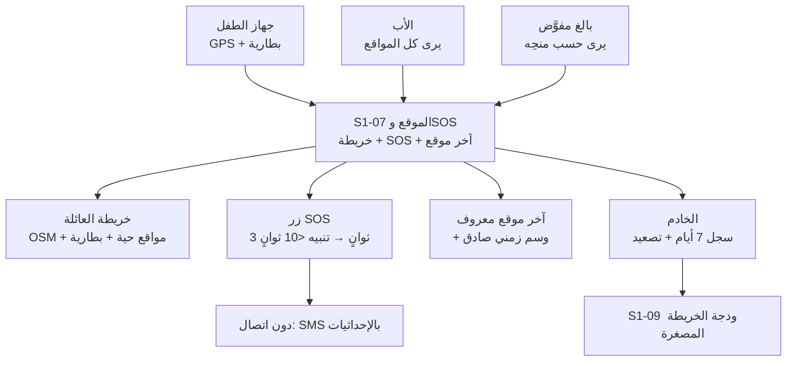
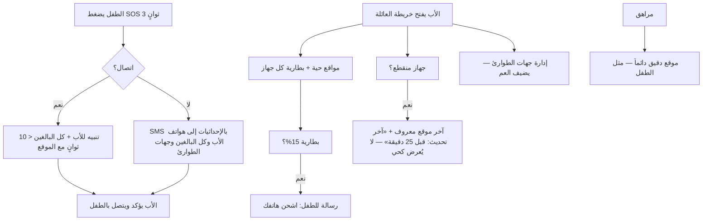

# S1-07: الموقع الأساسي وSOS (Basic Location & SOS)

- **الحالة:** approved | **المرحلة:** 1 (نواة الحماية) · **آخر تحديث:** 2026-11-06
- **القرارات الحاكمة:** Q-001 · Q-003 · Q-007 · Q-020 · Q-055 · Q-056 · Q-061 · Q-064 · Q-067 · Q-101 · Q-102 · Q-103 · Q-104 · Q-105 · Q-106 · Q-129 · Q-136 · Q-138 · Q-160 · Q-161 · Q-163 · Q-166 · Q-229 · Q-233 · Q-234 · Q-238 · Q-239 · D-021 · D-023 · D-038 · G-006 · G-011
- **حالة المراجعة:** §§1–8 + §10 معتمدة بالكامل في التخطيط (حكم المالك 2026-11-06) · §9 في مرحلة التصميم.
- **الأدلة المرجعية:** المواصفة القديمة S1-07 (مرجع فقط، G-009) · Deep-dives: Life360 (تنعيم Kalman + توفير البطارية + SOS) · FamilyWall (خريطة الأسرة) · S1-01 (معتمد) · S1-02 (معتمد) · S1-03 (معتمد) · S1-09 (معتمد)

## 1. الهدف والتحليل والنطاق

الموقع الأساسي وSOS هو **درع الأمان الطارئ وركيزة الاطمئنان** للعائلة: خريطة عائلية تعرض مواقع الأفراد الحية ومستوى بطارياتهم، وآخر موقع معروف بصدق عند انقطاع الاتصال، وزر استغاثة SOS يصل للأب وكل البالغين في أقل من 10 ثوانٍ عند الاتصال الطبيعي (Q-061) — ودون اتصال يُرسَل SMS بالإحداثيات بأفضل جهد بلا وعد زمني.

**التحليل (لماذا هذا النظام):** الأب يحتاج أن يعرف أين أطفاله الآن، وأن يصله نداء استغاثتهم فوراً مهما كانت الشبكة. بدون موقع حي يبقى الاطمئنان تخميناً، وبدون SOS دون اتصال يفشل النظام في اللحظة التي يُحتاج فيها أكثر (اليمن). لذلك S1-07 يبني الموقع على ثلاث قواعد: التتبع التكيفي الموفر للبطارية، والصدق في آخر موقع معروف، ومسار SOS لا يعتمد على الإنترنت وحده.

**داخل النطاق:**
- خريطة العائلة التفاعلية (OSM — Q-020) + مواقع الأفراد الحية + مستوى البطارية.
- آخر موقع معروف بوسم زمني صادق (لا يُعرض كأنه حي).
- زر SOS (ضغط مطول 3 ثوانٍ — Q-067) + مسار تصعيد + جهات طوارئ عائلية.
- تتبع تكيفي: كل 5 دقائق عند السكون، وكل دقيقة عند الحركة (Q-101).
- SOS دون اتصال: مسار بديل عبر SMS بالإحداثيات إلى هواتف الأب وكل البالغين وجهات الطوارئ (Q-103 · Q-138).
- سجل مواقع 7 أيام + آخر موقع معروف (Q-105) — ويُحذف آخر موقع معروف بعد 7 أيام من آخر قراءة (Q-166).

**خارج النطاق (أنظمة أخرى):**
- السياج الجغرافي الكامل وتنبيهات الدخول/الخروج (المرحلة 5 — Q-056).
- كشف حوادث السيارات وقياس سرعة القيادة (نظام لاحق — سؤال مفتوح Q-147، المرحلة 5).
- تكامل خدمات الطوارئ الرسمية 911/999 (مرحلة لاحقة — سؤال مفتوح Q-148، المرحلة 5).

**يعتمد على:** S1-01 (الغلاف — زر SOS الدائم) + S1-02 (العضوية) + S1-03 (الأدوار والصلاحيات — من يرى ماذا) + S1-09 (ودجة الخريطة المصغرة في مركز الأوامر).

**المصطلحات:** خريطة العائلة (family map) · آخر موقع معروف (last known location) · SOS · تصعيد (escalation) · جهات طوارئ (emergency contacts) · تتبع تكيفي (adaptive tracking) · مرشح كالمان (Kalman Filter).

**من التطبيقات المفككة (§1):** نمط Life360 — تنعيم مسار GPS بمرشح Kalman Filter (منع القفزات الوهمية) + توفير بطارية تكيفي (خفض التردد عند السكون) + بروتوكول SOS؛ ونمط FamilyWall — شاشة خريطة الأسرة التجميعية. نأخذ منهما أن **الموقع دقيق وموفر للبطارية معاً**: لا قفزات وهمية على الخريطة، ولا بطارية تُستنزف.

**رسم توضيحي — أين يُستخدم الموقع وSOS (للفهم السريع):**



## 2. سيناريوهات المستخدم

### 7-1: الأب يفتح خريطة العائلة ويرى أطفاله وبطارياتهم
- **الممثل:** الأب (المالك). **السياق:** مساءً، يريد الاطمئنان على مكان أطفاله.
- **التدفق:** 1) الأب يفتح خريطة العائلة. 2) يرى مواقع أطفاله الحية على الخريطة (OSM) مع مستوى بطارية كل جهاز. 3) يرى أن بطارية جهاز ابنه 15% فيرسل له رسالة ليشحن هاتفه. **النتيجة:** اطمئنان كامل في نظرة واحدة — المكان والبطارية معاً.

### 7-2: الطفل يضغط SOS فيصل التنبيه للأب وكل البالغين في أقل من 10 ثوانٍ
- **الممثل:** الطفل. **السياق:** الطفل في موقف خطر ويحتاج والديه فوراً.
- **التدفق:** 1) الطفل يضغط زر SOS في الغلاف ضغطاً مطولاً 3 ثوانٍ. 2) يصل التنبيه للأب وكل البالغين في العائلة في أقل من 10 ثوانٍ (Q-061) مع موقع الطفل لحظتها. 3) الأب يؤكد استلام التنبيه ويتصل بالطفل. **النتيجة:** استغاثة تصل قبل فوات الأوان.

### 7-3: SOS دون إنترنت — الإحداثيات تصل عبر SMS
- **الممثل:** الطفل. **السياق:** الطفل في منطقة بلا إنترنت ويضغط SOS.
- **التدفق:** 1) الطفل يضغط SOS ولا يوجد اتصال بالخادم. 2) الجهاز يرسل SMS بالإحداثيات مباشرة إلى هواتف الأب وكل البالغين وجهات الطوارئ (Q-103 · Q-138). 3) الأب يفتح الإحداثيات في الخريطة ويعرف مكان الطفل. **النتيجة:** الاستغاثة لا تعتمد على الإنترنت وحده — تعمل في أسوأ شبكة.

### 7-4: دون اتصال — آخر موقع معروف بوسم صادق
- **الممثل:** الأب. **السياق:** جهاز الطفل انقطع اتصاله منذ 25 دقيقة.
- **التدفق:** 1) الأب يفتح الخريطة. 2) يرى آخر موقع معروف للطفل مع وسم "آخر تحديث: قبل 25 دقيقة" — لا يُعرض كأنه حي. 3) نقاط الموقع المحفوظة محلياً في الصندوق الصادر تُزامَن عند عودة الاتصال. **النتيجة:** صدق كامل — الأب يعرف ما هو حي وما هو قديم.

### 7-5: موقع المراهق الدقيق مرئي للأب دائماً
- **الممثل:** الأب + المراهق. **السياق:** المراهق في طريقه إلى المدرسة.
- **التدفق:** 1) الأب يفتح الخريطة. 2) يرى موقع المراهق الدقيق (مثل الطفل — Q-102). 3) لا مشاركة ضبابية ولا إخفاء: المراهق قاصر وحمايته أولاً. **النتيجة:** إشراف كامل على كل قاصر — طفلاً كان أو مراهقاً.

### 7-6: الأب يدير جهات الطوارئ العائلية
- **الممثل:** الأب. **السياق:** الأب يريد إضافة عمه كجهة طوارئ.
- **التدفق:** 1) الأب يفتح إدارة جهات الطوارئ. 2) يضيف عمه (بالغ في العائلة) برقم هاتفه. 3) عند أي SOS لاحق يصل التنبيه للعم أيضاً مع الأب وكل البالغين. **النتيجة:** شبكة أمان عائلية أوسع من الوالدين وحدهما.

**مخطط السيناريوهات (§2 — بصري):**



## 3. المتطلبات الوظيفية

### الخريطة
- **REQ-001:** خريطة عائلية تفاعلية (OSM — Q-020) تعرض مواقع الأفراد الحية. [Q-020 · DIRECT]
- **REQ-002:** مستوى بطارية كل جهاز ظاهر مع موقعه. [§2 · DERIVED]
- **REQ-003:** آخر موقع معروف يعرض مع وسم زمني صريح — ولا يُعرض كأنه حي أبداً. [§2 · DERIVED]

### التتبع
- **REQ-004:** تحديث تكيفي: كل 5 دقائق عند السكون، وكل دقيقة عند الحركة. [Q-101 · DIRECT]
- **REQ-005:** تنعيم مسار GPS بمرشح Kalman Filter — بلا قفزات وهمية على الخريطة. [Life360 · DIRECT]
- **REQ-006:** دون اتصال: نقاط الموقع تُحفظ في الصندوق الصادر وتُزامَن عند عودة الاتصال (بلا تكرار). [Q-064 · DIRECT] [S1-01 REQ-009 · DERIVED]

### SOS
- **REQ-007:** زر SOS بضغط مطول 3 ثوانٍ (في الغلاف — Q-067). [Q-067 · DIRECT]
- **REQ-008:** تنبيه SOS يصل للأب وكل البالغين في أقل من 10 ثوانٍ مع موقع المستغيث لحظتها. [Q-061 · Q-104 · DIRECT]
- **REQ-009:** SOS دون اتصال: SMS بالإحداثيات إلى هواتف الأب وكل البالغين وجهات الطوارئ — نفس مجموعة مستلمي التنبيه دون اتصال (Q-138) — عند تعذر الاتصال بالخادم؛ وعلى iOS يفتح التطبيق مؤلف SMS النظام معبأً مسبقاً إلى الأب وكل البالغين وجهات الطوارئ (المستخدم يضغط إرسال) — بلا إرسال تلقائي (قيد Apple) — وإن ألغى المستخدم المؤلف (أغلقه دون إرسال) يبقى SOS في حالة «معلّقة — مؤلف ملغى» دائمة على الجهاز: تُعاد المطالبة فوراً بإعادة فتح المؤلف لنفس حدث SOS (نفس `Idempotency-Key`) — لا حدث SOS ثانٍ ولا SMS مكرر — وتُزامَن الحالة عند عودة الاتصال؛ ولا تُعرض لافتة «فشل SOS» (Q-238). **ملكية النقل دون اتصال (Q-234): S1-07 يملك النقل؛ الغلاف يسلّم `sos_triggered` إلى S1-07 فوراً**؛ والصندوق الصادر (Outbox) مخزن تأجيل لا نقل بديل — S1-07 وحده يقرر الوسيلة: SMS مباشر عند توفر الحصة، أو تسجيل الحدث في Outbox بأولوية قصوى للمزامنة عند عودة الاتصال — لا نقلان بديلان بلا مالك. [Q-103 · Q-138 · Q-229 · Q-233 · Q-234 · Q-238 · DIRECT]
- **REQ-010:** الأب يدير جهات الطوارئ العائلية (إضافة/حذف). [§2 · DERIVED]

### الخصوصية والرؤية
- **REQ-011:** الأب يرى الموقع الدقيق لكل قاصر — طفلاً كان أو مراهقاً. [Q-102 · DIRECT]
- **REQ-012:** البالغ المفوَّض يرى المواقع حسب منحِه فقط (deny-override). [Q-007 · DIRECT]

### السجل والتكامل
- **REQ-013:** سجل مواقع 7 أيام + آخر موقع معروف. [Q-105 · DIRECT]
- **REQ-014:** السجل يُحذف تلقائياً بعد 7 أيام. [Q-105 · DERIVED]
- **REQ-015:** ودجة S1-09 "الخريطة المصغرة": آخر مواقع الأبناء حسب المنح. [S1-09 · DERIVED]
- **REQ-016:** تنبيهات SOS تظهر في تنبيهات S1-09. [S1-09 · DERIVED]
- **REQ-017:** رسائل SMS تُحسب من حصة الخطة (Q-055)؛ **الحصص (Q-129): مجانية 20 رسالة/شهر، ومميزة 100 رسالة/شهر، وتعبئة 50 رسالة (S1-04 REQ-010)**؛ ويُسمح بـ 3 رسائل SOS طارئة بعد نفاد الحصة في كل دورة (SOS فقط) — **يبقى الحد كما هو بحكم المالك (Q-163، خيار ب) ويُوثَّق كخطر مقبول**: بعد استنفاد الثلاث وبلا تعبئة وبلا إنترنت لا يصل SOS عبر SMS؛ والتعبئة وشراء الحزم عبر S1-04؛ والأب يُشعَر فوراً بكل رسالة طارئة وعند النفاد — إلا دون اتصال مع استنفاد الحصة والطوارئ الثلاث، فيُحفظ إشعار النفاد في طابور على الجهاز للتسليم عند عودة الاتصال ويُعرض محلياً للطفل (لا قناة فورية دون اتصال). **مرآة الحصة المحلية:** الجهاز يحتفظ بنسخة محلية من رصيد الحصة والطوارئ المتبقية ونهاية الدورة، تُزامَن عند كل اتصال بالخادم، ويُتخذ قرار الإرسال دون اتصال بناءً عليها. **سياسة المرآة عند الفشل (Q-239 — D-9): المرآة مغلقة-عند-الفشل بعد 3:** بعد استنفاد رسائل الطوارئ الثلاث (Q-163) يُغلق الإرسال دون اتصال تماماً حتى أول مزامنة ناجحة مع الخادم — لا رسالة SMS دون اتصال بعد الثالثة؛ ومرآة فارغة (لم تُزامَن أبداً) تُعامل كمنتهية الحصة: يُسمح فقط بالثلاث الطارئة ثم تُغلق؛ وعند الإغلاق يُشعَر الأب فوراً إن كان متصلاً، وإلا يُحفظ إشعار الإغلاق في الطابور للتسليم عند عودة الاتصال ويُعرض محلياً للطفل. **والثلاث لكل عائلة لا لكل جهاز:** تُعدّ خادمياً عند المزامنة (`quota_usage.sms_emergency_used` — S1-04 §5) — جهاز ثانٍ للطفل نفسه (Q-230) لا يعيد صرف الثلاث نفسها؛ وعند التعارض يفوز الخادم دائماً (لقطة الخادم تستبدل المرآة كاملةً — بروتوكول المزامنة §6-3). **توقيع SOS:** كل SMS استغاثة يحمل توقيع HMAC-SHA256 (مقتطع إلى 10 أحرف) بمفتاح الجهاز المتبادل عند الإقران فوق (العائلة، العضو، الوقت، الإحداثيات)، ويتحقق تطبيق الأب من التوقيع قبل عرض التنبيه. [Q-106 · Q-129 · Q-163 · DIRECT — أضيف بتعديل 2026-11-06؛ وُسّع بتعديل 2026-11-06 (Q-163)؛ وأُضيفت الحصص بتعديل 2026-11-07 (Q-175)]
- **REQ-018:** حل تنبيه SOS: الأب أو البالغ المفوَّض حسب القالب يحل التنبيه عبر `POST /api/v1/families/{id}/sos/{sosId}/resolve` (مفتاح `location.sos.resolve` — Q-160)؛ فتصبح حالته `resolved` ويتوقف التصعيد؛ ويُدفع حدث `family/{family_id}/sos/resolved` فوراً للأجهزة التي تعرض التنبيه؛ ويُسجَّل الحل في التدقيق. [Q-136 · Q-160 · Q-161 · DIRECT]

## 4. الواجهات والعقود

### 4-1. نقاط الوصول (REST — `/api/v1`)

| الطريقة والمسار | الغرض | المدخل | المخرج |
|---|---|---|---|
| `GET /api/v1/families/{id}/locations` | آخر مواقع كل الأعضاء (مصفاة حسب المنح) | — | `[{member_id, lat, lng, accuracy, battery, at}]` |
| `POST /api/v1/families/{id}/locations` | الإبلاغ عن نقطة موقع (الجهاز → الخادم) | `{lat, lng, accuracy, battery, at}` | النقطة + `server_seq` |
| `GET /api/v1/families/{id}/members/{memberId}/locations` | سجل المواقع (7 أيام كحد أقصى) | `?from&to` | `[{lat, lng, at}]` |
| `POST /api/v1/families/{id}/sos` | إطلاق SOS (الجهاز → الخادم) | `{lat, lng, at}` + ترويسة `Idempotency-Key` (UUID يولّده الجهاز لكل حدث SOS — يمنع التنبيه المكرر عند إعادة الإرسال) | `{sos_id, at}` |
| `POST /api/v1/families/{id}/sos/{sosId}/acknowledge` | تأكيد استلام SOS (الأب/بالغ) | — | `{sos_id, acknowledged_by, at}` |
| `POST /api/v1/families/{id}/sos/{sosId}/resolve` | حل تنبيه SOS وإيقاف التصعيد (الأب + البالغ المفوَّض حسب القالب — مفتاح `location.sos.resolve` — Q-136 · Q-160) | `{resolution_note?}` | `{sos_id, resolved_by, at, status: "resolved"}` |
| `POST /api/v1/families/{id}/quota/mirror-sync` | مزامنة مرآة الحصة (الجهاز → الخادم — عند كل اتصال؛ المالك خادمياً: الفوترة `SmsLedger` — S1-04 §5) | `{device_id, mirror_version, sms_sent_local, sms_emergency_used_local, cycle_end}` | `{quota_balance, sms_emergency_remaining, cycle_end, server_timestamp, mirror_version}` — لقطة الخادم المرجعية؛ تفوز على المرآة دائماً (Q-239) |
| `GET /api/v1/families/{id}/emergency-contacts` | قائمة جهات الطوارئ | — | `[{contact_id, member_id, phone}]` |
| `POST /api/v1/families/{id}/emergency-contacts` | إضافة جهة طوارئ (الأب) | `{member_id, phone}` | جهة الطوارئ |
| `DELETE /api/v1/families/{id}/emergency-contacts/{contactId}` | حذف جهة طوارئ (الأب) | — | `{ok: true}` |

### 4-2. الأحداث (MQTT → الأجهزة)

> **عقد الوسيط الملزم (Q-168):** الوسيط Eclipse Mosquitto 2.x — عقدة واحدة في المرحلة 1 — TLS 1.2+ على 8883 + mTLS؛ QoS 1؛ والإقرار التطبيقي إلزامي للأوامر وSOS فقط؛ والموقع الحي QoS 0؛ وبلا QoS 2؛ والعزل ببادئة `family/{family_id}/` + ACL خادمي؛ والشهادات سنتان مع تجديد تلقائي وإبطال فوري. التفصيل الكامل: `docs/family-os/governance/architecture/MQTT-BROKER-SPEC.md`. [Q-168 · Q-175]

| الموضوع | الغرض |
|---|---|
| `family/{family_id}/location/updated` | تحديث موقع عضو (للخريطة الحية) |
| `family/{family_id}/sos/new` | SOS جديد (أولوية عالية — يصل في أقل من 10 ثوانٍ) |
| `family/{family_id}/sos/acknowledged` | تأكيد استلام SOS |
| `family/{family_id}/sos/resolved` | حل تنبيه SOS (`{sos_id, resolved_by, at}`) — يُدفع فوراً للأجهزة التي تعرض التنبيه |

### 4-3. قناة المنصة (MethodChannel — Flutter ↔ Kotlin)

| الطريقة | الغرض |
|---|---|
| `startLocationService()` | تشغيل خدمة الموقع في الخلفية (التتبع التكيفي) |
| `getLastKnownLocation() → {lat, lng, at}` | آخر موقع مخزن + وسمه الزمني |
| `triggerSos()` | إطلاق SOS من زر الغلاف (ضغط مطول 3 ثوانٍ) |

### 4-4. صيغة الخطأ الموحدة

`{code, message_ar, trace_id}` — كما في S1-02 §4. رموز هذا النظام: `LOC_MEMBER_NOT_FOUND` (عضو غير موجود) · `LOC_NOT_VISIBLE` (موقع بلا منح رؤية) · `LOC_SOS_ALREADY_ACTIVE` (يوجد SOS نشط — تُعاد بياناته بدل التكرار) · `LOC_INVALID_COORDINATES` (إحداثيات خارج النطاق).

## 5. البيانات — النموذج

كل جدول يحمل `family_id` + RLS (D-021). سجل المواقع يُحذف تلقائياً بعد 7 أيام (REQ-014).

### 5-1. `location_point` — نقاط الموقع (سجل 7 أيام)
| الحقل | النوع | ملاحظات |
|---|---|---|
| `point_id` | uuid (PK) | |
| `family_id` | uuid (FK) | + RLS |
| `member_id` | uuid (FK) | |
| `lat` / `lng` | double | بعد التنعيم (Kalman) |
| `accuracy` | double | دقة القراءة (متر) |
| `battery` | int | مستوى بطارية الجهاز (%) |
| `at` | timestamptz | وقت القراءة على الجهاز |
| `server_seq` | bigint | تسلسل الخادم |

### 5-2. `last_known_location` — آخر موقع معروف (قراءة سريعة للوحة)
| الحقل | النوع | ملاحظات |
|---|---|---|
| `member_id` | uuid (PK, FK) | |
| `family_id` | uuid (FK) | + RLS |
| `lat` / `lng` | double | |
| `accuracy` | double | |
| `battery` | int | |
| `at` | timestamptz | الوسم الزمني الصريح (REQ-003) |
| `expires_at` | timestamptz | آخر قراءة + 7 أيام — يُحذف تلقائياً (Q-166) |

### 5-3. `sos_alert` — تنبيهات SOS
| الحقل | النوع | ملاحظات |
|---|---|---|
| `sos_id` | uuid (PK) | |
| `family_id` | uuid (FK) | + RLS |
| `member_id` | uuid (FK) | المستغيث |
| `lat` / `lng` | double | موقع الاستغاثة لحظتها |
| `at` | timestamptz | |
| `status` | text | `active` / `acknowledged` / `resolved` |
| `channel` | text | `server` / `sms` (أي مسار أوصل التنبيه — REQ-009) |
| `acknowledged_by` / `acknowledged_at` | uuid / timestamptz (nullable) | |
| `resolved_by` / `resolved_at` | uuid / timestamptz (nullable) | من حلّ التنبيه ومتى (Q-136) |

### 5-4. `emergency_contact` — جهات الطوارئ العائلية
| الحقل | النوع | ملاحظات |
|---|---|---|
| `contact_id` | uuid (PK) | |
| `family_id` | uuid (FK) | + RLS |
| `member_id` | uuid (FK) | البالغ جهة الطوارئ |
| `phone` | text | لرسائل SMS البديلة |
| `added_by` / `added_at` | uuid / timestamptz | |

### 5-5. مراجع (بلا تكرار)
- العضوية: S1-02 (`membership`) · تنبيهات SOS: تظهر في S1-09 (`alert`، النوع `sos`) · إطلاق SOS وتأكيده: أحداث تدقيق في النواة المشتركة (`AuditEvent`، النطاق `location`).
- **ملاحظة العميل:** بلاطات الخرائط دون اتصال (MBTiles — Q-020) + نقاط الصندوق الصادر + **مرآة الحصة المحلية (رصيد الحصة + الطوارئ المتبقية + نهاية الدورة — REQ-017، تُزامَن عند كل اتصال بالخادم)** — مخازن عميل لا جداول خادم. **حقول المرآة:** `quota_balance` · `sms_emergency_remaining` · `cycle_end` · `mirror_version` (نسخة أحادية رتيبة يملكها الخادم — تُرفع عند كل تغيير في `quota_usage`) · `last_sync_at` · `sms_sent_local` / `sms_emergency_used_local` (عدّادات محلية تُبلَّغ عند المزامنة فقط — لا سلطة لها). **قاعدة التعارض:** لقطة الخادم تفوز دائماً — عند المزامنة يستبدل الجهاز مرآته كاملةً باللقطة الخادمية (`POST .../quota/mirror-sync` — §4-1) ولا يدمج محلياً أبداً؛ ونسخة أقدم (`mirror_version` أصغر) لا تكتب فوق نسخة أحدث أبداً.

## 6. القواعد والصلاحيات

### 6-1. مفاتيح هذا النظام (`location.*`)

| المفتاح | الوصف | لمن؟ |
|---|---|---|
| `location.view` | عرض مواقع الأعضاء الحية | الأب + البالغ المفوَّض حسب منحِه |
| `location.history.view` | عرض سجل المواقع (7 أيام) | الأب + البالغ المفوَّض حسب منحِه |
| `location.sos.trigger` | إطلاق SOS | كل الأدوار — حتى الطفل (لا يُحجب أبداً) |
| `location.sos.acknowledge` | تأكيد استلام SOS | الأب + البالغون |
| `location.sos.resolve` | حل تنبيه SOS وإيقاف التصعيد | الأب + البالغ المفوَّض حسب القالب (Q-136 · Q-160) |
| `location.emergency.manage` | إدارة جهات الطوارئ | الأب |

### 6-2. الثوابت الصلبة (لا تُكسر أبداً)
- الأب يرى الموقع الدقيق لكل قاصر — طفلاً كان أو مراهقاً (Q-102).
- SOS متاح لكل الأدوار دائماً ولا يُحجب بأي صلاحية (Q-067).
- آخر موقع معروف لا يُعرض كأنه حي أبداً (REQ-003).
- سجل المواقع يُحذف تلقائياً بعد 7 أيام — لا احتفاظ أطول (Q-105).
- بيانات الموقع لا تغادر العائلة أبداً.
- تجاوز الطوارئ الثلاث لا يُمنح إلا لـ SOS (لا OTP ولا غيره).

### 6-3. قواعد التشغيل
- **التتبع التكيفي:** حساس الحركة يحدد التردد (5 دقائق عند السكون، دقيقة عند الحركة)؛ والتنعيم (Kalman) على الجهاز قبل الإرسال.
- **تصعيد SOS:** الخادم يدفع التنبيه لكل البالغين فوراً؛ وإن لم يقرّ أي بالغ خلال **5 دقائق** يُعاد الدفع والتذكير (دفع + تنبيه) حتى الإقرار أو الحل — التصعيد لا يتوقف بصمت. وإن تعذر الاتصال بالخادم يرسل الجهاز SMS بالإحداثيات إلى هواتف الأب وكل البالغين وجهات الطوارئ (Q-138) — من حصة الرسائل (Q-106)؛ ويُتخذ قرار الإرسال دون اتصال بناءً على **مرآة الحصة المحلية** (لا على فحص خادمي غير reachable)؛ وإن نفدت الحصة يُسمح بـ 3 رسائل SOS طارئة فقط في كل دورة (SOS فقط) ثم تُحجب رسائل SOS حتى التعبئة أو التجديد — **الحد يُوثَّق كخطر مقبول بحكم المالك (Q-163)**؛ ويُشعَر الأب فوراً بكل رسالة طارئة وعند استنفادها — إلا دون اتصال مع استنفاد الحصة والطوارئ الثلاث، فيُحفظ إشعار النفاد في طابور على الجهاز للتسليم عند عودة الاتصال ويُعرض محلياً للطفل. وكل SMS استغاثة **موقّع** (HMAC-SHA256 بمفتاح الجهاز — REQ-017) فيتحقق تطبيق الأب من الأصالة قبل العرض.
- **حصة الرسائل:** كل SMS صادر (SOS + OTP الاحتياطي) يُحسب من حصة الخطة؛ والتعبئة عبر S1-04.
- **بروتوكول مزامنة مرآة الحصة (Q-239 — D-9؛ مالك المزامنة خادمياً: الفوترة `SmsLedger` — S1-04 §5):** (1) **التردد:** الجهاز يزامن مرآته عند كل اتصال بالخادم (`POST /api/v1/families/{id}/quota/mirror-sync` — §4-1) وكلما دفع الخادم لقطة جديدة عبر الموضوع المحتفظ `family/{family_id}/billing/quota-mirror` (S1-04 §4). (2) **قاعدة التعارض — الخادم يفوز:** لقطة الخادم (`quota_balance` · `sms_emergency_remaining` · `cycle_end` · `server_timestamp` · `mirror_version`) تستبدل المرآة كاملةً؛ والجهاز لا يدمج محلياً ولا يكتب نسخة أقدم فوق أحدث. (3) **مصالحة متعددة الأجهزة:** العدّادات خادمية لكل عائلة لا لكل جهاز (`quota_usage` — `family_id` + `period`)؛ وكل جهاز يبلّغ استهلاكه المحلي عند المزامنة، فيجمعه الخادم بعد إزالة التكرار بمفاتيح عدم التكرار/سجلات الإرسال، ويعيد اللقطة المرجعية لكل أجهزة العائلة — فالثلاث الطارئة (Q-163) لكل عائلة: جهاز ثانٍ (Q-230) لا يعيد صرف ما صرفه الأول. (4) **مغلقة-عند-الفشل بعد 3 (Q-239):** بعد استنفاد الثلاث الطارئة — أو بمرآة فارغة لم تُزامَن أبداً — يُغلق الإرسال دون اتصال حتى أول مزامنة ناجحة؛ ويُشعَر الأب فوراً (أو يُحفظ الإشعار في الطابور عند انقطاع الاتصال ويُعرض محلياً للطفل — REQ-017).
- **منع تكرار SOS:** SOS نشط قائم → الضغط الجديد يعيد بياناته بدل إنشاء تنبيه مكرر؛ و`POST /api/v1/families/{id}/sos` يقبل ترويسة `Idempotency-Key` (UUID لكل حدث) فيرفض الخادم إعادة إرسال الحدث نفسه.
- **البطارية:** مستوى البطارية ظاهر مع الموقع؛ ولا تنبيه بطارية منخفضة في المرحلة 1 (عرض فقط).

## 7. الحالات الحدية والأخطاء

1. **إحداثيات خارج النطاق:** نقطة بإحداثيات غير صالحة → `LOC_INVALID_COORDINATES` (لا تُحفظ).
2. **عضو غير موجود:** طلب موقع عضو غير موجود → `LOC_MEMBER_NOT_FOUND`.
3. **بلا منح رؤية:** طلب موقع بلا منح → `LOC_NOT_VISIBLE`.
4. **SOS نشط قائم:** ضغط SOS جديد أثناء SOS نشط → تُعاد بيانات النشط بدل تنبيه مكرر (`LOC_SOS_ALREADY_ACTIVE`).
5. **SOS بلا رصيد وبلا إنترنت:** الحصة منتهية والطوارئ الثلاث مستنفدة ولا اتصال → SOS يبقى "معلقاً" على الجهاز (لا يُعرض كأنه أُرسل) ويُرسَل عبر الخادم فور عودة الاتصال؛ وإشعار النفاد يُحفظ في الطابور معه ويُعرض محلياً للطفل. (قرار «منتهية» هنا يُتخذ من مرآة الحصة المحلية — Q-163؛ والحد نفسه خطر مقبول موثَّق بحكم المالك.)
6. **GPS ضعيف:** قراءة بدقة سيئة → تُرسَل مع دقتها؛ والخريطة تعرض دائرة عدم يقين بدل نقطة وهمية دقيقة.
7. **قفزة GPS وهمية:** نقطة شاذة يرفضها مرشح Kalman → تُتجاهل ولا تُحفظ.
8. **بطارية منخفضة جداً:** عند انخفاض البطارية يقل تردد التتبع تلقائياً لحفظ ما تبقى للطوارئ (SOS أولاً).
9. **جهاز مغلق:** جهاز الطفل مغلق أو بلا بطارية → آخر موقع معروف مع وسمه (لا يُعرض كأنه حي).
10. **SOS عرضي:** SOS بالخطأ (ضغط عرضي) → الأب يؤكد أو يلغي عبر نقطة الحل `POST /api/v1/families/{id}/sos/{sosId}/resolve` (الأب + البالغ المفوَّض حسب القالب — Q-136)؛ الحالة تصبح `resolved` ويتوقف التصعيد؛ والإلغاء يُسجَّل في التدقيق.
11. **جهة طوارئ محذوفة:** جهة طوارئ حُذفت أو غيّرت رقمها → تُحذف من القائمة؛ وSOS اللاحق لا يرسل لها.
12. **سجل قديم:** طلب سجل أقدم من 7 أيام → يعيد فارغاً (محذوف تلقائياً — لا خطأ).
13. **نقاط منتهية في الصندوق:** نقاط في الصندوق الصادر أقدم من 7 أيام عند عودة الاتصال → تُتجاهل (انتهت صلاحيتها) ولا تُزامَن.
14. **إلغاء مؤلف SMS على iOS:** المستخدم أغلق مؤلف SMS النظام دون إرسال → SOS يبقى في حالة «معلّقة — مؤلف ملغى» دائمة على الجهاز (لا تُعرض كأنها أُرسلت، ولا كلافتة «فشل SOS»)؛ وتُعاد المطالبة فوراً بإعادة فتح المؤلف لنفس حدث SOS (نفس `Idempotency-Key`) — لا حدث SOS ثانٍ ولا SMS مكرر؛ وتُزامَن الحالة عند عودة الاتصال. (Q-238 · REQ-009)

## 8. معايير القبول

- **ACC-001:** الخريطة العائلية تعرض مواقع الأفراد الحية + مستوى البطارية. [REQ-001/002]
- **ACC-002:** آخر موقع معروف مع وسم زمني صريح؛ ولا يُعرض كأنه حي أبداً. [REQ-003]
- **ACC-003:** التحديث التكيفي: كل 5 دقائق عند السكون، وكل دقيقة عند الحركة. [REQ-004]
- **ACC-004:** بلا قفزات وهمية على الخريطة (Kalman). [REQ-005]
- **ACC-005:** دون اتصال: النقاط تُزامَن عند عودة الاتصال بلا تكرار. [REQ-006]
- **ACC-006:** زر SOS بضغط مطول 3 ثوانٍ يطلق الاستغاثة. [REQ-007]
- **ACC-007:** تنبيه SOS يصل للأب وكل البالغين في أقل من 10 ثوانٍ مع موقع المستغيث. [REQ-008 · Q-061]
- **ACC-008:** SOS دون اتصال: SMS بالإحداثيات إلى هواتف الأب وكل البالغين وجهات الطوارئ. [REQ-009 · Q-138]
- **ACC-009:** الأب يدير جهات الطوارئ (إضافة/حذف). [REQ-010]
- **ACC-010:** الأب يرى الموقع الدقيق لكل قاصر (طفل أو مراهق). [REQ-011]
- **ACC-011:** البالغ المفوَّض يرى حسب منحِه فقط. [REQ-012]
- **ACC-012:** سجل 7 أيام + حذف تلقائي بعد 7 أيام. [REQ-013/014]
- **ACC-013:** ودجة S1-09 (الخريطة المصغرة) + تنبيهات SOS تظهر في S1-09. [REQ-015/016]
- **ACC-014:** حصة الرسائل: كل SMS يُحسب؛ و3 رسائل SOS طارئة فقط بعد النفاد (SOS فقط) — الحد موثَّق كخطر مقبول (Q-163)؛ والجهاز يقرر الإرسال دون اتصال من مرآة الحصة المحلية؛ وكل SMS استغاثة موقّع ويتحقق منه تطبيق الأب؛ وإن لم يقرّ أي بالغ خلال 5 دقائق يُعاد الدفع والتذكير حتى الحل؛ والأب يُشعَر فوراً — إلا دون اتصال مع استنفاد الحصة والطوارئ، فيُحفظ إشعار النفاد في الطابور للتسليم عند عودة الاتصال. [REQ-017 · Q-106 · Q-163]
- **ACC-015:** مفاتيح `location.*` الستة مطبقة؛ والطفل يستطيع إطلاق SOS. [§6]
- **ACC-016:** حل تنبيه SOS: الأب أو المفوَّض يحل التنبيه عبر نقطة الحل؛ فتصبح حالته `resolved` ويتوقف التصعيد؛ ويُدفع حدث الحل فوراً للأجهزة؛ والحل مسجَّل في التدقيق. [REQ-018 · Q-136 · Q-160 · Q-161]

## 9. قائمة الشاشات

**المصدر:** `docs/family-os/governance/phases/phase-1/S1-07-location-basic/SPEC.md` (§§1–8 + §10، ‏18 REQ) + `DIAGRAMS.md` §1 (‏12 حالة استخدام UC1…UC12) + قالب المواصفة `templates/system-spec.md:37` + قائمة قبول المسودات `design-draft-acceptance.md`.
**الحالة:** مسودة (drafted) — للمراجعة الصباحية؛ لا اعتماد ليلاً.

## قيود صريحة (تسجَّل هنا ولا تُفترض ضمناً)

- **Q-201 (بوابة «قبل التصميم» مفتوحة):** سجل المواقع 7 أيام محكوم بـ Q-105 (REQ-013/REQ-014)، لا بافتراض 30 يوماً — «قابل للتغيير بعد استشارة PDPL (Q-201)» إن غيّرت الاستشارة مدد الاحتفاظ.
- **Q-042/Q-044:** بلا خط عربي نهائي وبلا درجات ألوان 50–950 نهائية — المسودات البصرية على الرموز الحالية فقط (DS-CL-02).
- **Q-043:** لا شعار SVG ولا شخصية مرشد مخترعة — علامة نصية «عائلتي» بألوان DS-BR فقط (DS-BR-02)، والفجوة مسجلة (B-001/B-002).
- **Q-045:** التصميم للهاتف أولاً؛ والحد الأدنى على اللوحي «لا ينكسر» (S-001) — النطاق الكامل للوحي/الطيّ بطاقة صباحية.
- **Q-046:** بلا تحليلات في شاشات الأطفال — لا أحداث تحليلية في شاشات الأطفال إلا «بلا بيانات شخصية» (QUALITY-GATES §2).
- **Q-157:** بلا هدف 24 ساعة في أي شاشة — قائمة الإعداد الأولي (DS-CC-10) بلا هدف زمني حتى يُحسم.
- **Q-159:** غير منطبق على هذا النظام (خاص بـ S1-10).
- **CH-003: حدود تنبيه الأهل عند إشارات ضيق الطفل فجوة مسجلة (مراجعة سلامة طفل + قانونية) — لا تُصمَّم عتبات تنبيه تخميناً.** ينطبق هنا بالسلب: S1-07 لا يكشف إشارات الضيق آلياً أبداً — SOS يدوي فقط (ضغط 3 ثوانٍ — Q-067)؛ أي تنبيه تلقائي مبني على «ضيق» أو سلوك فجوة (G-S107-03) ولا يُصمَّم في LO-01…LO-07.
- **Q-070:** العربية أولاً RTL؛ كل نص من ملفات الترجمة بمفاتيح `screens.<screen-id>.<element>` (DS-MC-01).
- **قيد صدق خاص بهذا النظام:** آخر موقع معروف لا يُعرض كأنه حي أبداً (REQ-003) — كل عرض موقع يحمل عمره ودقته إلزامياً (DS-ST-09).

## 9-1. فهرس الشاشات

| المعرف | الاسم | الوضع | الأدوار المستهدفة | الغرض | REQ | معايير DS |
|---|---|---|---|---|---|---|
| LO-01 | الخريطة العائلية الحية | أهل + طفل | الأب؛ البالغ المفوَّض حسب منحِه؛ الطفل/المراهق لموقعه | عرض مواقع الأفراد الحية والبطارية على خريطة OSM | REQ-001، REQ-002، REQ-003، REQ-006، REQ-011، REQ-012 | DS-ST-09، DS-CC-05، DS-CM-07، DS-RT-07 |
| LO-02 | آخر موقع معروف (تفاصيل عضو) | أهل + طفل | الأب؛ البالغ المفوَّض حسب منحِه؛ العضو نفسه | عرض آخر موقع معروف لعضو مع وسمه الزمني الصادق ودقته | REQ-003، REQ-006، REQ-011، REQ-012 | DS-ST-09، DS-ST-05، DS-MC-04 |
| LO-03 | زر SOS وشاشة حالة SOS | أهل + طفل | كل الأدوار (الإطلاق)؛ الأب وكل البالغين وجهات الطوارئ (الاستلام) | إطلاق SOS بضغط 3 ثوانٍ وعرض حالته (أُرسل/وصل/أُقرّ) ومساره (خادم/SMS) | REQ-007، REQ-008، REQ-009، REQ-017 | DS-CM-04، DS-MT-06، DS-MC-08، DS-SP-07 |
| LO-04 | جهات الطوارئ العائلية | أهل | الأب | إضافة جهات الطوارئ وحذفها | REQ-010 | DS-SE-01، DS-MC-01، DS-ST-07 |
| LO-05 | سجل المواقع 7 أيام | أهل | الأب؛ البالغ المفوَّض حسب منحِه | عرض سجل مواقع عضو خلال 7 أيام كحد أقصى | REQ-012، REQ-013، REQ-014 | DS-ST-05، DS-NV-03، DS-RT-08 |
| LO-06 | تنبيهات SOS | أهل | الأب؛ البالغ المفوَّض حسب القالب | عرض تنبيهات SOS وتأكيد استلامها وحلّها وإيقاف التصعيد | REQ-008، REQ-009، REQ-016، REQ-017، REQ-018 | DS-CC-02، DS-MC-08، DS-ST-03، DS-MT-06 |
| LO-07 | ودجة الخريطة المصغرة | أهل + طفل | كل الأدوار (المحتوى حسب المنح) | سطح الويدجت في S1-09: آخر مواقع الأبناء | REQ-015 | DS-CC-04، DS-CC-06، DS-ST-06 |

## 9-2. تفصيل الشاشات

### LO-01 — الخريطة العائلية الحية

- **الوضع:** أهل + طفل. **الأدوار:** الأب (كل المواقع الدقيقة — REQ-011)؛ البالغ المفوَّض حسب منحِه فقط (REQ-012، deny-override)؛ الطفل/المراهق يرى موقعه وموقع من يشاركه الأب. **المصدر:** §2 (7-1/7-4/7-5) + DIAGRAMS §1 (UC1/UC2/UC3) + §4-1 `GET /api/v1/families/{id}/locations`.
- **الحقول الرئيسية:** خريطة OSM تفاعلية (`FosMapView` + `FosMemberMarker` — DS-CM-5.8)؛ علامة كل عضو: الاسم + البطارية (%) + عمر آخر تحديث؛ شارة «آخر موقع معروف — قبل 25 دقيقة» على العلامة غير الحية (مثال §2 7-4 — الصياغة بالمتغير لا بالرقم الثابت)؛ دائرة عدم يقين عند دقة سيئة (§7-6) بدل نقطة وهمية دقيقة؛ بانر دون اتصال + شارة «وضع منخفض» (Q-064)؛ زر SOS عائم فوق كل الطبقات (DS-SP-07 — زر الغلاف من S1-01)؛ مبدّل أفراد لتصفية العرض.
- **التنقل:** من: تبويب «الأمان/الموقع» (DS-NV-03) / ودجة LO-07 / رابط عميق `fos://location/member/{id}` (DS-NV-07). إلى: LO-02 (تفاصيل عضو) / LO-05 (سجل العضو) / LO-03 (SOS).
- **الحالات (DS-ST):** تحميل: بلاطات الخريطة من الكاش (MBTiles — Q-020) + Skeleton للعلامات؛ فارغة: لا أعضاء مرئيون حسب المنح → حالة صادقة `not_delegated` (DS-ST-03)؛ خطأ: `LOC_NOT_VISIBLE` كحالة صادقة لا «خطأ»؛ فشل تحميل بلاطات → بطاقة خطأ داخل الشاشة والقائمة تعمل (DS-ST-06)؛ بلا اتصال: آخر المواقع المعروفة مع أعمارها + نقاط الصندوق الصادر تُزامَن عند العودة (DS-ST-05)؛ نجاح: مواقع حية + بطارية؛ جزئي: GPS ضعيف → دائرة عدم يقين. **لا ينطبق:** تنبيه بطارية منخفضة — عرض فقط في المرحلة 1 (§6-3).
- **وايرفريم ASCII:**
```
┌─────────────────────────────────┐
│ خريطة العائلة      [SOS] [⚙]   │
│ ┌─────────────────────────────┐ │
│ │   🗺️  خريطة OSM             │ │
│ │    ● سارة  85% • الآن       │ │
│ │    ◐ عمر  15% • قبل 25 دقيقة│ │
│ │    (دائرة عدم يقين)         │ │
│ └─────────────────────────────┘ │
│ [سارة] [عمر] [ليلى]  [السجل >] │
│ [بانر دون اتصال — عند الانقطاع] │
└─────────────────────────────────┘
```
- **رموز DS المستخدمة:** DS-ST-09، DS-CC-05، DS-CM-07، DS-RT-07، DS-ST-05، DS-ST-06، DS-SP-07، DS-MC-04.
- **النصوص الدقيقة (مصدر الترجمة):**
  - `screens.family-map.title` = «خريطة العائلة»
  - `screens.family-map.last_known` = «آخر موقع معروف — قبل {duration}»
  - `screens.family-map.battery` = «البطارية {percent}٪»
  - `screens.family-map.offline_banner` = «أنت دون اتصال — تُعرض آخر المواقع المعروفة»
  - `screens.family-map.not_visible` = «لا مواقع مرئية لك حسب منحك»

### LO-02 — آخر موقع معروف (تفاصيل عضو)

- **الوضع:** أهل + طفل. **الأدوار:** الأب؛ البالغ المفوَّض حسب منحِه؛ العضو نفسه لموقعه. **المصدر:** §2 (7-4) + DIAGRAMS §1 (UC3) + §4-3 `getLastKnownLocation() → {lat, lng, at}`.
- **الحقول الرئيسية:** بطاقة العضو (الاسم + الصورة + البطارية)؛ آخر موقع: الإحداثيات على خريطة مصغرة + الوسم الزمني الصريح + الدقة (متر)؛ شارة «ليس حياً» الصريحة عند الانقطاع (REQ-003)؛ زر «عرض السجل» (→ LO-05)؛ زر «مراسلة» (→ CH-02 في S1-08 — مثال §2 7-1: رسالة «اشحن هاتفك» عند بطارية 15%).
- **التنقل:** من: LO-01 (علامة عضو) / LO-07. إلى: LO-05 / CH-02 (S1-08) / رجوع إلى LO-01.
- **الحالات (DS-ST):** تحميل: Skeleton للبطاقة؛ فارغة: لا قراءة بعد لهذا العضو («لا موقع معروف بعد»)؛ خطأ: `LOC_MEMBER_NOT_FOUND` / `LOC_NOT_VISIBLE` كحالتين صادقتين؛ بلا اتصال: آخر قراءة مخزنة مع عمرها؛ نجاح: عرض آخر موقع + وسمه. **لا ينطبق:** حالة «فارغة بعد حذف» (السجل يُحذف تلقائياً بعد 7 أيام — §7-12: طلب أقدم يعيد فارغاً بلا خطأ).
- **وايرفريم ASCII:**
```
┌─────────────────────────────────┐
│ < موقع سارة                     │
│ ┌─────────────────────────────┐ │
│ │ (صورة) سارة • البطارية 15%  │ │
│ │ 🗺️ خريطة مصغرة + دائرة دقة │ │
│ │ آخر تحديث: قبل 25 دقيقة     │ │
│ │ [شارة: ليس موقعاً حياً]      │ │
│ └─────────────────────────────┘ │
│ [عرض السجل]  [مراسلة سارة]      │
└─────────────────────────────────┘
```
- **رموز DS المستخدمة:** DS-ST-09، DS-ST-05، DS-MC-04، DS-ST-02، DS-NV-07.
- **النصوص الدقيقة (مصدر الترجمة):**
  - `screens.last-known.title` = «موقع {name}»
  - `screens.last-known.not_live` = «ليس موقعاً حياً»
  - `screens.last-known.no_reading` = «لا موقع معروف بعد»
  - `screens.last-known.view_history` = «عرض السجل»
  - `screens.last-known.message` = «مراسلة {name}»

### LO-03 — زر SOS وشاشة حالة SOS

- **الوضع:** أهل + طفل. **الأدوار:** كل الأدوار تطلق SOS (لا يُحجب أبداً — REQ-007/§6-2)؛ الأب وكل البالغين وجهات الطوارئ يستلمون. **المصدر:** §2 (7-2/7-3) + DIAGRAMS §1 (UC4/UC5) + §4-3 `triggerSos()` + DS-CM-5.5 (`FosSosButton`).
- **الحقول الرئيسية:** زر SOS (`FosSosButton`): ضغط مطوّل 3 ثوانٍ + حلقة تقدّم + اهتزاز تصاعدي + صوت مميز، وبديل وصول بتأكيد من خطوتين (DS-CM-04)؛ بعد التفعيل شاشة حالة ثابتة (لا تزول — DS-MT-10): أُرسل / وصل إلى N من M / أُقرّ من فلان؛ المسار: خادم أو SMS (REQ-009)؛ إشعار نفاد الحصة/الطوارئ عند الاستنفاد (§6-3 — يُعرض محلياً للطفل دون اتصال ويُحفظ في الطابور)؛ زر «إلغاء SOS بالخطأ» ضمن نافذة قصيرة (10 ثوانٍ — components §5.5) يفتح الحل (→ LO-06/REQ-018).
- **التنقل:** من: زر الغلاف الدائم في كل الشاشات (S1-01 — Q-067) / LO-01. إلى: LO-06 (تفاصيل التنبيه) / رجوع بعد الحل.
- **الحالات (DS-ST):** تحميل: حلقة تقدّم الضغط (3 ثوانٍ — DS-MT-06)؛ فارغة: لا تنطبق (إجراء طارئ) — تُذكر صراحةً؛ خطأ: SOS نشط قائم → تُعاد بيانات النشط بدل تنبيه مكرر (`LOC_SOS_ALREADY_ACTIVE` — §7-4)؛ الحصة منتهية والطوارئ الثلاث مستنفدة وبلا إنترنت → SOS «معلّق» على الجهاز (لا يُعرض كأنه أُرسل) ويُرسَل فور عودة الاتصال (§7-5)؛ **مؤلف ملغى (iOS — Q-238):** المستخدم أغلق مؤلف SMS دون إرسال → حالة «معلّقة — مؤلف ملغى» دائمة على الجهاز + إعادة عرض المطالبة فوراً (إعادة فتح المؤلف لنفس الحدث — نفس `Idempotency-Key` — لا SOS ثانٍ مكرر) + مزامنة الحالة عند عودة الاتصال؛ والنص: «لم يُرسَل نداء الاستغاثة بعد — أعد المحاولة» (بلا لافتة «فشل SOS») (§7-14)؛ بلا اتصال: مسار SMS بالإحداثيات (REQ-009)؛ نجاح: تنبيه وصل في أقل من 10 ثوانٍ (Q-061). **لا تُكتم** حلقة SOS والاهتزاز والصوت بتقليل الحركة (تُبسَّط ولا تُلغى — DS-MT-06).
- **وايرفريم ASCII:**
```
┌─────────────────────────────────┐
│ SOS — نداء استغاثة              │
│ ┌───────────────────────────┐   │
│ │    ◉ اضغط مطولاً 3 ثوانٍ   │ │
│ │    (حلقة تقدّم + اهتزاز)   │ │
│ │ أُرسل ✓ • وصل إلى ٣ من ٣   │ │
│ │ أُقرّ من: الأب              │ │
│ │ المسار: خادم / SMS          │ │
│ └───────────────────────────┘   │
│ [إلغاء — SOS بالخطأ]            │
└─────────────────────────────────┘
```
- **رموز DS المستخدمة:** DS-CM-04، DS-MT-06، DS-MC-08، DS-SP-07، DS-MT-10، DS-ST-05، DS-ST-09.
- **النصوص الدقيقة (مصدر الترجمة):**
  - `screens.sos.title` = «نداء استغاثة»
  - `screens.sos.press_hold` = «اضغط مطولاً 3 ثوانٍ لإرسال نداء استغاثة»
  - `screens.sos.sent` = «أُرسل نداء الاستغاثة»
  - `screens.sos.delivered` = «وصل إلى {delivered} من {total}»
  - `screens.sos.acknowledged_by` = «أُقرّ من {name}»
  - `screens.sos.pending_quota` = «النداء معلّق — سيُرسل فور عودة الاتصال»
  - `screens.sos.composer_cancelled` = «لم يُرسَل نداء الاستغاثة بعد — أعد المحاولة»
  - `screens.sos.false_alarm` = «SOS بالخطأ»

### LO-04 — جهات الطوارئ العائلية

- **الوضع:** أهل فقط. **الأدوار:** الأب (إضافة/حذف — REQ-010، `location.emergency.manage`). **المصدر:** §2 (7-6) + DIAGRAMS §1 (UC8) + §4-1 (`GET/POST /api/v1/families/{id}/emergency-contacts` + `DELETE /api/v1/families/{id}/emergency-contacts/{contactId}`).
- **الحقول الرئيسية:** قائمة جهات الطوارئ: الاسم + رقم الهاتف (معزول LTR — DS-RT-04) + من أضافها ومتى (`added_by`/`added_at`)؛ إضافة: منتقي بالغ من العائلة + حقل هاتف (`FosPhoneField` — E.164)؛ حذف: حوار تأكيد («لن يصل SOS اللاحق لهذه الجهة» — §7-11). عند أي SOS لاحق يصل التنبيه للجهات أيضاً (REQ-009).
- **التنقل:** من: LO-01 (الإعدادات) / LO-06 (من تنبيه SOS) / مركز الإعدادات (S1-09). إلى: LO-01 / رجوع.
- **الحالات (DS-ST):** تحميل: Skeleton للقائمة؛ فارغة: «لا جهات طوارئ بعد» + إجراء «أضف جهة طوارئ» (DS-ST-07)؛ خطأ: تحقق الهاتف كخطأ مضمَّن بجانب الحقل؛ بلا اتصال: الإضافة/الحذف معطَّلان بشرح صادق (يحتاجان الخادم)؛ نجاح: Snackbar قصير + تراجع 10 ثوانٍ (DS-MT-07). **لا ينطبق:** حالة «فارغة بعد تصفية» (بلا بحث في هذه القائمة).
- **وايرفريم ASCII:**
```
┌─────────────────────────────────┐
│ جهات الطوارئ            [+ أضف]  │
│ ┌─────────────────────────────┐ │
│ │ العم أحمد • +967 7•• ••• ••• │ │
│ │ أضافه الأب • قبل يومين       │ │
│ │                    [حذف]     │ │
│ └─────────────────────────────┘ │
│ [        إضافة جهة طوارئ      ]  │
└─────────────────────────────────┘
```
- **رموز DS المستخدمة:** DS-SE-01، DS-MC-01، DS-ST-07، DS-RT-04، DS-MT-07، DS-ST-02.
- **النصوص الدقيقة (مصدر الترجمة):**
  - `screens.emergency-contacts.title` = «جهات الطوارئ»
  - `screens.emergency-contacts.empty` = «لا جهات طوارئ بعد»
  - `screens.emergency-contacts.add` = «أضف جهة طوارئ»
  - `screens.emergency-contacts.delete_confirm` = «لن يصل SOS اللاحق لهذه الجهة»
  - `screens.emergency-contacts.phone_hint` = «رقم الهاتف»

### LO-05 — سجل المواقع 7 أيام

- **الوضع:** أهل فقط. **الأدوار:** الأب؛ البالغ المفوَّض حسب منحِه (`location.history.view`). **المصدر:** §2 (عبر REQ-012/REQ-013/REQ-014) + DIAGRAMS §1 (UC7) + §4-1 `GET /api/v1/families/{id}/members/{memberId}/locations?from&to`.
- **الحقول الرئيسية:** منتقي العضو (شرائح الأفراد)؛ منتقي النطاق ضمن 7 أيام كحد أقصى (REQ-013)؛ قائمة زمنية للنقاط: الوقت + الدقة + البطارية لحظتها؛ شارة «يُحذف تلقائياً بعد 7 أيام» (REQ-014 — «قابل للتغيير بعد استشارة PDPL (Q-201)»)؛ النقر على نقطة يركّزها في LO-01. بلا تشغيل مسار متحرك (لا مصدر له في SPEC — لا يُخترع).
- **التنقل:** من: LO-01 (زر السجل) / LO-02 (عرض السجل). إلى: LO-01 (تركيز نقطة) / رجوع.
- **الحالات (DS-ST):** تحميل: Skeleton للقائمة؛ فارغة: «لا نقاط في هذا النطاق» + طلب أقدم من 7 أيام يعيد فارغاً بلا خطأ (§7-12)؛ خطأ: `LOC_NOT_VISIBLE` كحالة صادقة؛ بلا اتصال: قراءة النقاط المخزنة محلياً مع أعمارها؛ نجاح: القائمة الزمنية. **لا ينطبق:** حذف يدوي من السجل (الحذف تلقائي بعد 7 أيام فقط).
- **وايرفريم ASCII:**
```
┌─────────────────────────────────┐
│ سجل مواقع سارة                  │
│ [سارة] [عمر]   النطاق: ٧ أيام   │
│ ┌─────────────────────────────┐ │
│ │ ٠٨:١٥ — دقة ١٢م — بطارية 85% │ │
│ │ ٠٨:١٠ — دقة ١٠م — بطارية 86% │ │
│ └─────────────────────────────┘ │
│ يُحذف تلقائياً بعد 7 أيام       │
└─────────────────────────────────┘
```
- **رموز DS المستخدمة:** DS-ST-05، DS-NV-03، DS-RT-08، DS-ST-09، DS-ST-07.
- **النصوص الدقيقة (مصدر الترجمة):**
  - `screens.location-history.title` = «سجل مواقع {name}»
  - `screens.location-history.empty` = «لا نقاط في هذا النطاق»
  - `screens.location-history.auto_delete` = «يُحذف تلقائياً بعد 7 أيام»
  - `screens.location-history.range_7d` = «النطاق: 7 أيام»

### LO-06 — تنبيهات SOS

- **الوضع:** أهل فقط. **الأدوار:** الأب؛ البالغ المفوَّض حسب القالب (حلّ التنبيه — REQ-018، Q-136/Q-160). **المصدر:** §2 (7-2) + DIAGRAMS §1 (UC6/UC12) + REQ-008/REQ-009/REQ-016/REQ-018 + §4-1 (`acknowledge`/`resolve`).
- **الحقول الرئيسية:** قائمة التنبيهات بالحالة (`active` / `acknowledged` / `resolved` — §5-3)؛ تفصيل التنبيه: المستغيث + موقع الاستغاثة لحظتها + الوقت + المسار (`server`/`sms`)؛ زر «تأكيد الاستلام» (`location.sos.acknowledge`)؛ زر «حل التنبيه» مع ملاحظة اختيارية (`resolution_note?`) — يوقف التصعيد ويدفع حدث `sos/resolved` فوراً ويُسجَّل في التدقيق (REQ-018)؛ شارة التصعيد: «إن لم يقرّ أي بالغ خلال 5 دقائق يُعاد الدفع والتذكير حتى الإقرار أو الحل» (§6-3 — Q-163)؛ إشعار نفاد الحصة/الطوارئ عند الاستنفاد (REQ-017).
- **التنقل:** من: تنبيه S1-09 (P0 — DS-CC-02: يتصدر ولا يمكن إخفاؤه حتى الإقرار) / LO-03 / رابط عميق `fos://sos/{event_id}` (DS-NV-07). إلى: LO-01 (موقع المستغيث) / LO-02 / رجوع.
- **الحالات (DS-ST):** تحميل: Skeleton للقائمة؛ فارغة: «لا تنبيهات SOS — كل شيء على ما يرام» (إيجابي — DS-ST-§2.2)؛ خطأ: تنبيه حُلّ من جهاز آخر → تحديث الحالة فوراً عبر `sos/resolved` (لا تعارض صامت)؛ بلا اتصال: عرض التنبيهات المخزنة + تعطيل التأكيد/الحل بشرح صادق؛ نجاح: تأكيد/حل مع Snackbar. **التصعيد لا يتوقف بصمت** (§6-3).
- **وايرفريم ASCII:**
```
┌─────────────────────────────────┐
│ تنبيهات SOS                      │
│ ┌─────────────────────────────┐ │
│ │ ● نشط — سارة • قبل ٣ دقائق  │ │
│ │ الموقع: [خريطة مصغرة]       │ │
│ │ المسار: SMS • لم يُقرّ بعد   │ │
│ └─────────────────────────────┘ │
│ [تأكيد الاستلام] [حل التنبيه]   │
│ [سبب/ملاحظة الحل (اختياري)...]  │
└─────────────────────────────────┘
```
- **رموز DS المستخدمة:** DS-CC-02، DS-MC-08، DS-ST-03، DS-MT-06، DS-NV-07، DS-CC-04.
- **النصوص الدقيقة (مصدر الترجمة):**
  - `screens.sos-alerts.title` = «تنبيهات SOS»
  - `screens.sos-alerts.empty` = «لا تنبيهات SOS — كل شيء على ما يرام»
  - `screens.sos-alerts.acknowledge` = «تأكيد الاستلام»
  - `screens.sos-alerts.resolve` = «حل التنبيه»
  - `screens.sos-alerts.resolution_note_hint` = «ملاحظة الحل (اختياري)»
  - `screens.sos-alerts.sos_notification` = «{name} أرسل نداء استغاثة الآن. آخر موقع: {location}. اتصل أو تابع الموقع.»

### LO-07 — ودجة الخريطة المصغرة (سطح S1-09)

- **الوضع:** أهل + طفل. **الأدوار:** كل الأدوار (المحتوى حسب المنح). **المصدر:** REQ-015 + DIAGRAMS §1 (UC11) + DS-CC-4.1 (ويدجت «الموقع (S1-07)» l — خريطة العائلة، آخر مواقع، تنبيهات الأماكن، SOS).
- **الحقول الرئيسية:** هذا **سطح ويدجت يعيش في S1-09** (مركز الأوامر) ومحتواه من S1-07: خريطة مصغرة + آخر مواقع الأبناء حسب المنح + عمر كل موقع؛ رابط عميق `fos://location/member/{id}` إلى LO-02؛ بلا مواقع دقيقة في وضع الخصوصية (DS-CC-06 — Privacy Mode يخفي الحساس)؛ بلا محتوى رسائل أو صور (DS-CC-06).
- **التنقل:** من: الرئيسية (S1-09). إلى: LO-01 (الخريطة الكاملة) / LO-02 (تفاصيل عضو).
- **الحالات (DS-ST):** تحميل/فارغ/خطأ/غير متاح صادقة لكل ويدجت (DS-CC-04)؛ فشل الويدجت لا يعطّل بقية الرئيسية (DS-ST-06)؛ بلا اتصال: آخر المواقع المعروفة مع أعمارها؛ نجاح: آخر المواقع. **لا ينطبق:** SOS من الويدجت (زر SOS في الغلاف — S1-01).
- **وايرفريم ASCII:**
```
┌─────────────────────────────────┐
│ الموقع                [الكل >]  │
│ ┌─────────────────────────────┐ │
│ │ 🗺️ خريطة مصغرة              │ │
│ │ سارة — قبل ٥ دقائق          │ │
│ │ عمر — قبل ٢٥ دقيقة (معروف)  │ │
│ └─────────────────────────────┘ │
└─────────────────────────────────┘
```
- **رموز DS المستخدمة:** DS-CC-04، DS-CC-06، DS-ST-06، DS-NV-07، DS-ST-09.
- **النصوص الدقيقة (مصدر الترجمة):**
  - `screens.map-widget.title` = «الموقع»
  - `screens.map-widget.view_all` = «كل المواقع»
  - `screens.map-widget.last_update` = «آخر تحديث قبل {duration}»

## 9-3. سطح التحكم (Q-092)

### (أ) جرد التحكمات

| `control_key` | النوع | القيمة الافتراضية | القيم المتاحة | من يملكه |
|---|---|---|---|---|
| `location.emergency.contacts` | قائمة أعضاء + هواتف (`member_set`) | بلا جهات افتراضياً (يضيفها الأب — §2 7-6) | إضافة / حذف | الأب فقط (REQ-010) |
| `location.sos.trigger` | إجراء دائم (ليس مفتاحاً) | مفعّل دائماً — لا يُحجب أبداً (§6-2) | — (بلا إيقاف) | كل الأدوار — حتى الطفل |
| `location.sos.acknowledge` | إجراء | بلا قيمة افتراضية (عند التنبيه) | تأكيد / — | الأب + البالغون |
| `location.sos.resolve` | إجراء (مع ملاحظة اختيارية) | بلا قيمة افتراضية (عند التنبيه) | حل / — | الأب + البالغ المفوَّض حسب القالب (Q-136 · Q-160) |

### (ب) العرض المزدوج

- **سريع (بطاقات بنقرة واحدة):** بطاقة «جهات الطوارئ» في لوحة الموقع (DS-CC-05: تحكمات سريعة 3–5) بإضافة/حذف مباشر؛ وزرا «تأكيد» و«حل» بنقرة واحدة في LO-06.
- **متقدم:** شجرة صلاحيات `location.*` الستة (§6-1) + سجل تضارب — **يعيش في S1-03** (قوالب التفويض Q-089)، لا يُبنى هنا؛ §9 هنا يربط إليه برابط عميق `fos://controls/location.emergency.contacts` (DS-NV-07).
- **التراجع الفوري (DS-MT-07):** 10 ثوانٍ لحذف جهة طوارئ (تغيير بسيط)؛ ولا تراجع لحلّ SOS بعد دفعه (حدث `sos/resolved` يُدفع فوراً — REQ-018 — يُذكر صراحةً).

### (ج) من يتحكم بماذا

| المتحكم | يتحكم في |
|---|---|
| الأب (المالك) | جهات الطوارئ (إضافة/حذف)؛ تأكيد SOS؛ حل أي تنبيه SOS |
| البالغ المفوَّض (حسب قالب Q-089) | تأكيد SOS؛ حل التنبيه إن مُنح `location.sos.resolve`؛ رؤية المواقع/السجل حسب منحِه |
| المراهق / الطفل | إطلاق SOS فقط — لا تأكيد ولا حل ولا إدارة جهات ولا رؤية مواقع غيره (إلا بقرار الأب) |

### (د) مصفوفة التوفر الصادقة — Android مقابل iOS (Q-005)

| التحكم / المسار | Android | iOS | ملاحظة الصدق |
|---|---|---|---|
| خريطة OSM + علامات الأفراد | متوفر | متوفر | بلاطات MBTiles دون اتصال على النظامين (Q-020) |
| التتبع التكيفي الخلفي (REQ-004) | خدمة خلفية | **مقيد بنظام iOS** — سلوك الخلفية وحدوده بلا مصدر في SPEC → فجوة G-S107-02 | عند عدم التوفر تُعرض حالة صادقة للأب (DS-CH-08) بدل الإيحاء بالحماية |
| SOS عبر الخادم (< 10 ثوانٍ) | متوفر | متوفر | مسار خادمي — بلا فرق منصة |
| SOS دون اتصال — SMS بالإحداثيات (REQ-009) | متوفر (إرسال مباشر) | مؤلف SMS النظام معبأً مسبقاً (المستخدم يضغط إرسال) — بلا إرسال تلقائي (Q-229) | قيد Apple: لا إرسال SMS برمجياً من التطبيق على iOS |
| زر SOS (3 ثوانٍ) | متوفر | متوفر | زر الغلاف (S1-01 — Q-067) على النظامين |
| جهات الطوارئ / حل SOS | متوفر | متوفر | إجراءان خادميان — بلا فرق منصة |

### ما ليس تحكماً في هذا النظام («بلا سطح تحكم» هنا)

- **تردد التتبع التكيفي (5 دقائق سكون / دقيقة حركة — Q-101):** ثابت لا مفتاح له.
- **تنعيم Kalman (REQ-005):** ثابت على الجهاز لا يُضبط من الواجهة.
- **احتفاظ السجل 7 أيام (REQ-014، Q-105):** قاعدة ثابتة — لا تحكم «مدة احتفاظ».
- **حصة رسائل SMS والتعبئة (REQ-017، Q-129):** الأرقام محكومة (مجانية 20/شهر، مميزة 100/شهر، تعبئة 50 — S1-04 REQ-010)؛ والتعبئة وشراء الحزم عبر **S1-04**، لا هنا.
- **مهلة التصعيد 5 دقائق (Q-163):** ثابتة لا تُضبط من الواجهة.
- **السياج الجغرافي الكامل (Q-056):** المرحلة 5 — لا شاشات ولا تحكمات هنا.
- **قوالب التفويض (Q-089) ومفاتيح `location.*` الستة:** تعيش في **S1-03**.
- **ودجة LO-07:** سطحها في **S1-09**؛ هذا النظام يزوّد المحتوى فقط.

## 9-4. خريطة قوالب العرض (Q-090)

القوالب من S1-02 REQ-013: `minimal` دون 7 سنوات / `standard` 7–12 / `standard` 13–17.

| الشاشة | `minimal` (دون 7) | `standard` طفل (7–12) | `standard` مراهق (13–17) |
|---|---|---|---|
| LO-01 الخريطة الحية | يراها — مبسطة: موقعه + زر SOS الكبير؛ بلا مواقع مفصلة لغيره إلا بقرار الأب (DS-CH-03) | يراها — موقعه + من يشاركه الأب | يراها — موقعه + من يشاركه الأب؛ وموقعه الدقيق مرئي للأب دائماً (REQ-011 — بلا مشاركة ضبابية) |
| LO-02 آخر موقع معروف | يراها — موقعه فقط (بلا تفاصيل تقنية) | يراها — موقعه فقط | يراها — موقعه فقط |
| LO-03 SOS | يراها — زر SOS الكبير + شاشة الحالة بصوت ورسم (DS-CH-§5/§10) | يراها — كاملة | يراها — كاملة |
| LO-04 جهات الطوارئ | **مخفية** (شاشة أهل) | **مخفية** (شاشة أهل) | **مخفية** (شاشة أهل) |
| LO-05 سجل المواقع | **مخفية** (شاشة أهل) | **مخفية** (شاشة أهل) | **مخفية** (شاشة أهل) |
| LO-06 تنبيهات SOS | **مخفية** (شاشة أهل) | **مخفية** (شاشة أهل) | **مخفية** (شاشة أهل) |
| LO-07 ودجة الخريطة | يراها — موقعه فقط (بلاطة كبيرة في `minimal`) | يراها — موقعه ومن يشاركه الأب | يراها — موقعه ومن يشاركه الأب |

- **شاشات الأب في S1-07 لا يراها الطفل:** LO-04/LO-05/LO-06 شاشات أهل حصراً (الأب + البالغ المفوَّض حسب منحِه).
- **زر «أحتاج مساعدة» (DS-CH-§10):** حاضر لـ child/teen — غير SOS الطارئ — يفتح خيارات بسيطة (أحدّث أبي/أمي، رسالة آمنة، SOS)؛ سطحه في ملف الطفل (S1-01)، ويُذكر هنا لأنه يفضي إلى LO-03.

## 9-5. جدول تغطية REQ

| REQ | الشاشة/الشاشات | ملاحظة |
|---|---|---|
| REQ-001 | LO-01 | خريطة OSM + مواقع حية |
| REQ-002 | LO-01 | بطارية كل جهاز مع موقعه |
| REQ-003 | LO-01، LO-02 | آخر موقع معروف + وسم صادق — لا يُعرض كحي |
| REQ-004 | **بلا واجهة** | تتبع تكيفي خلفي تلقائي (UC9 فعل نظامي — DIAGRAMS §1) — لا شاشة يطلقه منها المستخدم |
| REQ-005 | **بلا واجهة** | تنعيم Kalman على الجهاز قبل الإرسال — لا عنصر واجهة يقابله |
| REQ-006 | LO-01، LO-02 | مزامنة نقاط الصندوق الصادر خلفية؛ حالتها تظهر كبانر دون اتصال وعمر بيانات في LO-01/LO-02، ولا شاشة صندوق مستقلة لها |
| REQ-007 | LO-03 | زر SOS بضغط 3 ثوانٍ (في الغلاف — S1-01) |
| REQ-008 | LO-03، LO-06 | تنبيه SOS < 10 ثوانٍ مع الموقع |
| REQ-009 | LO-03، LO-06 | SOS دون اتصال — SMS بالإحداثيات |
| REQ-010 | LO-04 | إدارة جهات الطوارئ |
| REQ-011 | LO-01، LO-02 | موقع دقيق لكل قاصر (طفل أو مراهق) |
| REQ-012 | LO-01، LO-02، LO-05 | البالغ المفوَّض حسب منحِه فقط |
| REQ-013 | LO-05 | سجل 7 أيام |
| REQ-014 | LO-05 | حذف تلقائي بعد 7 أيام (شارة في الشاشة) |
| REQ-015 | LO-07 | ودجة الخريطة المصغرة — سطحها في S1-09 ومحتواها هنا |
| REQ-016 | LO-06 | تنبيهات SOS تظهر في S1-09 — شاشة التفصيل هنا |
| REQ-017 | LO-03، LO-06 | حصة SMS + 3 طارئة + مرآة محلية + توقيع HMAC + إشعار النفاد |
| REQ-018 | LO-06 | حل تنبيه SOS وإيقاف التصعيد |

**خلاصة التغطية:** 7 شاشة؛ 16 REQ مغطاة؛ 2 بلا واجهة (REQ-004، REQ-005)؛ المجموع 18 REQ.

## 9-6. فجوات مسجلة (بمالك + بوابة)

| الفجوة | المالك | البوابة |
|---|---|---|
| G-S107-01: آلية SMS دون اتصال على iOS (REQ-009) — **مغلقة — حُسمت بـ Q-229 (2026-11-07)**: على iOS يفتح التطبيق مؤلف SMS النظام معبأً مسبقاً إلى الأب وكل البالغين وجهات الطوارئ (المستخدم يضغط إرسال)؛ بلا إرسال تلقائي (قيد Apple) — ومجموعة المستلمين هي مجموعة Q-138 كاملة بحكم Q-233؛ وإن أُلغي المؤلف دون إرسال فالحالة «معلّقة — مؤلف ملغى» بحكم Q-238 (REQ-009، §7-14) | حوكمة/بنية | **مغلقة — Q-229** |
| G-S107-02: سلوك التتبع التكيفي الخلفي على iOS وحدوده (REQ-004) — بلا مصدر في SPEC | تصميم/بنية | مرحلة التصميم |
| G-S107-03 (CH-003): أي تنبيه تلقائي مبني على إشارات ضيق الطفل — لا كشف آلي في S1-07؛ SOS يدوي فقط؛ العتبات فجوة (مراجعة سلامة طفل + قانونية) ولا تُصمَّم تخميناً | سلامة طفل + قانوني | مراجعة سلامة طفل وقانونية (قبل التنفيذ) |
| G-S107-04 (Q-201): مدة احتفاظ السجل 7 أيام (Q-105) قد تغيّرها استشارة PDPL — تُعاد صياغة LO-05 إن تغيّرت | المالك (Q-201) | قبل التصميم |
| G-S107-05 (Q-158): مصطلحات واجهة جديدة في §9 (آخر موقع معروف · جهات الطوارئ · نداء استغاثة SOS · وضع منخفض · دائرة عدم يقين · حل التنبيه · تأكيد الاستلام) تُضاف إلى مسودة مسرد الواجهة قبل الاستخدام | حوكمة (Q-158) | مرحلة التصميم |

## 9-7. مصطلحات جديدة للمسرد (Q-158)

آخر موقع معروف · جهات الطوارئ · نداء استغاثة SOS · وضع منخفض · دائرة عدم يقين · حل التنبيه · تأكيد الاستلام. (تُضاف إلى مسودة المسرد؛ لا تُستخدم خارج §9 قبل إضافتها — DS-MC-02.)

## 10. خطة التنفيذ

### خطوات البناء بالترتيب
1. جداول المواقع وSOS وجهات الطوارئ + RLS + الحذف التلقائي بعد 7 أيام.
2. نقاط الوصول REST التسعة + أحداث MQTT (موقع/SOS).
3. خدمة الموقع في الخلفية (تتبع تكيفي + Kalman على الجهاز) + MethodChannel.
4. SOS: زر الغلاف + التصعيد (مهلة إقرار 5 دقائق — Q-163) + مسار SMS البديل الموقّع + حصة الرسائل والتجاوز الطارئ ومرآة الحصة المحلية (Q-106 · Q-163) + مفتاح منع التكرار.
5. خرائط OSM دون اتصال (بلاطات MBTiles).
6. الشاشات بعد التصميم (§9).

- **بذر المفاتيح في السجل المركزي:** مفاتيح `location.*` الستة (§6: `location.view` · `location.history.view` · `location.sos.trigger` · `location.sos.acknowledge` · `location.sos.resolve` · `location.emergency.manage`) تُزرع في جدول `permission_key` المركزي (S1-03 §10-1) وقت النشر — لا منح لمفتاح غير مزروع (S1-03 REQ-009).

### الوحدات
- Ktor: وحدة `location` (نقاط + SOS + جهات طوارئ + حصة رسائل).
- Flutter: شاشة الخريطة (OSM) + شاشات SOS.
- Kotlin: خدمة الموقع في الخلفية + Kalman + إطلاق SOS.

### التبعيات
- S1-01 (زر SOS في الغلاف) · S1-02 (العضوية) · S1-03 (الصلاحيات) · S1-09 (الودجة والتنبيهات) · S1-04 (حصص SMS والتعبئة — REQ-017) · Q-020 (OSM) · Q-022 (MQTT) · Q-168 (مواصفة الوسيط — انظر §4-2) · Q-106 (حصة SMS) · مختبر Q-027 (قياس SOS أقل من 10 ثوانٍ).

### منهج الاختبار
- وحدة: Kalman + التتبع التكيفي + منع تكرار SOS + عدّاد الحصة.
- تكامل: نقاط الوصول + الأحداث + التصعيد + مسار SMS البديل.
- قبول: ACC-001…ACC-016.
- أداء: تنبيه SOS أقل من 10 ثوانٍ في مختبر Q-027 (Q-061).

## أسئلة مفتوحة (من هذه المواصفة)

لا أسئلة مفتوحة من هذه المواصفة.

## ملحق أ: الاستخلاص من الهندسة العكسية (RE)

| المصدر المفكك | الآلية المستخلصة | أين تُستخدم في S1-07 |
|---|---|---|
| Life360 | تنعيم مسار GPS بمرشح Kalman Filter (منع القفزات الوهمية) + توفير بطارية تكيفي (خفض التردد عند السكون) | §1، §3 (التتبع والاستغاثة) |
| FamilyWall | شاشة خريطة الأسرة التجميعية (الأعضاء + الحالة في مكان واحد) — نمط واجهة مرجعي، لا آلية مُعاد استخدامها | §1، §3 (الخريطة العائلية) |
