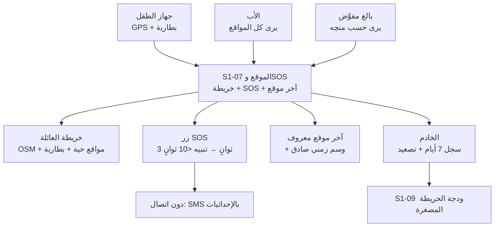
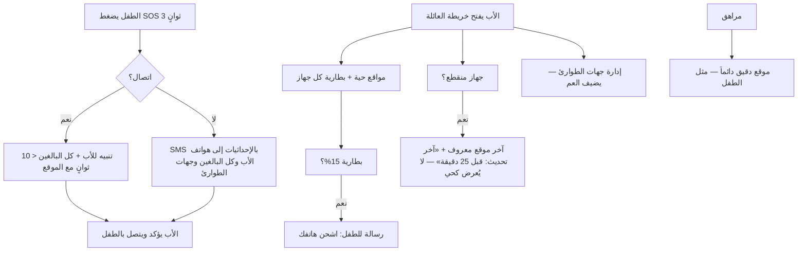

# S1-07: الموقع الأساسي وSOS (Basic Location & SOS)

- **الحالة:** approved | **المرحلة:** 1 (نواة الحماية) · **آخر تحديث:** 2026-11-06
- **القرارات الحاكمة:** Q-003 · Q-007 · Q-020 · Q-056 · Q-061 · Q-064 · Q-067 · Q-101 · Q-102 · Q-103 · Q-104 · Q-105 · Q-136 · Q-138 · Q-160 · Q-161 · D-021 · D-023 · D-038 · G-006 · G-011
- **حالة المراجعة:** §§1–8 + §10 معتمدة بالكامل في التخطيط (حكم المالك 2026-11-06) · §9 في مرحلة التصميم.
- **الأدلة المرجعية:** المواصفة القديمة S1-07 (مرجع فقط، G-009) · Deep-dives: Life360 (تنعيم Kalman + توفير البطارية + SOS) · FamilyWall (خريطة الأسرة) · S1-01 (معتمد) · S1-02 (معتمد) · S1-03 (معتمد) · S1-09 (معتمد)

## 1. الهدف والتحليل والنطاق

الموقع الأساسي وSOS هو **درع الأمان الطارئ وركيزة الاطمئنان** للعائلة: خريطة عائلية تعرض مواقع الأفراد الحية ومستوى بطارياتهم، وآخر موقع معروف بصدق عند انقطاع الاتصال، وزر استغاثة SOS يصل للأب وكل البالغين في أقل من 10 ثوانٍ — حتى دون إنترنت.

**التحليل (لماذا هذا النظام):** الأب يحتاج أن يعرف أين أطفاله الآن، وأن يصله نداء استغاثتهم فوراً مهما كانت الشبكة. بدون موقع حي يبقى الاطمئنان تخميناً، وبدون SOS دون اتصال يفشل النظام في اللحظة التي يُحتاج فيها أكثر (اليمن). لذلك S1-07 يبني الموقع على ثلاث قواعد: التتبع التكيفي الموفر للبطارية، والصدق في آخر موقع معروف، ومسار SOS لا يعتمد على الإنترنت وحده.

**داخل النطاق:**
- خريطة العائلة التفاعلية (OSM — Q-020) + مواقع الأفراد الحية + مستوى البطارية.
- آخر موقع معروف بوسم زمني صادق (لا يُعرض كأنه حي).
- زر SOS (ضغط مطول 3 ثوانٍ — Q-067) + مسار تصعيد + جهات طوارئ عائلية.
- تتبع تكيفي: كل 5 دقائق عند السكون، وكل دقيقة عند الحركة (Q-101).
- SOS دون اتصال: مسار بديل عبر SMS بالإحداثيات إلى هواتف الأب وكل البالغين وجهات الطوارئ (Q-103 · Q-138).
- سجل مواقع 7 أيام + آخر موقع معروف (Q-105) — ويُحذف آخر موقع معروف بعد 7 أيام من آخر قراءة (Q-166).

**خارج النطاق (أنظمة أخرى):**
- السياج الجغرافي الكامل وتنبيهات الدخول/الخروج (المرحلة 5 — Q-056).
- كشف حوادث السيارات وقياس سرعة القيادة (نظام لاحق — سؤال مفتوح Q-147، المرحلة 5).
- تكامل خدمات الطوارئ الرسمية 911/999 (مرحلة لاحقة — سؤال مفتوح Q-148، المرحلة 5).

**يعتمد على:** S1-01 (الغلاف — زر SOS الدائم) + S1-02 (العضوية) + S1-03 (الأدوار والصلاحيات — من يرى ماذا) + S1-09 (ودجة الخريطة المصغرة في مركز الأوامر).

**المصطلحات:** خريطة العائلة (family map) · آخر موقع معروف (last known location) · SOS · تصعيد (escalation) · جهات طوارئ (emergency contacts) · تتبع تكيفي (adaptive tracking) · مرشح كالمان (Kalman Filter).

**من التطبيقات المفككة (§1):** نمط Life360 — تنعيم مسار GPS بمرشح Kalman Filter (منع القفزات الوهمية) + توفير بطارية تكيفي (خفض التردد عند السكون) + بروتوكول SOS؛ ونمط FamilyWall — شاشة خريطة الأسرة التجميعية. نأخذ منهما أن **الموقع دقيق وموفر للبطارية معاً**: لا قفزات وهمية على الخريطة، ولا بطارية تُستنزف.

**رسم توضيحي — أين يُستخدم الموقع وSOS (للفهم السريع):**

## 2. سيناريوهات المستخدم

### 7-1: الأب يفتح خريطة العائلة ويرى أطفاله وبطارياتهم
- **الممثل:** الأب (المالك). **السياق:** مساءً، يريد الاطمئنان على مكان أطفاله.
- **التدفق:** 1) الأب يفتح خريطة العائلة. 2) يرى مواقع أطفاله الحية على الخريطة (OSM) مع مستوى بطارية كل جهاز. 3) يرى أن بطارية جهاز ابنه 15% فيرسل له رسالة ليشحن هاتفه. **النتيجة:** اطمئنان كامل في نظرة واحدة — المكان والبطارية معاً.

### 7-2: الطفل يضغط SOS فيصل التنبيه للأب وكل البالغين في أقل من 10 ثوانٍ
- **الممثل:** الطفل. **السياق:** الطفل في موقف خطر ويحتاج والديه فوراً.
- **التدفق:** 1) الطفل يضغط زر SOS في الغلاف ضغطاً مطولاً 3 ثوانٍ. 2) يصل التنبيه للأب وكل البالغين في العائلة في أقل من 10 ثوانٍ (Q-061) مع موقع الطفل لحظتها. 3) الأب يؤكد استلام التنبيه ويتصل بالطفل. **النتيجة:** استغاثة تصل قبل فوات الأوان.

### 7-3: SOS دون إنترنت — الإحداثيات تصل عبر SMS
- **الممثل:** الطفل. **السياق:** الطفل في منطقة بلا إنترنت ويضغط SOS.
- **التدفق:** 1) الطفل يضغط SOS ولا يوجد اتصال بالخادم. 2) الجهاز يرسل SMS بالإحداثيات مباشرة إلى هواتف الأب وكل البالغين وجهات الطوارئ (Q-103 · Q-138). 3) الأب يفتح الإحداثيات في الخريطة ويعرف مكان الطفل. **النتيجة:** الاستغاثة لا تعتمد على الإنترنت وحده — تعمل في أسوأ شبكة.

### 7-4: دون اتصال — آخر موقع معروف بوسم صادق
- **الممثل:** الأب. **السياق:** جهاز الطفل انقطع اتصاله منذ 25 دقيقة.
- **التدفق:** 1) الأب يفتح الخريطة. 2) يرى آخر موقع معروف للطفل مع وسم "آخر تحديث: قبل 25 دقيقة" — لا يُعرض كأنه حي. 3) نقاط الموقع المحفوظة محلياً في الصندوق الصادر تُزامَن عند عودة الاتصال. **النتيجة:** صدق كامل — الأب يعرف ما هو حي وما هو قديم.

### 7-5: موقع المراهق الدقيق مرئي للأب دائماً
- **الممثل:** الأب + المراهق. **السياق:** المراهق في طريقه إلى المدرسة.
- **التدفق:** 1) الأب يفتح الخريطة. 2) يرى موقع المراهق الدقيق (مثل الطفل — Q-102). 3) لا مشاركة ضبابية ولا إخفاء: المراهق قاصر وحمايته أولاً. **النتيجة:** إشراف كامل على كل قاصر — طفلاً كان أو مراهقاً.

### 7-6: الأب يدير جهات الطوارئ العائلية
- **الممثل:** الأب. **السياق:** الأب يريد إضافة عمه كجهة طوارئ.
- **التدفق:** 1) الأب يفتح إدارة جهات الطوارئ. 2) يضيف عمه (بالغ في العائلة) برقم هاتفه. 3) عند أي SOS لاحق يصل التنبيه للعم أيضاً مع الأب وكل البالغين. **النتيجة:** شبكة أمان عائلية أوسع من الوالدين وحدهما.

**مخطط السيناريوهات (§2 — بصري):**

## 3. المتطلبات الوظيفية

### الخريطة
- **REQ-001:** خريطة عائلية تفاعلية (OSM — Q-020) تعرض مواقع الأفراد الحية. [Q-020 · DIRECT]
- **REQ-002:** مستوى بطارية كل جهاز ظاهر مع موقعه. [§2 · DERIVED]
- **REQ-003:** آخر موقع معروف يعرض مع وسم زمني صريح — ولا يُعرض كأنه حي أبداً. [§2 · DERIVED]

### التتبع
- **REQ-004:** تحديث تكيفي: كل 5 دقائق عند السكون، وكل دقيقة عند الحركة. [Q-101 · DIRECT]
- **REQ-005:** تنعيم مسار GPS بمرشح Kalman Filter — بلا قفزات وهمية على الخريطة. [Life360 · DIRECT]
- **REQ-006:** دون اتصال: نقاط الموقع تُحفظ في الصندوق الصادر وتُزامَن عند عودة الاتصال (بلا تكرار). [Q-064 · DIRECT]

### SOS
- **REQ-007:** زر SOS بضغط مطول 3 ثوانٍ (في الغلاف — Q-067). [Q-067 · DIRECT]
- **REQ-008:** تنبيه SOS يصل للأب وكل البالغين في أقل من 10 ثوانٍ مع موقع المستغيث لحظتها. [Q-061 · Q-104 · DIRECT]
- **REQ-009:** SOS دون اتصال: SMS بالإحداثيات إلى هواتف الأب وكل البالغين وجهات الطوارئ — نفس مجموعة مستلمي التنبيه دون اتصال (Q-138) — عند تعذر الاتصال بالخادم. [Q-103 · Q-138 · DIRECT]
- **REQ-010:** الأب يدير جهات الطوارئ العائلية (إضافة/حذف). [§2 · DERIVED]

### الخصوصية والرؤية
- **REQ-011:** الأب يرى الموقع الدقيق لكل قاصر — طفلاً كان أو مراهقاً. [Q-102 · DIRECT]
- **REQ-012:** البالغ المفوَّض يرى المواقع حسب منحِه فقط (deny-override). [Q-007 · DIRECT]

### السجل والتكامل
- **REQ-013:** سجل مواقع 7 أيام + آخر موقع معروف. [Q-105 · DIRECT]
- **REQ-014:** السجل يُحذف تلقائياً بعد 7 أيام. [Q-105 · DERIVED]
- **REQ-015:** ودجة S1-09 "الخريطة المصغرة": آخر مواقع الأبناء حسب المنح. [S1-09 · DERIVED]
- **REQ-016:** تنبيهات SOS تظهر في تنبيهات S1-09. [S1-09 · DERIVED]
- **REQ-017:** رسائل SMS تُحسب من حصة الخطة (Q-055)؛ **الحصص (Q-129): مجانية 20 رسالة/شهر، ومميزة 100 رسالة/شهر، وتعبئة 50 رسالة (S1-04 REQ-010)**؛ ويُسمح بـ 3 رسائل SOS طارئة بعد نفاد الحصة في كل دورة (SOS فقط) — **يبقى الحد كما هو بحكم المالك (Q-163، خيار ب) ويُوثَّق كخطر مقبول**: بعد استنفاد الثلاث وبلا تعبئة وبلا إنترنت لا يصل SOS عبر SMS؛ والتعبئة وشراء الحزم عبر S1-04؛ والأب يُشعَر فوراً بكل رسالة طارئة وعند النفاد — إلا دون اتصال مع استنفاد الحصة والطوارئ الثلاث، فيُحفظ إشعار النفاد في طابور على الجهاز للتسليم عند عودة الاتصال ويُعرض محلياً للطفل (لا قناة فورية دون اتصال). **مرآة الحصة المحلية:** الجهاز يحتفظ بنسخة محلية من رصيد الحصة والطوارئ المتبقية ونهاية الدورة، تُزامَن عند كل اتصال بالخادم، ويُتخذ قرار الإرسال دون اتصال بناءً عليها. **توقيع SOS:** كل SMS استغاثة يحمل توقيع HMAC-SHA256 (مقتطع إلى 10 أحرف) بمفتاح الجهاز المتبادل عند الإقران فوق (العائلة، العضو، الوقت، الإحداثيات)، ويتحقق تطبيق الأب من التوقيع قبل عرض التنبيه. [Q-106 · Q-129 · Q-163 · DIRECT — أضيف بتعديل 2026-11-06؛ وُسّع بتعديل 2026-11-06 (Q-163)؛ وأُضيفت الحصص بتعديل 2026-11-07 (Q-175)]
- **REQ-018:** حل تنبيه SOS: الأب أو البالغ المفوَّض حسب القالب يحل التنبيه عبر `POST /families/{id}/sos/{sosId}/resolve` (مفتاح `location.sos.resolve` — Q-160)؛ فتصبح حالته `resolved` ويتوقف التصعيد؛ ويُدفع حدث `family/{family_id}/sos/resolved` فوراً للأجهزة التي تعرض التنبيه؛ ويُسجَّل الحل في التدقيق. [Q-136 · Q-160 · Q-161 · DIRECT]

## 4. الواجهات والعقود

### 4-1. نقاط الوصول (REST — `/api/v1`)

| الطريقة والمسار | الغرض | المدخل | المخرج |
|---|---|---|---|
| `GET /families/{id}/locations` | آخر مواقع كل الأعضاء (مصفاة حسب المنح) | — | `[{member_id, lat, lng, accuracy, battery, at}]` |
| `POST /families/{id}/locations` | الإبلاغ عن نقطة موقع (الجهاز → الخادم) | `{lat, lng, accuracy, battery, at}` | النقطة + `server_seq` |
| `GET /families/{id}/members/{memberId}/locations` | سجل المواقع (7 أيام كحد أقصى) | `?from&to` | `[{lat, lng, at}]` |
| `POST /families/{id}/sos` | إطلاق SOS (الجهاز → الخادم) | `{lat, lng, at}` + ترويسة `Idempotency-Key` (UUID يولّده الجهاز لكل حدث SOS — يمنع التنبيه المكرر عند إعادة الإرسال) | `{sos_id, at}` |
| `POST /families/{id}/sos/{sosId}/acknowledge` | تأكيد استلام SOS (الأب/بالغ) | — | `{sos_id, acknowledged_by, at}` |
| `POST /families/{id}/sos/{sosId}/resolve` | حل تنبيه SOS وإيقاف التصعيد (الأب + البالغ المفوَّض حسب القالب — مفتاح `location.sos.resolve` — Q-136 · Q-160) | `{resolution_note?}` | `{sos_id, resolved_by, at, status: "resolved"}` |
| `GET /families/{id}/emergency-contacts` | قائمة جهات الطوارئ | — | `[{contact_id, member_id, phone}]` |
| `POST /families/{id}/emergency-contacts` | إضافة جهة طوارئ (الأب) | `{member_id, phone}` | جهة الطوارئ |
| `DELETE /families/{id}/emergency-contacts/{contactId}` | حذف جهة طوارئ (الأب) | — | `{ok: true}` |

### 4-2. الأحداث (MQTT → الأجهزة)

> **عقد الوسيط الملزم (Q-168):** الوسيط Eclipse Mosquitto 2.x — عقدة واحدة في المرحلة 1 — TLS 1.2+ على 8883 + mTLS؛ وQoS لكل نوع (أوامر/SOS/عبث/منح QoS 1 + إقرار؛ والموقع الحي QoS 0؛ وبلا QoS 2)؛ والعزل ببادئة `family/{family_id}/` + ACL خادمي؛ والشهادات سنتان مع تجديد تلقائي وإبطال فوري. التفصيل الكامل: `docs/family-os/governance/architecture/MQTT-BROKER-SPEC.md`. [Q-168 · Q-175]

| الموضوع | الغرض |
|---|---|
| `family/{family_id}/location/updated` | تحديث موقع عضو (للخريطة الحية) |
| `family/{family_id}/sos/new` | SOS جديد (أولوية عالية — يصل في أقل من 10 ثوانٍ) |
| `family/{family_id}/sos/acknowledged` | تأكيد استلام SOS |
| `family/{family_id}/sos/resolved` | حل تنبيه SOS (`{sos_id, resolved_by, at}`) — يُدفع فوراً للأجهزة التي تعرض التنبيه |

### 4-3. قناة المنصة (MethodChannel — Flutter ↔ Kotlin)

| الطريقة | الغرض |
|---|---|
| `startLocationService()` | تشغيل خدمة الموقع في الخلفية (التتبع التكيفي) |
| `getLastKnownLocation() → {lat, lng, at}` | آخر موقع مخزن + وسمه الزمني |
| `triggerSos()` | إطلاق SOS من زر الغلاف (ضغط مطول 3 ثوانٍ) |

### 4-4. صيغة الخطأ الموحدة

`{code, message_ar, trace_id}` — كما في S1-02 §4. رموز هذا النظام: `LOC_MEMBER_NOT_FOUND` (عضو غير موجود) · `LOC_NOT_VISIBLE` (موقع بلا منح رؤية) · `LOC_SOS_ALREADY_ACTIVE` (يوجد SOS نشط — تُعاد بياناته بدل التكرار) · `LOC_INVALID_COORDINATES` (إحداثيات خارج النطاق).

## 5. البيانات — النموذج

كل جدول يحمل `family_id` + RLS (D-021). سجل المواقع يُحذف تلقائياً بعد 7 أيام (REQ-014).

### 5-1. `location_point` — نقاط الموقع (سجل 7 أيام)
| الحقل | النوع | ملاحظات |
|---|---|---|
| `point_id` | uuid (PK) | |
| `family_id` | uuid (FK) | + RLS |
| `member_id` | uuid (FK) | |
| `lat` / `lng` | double | بعد التنعيم (Kalman) |
| `accuracy` | double | دقة القراءة (متر) |
| `battery` | int | مستوى بطارية الجهاز (%) |
| `at` | timestamptz | وقت القراءة على الجهاز |
| `server_seq` | bigint | تسلسل الخادم |

### 5-2. `last_known_location` — آخر موقع معروف (قراءة سريعة للوحة)
| الحقل | النوع | ملاحظات |
|---|---|---|
| `member_id` | uuid (PK, FK) | |
| `family_id` | uuid (FK) | + RLS |
| `lat` / `lng` | double | |
| `accuracy` | double | |
| `battery` | int | |
| `at` | timestamptz | الوسم الزمني الصريح (REQ-003) |
| `expires_at` | timestamptz | آخر قراءة + 7 أيام — يُحذف تلقائياً (Q-166) |

### 5-3. `sos_alert` — تنبيهات SOS
| الحقل | النوع | ملاحظات |
|---|---|---|
| `sos_id` | uuid (PK) | |
| `family_id` | uuid (FK) | + RLS |
| `member_id` | uuid (FK) | المستغيث |
| `lat` / `lng` | double | موقع الاستغاثة لحظتها |
| `at` | timestamptz | |
| `status` | text | `active` / `acknowledged` / `resolved` |
| `channel` | text | `server` / `sms` (أي مسار أوصل التنبيه — REQ-009) |
| `acknowledged_by` / `acknowledged_at` | uuid / timestamptz (nullable) | |
| `resolved_by` / `resolved_at` | uuid / timestamptz (nullable) | من حلّ التنبيه ومتى (Q-136) |

### 5-4. `emergency_contact` — جهات الطوارئ العائلية
| الحقل | النوع | ملاحظات |
|---|---|---|
| `contact_id` | uuid (PK) | |
| `family_id` | uuid (FK) | + RLS |
| `member_id` | uuid (FK) | البالغ جهة الطوارئ |
| `phone` | text | لرسائل SMS البديلة |
| `added_by` / `added_at` | uuid / timestamptz | |

### 5-5. مراجع (بلا تكرار)
- العضوية: S1-02 (`membership`) · تنبيهات SOS: تظهر في S1-09 (`alert`، النوع `sos`) · إطلاق SOS وتأكيده: أحداث تدقيق في النواة المشتركة (`AuditEvent`، النطاق `location`).
- **ملاحظة العميل:** بلاطات الخرائط دون اتصال (MBTiles — Q-020) + نقاط الصندوق الصادر — مخازن عميل لا جداول خادم.

## 6. القواعد والصلاحيات

### 6-1. مفاتيح هذا النظام (`location.*`)

| المفتاح | الوصف | لمن؟ |
|---|---|---|
| `location.view` | عرض مواقع الأعضاء الحية | الأب + البالغ المفوَّض حسب منحِه |
| `location.history.view` | عرض سجل المواقع (7 أيام) | الأب + البالغ المفوَّض حسب منحِه |
| `location.sos.trigger` | إطلاق SOS | كل الأدوار — حتى الطفل (لا يُحجب أبداً) |
| `location.sos.acknowledge` | تأكيد استلام SOS | الأب + البالغون |
| `location.sos.resolve` | حل تنبيه SOS وإيقاف التصعيد | الأب + البالغ المفوَّض حسب القالب (Q-136 · Q-160) |
| `location.emergency.manage` | إدارة جهات الطوارئ | الأب |

### 6-2. الثوابت الصلبة (لا تُكسر أبداً)
- الأب يرى الموقع الدقيق لكل قاصر — طفلاً كان أو مراهقاً (Q-102).
- SOS متاح لكل الأدوار دائماً ولا يُحجب بأي صلاحية (Q-067).
- آخر موقع معروف لا يُعرض كأنه حي أبداً (REQ-003).
- سجل المواقع يُحذف تلقائياً بعد 7 أيام — لا احتفاظ أطول (Q-105).
- بيانات الموقع لا تغادر العائلة أبداً.
- تجاوز الطوارئ الثلاث لا يُمنح إلا لـ SOS (لا OTP ولا غيره).

### 6-3. قواعد التشغيل
- **التتبع التكيفي:** حساس الحركة يحدد التردد (5 دقائق عند السكون، دقيقة عند الحركة)؛ والتنعيم (Kalman) على الجهاز قبل الإرسال.
- **تصعيد SOS:** الخادم يدفع التنبيه لكل البالغين فوراً؛ وإن لم يقرّ أي بالغ خلال **5 دقائق** يُعاد الدفع والتذكير (دفع + تنبيه) حتى الإقرار أو الحل — التصعيد لا يتوقف بصمت. وإن تعذر الاتصال بالخادم يرسل الجهاز SMS بالإحداثيات إلى هواتف الأب وكل البالغين وجهات الطوارئ (Q-138) — من حصة الرسائل (Q-106)؛ ويُتخذ قرار الإرسال دون اتصال بناءً على **مرآة الحصة المحلية** (لا على فحص خادمي غير reachable)؛ وإن نفدت الحصة يُسمح بـ 3 رسائل SOS طارئة فقط في كل دورة (SOS فقط) ثم تُحجب رسائل SOS حتى التعبئة أو التجديد — **الحد يُوثَّق كخطر مقبول بحكم المالك (Q-163)**؛ ويُشعَر الأب فوراً بكل رسالة طارئة وعند استنفادها — إلا دون اتصال مع استنفاد الحصة والطوارئ الثلاث، فيُحفظ إشعار النفاد في طابور على الجهاز للتسليم عند عودة الاتصال ويُعرض محلياً للطفل. وكل SMS استغاثة **موقّع** (HMAC-SHA256 بمفتاح الجهاز — REQ-017) فيتحقق تطبيق الأب من الأصالة قبل العرض.
- **حصة الرسائل:** كل SMS صادر (SOS + OTP الاحتياطي) يُحسب من حصة الخطة؛ والتعبئة عبر S1-04.
- **منع تكرار SOS:** SOS نشط قائم → الضغط الجديد يعيد بياناته بدل إنشاء تنبيه مكرر؛ و`POST /sos` يقبل ترويسة `Idempotency-Key` (UUID لكل حدث) فيرفض الخادم إعادة إرسال الحدث نفسه.
- **البطارية:** مستوى البطارية ظاهر مع الموقع؛ ولا تنبيه بطارية منخفضة في المرحلة 1 (عرض فقط).

## 7. الحالات الحدية والأخطاء

1. **إحداثيات خارج النطاق:** نقطة بإحداثيات غير صالحة → `LOC_INVALID_COORDINATES` (لا تُحفظ).
2. **عضو غير موجود:** طلب موقع عضو غير موجود → `LOC_MEMBER_NOT_FOUND`.
3. **بلا منح رؤية:** طلب موقع بلا منح → `LOC_NOT_VISIBLE`.
4. **SOS نشط قائم:** ضغط SOS جديد أثناء SOS نشط → تُعاد بيانات النشط بدل تنبيه مكرر (`LOC_SOS_ALREADY_ACTIVE`).
5. **SOS بلا رصيد وبلا إنترنت:** الحصة منتهية والطوارئ الثلاث مستنفدة ولا اتصال → SOS يبقى "معلقاً" على الجهاز (لا يُعرض كأنه أُرسل) ويُرسَل عبر الخادم فور عودة الاتصال؛ وإشعار النفاد يُحفظ في الطابور معه ويُعرض محلياً للطفل. (قرار «منتهية» هنا يُتخذ من مرآة الحصة المحلية — Q-163؛ والحد نفسه خطر مقبول موثَّق بحكم المالك.)
6. **GPS ضعيف:** قراءة بدقة سيئة → تُرسَل مع دقتها؛ والخريطة تعرض دائرة عدم يقين بدل نقطة وهمية دقيقة.
7. **قفزة GPS وهمية:** نقطة شاذة يرفضها مرشح Kalman → تُتجاهل ولا تُحفظ.
8. **بطارية منخفضة جداً:** عند انخفاض البطارية يقل تردد التتبع تلقائياً لحفظ ما تبقى للطوارئ (SOS أولاً).
9. **جهاز مغلق:** جهاز الطفل مغلق أو بلا بطارية → آخر موقع معروف مع وسمه (لا يُعرض كأنه حي).
10. **SOS عرضي:** SOS بالخطأ (ضغط عرضي) → الأب يؤكد أو يلغي عبر نقطة الحل `POST /families/{id}/sos/{sosId}/resolve` (الأب + البالغ المفوَّض حسب القالب — Q-136)؛ الحالة تصبح `resolved` ويتوقف التصعيد؛ والإلغاء يُسجَّل في التدقيق.
11. **جهة طوارئ محذوفة:** جهة طوارئ حُذفت أو غيّرت رقمها → تُحذف من القائمة؛ وSOS اللاحق لا يرسل لها.
12. **سجل قديم:** طلب سجل أقدم من 7 أيام → يعيد فارغاً (محذوف تلقائياً — لا خطأ).
13. **نقاط منتهية في الصندوق:** نقاط في الصندوق الصادر أقدم من 7 أيام عند عودة الاتصال → تُتجاهل (انتهت صلاحيتها) ولا تُزامَن.

## 8. معايير القبول

- **ACC-001:** الخريطة العائلية تعرض مواقع الأفراد الحية + مستوى البطارية. [REQ-001/002]
- **ACC-002:** آخر موقع معروف مع وسم زمني صريح؛ ولا يُعرض كأنه حي أبداً. [REQ-003]
- **ACC-003:** التحديث التكيفي: كل 5 دقائق عند السكون، وكل دقيقة عند الحركة. [REQ-004]
- **ACC-004:** بلا قفزات وهمية على الخريطة (Kalman). [REQ-005]
- **ACC-005:** دون اتصال: النقاط تُزامَن عند عودة الاتصال بلا تكرار. [REQ-006]
- **ACC-006:** زر SOS بضغط مطول 3 ثوانٍ يطلق الاستغاثة. [REQ-007]
- **ACC-007:** تنبيه SOS يصل للأب وكل البالغين في أقل من 10 ثوانٍ مع موقع المستغيث. [REQ-008 · Q-061]
- **ACC-008:** SOS دون اتصال: SMS بالإحداثيات إلى هواتف الأب وكل البالغين وجهات الطوارئ. [REQ-009 · Q-138]
- **ACC-009:** الأب يدير جهات الطوارئ (إضافة/حذف). [REQ-010]
- **ACC-010:** الأب يرى الموقع الدقيق لكل قاصر (طفل أو مراهق). [REQ-011]
- **ACC-011:** البالغ المفوَّض يرى حسب منحِه فقط. [REQ-012]
- **ACC-012:** سجل 7 أيام + حذف تلقائي بعد 7 أيام. [REQ-013/014]
- **ACC-013:** ودجة S1-09 (الخريطة المصغرة) + تنبيهات SOS تظهر في S1-09. [REQ-015/016]
- **ACC-014:** حصة الرسائل: كل SMS يُحسب؛ و3 رسائل SOS طارئة فقط بعد النفاد (SOS فقط) — الحد موثَّق كخطر مقبول (Q-163)؛ والجهاز يقرر الإرسال دون اتصال من مرآة الحصة المحلية؛ وكل SMS استغاثة موقّع ويتحقق منه تطبيق الأب؛ وإن لم يقرّ أي بالغ خلال 5 دقائق يُعاد الدفع والتذكير حتى الحل؛ والأب يُشعَر فوراً — إلا دون اتصال مع استنفاد الحصة والطوارئ، فيُحفظ إشعار النفاد في الطابور للتسليم عند عودة الاتصال. [REQ-017 · Q-106 · Q-163]
- **ACC-015:** مفاتيح `location.*` الستة مطبقة؛ والطفل يستطيع إطلاق SOS. [§6]
- **ACC-016:** حل تنبيه SOS: الأب أو المفوَّض يحل التنبيه عبر نقطة الحل؛ فتصبح حالته `resolved` ويتوقف التصعيد؛ ويُدفع حدث الحل فوراً للأجهزة؛ والحل مسجَّل في التدقيق. [REQ-018 · Q-136 · Q-160 · Q-161]

## 9. قائمة الشاشات

في مرحلة التصميم.

## 10. خطة التنفيذ

### خطوات البناء بالترتيب
1. جداول المواقع وSOS وجهات الطوارئ + RLS + الحذف التلقائي بعد 7 أيام.
2. نقاط الوصول REST التسعة + أحداث MQTT (موقع/SOS).
3. خدمة الموقع في الخلفية (تتبع تكيفي + Kalman على الجهاز) + MethodChannel.
4. SOS: زر الغلاف + التصعيد (مهلة إقرار 5 دقائق — Q-163) + مسار SMS البديل الموقّع + حصة الرسائل والتجاوز الطارئ ومرآة الحصة المحلية (Q-106 · Q-163) + مفتاح منع التكرار.
5. خرائط OSM دون اتصال (بلاطات MBTiles).
6. الشاشات بعد التصميم (§9).

- **بذر المفاتيح في السجل المركزي:** مفاتيح `location.*` الستة (§6: `location.view` · `location.history.view` · `location.sos.trigger` · `location.sos.acknowledge` · `location.sos.resolve` · `location.emergency.manage`) تُزرع في جدول `permission_key` المركزي (S1-03 §10-1) وقت النشر — لا منح لمفتاح غير مزروع (S1-03 REQ-009).

### الوحدات
- Ktor: وحدة `location` (نقاط + SOS + جهات طوارئ + حصة رسائل).
- Flutter: شاشة الخريطة (OSM) + شاشات SOS.
- Kotlin: خدمة الموقع في الخلفية + Kalman + إطلاق SOS.

### التبعيات
- S1-01 (زر SOS في الغلاف) · S1-02 (العضوية) · S1-03 (الصلاحيات) · S1-09 (الودجة والتنبيهات) · Q-020 (OSM) · Q-022 (MQTT) · Q-168 (مواصفة الوسيط — انظر §4-2) · Q-106 (حصة SMS) · مختبر Q-027 (قياس SOS أقل من 10 ثوانٍ).

### منهج الاختبار
- وحدة: Kalman + التتبع التكيفي + منع تكرار SOS + عدّاد الحصة.
- تكامل: نقاط الوصول + الأحداث + التصعيد + مسار SMS البديل.
- قبول: ACC-001…ACC-016.
- أداء: تنبيه SOS أقل من 10 ثوانٍ في مختبر Q-027 (Q-061).

## أسئلة مفتوحة (من هذه المواصفة)

لا أسئلة مفتوحة من هذه المواصفة.

## ملحق أ: الاستخلاص من الهندسة العكسية (RE)

| المصدر المفكك | الآلية المستخلصة | أين تُستخدم في S1-07 |
|---|---|---|
| Life360 | تنعيم مسار GPS بمرشح Kalman Filter (منع القفزات الوهمية) + توفير بطارية تكيفي (خفض التردد عند السكون) + بروتوكول SOS | §1، §3 (التتبع والاستغاثة) |
| FamilyWall | شاشة خريطة الأسرة التجميعية (الأعضاء + الحالة في مكان واحد) | §1، §3 (الخريطة العائلية) |
