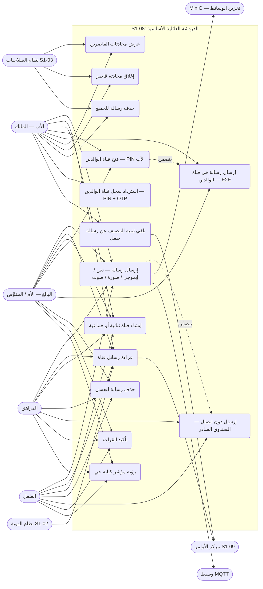
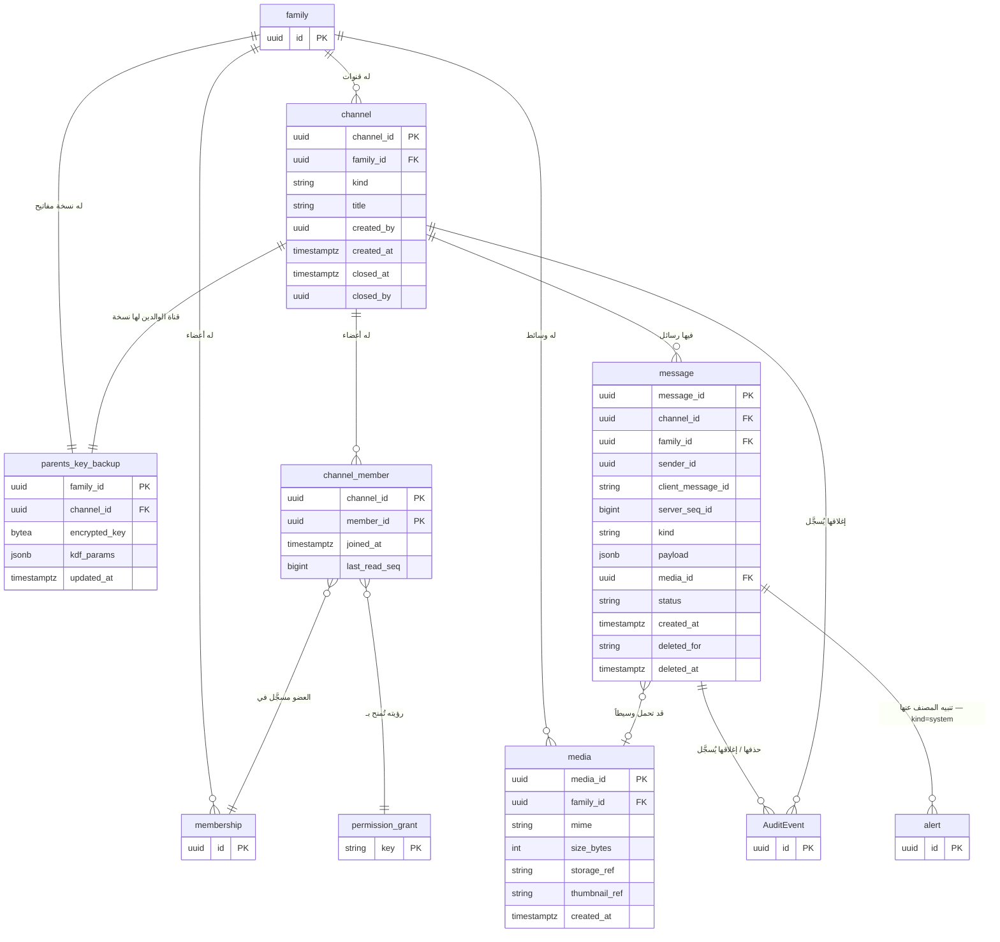
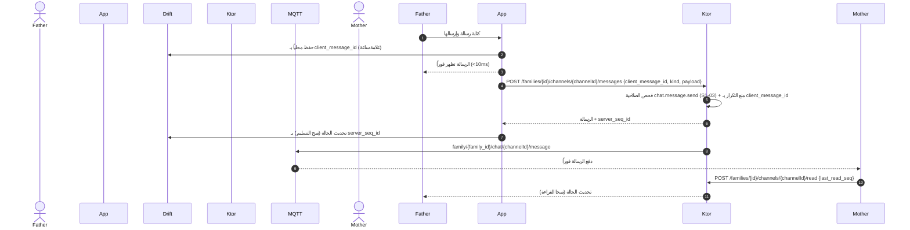
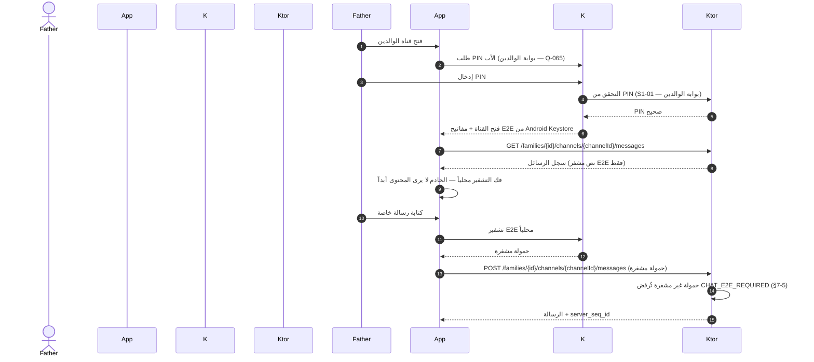
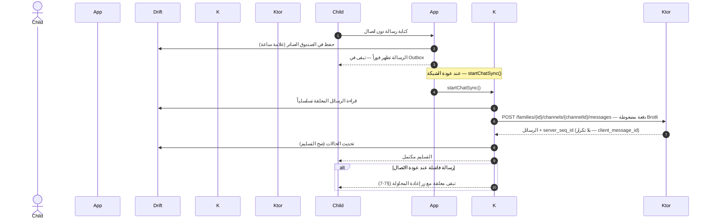
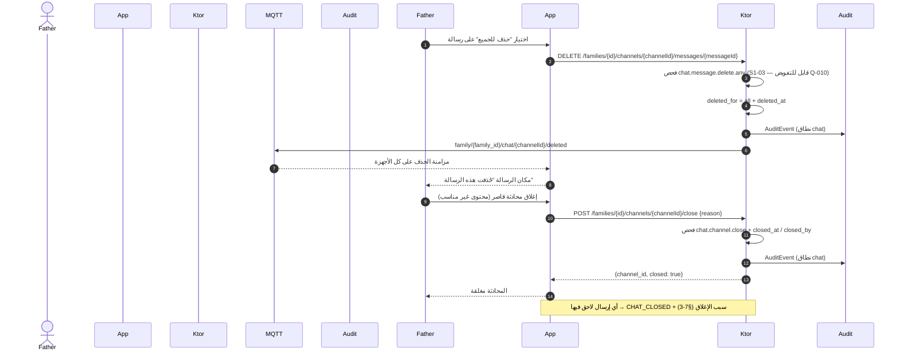
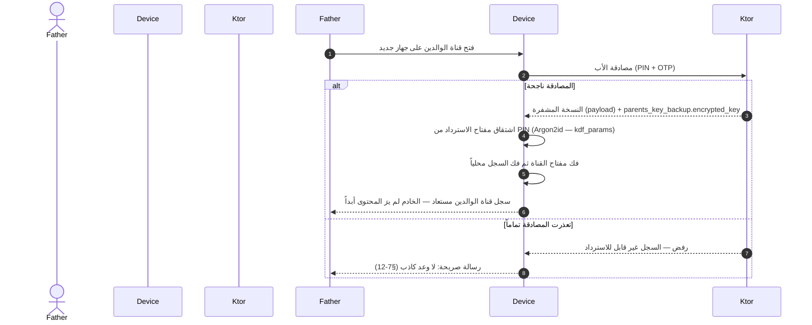
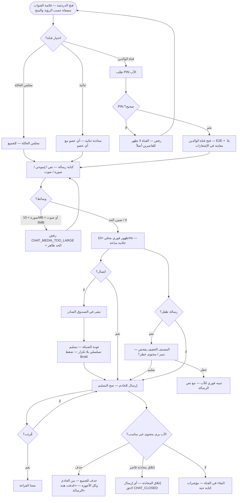
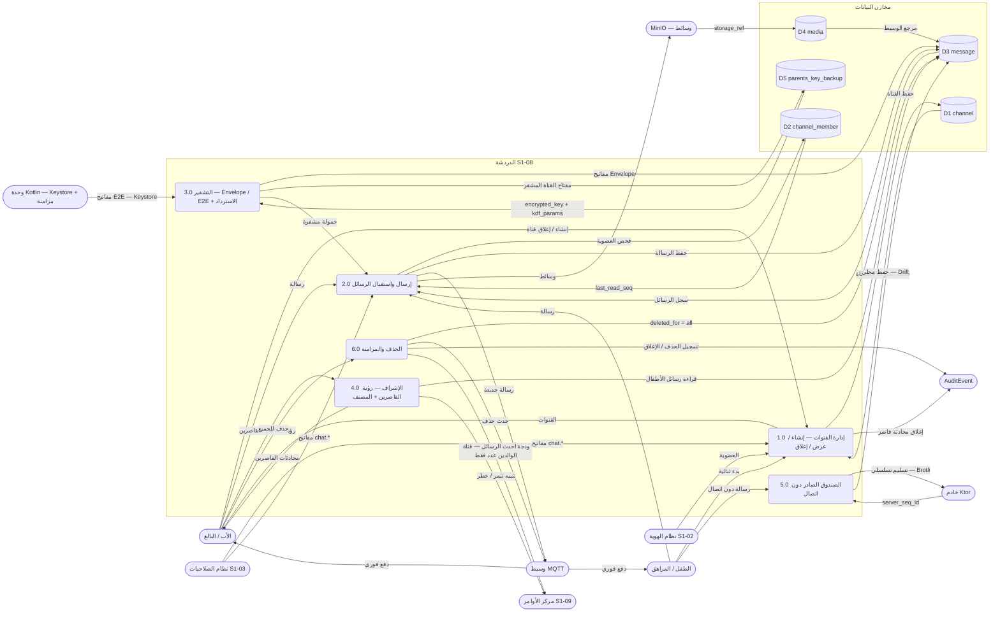
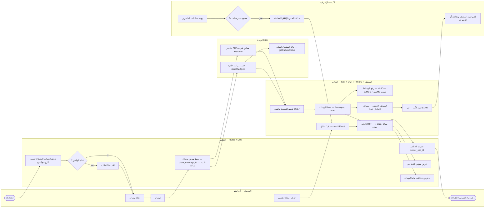

# S1-08: مخططات هندسة البرمجيات (DIAGRAMS)

- **الحالة:** مسودة للمراجعة على GitHub — المواصفة معتمدة بالكامل في التخطيط؛ والمخططات الستة مسودة بانتظار مراجعة المالك على GitHub (لم تُعتمد بعد)
- **المواصفة:** `SPEC.md` (§§1–8 + §10 معتمدة بالكامل في التخطيط)
- **القرارات الحاكمة:** Q-003 · Q-007 · Q-010 · Q-058 · Q-064 · Q-065 · Q-077 · Q-081 · Q-082 · Q-083 · Q-099 · Q-100 · D-011 · D-019 · D-020 · D-021 · D-023 · D-038 · G-006 · G-007 · G-011 · Q-134 (هيكل الملف)
- **الأنواع الستة:** 1. حالات الاستخدام · 2. ERD · 3. التسلسل · 4. تدفق المستخدم · 5. DFD · 6. النشاط
- **الأشكال الموحدة:** مستطيل = جهة خارجية · مستطيل مستدير = عملية · معين = قرار · أسطوانة = مخزن بيانات · خط متقطع = يتضمن / اختياري

## 1. حالات الاستخدام

14 حالة استخدام من السيناريوهات الستة والمتطلبات (§2/§3 — REQ-001…REQ-005 للقنوات والوسائط، REQ-006/007 للعرض الفوري وحالات التسليم، REQ-009 للحذف، REQ-011/017 لقناة الوالدين والاسترداد، REQ-012 لتنبيه المصنف، REQ-014 للعمل دون اتصال): أي عضو يراسل أي عضو، الأب يرى محادثات القاصرين ويغلقها، قناة الوالدين للبالغين فقط بـ PIN الأب ومخفية عن أجهزة الأطفال، والمصنف الخفيف يحرس رسائل الأطفال فقط. والتسليم إلى أنظمة الهوية (S1-02) والصلاحيات (S1-03) ومركز الأوامر (S1-09) ممثل كجهات خارجية.

- ملاحظتان: قناة الوالدين **لا تظهر أصلاً** على جهاز الطفل أو المراهق — لا في القائمة ولا في البحث (REQ-003)؛ والمراهق والطفل لا يغلقان محادثة ولا يحذفان رسالة للجميع أبداً (§6-1 — `chat.channel.close` و`chat.message.delete.any` للبالغين فقط).

## 2. مخطط قاعدة البيانات (ERD)

الجداول الخمسة من §5 كما هي، مع أربعة مراجع خارجية: العائلة والعضوية (S1-02)، ومفتاح الصلاحية (S1-03 — مفاتيح `chat.*`)، وتنبيهات المصنف (S1-09 — `alert`)، و`AuditEvent` (النواة المشتركة). ملاحظتان: النسخة المحلية من `channel` + `message` في Drift على العميل مخزن عميل لا جدول خادم (§5-6)، و`payload` في قناة الوالدين نص مشفر E2E فقط — الخادم لا يقرأ محتواها أبداً (REQ-011). كل جدول يحمل `family_id` + عزل RLS (D-021) عدا `channel_member` الذي يصل إلى العائلة عبر `channel`.

- `channel.kind`: `lounge` / `parents` / `direct` / `group` (§5-1 — REQ-001/002) — قناة الوالدين واحدة تُنشأ مع العائلة ولا تُنشأ من نقطة الإنشاء (§6-2). `message.kind`: `text` / `emoji` / `image` / `voice` / `system` (§5-3 — REQ-005). `media.size_bytes`: الحد 10MB للصور / 5MB للرسائل الصوتية (Q-058). `message.status`: `sent` / `delivered` / `read` (§5-3 — REQ-007). `message.deleted_for`: `all` (الأب) أو `self` (العضو) (§5-3 — REQ-009). `payload`: الحمولة المعماة Envelope للقنوات العائلية (REQ-010) وE2E لقناة الوالدين (REQ-011).

## 3. التسلسل (Sequence) — من عقود §4

خمسة مخططات، كل واحد لتدفق واحد:

### 3-أ. إرسال رسالة فورياً — العرض المتفائل ثم المزامنة (REQ-006/007 — §4.1 + §4.2)

- نفس `client_message_id` مرتين تُعيد الرسالة الأصلية بلا تكرار (§7-6)؛ والترتيب بـ `server_seq_id` لكل قناة (§6-3).

### 3-ب. فتح قناة الوالدين وإرسال رسالة E2E (REQ-003/011 — §4.1)

- على جهاز الطفل: القناة غير موجودة أصلاً — لا في القائمة ولا في البحث — ولا معاينة محتوى في الإشعارات (REQ-003).

### 3-ج. دون اتصال — الصندوق الصادر والتسليم التسلسلي (REQ-014 — §4.1/§4.3)

- وضع النطاق المنخفض (Q-064): ضغط Brotli + تسليم تسلسلي بلا تكرار (§2 8-5).

### 3-د. حذف رسالة للجميع وإغلاق محادثة قاصر (REQ-004/009 — §4.1 + §4.2)

- العضو يحذف رسائله لنفسه فقط (`deleted_for = self`)؛ وحذف رسالة محذوفة أصلاً يُعيد النتيجة نفسها (idempotent — §7-8).

### 3-هـ. استرداد سجل قناة الوالدين على جهاز جديد (REQ-017 — §4.1)

- النسخة المشفرة ومفتاحها المشفر لا يُسلَّمان إلا بعد مصادقة الأب (PIN + OTP) (§6-2)؛ وإعادة تعيين PIN (Q-077) تُعيد تغليف مفتاح الاسترداد (§6-3).

## 4. تدفق المستخدم (User Flow) — من السيناريوهات الستة (§2)

- ملاحظة: محادثة أي قاصر مرئية للأب دائماً (REQ-004)؛ ومؤشرات الكتابة تظهر فقط لأعضاء القناة (§6-3)؛ ولا حذف تلقائي أبداً — الاحتفاظ دائم حتى يحذف الأب (REQ-015).

## 5. مخطط تدفق البيانات (DFD — المستوى 1) — من §4/§5

العمليات مرقمة 1.0–6.0، والمخازن D1–D5. المخازن جداول خادم (PostgreSQL) مع نسخة محلية في Drift على العميل (`channel` + `message`)؛ ووسائط `media` تُخزن في MinIO (Q-058) ومرجعها فقط في قاعدة البيانات.

- **تغطية نقاط §4:** التسلسلات في §3 تغطي التدفقات الأساسية فقط؛ وكل نقطة §4.1 تظهر هنا على الأقل: `GET /families/{id}/channels` (قائمة القنوات — REQ-001، تُقرأ عبر P1) · `POST /families/{id}/channels` (إنشاء قناة ثنائية/جماعية — REQ-002، تمر عبر P1؛ وقناة الوالدين تُنشأ مع العائلة لا هنا)؛ وبقية النقاط مرسومة في §3 (messages إرسال/قراءة/حذف، read، close).

- ودجة S1-09 "أحدث الرسائل" تعرض آخر رسائل القنوات العائلية حسب المنح؛ وقناة الوالدين تظهر كعدد فقط بلا محتوى (REQ-016).

## 6. مخطط النشاط (Activity) — دورة حياة الرسالة من الإرسال إلى الإشراف

المسارات الأربعة (المرسل / التطبيق / وحدة Kotlin / الخادم) كمسارات متوازية — من §2/§7: العرض المتفائل (REQ-006)، حالات التسليم والقراءة (REQ-007)، مؤشرات الكتابة (REQ-008)، فحص المصنف لرسائل الأطفال (REQ-012)، رؤية القاصرين وإغلاق الأب (REQ-013/004)، والحذف (REQ-009). والأنشطة الخلفية (المزامنة الخلفية للصندوق الصادر + دفع MQTT + فحص المصنف) تعمل **بالتوازي** مع استخدام الدردشة.

- عند إعادة الفتح بعد الإغلاق القسري، يعود المستخدم لنفس القناة والمسودة (S1-01 §7 — سلوك الغلاف، يسري على كل الأنظمة)؛ والرسائل الفاشلة في الصندوق الصادر تبقى معلقة حتى تنجح أو يحذفها مرسلها (§6-3).
