# S1-08: مخططات هندسة البرمجيات (DIAGRAMS)

- **الحالة:** مسودة للمراجعة على GitHub — المواصفة معتمدة بالكامل في التخطيط؛ والمخططات الستة مسودة بانتظار مراجعة المالك على GitHub (لم تُعتمد بعد)
- **المواصفة:** `SPEC.md` (§§1–8 + §10 معتمدة بالكامل في التخطيط)
- **السياق المحدد (Bounded Context):** #6 التواصل (Messaging) — `CONTEXT-MAP.md` §2 صف 6
- **القرارات الحاكمة:** Q-001 · Q-003 · Q-007 · Q-010 · Q-058 · Q-064 · Q-065 · Q-077 · Q-081 · Q-082 · Q-083 · Q-099 · Q-100 · Q-140 · Q-165 · D-011 · D-019 · D-020 · D-021 · D-023 · D-038 · G-006 · G-007 · G-011 · Q-134 (هيكل الملف)
- **الأنواع الستة:** 1. حالات الاستخدام · 2. ERD · 3. التسلسل · 4. تدفق المستخدم · 5. DFD · 6. النشاط
- **الأشكال الموحدة:** مستطيل = جهة خارجية · مستطيل مستدير = عملية · معين = قرار · أسطوانة = مخزن بيانات · خط متقطع = يتضمن / اختياري

## 1. حالات الاستخدام

15 حالة استخدام من السيناريوهات الستة والمتطلبات (§2/§3 — REQ-001…REQ-017؛ وREQ-010 وREQ-015 بلا حالة استخدام لأنهما بلا واجهة — يُغطَّيان في §9-5 — وREQ-016 سطحه في S1-09 لا حالة استخدام له هنا): أي عضو يراسل أي عضو، الأب يرى محادثات القاصرين ويغلقها، والبالغ المفوَّض يراها حسب قالب التفويض (REQ-013 — `chat.minor.view`)، قناة الوالدين للبالغين فقط بـ PIN الأب ومخفية عن أجهزة الأطفال، والمصنف الخفيف على الخادم (Q-165) يحرس كل رسائل محادثات الأطفال دون 13 سنة بالاتجاهين (Q-292) دائماً، وكل رسائل محادثات المراهقين 13–17 سنة بالاتجاهين بمفتاح تحكم لكل عائلة يملكه مالك العائلة والافتراضي تشغيل (Q-083 كما عدّله Q-140). والتسليم إلى أنظمة الهوية (S1-02) والصلاحيات (S1-03) ومركز الأوامر (S1-09) ممثل كجهات خارجية.

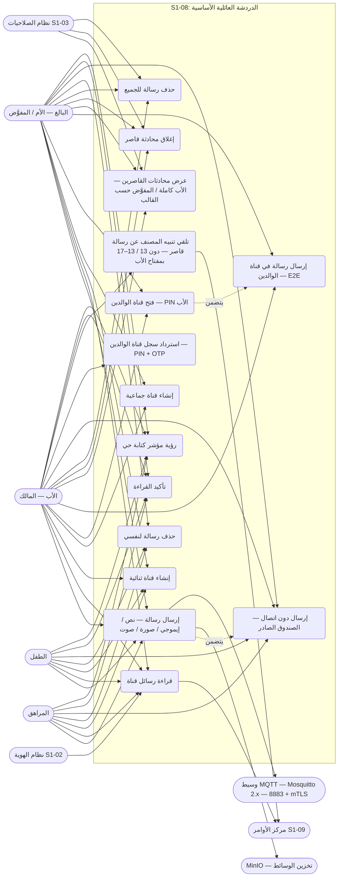

- ملاحظات: قناة الوالدين **لا تظهر أصلاً** على جهاز الطفل أو المراهق — لا في القائمة ولا في البحث (REQ-003)؛ والمراهق والطفل لا يغلقان محادثة ولا يحذفان رسالة للجميع أبداً (§6-1 — `chat.channel.close` و`chat.message.delete.any` للبالغين فقط — Q-010)؛ والبالغ المفوَّض يرى محادثات القاصرين حسب قالب التفويض فقط (REQ-013 — `chat.minor.view` — Q-089).

## 2. مخطط قاعدة البيانات (ERD)

الجداول الخمسة من §5 كما هي، مع أربعة مراجع خارجية: العائلة والعضوية (S1-02)، ومفتاح الصلاحية (S1-03 — مفاتيح `chat.*`)، وتنبيهات المصنف (S1-09 — `alert`)، و`AuditEvent` (النواة المشتركة). ملاحظتان: النسخة المحلية من `channel` + `message` في Drift على العميل مخزن عميل لا جدول خادم (§5-6)، و`payload` في قناة الوالدين نص مشفر E2E فقط — الخادم لا يقرأ محتواها أبداً (REQ-011). كل جدول يحمل `family_id` + عزل RLS (D-021) — بما فيه `channel_member` (§5-2).

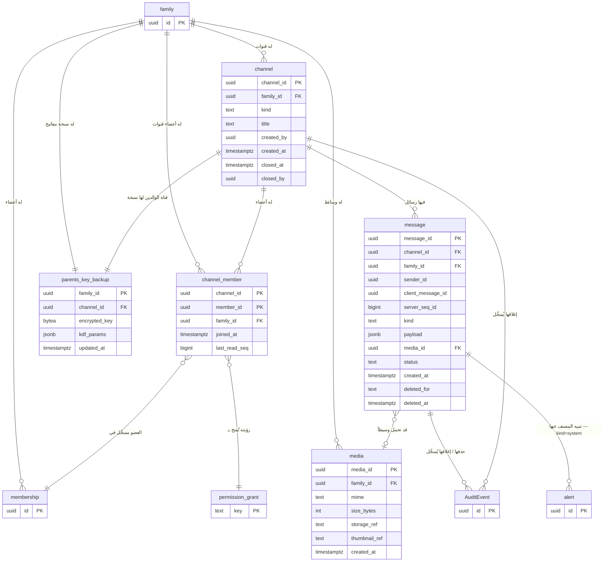

- `channel.kind`: `lounge` / `parents` / `direct` / `group` (§5-1 — REQ-001/002) — قناة الوالدين واحدة تُنشأ مع العائلة ولا تُنشأ من نقطة الإنشاء (§6-2). `message.kind`: `text` / `emoji` / `image` / `voice` / `system` (§5-3 — REQ-005). `media.size_bytes`: الحد 10MB للصور / 5MB للرسائل الصوتية (Q-058). `message.status`: `sent` / `delivered` / `read` (§5-3 — REQ-007) — بلا `pending` (قيمة عميل فقط في Drift، لا تُخزَّن على الخادم). `message.deleted_for`: `all` (الأب) أو `self` (العضو) (§5-3 — REQ-009). `payload`: الحمولة المعماة Envelope للقنوات العائلية (REQ-010) وE2E لقناة الوالدين (REQ-011).

## 3. التسلسل (Sequence) — من عقود §4

ستة مخططات، كل واحد لتدفق واحد:
- **عقد MQTT (Q-168 — الإحالة الصريحة إلى `docs/family-os/governance/architecture/MQTT-BROKER-SPEC.md`):** الوسيط Eclipse Mosquitto 2.x — عقدة واحدة في المرحلة 1 — TLS 1.2+ على المنفذ 8883 + mTLS (شهادة خادم + شهادة جهاز)؛ ورسائل الدردشة (`family/{family_id}/chat/{channelId}/message` و`family/{family_id}/chat/{channelId}/typing` و`family/{family_id}/chat/{channelId}/deleted` و`family/{family_id}/chat/{channelId}/read` و`family/{family_id}/chat/{channelId}/created` و`family/{family_id}/chat/{channelId}/closed`) QoS 1 وبلا احتفاظ (retained=false — §4-2)؛ وبلا QoS 2؛ والعزل ببادئة `family/{family_id}/` + ACL خادمي؛ والشهادات سنتان مع تجديد تلقائي وإبطال فوري. لا `command_id` في هذا النظام — عدم التكرار هنا بـ `client_message_id` (§4-1).

### 3-أ. إرسال رسالة فورياً — العرض المتفائل ثم المزامنة (REQ-006/007 — §4.1 + §4.2)

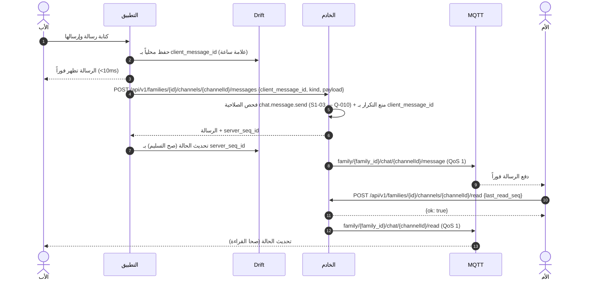

- نفس `client_message_id` مرتين تُعيد الرسالة الأصلية بلا تكرار (§7-6)؛ والترتيب بـ `server_seq_id` لكل قناة (§6-3). عند إعادة الاتصال: كشف الفجوات وإصلاحها عبر `GET .../messages` بقاعدة §4-2 (مقارنة آخر `server_seq_id` مرئي) — QoS 1 وحده لا يغلق فجوة جلسة ساقطة.

### 3-ب. فتح قناة الوالدين وإرسال رسالة E2E (REQ-003/011 — §4.1)

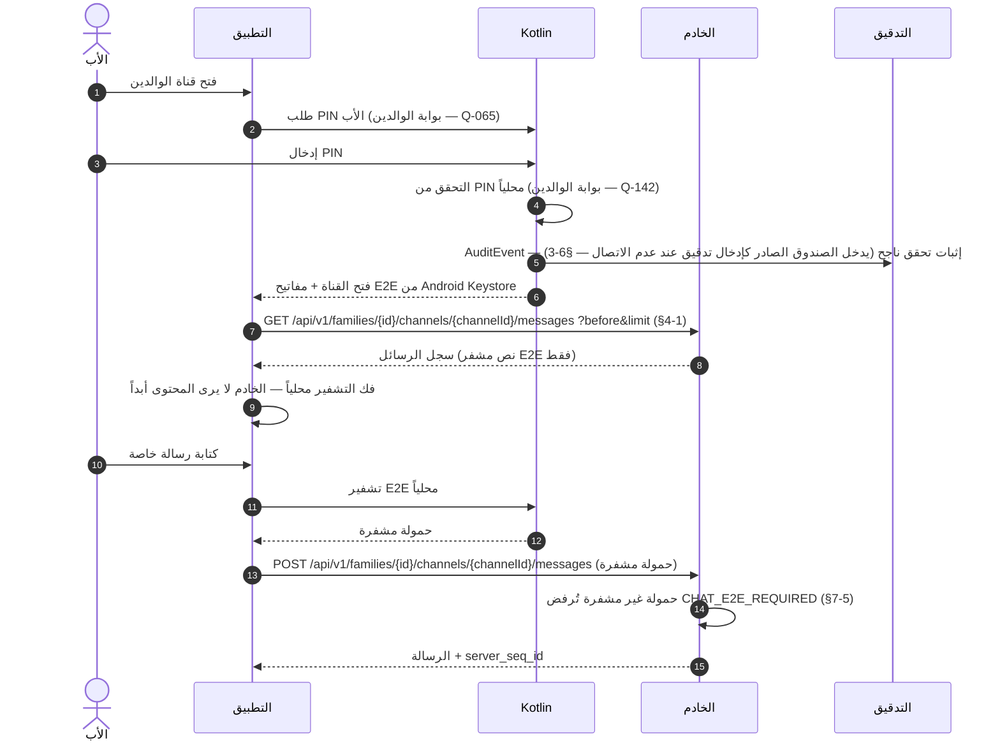

- على جهاز الطفل: القناة غير موجودة أصلاً — لا في القائمة ولا في البحث — ولا معاينة محتوى في الإشعارات (REQ-003).

### 3-ج. دون اتصال — الصندوق الصادر والتسليم التسلسلي (REQ-014 — §4.1/§4.3)

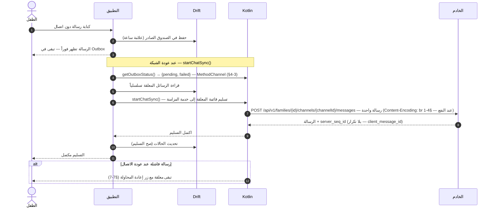

- وضع النطاق المنخفض (Q-064): ضغط Brotli على جسم كل طلب عند النفع (بلا دفعة مجمّعة — §4-1 يعرّف POST واحداً لكل رسالة) + تسليم تسلسلي بلا تكرار (§2 8-5).

### 3-د. حذف رسالة للجميع وإغلاق محادثة قاصر (REQ-004/009 — §4.1 + §4.2)

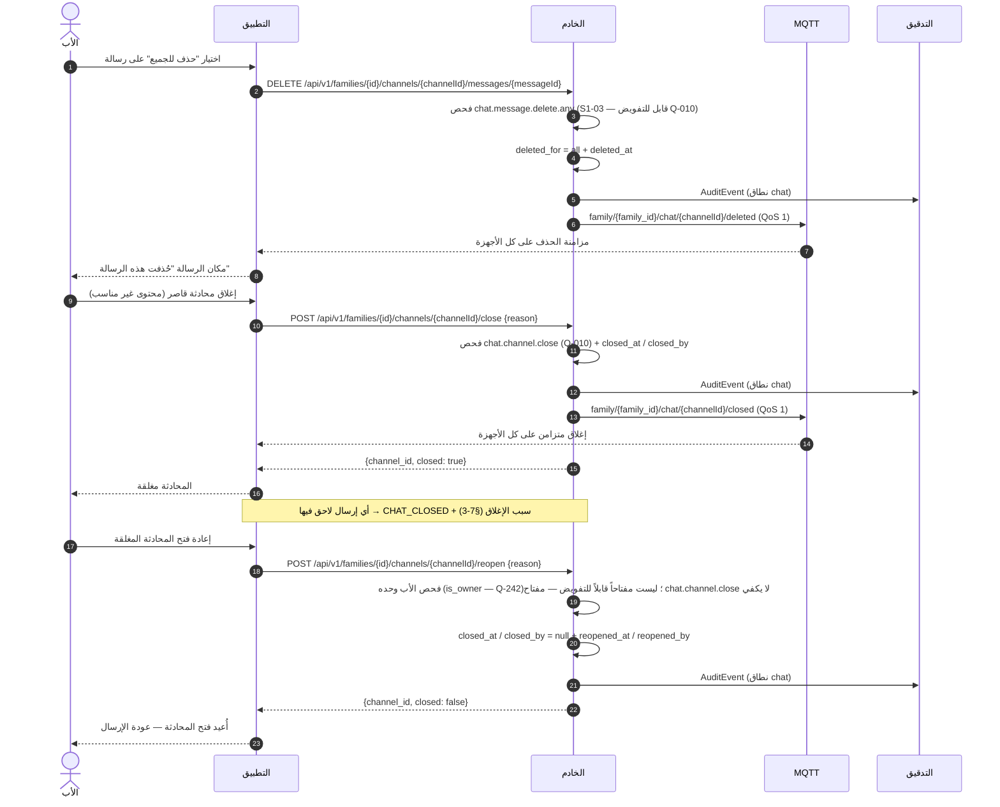

- محاولة إعادة فتح من بالغ مفوَّض (أو مراهق/طفل) → `403` + تسجيل في التدقيق (§7-14)؛ وإعادة الفتح لا تعيد رسائل محذوفة — الحذف دائم بلا تراجع، والإغلاق وحده قابل للعكس (Q-242).

- العضو يحذف رسائله لنفسه فقط (`deleted_for = self`)؛ وحذف رسالة محذوفة أصلاً يُعيد النتيجة نفسها (idempotent — §7-8).

### 3-هـ. استرداد سجل قناة الوالدين على جهاز جديد (REQ-017 — §4.1)

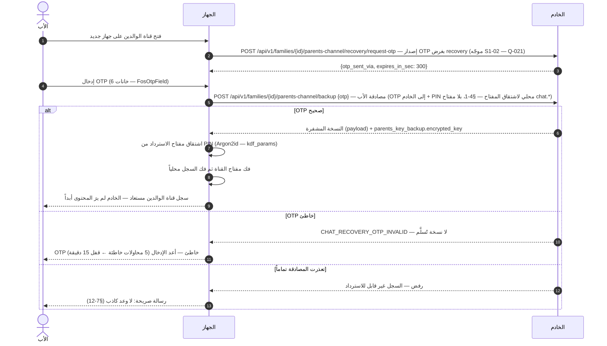

- النسخة المشفرة ومفتاحها المشفر لا يُسلَّمان إلا بعد مصادقة الأب (PIN + OTP) (§6-2)؛ وإعادة تعيين PIN (Q-077) تُعيد تغليف مفتاح الاسترداد (§6-3).

### 3-و. إرسال صورة/صوت — رفع عبر Ktor ثم إرسال بـ media_id (REQ-005 — §4.1)

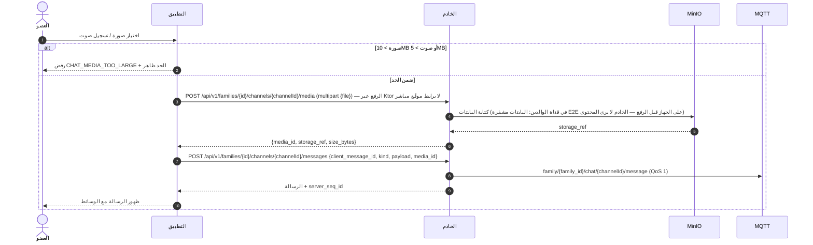

- `media_id` إلزامي عند `kind` صورة/صوت؛ و`payload` ظرف مشفَّر فقط — لا بايتات وسائط فيه (§4-1)؛ ومخرج `GET .../messages` يسرد `server_seq_id` و`media_id` و`deleted_for` لكل رسالة.

### 3-ز. إرسال في محادثة قاصر — بوابة المصنف والحظر قبل التسليم (REQ-012 — Q-292 · Q-293 · Q-294)

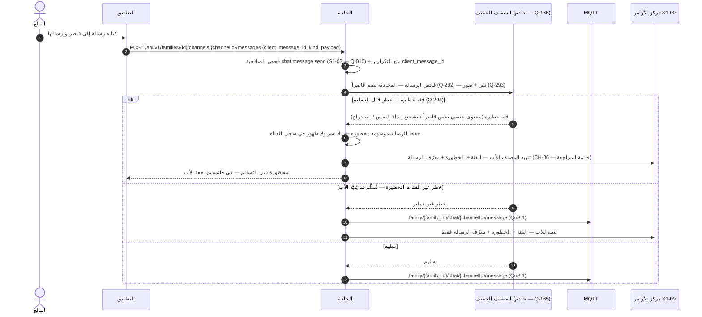

- رسالة بالغ إلى قاصر تُفحص كرسالة القاصر نفسه (Q-292 — بالاتجاهين)؛ والمحظور لا يُسلَّم ولا يُسقط — يبقى في قائمة المراجعة 30 يوماً حتى يقرر الأب (Q-294 · Q-295 · Q-296).

## 4. تدفق المستخدم (User Flow) — من السيناريوهات الستة (§2)

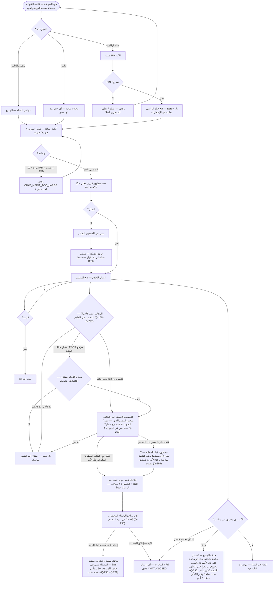

- ملاحظة: محادثة أي قاصر مرئية للأب دائماً (REQ-004)؛ ومؤشرات الكتابة تظهر فقط لأعضاء القناة (§6-3)؛ ولا حذف تلقائي أبداً — الاحتفاظ دائم حتى يحذف الأب (REQ-015).
- حدود المصنف (Q-165 — REQ-012): آلي فقط — لا قراءة بشرية للمحتوى في أي مسار؛ ولا يُخزَّن نص بعد الفحص — التنبيه يحمل الفئة + الخطورة + معرّف الرسالة فقط، ويرى الأب النص من الرسالة المخزنة بموجب رؤيته الإشرافية (Q-100) لا من نسخة في التنبيه؛ ولا استخدام للمحتوى المفحوص لغير التنبيه — لا تدريب نماذج عليه ولا مشاركة مع طرف ثالث؛ وقناة الوالدين E2E بلا فحص أبداً؛ ويُفصَح عن الفحص الآلي في الإعداد المشترك (C-09). والنطاق (Q-292): كل رسائل محادثات القاصر بالاتجاهين — ما يرسله وما يصله. والوسيلة (Q-293): نص + صور في المرحلة 1 (عبر بوابة الذكاء)؛ وتحويل الصوت لنص مؤجل للمرحلة 2. والتوقيت (Q-294): حظر قبل التسليم للفئات الخطيرة فقط (محتوى جنسي يخص قاصراً، تشجيع إيذاء النفس، أنماط استدراج)؛ وتنبيه للأب لما عداها؛ والمحظور يذهب لقائمة مراجعة يراها الأب ولا يُسقط بصمت أبداً. ومسار الإيجاب الكاذب (Q-296): نافذة المراجعة 30 يوماً كما في Q-295 ثم حذف صلب؛ وبعدها الرسالة غير متاحة للعرض.
- قائمة المراجعة (Q-294) ليست مخزناً منفصلاً: هي الرسائل المحظورة المعروضة في تنبيه المصنف CH-06 + تنبيه S1-09 — والأب يقرر بشأنها (تجاهل التنبيه أو إغلاق المحادثة)؛ ولا تُسقط بصمت أبداً.

## 5. مخطط تدفق البيانات (DFD — المستوى 1) — من §4/§5

العمليات مرقمة 1.0–7.0، والمخازن D1–D5. المخازن جداول خادم (PostgreSQL) مع نسخة محلية في Drift على العميل (`channel` + `message`)؛ ووسائط `media` تُخزن في MinIO (Q-058) ومرجعها فقط في قاعدة البيانات.

- **تغطية نقاط §4:** التسلسلات في §3 تغطي التدفقات الأساسية فقط؛ وكل نقطة §4.1 تظهر هنا على الأقل: `GET /api/v1/families/{id}/channels` (قائمة القنوات — REQ-001، تُقرأ عبر P1) · `POST /api/v1/families/{id}/channels` (إنشاء قناة ثنائية/جماعية — REQ-002، تمر عبر P1؛ وقناة الوالدين تُنشأ مع العائلة لا هنا)؛ وبقية النقاط مرسومة في §3 (messages إرسال/قراءة/حذف، read، close).

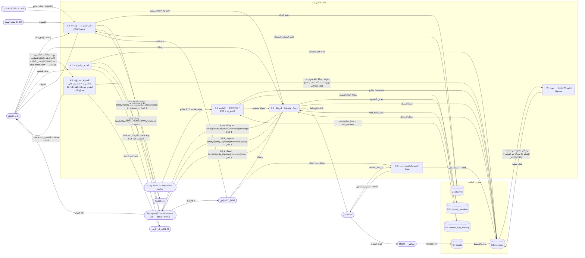

- ودجة S1-09 "أحدث الرسائل" تعرض آخر رسائل القنوات العائلية حسب المنح؛ وقناة الوالدين تظهر كعدد فقط بلا محتوى (REQ-016).

## 6. مخطط النشاط (Activity) — دورة حياة الرسالة من الإرسال إلى الإشراف

المسارات الستة (المرسل / التطبيق / وحدة Kotlin / الخادم / الأب / البالغ المفوَّض) كمسارات متوازية — من §2/§7: العرض المتفائل (REQ-006)، حالات التسليم والقراءة (REQ-007)، مؤشرات الكتابة (REQ-008)، فحص المصنف لرسائل القاصرين على الخادم — دون 13 دائماً، و13–17 بمفتاح مالك العائلة والافتراضي تشغيل (REQ-012 — Q-083/Q-140/Q-165)؛ وحدود الفحص الخمسة (Q-165) في ملاحظة §4، رؤية القاصرين (الأب كاملة + البالغ المفوَّض حسب قالب التفويض — REQ-013) وإغلاق الأب (REQ-004)، والحذف (REQ-009). والأنشطة الخلفية (المزامنة الخلفية للصندوق الصادر + دفع MQTT + فحص المصنف) تعمل **بالتوازي** مع استخدام الدردشة.

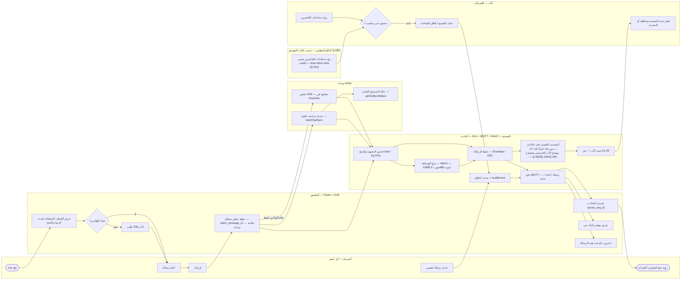

- عند إعادة الفتح بعد الإغلاق القسري، يعود المستخدم لنفس القناة والمسودة (S1-01 §7 — سلوك الغلاف، يسري على كل الأنظمة)؛ والرسائل الفاشلة في الصندوق الصادر تبقى معلقة حتى تنجح أو يحذفها مرسلها (§6-3). وكل مسار إرسال (عادي عبر A4، أو قناة والدين عبر K1، أو صندوق صادر عبر K2) يمر بفحص العضوية والمنح V1 قبل الحفظ V2؛ ورفع الوسائط (V3) شرط مسبق للحفظ (V2) في رسائل الوسائط (media_id مع الرسالة — 3-و)، لا تالٍ له.
