# S1-08: مخططات هندسة البرمجيات (DIAGRAMS)

- **الحالة:** معتمدة — المخططات الستة معتمدة (حكم المالك 2026-11-08 — D-2، بعد موجة الإصلاح 0e4a3e2..f7da470)؛ والمواصفة معتمدة بالكامل في التخطيط
- **المواصفة:** `SPEC.md` (§§1–8 + §10 معتمدة بالكامل في التخطيط)
- **رُسم 2026-11-19 (Q-410 · Q-413 — Q-434):** المصنف بفئاته السبع (3-ز)، ومراجعة التنبيه بنص لا يظهر إلا بطلب (3-ح)، وإغلاق المحادثة بسبب وإعادة فتحها (3-ط)، ومفتاح مصنف المراهق (UC16)، وإبلاغ المرسل بالحظر (UC18) — انظر «أُعيد رسمه» تحت كل مخطط.
- **السياق المحدد (Bounded Context):** #6 التواصل (Messaging) — `CONTEXT-MAP.md` §2 صف 6
- **القرارات الحاكمة:** Q-001 · Q-003 · Q-007 · Q-010 · Q-058 · Q-064 · Q-065 · Q-077 · Q-081 · Q-082 · Q-083 · Q-099 · Q-100 · Q-140 · Q-165 · Q-410 · Q-413 · D-011 · D-019 · D-020 · D-021 · D-023 · D-038 · G-006 · G-007 · G-011 · Q-134 (هيكل الملف) · Q-168
- **الأنواع الستة:** 1. حالات الاستخدام · 2. ERD · 3. التسلسل · 4. تدفق المستخدم · 5. DFD · 6. النشاط
- **الأشكال الموحدة:** مستطيل بطرفين مستديرين = طرف خارج العملية المرسومة (مستخدم، نظام مجاور، خدمة، أو الخادم) · مستطيل = شاشة أو خطوة، وفي مخطط تدفق البيانات عملية مرسومة في لوحة أخرى · مستطيل مستدير الزوايا = عملية · معين = قرار · أسطوانة = مخزن بيانات · خط متقطع = يتضمن / اختياري

## 1. حالات الاستخدام

19 حالة استخدام من السيناريوهات الستة والمتطلبات (§2/§3 — REQ-001…REQ-017؛ وREQ-010 وREQ-015 بلا حالة استخدام لأنهما بلا واجهة — يُغطَّيان في §9-5 — وREQ-016 سطحه في S1-09 لا حالة استخدام له هنا): أي عضو يراسل أي عضو، الأب يرى محادثات القاصرين ويغلقها، والبالغ المفوَّض يراها حسب قالب التفويض (REQ-013 — `chat.minor.view`)، قناة الوالدين للبالغين فقط بـ PIN الأب ومخفية عن أجهزة الأطفال، والمصنف الخفيف على الخادم (Q-165) يحرس كل رسائل محادثات الأطفال دون 13 سنة بالاتجاهين (Q-292) دائماً، وكل رسائل محادثات المراهقين 13–17 سنة بالاتجاهين بمفتاح تحكم لكل عائلة يملكه مالك العائلة والافتراضي تشغيل (Q-083 كما عدّله Q-140). والتسليم إلى أنظمة الهوية (S1-02) والصلاحيات (S1-03) ومركز الأوامر (S1-09) ممثل كجهات خارجية. والجديد (Q-410 · Q-413): الأب يراجع تنبيه المصنف بنص لا يظهر إلا بطلب صريح مسجَّل (UC15)، ويشغّل/يوقف مصنف المراهق وحده (UC16)، ويعيد فتح المحادثة المغلقة وحده بتأكيد بلا سبب إلزامي (UC17)، ويُخبَر مرسل الرسالة المحظورة أنها لم تُسلَّم (UC18).

### 1-أ. الأب — الإرسال والقراءة (REQ-001/002/003/005/006/007/008/011/014/017)

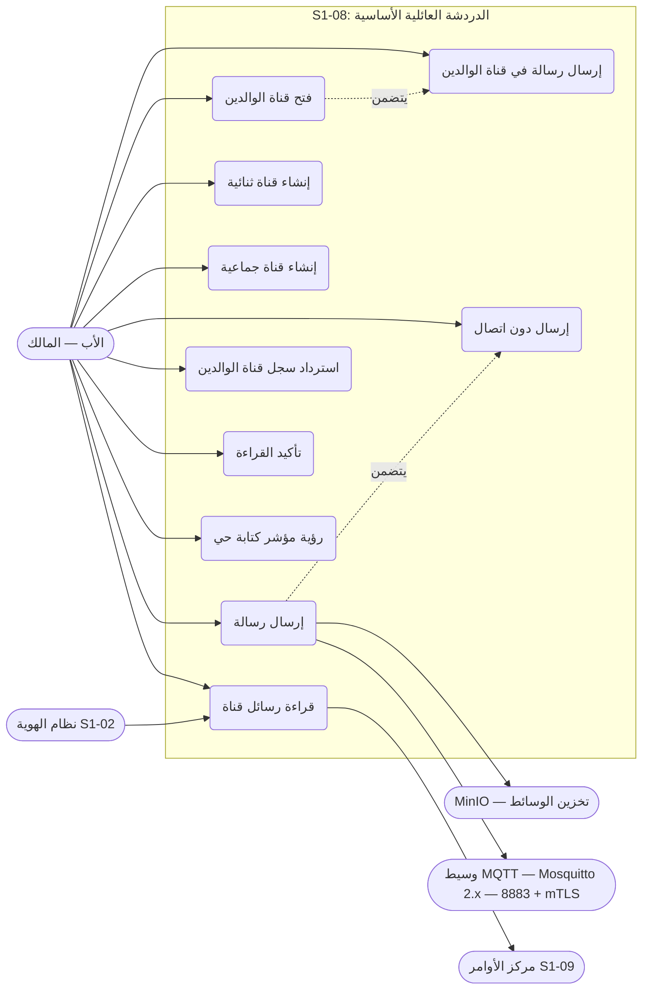

- ما يُقرأ منه: كيف يرسل الأب ويقرأ — قنوات ثنائية وجماعية وقناة الوالدين، والإرسال دون اتصال عبر الصندوق الصادر.

### 1-ب. الأب — الإشراف والتنبيهات (REQ-004/009/012/013)

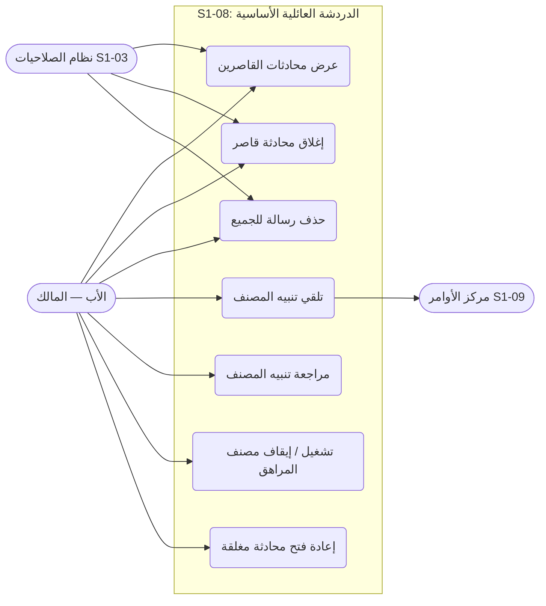

- ما يُقرأ منه: إشراف الأب وحده — رؤية محادثات القاصرين وإغلاقها وحذف رسائلها، وتنبيهات المصنف ومراجعتها ومفتاح مصنف المراهق.

### 1-ج. البالغ — الإرسال والإشراف حسب القالب (REQ-001/002/003/005/006/007/008/009/011/013/014)

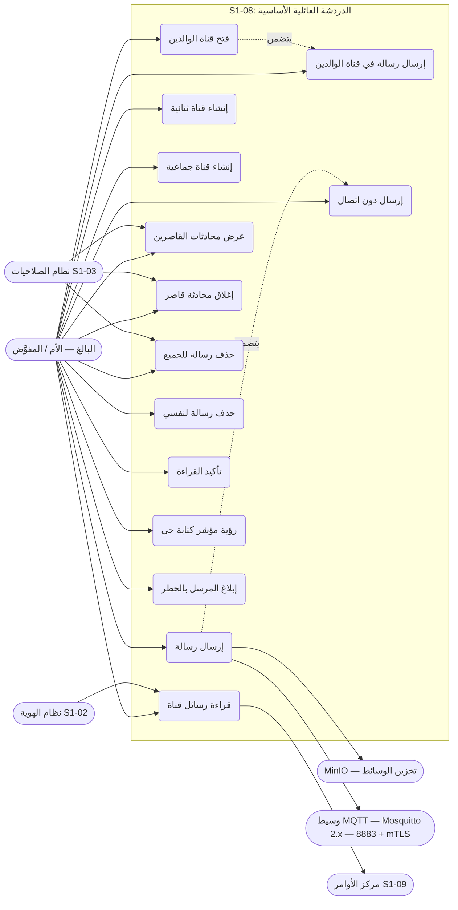

- ما يُقرأ منه: البالغ يرسل ويقرأ كالأب، ويرى محادثات القاصرين حسب قالب التفويض فقط؛ ويُخبَر بالحظر حين تُحظر رسالته.

### 1-د. المراهق والطفل — الإرسال والقراءة (REQ-001/002/005/006/007/008/009/014)

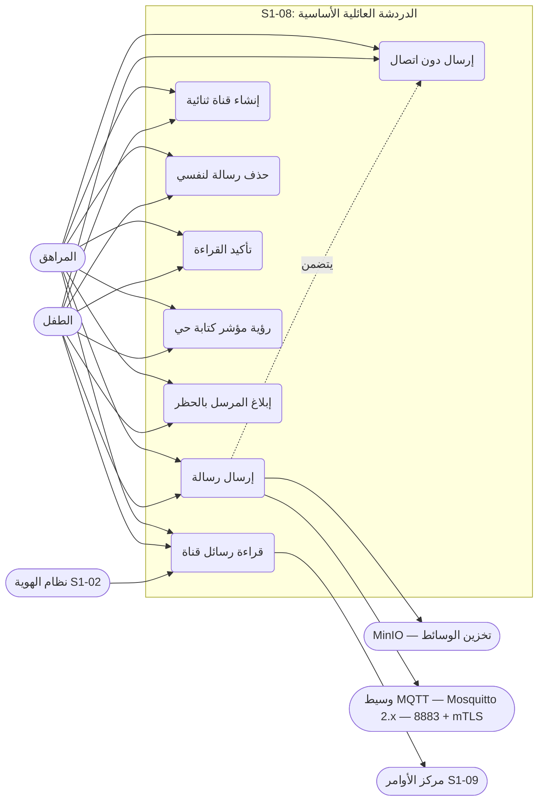

- ما يُقرأ منه: المراهق والطفل يرسلان ويقرآن فقط — لا إغلاق محادثة ولا حذف للجميع ولا رؤية قناة الوالدين؛ ويُخبَران بالحظر حين تُحظر رسالة أحدهما.

- ملاحظات: قناة الوالدين **لا تظهر أصلاً** على جهاز الطفل أو المراهق — لا في القائمة ولا في البحث (REQ-003)؛ والمراهق والطفل لا يغلقان محادثة ولا يحذفان رسالة للجميع أبداً (§6-1 — `chat.channel.close` و`chat.message.delete.any` للبالغين فقط — Q-010)؛ والبالغ المفوَّض يرى محادثات القاصرين حسب قالب التفويض فقط (REQ-013 — `chat.minor.view` — Q-089).
- ملاحظة: UC1 نص / إيموجي / صورة / صوت (REQ-005)؛ وUC4 بطلب PIN الأب (Q-065)؛ وUC5 مشفرة E2E (REQ-011)؛ وUC6 الأب كاملة والمفوَّض حسب القالب (REQ-013)؛ وUC10 عبر الصندوق الصادر (REQ-014)؛ وUC11 بمصادقة PIN + OTP (REQ-017)؛ وUC12 دون 13 دائماً و13–17 بمفتاح المالك (Q-140).
- ملاحظة (Q-410 · Q-413): UC15 نص الرسالة المرصودة لا يظهر إلا بطلب صريح ويُسجَّل العرض في التدقيق؛ وUC16 عنصر سطح تحكم للمالك وحده — ليس مفتاح صلاحية ولا يُفوَّض (مفاتيح `chat.*` تبقى 8)؛ وUC17 الأب وحده بتأكيد بلا سبب إلزامي (Q-242)؛ وUC18 المرسل يُخبَر بالمحظور فقط — لا يُخبَر بتنبيه عن رسالة سُلّمت.
- خريطة المتطلبات إلى الحالات: REQ-001 ← UC2/UC3/UC3b؛ REQ-002 ← UC3/UC3b؛ REQ-003 ← UC4؛ REQ-004 ← UC6/UC7/UC17؛ REQ-005 ← UC1؛ REQ-006 ← UC1/UC10؛ REQ-007 ← UC13؛ REQ-008 ← UC14؛ REQ-009 ← UC8/UC9؛ REQ-011 ← UC5؛ REQ-012 ← UC12/UC15/UC16/UC18؛ REQ-013 ← UC6؛ REQ-014 ← UC10؛ REQ-017 ← UC11؛ وREQ-010 وREQ-015 بلا حالة استخدام (بلا واجهة — §9-5)؛ وREQ-016 سطحه في S1-09.
- أُعيد رسمه 2026-11-19 (Q-434 — محتوى وشكل): أُضيفت UC15…UC18 (Q-410 · Q-413)؛ وقُصّرت كل التسميات إلى 5 كلمات فأقل ونُقلت أرقام REQ والتفاصيل إلى الملاحظات أعلاه؛ ورُتّبت العقد بترتيب القراءة.
- أُعيد تقسيمه 2026-11-19 (دفعة الشكل 2): لوحة واحدة (28 عقدة) → أربع لوحات حسب الفاعل (1-أ الأب إرسال/قراءة 15 عقدة، 1-ب الأب إشراف 10 عقد، 1-ج البالغ 20 عقدة، 1-د المراهق والطفل 14 عقدة)؛ والجهات الخارجية مكررة باسمها في كل لوحة تحتاجها.

## 2. مخطط قاعدة البيانات (ERD)

الجداول الخمسة من §5 كما هي، مع أربعة مراجع خارجية: العائلة والعضوية (S1-02)، ومفتاح الصلاحية (S1-03 — مفاتيح `chat.*`)، وتنبيهات المصنف (S1-09 — `alert`)، و`AuditEvent` (النواة المشتركة). ملاحظتان: النسخة المحلية من `channel` + `message` في Drift على العميل مخزن عميل لا جدول خادم (§5-6)، و`payload` في قناة الوالدين نص مشفر E2E فقط — الخادم لا يقرأ محتواها أبداً (REQ-011). كل جدول يحمل `family_id` + عزل RLS (D-021) — بما فيه `channel_member` (§5-2).

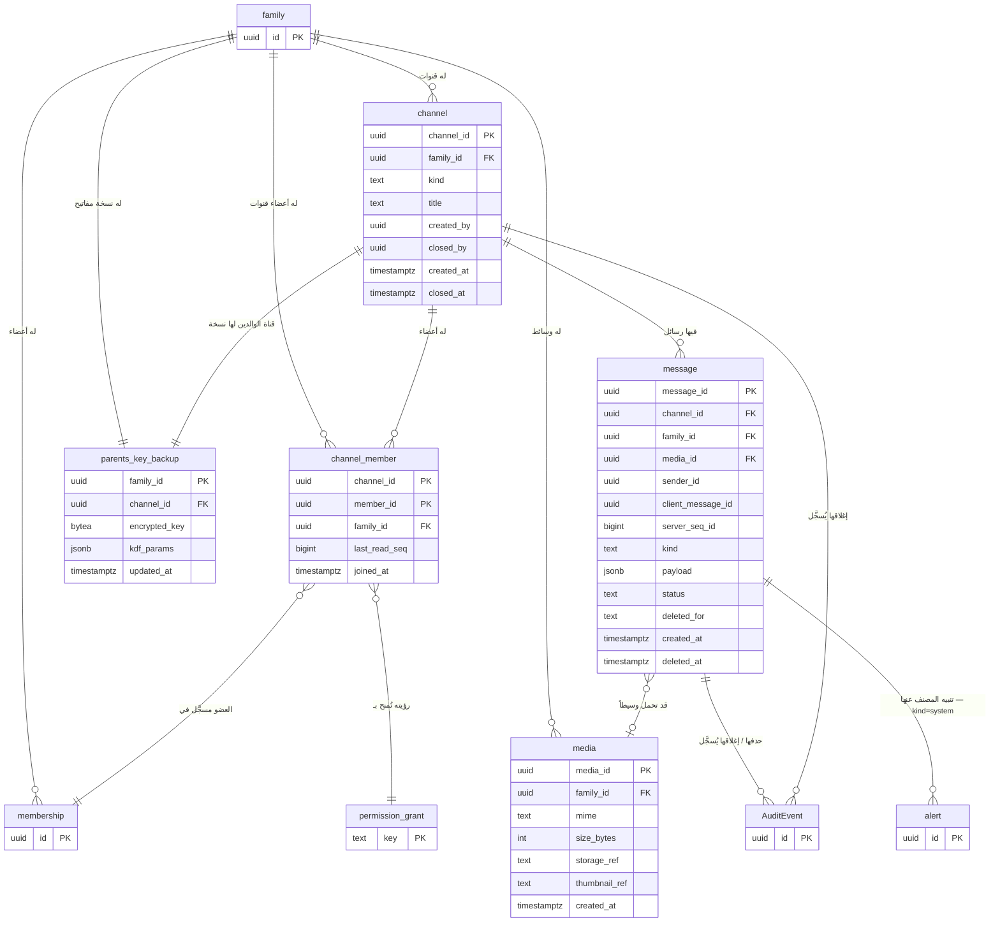

- `channel.kind`: `lounge` / `parents` / `direct` / `group` (§5-1 — REQ-001/002) — قناة الوالدين واحدة تُنشأ مع العائلة ولا تُنشأ من نقطة الإنشاء (§6-2). `message.kind`: `text` / `emoji` / `image` / `voice` / `system` (§5-3 — REQ-005). `media.size_bytes`: الحد 10MB للصور / 5MB للرسائل الصوتية (Q-058). `message.status`: `sent` / `delivered` / `read` (§5-3 — REQ-007) — بلا `pending` (قيمة عميل فقط في Drift، لا تُخزَّن على الخادم). `message.deleted_for`: `all` (الأب) أو `self` (العضو) (§5-3 — REQ-009). `payload`: الحمولة المعماة Envelope للقنوات العائلية (REQ-010) وE2E لقناة الوالدين (REQ-011).
- أُعيد رسمه 2026-11-19 (Q-434 — شكل فقط): رُتّبت الحقول في `channel` و`channel_member` و`message`: المفتاح الأساسي، ثم الأجنبية، ثم الحقول، ثم التواريخ في الآخر؛ ولا جدول جديد — المصنف بلا جدول (التنبيه يحمل الفئة + الخطورة + معرّف الرسالة فقط — Q-165).

## 3. التسلسل (Sequence) — من عقود §4

تسعة مخططات، كل واحد لتدفق واحد (3-د قُسّم إلى 3-د و3-ط لأن رسائله تجاوزت 20، و3-ح مخطط جديد لمراجعة التنبيه — Q-434):
- **عقد MQTT (Q-168 — الإحالة الصريحة إلى `docs/family-os/governance/architecture/MQTT-BROKER-SPEC.md`):** الوسيط Eclipse Mosquitto 2.x — عقدة واحدة في المرحلة 1 — TLS 1.2+ على المنفذ 8883 + mTLS (شهادة خادم + شهادة جهاز)؛ ورسائل الدردشة (`family/{family_id}/chat/{channelId}/message` و`family/{family_id}/chat/{channelId}/typing` و`family/{family_id}/chat/{channelId}/deleted` و`family/{family_id}/chat/{channelId}/read` و`family/{family_id}/chat/{channelId}/created` و`family/{family_id}/chat/{channelId}/closed`) QoS 1 وبلا احتفاظ (retained=false — §4-2)؛ وبلا QoS 2؛ والعزل ببادئة `family/{family_id}/` + ACL خادمي؛ والشهادات سنتان مع تجديد تلقائي وإبطال فوري. لا `command_id` في هذا النظام — عدم التكرار هنا بـ `client_message_id` (§4-1).

### 3-أ. إرسال رسالة فورياً — العرض المتفائل ثم المزامنة (REQ-006/007 — §4.1 + §4.2)

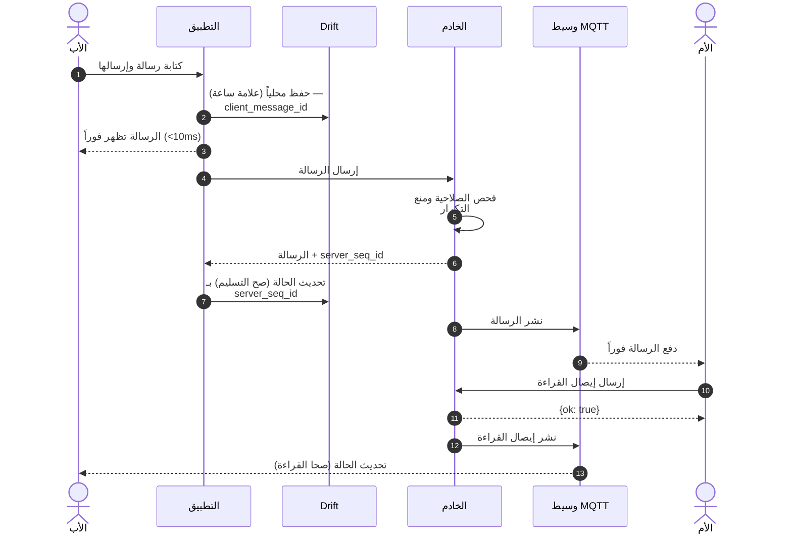
- الرسالة 2: حفظ محلياً بـ client_message_id (علامة ساعة).
- الرسالة 4: `POST /api/v1/families/{id}/channels/{channelId}/messages {client_message_id, kind, payload}`.
- الرسالة 5: فحص الصلاحية chat.message.send (S1-03 — Q-010) + منع التكرار بـ client_message_id.
- الرسالة 8: `family/{family_id}/chat/{channelId}/message (QoS 1)`.
- الرسالة 10: `POST /api/v1/families/{id}/channels/{channelId}/read {last_read_seq}`.
- الرسالة 12: `family/{family_id}/chat/{channelId}/read (QoS 1)`.

- نفس `client_message_id` مرتين تُعيد الرسالة الأصلية بلا تكرار (§7-6)؛ والترتيب بـ `server_seq_id` لكل قناة (§6-3). عند إعادة الاتصال: كشف الفجوات وإصلاحها عبر `GET .../messages` بقاعدة §4-2 (مقارنة آخر `server_seq_id` مرئي) — QoS 1 وحده لا يغلق فجوة جلسة ساقطة.

### 3-ب. فتح قناة الوالدين وإرسال رسالة E2E (REQ-003/011 — §4.1)

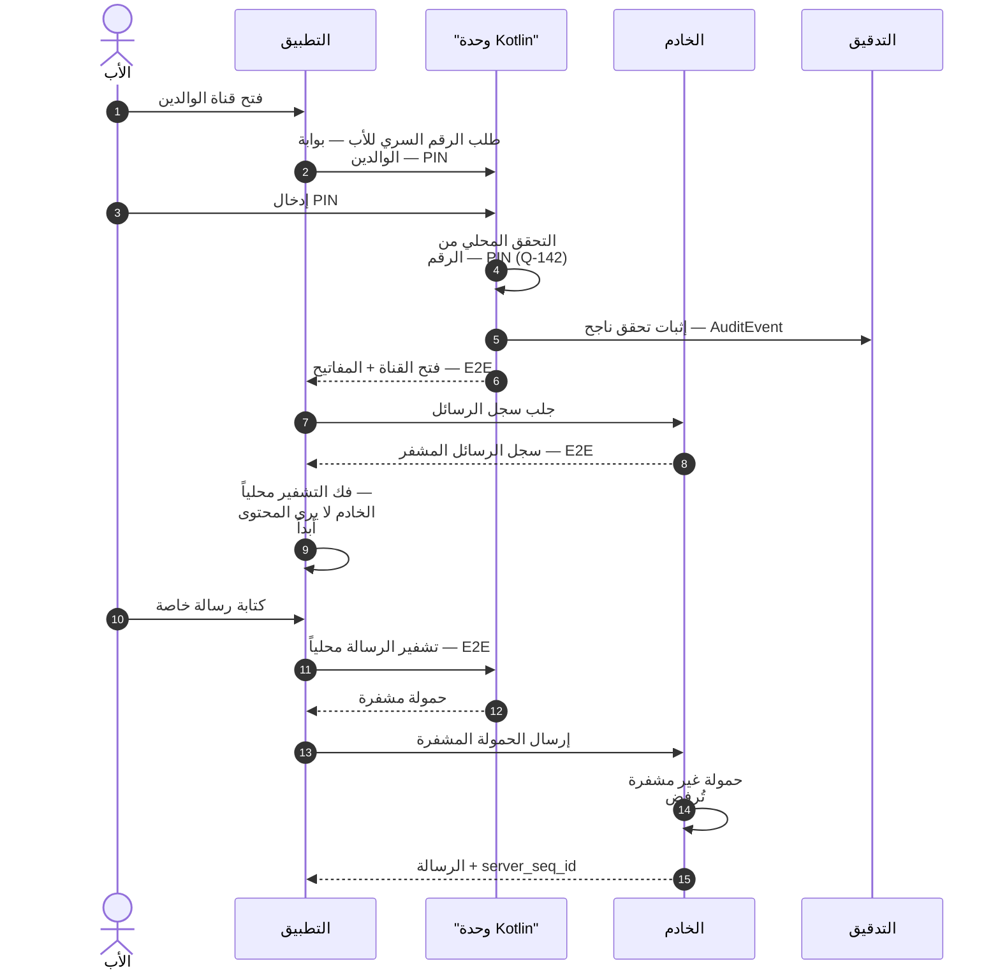
- الرسالة 2: طلب PIN الأب (بوابة الوالدين — Q-065).
- الرسالة 5: `AuditEvent` — إثبات تحقق ناجح (يدخل الصندوق الصادر كإدخال تدقيق عند عدم الاتصال — §6-3).
- الرسالة 6: فتح القناة + مفاتيح E2E من Android Keystore.
- الرسالة 7: `GET /api/v1/families/{id}/channels/{channelId}/messages ?before&limit (§4-1)`.
- الرسالة 8: سجل الرسائل (نص مشفر E2E فقط).
- الرسالة 13: `POST /api/v1/families/{id}/channels/{channelId}/messages (حمولة مشفرة)`.
- الرسالة 14: حمولة غير مشفرة تُرفض CHAT_E2E_REQUIRED (§7-5).

- على جهاز الطفل: القناة غير موجودة أصلاً — لا في القائمة ولا في البحث — ولا معاينة محتوى في الإشعارات (REQ-003).

### 3-ج. دون اتصال — الصندوق الصادر والتسليم التسلسلي (REQ-014 — §4.1/§4.3)

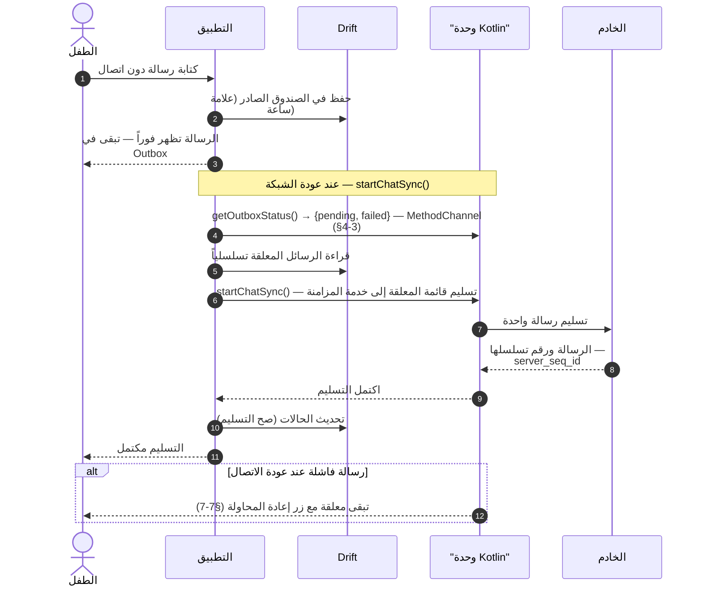
- الرسالة 7: `POST /api/v1/families/{id}/channels/{channelId}/messages — رسالة واحدة (Content-Encoding: br عند النفع — §4-1)`.
- الرسالة 8: الرسالة + server_seq_id (بلا تكرار — client_message_id).

- وضع النطاق المنخفض (Q-064): ضغط Brotli على جسم كل طلب عند النفع (بلا دفعة مجمّعة — §4-1 يعرّف POST واحداً لكل رسالة) + تسليم تسلسلي بلا تكرار (§2 8-5).

### 3-د. حذف رسالة للجميع (REQ-009 — §4.1 + §4.2)

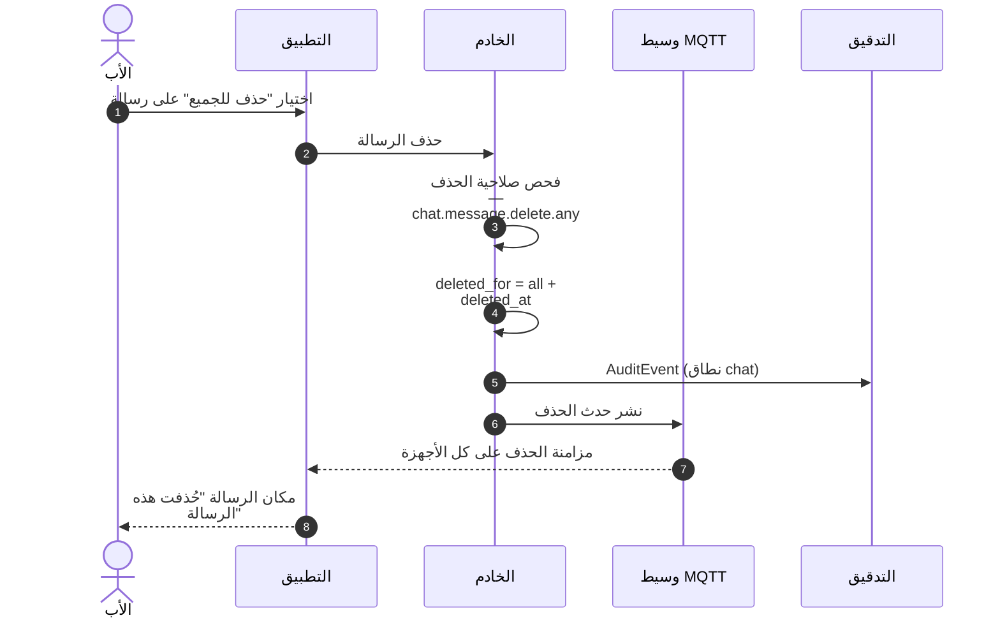
- الرسالة 2: `DELETE /api/v1/families/{id}/channels/{channelId}/messages/{messageId}`.
- الرسالة 3: فحص chat.message.delete.any (S1-03 — قابل للتفويض Q-010).
- الرسالة 6: `family/{family_id}/chat/{channelId}/deleted (QoS 1)`.

- العضو يحذف رسائله لنفسه فقط (`deleted_for = self`)؛ وحذف رسالة محذوفة أصلاً يُعيد النتيجة نفسها (idempotent — §7-8).
- الاحتفاظ بعد الحذف (Q-295): المحتوى المُعلَّم يُحتفظ به 30 يوماً للمراجعة ثم يُحذف نهائياً؛ وغير المُعلَّم يُطهر خلال 7 أيام — يُوثَّق للأب في حوار التأكيد.
- أُعيد رسمه 2026-11-19 (Q-434 — محتوى + شكل): قُسّم من 3-د (كان 23 رسالة) إلى 3-د حذف فقط (8 رسائل) و3-ط إغلاق/إعادة فتح/مصنف؛ وإضافة ملاحظة الاحتفاظ (Q-295).

### 3-ط. إغلاق محادثة قاصر وإعادة فتحها ومفتاح المصنف (REQ-004 · REQ-012 — §4.1 + §4.2 — Q-242 · Q-410)

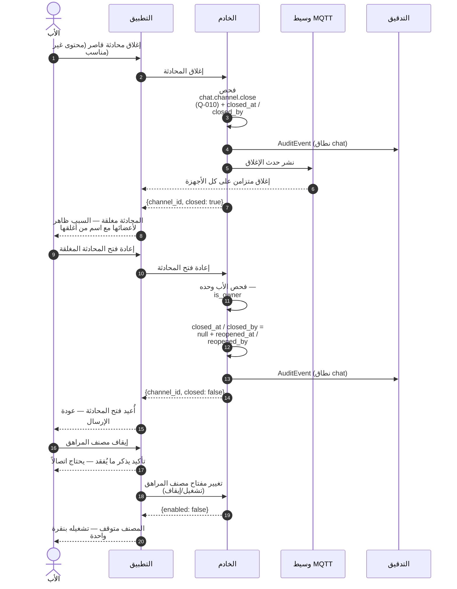
- الرسالة 2: `POST /api/v1/families/{id}/channels/{channelId}/close {reason}`.
- الرسالة 5: `family/{family_id}/chat/{channelId}/closed (QoS 1)`.
- الرسالة 10: `POST /api/v1/families/{id}/channels/{channelId}/reopen {reason?}`.
- الرسالة 11: فحص الأب وحده (is_owner — Q-242)؛ ليست مفتاحاً قابلاً للتفويض — مفتاح chat.channel.close لا يكفي.
- الرسالة 18: `PATCH /api/v1/families/{id}/settings/{system}` — `{control_key: "chat.classifier.teen", value}` — نقطة S1-09 §4-1؛ للمالك وحده.

- محاولة إعادة فتح من بالغ مفوَّض (أو مراهق/طفل) → `403` + تسجيل في التدقيق (§7-14)؛ وإعادة الفتح لا تعيد رسائل محذوفة — الحذف دائم بلا تراجع، والإغلاق وحده قابل للعكس (Q-242).
- سبب الإغلاق إلزامي ويُعرض لأعضاء المحادثة مع اسم من أغلقها (Q-410)؛ وإعادة الفتح بتأكيد من الأب بلا سبب إلزامي (Q-410 — `{reason?}`)، ولا انتهاء تلقائي للإغلاق — إعادة فتح الأب هي الطريق الوحيد (Q-242). وأي إرسال لاحق في محادثة مغلقة → `CHAT_CLOSED` + سبب الإغلاق (§7-3).
- مفتاح المصنف (`chat.classifier.teen`) عنصر سطح تحكم للمالك وحده — ليس مفتاح صلاحية ولا يُزرع ولا يُفوَّض (§9-3)؛ إيقافه بتأكيد يذكر ما يُفقد ويحتاج اتصالاً، وتشغيله بنقرة واحدة (Q-410 (ج)). ولا نقطة نهاية محددة في §4-1 لهذا المفتاح — السلوك موصوف في §9-3.
- أُعيد رسمه 2026-11-19 (Q-434 — محتوى): مخطط جديد مقسوم من 3-د (كان 23 رسالة)؛ 20 رسالة.

### 3-هـ. استرداد سجل قناة الوالدين على جهاز جديد (REQ-017 — §4.1)

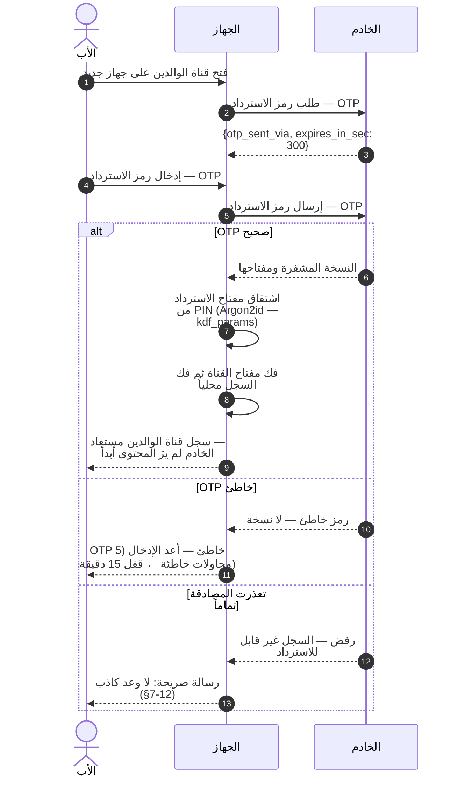
- الرسالة 2: `POST /api/v1/families/{id}/parents-channel/recovery/request-otp — إصدار OTP بغرض recovery (موجّه S1-02 — Q-021)`.
- الرسالة 4: إدخال OTP (6 خانات — FosOtpField).
- الرسالة 5: `POST /api/v1/families/{id}/parents-channel/backup {otp} — مصادقة الأب (OTP إلى الخادم + PIN محلي لاشتقاق المفتاح — §4-1، بلا مفتاح chat.*)`.
- الرسالة 6: النسخة المشفرة (payload) + parents_key_backup.encrypted_key.
- الرسالة 10: CHAT_RECOVERY_OTP_INVALID — لا نسخة تُسلَّم.

- النسخة المشفرة ومفتاحها المشفر لا يُسلَّمان إلا بعد مصادقة الأب (PIN + OTP) (§6-2)؛ وإعادة تعيين PIN (Q-077) تُعيد تغليف مفتاح الاسترداد (§6-3).

### 3-و. إرسال صورة/صوت — رفع عبر Ktor ثم إرسال بـ media_id (REQ-005 — §4.1)

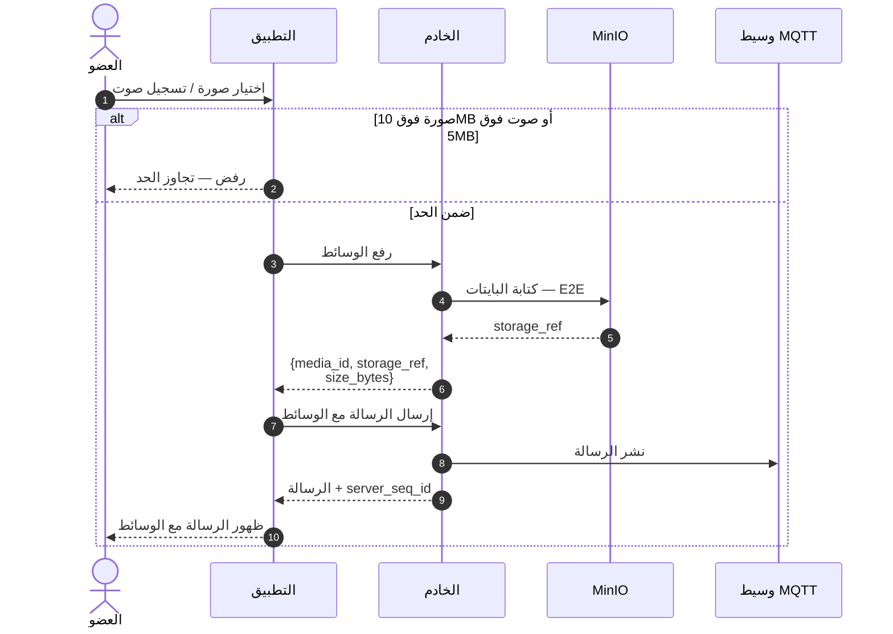
- الرسالة 2: رفض CHAT_MEDIA_TOO_LARGE + الحد ظاهر.
- الرسالة 3: `POST /api/v1/families/{id}/channels/{channelId}/media (multipart {file}) — الرفع عبر Ktor لا برابط موقّع مباشر`.
- الرسالة 4: كتابة البايتات (في قناة الوالدين: البايتات مشفرة E2E على الجهاز قبل الرفع — الخادم لا يرى المحتوى).
- الرسالة 7: `POST /api/v1/families/{id}/channels/{channelId}/messages {client_message_id, kind, payload, media_id}`.
- الرسالة 8: `family/{family_id}/chat/{channelId}/message (QoS 1)`.

- `media_id` إلزامي عند `kind` صورة/صوت؛ و`payload` ظرف مشفَّر فقط — لا بايتات وسائط فيه (§4-1)؛ ومخرج `GET .../messages` يسرد `server_seq_id` و`media_id` و`deleted_for` لكل رسالة.

### 3-ز. إرسال في محادثة قاصر — بوابة المصنف بفئاته السبع (REQ-012 — Q-292 · Q-293 · Q-294 · Q-413)

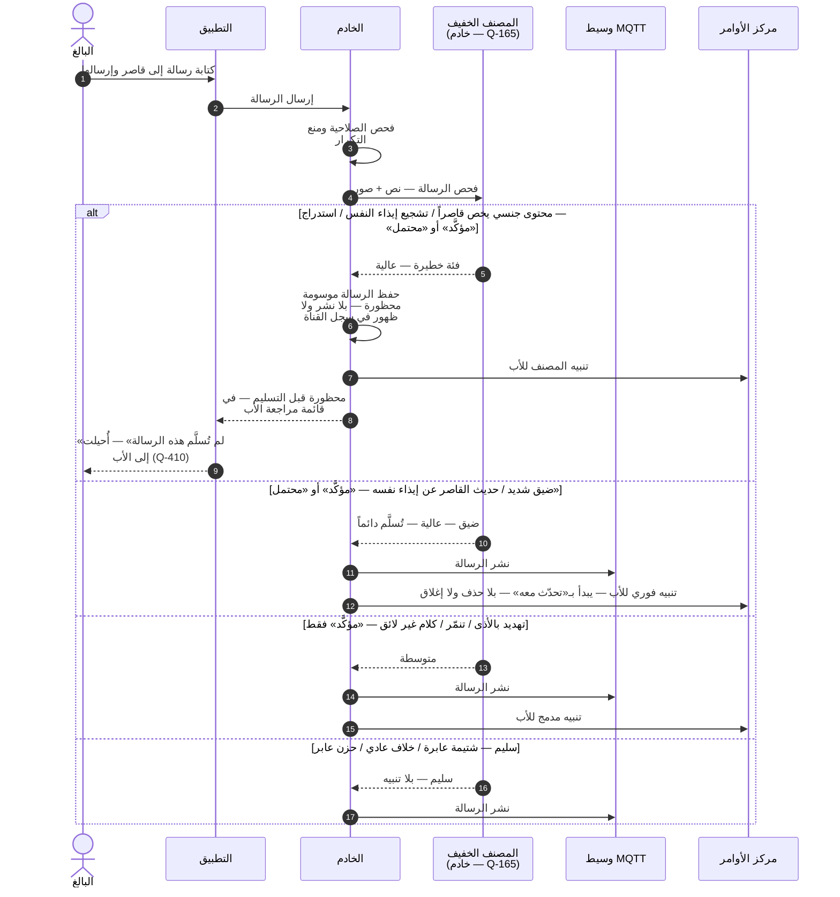
- الرسالة 2: `POST /api/v1/families/{id}/channels/{channelId}/messages {client_message_id, kind, payload}`.
- الرسالة 3: فحص الصلاحية chat.message.send (S1-03 — Q-010) + منع التكرار بـ client_message_id.
- الرسالة 4: فحص الرسالة — المحادثة تضم قاصراً (Q-292) — نص + صور (Q-293).
- الرسالة 7: تنبيه المصنف للأب — الفئة + الخطورة + معرّف الرسالة (CH-06 — قائمة المراجعة).
- الرسائل 11 و14 و17: `family/{family_id}/chat/{channelId}/message (QoS 1)`.
- الرسالة 15: تنبيه للأب — الفئة + الخطورة + معرّف الرسالة — واحد لكل محادثة ولكل فئة في اليوم.

- رسالة بالغ إلى قاصر تُفحص كرسالة القاصر نفسه (Q-292 — بالاتجاهين)؛ والمحظور لا يُسلَّم ولا يُسقط — يبقى في قائمة المراجعة 30 يوماً حتى يقرر الأب (Q-294 · Q-295 · Q-296).
- الفئات السبع قائمة مغلقة في المرحلة 1 (Q-413 — §6-4): الثلاث المحظورة تُحظر عند «مؤكَّد» أو «محتمل»؛ والضيق يُسلَّم دائماً مع تنبيه فوري عالٍ؛ والتهديد والتنمّر والكلام غير اللائق تُسلَّم مع تنبيه متوسط عند «مؤكَّد» فقط. والتنمّر: «مؤكَّد» شديد مرة واحدة، أو تكرار من المرسل نفسه في المحادثة نفسها في اليوم نفسه (قيمة البداية: 3 رسائل مرصودة). وما عدا السبع لا ينبّه — المصنف ليس رقيب أدب.
- دمج التنبيهات (Q-413): المتوسطة تنبيه واحد لكل محادثة ولكل فئة في اليوم، وما يليه يزيد العدد داخل التنبيه نفسه؛ والعالية تنبّه فوراً وفي كل مرة. والأب يرى الفئة والخطورة و«قد يكون تقديره خاطئاً» — بلا رقم ثقة. والمرسل يُخبَر بالمحظور فقط.
- أُعيد رسمه 2026-11-19 (Q-434 — محتوى): الفئات السبع بتصرفاتها الأربعة بدلاً من ثلاث (الضيق يُسلَّم دائماً، والمتوسطة تُسلَّم مع تنبيه مدمج)؛ وإبلاغ المرسل بالحظر (Q-410)؛ والرسائل 17 (كانت 13).

### 3-ح. مراجعة تنبيه المصنف — النص بطلب صريح والتصرف عليه (REQ-012 — Q-165 · Q-410 · Q-413)

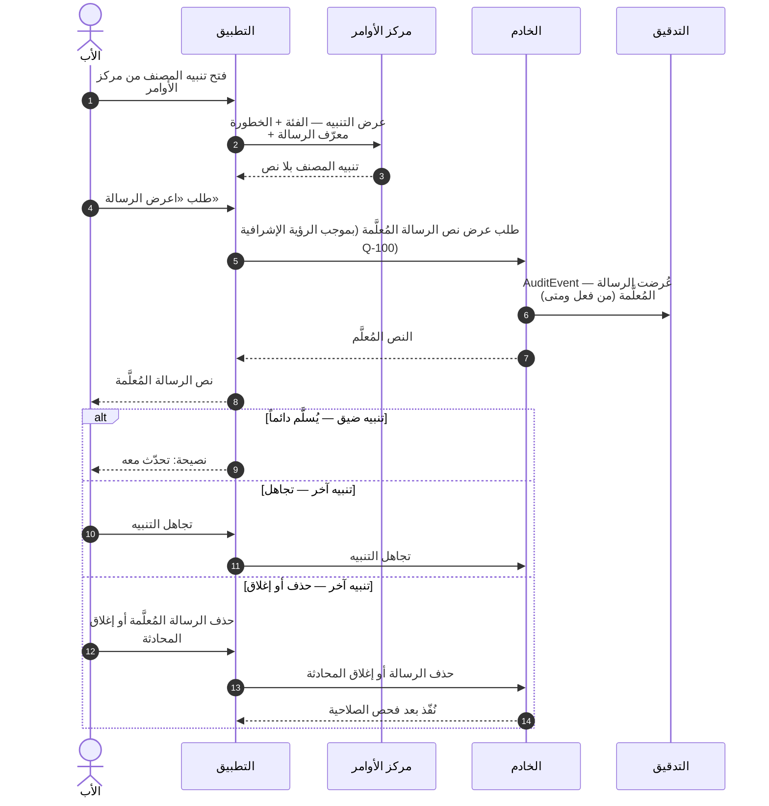
- الرسالة 3: تنبيه المصنف — «قد يكون تقديره خاطئاً» — بلا رقم ثقة — بلا نص الرسالة.
- الرسالة 5: `POST /api/v1/families/{id}/flagged-messages/{messageId}/reveal` — يُكتب العرض في التدقيق.
- الرسالة 9: يبدأ بـ«تحدّث معه» — نصيحة بطلب مساعدة مختص — بلا حذف ولا إغلاق.
- الرسالة 11: `POST /api/v1/families/{id}/flagged-messages/{messageId}/dismiss`.
- الرسالة 13: `DELETE .../messages/{messageId} أو POST .../channels/{channelId}/close {reason}`.
- الرسالة 14: نُفّذ (بعد فحص الصلاحية — chat.message.delete.any / chat.channel.close).

- نص الرسالة لا يُعرض إلا بطلب صريح («اعرض الرسالة»)، ويُسجَّل العرض في التدقيق (Q-410 (ب))؛ والتنبيه نفسه يحمل الفئة والخطورة ومعرّف الرسالة فقط — بلا نص وبلا رقم ثقة — مع عبارة «قد يكون تقديره خاطئاً» (Q-165 · Q-413).
- الخيارات: تحدث مع الطفل / افتح المحادثة / تجاهل / احذف الرسالة / أغلق المحادثة — وآخر اثنين لمن مُنحا فقط (Q-410 (ب))؛ والتجاهل يُسجَّل بيانات وصفية فقط (معرّف الرسالة + الفئة + علامة التجاهل — بلا نص) (§7-10).
- في تنبيه الضيق لا تظهر خيارات الحذف والإغلاق — التنبيه يبدأ بـ«تحدّث معه» ونصيحته تذكر طلب مساعدة مختص (Q-413 — §6-4)؛ والتصرف يكون بالحديث مع الطفل، أو من المحادثة نفسها.
- أُعيد رسمه 2026-11-19 (Q-434 — محتوى): مخطط جديد — مراجعة التنبيه (Q-410 (ب))؛ 14 رسالة.

## 4. تدفق المستخدم (User Flow) — من السيناريوهات الستة (§2)

ثلاثة ألواح (Q-434 — المخطط الواحد كان 30 عقدة): 4-أ الكتابة والإرسال، 4-ب المصنف والتنبيه والمراجعة، 4-ج إشراف الأب. المسار السعيد عمود واحد مستقيم في كل لوح.

### 4-أ. الكتابة والإرسال — من فتح الدردشة إلى صح القراءة

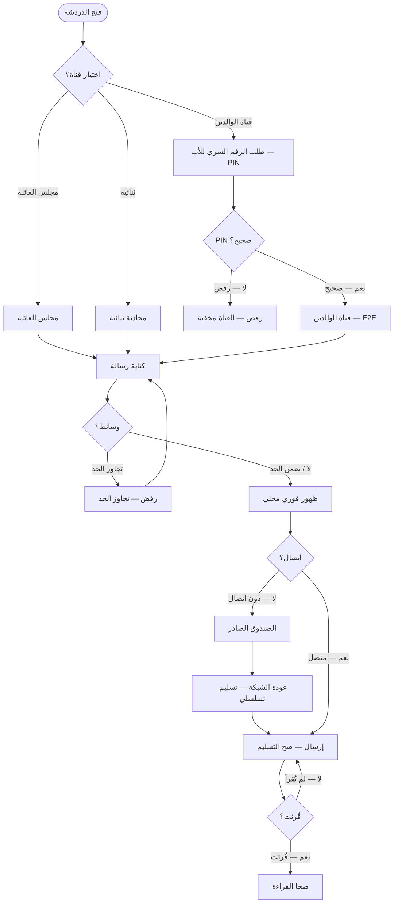

- قائمة القنوات مصفاة حسب الرؤية والمنح؛ وقناة الوالدين لا تظهر للقاصرين أصلاً، وبلا معاينة في الإشعارات. والكتابة نص / إيموجي / صورة / صوت؛ والحد: صورة > 10MB أو صوت > 5MB → `CHAT_MEDIA_TOO_LARGE` والحد ظاهر. والظهور الفوري المحلي <10ms — علامة ساعة. والتسليم دون اتصال تسلسلي بلا تكرار — ضغط Brotli.
- أُعيد رسمه 2026-11-19 (Q-434 — شكل): لوح مقسوم من §4 (كان 30 عقدة)؛ 18 عقدة و23 سهماً؛ وتسميات ≤5 كلمات.

### 4-ب. المصنف والتنبيه والمراجعة — الفئات السبع (REQ-012 — Q-413)

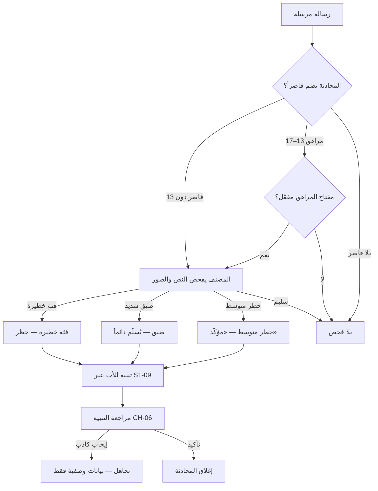

- الفحص على الخادم (Q-165 · Q-292)؛ والصوت بلا فحص في المرحلة 1 (Q-293)؛ ومفتاح المراهق الافتراضي تشغيل. والفئات السبع (§6-4 — Q-413): الثلاث الخطيرة تُحظر عند «مؤكَّد» أو «محتمل»؛ والضيق يُسلَّم دائماً مع تنبيه فوري عالٍ يبدأ بـ«تحدّث معه»؛ والمتوسطة تُسلَّم مع تنبيه متوسط عند «مؤكَّد» فقط (مدمج — واحد لكل محادثة ولكل فئة في اليوم)؛ والسليم بلا تنبيه.
- أُعيد رسمه 2026-11-19 (Q-434 — محتوى + شكل): لوح مقسوم من §4؛ 12 عقدة و16 سهماً؛ وتصرفات الفئات السبع الأربع بدلاً من ثلاث (Q-413)؛ وتسميات ≤5 كلمات.

### 4-ج. إشراف الأب — الحذف والإغلاق (REQ-004 · REQ-009)

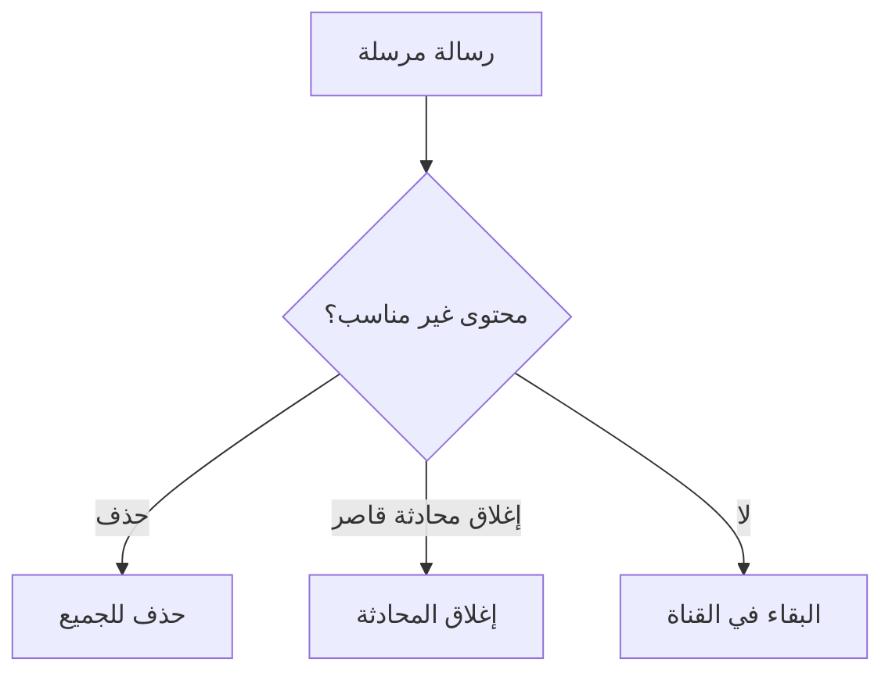

- الحذف للجميع تُستبدل به الرسالة بعلامة «حُذفت هذه الرسالة» على كل الأجهزة؛ والصف محذوف برمجياً حتى التطهير (Q-295: المُعلَّم 30 يوماً ثم حذف صلب؛ وغير المُعلَّم خلال 7 أيام). وإغلاق المحادثة — أي إرسال لاحق `CHAT_CLOSED`. ومؤشرات الكتابة تظهر فقط لأعضاء القناة (§6-3).
- أُعيد رسمه 2026-11-19 (Q-434 — شكل): لوح مقسوم من §4؛ 5 عقد و4 أسهم؛ وتسميات ≤5 كلمات.

- ملاحظة: محادثة أي قاصر مرئية للأب دائماً (REQ-004)؛ ولا حذف تلقائي أبداً — الاحتفاظ دائم حتى يحذف الأب (REQ-015).
- حدود المصنف (Q-165 — REQ-012): آلي فقط — لا قراءة بشرية للمحتوى في أي مسار؛ ولا يُخزَّن نص بعد الفحص — التنبيه يحمل الفئة + الخطورة + معرّف الرسالة فقط، ويرى الأب النص من الرسالة المخزنة بموجب رؤيته الإشرافية (Q-100) لا من نسخة في التنبيه؛ ولا استخدام للمحتوى المفحوص لغير التنبيه — لا تدريب نماذج عليه ولا مشاركة مع طرف ثالث؛ وقناة الوالدين E2E بلا فحص أبداً؛ ويُفصَح عن الفحص الآلي في الإعداد المشترك (C-09). والنطاق (Q-292): كل رسائل محادثات القاصر بالاتجاهين — ما يرسله وما يصله. والوسيلة (Q-293): نص + صور في المرحلة 1 (عبر بوابة الذكاء)؛ وتحويل الصوت لنص مؤجل للمرحلة 2. والتوقيت (Q-294 · Q-413 — §6-4): حظر قبل التسليم للفئات الخطيرة فقط عند «مؤكَّد» أو «محتمل»؛ والضيق يُسلَّم دائماً مع تنبيه فوري عالٍ؛ والمتوسطة تُسلَّم مع تنبيه متوسط عند «مؤكَّد» فقط؛ والسليم بلا تنبيه؛ والمحظور يذهب لقائمة مراجعة يراها الأب ولا يُسقط بصمت أبداً. ومسار الإيجاب الكاذب (Q-296): نافذة المراجعة 30 يوماً كما في Q-295 ثم حذف صلب؛ وبعدها الرسالة غير متاحة للعرض.
- قائمة المراجعة (Q-294) ليست مخزناً منفصلاً: هي الرسائل المحظورة المعروضة في تنبيه المصنف CH-06 + تنبيه S1-09 — والأب يقرر بشأنها (تجاهل التنبيه أو إغلاق المحادثة)؛ ولا تُسقط بصمت أبداً.

## 5. مخطط تدفق البيانات (DFD — المستوى 1) — من §4/§5

العمليات مرقمة 1.0–7.0، والمخازن D1–D5. المخازن جداول خادم (PostgreSQL) مع نسخة محلية في Drift على العميل (`channel` + `message`)؛ ووسائط `media` تُخزن في MinIO (Q-058) ومرجعها فقط في قاعدة البيانات. سبع لوحات (دفعة الشكل 2 — المخطط الواحد كان 22 عقدة): 5-أ إدارة القنوات (P1)، 5-ب إرسال الرسائل — الحفظ والدفع (P2)، 5-ج إرسال الرسائل — الوسائط (P2)، 5-د التشفير E2E ‏(P3)، 5-هـ الإشراف والمصنف (P4)، 5-و الصندوق الصادر (P5)، 5-ز الحذف والتطهير (P6+P7).

- **تغطية نقاط §4:** التسلسلات في §3 تغطي التدفقات الأساسية فقط؛ وكل نقطة §4.1 تظهر هنا على الأقل: `GET /api/v1/families/{id}/channels` (قائمة القنوات — REQ-001، تُقرأ عبر P1) · `POST /api/v1/families/{id}/channels` (إنشاء قناة ثنائية/جماعية — REQ-002، تمر عبر P1؛ وقناة الوالدين تُنشأ مع العائلة لا هنا) · `GET /api/v1/families/{id}/flagged-messages` (قائمة ما رصده المصنف — REQ-012، تُقرأ عبر P4) · `POST /api/v1/families/{id}/flagged-messages/{messageId}/reveal` (عرض نص الرسالة المُعلَّمة — REQ-012، تمر عبر P4) · `POST /api/v1/families/{id}/flagged-messages/{messageId}/dismiss` (تجاهل التنبيه — REQ-012، تمر عبر P4)؛ وبقية النقاط مرسومة في §3 (messages إرسال/قراءة/حذف، read، close).

### 5-أ. إدارة القنوات (P1 — REQ-001/002)

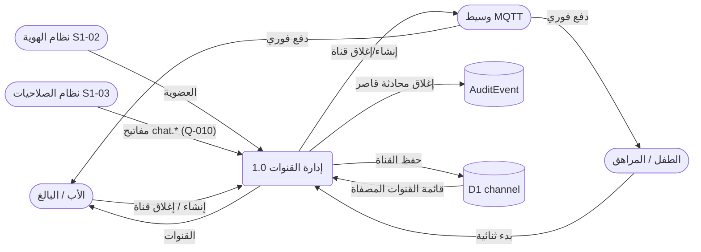

- ما يُقرأ منه: كيف تُدار القنوات — إنشاؤها وإغلاقها وقائمتها المصفاة، ودفع أحداثها فوراً.
- أُعيد رسمه 2026-11-19 (Q-434 — شكل): لوح مقسوم من §5 (كان 22 عقدة + لوحا subgraph)؛ وتسميات ≤5 كلمات.
- أُعيد تقسيمه 2026-11-19 (دفعة الشكل 2): لوح P1 وحده — 8 عقد و11 سهماً؛ والخارجيات مستطيلات؛ وبلا subgraph (الاستثناء نفسه).

### 5-ب. إرسال الرسائل (P2 — REQ-005/006/007/008)

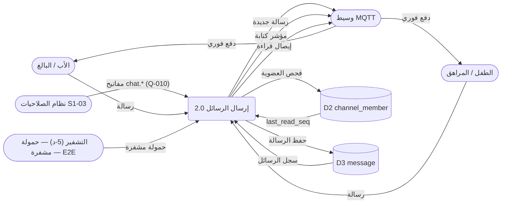

- ما يُقرأ منه: كيف تُرسل الرسالة وتُحفظ وتُدفع فوراً.
- مواضيع MQTT (QoS 1): `family/{family_id}/chat/{channelId}/message` (رسالة جديدة) · `.../typing` (مؤشر كتابة) · `.../read` (إيصال قراءة) · `.../created | .../closed` (إنشاء/إغلاق قناة). والوسيط Mosquitto 2.x — 8883 + mTLS.
- أُعيد تقسيمه 2026-11-19 (دفعة الشكل 2): لوح P2 وحده — 8 عقد و13 سهماً؛ وحافة P3→P2 مرسومة هنا وفي 5-د؛ والوسائط في 5-ج.

### 5-ج. إرسال الرسائل — الوسائط (P2 — REQ-005)

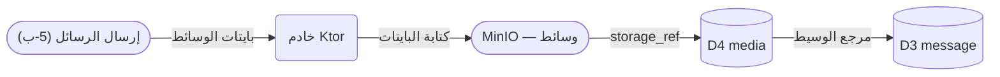

- ما يُقرأ منه: رفع الوسائط عبر الخادم إلى MinIO، ومرجعها فقط في قاعدة البيانات.
- أُعيد تقسيمه 2026-11-19 (دفعة الشكل 2): لوح الوسائط وحده — 5 عقد و4 أسهم؛ والعملية نفسها (P2) مرجع إلى 5-ب.

### 5-د. التشفير E2E ‏(P3 — REQ-010/011)

```mermaid
flowchart LR
    Kotlin([وحدة Kotlin])
    P3(3.0 التشفير E2E)
    P2x(["إرسال الرسائل (5-ب) — حمولة مشفرة"])
    D3[(D3 message)]
    D5[(D5 parents_key_backup)]

    P3 -->|مفاتيح Envelope| D3
    P3 -->|مفتاح القناة المشفر| D5
    D5 -->|encrypted_key + kdf_params| P3
    Kotlin -->|مفاتيح E2E — Keystore| P3
    P3 -->|حمولة مشفرة| P2x
```

- ما يُقرأ منه: مفاتيح التشفير — Envelope للقنوات العائلية، وE2E لقناة الوالدين في Keystore.
- أُعيد تقسيمه 2026-11-19 (دفعة الشكل 2): لوح P3 وحده — 5 عقد و5 أسهم؛ وحافة P3→P2 مرسومة هنا وفي 5-ب.

### 5-هـ. الإشراف والمصنف (P4 — REQ-004/012/013)

```mermaid
flowchart LR
    Father([الأب / البالغ])
    Minor([الطفل / المراهق])
    S109([مركز الأوامر S1-09])
    P4(4.0 الإشراف والمصنف)
    D3[(D3 message)]

    P4 -->|قراءة رسائل القاصرين| D3
    P4 -->|تنبيه تنمر / خطر| S109
    Father -->|رؤية محادثات القاصرين| P4
    P4 -->|محادثات القاصرين — حسب القالب| Father
```

- ما يُقرأ منه: كيف يرى الأب محادثات القاصرين، وكيف يصل تنبيه المصنف إلى مركز الأوامر.
- المصنف على الخادم (Q-165): دون 13 دائماً / 13–17 بمفتاح الأب (Q-140)؛ والرؤية: الأب كاملة / البالغ المفوَّض ضمن القالب (REQ-013 — `chat.minor.view` — Q-010).
- أُعيد تقسيمه 2026-11-19 (دفعة الشكل 2): لوح P4 وحده — 5 عقد و4 أسهم.

### 5-و. الصندوق الصادر (P5 — REQ-014)

```mermaid
flowchart LR
    Minor([الطفل / المراهق])
    Ktor(خادم Ktor)
    P5(5.0 الصندوق الصادر)
    D3[(D3 message)]

    Minor -->|رسالة دون اتصال| P5
    P5 -->|تسليم تسلسلي — Brotli| Ktor
    Ktor -->|server_seq_id| P5
    P5 -->|حفظ محلي — Drift| D3
```

- ما يُقرأ منه: كيف تُسلَّم رسائل دون اتصال تسلسلياً عند عودة الشبكة.
- أُعيد تقسيمه 2026-11-19 (دفعة الشكل 2): لوح P5 وحده — 4 عقد و4 أسهم.

### 5-ز. الحذف والتطهير (P6+P7 — REQ-009/015)

```mermaid
flowchart LR
    Father([الأب / البالغ])
    S109([مركز الأوامر S1-09])
    MQTT([وسيط MQTT])
    Audit[(AuditEvent)]
    P6(6.0 الحذف والمزامنة)
    P7(7.0 تطهير الاحتفاظ)
    D3[(D3 message)]

    Father -->|حذف للجميع| P6
    P6 -->|deleted_for = all| D3
    P6 -->|حدث حذف| MQTT
    P6 -->|تسجيل الحذف| Audit
    P6 -->|ودجة أحدث الرسائل| S109
    D3 -->|رسائل محذوفة برمجياً| P7
    P7 -->|حذف صلب| D3
```

- ما يُقرأ منه: كيف يُحذف للجميع ويُزامَن الحذف، وكيف يُطهَّر المحذوف برمجياً بعد الاحتفاظ.
- موضوع الحذف: `family/{family_id}/chat/{channelId}/deleted` — QoS 1. والاحتفاظ (Q-295): المُعلَّم 30 يوماً / غير المُعلَّم 7 أيام.
- أُعيد تقسيمه 2026-11-19 (دفعة الشكل 2): لوح P6+P7 — 7 عقد و7 أسهم.

- ودجة S1-09 "أحدث الرسائل" تعرض آخر رسائل القنوات العائلية حسب المنح؛ وقناة الوالدين تظهر كعدد فقط بلا محتوى (REQ-016).

## 6. مخطط النشاط (Activity) — دورة حياة الرسالة من الإرسال إلى الإشراف

المسارات الستة (المرسل / التطبيق / وحدة Kotlin / الخادم / الأب / البالغ المفوَّض) كمسارات متوازية — من §2/§7: العرض المتفائل (REQ-006)، حالات التسليم والقراءة (REQ-007)، مؤشرات الكتابة (REQ-008)، فحص المصنف لرسائل القاصرين على الخادم — دون 13 دائماً، و13–17 بمفتاح مالك العائلة والافتراضي تشغيل (REQ-012 — Q-083/Q-140/Q-165)؛ وحدود الفحص الخمسة (Q-165) في ملاحظة §4، رؤية القاصرين (الأب كاملة + البالغ المفوَّض حسب قالب التفويض — REQ-013) وإغلاق الأب (REQ-004)، والحذف (REQ-009). والأنشطة الخلفية (المزامنة الخلفية للصندوق الصادر + دفع MQTT + فحص المصنف) تعمل **بالتوازي** مع استخدام الدردشة. ثلاثة ألواح (دفعة الشكل 2): 6-أ الإرسال (المرسل والتطبيق وKotlin)، 6-ب الخادم (الفحص والحفظ والدفع)، 6-ج المصنف والإشراف والحذف. والاتجاه TD بدلاً من LR.

### 6-أ. الإرسال — من فتح القناة إلى الفحص

```mermaid
flowchart TD
    subgraph Sender [المرسل — أي عضو]
        direction TB
        U1([فتح قناة])
        U2[كتابة رسالة]
        U3[إرسال]
        U4([رؤية صح التسليم / القراءة])
    end
    subgraph App [التطبيق — Flutter + Drift]
        direction TB
        A1[عرض القنوات المصفاة]
        A2{قناة الوالدين؟}
        A3[طلب الرقم السري للأب<br/>— PIN]
        A4[حفظ محلي متفائل]
        A5[تحديث الحالة]
        A6[مؤشر كتابة حي]
    end
    subgraph Kotlin [وحدة Kotlin]
        direction TB
        K1[تشفير E2E]
        K2[خدمة مزامنة خلفية]
        K3[حالة الصندوق الصادر]
    end
    V1x(["فحص العضوية (6-ب)"])
    V4x(["دفع MQTT (6-ب)"])

    U1 --> A1
    A1 --> A2
    A2 -->|نعم — قناة الوالدين| A3
    A2 -->|لا — قناة عادية| U2
    A3 --> U2
    U2 --> U3
    U3 --> A4
    A4 -->|قناة الوالدين فقط| K1
    K1 --> V1x
    A4 --> V1x
    A4 --> K2
    K2 --> V1x
    K2 --> K3
    V4x --> A5
    A5 --> U4
    V4x --> A6
```

- القنوات مصفاة حسب الرؤية والمنح؛ والحفظ المتفائل بـ `client_message_id` — علامة ساعة؛ وتحديث الحالة بـ `server_seq_id`. والتشفير E2E — مفاتيح في Keystore؛ وخدمة المزامنة `startChatSync`؛ وحالة الصندوق `getOutboxStatus`.
- أُعيد رسمه 2026-11-19 (Q-434 — شكل): لوح مقسوم من §6 (كان 27 عقدة)؛ 17 عقدة و20 سهماً؛ والاتجاه TD بدلاً من LR؛ وتسميات ≤5 كلمات.
- أُعيد تقسيمه 2026-11-19 (دفعة الشكل 2): مسارات المرسل والتطبيق وKotlin وحدهما — 15 عقدة و16 سهماً؛ والفحص والدفع مرجعان إلى 6-ب.

### 6-ب. الخادم — الفحص والحفظ والدفع

```mermaid
flowchart TD
    subgraph Server [الخادم والمصنف — Ktor — MQTT — MinIO]
        direction TB
        V1[فحص العضوية والمنح]
        V2[حفظ الرسالة]
        V3[رفع الوسائط — MinIO]
        V4[دفع MQTT]
    end
    K1x(["تشفير الرسالة (6-أ) — E2E"])
    A4x(["حفظ محلي متفائل (6-أ)"])
    K2x(["خدمة مزامنة خلفية (6-أ)"])
    A5x(["تحديث الحالة (6-أ)"])
    A6x(["مؤشر كتابة حي (6-أ)"])

    K1x --> V1
    A4x --> V1
    K2x --> V1
    V1 --> V2
    V1 --> V3
    V3 --> V2
    V2 --> V4
    V4 --> A5x
    V4 --> A6x
```

- ما يُقرأ منه: كل مسار إرسال يمر بفحص العضوية والمنح قبل الحفظ؛ ورفع الوسائط شرط مسبق للحفظ في رسائل الوسائط (media_id مع الرسالة — 3-و)، لا تالٍ له.
- أُعيد تقسيمه 2026-11-19 (دفعة الشكل 2): مسار الخادم وحده — 9 عقد و9 أسهم.

### 6-ج. المصنف والإشراف والحذف — من الحفظ إلى التنبيه والتصرف

```mermaid
flowchart TD
    subgraph App [التطبيق — Flutter + Drift]
        direction TB
        A7["عرض «حُذفت هذه الرسالة»"]
    end
    subgraph Sender [المرسل — أي عضو]
        direction TB
        U5[حذف رسالة لنفسي]
    end
    subgraph Server [الخادم والمصنف — Ktor — MQTT — MinIO]
        direction TB
        V2[رسالة محفوظة]
        V5[المصنف على الخادم]
        V6[تنبيه الأب]
        V7[حذف / إغلاق + AuditEvent]
        V4[دفع MQTT]
    end
    subgraph Father [الأب — الإشراف]
        direction TB
        F1[رؤية محادثات القاصرين]
        F2{محتوى غير مناسب؟}
        F3[حذف للجميع / إغلاق]
        F4[تلقي تنبيه المصنف]
    end
    subgraph Delegated [البالغ المفوَّض — حسب قالب التفويض Q-089]
        direction TB
        D1[رؤية ضمن القالب]
    end

    V2 --> V5
    V5 --> V6
    V6 --> F4
    F1 --> F2
    D1 --> F2
    F2 -->|نعم — غير مناسب| F3
    F3 --> V7
    V7 --> V4
    V4 --> A7
    U5 --> V7
```

- المصنف على الخادم (Q-165 · Q-292): دون 13 دائماً / 13–17 بمفتاح الأب (افتراضي تشغيل — Q-083/Q-140)؛ والتنبيه للأب عبر S1-09؛ وتلقي التنبيه وتجاهله أو التصرف (3-ح). والرؤية ضمن القالب — `chat.minor.view` (Q-010). وحذف الرسالة لنفسي (U5) يمر بالخادم أيضاً — `deleted_for = self` — ولا يمس أجهزة الآخرين (§7-8).
- أُعيد رسمه 2026-11-19 (Q-434 — شكل): لوح مقسوم من §6؛ 12 عقدة و10 أسهم؛ والاتجاه TD بدلاً من LR؛ وتسميات ≤5 كلمات.
- أُعيد ترقيمه 2026-11-19 (دفعة الشكل 2): كان 6-ب فصار 6-ج بعد تقسيم 6-أ إلى لوحين.

- عند إعادة الفتح بعد الإغلاق القسري، يعود المستخدم لنفس القناة والمسودة (S1-01 §7 — سلوك الغلاف، يسري على كل الأنظمة)؛ والرسائل الفاشلة في الصندوق الصادر تبقى معلقة حتى تنجح أو يحذفها مرسلها (§6-3). وكل مسار إرسال (عادي عبر A4، أو قناة والدين عبر K1، أو صندوق صادر عبر K2) يمر بفحص العضوية والمنح V1 قبل الحفظ V2؛ ورفع الوسائط (V3) شرط مسبق للحفظ (V2) في رسائل الوسائط (media_id مع الرسالة — 3-و)، لا تالٍ له.
