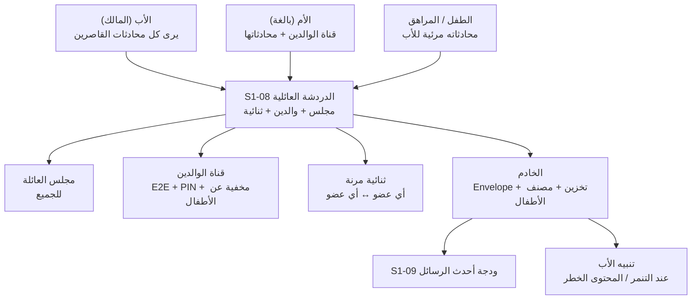
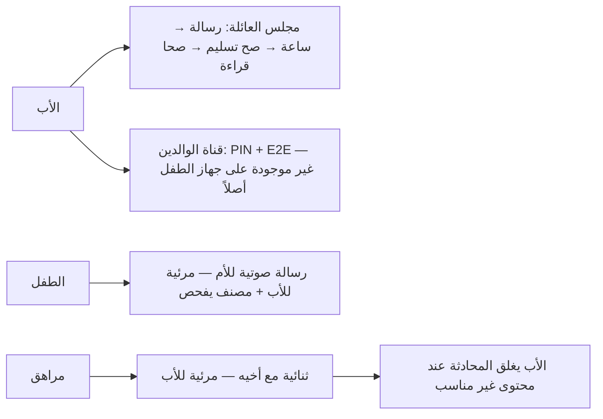
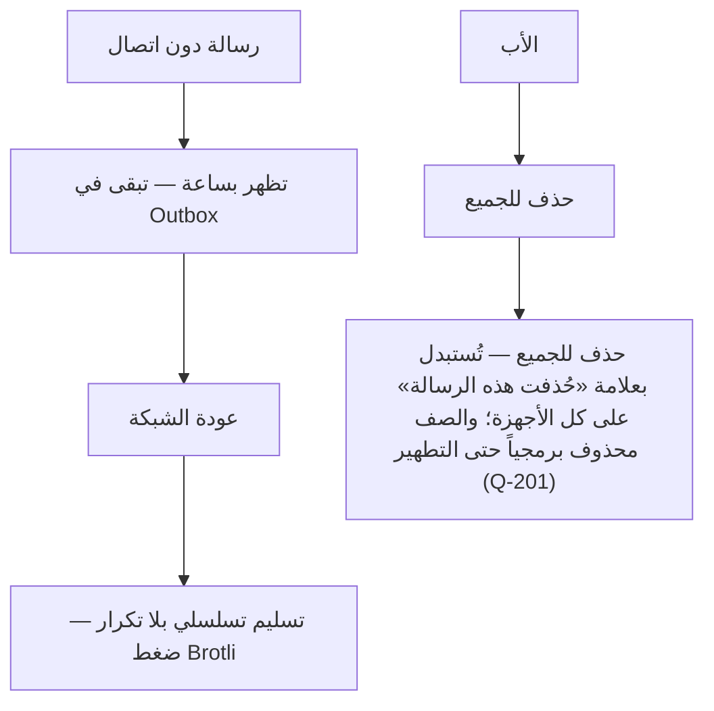

# S1-08: الدردشة العائلية الأساسية (Basic Family Chat)

- **الحالة:** approved | **المرحلة:** 1 (نواة الحماية) · **آخر تحديث:** 2026-11-06
- **القرارات الحاكمة:** Q-001 · Q-003 · Q-007 · Q-010 · Q-064 · Q-065 · Q-081 · Q-082 · Q-083 · Q-099 · Q-100 · Q-140 · Q-164 · Q-165 · Q-182 · D-011 · D-019 · D-020 · D-021 · D-023 · D-038 · G-006 · G-007 · G-011
- **حالة المراجعة:** §§1–8 + §10 معتمدة بالكامل في التخطيط (حكم المالك 2026-11-06) · §9 في مرحلة التصميم.
- **الأدلة المرجعية:** المواصفة القديمة S1-08 (مرجع فقط، G-009) · Deep-dives: Telegram (معمارية الرسائل + المحادثات السرية) · FamilyWall (قنوات عائلية) · S1-01 (معتمد) · S1-02 (معتمد) · S1-03 (معتمد) · S1-09 (معتمد)

## 1. الهدف والتحليل والنطاق

الدردشة العائلية الأساسية هي **شريان التواصل اليومي** بين أفراد الأسرة داخل المنصة — البديل الآمن الخالي من الإعلانات والتتبع لمجموعات واتساب العائلية، بخصوصية عائلية فريدة: مرونة كاملة في التواصل داخل العائلة، ومساحة خاصة آمنة للوالدين، وإشراف أبوي دائم على محادثات القاصرين.

**التحليل (لماذا هذا النظام):** العائلة تتواصل يومياً في مجموعات خارجية لا تملكها ولا تحمي أطفالها. بدون دردشة داخلية يبقى التواصل العائلي خارج المنصة، وتضيع الحماية (الإشراف على رسائل الأطفال) والخصوصية (قناة الوالدين) والسرعة (العرض الفوري دون انتظار الخادم). لذلك S1-08 يبني التواصل **داخل** المنصة على ثلاث قواعد: المرونة افتراضياً (أي عضو يراسل أي عضو)، والإشراف دائماً على القاصرين، والخصوصية الحقيقية للوالدين.

**داخل النطاق:**
- 3 قنوات: مجلس العائلة العام + قناة الوالدين الخاصة (PIN الأب، مخفية عن أجهزة الأطفال، E2E + نسخة مشفرة على الخادم للاسترداد) + محادثات ثنائية مرنة (أي عضو يراسل أي عضو).
- الوسائط: نص + إيموجي + صور + رسائل صوتية (Q-099).
- عرض فوري محلي (نمط تيليجرام: `client_message_id` متفائل + صندوق صادر) + مؤشرات كتابة + صح التسليم/القراءة + عمل دون اتصال.
- التشفير: Envelope Encryption بمفاتيح يديرها الخادم + جاهزية E2E (Q-081)؛ قناة الوالدين E2E بنطاق المرحلة 1 = مخطط النسخ الاحتياطي/الاسترداد كما هو معرّف (REQ-011 · Q-263) + نسخة مشفرة على الخادم للاسترداد بمفتاح مشتق من PIN الأب (Q-100)؛ والتدوير والإبطال مؤجلان إلى Q-154 (المرحلة 2).
- الاحتفاظ دائم حتى يحذف الأب (Q-082)؛ المصنف الخفيف **على الخادم (Q-165)**: يعمل دائماً على رسائل الأطفال دون 13 سنة، وللمراهقين 13–17 سنة مفتاح تحكم لكل عائلة يملكه مالك العائلة (تشغيل/إيقاف) والافتراضي تشغيل — ينبّه الأب (Q-083 كما عدّله Q-140)؛ والفحص آلي للحماية فقط — بلا قراءة بشرية، بلا تخزين نص بعد الفحص، بلا استخدام لغير التنبيه؛ وقناة الوالدين E2E بلا فحص أبداً.
- المرونة: أي عضو يراسل أي عضو؛ ومحادثة أي قاصر مرئية للأب دائماً وله إغلاقها (Q-100).

**خارج النطاق (أنظمة أخرى):**
- مكالمات الفيديو والصوت ونقل الملفات الكبيرة (أنظمة لاحقة — مكالمات الفيديو سؤال مفتوح Q-152، المرحلة 2؛ ونقل الملفات الكبيرة سؤال مفتوح Q-153، المرحلة 2).

**يعتمد على:** S1-01 (الغلاف والوضعان) + S1-02 (العضوية) + S1-03 (الأدوار والصلاحيات — من يرى ماذا ويدير ماذا) + S1-09 (ودجة "أحدث الرسائل" في مركز الأوامر).

**المصطلحات:** قناة (channel) · رسالة (message) · مجلس العائلة (Family Lounge) · قناة الوالدين (Parents Sanctuary) · ثنائية (1-on-1) · تشفير المغلف (Envelope Encryption) · تشفير طرفي (E2E) · صندوق صادر (Outbox) · مصنف خفيف (lightweight classifier).

**من التطبيقات المفككة (§1):** نمط تيليجرام — العرض الفوري المحلي بـ `random_id` متفائل ثم المزامنة في الخلفية، والنموذجان معاً في تطبيق واحد (محادثات سحابية + محادثات سرية E2E)؛ ونمط FamilyWall — قنوات عائلية (مجلس + ثنائية). نأخذ منهما أن **التواصل سريع أولاً وآمن دائماً**: الرسالة تظهر فور إرسالها، والتشفير يتبع طبيعة القناة لا العكس.

**رسم توضيحي — أين تُستخدم الدردشة (للفهم السريع):**



## 2. سيناريوهات المستخدم

### 8-1: الأب يرسل رسالة في مجلس العائلة ويرى قراءتها فوراً
- **الممثل:** الأب (المالك). **السياق:** مساءً، يريد إبلاغ العائلة بموعد الغداء.
- **التدفق:** 1) الأب يكتب رسالة في مجلس العائلة ويرسلها — تظهر فوراً بعلامة ساعة (pending). 2) تصل الرسالة إلى الخادم فتتحول العلامة إلى صح التسليم. 3) يقرأها الأطفال فتتحول إلى صحي القراءة. **النتيجة:** تواصل فوري بلا انتظار (نمط تيليجرام).

### 8-2: الطفل يرسل رسالة صوتية لأمه — والأب يراها والمصنف يحرسها
- **الممثل:** الطفل + الأم + الأب. **السياق:** الطفل يرسل رسالة صوتية لأمه من المدرسة.
- **التدفق:** 1) الطفل يسجل رسالة صوتية ويرسلها — تظهر عند الأم فوراً. 2) الرسالة مرئية للأب أيضاً (إشراف دائم على القاصرين). 3) المصنف الخفيف **على الخادم (Q-165)** يفحص رسائل الأطفال آلياً؛ إن رصد تنمراً أو محتوى خطراً نبّه الأب فوراً. **النتيجة:** تواصل دافئ للطفل مع حماية صامتة خلفه.

### 8-3: الوالدان يتبادلان رسائل خاصة لا يراها الأطفال أبداً
- **الممثل:** الأب والأم. **السياق:** حديث خاص بين الوالدين عن ميزانية العائلة.
- **التدفق:** 1) الأب يفتح قناة الوالدين (PIN الأب). 2) يتبادلان الرسائل — مشفرة E2E. 3) على جهاز الطفل: القناة غير موجودة أصلاً (لا في القائمة ولا في البحث)؛ ولا معاينة محتوى في الإشعارات. **النتيجة:** جو خاص حقيقي للوالدين — لا مجرد إخفاء بالواجهة.

### 8-4: المراهق يبدأ محادثة ثنائية مع أخيه — والأب يرى ويستطيع الإغلاق
- **الممثل:** المراهق + أخوه + الأب. **السياق:** المراهق يراسل أخاه مباشرة.
- **التدفق:** 1) المراهق يبدأ ثنائية مع أخيه — المرونة تسمح. 2) المحادثة مرئية للأب (قاصرون). 3) الأب يرى محتوى غير مناسب فيغلق المحادثة فوراً من إدارة الدردشة. **النتيجة:** المرونة افتراضياً، وإشراف الأب دائماً.

### 8-5: دون اتصال — الرسالة تنتظر في الصندوق الصادر وتُسلَّم عند عودة الشبكة
- **الممثل:** الطفل. **السياق:** في منطقة ضعيفة الشبكة في اليمن.
- **التدفق:** 1) الطفل يكتب رسالة دون اتصال — تظهر فوراً بعلامة ساعة وتبقى في الصندوق الصادر. 2) تعود الشبكة فيُسلَّم الصندوق تسلسلياً (بلا تكرار، مع ضغط Brotli). 3) تصل الرسالة ويتحول مؤشرها. **النتيجة:** الدردشة تعمل في أسوأ شبكة — لا رسائل ضائعة ولا مكررة.

### 8-6: الأب يحذف رسالة غير مناسبة للجميع
- **الممثل:** الأب. **السياق:** رسالة غير مناسبة وصلت إلى مجلس العائلة.
- **التدفق:** 1) الأب يفتح الرسالة ويختار "حذف للجميع". 2) تُحذف من العرض على الخادم ومن كل الأجهزة وتُستبدل بعلامة «حُذفت هذه الرسالة»؛ ويبقى صفها محذوفاً برمجياً (`deleted_for=all` + `deleted_at` في §5-3) مع بقاء الحمولة حتى مدة التطهير المحكومة باستشارة Q-201 (G-S108-03) — بلا حذف فيزيائي فوري (الاحتفاظ دائم حتى يحذف الأب — Q-082). 3) يظهر مكانها "حُذفت هذه الرسالة". **النتيجة:** الأب يملك الكلمة الأخيرة على محتوى العائلة.

**مخطط القنوات والخصوصية (§2 — بصري):**



**مخطط دون اتصال والحذف (§2 — بصري):**



## 3. المتطلبات الوظيفية

### القنوات
- **REQ-001:** 3 قنوات: مجلس العائلة العام + قناة الوالدين الخاصة + محادثات ثنائية. [Q-100 · DIRECT]
- **REQ-002:** الثنائية مرنة: أي عضو يبدأ محادثة مع أي عضو في العائلة. [Q-100 · DIRECT]
- **REQ-003:** قناة الوالدين للبالغين فقط: PIN الأب + مخفية تماماً عن أجهزة الأطفال (لا قائمة ولا بحث) + بلا معاينة محتوى في الإشعارات. [Q-100 · DIRECT]
- **REQ-004:** محادثة أي قاصر مرئية للأب دائماً؛ والأب يستطيع إغلاق أي محادثة لقاصر في أي لحظة. **إعادة الفتح (Q-242):** الإغلاق ليس دائماً — الأب وحده يستطيع إعادة فتح أي محادثة أغلقها (`POST .../channels/{channelId}/reopen` — §4-1)؛ وإعادة الفتح **ليست مفتاحاً قابلاً للتفويض** — لا يجوز لبالغ مفوَّض (ولا لجلسة مخترَقة بصلاحياته) إعادة فتح قناة أغلقها الأب للسلامة، حتى لو كان يملك مفتاح `chat.channel.close`؛ وكل إغلاق وإعادة فتح يُسجَّلان في التدقيق (من فعل ومتى — §5-1)؛ والإغلاق بلا انتهاء زمني: `closed_until` دائماً `null` في المرحلة 1 — لا انتهاء تلقائي، وإعادة فتح الأب هي الطريق الوحيد لعودة الإرسال. [Q-100 · Q-242 · Q-006 · DIRECT]

### الرسائل
- **REQ-005:** الوسائط: نص + إيموجي + صور + رسائل صوتية. [Q-099 · DIRECT]
- **REQ-006:** عرض فوري محلي (<10ms) بـ `client_message_id` متفائل + صندوق صادر، ثم تحديث بـ `server_seq_id`. [Telegram · DIRECT]
- **REQ-007:** حالات التسليم والقراءة: أُرسلت (ساعة) → للخادم (صح) → قُرئت (صحان). **التعيين الصريح بين قيم `status` (§5-3) وعلامات الواجهة:** ساعة = `pending` (عميل فقط)؛ صح واحد = `sent` (مخزَّنة على الخادم)؛ صحان = `read`؛ وقيمة `delivered` **داخلية فقط بلا علامة مميزة** — تُستخدم في التجميع متعدد المستلمين (§6-3) لا كحالة عرض رابعة. [§2 · DERIVED]
| قيمة `status` | علامة الواجهة | المعنى |
|---|---|---|
| `pending` | ساعة | متفائلة محلية — لم تصل إلى الخادم بعد (عميل فقط) |
| `sent` | صح واحد | مخزَّنة على الخادم (`server_seq_id` مُسند) |
| `delivered` | (بلا علامة — داخلية فقط) | وصلت إلى جهاز مستلم واحد على الأقل (تجميع §6-3) |
| `read` | صحان | قرأها كل المستلمين الآخرين (`last_read_seq` — §6-3) |
- **REQ-008:** مؤشرات كتابة حية في القناة — يظهر المؤشر **5 ثوانٍ** من آخر نبضة كتابة؛ ويعيد العميل النشر كل **3 ثوانٍ** ما دام يكتب؛ ويُمسح فور إرسال الرسالة أو انقطاع الناشر (قيم أولية — تُثبَّت في مختبر Q-027). [§2 · DERIVED]
- **REQ-009:** الأب يحذف أي رسالة للجميع؛ والعضو يحذف رسائله لنفسه فقط. [Q-082 · DERIVED]

### التشفير
- **REQ-010:** القنوات العائلية: Envelope Encryption بمفاتيح يديرها الخادم + بنية جاهزة لـ E2E (فصل الحمولة المعماة عن البيانات الوصفية). **تعريف «جاهزة لـ E2E» القابل للاختبار (قائمة تحقق):** (1) فصل الحمولة المعماة عن البيانات الوصفية حاضر في §5-3 (`payload` مقابل أعمدة المرسل/الوقت/التسلسل)؛ (2) بلا عمود محتوى نصي في جدول `message` — لا `body` ولا `text`؛ (3) مفاتيح التشفير خارج صف الرسالة — في §5-5 / مفاتيح يديرها الخادم، لا في `payload` ولا في أعمدة الرسالة. [Q-081 · DIRECT]
- **REQ-011:** قناة الوالدين: E2E بنطاق المرحلة 1 = مخطط النسخ الاحتياطي/الاسترداد كما هو معرّف هنا (Q-263)؛ ونسخة مشفرة من رسائلها محفوظة على الخادم للاسترداد (النص المشفر فقط — الخادم لا يقرأ المحتوى)؛ ومفاتيح القناة محفوظة مشفرة بمفتاح استرداد مشتق من PIN الأب (**Argon2id — m=64MiB، t=3، p=1 — Q-164**)؛ ولا تُسلَّم النسخة إلا بعد مصادقة الأب (PIN + OTP). **تغيير PIN** يعيد اشتقاق مفتاح الاسترداد وإعادة تغليف نسخة المفاتيح؛ وإن تعذرت المصادقة القديمة فالسجل القديم غير قابل للاسترداد (حد صادق — §6). **نطاق المرحلة 1 (Q-263): التدوير والإبطال مؤجلان إلى Q-154 (المرحلة 2)؛ ولا ادعاء «E2E كاملة» قبل ذلك.** [Q-100 · Q-164 · Q-263 · DIRECT — معدَّل 2026-11-06؛ وُسّع بتعديل 2026-11-06 (Q-164)]

### الإشراف والمصنف
- **REQ-012:** المصنف الخفيف (Q-023) **على الخادم (Q-165)** يعمل دائماً على رسائل الأطفال دون 13 سنة؛ وللمراهقين 13–17 سنة مفتاح تحكم لكل عائلة يملكه مالك العائلة (تشغيل/إيقاف)، والافتراضي تشغيل (Q-007)؛ وينبّه الأب عند التنمر/المحتوى الخطر. **حدود الفحص (Q-165):** آلي فقط — لا قراءة بشرية للمحتوى في أي مسار؛ ولا يُخزَّن نص بعد الفحص — التنبيه يحمل الفئة + الخطورة + معرّف الرسالة فقط؛ ولا استخدام للمحتوى المفحوص لغير التنبيه — لا تدريب نماذج عليه ولا مشاركة مع طرف ثالث؛ وقناة الوالدين E2E بلا فحص أبداً (REQ-011)؛ ويُفصَح عن الفحص الآلي في الإعداد المشترك (C-09). [Q-083 كما عدّله Q-140 · Q-165 · Q-182 · DIRECT]
- **REQ-013:** رؤية محادثات القاصرين: الأب كاملة؛ والبالغ المفوَّض حسب قالب التفويض (Q-089). [Q-100 · Q-089 · DERIVED]

### دون اتصال والاحتفاظ والتكامل
- **REQ-014:** دون اتصال: الصندوق الصادر يحفظ الرسائل ويُسلّمها تسلسلياً بلا تكرار، مع ضغط Brotli (وضع النطاق المنخفض). [Q-064 · DIRECT]
- **REQ-015:** الاحتفاظ دائم حتى يحذف الأب. [Q-082 · DIRECT]
- **REQ-016:** ودجة S1-09 "أحدث الرسائل": تعرض آخر رسائل القنوات العائلية حسب المنح — **آخر 5 رسائل إجمالاً، رسالة واحدة كحد أقصى لكل قناة (الأحدث في كل قناة)**، مرتبة بـ `at` تنازلياً (والترتيب داخل القناة بـ `server_seq_id`)؛ وتُطبَّق تصفية المنح أولاً (REQ-013 — لا تظهر رسائل قناة لا يملك المشاهِد منح رؤيتها)؛ وقناة الوالدين تظهر كعدد فقط (بلا محتوى) — **للبالغين فقط** — في صف عدد إضافي لا يستهلك خانة من الخمس. [Q-100 · S1-09 · DERIVED]
- **REQ-017:** استرداد سجل قناة الوالدين على جهاز جديد: بعد مصادقة الأب (PIN + OTP) تُسلَّم النسخة المشفرة ومفتاحها المشفر، ويُفك السجل محلياً على الجهاز؛ والخادم لا يرى المحتوى أبداً. [Q-100 · Q-263 · DIRECT — أضيف بتعديل 2026-11-06]

## 4. الواجهات والعقود

### 4-1. نقاط الوصول (REST — `/api/v1`)

| الطريقة والمسار | الغرض | المدخل | المخرج | مفتاح الصلاحية | HTTP |
|---|---|---|---|---|---|
| `GET /api/v1/families/{id}/channels` | قائمة القنوات (مصفاة حسب الرؤية والمنح) | — | `[{channel_id, kind, title, last_message_at}]` | `chat.channel.view` | 200 |
| `POST /api/v1/families/{id}/channels` | إنشاء قناة (ثنائية أو جماعية) | `{kind, member_ids, title?}` — `kind`: `direct` أو `group` فقط (أما `lounge`/`parents` فتُرفض بـ `CHAT_CHANNEL_KIND_INVALID`)؛ و`member_ids`: الأعضاء الآخرون دون المتصل — الثنائية عضو واحد بالضبط، والجماعية عضوان آخران على الأقل (3 أعضاء إجمالاً مع المتصل)؛ و`title` اختياري (للجماعية؛ وللثنائية يُشتق العرض من اسم العضو الآخر إن غاب)؛ وإنشاء ثنائية موجودة مع العضو نفسه يُعيد القناة الموجودة بدل إنشاء مكررة؛ وكل `member_id` يجب أن يكون عضواً في العائلة وإلا `CHAT_INVALID_MEMBER` | القناة — قناة الوالدين تُنشأ مع العائلة لا هنا | `chat.channel.create.direct` / `chat.channel.create.group` (حسب `kind`) | 201 (200 عند إرجاع ثنائية موجودة) |
| `GET /api/v1/families/{id}/channels/{channelId}/messages` | سجل الرسائل (ترقيم) | `?before=<server_seq_id>&limit=<n>` — `before`: bigint حصري — تُعاد الرسائل ذات `server_seq_id < before` مرتبة تنازلياً بـ `server_seq_id` (الأحدث أولاً)؛ وإغفال `before` يعني الصفحة الأولى (الأحدث)؛ و`limit`: افتراضي 50، أقصى 100 (ما فوقه يُقصّ إلى 100) | `{messages: [{message_id, sender, kind, payload, media_id, server_seq_id, deleted_for, at, status}], has_more: bool, next_before: <أصغر server_seq_id في الصفحة>}` — وتُستخدم `next_before` قيمةً لـ `before` في الصفحة التالية | `chat.channel.view` | 200 |
| `POST /api/v1/families/{id}/channels/{channelId}/messages` | إرسال رسالة (نص/إيموجي/صورة/صوت) | `{client_message_id, kind, payload, media_id?}` — `media_id` إلزامي عند `kind` صورة/صوت (من نقطة الرفع أدناه)؛ و`payload` ظرف مشفَّر (REQ-010/011) — لا تُحشو `media_id` فيه | الرسالة + `server_seq_id` — `client_message_id` يمنع التكرار | `chat.message.send` | 201 |
| `POST /api/v1/families/{id}/channels/{channelId}/media` | رفع وسيط (صورة/صوت) إلى MinIO قبل إرسالها (REQ-005) | `multipart {file}` — صورة ≤ 10MB / صوت ≤ 5MB (Q-058)؛ وتجاوز الحد → `CHAT_MEDIA_TOO_LARGE` | `{media_id, storage_ref, size_bytes}` — الرفع عبر Ktor لا برابط موقّع مباشر إلى MinIO في المرحلة 1 (نفس نمط S1-06 §4-1-أ — اختيار معلَن)؛ وفي قناة الوالدين تكون البايتات المرفوعة مشفرة E2E على الجهاز قبل الرفع — الخادم لا يرى المحتوى أبداً | `chat.message.send` | 201 |
| `DELETE /api/v1/families/{id}/channels/{channelId}/messages/{messageId}` | حذف رسالة (الأب: للجميع؛ العضو: لنفسه) | — | `{message_id, deleted_for: all\|self}` | `chat.message.delete.any` (للحذف للجميع)؛ والحذف لنفسي — بلا مفتاح مقرر بعد (سؤال B2 مفتوح — R2-S108-08) | 200 |
| `POST /api/v1/families/{id}/channels/{channelId}/close` | الأب يغلق محادثة قاصر | `{reason}` | `{channel_id, closed: true}` | `chat.channel.close` | 200 |
| `POST /api/v1/families/{id}/channels/{channelId}/reopen` | الأب وحده يعيد فتح محادثة قاصر مغلقة (ليست قابلة للتفويض — Q-242؛ مفتاح `chat.channel.close` لا يكفي) | `{reason}` | `{channel_id, closed: false}` | بلا مفتاح — الأب وحده (`is_owner` — Q-242) | 200 |
| `POST /api/v1/families/{id}/channels/{channelId}/read` | تأكيد القراءة (صحا القراءة) | `{last_read_seq}` | `{ok: true}` | `chat.channel.view` | 200 |
| `POST /api/v1/families/{id}/parents-channel/recovery/request-otp` | إصدار OTP استرداد قناة الوالدين (REQ-017) — عبر موجّه OTP في S1-02 (Q-021) بغرض `recovery` لا بغرض الدخول (عامل إصدار مفتاح لا عامل دخول) | — (جلسة أب مصادقة) | `{otp_sent_via, expires_in_sec: 300}` — OTP 6 خانات صالح 5 دقائق؛ وإعادة الإرسال بعد 60 ثانية؛ و5 محاولات خاطئة → قفل 15 دقيقة (سياسة OTP في S1-02 — Q-079) | بلا مفتاح `chat.*` — بوابة الأب (PIN + OTP — §6-1)؛ وغير الأب يُرفض بـ `403` | 200 |
| `POST /api/v1/families/{id}/parents-channel/backup` | استرداد نسخة مفاتيح قناة الوالدين المشفرة على جهاز جديد (REQ-017) | `{otp}` — يتحقق الخادم من OTP (عبر S1-02) وأن المتصل هو الأب؛ والـ PIN لا يُرسل أبداً (اشتقاق محلي)؛ وOTP خاطئ → `CHAT_RECOVERY_OTP_INVALID` ولا نسخة تُسلَّم؛ و5 محاولات خاطئة → قفل 15 دقيقة (`CHAT_RECOVERY_LOCKED`) | `{encrypted_key, kdf_params}` — النص المشفر فقط؛ والخادم لا يرى المحتوى أبداً | بلا مفتاح `chat.*` — بوابة الأب (PIN + OTP — §6-1)؛ وغير الأب يُرفض بـ `403` | 200 |

### 4-2. الأحداث (MQTT → الأجهزة)

> **عقد الوسيط الملزم (Q-168):** الوسيط Eclipse Mosquitto 2.x — عقدة واحدة في المرحلة 1 — TLS 1.2+ على 8883 + mTLS؛ QoS 1؛ والإقرار التطبيقي إلزامي للأوامر وSOS فقط؛ والموقع الحي QoS 0؛ وبلا QoS 2؛ والعزل ببادئة `family/{family_id}/` + ACL خادمي؛ والشهادات سنتان مع تجديد تلقائي وإبطال فوري. التفصيل الكامل: `docs/family-os/governance/architecture/MQTT-BROKER-SPEC.md`. [Q-168 · Q-175]

| الموضوع | الحمولة | QoS | الناشر / المشتركون | الغرض |
|---|---|---|---|---|
| `family/{family_id}/chat/{channelId}/message` | `{channel_id, message_id, sender_id, kind, payload, server_seq_id, at}` | 1 | الناشر: الخادم / المشتركون: أعضاء القناة | رسالة جديدة (تُدفع فوراً) |
| `family/{family_id}/chat/{channelId}/typing` | `{channel_id, member_id, at}` | 1 | الناشر: عميل عضو / المشتركون: أعضاء القناة | مؤشر كتابة حي (عمره 5 ثوانٍ من `at` — REQ-008) |
| `family/{family_id}/chat/{channelId}/deleted` | `{channel_id, message_id, deleted_for, deleted_at}` | 1 | الناشر: الخادم / المشتركون: أعضاء القناة | حذف رسالة (للمزامنة على كل الأجهزة) |
| `family/{family_id}/chat/{channelId}/read` | `{channel_id, reader_id, last_read_seq, at}` | 1 | الناشر: الخادم / المشتركون: أعضاء القناة | إيصال قراءة — يصل المشتركين في §4-2 فقط، لا برد مباشر (REQ-007) |
| `family/{family_id}/chat/{channelId}/created` | `{channel_id, kind, title, member_ids, created_by, at}` | 1 | الناشر: الخادم / المشتركون: أعضاء القناة الجدد | إنشاء قناة — يصل الأعضاء بلا استطلاع (REQ-001/002) |
| `family/{family_id}/chat/{channelId}/closed` | `{channel_id, closed_by, reason, closed_at}` | 1 | الناشر: الخادم / المشتركون: أعضاء القناة | إغلاق قناة — يُنشر فور تنفيذ `POST .../close` (REQ-004) |

- **بلا احتفاظ:** كل مواضيع الدردشة QoS 1 و`retained=false` — الحالة تُستعاد عبر REST عند إعادة الاتصال (§4-1) لا من رسائل محتفَظة؛ ورسالة `closed` محتفَظة قد تُحيي إغلاقاً قديماً بعد إعادة الفتح (Q-242)، لذا لا احتفاظ لأي موضوع هنا.
- **نشر الكتابة:** النشر على موضوع `typing` يتطلب عضوية القناة (`chat.channel.view`)؛ ولا يتطلب `chat.message.send` — مؤشر الكتابة إشارة حضور لا رسالة، ولا نقطة REST له (النشر MQTT فقط).
- **إعادة الاتصال وإعادة المزامنة (REQ-006/007):** عند إعادة الاتصال يعيد العميل الاشتراك في مواضيع §4-2، ثم يسترجع الصفحة الأولى من `GET .../messages` لكل قناة ويواصل الترقيم بـ `before` حتى يصل إلى رسالة بـ `server_seq_id ≤` آخر تسلسل رآه (المخزن محلياً في Drift) أو تنتهي الصفحات؛ ويدمج حسب `server_seq_id` ويزيل التكرار بـ `client_message_id`. وQoS 1 وحده لا يغلق الفجوات عبر جلسة ساقطة — قاعدة إعادة المزامنة هذه هي التي تغلقها.

### 4-3. قناة المنصة (MethodChannel — Flutter ↔ Kotlin)

| الطريقة | الغرض |
|---|---|
| `startChatSync()` | تشغيل خدمة المزامنة الخلفية للصندوق الصادر — يستلم التطبيق قائمة المعلقة من Drift ويسلّمها إلى الخدمة عبر القناة؛ والخدمة ترسل POST واحداً لكل رسالة (§4-1) |
| `getOutboxStatus() → {pending, failed}` | حالة الصندوق الصادر (رسائل معلقة/فاشلة) |

### 4-4. صيغة الخطأ الموحدة

`{code, message_ar, trace_id}` — كما في S1-02 §4. رموز هذا النظام: `CHAT_CHANNEL_NOT_FOUND` (قناة غير موجودة) · `CHAT_NOT_MEMBER` (ليس عضواً في القناة) · `CHAT_CLOSED` (قناة مغلقة بأمر الأب) · `CHAT_MEDIA_TOO_LARGE` (وسائط تتجاوز الحد: 10MB صور / 5MB صوت — Q-058) · `CHAT_E2E_REQUIRED` (حمولة غير مشفرة في قناة الوالدين تُرفض) · `CHAT_CHANNEL_KIND_INVALID` (نوع قناة غير قابل للإنشاء هنا) · `CHAT_INVALID_MEMBER` (عضو غير موجود في العائلة أو عدد أعضاء غير صالح) · `CHAT_RECOVERY_OTP_INVALID` (OTP استرداد خاطئ — لا نسخة تُسلَّم) · `CHAT_RECOVERY_LOCKED` (استرداد مقفل مؤقتاً بعد 5 محاولات خاطئة).

| الرمز | HTTP | المعنى |
|---|---|---|
| `CHAT_CHANNEL_NOT_FOUND` | 404 | قناة غير موجودة |
| `CHAT_NOT_MEMBER` | 403 | ليس عضواً في القناة — ويُستخدم أيضاً للوصول المباشر لقناة الوالدين من قاصر (§7-9) |
| `CHAT_CLOSED` | 403 | إرسال في قناة مغلقة بأمر الأب |
| `CHAT_MEDIA_TOO_LARGE` | 413 | وسائط تتجاوز الحد (10MB صور / 5MB صوت) |
| `CHAT_E2E_REQUIRED` | 400 | حمولة غير مشفرة في قناة الوالدين |
| `CHAT_CHANNEL_KIND_INVALID` | 400 | `kind` ليس `direct` أو `group` (§4-1) |
| `CHAT_INVALID_MEMBER` | 400 | `member_id` ليس عضواً في العائلة، أو عدد الأعضاء دون الحد (§4-1) |
| `CHAT_RECOVERY_OTP_INVALID` | 401 | OTP استرداد خاطئ — لا نسخة مفاتيح تُسلَّم (§7) |
| `CHAT_RECOVERY_LOCKED` | 423 | استرداد مقفل مؤقتاً 15 دقيقة بعد 5 محاولات OTP خاطئة (§7 — سياسة Q-079) |

- إعادة فتح من غير الأب (§7-14) → `403` بلا رمز خاص (رفض صلاحية الأب وحده — Q-242).

## 5. البيانات — النموذج

كل جدول يحمل `family_id` + RLS (D-021). الرسائل تُخزن بنمط فصل الحمولة المعماة عن البيانات الوصفية (Q-081): الخادم يرى المرسل والوقت والتسلسل، لا محتوى قناة الوالدين أبداً.

### 5-1. `channel` — القنوات
| الحقل | النوع | ملاحظات |
|---|---|---|
| `channel_id` | uuid (PK) | |
| `family_id` | uuid (FK) | + RLS |
| `kind` | text | `lounge` / `parents` / `direct` / `group` |
| `title` | text | |
| `created_by` | uuid | |
| `created_at` | timestamptz | |
| `closed_at` / `closed_by` | timestamptz / uuid (nullable) | إغلاق الأب لمحادثة قاصر (REQ-004)؛ يُصفَّران عند إعادة الفتح — والسجل الكامل في التدقيق |
| `reopened_at` / `reopened_by` | timestamptz / uuid (nullable) | إعادة فتح الأب للمحادثة المغلقة (Q-242)؛ `null` ما لم تُعَد فتحها أبداً |
| `closed_until` | timestamptz (nullable) | دلالات الانتهاء: دائماً `null` في المرحلة 1 — الإغلاق بلا انتهاء زمني؛ لا يُملأ إلا بقرار لاحق يعرّف إغلاقاً مؤقتاً (REQ-004) |

### 5-2. `channel_member` — أعضاء القناة + آخر قراءة
| الحقل | النوع | ملاحظات |
|---|---|---|
| `channel_id` / `member_id` | uuid (PK مركب) | |
| `family_id` | uuid (FK) | + RLS (D-021) — فجملة «كل جدول يحمل `family_id`» في §5 صحيحة كما هي مكتوبة |
| `joined_at` | timestamptz | |
| `last_read_seq` | bigint | آخر تسلسل قرأه العضو (صحا القراءة — REQ-007) — يتقدم فقط عبر `POST .../read` صريح (§6-3) |

### 5-3. `message` — الرسائل
| الحقل | النوع | ملاحظات |
|---|---|---|
| `message_id` | uuid (PK) | |
| `channel_id` | uuid (FK) | |
| `family_id` | uuid (FK) | + RLS |
| `sender_id` | uuid | |
| `client_message_id` | uuid | يولّده العميل (uuid v4) — متفرد لكل مرسل — يمنع التكرار (REQ-006) |
| `server_seq_id` | bigint | تسلسل الخادم لكل قناة (نمط Telegram SeqID) |
| `kind` | text | `text` / `emoji` / `image` / `voice` / `system` |
| `payload` | jsonb | الحمولة المعماة (Envelope) — كائن JSON: `{alg, ciphertext}` حيث `ciphertext` نص base64 (و`alg` مثل `AES-256-GCM`)؛ وفي قناة الوالدين: نص مشفر E2E فقط — الخادم لا يقرأ محتواها ولا يفكك `ciphertext`؛ وتُحتفظ نسخة مشفرة للاسترداد (REQ-011) |
| `media_id` | uuid (nullable, FK → `media`) | للصور والصوت |
| `status` | text | تعداد الخادم: `sent` / `delivered` / `read` — قيمة **مشتقة** من `channel_member.last_read_seq` لكل عضو آخر (§6-3)، لا مخزَّنة لكل مستلم؛ وتعداد العميل (Drift) يضيف `pending` (حالة متفائلة محلية — علامة الساعة قبل وصول الرسالة إلى الخادم؛ ولا تُخزَّن على الخادم أبداً) |
| `created_at` | timestamptz | |
| `deleted_for` / `deleted_at` | text / timestamptz (nullable) | `all` (الأب) أو `self` (العضو) — حذف برمجي (soft-delete): الصف يبقى مع الحمولة، وما يختفي هو العرض فقط (علامة «حُذفت هذه الرسالة»)؛ والتطهير الفيزيائي للحمولة/الوسائط بمدة تُحكم باستشارة Q-201 (G-S108-03 — انظر R2-S108-44) |

### 5-4. `media` — الوسائط
| الحقل | النوع | ملاحظات |
|---|---|---|
| `media_id` | uuid (PK) | |
| `family_id` | uuid (FK) | + RLS |
| `mime` | text | `image/*` / `audio/*` |
| `size_bytes` | int | الحد: 10MB للصور / 5MB للرسائل الصوتية (Q-058) |
| `storage_ref` | text | مرجع تخزين: MinIO متوافق مع S3 على خادمنا (Q-058) |
| `thumbnail_ref` | text (nullable) | مصغرة للصور |
| `created_at` | timestamptz | |

### 5-5. `parents_key_backup` — نسخة مفاتيح قناة الوالدين الاحتياطية (REQ-011/017)
| الحقل | النوع | ملاحظات |
|---|---|---|
| `family_id` | uuid (PK, FK) | + RLS |
| `channel_id` | uuid (FK) | قناة الوالدين |
| `encrypted_key` | bytea | مفاتيح القناة مشفرة بمفتاح الاسترداد (PIN-derived Argon2id) |
| `kdf_params` | jsonb | معاملات Argon2id — `{m: 65536, t: 3, p: 1}` (Q-164) |
| `updated_at` | timestamptz | |

**نطاق المرحلة 1 (Q-263):** هذه النسخة هي مخطط النسخ الاحتياطي/الاسترداد كما هو معرّف (REQ-011/017)؛ التدوير والإبطال مؤجلان إلى Q-154 (المرحلة 2).

### 5-6. مراجع (بلا تكرار)
- العضوية: S1-02 (`membership`) · المنح: S1-03 (`permission_grant` — مفاتيح `chat.*`) · تنبيهات المصنف: تظهر كتنبيهات في S1-09 (`alert`، النوع `system`، النظام `S1-08`) · إغلاق/حذف الأب: أحداث تدقيق في النواة المشتركة (`AuditEvent`، النطاق `chat`).
- **ملاحظة العميل:** نسخة محلية من `channel` + `message` في Drift (دون اتصال) — مخزن عميل لا جدول خادم؛ وإدخالات تدقيق معلقة (`kind=audit`) تعيش في الصندوق الصادر نفسه (§6-3).

## 6. القواعد والصلاحيات

### 6-1. مفاتيح هذا النظام (`chat.*`)

| المفتاح | الوصف | لمن؟ |
|---|---|---|
| `chat.channel.create.direct` | إنشاء محادثة ثنائية | أي عضو (REQ-002) |
| `chat.channel.create.group` | إنشاء قناة جماعية | الأب + البالغ المفوَّض |
| `chat.channel.view` | عرض قناة | عضو فيها |
| `chat.message.send` | إرسال رسالة | عضو في القناة |
| `chat.message.delete.any` | حذف أي رسالة للجميع (قابل للتفويض — Q-010) | الأب افتراضياً + المفوَّض |
| `chat.channel.close` | إغلاق محادثة قاصر | الأب + البالغ المفوَّض — أبداً للمراهق/الطفل (Q-086) |
| `chat.parents.view` | عرض قناة الوالدين | البالغون فقط — أبداً للقاصرين |
| `chat.minor.view` | رؤية محادثات القاصرين | الأب + البالغ المفوَّض حسب القالب (Q-089) |

- **الاسترداد (REQ-017) بلا مفتاح `chat.*`:** استرداد نسخة مفاتيح قناة الوالدين (`POST .../parents-channel/backup` — §4-1) لا يخضع لأي مفتاح صلاحية — التفويض ببوابة الأب (PIN + OTP) لا بمنح قابل للتفويض؛ والسبب: الاسترداد يستعيد مفاتيح القناة نفسها، فلا يصح أن يخضع لمنح يُمنح ويُسحب؛ وغير الأب يُرفض بـ `403`. (لا مفتاح جديد هنا — فلا يتغير عدّ مفاتيح `chat.*` الثمانية ولا بذر S1-03 §10-1.)

- **مفتاح المصنف (`chat.classifier.teen`) ليس مفتاح صلاحية:** مفتاح التشغيل/الإيقاف في §9-3 عنصر سطح تحكم للمالك وحده (REQ-012 — Q-083 كما عدّله Q-140) — لا يُزرع في سجل `permission_key` المركزي، ولا يُمنح ولا يُفوَّض، ولا يدخل في عدّ مفاتيح `chat.*` الثمانية؛ وعدّ `chat.*` يبقى 8.

### 6-2. الثوابت الصلبة (لا تُكسر أبداً)
- محادثة أي قاصر مرئية للأب دائماً (Q-100 + D-038).
- قناة الوالدين لا تظهر للقاصرين أبداً — لا وجودها ولا محتواها ولا عدد رسائلها (Q-100).
- محتوى قناة الوالدين E2E لا يقرأه الخادم أبداً (Q-100).
- النسخة المشفرة لقناة الوالدين ومفتاحها المشفر لا يُسلَّمان إلا بعد مصادقة الأب (PIN + OTP).
- المصنف **على الخادم (Q-165)** يعمل دائماً على رسائل الأطفال دون 13 سنة؛ وللمراهقين 13–17 سنة مفتاح تحكم لكل عائلة يملكه مالك العائلة، والافتراضي تشغيل (Q-007) (Q-083 كما عدّله Q-140)؛ والفحص آلي للحماية فقط — بلا قراءة بشرية، بلا تخزين نص بعد الفحص، بلا استخدام لغير التنبيه.
- لا محتوى رسائل يغادر العائلة أبداً (لا مشاركة خارجية).
- قناة الوالدين واحدة، تُنشأ مع العائلة، ولا تُنشأ من نقطة الإنشاء (Q-100).

### 6-3. قواعد التشغيل
- **إنشاء القنوات:** الثنائية (`chat.channel.create.direct`) يبدؤها أي عضو مع أي عضو؛ والجماعية (`chat.channel.create.group`) ينشئها الأب أو البالغ المفوَّض.
- **الترتيب:** ترتيب الرسائل بـ `server_seq_id` لكل قناة؛ والتكرار يُمنع بـ `client_message_id`.
- **حالات التسليم/القراءة متعددة المستلمين (REQ-007):** `status` قيمة مشتقة لا مخزَّنة لكل مستلم — تُحسب من `channel_member.last_read_seq` لكل عضو آخر غير المرسل: `sent` عند إسناد `server_seq_id`؛ و`delivered` عند وصول الرسالة إلى جهاز مستلم واحد على الأقل (دفع MQTT أو جلب عبر `GET .../messages`)؛ و`read` عند بلوغ `last_read_seq` لكل الأعضاء الآخرين `server_seq_id` أو تجاوزه. **مثال:** مجموعة من 3 أعضاء (مرسل + عضوان) قرأ أحدهما ولم يقرأ الآخر: `status` = `delivered` — وصحا القراءة لا تظهران إلا بعد قراءة العضو الثاني أيضاً. وفي الثنائية: `read` عند `last_read_seq` للعضو الآخر ≥ `server_seq_id`. **تقدّم `last_read_seq`:** يتقدم فقط عبر `POST .../read` صريح من العضو نفسه (`last_read_seq` = أعلى تسلسل قرأه)؛ وفتح القناة أو التمرير وحده لا يقدّمه حتى يرسل العميل `POST .../read`؛ وقراءة الأب الإشرافية (CH-05 — بلا عضوية في القناة) لا تقدّم `last_read_seq` لأي عضو.
- **الصندوق الصادر:** الرسائل دون اتصال تُسلَّم تسلسلياً بلا تكرار؛ والفاشلة تبقى معلقة حتى تنجح أو يحذفها مرسلها. **جدولة إعادة المحاولة (تراجع أسي):** 5 ثوانٍ ثم 10 ثم 20 ثم 40 ثم 80 ثم 160 ثم **5 دقائق كسقف** لكل محاولة تالية؛ وتُصفَّر الجدولة عند نجاح التسليم أو تغيّر حالة الاتصال. **بلا انتهاء زمني:** الرسالة المعلقة لا تنتهي صلاحيتها بالزمن أبداً — تبقى حتى تُسلَّم أو يحذفها مرسلها (مثال: رسالة فشلت 10 مرات تبقى معلقة، ومحاولتها التالية بعد 5 دقائق — السقف). **حد الصندوق:** 200 رسالة معلقة كحد أقصى لكل جهاز؛ وعند بلوغه يُرفض الإرسال الجديد برسالة صريحة داخل التطبيق («الصندوق الصادر ممتلئ — احذف رسائل معلقة أو انتظر عودة الاتصال») ولا يُحذف شيء بصمت. وإعادة المحاولة اليدوية من CH-09 تتجاوز الجدولة (محاولة فورية). (الثوابت — 5 ثوانٍ/السقف/200 — قيم أولية تُثبَّت في مختبر Q-027.) **إدخالات التدقيق في الصندوق:** أحداث التدقيق (مثل إثبات تحقق Parent Gate — DIAGRAMS §3-ب) تدخل الصندوق الصادر نفسه كإدخالات من نوع `audit` (`{kind: audit, client_audit_id, event, at}` — و`client_audit_id` uuid يولّده العميل لمنع التكرار)، وتُرسل **بعد** الرسائل المعلقة (لا تؤخر الدردشة)، وبجدولة إعادة المحاولة نفسها أعلاه.
- **الاحتفاظ:** لا حذف تلقائي أبداً (Q-082).
- **مؤشرات الكتابة:** تظهر فقط لأعضاء القناة؛ وعمر المؤشر 5 ثوانٍ من آخر نبضة (`typing` — §4-2)، مع إعادة نشر كل 3 ثوانٍ ما دام الكاتب يكتب؛ ويُمسح فور إرسال الرسالة أو انقطاع الناشر.
- **الوسائط:** الصور والصوت تُرفع عبر Ktor أولاً (`POST .../channels/{channelId}/media` — §4-1) ثم تُرسَل الرسالة بـ `media_id`؛ ولا بايتات وسائط في `payload` أبداً — `payload` ظرف مشفَّر فقط؛ وفي قناة الوالدين تكون البايتات المرفوعة مشفرة E2E على الجهاز قبل الرفع.
- **الاسترداد:** سجل قناة الوالدين يُسترد على جهاز جديد بعد المصادقة (REQ-017)؛ وإعادة تعيين PIN (Q-077) تُعيد تغليف مفتاح الاسترداد **بمعاملات Q-164 (Argon2id m=64MiB، t=3، p=1)** — فإن تعذرت المصادقة القديمة فالسجل القديم غير قابل للاسترداد. وOTP الاسترداد يُصدر عبر `POST .../parents-channel/recovery/request-otp` (غرض `recovery` في موجّه S1-02 — Q-021)؛ وسياسة OTP كما في S1-02 (Q-079): صالح 5 دقائق، إعادة إرسال بعد 60 ثانية، 5 محاولات خاطئة → قفل 15 دقيقة؛ وكل محاولة OTP تُسجَّل في التدقيق.

## 7. الحالات الحدية والأخطاء

1. **قناة غير موجودة:** رسالة لقناة غير موجودة → `CHAT_CHANNEL_NOT_FOUND`.
2. **ليس عضواً:** إرسال في قناة لست عضواً فيها → `CHAT_NOT_MEMBER`.
3. **قناة مغلقة:** إرسال في قناة أغلقها الأب → `CHAT_CLOSED` + سبب الإغلاق؛ وإعادة فتحها من الأب وحده (`POST .../reopen` — Q-242) تعيد الإرسال فوراً.
4. **وسائط كبيرة:** صورة > 10MB أو صوت > 5MB → `CHAT_MEDIA_TOO_LARGE` + الحد ظاهر في الرسالة.
5. **حمولة غير مشفرة:** حمولة غير مشفرة في قناة الوالدين → `CHAT_E2E_REQUIRED` (تُرفض قبل الحفظ).
6. **تكرار الإرسال:** نفس `client_message_id` مرتين → تُعاد الرسالة الأصلية بلا تكرار (idempotency).
7. **فشل بعد عودة الشبكة:** رسالة في الصندوق الصادر تفشل عند عودة الاتصال → تبقى معلقة مع زر إعادة المحاولة، وتُعاد تلقائياً بجدولة التراجع الأسي في §6-3 (5 ثوانٍ → سقف 5 دقائق، بلا انتهاء زمني)؛ وإعادة المحاولة اليدوية من CH-09 فورية.
8. **حذف محذوفة:** حذف رسالة محذوفة أصلاً → تُعاد النتيجة نفسها (idempotent).
9. **وصول مباشر لقناة الوالدين:** قاصر يحاول الوصول لقناة الوالدين عبر API مباشرة → `403` + القناة لا تظهر في أي قائمة (لا تسريب لوجودها).
10. **تنبيه كاذب من المصنف:** المصنف يرفع تنبيهاً خاطئاً → الأب يرى التنبيه مع نص الرسالة (يسحبه العرض من الرسالة المخزنة بموجب رؤيته الإشرافية Q-100 — لا يُخزَّن النص في سجل التنبيه) ويمكنه تجاهله؛ والتجاهل يُسجَّل كبيانات وصفية فقط (معرّف الرسالة + الفئة + علامة التجاهل — بلا نص).
11. **مراهق يحاول الإدارة:** مراهق يحاول إغلاق محادثة أو حذف رسالة للجميع → مرفوض (المفاتيح للبالغين فقط) + تسجيل المحاولة في التدقيق.
12. **فقدان جهاز الوالدين:** استعادة سجل قناة الوالدين بعد فقدان الجهاز → ممكنة من النسخة المشفرة بعد مصادقة الأب (PIN + OTP) على الجهاز الجديد (REQ-017)؛ وإن تعذرت مصادقة الأب تماماً (نسي الـ PIN ولم يستطع المصادقة) فالسجل غير قابل للاسترداد — رسالة صريحة للمستخدم لا وعد كاذب. [معدَّل 2026-11-06]
13. **وسائط تالفة:** رسالة صوتية/صورة غير مكتملة أو تالفة → تُرفض مع رسالة واضحة؛ ولا تُحفظ ناقصة.
14. **إعادة فتح من غير الأب:** بالغ مفوَّض (أو مراهق/طفل) يحاول إعادة فتح محادثة مغلقة → `403` + تسجيل المحاولة في التدقيق — إعادة الفتح للأب وحده (Q-242) حتى لو كان للمحاوِل مفتاح `chat.channel.close`؛ وإعادة فتح قناة مفتوحة أصلاً → تُعاد النتيجة نفسها `{channel_id, closed: false}` (idempotent — §7-8).
15. **OTP استرداد خاطئ:** OTP خاطئ في `POST .../parents-channel/backup` → `CHAT_RECOVERY_OTP_INVALID` ولا نسخة مفاتيح تُسلَّم؛ و5 محاولات خاطئة → قفل 15 دقيقة (`CHAT_RECOVERY_LOCKED`)؛ وكل محاولة تُسجَّل في التدقيق.

## 8. معايير القبول

- **ACC-001:** القنوات الثلاث موجودة: مجلس العائلة + قناة الوالدين + ثنائية. [REQ-001]
- **ACC-002:** أي عضو يبدأ محادثة ثنائية مع أي عضو (`chat.channel.create.direct`). [REQ-002]
- **ACC-003:** قناة الوالدين للبالغين فقط: PIN + مخفية عن أجهزة الأطفال + بلا معاينة في الإشعارات. [REQ-003]
- **ACC-004:** محادثات القاصرين مرئية للأب؛ والأب يغلق أي محادثة قاصر. [REQ-004]
- **ACC-005:** الوسائط الأربع تُرسل وتُعرض: نص + إيموجي + صور + صوت — والصور/الصوت عبر نقطة الرفع `POST .../channels/{channelId}/media` ثم `POST .../messages` بـ `media_id`؛ ومخرج `GET .../messages` يسرد `server_seq_id` و`media_id` و`deleted_for` لكل رسالة. [REQ-005]
- **ACC-006:** الرسالة تظهر محلياً فوراً (<10ms) ثم تُزامَن؛ ولا تكرار عند إعادة الإرسال. [REQ-006]
- **ACC-007:** حالات التسليم والقراءة صحيحة (ساعة → صح → صحان)؛ و`delivered` قيمة داخلية بلا علامة مميزة (جدول REQ-007). [REQ-007]
- **ACC-008:** القنوات العائلية Envelope + جاهزة لـ E2E حسب قائمة REQ-010 (فصل الحمولة عن البيانات الوصفية في §5-3؛ بلا عمود محتوى نصي في جدول `message`؛ مفاتيح التشفير خارج صف الرسالة — §5-5)؛ وقناة الوالدين E2E لا يقرأ الخادم محتواها. [REQ-010/011]
- **ACC-009:** المصنف يرفع تنبيهاً للأب عند التنمر/المحتوى الخطر في رسائل الأطفال دون 13 سنة، والمراهقين ما لم يوقف مالك العائلة المفتاح. [REQ-012]
- **ACC-010:** دون اتصال: الصندوق الصادر يُسلَّم تسلسلياً بلا تكرار، مع ضغط Brotli. [REQ-014]
- **ACC-011:** لا حذف تلقائي أبداً؛ والاحتفاظ حتى يحذف الأب. [REQ-015]
- **ACC-012:** ودجة S1-09 تعرض قناة الوالدين كعدد فقط (بلا محتوى) — للبالغين فقط. [REQ-016]
- **ACC-013:** مفاتيح `chat.*` الثمانية مطبقة؛ والمراهق لا يغلق محادثة ولا يحذف للجميع. [§6]
- **ACC-014:** استرداد سجل قناة الوالدين على جهاز جديد بعد مصادقة الأب (PIN + OTP) من النسخة المشفرة؛ والخادم لا يرى المحتوى أبداً؛ وOTP خاطئ → لا نسخة تُسلَّم (`CHAT_RECOVERY_OTP_INVALID`)؛ و5 محاولات خاطئة → قفل 15 دقيقة. [REQ-017 — أضيف بتعديل 2026-11-06]
- **ACC-015:** مؤشر الكتابة يظهر لأعضاء القناة فقط، ويختفي خلال 5 ثوانٍ من توقف الكاتب عن الكتابة دون إرسال؛ ولا يظهر لغير الأعضاء. [REQ-008]
- **ACC-016:** الحذف للجميع يزيل الرسالة من الخادم ومن كل الأجهزة مع علامة «حُذفت هذه الرسالة»؛ والحذف لنفسي يخفيها عن الحاذف فقط ويبقيها ظاهرة للآخرين. [REQ-009]
- **ACC-017:** البالغ المفوَّض يرى محادثات القاصرين ضمن قالب تفويضه فقط (لا قاصرين آخرين)؛ وسحب المنح يخفيها فوراً. [REQ-013]

## 9. قائمة الشاشات

**المصدر:** `docs/family-os/governance/phases/phase-1/S1-08-chat-basic/SPEC.md` (§§1–8 + §10، ‏17 REQ) + `DIAGRAMS.md` §1 (‏15 حالة استخدام UC1…UC14 + UC3b) + قالب المواصفة `templates/system-spec.md:37` + قائمة قبول المسودات `design-draft-acceptance.md`.
**الحالة:** مسودة (drafted) — للمراجعة الصباحية؛ لا اعتماد ليلاً.

## قيود صريحة (تسجَّل هنا ولا تُفترض ضمناً)

- **Q-201 (بوابة «قبل التصميم» مفتوحة):** لا شاشة حذف/تصدير في هذا النظام تقوم على افتراض 30 يوماً — الاحتفاظ دائم حتى يحذف الأب (REQ-015، Q-082)، والحذف يدوي في CH-07. إن فرضت استشارة PDPL مدة تطهير للرسائل المحذوفة فتُعاد صياغة CH-07 — «قابل للتغيير بعد استشارة PDPL (Q-201)».
- **Q-042/Q-044:** بلا خط عربي نهائي وبلا درجات ألوان 50–950 نهائية — المسودات البصرية على الرموز الحالية فقط (DS-CL-02: لا لون مباشر خارج `fos_design_system`).
- **Q-043:** لا شعار SVG ولا شخصية مرشد مخترعة — علامة نصية «عائلتي» بألوان DS-BR فقط (DS-BR-02)، والفجوة مسجلة (B-001/B-002).
- **Q-045:** التصميم للهاتف أولاً؛ والحد الأدنى على اللوحي «لا ينكسر» (S-001) — النطاق الكامل للوحي/الطيّ بطاقة صباحية.
- **Q-046:** بلا تحليلات في شاشات الأطفال — لا أحداث تحليلية في شاشات الأطفال إلا «بلا بيانات شخصية» (QUALITY-GATES §2).
- **Q-157:** بلا هدف 24 ساعة في أي شاشة — قائمة الإعداد الأولي (DS-CC-10) بلا هدف زمني حتى يُحسم.
- **Q-159:** غير منطبق على هذا النظام (خاص بـ S1-10).
- **CH-003: حدود تنبيه الأهل عند إشارات ضيق الطفل فجوة مسجلة (مراجعة سلامة طفل + قانونية) — لا تُصمَّم عتبات تنبيه تخميناً.** ينطبق مباشرة على CH-06: المصنف ينبّه عند «التنمر/المحتوى الخطر» (REQ-012) دون أن يحدد SPEC أي عتبة أو فئة تفصيلية؛ الشاشة تعرض ما يصلها من الخادم فقط (الفئة + الخطورة + معرّف الرسالة)، ولا تخترع عتبات.
- **Q-070:** العربية أولاً RTL؛ كل نص من ملفات الترجمة بمفاتيح `screens.<screen-id>.<element>` (DS-MC-01).

## 9-1. فهرس الشاشات

| المعرف | الاسم | الوضع | الأدوار المستهدفة | الغرض | REQ | معايير DS |
|---|---|---|---|---|---|---|
| CH-01 | قائمة القنوات | أهل + طفل | كل الأدوار | عرض القنوات المصفاة حسب الرؤية والمنح والدخول إليها | REQ-001، REQ-002، REQ-003 | DS-NV-01، DS-RT-01، DS-ST-01، DS-CC-06 |
| CH-02 | شاشة محادثة | أهل + طفل | كل الأدوار | إرسال وعرض الرسائل (نص/إيموجي/صورة/صوت) + مؤشر كتابة + حالات تسليم | REQ-005، REQ-006، REQ-007، REQ-008، REQ-014 | DS-ST-05، DS-MT-09، DS-RT-03، DS-CH-03، DS-CM-07 |
| CH-03 | قناة الوالدين (بوابة PIN + المحادثة) | أهل | الأب + البالغون | محادثة الوالدين الخاصة E2E خلف PIN الأب، مخفية عن القاصرين | REQ-003، REQ-011 | DS-CM-05، DS-ST-08، DS-MC-04، DS-RT-07 |
| CH-04 | إنشاء قناة | أهل + طفل | أي عضو (ثنائية)؛ الأب + البالغ المفوَّض (جماعية) | بدء محادثة ثنائية أو إنشاء قناة جماعية | REQ-001، REQ-002 | DS-NV-02، DS-SE-02، DS-MC-01 |
| CH-05 | عرض محادثات القاصرين | أهل | الأب كاملة؛ البالغ المفوَّض حسب القالب | إشراف الأب على محادثات القاصرين والوصول إلى إغلاقها | REQ-004، REQ-013 | DS-SE-02، DS-SE-10، DS-ST-03، DS-MC-05 |
| CH-06 | تنبيه المصنف | أهل | الأب (مستلم التنبيه) | عرض تنبيه المصنف عن رسالة قاصر والتصرف عليه | REQ-012 | DS-MC-08، DS-ST-03، DS-CC-02، DS-CH-07 |
| CH-07 | حذف رسالة / إغلاق محادثة | أهل | الأب + البالغ المفوَّض (حسب المفتاح) — إعادة الفتح للأب وحده | حذف رسالة للجميع أو لنفسي؛ إغلاق محادثة قاصر مع السبب؛ وإعادة فتحها (الأب وحده — Q-242) | REQ-004، REQ-009 | DS-MC-03، DS-CM-02، DS-ST-02 |
| CH-08 | استرداد سجل قناة الوالدين | أهل | الأب | استرداد السجل المشفر على جهاز جديد بعد مصادقة (PIN + OTP) | REQ-017، REQ-011 | DS-MC-03، DS-ST-08، DS-CM-05 |
| CH-09 | دون اتصال — الصندوق الصادر | أهل + طفل | كل الأدوار | عرض الرسائل المعلقة والفاشلة وإعادة محاولتها | REQ-014، REQ-006 | DS-ST-05، DS-ST-11، DS-MC-03 |
| CH-10 | ودجة «أحدث الرسائل» | أهل + طفل | كل الأدوار (المحتوى حسب المنح) | سطح الويدجت في S1-09: آخر الرسائل؛ قناة الوالدين عدد فقط للبالغين | REQ-016 | DS-CC-04، DS-CC-06، DS-ST-06 |

## 9-2. تفصيل الشاشات

### CH-01 — قائمة القنوات

- **الوضع:** أهل + طفل. **الأدوار:** كل الأدوار (مصفاة حسب الرؤية والمنح — REQ-001). **المصدر:** §2 (8-1/8-3/8-4) + DIAGRAMS §1 (UC2) + §4-1 `GET /api/v1/families/{id}/channels`.
- **الحقول الرئيسية:** حقل بحث (تطبيع عربي — DS-RT-05)؛ صف لكل قناة: الصورة/الأيقونة، العنوان، وقت آخر رسالة، شارة غير المقروء؛ زر إنشاء قناة (→ CH-04)؛ بانر دون اتصال عند انقطاع الشبكة. قناة الوالدين لا تظهر أصلاً على جهاز الطفل أو المراهق — لا في القائمة ولا في البحث (REQ-003).
- **التنقل:** من: تبويب «المحادثات» في الغلاف (DS-NV-01) / ودجة CH-10. إلى: CH-02 (اختيار قناة) / CH-03 (قناة الوالدين بعد PIN) / CH-04 (إنشاء).
- **الحالات (DS-ST):** تحميل: هيكل Skeleton بشكل الصفوف + عرض الكاش فوراً (DS-ST-01)؛ فارغة: «لا محادثات بعد» + إجراء «ابدأ محادثة» (DS-ST-07) — ويُذكر: لا حالة «فارغة بعد حذف» منفصلة لأن الحذف لا يحذف القناة؛ خطأ: بطاقة خطأ داخل الشاشة مع إعادة محاولة وباقي الشاشة يعمل (DS-ST-06)؛ بلا اتصال: بانر هادئ + قراءة من الكاش + شارة «ستُرسل عند الاتصال» على المسودات (DS-ST-05)؛ نجاح: القائمة محدثة؛ جزئي: فشل تحميل صورة مصغرة لا يعطّل الصف.
- **وايرفريم ASCII:**
```
┌─────────────────────────────────┐
│ المحادثات            [ + قناة ]  │
│ ┌─────────────────────────────┐ │
│ │ بحث في المحادثات...         │ │
│ └─────────────────────────────┘ │
│ ┌─────────────────────────────┐ │
│ │ (صورة) مجلس العائلة    ٢م   │ │
│ ├─────────────────────────────┤ │
│ │ (صورة) سارة            ١م   │ │
│ └─────────────────────────────┘ │
│ [بانر دون اتصال — عند الانقطاع] │
└─────────────────────────────────┘
```
- **رموز DS المستخدمة:** DS-NV-01، DS-RT-01، DS-RT-05، DS-ST-01، DS-ST-05، DS-ST-06، DS-ST-07، DS-CC-06، DS-MC-01.
- **النصوص الدقيقة (مصدر الترجمة):**
  - `screens.chat-list.title` = «المحادثات»
  - `screens.chat-list.search_hint` = «ابحث في المحادثات»
  - `screens.chat-list.create` = «قناة جديدة»
  - `screens.chat-list.empty_title` = «لا محادثات بعد»
  - `screens.chat-list.empty_action` = «ابدأ محادثة»
  - `screens.chat-list.offline_banner` = «أنت دون اتصال — تُعرض المحادثات المحفوظة»

### CH-02 — شاشة محادثة

- **الوضع:** أهل + طفل. **الأدوار:** كل الأدوار (أعضاء القناة فقط). **المصدر:** §2 (8-1/8-2/8-5) + DIAGRAMS §1 (UC1/UC13/UC14) + §4-1 (إرسال/قراءة) + §4-2 (رسالة/كتابة/حذف).
- **الحقول الرئيسية:** رأس القناة (العنوان + حالة الأعضاء)؛ قائمة الرسائل: فقاعة لكل رسالة بحسب لغة رسالتها (DS-RT-03) + الطابع الزمني + حالة التسليم (ساعة → صح → صحان — REQ-007)؛ مؤشر كتابة حي («يكتب الآن…» — REQ-008، يظهر لأعضاء القناة فقط)؛ صندوق الكتابة: حقل نص + زر إيموجي + زر صورة + زر تسجيل صوتي + زر إرسال (REQ-005)؛ شارة «مغلقة» + سبب الإغلاق عند CHAT_CLOSED (REQ-004)؛ شارة دون اتصال على الرسائل المعلقة (REQ-014).
- **التنقل:** من: CH-01 / CH-05 / CH-06 / CH-10. إلى: CH-07 (حذف/إغلاق من قائمة الرسالة) / CH-09 (عرض الصندوق الصادر) / رجوع إلى CH-01 مع حفظ المسودة (DS-NV-04).
- **الحالات (DS-ST):** تحميل: Skeleton لفقاعات + الكاش أولاً؛ فارغة: «ابدأ المحادثة» (قناة جديدة بلا رسائل)؛ خطأ: `CHAT_MEDIA_TOO_LARGE` (صورة > 10MB أو صوت > 5MB — Q-058) كخطأ مضمَّن بجانب الحقل + الحد ظاهر في الرسالة (§7-4)؛ `CHAT_CLOSED` + سبب الإغلاق؛ `CHAT_NOT_MEMBER` كحالة `not_delegated` لا «خطأ» (DS-ST-02)؛ بلا اتصال: الرسالة تظهر فوراً بعلامة ساعة وتبقى في الصندوق الصادر (DS-ST-05)؛ نجاح: صح التسليم ثم صحا القراءة؛ فشل إرسال بعد عودة الشبكة: تبقى معلقة مع زر إعادة المحاولة (§7-7).
- **وايرفريم ASCII:**
```
┌─────────────────────────────────┐
│ < مجلس العائلة        [•••]     │
│ ┌───────────────────────────┐   │
│ │        [فقاعة: مرحباً ✓✓] │   │
│ │ [فقاعة: أهلاً ✓]           │   │
│ │        [فقاعة صوتية ٠:٣١ 🕐]│   │
│ │ سارة تكتب الآن…            │   │
│ └───────────────────────────┘   │
│ [📷] [🎤] [اكتب رسالة...] [➤]   │
└─────────────────────────────────┘
```
- **رموز DS المستخدمة:** DS-ST-01، DS-ST-02، DS-ST-05، DS-MT-09، DS-RT-03، DS-CH-03، DS-CM-07، DS-SP-06، DS-MC-03.
- **النصوص الدقيقة (مصدر الترجمة):**
  - `screens.chat-thread.composer_hint` = «اكتب رسالة»
  - `screens.chat-thread.typing` = «{name} يكتب الآن»
  - `screens.chat-thread.closed` = «أُغلقت هذه المحادثة بأمر الأب»
  - `screens.chat-thread.media_too_large` = «الوسائط تتجاوز الحد: 10MB للصور و5MB للصوت»
  - `screens.chat-thread.retry` = «أعد المحاولة»
  - `screens.chat-thread.deleted_placeholder` = «حُذفت هذه الرسالة»
  - `screens.chat-thread.voice_duration` = «رسالة صوتية»

### CH-03 — قناة الوالدين (بوابة PIN + المحادثة)

- **الوضع:** أهل فقط. **الأدوار:** الأب + البالغون (`chat.parents.view` — أبداً للقاصرين). **المصدر:** §2 (8-3) + DIAGRAMS §1 (UC4/UC5) + REQ-003/REQ-011 + Q-065 (PIN الأب فقط).
- **الحقول الرئيسية:** بوابة `FosParentGate` + لوحة `FosPinPad` (PIN الأب فقط، بلا سؤال حسابي — Q-065؛ 5 محاولات خاطئة → قفل 5 دقائق — DS-CM-05)؛ بعد الفتح: شاشة محادثة بنمط CH-02 + شارة E2E («مشفرة طرفاً لطرف»)؛ بلا مؤشر مصنف وبلا فحص أبداً (REQ-011/REQ-012)؛ بلا معاينة محتوى في الإشعارات (REQ-003).
- **التنقل:** من: CH-01 (صف قناة الوالدين — للبالغين فقط). إلى: CH-02-نمط (داخل القناة نفسها) / CH-08 (استرداد على جهاز جديد) / رجوع يقفل القناة.
- **الحالات (DS-ST):** تحميل: تحقق PIN محلي (Q-142)؛ فارغة: قناة جديدة بلا رسائل؛ خطأ: PIN خاطئ بهزّ خفيف + تأخير تصاعدي مرئي (DS-MT-10) ثم قفل 5 دقائق بعد 5 محاولات؛ `CHAT_E2E_REQUIRED` (حمولة غير مشفرة تُرفض قبل الحفظ — §7-5)؛ بلا اتصال: القراءة من الكاش المشفر محلياً، والإرسال إلى الصندوق الصادر؛ نجاح: فتح القناة وفك السجل محلياً. **لا ينطبق:** حالة «فارغة بعد حذف» للقناة نفسها (القناة واحدة ولا تُحذف).
- **وايرفريم ASCII:**
```
┌─────────────────────────────────┐
│ قناة الوالدين        [🔒 E2E]    │
│ ┌───────────────────────────┐   │
│ │ أدخل PIN الأب لفتح القناة │   │
│ │   ┌───┐ ┌───┐ ┌───┐ ┌───┐  │   │
│ │   │ • │ │ • │ │ • │ │   │  │   │
│ │   └───┘ └───┘ └───┘ └───┘  │   │
│ │  [1] [2] [3]               │   │
│ │  [4] [5] [6]               │   │
│ │  [7] [8] [9]   [0]         │   │
│ └───────────────────────────┘   │
└─────────────────────────────────┘
```
- **رموز DS المستخدمة:** DS-CM-05، DS-ST-02، DS-ST-08، DS-MC-04، DS-RT-07، DS-MT-10، DS-SP-03.
- **النصوص الدقيقة (مصدر الترجمة):**
  - `screens.parents-channel.title` = «قناة الوالدين»
  - `screens.parents-channel.pin_prompt` = «أدخل PIN الأب لفتح القناة»
  - `screens.parents-channel.e2e_badge` = «مشفرة طرفاً لطرف»
  - `screens.parents-channel.pin_wrong` = «PIN غير صحيح — حاول مرة أخرى»
  - `screens.parents-channel.locked` = «أُقفلت البوابة 5 دقائق بعد 5 محاولات خاطئة»

### CH-04 — إنشاء قناة

- **الوضع:** أهل + طفل. **الأدوار:** أي عضو يبدأ ثنائية (REQ-002)؛ الأب + البالغ المفوَّض ينشئ جماعية (`chat.channel.create.group`). **المصدر:** §2 (8-4) + DIAGRAMS §1 (UC3/UC3b) + §4-1 `POST /api/v1/families/{id}/channels`.
- **الحقول الرئيسية:** اختيار النوع (ثنائية / جماعية)؛ منتقي أعضاء (`FosMemberPicker` — بحسب النطاق المسموح)؛ حقل عنوان للجماعية؛ زر إنشاء. قناة الوالدين لا تُنشأ من هنا أبداً — تُنشأ مع العائلة (§6-2).
- **التنقل:** من: CH-01 (زر إنشاء). إلى: CH-02 (القناة الجديدة) / رجوع إلى CH-01.
- **الحالات (DS-ST):** تحميل: قائمة الأعضاء من الكاش؛ فارغة: لا أعضاء متاحين لإضافتهم (حالة صادقة `not_delegated` حيث ينطبق)؛ خطأ: `CHAT_NOT_MEMBER` / تحقق (لا أعضاء مختارين) كخطأ مضمَّن؛ بلا اتصال: الإنشاء معطَّل بشرح صادق (يحتاج الخادم — DS-NV-09)؛ نجاح: فتح القناة الجديدة. **لا ينطبق:** حالة «فارغة بعد حذف».
- **وايرفريم ASCII:**
```
┌─────────────────────────────────┐
│ قناة جديدة               [✕]    │
│ (•) محادثة ثنائية                │
│ ( ) قناة جماعية                 │
│ ┌─────────────────────────────┐ │
│ │ بحث عن عضو...              │ │
│ │ ☑ سارة   ☐ عمر   ☐ ليلى    │ │
│ └─────────────────────────────┘ │
│ [        إنشاء المحادثة       ]  │
└─────────────────────────────────┘
```
- **رموز DS المستخدمة:** DS-NV-02، DS-SE-02، DS-MC-01، DS-ST-02، DS-ST-03، DS-RT-05.
- **النصوص الدقيقة (مصدر الترجمة):**
  - `screens.channel-create.title` = «قناة جديدة»
  - `screens.channel-create.direct` = «محادثة ثنائية»
  - `screens.channel-create.group` = «قناة جماعية»
  - `screens.channel-create.create` = «إنشاء المحادثة»
  - `screens.channel-create.no_members` = «لا أعضاء متاحين لإضافتهم»

### CH-05 — عرض محادثات القاصرين

- **الوضع:** أهل فقط. **الأدوار:** الأب كاملة؛ البالغ المفوَّض حسب قالب التفويض (`chat.minor.view` — Q-089/REQ-013). **المصدر:** §2 (8-2/8-4) + DIAGRAMS §1 (UC6) + REQ-004/REQ-013.
- **الحقول الرئيسية:** منتقي القاصر (شرائح الأبناء القاصرين)؛ قائمة محادثات القاصر المختار (قنواته)؛ فتح أي محادثة للقراءة (→ CH-02 بنمط قراءة إشرافية)؛ زر «إغلاق المحادثة» (→ CH-07). لا يظهر هنا محتوى قناة الوالدين أبداً.
- **التنقل:** من: CH-01 (دخول إشرافي) / CH-06 (من تنبيه المصنف). إلى: CH-02 (قراءة المحادثة) / CH-07 (إغلاق).
- **الحالات (DS-ST):** تحميل: Skeleton لقائمة المحادثات؛ فارغة: «لا محادثات لهذا القاصر بعد»؛ خطأ: `not_delegated` للبالغ بلا منح رؤية (حالة صادقة + «اطلب من الأب» — DS-ST-03)؛ بلا اتصال: قراءة من الكاش؛ نجاح: عرض المحادثات. **لا ينطبق:** إرسال رسالة من هذه الشاشة (القراءة إشرافية؛ الإرسال من CH-02 بعضوية القناة).
- **وايرفريم ASCII:**
```
┌─────────────────────────────────┐
│ محادثات القاصرين                 │
│ [سارة] [عمر] [ليلى]             │
│ ┌─────────────────────────────┐ │
│ │ مجلس العائلة — آخر رسالة    │ │
│ │ ثنائية: سارة ↔ عمر          │ │
│ └─────────────────────────────┘ │
│ [إغلاق المحادثة]  [فتح المحادثة] │
└─────────────────────────────────┘
```
- **رموز DS المستخدمة:** DS-SE-02، DS-SE-10، DS-ST-03، DS-MC-05، DS-NV-03، DS-RT-01.
- **النصوص الدقيقة (مصدر الترجمة):**
  - `screens.minor-chats.title` = «محادثات القاصرين»
  - `screens.minor-chats.empty` = «لا محادثات لهذا القاصر بعد»
  - `screens.minor-chats.not_delegated` = «لم يمنحك الأب صلاحية رؤية هذه المحادثات»
  - `screens.minor-chats.open` = «فتح المحادثة»
  - `screens.minor-chats.close` = «إغلاق المحادثة»

### CH-06 — تنبيه المصنف

- **الوضع:** أهل فقط. **الأدوار:** الأب (مستلم التنبيه — REQ-012). **المصدر:** §2 (8-2) + DIAGRAMS §1 (UC12) + REQ-012 + حدود Q-165 الخمسة.
- **الحقول الرئيسية:** بطاقة التنبيه: الفئة + الخطورة + معرّف الرسالة فقط (لا يُخزَّن نص بعد الفحص — Q-165)؛ زر «عرض الرسالة» (يسحب النص من الرسالة المخزنة بموجب الرؤية الإشرافية Q-100 — لا من سجل التنبيه)؛ زر «تجاهل التنبيه» (يُسجَّل كبيانات وصفية فقط: معرّف الرسالة + الفئة + علامة التجاهل — بلا نص — §7-10)؛ زر «فتح المحادثة» (→ CH-05)؛ زر «إغلاق المحادثة» (→ CH-07). التنبيه نفسه يصل عبر تنبيهات S1-09؛ هذه شاشة التفصيل التي يفتحها.
- **التنقل:** من: تنبيه S1-09 / CH-05. إلى: CH-02 (عرض الرسالة في سياقها) / CH-07 (إغلاق).
- **الحالات (DS-ST):** تحميل: Skeleton للبطاقة؛ فارغة: لا تنطبق (التنبيه يفتح من عنصر موجود) — تُذكر صراحةً؛ خطأ: الرسالة الأصلية حُذفت قبل العرض → حالة صادقة «الرسالة غير متاحة»؛ بلا اتصال: عرض نسخة التنبيه المخزنة محلياً + تعطيل «عرض الرسالة» بشرح؛ نجاح: عرض التنبيه واتخاذ قرار. **عتبات التنبيه نفسها فجوة (CH-003) — لا تُصمَّم هنا.**
- **وايرفريم ASCII:**
```
┌─────────────────────────────────┐
│ تنبيه المصنف           [P1]     │
│ ┌─────────────────────────────┐ │
│ │ الفئة: محتوى قد يكون غير    │ │
│ │ مناسب • الخطورة: عالية      │ │
│ │ في محادثة: سارة             │ │
│ └─────────────────────────────┘ │
│ [عرض الرسالة] [تجاهل التنبيه]   │
│ [فتح المحادثة] [إغلاق المحادثة] │
└─────────────────────────────────┘
```
- **رموز DS المستخدمة:** DS-MC-08، DS-ST-03، DS-CC-02، DS-CH-07، DS-MC-05، DS-ST-05.
- **النصوص الدقيقة (مصدر الترجمة):**
  - `screens.classifier-alert.title` = «تنبيه المصنف»
  - `screens.classifier-alert.body` = «رصدنا محتوى قد يكون غير مناسب في محادثة {name}»
  - `screens.classifier-alert.view_message` = «عرض الرسالة»
  - `screens.classifier-alert.dismiss` = «تجاهل التنبيه»
  - `screens.classifier-alert.message_gone` = «الرسالة غير متاحة — حُذفت قبل العرض»

### CH-07 — حذف رسالة / إغلاق محادثة

- **الوضع:** أهل فقط. **الأدوار:** الأب + البالغ المفوَّض (حسب المفتاح — Q-010) للإغلاق والحذف؛ **إعادة الفتح للأب وحده (Q-242)** — ليست مفتاحاً قابلاً للتفويض. **المصدر:** §2 (8-4/8-6) + DIAGRAMS §1 (UC7/UC8/UC9) + REQ-004/REQ-009 + §7-3/§7-8/§7-14.
- **الحقول الرئيسية:** حوار تأكيد الحذف: نوع الحذف (للجميع / لنفسي) + الأثر الحقيقي («سيُحذف من الخادم ومن كل الأجهزة»)؛ حقل سبب الإغلاق (إلزامي للإغلاق — `POST .../close {reason}`)؛ زر تنفيذ (مدمر — `FosButton.destructive`)؛ بعد الحذف: مكان الرسالة «حُذفت هذه الرسالة» في CH-02. **إعادة الفتح:** زر «أعد فتح المحادثة» يظهر للأب وحده على المحادثة المغلقة (مع حقل سبب إعادة الفتح — `POST .../reopen {reason}`)؛ و**دوام «لا يمكن التراجع» يخص حذف الرسالة فقط — الإغلاق قابل للعكس بإعادة فتح من الأب وحده (Q-242)، ولا يرث الإغلاق دوام الحذف**.
- **التنقل:** من: CH-02 (قائمة رسالة) / CH-05 / CH-06. إلى: CH-02 (بعد التنفيذ، مع تحديث الحالة) / رجوع.
- **الحالات (DS-ST):** تحميل: تنفيذ الحذف/الإغلاق مع مؤشر في الزر ومنع النقر المزدوج؛ فارغة: لا تنطبق (إجراء لا قائمة) — تُذكر صراحةً؛ خطأ: حذف رسالة محذوفة أصلاً → تُعاد النتيجة نفسها (idempotent — §7-8)؛ محاولة مراهق/طفل → مرفوض + تسجيل في التدقيق (§7-11)؛ محاولة إعادة فتح من غير الأب → مرفوض + تسجيل في التدقيق (§7-14)؛ بلا اتصال: الحذف/الإغلاق معطَّل بشرح صادق (يحتاج الخادم)؛ نجاح: Snackbar قصير + تحديث كل الأجهزة عبر MQTT؛ نجاح إعادة الفتح: Snackbar «أُعيد فتح المحادثة» + عودة الإرسال فوراً.
- **وايرفريم ASCII:**
```
┌─────────────────────────────────┐
│ حذف الرسالة              [✕]    │
│ ┌─────────────────────────────┐ │
│ │ سيُحذف من الخادم ومن كل     │ │
│ │ الأجهزة ولا يمكن التراجع.   │ │
│ │ (•) حذف للجميع              │ │
│ │ ( ) حذف لنفسي فقط           │ │
│ └─────────────────────────────┘ │
│ [إلغاء]  [احذف الرسالة]         │
│ ─────────────────────────────── │
│ إغلاق المحادثة:                 │
│ [سبب الإغلاق...] [إغلاق]        │
└─────────────────────────────────┘
```
- **رموز DS المستخدمة:** DS-MC-03، DS-CM-02، DS-ST-02، DS-MC-04، DS-MT-07.
- **النصوص الدقيقة (مصدر الترجمة):**
  - `screens.chat-manage.delete_title` = «حذف الرسالة»
  - `screens.chat-manage.delete_effect` = «سيُحذف من الخادم ومن كل الأجهزة ولا يمكن التراجع»
  - `screens.chat-manage.delete_all` = «حذف للجميع»
  - `screens.chat-manage.delete_self` = «حذف لنفسي فقط»
  - `screens.chat-manage.delete_confirm` = «احذف الرسالة»
  - `screens.chat-manage.close_reason_hint` = «سبب الإغلاق»
  - `screens.chat-manage.close_confirm` = «أغلق المحادثة»
  - `screens.chat-manage.reopen_confirm` = «أعد فتح المحادثة»
  - `screens.chat-manage.reopened` = «أُعيد فتح المحادثة»

### CH-08 — استرداد سجل قناة الوالدين

- **الوضع:** أهل فقط. **الأدوار:** الأب (المصادقة PIN + OTP — REQ-017). **المصدر:** §2 (عبر §7-12) + DIAGRAMS §1 (UC11) + REQ-011/REQ-017 + §6-3.
- **الحقول الرئيسية:** خطوات: (1) إدخال PIN الأب (اشتقاق مفتاح الاسترداد Argon2id محلياً)؛ (2) طلب OTP عبر `POST .../parents-channel/recovery/request-otp` ثم إدخال OTP (6 خانات — `FosOtpField`) والتحقق عبر `POST .../parents-channel/backup {otp}`؛ (3) تقدّم فك التشفير محلياً؛ زر «استرداد السجل». الخادم لا يرى المحتوى أبداً.
- **التنقل:** من: CH-03 (على جهاز جديد بلا مفاتيح محلية). إلى: CH-03 (السجل مستعاد) / رجوع.
- **الحالات (DS-ST):** تحميل: «نفك السجل محلياً…» + مؤشر (DS-MT-08: لا تحميل > 2s بلا نص)؛ فارغة: لا تنطبق (معالج استرداد) — تُذكر صراحةً؛ خطأ: مصادقة خاطئة → إعادة المحاولة؛ تعذّرت المصادقة تماماً → رسالة صريحة «السجل غير قابل للاسترداد» بلا وعد كاذب (§7-12)؛ بلا اتصال: الاسترداد معطَّل بشرح صادق (يحتاج الخادم)؛ نجاح: «سجل قناة الوالدين مستعاد».
- **وايرفريم ASCII:**
```
┌─────────────────────────────────┐
│ استرداد سجل قناة الوالدين       │
│ ① PIN الأب  ② رمز OTP  ③ فكّ    │
│ ┌─────────────────────────────┐ │
│ │ [•][•][•][•][•][•]  OTP     │ │
│ │ نفك السجل محلياً…           │ │
│ │ ██████████░░░░  ٦٠٪          │ │
│ └─────────────────────────────┘ │
│ [        استرداد السجل        ]  │
└─────────────────────────────────┘
```
- **رموز DS المستخدمة:** DS-MC-03، DS-ST-08، DS-CM-05، DS-MT-08، DS-RT-04، DS-ST-02.
- **النصوص الدقيقة (مصدر الترجمة):**
  - `screens.parents-recovery.title` = «استرداد سجل قناة الوالدين»
  - `screens.parents-recovery.progress` = «نفك السجل محلياً»
  - `screens.parents-recovery.success` = «سجل قناة الوالدين مستعاد»
  - `screens.parents-recovery.unrecoverable` = «تعذرت المصادقة — السجل غير قابل للاسترداد»

### CH-09 — دون اتصال — الصندوق الصادر

- **الوضع:** أهل + طفل. **الأدوار:** كل الأدوار (صندوق كل جهاز لرسائله). **المصدر:** §2 (8-5) + DIAGRAMS §1 (UC10) + REQ-014 + §4-3 (`getOutboxStatus() → {pending, failed}`).
- **القالب المصغّر (<7):** الوصول من علامة الساعة داخل CH-02 (بلا مدخل مستقل) — الشاشة نفسها واحدة لكل القوالب (§9-4).
- **الحقول الرئيسية:** عدّاد المعلقة والفاشلة (`pending` / `failed`)؛ قائمة الرسائل المعلقة (علامة ساعة + القناة + الوقت)؛ زر «إعادة المحاولة» لكل فاشلة (§7-7)؛ زر «مزامنة الآن» (DS-ST-11: مزامنة يدوية في وضع النطاق المنخفض — Q-064)؛ شارة «وضع منخفض» في الغلاف.
- **التنقل:** من: بانر دون اتصال في CH-01/CH-02. إلى: CH-02 (الرسالة بعد تسليمها) / رجوع.
- **الحالات (DS-ST):** تحميل: قراءة الصندوق المحلي؛ فارغة: «لا رسائل معلقة — كل رسائلك أُرسلت» (DS-ST-07)؛ خطأ: فشل مزامنة → تبقى معلقة مع زر إعادة المحاولة؛ بلا اتصال: هذه الشاشة نفسها تعمل دون اتصال (قراءة محلية)؛ نجاح: «التسليم مكتمل» + تحديث الحالات إلى صح التسليم. **لا ينطبق:** حالة «فارغة بعد حذف» كقائمة مستقلة (حذف رسالة معلقة يحذفها مرسلها — §6-3 — فيرجع للقائمة الفارغة أعلاه).
- **وايرفريم ASCII:**
```
┌─────────────────────────────────┐
│ الصندوق الصادر        [مزامنة]  │
│ معلقة: ٢ • فاشلة: ١             │
│ ┌─────────────────────────────┐ │
│ │ 🕐 مجلس العائلة — «سأصل…»   │ │
│ │ ❌ سارة — صورة [إعادة المحاولة]│
│ └─────────────────────────────┘ │
│ شارة: وضع منخفض — مزامنة يدوية  │
└─────────────────────────────────┘
```
- **رموز DS المستخدمة:** DS-ST-05، DS-ST-11، DS-MC-03، DS-ST-07، DS-ST-01.
- **النصوص الدقيقة (مصدر الترجمة):**
  - `screens.chat-offline.title` = «الصندوق الصادر»
  - `screens.chat-offline.empty` = «لا رسائل معلقة — كل رسائلك أُرسلت»
  - `screens.chat-offline.sync_now` = «مزامنة الآن»
  - `screens.chat-offline.retry` = «إعادة المحاولة»
  - `screens.chat-offline.low_bandwidth` = «وضع منخفض — مزامنة يدوية»

### CH-10 — ودجة «أحدث الرسائل» (سطح S1-09)

- **الوضع:** أهل + طفل. **الأدوار:** كل الأدوار (المحتوى حسب المنح). **المصدر:** REQ-016 + DIAGRAMS §5 (ودجة S1-09) + DS-CC-4.1 (ويدجت «المحادثات» m — محادثات غير مقروءة، رسالة سريعة).
- **الحقول الرئيسية:** هذا **سطح ويدجت يعيش في S1-09** (مركز الأوامر) ومحتواه من S1-08: آخر رسائل القنوات العائلية حسب المنح — **آخر 5 رسائل إجمالاً، واحدة لكل قناة** (REQ-016)؛ قناة الوالدين تظهر **كعدد فقط (بلا محتوى) — للبالغين فقط** (REQ-016)؛ رابط عميق `fos://chat/{thread_id}` (DS-NV-07) إلى CH-02؛ بلا محتوى رسائل أو صور في الويدجت (DS-CC-06).
- **التنقل:** من: الرئيسية (S1-09). إلى: CH-02 (فتح المحادثة) / CH-01 (كل المحادثات).
- **الحالات (DS-ST):** تحميل/فارغ/خطأ/غير متاح صادقة لكل ويدجت (DS-CC-04)؛ فشل الويدجت لا يعطّل بقية الرئيسية (DS-ST-06)؛ بلا اتصال: عرض الكاش مع عمر البيانات؛ نجاح: آخر الرسائل + عدد غير المقروء. **لا ينطبق:** إرسال من الويدجت إلا «رسالة سريعة» تفتح CH-02 (DS-CC-4.1).
- **وايرفريم ASCII:**
```
┌─────────────────────────────────┐
│ المحادثات              [الكل >]  │
│ ┌─────────────────────────────┐ │
│ │ مجلس العائلة — (٢) غير مقروءة│ │
│ │ قناة الوالدين — (٣) رسائل   │ │
│ │   (عدد فقط — بلا محتوى)      │ │
│ └─────────────────────────────┘ │
└─────────────────────────────────┘
```
- **رموز DS المستخدمة:** DS-CC-04، DS-CC-06، DS-ST-06، DS-NV-07، DS-CC-01.
- **النصوص الدقيقة (مصدر الترجمة):**
  - `screens.chat-widget.title` = «المحادثات»
  - `screens.chat-widget.unread` = «{count} غير مقروءة»
  - `screens.chat-widget.parents_count` = «قناة الوالدين — {count} رسائل»
  - `screens.chat-widget.view_all` = «كل المحادثات»

## 9-3. سطح التحكم (Q-092)

### (أ) جرد التحكمات

| `control_key` | النوع | القيمة الافتراضية | القيم المتاحة | من يملكه |
|---|---|---|---|---|
| `chat.classifier.teen` | مفتاح تشغيل/إيقاف (toggle) | تشغيل (Q-007 — الغموض لصالح حماية الطفل) | تشغيل / إيقاف | مالك العائلة فقط (REQ-012 — Q-083 كما عدّله Q-140) |

**ملاحظة:** `chat.classifier.teen` عنصر سطح تحكم (toggle) للمالك وحده — ليس مفتاح صلاحية ولا يُزرع في السجل المركزي ولا يُفوَّض؛ ومفاتيح `chat.*` الثمانية في §6-1 وحدها هي المفاتيح (§10).
| `chat.parents.gate` | إجراء ببوابة (PIN الأب — Q-065) | مقفل دائماً (يُفتح بـ PIN لكل دخول) | فتح بـ PIN / مغلق | الأب (PIN)؛ البالغون بعده (`chat.parents.view`) |
| `chat.channel.close` | إجراء (مع سبب إلزامي) | بلا قيمة افتراضية (إجراء عند الحاجة) | إغلاق / — | الأب + البالغ المفوَّض — أبداً للمراهق/الطفل (Q-086) |
| `chat.message.delete.any` | إجراء (قابل للتفويض — Q-010) | الأب افتراضياً | حذف للجميع / — | الأب افتراضياً + المفوَّض حسب القالب |

### (ب) العرض المزدوج

- **سريع (بطاقات بنقرة واحدة):** بطاقة «مصنف المراهقين» في صفحة الدردشة (CH-06 سياقها) بمفتاح تشغيل/إيقاف + شارة المصدر (`FosProvenanceChip` — DS-CM-02)؛ وإجراءا الحذف/الإغلاق كبطاقتين في CH-07 من مكان الرسالة/المحادثة مباشرة.
- **متقدم:** شجرة صلاحيات `chat.*` الثمانية (§6-1) + سجل تضارب — **يعيش في S1-03** (قوالب التفويض Q-089)، لا يُبنى هنا؛ §9 هنا يربط إليه برابط عميق `fos://controls/chat.classifier.teen` (DS-NV-07).
- **التراجع الفوري (DS-MT-07):** 10 ثوانٍ لتغيير مفتاح المصنف (تغيير إعداد بسيط)؛ ولا تراجع لحذف للجميع (لا مصدر يمنحه — يُذكر صراحةً).

### (ج) من يتحكم بماذا

| المتحكم | يتحكم في |
|---|---|
| الأب (المالك) | مفتاح مصنف المراهقين؛ فتح قناة الوالدين؛ حذف أي رسالة للجميع؛ إغلاق أي محادثة قاصر |
| البالغ المفوَّض (حسب قالب Q-089) | فتح قناة الوالدين إن مُنح `chat.parents.view`؛ حذف للجميع إن مُنح `chat.message.delete.any`؛ إغلاق إن مُنح `chat.channel.close`؛ رؤية محادثات القاصرين إن مُنح `chat.minor.view` |
| المراهق / الطفل | لا تحكمات — حذف رسائله لنفسه فقط (`deleted_for=self`)؛ ولا إغلاق ولا حذف للجميع أبداً |

### (د) مصفوفة التوفر الصادقة — Android مقابل iOS (Q-005)

| التحكم | Android | iOS | ملاحظة الصدق |
|---|---|---|---|
| `chat.classifier.teen` | متوفر | متوفر | مفتاح خادمي (REQ-012) — السلوك واحد على النظامين |
| `chat.parents.gate` (PIN) | متوفر | متوفر | تحقق محلي `FosParentGate` (DS-CM-05) على النظامين |
| مفاتيح E2E لقناة الوالدين | Android Keystore | Keychain | الآلية تختلف بحسب النظام (Q-005) والسلوك واحد: الخادم لا يقرأ المحتوى أبداً |
| الصندوق الصادر دون اتصال | متوفر | متوفر | مزامنة خلفية + `startChatSync()` (§4-3) على النظامين |
| حذف/إغلاق | متوفر | متوفر | إجراءان خادميان — بلا فرق منصة |

### ما ليس تحكماً في هذا النظام («بلا سطح تحكم» هنا)

- **قوالب التفويض (Q-089) ومفاتيح `chat.*` الثمانية:** تعيش في **S1-03** — هنا تُعرض فقط كنتيجة (منح/منع) لا كتحرير.
- **الاحتفاظ الدائم (REQ-015، Q-082):** قاعدة ثابتة لا مفتاح لها — لا تحكم «مدة احتفاظ» في هذا النظام.
- **تشفير Envelope/E2E (REQ-010/REQ-011):** ثابت لا يُضبط من الواجهة.
- **حدود الوسائط (10MB صور / 5MB صوت — Q-058):** ثابتة لا تُضبط من الواجهة.
- **ودجة CH-10:** سطحها في **S1-09**؛ هذا النظام يزوّد المحتوى فقط.

## 9-4. خريطة قوالب العرض (Q-090)

القوالب من S1-02 REQ-013: `minimal` دون 7 سنوات / `standard` 7–12 / `standard` 13–17. العضوية في القنوات تحكمها S1-02/S1-03 — §9 لا يضيف قيد عضوية.

| الشاشة | `minimal` (دون 7) | `standard` طفل (7–12) | `standard` مراهق (13–17) |
|---|---|---|---|
| CH-01 قائمة القنوات | يراها — بلاطات كبيرة + صوت + نص أقل ما يمكن (DS-CH-03)؛ قناة الوالدين مخفية تماماً | يراها — قناة الوالدين مخفية تماماً | يراها — قناة الوالدين مخفية تماماً |
| CH-02 شاشة محادثة | يراها — مبسطة: أهداف لمس 72–88dp، إدخال محدود، بلا ضغط مطوّل (DS-CH-03/§5) | يراها — كاملة | يراها — كاملة |
| CH-03 قناة الوالدين | **مخفية تماماً** — لا وجود ولا محتوى ولا عدد (REQ-003) | **مخفية تماماً** | **مخفية تماماً** |
| CH-04 إنشاء قناة | يراها — ثنائية فقط (مع جهات العائلة) | يراها — ثنائية فقط؛ الجماعية للأب والمفوَّض | يراها — ثنائية فقط؛ الجماعية للأب والمفوَّض |
| CH-05 محادثات القاصرين | **مخفية** (شاشة أهل) | **مخفية** (شاشة أهل) | **مخفية** (شاشة أهل) |
| CH-06 تنبيه المصنف | **مخفية** (شاشة أهل) | **مخفية** (شاشة أهل) | **مخفية** (شاشة أهل) |
| CH-07 حذف/إغلاق | **مخفية** — حذف لنفسي فقط من داخل CH-02 (بلا حذف للجميع ولا إغلاق) | **مخفية** — حذف لنفسي فقط من داخل CH-02 | **مخفية** — حذف لنفسي فقط من داخل CH-02 |
| CH-08 استرداد قناة الوالدين | **مخفية** (شاشة أهل) | **مخفية** (شاشة أهل) | **مخفية** (شاشة أهل) |
| CH-09 الصندوق الصادر | يراها كحالة داخل CH-02 (علامة ساعة) تفتح CH-09 — بلا مدخل مستقل | يراها — كاملة | يراها — كاملة |
| CH-10 ودجة أحدث الرسائل | يراها — رسائله فقط؛ عدد قناة الوالدين **مخفي** (بالغون فقط — REQ-016) | يراها — رسائله فقط؛ عدد قناة الوالدين **مخفي** | يراها — رسائله فقط؛ عدد قناة الوالدين **مخفي** |

- **شفافية المراهق (DS-CH-06):** صفحة «ماذا يراه بابا وماما؟» (الفئات المراقَبة لا المحتوى — S1-02 REQ-017) تعيش في ملف المراهق (S1-01/S1-09)، لا في شاشات S1-08؛ وتُذكر هنا لأن الإفصاح عن الفحص الآلي (C-09، REQ-012 حد 5) واجهة شفافية لا شاشة دردشة.

## 9-5. جدول تغطية REQ

| REQ | الشاشة/الشاشات | ملاحظة |
|---|---|---|
| REQ-001 | CH-01، CH-04 | القنوات الثلاث + إنشاء الجماعية |
| REQ-002 | CH-01، CH-04 | ثنائية مرنة لأي عضو |
| REQ-003 | CH-01 (إخفاء)، CH-03 | PIN + إخفاء تام + بلا معاينة في الإشعارات |
| REQ-004 | CH-05، CH-07 | رؤية القاصرين + إغلاق الأب |
| REQ-005 | CH-02 | الوسائط الأربع |
| REQ-006 | CH-02، CH-09 | عرض فوري + صندوق صادر |
| REQ-007 | CH-02 | ساعة → صح → صحان |
| REQ-008 | CH-02 | مؤشر كتابة حي |
| REQ-009 | CH-07 | حذف للجميع / لنفسي |
| REQ-010 | **بلا واجهة** | تشفير Envelope خلفي + جاهزية E2E — لا عنصر واجهة يقابله |
| REQ-011 | CH-03، CH-08 | E2E + نسخة مشفرة + استرداد |
| REQ-012 | CH-06 (+ مفتاح `chat.classifier.teen` في §9-3) | تنبيه المصنف + حدود Q-165 |
| REQ-013 | CH-05 | رؤية القاصرين حسب القالب |
| REQ-014 | CH-02 (حالة)، CH-09 | دون اتصال + Brotli |
| REQ-015 | CH-07 (الحذف — بلا شاشة مستقلة) | قاعدة احتفاظ خلفية (دائم حتى يحذف الأب) — واجهتها التنفيذية الحذف في CH-07 |
| REQ-016 | CH-10 | ودجة S1-09 — سطحها في S1-09 ومحتواها هنا |
| REQ-017 | CH-08 | استرداد على جهاز جديد (PIN + OTP) |

**خلاصة التغطية:** 10 شاشة؛ 16 REQ مغطاة؛ 1 بلا واجهة (REQ-010)؛ المجموع 17 REQ.

## 9-6. فجوات مسجلة (بمالك + بوابة)

| الفجوة | المالك | البوابة |
|---|---|---|
| G-S108-01 (CH-003): عتبات تنبيه المصنف — ما الذي يُعد «تنمراً/محتوى خطراً» يستدعي التنبيه، والفئات التفصيلية — بلا مصدر في SPEC؛ لا تُصمَّم تخميناً | سلامة طفل + قانوني | مراجعة سلامة طفل وقانونية (قبل التنفيذ) |
| G-S108-02: معاينة نص آخر رسالة في صف قناة الوالدين داخل CH-01 — **مغلقة — حُسمت بـ Q-218 (2026-11-07)**: حُذف سطرا المعاينة («آخر رسالة...» و«رسالة صوتية • ٠:٣١») من وايرفريم CH-01؛ وسطر الحقول يفوز: وقت آخر رسالة فقط | تصميم | **مغلقة — Q-218** |
| G-S108-03 (Q-201): مدة تطهير الرسائل المحذوفة — بلا مدة محكومة (الاحتفاظ دائم Q-082)؛ إن فرضت استشارة PDPL مدة فتُعاد صياغة CH-07 | المالك (Q-201) | قبل التصميم |
| G-S108-04 (DS-MC-08): نص تنبيه المصنف الكامل + نصائح المحادثة للأهل — microcopy يذكرها دون نص مقرر؛ النصوص الحرجة تُراجَع أمنياً في المراجعة الصباحية | تصميم + أمان | مراجعة صباحية |
| G-S108-05 (Q-158): مصطلحات واجهة جديدة في §9 (قناة الوالدين · مجلس العائلة · محادثة ثنائية · الصندوق الصادر · المصنف الخفيف · ساعة التسليم / صح التسليم / صحا القراءة · حذف للجميع / حذف لنفسي · استرداد السجل) تُضاف إلى مسودة مسرد الواجهة قبل الاستخدام | حوكمة (Q-158) | مرحلة التصميم |

## 9-7. مصطلحات جديدة للمسرد (Q-158)

قناة الوالدين · مجلس العائلة · محادثة ثنائية · الصندوق الصادر · المصنف الخفيف · ساعة التسليم / صح التسليم / صحا القراءة · حذف للجميع / حذف لنفسي · استرداد السجل. (تُضاف إلى مسودة المسرد؛ لا تُستخدم خارج §9 قبل إضافتها — DS-MC-02.)

## 10. خطة التنفيذ

### خطوات البناء بالترتيب
1. جداول القنوات والرسائل والوسائط ونسخة المفاتيح + RLS.
2. نقاط الوصول REST السبعة + أحداث MQTT (رسالة/كتابة/حذف).
3. التشفير: Envelope للقنوات العائلية + E2E لقناة الوالدين + نسخة المفاتيح (PIN-derived Argon2id — m=64MiB، t=3، p=1 — Q-164) + الاسترداد.
4. المصنف الخفيف على الخادم (أطفال دون 13 سنة دائماً؛ مراهقون بمفتاح مالك العائلة، الافتراضي تشغيل — Q-140 · Q-165) + تنبيهات S1-09.
5. الصندوق الصادر دون اتصال + MethodChannel (مزامنة خلفية).
6. الشاشات بعد التصميم (§9).

- **بذر المفاتيح في السجل المركزي:** مفاتيح `chat.*` الثمانية (§6: `chat.channel.create.direct` · `chat.channel.create.group` · `chat.channel.view` · `chat.message.send` · `chat.message.delete.any` · `chat.channel.close` · `chat.parents.view` · `chat.minor.view`) تُزرع في جدول `permission_key` المركزي (S1-03 §10-1) وقت النشر — لا منح لمفتاح غير مزروع (S1-03 REQ-009)؛ و`chat.classifier.teen` (§9-3) ليس مفتاحاً ولا يُزرع.

### الوحدات
- Ktor: وحدة `chat` (قنوات + رسائل + وسائط + مفاتيح).
- Flutter: شاشات الدردشة + Drift (الصندوق الصادر + النسخة المحلية).
- Kotlin: مفاتيح E2E في Android Keystore + المزامنة الخلفية.

### التبعيات
- S1-01 (الغلاف) · S1-02 (العضوية) · S1-03 (الصلاحيات) · S1-09 (ودجة أحدث الرسائل + التنبيهات) · Q-022 (MQTT) · Q-168 (مواصفة الوسيط — انظر §4-2) · Q-023 (المصنف الخفيف) · Q-058 (MinIO) · مختبر Q-027.

### منهج الاختبار
- وحدة: التشفير (Envelope + E2E) + الصندوق الصادر + منع التكرار.
- تكامل: نقاط الوصول + الأحداث + التصفية حسب المنح + الاسترداد.
- قبول: ACC-001…ACC-017.
- دون اتصال: إرسال دون شبكة + تسليم تسلسلي بلا تكرار (اليمن).

## أسئلة مفتوحة (من هذه المواصفة)

لا أسئلة مفتوحة من هذه المواصفة (Q-058 حُسم 2026-11-06).

## ملحق أ: الاستخلاص من الهندسة العكسية (RE)

| المصدر المفكك | الآلية المستخلصة | أين تُستخدم في S1-08 |
|---|---|---|
| Telegram | عرض فوري محلي بـ `random_id` متفائل + صندوق صادر (Transactional Outbox) ثم مزامنة خلفية | §1، §3 (إرسال دون انتظار الخادم) |
| Telegram | محادثات سحابية (تشفير خادم) + محادثات سرية E2E — نموذجان معاً في تطبيق واحد | §1، §6 (Envelope للقنوات العائلية + E2E لقناة الوالدين) |
| FamilyWall | قنوات عائلية (مجلس + ثنائية) | §1، §3 |
| Brotli (تركيبنا — لا مصدر مفكك) | ضغط دفعات الصندوق الصادر للنطاق المنخفض | §3 REQ-014 · §2 (8-5) · DIAGRAMS §3-c |
