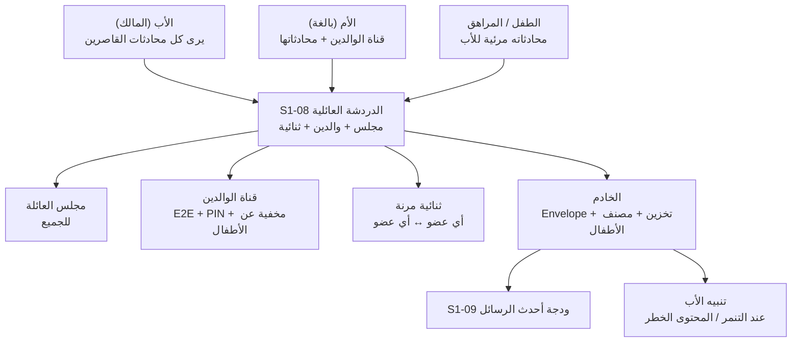
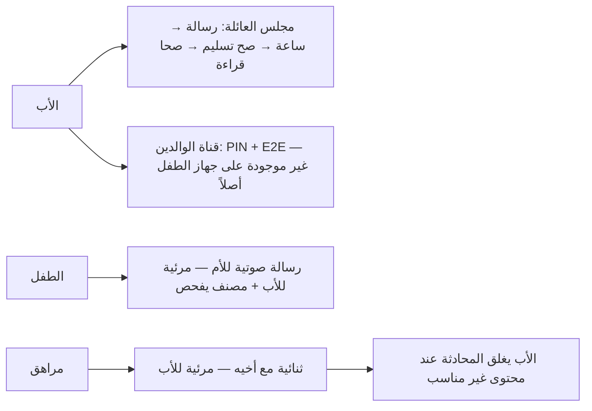

# S1-08: الدردشة العائلية الأساسية (Basic Family Chat)

- **الحالة:** drafted | **المرحلة:** 1 (نواة الحماية) · **آخر تحديث:** 2026-11-06
- **القرارات الحاكمة:** Q-003 · Q-007 · Q-010 · Q-064 · Q-065 · Q-081 · Q-082 · Q-083 · Q-099 · Q-100 · D-011 · D-019 · D-020 · D-021 · D-023 · D-038 · G-006 · G-007 · G-011
- **حالة المراجعة:** §§1–8 + §10 معتمدة بالكامل في التخطيط (حكم المالك 2026-11-06) · §9 في مرحلة التصميم.
- **الأدلة المرجعية:** المواصفة القديمة S1-08 (مرجع فقط، G-009) · Deep-dives: Telegram (معمارية الرسائل + المحادثات السرية) · FamilyWall (قنوات عائلية) · S1-01 (معتمد) · S1-02 (معتمد) · S1-03 (معتمد) · S1-09 (معتمد)

## 1. الهدف والتحليل والنطاق

الدردشة العائلية الأساسية هي **شريان التواصل اليومي** بين أفراد الأسرة داخل المنصة — البديل الآمن الخالي من الإعلانات والتتبع لمجموعات واتساب العائلية، بخصوصية عائلية فريدة: مرونة كاملة في التواصل داخل العائلة، ومساحة خاصة آمنة للوالدين، وإشراف أبوي دائم على محادثات القاصرين.

**التحليل (لماذا هذا النظام):** العائلة تتواصل يومياً في مجموعات خارجية لا تملكها ولا تحمي أطفالها. بدون دردشة داخلية يبقى التواصل العائلي خارج المنصة، وتضيع الحماية (الإشراف على رسائل الأطفال) والخصوصية (قناة الوالدين) والسرعة (العرض الفوري دون انتظار الخادم). لذلك S1-08 يبني التواصل **داخل** المنصة على ثلاث قواعد: المرونة افتراضياً (أي عضو يراسل أي عضو)، والإشراف دائماً على القاصرين، والخصوصية الحقيقية للوالدين.

**داخل النطاق:**
- 3 قنوات: مجلس العائلة العام + قناة الوالدين الخاصة (PIN الأب، مخفية عن أجهزة الأطفال، E2E + نسخة مشفرة على الخادم للاسترداد) + محادثات ثنائية مرنة (أي عضو يراسل أي عضو).
- الوسائط: نص + إيموجي + صور + رسائل صوتية (Q-099).
- عرض فوري محلي (نمط تيليجرام: `client_message_id` متفائل + صندوق صادر) + مؤشرات كتابة + صح التسليم/القراءة + عمل دون اتصال.
- التشفير: Envelope Encryption بمفاتيح يديرها الخادم + جاهزية E2E (Q-081)؛ قناة الوالدين E2E كاملة + نسخة مشفرة على الخادم للاسترداد بمفتاح مشتق من PIN الأب (Q-100).
- الاحتفاظ دائم حتى يحذف الأب (Q-082)؛ المصنف الخفيف على رسائل الأطفال في المرحلة 1 — ينبّه الأب (Q-083).
- المرونة: أي عضو يراسل أي عضو؛ ومحادثة أي قاصر مرئية للأب دائماً وله إغلاقها (Q-100).

**خارج النطاق (أنظمة أخرى):**
- مكالمات الفيديو ونقل الملفات الكبيرة (أنظمة لاحقة).
- المكالمات الصوتية/المرئية (نظام لاحق).

**يعتمد على:** S1-01 (الغلاف والوضعان) + S1-02 (العضوية) + S1-03 (الأدوار والصلاحيات — من يرى ماذا ويدير ماذا) + S1-09 (ودجة "أحدث الرسائل" في مركز الأوامر).

**المصطلحات:** قناة (channel) · رسالة (message) · مجلس العائلة (Family Lounge) · قناة الوالدين (Parents Sanctuary) · ثنائية (1-on-1) · تشفير المغلف (Envelope Encryption) · تشفير طرفي (E2E) · صندوق صادر (Outbox) · مصنف خفيف (lightweight classifier).

**من التطبيقات المفككة (§1):** نمط تيليجرام — العرض الفوري المحلي بـ `random_id` متفائل ثم المزامنة في الخلفية، والنموذجان معاً في تطبيق واحد (محادثات سحابية + محادثات سرية E2E)؛ ونمط FamilyWall — قنوات عائلية (مجلس + ثنائية). نأخذ منهما أن **التواصل سريع أولاً وآمن دائماً**: الرسالة تظهر فور إرسالها، والتشفير يتبع طبيعة القناة لا العكس.

**رسم توضيحي — أين تُستخدم الدردشة (للفهم السريع):**



## 2. سيناريوهات المستخدم

### 8-1: الأب يرسل رسالة في مجلس العائلة ويرى قراءتها فوراً
- **الممثل:** الأب (المالك). **السياق:** مساءً، يريد إبلاغ العائلة بموعد الغداء.
- **التدفق:** 1) الأب يكتب رسالة في مجلس العائلة ويرسلها — تظهر فوراً بعلامة ساعة (pending). 2) تصل الرسالة إلى الخادم فتتحول العلامة إلى صح التسليم. 3) يقرأها الأطفال فتتحول إلى صحي القراءة. **النتيجة:** تواصل فوري بلا انتظار (نمط تيليجرام).

### 8-2: الطفل يرسل رسالة صوتية لأمه — والأب يراها والمصنف يحرسها
- **الممثل:** الطفل + الأم + الأب. **السياق:** الطفل يرسل رسالة صوتية لأمه من المدرسة.
- **التدفق:** 1) الطفل يسجل رسالة صوتية ويرسلها — تظهر عند الأم فوراً. 2) الرسالة مرئية للأب أيضاً (إشراف دائم على القاصرين). 3) المصنف الخفيف يفحص رسائل الأطفال؛ إن رصد تنمراً أو محتوى خطراً نبّه الأب فوراً. **النتيجة:** تواصل دافئ للطفل مع حماية صامتة خلفه.

### 8-3: الوالدان يتبادلان رسائل خاصة لا يراها الأطفال أبداً
- **الممثل:** الأب والأم. **السياق:** حديث خاص بين الوالدين عن ميزانية العائلة.
- **التدفق:** 1) الأب يفتح قناة الوالدين (PIN الأب). 2) يتبادلان الرسائل — مشفرة E2E. 3) على جهاز الطفل: القناة غير موجودة أصلاً (لا في القائمة ولا في البحث)؛ ولا معاينة محتوى في الإشعارات. **النتيجة:** جو خاص حقيقي للوالدين — لا مجرد إخفاء بالواجهة.

### 8-4: المراهق يبدأ محادثة ثنائية مع أخيه — والأب يرى ويستطيع الإغلاق
- **الممثل:** المراهق + أخوه + الأب. **السياق:** المراهق يراسل أخاه مباشرة.
- **التدفق:** 1) المراهق يبدأ ثنائية مع أخيه — المرونة تسمح. 2) المحادثة مرئية للأب (قاصرون). 3) الأب يرى محتوى غير مناسب فيغلق المحادثة فوراً من إدارة الدردشة. **النتيجة:** المرونة افتراضياً، وإشراف الأب دائماً.

### 8-5: دون اتصال — الرسالة تنتظر في الصندوق الصادر وتُسلَّم عند عودة الشبكة
- **الممثل:** الطفل. **السياق:** في منطقة ضعيفة الشبكة في اليمن.
- **التدفق:** 1) الطفل يكتب رسالة دون اتصال — تظهر فوراً بعلامة ساعة وتبقى في الصندوق الصادر. 2) تعود الشبكة فيُسلَّم الصندوق تسلسلياً (بلا تكرار، مع ضغط Brotli). 3) تصل الرسالة ويتحول مؤشرها. **النتيجة:** الدردشة تعمل في أسوأ شبكة — لا رسائل ضائعة ولا مكررة.

### 8-6: الأب يحذف رسالة غير مناسبة للجميع
- **الممثل:** الأب. **السياق:** رسالة غير مناسبة وصلت إلى مجلس العائلة.
- **التدفق:** 1) الأب يفتح الرسالة ويختار "حذف للجميع". 2) تُحذف من الخادم ومن كل الأجهزة (الاحتفاظ دائم حتى يحذف الأب — Q-082). 3) يظهر مكانها "حُذفت هذه الرسالة". **النتيجة:** الأب يملك الكلمة الأخيرة على محتوى العائلة.

**مخطط القنوات والخصوصية (§2 — بصري):**



**مخطط دون اتصال والحذف (§2 — بصري):**

```mermaid
flowchart TD
    Offline[رسالة دون اتصال] --> Outbox[تظهر بساعة — تبقى في Outbox]
    Outbox --> Reconnect[عودة الشبكة]
    Reconnect --> Seq[تسليم تسلسلي بلا تكرار — ضغط Brotli]
    Father2[الأب] --> Del[حذف للجميع]
    Del --> Gone[تُحذف من الخادم وكل الأجهزة — "حُذفت هذه الرسالة"]
```

## 3. المتطلبات الوظيفية

### القنوات
- **REQ-001:** 3 قنوات: مجلس العائلة العام + قناة الوالدين الخاصة + محادثات ثنائية. [Q-100 · DIRECT]
- **REQ-002:** الثنائية مرنة: أي عضو يبدأ محادثة مع أي عضو في العائلة. [Q-100 · DIRECT]
- **REQ-003:** قناة الوالدين للبالغين فقط: PIN الأب + مخفية تماماً عن أجهزة الأطفال (لا قائمة ولا بحث) + بلا معاينة محتوى في الإشعارات. [Q-100 · DIRECT]
- **REQ-004:** محادثة أي قاصر مرئية للأب دائماً؛ والأب يستطيع إغلاق أي محادثة لقاصر في أي لحظة. [Q-100 · DIRECT]

### الرسائل
- **REQ-005:** الوسائط: نص + إيموجي + صور + رسائل صوتية. [Q-099 · DIRECT]
- **REQ-006:** عرض فوري محلي (<10ms) بـ `client_message_id` متفائل + صندوق صادر، ثم تحديث بـ `server_seq_id`. [Telegram · DIRECT]
- **REQ-007:** حالات التسليم والقراءة: أُرسلت (ساعة) → للخادم (صح) → قُرئت (صحان). [§2 · DERIVED]
- **REQ-008:** مؤشرات كتابة حية في القناة. [§2 · DERIVED]
- **REQ-009:** الأب يحذف أي رسالة للجميع؛ والعضو يحذف رسائله لنفسه فقط. [Q-082 · DERIVED]

### التشفير
- **REQ-010:** القنوات العائلية: Envelope Encryption بمفاتيح يديرها الخادم + بنية جاهزة لـ E2E (فصل الحمولة المعماة عن البيانات الوصفية). [Q-081 · DIRECT]
- **REQ-011:** قناة الوالدين: E2E كاملة؛ ونسخة مشفرة من رسائلها محفوظة على الخادم للاسترداد (النص المشفر فقط — الخادم لا يقرأ المحتوى)؛ ومفاتيح القناة محفوظة مشفرة بمفتاح استرداد مشتق من PIN الأب (Argon2id)؛ ولا تُسلَّم النسخة إلا بعد مصادقة الأب (PIN + OTP). [Q-100 · DIRECT — معدَّل 2026-11-06]

### الإشراف والمصنف
- **REQ-012:** المصنف الخفيف (Q-023) يعمل على رسائل الأطفال فقط في المرحلة 1؛ وينبّه الأب عند التنمر/المحتوى الخطر. [Q-083 · DIRECT]
- **REQ-013:** رؤية محادثات القاصرين: الأب كاملة؛ والبالغ المفوَّض حسب قالب التفويض (Q-089). [Q-100 · Q-089 · DERIVED]

### دون اتصال والاحتفاظ والتكامل
- **REQ-014:** دون اتصال: الصندوق الصادر يحفظ الرسائل ويُسلّمها تسلسلياً بلا تكرار، مع ضغط Brotli (وضع النطاق المنخفض). [Q-064 · DIRECT]
- **REQ-015:** الاحتفاظ دائم حتى يحذف الأب. [Q-082 · DIRECT]
- **REQ-016:** ودجة S1-09 "أحدث الرسائل": تعرض آخر رسائل القنوات العائلية حسب المنح؛ وقناة الوالدين تظهر كعدد فقط (بلا محتوى). [Q-100 · S1-09 · DERIVED]
- **REQ-017:** استرداد سجل قناة الوالدين على جهاز جديد: بعد مصادقة الأب (PIN + OTP) تُسلَّم النسخة المشفرة ومفتاحها المشفر، ويُفك السجل محلياً على الجهاز؛ والخادم لا يرى المحتوى أبداً. [Q-100 · DIRECT — أضيف بتعديل 2026-11-06]

## 4. الواجهات والعقود

### 4-1. نقاط الوصول (REST — `/api/v1`)

| الطريقة والمسار | الغرض | المدخل | المخرج |
|---|---|---|---|
| `GET /families/{id}/channels` | قائمة القنوات (مصفاة حسب الرؤية والمنح) | — | `[{channel_id, kind, title, last_message_at}]` |
| `POST /families/{id}/channels` | إنشاء قناة (ثنائية أو جماعية) | `{kind, member_ids}` | القناة — قناة الوالدين تُنشأ مع العائلة لا هنا |
| `GET /families/{id}/channels/{channelId}/messages` | سجل الرسائل (ترقيم) | `?before&limit` | `[{message_id, sender, kind, payload, at, status}]` |
| `POST /families/{id}/channels/{channelId}/messages` | إرسال رسالة (نص/إيموجي/صورة/صوت) | `{client_message_id, kind, payload}` | الرسالة + `server_seq_id` — `client_message_id` يمنع التكرار |
| `DELETE /families/{id}/channels/{channelId}/messages/{messageId}` | حذف رسالة (الأب: للجميع؛ العضو: لنفسه) | — | `{message_id, deleted_for: all\|self}` |
| `POST /families/{id}/channels/{channelId}/close` | الأب يغلق محادثة قاصر | `{reason}` | `{channel_id, closed: true}` |
| `POST /families/{id}/channels/{channelId}/read` | تأكيد القراءة (صحا القراءة) | `{last_read_seq}` | `{ok: true}` |

### 4-2. الأحداث (MQTT → الأجهزة)

| الموضوع | الغرض |
|---|---|
| `family/{family_id}/chat/{channelId}/message` | رسالة جديدة (تُدفع فوراً) |
| `family/{family_id}/chat/{channelId}/typing` | مؤشر كتابة حي |
| `family/{family_id}/chat/{channelId}/deleted` | حذف رسالة (للمزامنة على كل الأجهزة) |

### 4-3. قناة المنصة (MethodChannel — Flutter ↔ Kotlin)

| الطريقة | الغرض |
|---|---|
| `startChatSync()` | تشغيل خدمة المزامنة الخلفية للصندوق الصادر |
| `getOutboxStatus() → {pending, failed}` | حالة الصندوق الصادر (رسائل معلقة/فاشلة) |

### 4-4. صيغة الخطأ الموحدة

`{code, message_ar, trace_id}` — كما في S1-02 §4. رموز هذا النظام: `CHAT_CHANNEL_NOT_FOUND` (قناة غير موجودة) · `CHAT_NOT_MEMBER` (ليس عضواً في القناة) · `CHAT_CLOSED` (قناة مغلقة بأمر الأب) · `CHAT_MEDIA_TOO_LARGE` (وسائط تتجاوز الحد: 10MB صور / 5MB صوت — Q-058) · `CHAT_E2E_REQUIRED` (حمولة غير مشفرة في قناة الوالدين تُرفض).

## 5. البيانات — النموذج

كل جدول يحمل `family_id` + RLS (D-021). الرسائل تُخزن بنمط فصل الحمولة المعماة عن البيانات الوصفية (Q-081): الخادم يرى المرسل والوقت والتسلسل، لا محتوى قناة الوالدين أبداً.

### 5-1. `channel` — القنوات
| الحقل | النوع | ملاحظات |
|---|---|---|
| `channel_id` | uuid (PK) | |
| `family_id` | uuid (FK) | + RLS |
| `kind` | text | `lounge` / `parents` / `direct` / `group` |
| `title` | text | |
| `created_by` | uuid | |
| `created_at` | timestamptz | |
| `closed_at` / `closed_by` | timestamptz / uuid (nullable) | إغلاق الأب لمحادثة قاصر (REQ-004) |

### 5-2. `channel_member` — أعضاء القناة + آخر قراءة
| الحقل | النوع | ملاحظات |
|---|---|---|
| `channel_id` / `member_id` | uuid (PK مركب) | |
| `joined_at` | timestamptz | |
| `last_read_seq` | bigint | آخر تسلسل قرأه العضو (صحا القراءة — REQ-007) |

### 5-3. `message` — الرسائل
| الحقل | النوع | ملاحظات |
|---|---|---|
| `message_id` | uuid (PK) | |
| `channel_id` | uuid (FK) | |
| `family_id` | uuid (FK) | + RLS |
| `sender_id` | uuid | |
| `client_message_id` | text | متفرد لكل مرسل — يمنع التكرار (REQ-006) |
| `server_seq_id` | bigint | تسلسل الخادم لكل قناة (نمط Telegram SeqID) |
| `kind` | text | `text` / `emoji` / `image` / `voice` / `system` |
| `payload` | jsonb | الحمولة المعماة (Envelope)؛ وفي قناة الوالدين: نص مشفر E2E فقط — الخادم لا يقرأ محتواها؛ وتُحتفظ نسخة مشفرة للاسترداد (REQ-011) |
| `media_id` | uuid (nullable, FK → `media`) | للصور والصوت |
| `status` | text | `sent` / `delivered` / `read` |
| `created_at` | timestamptz | |
| `deleted_for` / `deleted_at` | text / timestamptz (nullable) | `all` (الأب) أو `self` (العضو) |

### 5-4. `media` — الوسائط
| الحقل | النوع | ملاحظات |
|---|---|---|
| `media_id` | uuid (PK) | |
| `family_id` | uuid (FK) | + RLS |
| `mime` | text | `image/*` / `audio/*` |
| `size_bytes` | int | الحد: 10MB للصور / 5MB للرسائل الصوتية (Q-058) |
| `storage_ref` | text | مرجع تخزين: MinIO متوافق مع S3 على خادمنا (Q-058) |
| `thumbnail_ref` | text (nullable) | مصغرة للصور |
| `created_at` | timestamptz | |

### 5-5. `parents_key_backup` — نسخة مفاتيح قناة الوالدين الاحتياطية (REQ-011/017)
| الحقل | النوع | ملاحظات |
|---|---|---|
| `family_id` | uuid (PK, FK) | + RLS |
| `channel_id` | uuid (FK) | قناة الوالدين |
| `encrypted_key` | bytea | مفاتيح القناة مشفرة بمفتاح الاسترداد (PIN-derived Argon2id) |
| `kdf_params` | jsonb | معاملات Argon2id |
| `updated_at` | timestamptz | |

### 5-6. مراجع (بلا تكرار)
- العضوية: S1-02 (`membership`) · المنح: S1-03 (`permission_grant` — مفاتيح `chat.*`) · تنبيهات المصنف: تظهر كتنبيهات في S1-09 (`alert`، النوع `system`، النظام `S1-08`) · إغلاق/حذف الأب: أحداث تدقيق في النواة المشتركة (`AuditEvent`، النطاق `chat`).
- **ملاحظة العميل:** نسخة محلية من `channel` + `message` في Drift (دون اتصال) — مخزن عميل لا جدول خادم.

## 6. القواعد والصلاحيات

### 6-1. مفاتيح هذا النظام (`chat.*`)

| المفتاح | الوصف | لمن؟ |
|---|---|---|
| `chat.channel.create` | إنشاء قناة (ثنائية/جماعية) | الأب + البالغ المفوَّض |
| `chat.channel.view` | عرض قناة | عضو فيها |
| `chat.message.send` | إرسال رسالة | عضو في القناة |
| `chat.message.delete.any` | حذف أي رسالة للجميع (قابل للتفويض — Q-010) | الأب افتراضياً + المفوَّض |
| `chat.channel.close` | إغلاق محادثة قاصر | الأب + البالغ المفوَّض — أبداً للمراهق/الطفل (Q-086) |
| `chat.parents.view` | عرض قناة الوالدين | البالغون فقط — أبداً للقاصرين |
| `chat.minor.view` | رؤية محادثات القاصرين | الأب + البالغ المفوَّض حسب القالب (Q-089) |

### 6-2. الثوابت الصلبة (لا تُكسر أبداً)
- محادثة أي قاصر مرئية للأب دائماً (Q-100 + D-038).
- قناة الوالدين لا تظهر للقاصرين أبداً — لا وجودها ولا محتواها ولا عدد رسائلها (Q-100).
- محتوى قناة الوالدين E2E لا يقرأه الخادم أبداً (Q-100).
- النسخة المشفرة لقناة الوالدين ومفتاحها المشفر لا يُسلَّمان إلا بعد مصادقة الأب (PIN + OTP).
- المصنف يعمل على رسائل الأطفال فقط في المرحلة 1 (Q-083).
- لا محتوى رسائل يغادر العائلة أبداً (لا مشاركة خارجية).
- قناة الوالدين واحدة، تُنشأ مع العائلة، ولا تُنشأ من نقطة الإنشاء (Q-100).

### 6-3. قواعد التشغيل
- **إنشاء القنوات:** الثنائية يبدؤها أي عضو مع أي عضو؛ والجماعية ينشئها الأب أو البالغ المفوَّض.
- **الترتيب:** ترتيب الرسائل بـ `server_seq_id` لكل قناة؛ والتكرار يُمنع بـ `client_message_id`.
- **الصندوق الصادر:** الرسائل دون اتصال تُسلَّم تسلسلياً بلا تكرار؛ والفاشلة تبقى معلقة حتى تنجح أو يحذفها مرسلها.
- **الاحتفاظ:** لا حذف تلقائي أبداً (Q-082).
- **مؤشرات الكتابة:** تظهر فقط لأعضاء القناة.
- **الاسترداد:** سجل قناة الوالدين يُسترد على جهاز جديد بعد المصادقة (REQ-017)؛ وإعادة تعيين PIN (Q-077) تُعيد تغليف مفتاح الاسترداد — فإن تعذرت المصادقة القديمة فالسجل القديم غير قابل للاسترداد.

## 7. الحالات الحدية والأخطاء

1. **قناة غير موجودة:** رسالة لقناة غير موجودة → `CHAT_CHANNEL_NOT_FOUND`.
2. **ليس عضواً:** إرسال في قناة لست عضواً فيها → `CHAT_NOT_MEMBER`.
3. **قناة مغلقة:** إرسال في قناة أغلقها الأب → `CHAT_CLOSED` + سبب الإغلاق.
4. **وسائط كبيرة:** صورة > 10MB أو صوت > 5MB → `CHAT_MEDIA_TOO_LARGE` + الحد ظاهر في الرسالة.
5. **حمولة غير مشفرة:** حمولة غير مشفرة في قناة الوالدين → `CHAT_E2E_REQUIRED` (تُرفض قبل الحفظ).
6. **تكرار الإرسال:** نفس `client_message_id` مرتين → تُعاد الرسالة الأصلية بلا تكرار (idempotency).
7. **فشل بعد عودة الشبكة:** رسالة في الصندوق الصادر تفشل عند عودة الاتصال → تبقى معلقة مع زر إعادة المحاولة.
8. **حذف محذوفة:** حذف رسالة محذوفة أصلاً → تُعاد النتيجة نفسها (idempotent).
9. **وصول مباشر لقناة الوالدين:** قاصر يحاول الوصول لقناة الوالدين عبر API مباشرة → `403` + القناة لا تظهر في أي قائمة (لا تسريب لوجودها).
10. **تنبيه كاذب من المصنف:** المصنف يرفع تنبيهاً خاطئاً → الأب يرى التنبيه مع نص الرسالة ويمكنه تجاهله؛ والتجاهل يُسجَّل (بيانات تحسين لاحقة — Q-052).
11. **مراهق يحاول الإدارة:** مراهق يحاول إغلاق محادثة أو حذف رسالة للجميع → مرفوض (المفاتيح للبالغين فقط) + تسجيل المحاولة في التدقيق.
12. **فقدان جهاز الوالدين:** استعادة سجل قناة الوالدين بعد فقدان الجهاز → ممكنة من النسخة المشفرة بعد مصادقة الأب (PIN + OTP) على الجهاز الجديد (REQ-017)؛ وإن تعذرت مصادقة الأب تماماً (نسي الـ PIN ولم يستطع المصادقة) فالسجل غير قابل للاسترداد — رسالة صريحة للمستخدم لا وعد كاذب. [معدَّل 2026-11-06]
13. **وسائط تالفة:** رسالة صوتية/صورة غير مكتملة أو تالفة → تُرفض مع رسالة واضحة؛ ولا تُحفظ ناقصة.

## 8. معايير القبول

- **ACC-001:** القنوات الثلاث موجودة: مجلس العائلة + قناة الوالدين + ثنائية. [REQ-001]
- **ACC-002:** أي عضو يبدأ محادثة ثنائية مع أي عضو. [REQ-002]
- **ACC-003:** قناة الوالدين للبالغين فقط: PIN + مخفية عن أجهزة الأطفال + بلا معاينة في الإشعارات. [REQ-003]
- **ACC-004:** محادثات القاصرين مرئية للأب؛ والأب يغلق أي محادثة قاصر. [REQ-004]
- **ACC-005:** الوسائط الأربع تُرسل وتُعرض: نص + إيموجي + صور + صوت. [REQ-005]
- **ACC-006:** الرسالة تظهر محلياً فوراً (<10ms) ثم تُزامَن؛ ولا تكرار عند إعادة الإرسال. [REQ-006]
- **ACC-007:** حالات التسليم والقراءة صحيحة (ساعة → صح → صحان). [REQ-007]
- **ACC-008:** القنوات العائلية Envelope + جاهزة لـ E2E؛ وقناة الوالدين E2E لا يقرأ الخادم محتواها. [REQ-010/011]
- **ACC-009:** المصنف يرفع تنبيهاً للأب عند التنمر/المحتوى الخطر في رسائل الأطفال. [REQ-012]
- **ACC-010:** دون اتصال: الصندوق الصادر يُسلَّم تسلسلياً بلا تكرار، مع ضغط Brotli. [REQ-014]
- **ACC-011:** لا حذف تلقائي أبداً؛ والاحتفاظ حتى يحذف الأب. [REQ-015]
- **ACC-012:** ودجة S1-09 تعرض قناة الوالدين كعدد فقط (بلا محتوى). [REQ-016]
- **ACC-013:** مفاتيح `chat.*` السبعة مطبقة؛ والمراهق لا يغلق محادثة ولا يحذف للجميع. [§6]
- **ACC-014:** استرداد سجل قناة الوالدين على جهاز جديد بعد مصادقة الأب (PIN + OTP) من النسخة المشفرة؛ والخادم لا يرى المحتوى أبداً. [REQ-017 — أضيف بتعديل 2026-11-06]

## 10. خطة التنفيذ

### خطوات البناء بالترتيب
1. جداول القنوات والرسائل والوسائط ونسخة المفاتيح + RLS.
2. نقاط الوصول REST السبعة + أحداث MQTT (رسالة/كتابة/حذف).
3. التشفير: Envelope للقنوات العائلية + E2E لقناة الوالدين + نسخة المفاتيح (PIN-derived Argon2id) + الاسترداد.
4. المصنف الخفيف على رسائل الأطفال + تنبيهات S1-09.
5. الصندوق الصادر دون اتصال + MethodChannel (مزامنة خلفية).
6. الشاشات بعد التصميم (§9).

### الوحدات
- Ktor: وحدة `chat` (قنوات + رسائل + وسائط + مفاتيح).
- Flutter: شاشات الدردشة + Drift (الصندوق الصادر + النسخة المحلية).
- Kotlin: مفاتيح E2E في Android Keystore + المزامنة الخلفية.

### التبعيات
- S1-01 (الغلاف) · S1-02 (العضوية) · S1-03 (الصلاحيات) · S1-09 (ودجة أحدث الرسائل + التنبيهات) · Q-022 (MQTT) · Q-023 (المصنف الخفيف) · Q-058 (MinIO) · مختبر Q-027.

### منهج الاختبار
- وحدة: التشفير (Envelope + E2E) + الصندوق الصادر + منع التكرار.
- تكامل: نقاط الوصول + الأحداث + التصفية حسب المنح + الاسترداد.
- قبول: ACC-001…ACC-014.
- دون اتصال: إرسال دون شبكة + تسليم تسلسلي بلا تكرار (اليمن).

## أسئلة مفتوحة (من هذه المواصفة)

لا أسئلة مفتوحة من هذه المواصفة (Q-058 حُسم 2026-11-06).

## ملحق أ: الاستخلاص من الهندسة العكسية (RE)

| المصدر المفكك | الآلية المستخلصة | أين تُستخدم في S1-08 |
|---|---|---|
| Telegram | عرض فوري محلي بـ `random_id` متفائل + صندوق صادر (Transactional Outbox) ثم مزامنة خلفية | §1، §3 (إرسال دون انتظار الخادم) |
| Telegram | محادثات سحابية (تشفير خادم) + محادثات سرية E2E — نموذجان معاً في تطبيق واحد | §1، §6 (Envelope للقنوات العائلية + E2E لقناة الوالدين) |
| FamilyWall | قنوات عائلية (مجلس + ثنائية) | §1، §3 |
