# S1-09: مخططات هندسة البرمجيات (DIAGRAMS)

- **الحالة:** معتمدة — المخططات الستة معتمدة (حكم المالك 2026-11-08 — D-2، بعد موجة الإصلاح 0e4a3e2..f7da470)؛ والمواصفة معتمدة بالكامل في التخطيط
- **المواصفة:** `SPEC.md` (§§1–8 + §10 معتمدة بالكامل في التخطيط، حكم المالك 2026-11-05 · §9 في مرحلة التصميم)
- **السياق المحدد (Bounded Context):** بلا سياق خاص — عنصر عابر يعبر كل السياقات (مركز الأوامر، `CONTEXT-MAP.md` §2-أ)
- **القرارات الحاكمة:** Q-001 · Q-003 · Q-007 · Q-055 · Q-061 · Q-063 · Q-064 · Q-065 · Q-089 · Q-092 · Q-094 · Q-095 · Q-096 · Q-097 · Q-098 · D-021 · D-038 · G-006 · G-011
- **الأنواع الستة:** 1. حالات الاستخدام · 2. ERD · 3. التسلسل · 4. تدفق المستخدم · 5. DFD · 6. النشاط
- **الأشكال الموحدة:** مستطيل = جهة خارجية · مستطيل مستدير = عملية · معين = قرار · أسطوانة = مخزن بيانات · خط متقطع = يتضمن / اختياري

كل عنصر في المخططات الستة يتتبع إلى متطلبات SPEC (§3) أو عقودها (§4) أو قرار محكوم — لا عناصر مخترعة.

## 1. حالات الاستخدام

16 حالة استخدام من السيناريوهات الستة والمتطلبات (§2/§3): الأب يرى كل شيء، والبالغ المفوَّض يرى فقط ما فُوِّض به (القسم غير المفوَّض به مخفي تماماً لا مغلقاً برمز)، والأنظمة الأخرى ممثلة كجهات خارجية لأن المركز يجمع ولا يملك (REQ-002)، والتسجيل في السجل المركزي يتم وقت النشر لا وقت التشغيل (§4-1).
- مفاتيح هذا النظام (§6-1 — REQ-004): `hub.dashboard.view` (عرض اللوحة) · `hub.settings.view` (عرض مركز الإعدادات) · `hub.settings.edit` (تعديل تحكم — مع مفتاح التحكم نفسه) · `hub.alerts.view` (عرض التنبيهات) · `hub.alerts.acknowledge` (تأكيد قراءة تنبيه) · `hub.plan.view` (عرض الخطة والاستخدام) — للأب + البالغ المفوَّض (يُصفى حسب منحِه)؛ و`hub.settings.edit` وحده لا يمنح حق التعديل.

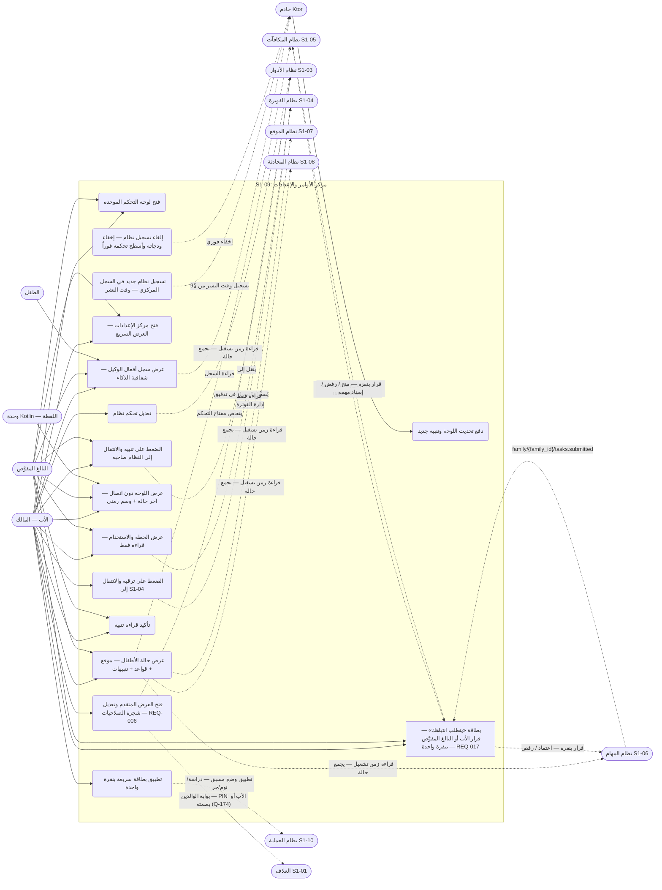

- البالغ المفوَّض لا يظهر له UC5 وUC6 وUC7 وUC10 وUC15 إلا إن ملك مفتاح كل عنصر (REQ-004 · Q-096)؛ وUC15 للبالغ مشروط بأن يكون عنصر الانتباه مفوَّضاً به (H09-02 — يرى منه فقط ما فُوِّض به، ويقرر العنصر المفوَّض به وحده — H09-03)؛ والمركز لا يمنح صلاحيات — تعديل أي تحكم يتطلب مفتاح التحكم نفسه عبر S1-03 (§6-2).
- بطاقة "يتطلب انتباهك" (UC15 — REQ-017): تستهلك `family/{family_id}/tasks.submitted` (S1-06 REQ-015) و`family/{family_id}/time-request/new` (S1-05 REQ-014)؛ والأب يقرر بنقرة واحدة (منح / رفض / إسناد مهمة لطلب الوقت؛ اعتماد / رفض لمهمة مسلَّمة)؛ والبالغ المفوَّض بصلاحية القرار يقرر العنصر المفوَّض به وحده (Q-268) — انظر التسلسل 3-و.
- سجل أفعال الوكيل (UC16): يعرض `AgentActionLog` كاملاً للأب؛ والبالغ المفوَّض يرى منه ما يخص ما فُوِّض به (REQ-004)؛ والطفل يرى منه ما يخصه فقط (G-006) — انظر التسلسل 3-ز.
- الحواف المنقطة عبر الأنظمة في §1 (قراءات الحالة، أحداث MQTT، القرارات بنقرة) هي حواف زمن تشغيل — قراءات وأحداث وقت التشغيل لا تبعيات بناء (Q-297)؛ فلا يبني S1-09 على S1-05/06/07/08/10 ولا يبنون عليه.
- الغلاف S1-01 يستضيف المركز (SPEC §1: «يعتمد على» + مخطط السياق)؛ والبطاقات السريعة (UC5) أوضاع S1-10 مسبقة (REQ-007) — تُطبَّق عبر التسلسل 3-ب.

## 2. مخطط قاعدة البيانات (ERD)

الجداول الأربعة الخاصة من §5 كما هي، مع خمسة مراجع خارجية: العائلة والعضوية (S1-02)، ومفتاح الصلاحية والمنح (S1-03)، والخطة (S1-04 — قراءة فقط). ملاحظتان: جدولا السجل (`dashboard_widget` و`control_surface`) مشتركان لكل العائلات بلا `family_id` (نفس المنطق المصحح في S1-03 §5)، و`dashboard_snapshot` لقطة واحدة لكل عائلة (PK = `family_id`). بيانات الأنظمة نفسها لا تُخزَّن هنا أبداً (REQ-002).

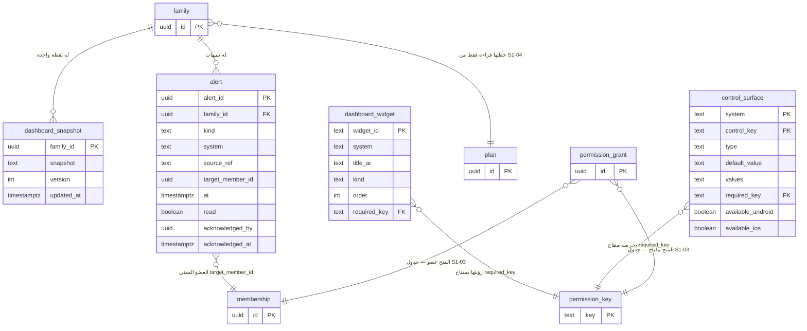

- `kind` في `dashboard_widget` من القيم الأربع فقط: `map` / `list` / `stat` / `alert` (§5-1)؛ و`kind` في `alert` من القيم الأربع فقط: `sos` / `escalation` / `grant_expiring` / `system` (§5-4)؛ و`type` في `control_surface` من القيم الثلاث فقط: `select` / `switch` / `action` (§5-2)؛ وأنواع هذا المخطط تتبع اتفاقية Q-177 (Q-267): يرسم `text` لما نوعه الحقيقي `jsonb` في §5 (`default_value`/`values`/`snapshot`)، و§5 مرجع الأنواع الحقيقية؛ وما عداها يطابق §5 حرفياً (`widget_id` نص، و`acknowledged_by` ‏`uuid`)؛ و`source_ref` في `alert` بصيغة `{system}:{kind}:{id}` (§5-4)؛ و`version` في `dashboard_snapshot` يزيده الخادم وحده (§5-3).

## 3. التسلسل (Sequence) — من عقود §4

ثمانية مخططات، كل واحد لتدفق واحد:

### 3-أ. فتح اللوحة الموحدة (REQ-001/016 — §4-1 + §4-3)

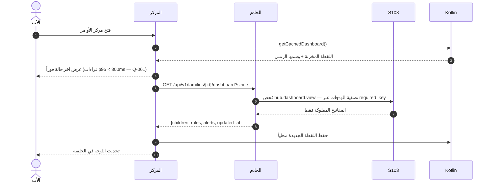

- الودجات المخفية لا تُرسَل للعميل أصلاً (§6-3)؛ واللقطة المخزنة تُعرض فوراً ثم يُحدَّث في الخلفية (REQ-016)؛ و`?since` طابع RFC 3339 UTC — بلا `since` لقطة كاملة، ومعه دلتا (المصفوفة الفارغة تعني «لا تغيير») — §4-1؛ واللقطة المحلية نسخة مخزنة من صف الخادم (`family_id`, `version`) لا سجل مستقل — والخادم وحده يكتب الصف (§5-3).

### 3-ب. تعديل تحكم نظام (REQ-004/008 — §4-1)

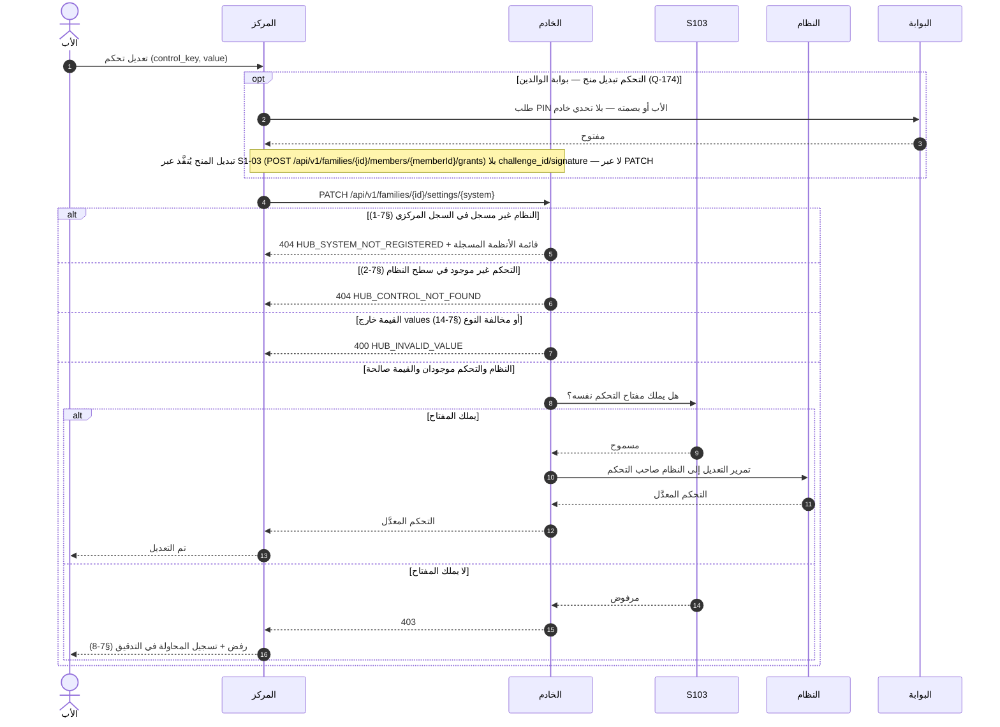

- مفتاح `hub.settings.edit` وحده لا يمنح حق التعديل (§6-1)؛ وحالات رموز HUB: `HUB_SYSTEM_NOT_REGISTERED` و`HUB_CONTROL_NOT_FOUND` خطأا `404`، و`HUB_INVALID_VALUE` خطأ `400` (§4-4)؛ والتعارض المتزامن على نفس التحكم يُمرَّر إلى النظام صاحبه ويُحل بقواعده (مثال S1-03 REQ-019) — المركز لا يبت في التعارض (§7-9).

### 3-ج. تنبيه جديد وتأكيد قراءته (REQ-003 — §4-1 + §4-2)

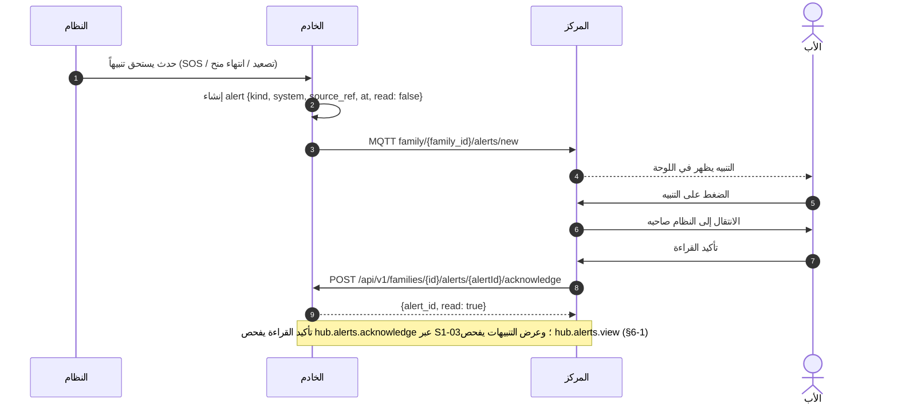

- تنبيه SOS يصل دون اتصال متأخراً عند عودة الاتصال مع وسمه الزمني الأصلي — لا يُعرض كأنه الآن (§7-10).

### 3-د. دون اتصال — اللقطة المخزنة (REQ-010/011 — §4-3)

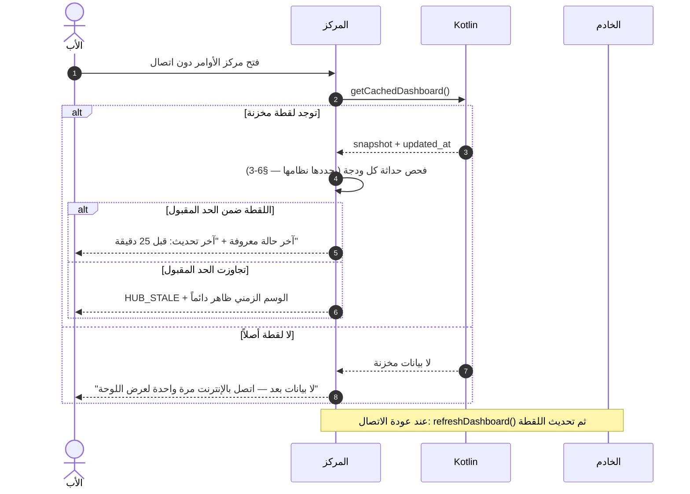

- "قبل 25 دقيقة" مثال من السيناريو 9-5؛ والبيانات القديمة لا تُعرض كأنها حية أبداً (§6-2)؛ واللقطة التالفة تُتجاهل وتُعاد من الخادم عند الاتصال (§7-12)؛ واللقطة المحلية نسخة مخزنة من صف الخادم (`family_id`, `version`) — والخادم وحده يكتب الصف ويزيد `version` (§5-3).

### 3-هـ. عرض الخطة والترقية (REQ-012/013 — §4-1)

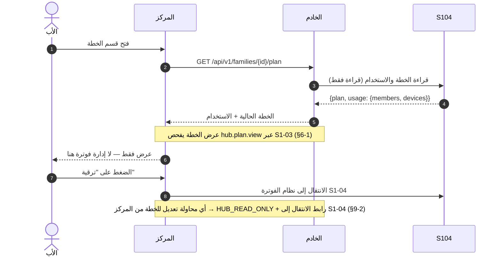

### 3-و. بطاقة "يتطلب انتباهك" — قرار الأب — أو البالغ المفوَّض للعنصر المفوَّض به — بنقرة واحدة (REQ-017 · Q-268 · S1-05 REQ-014 · S1-06 REQ-015 — §4-2)

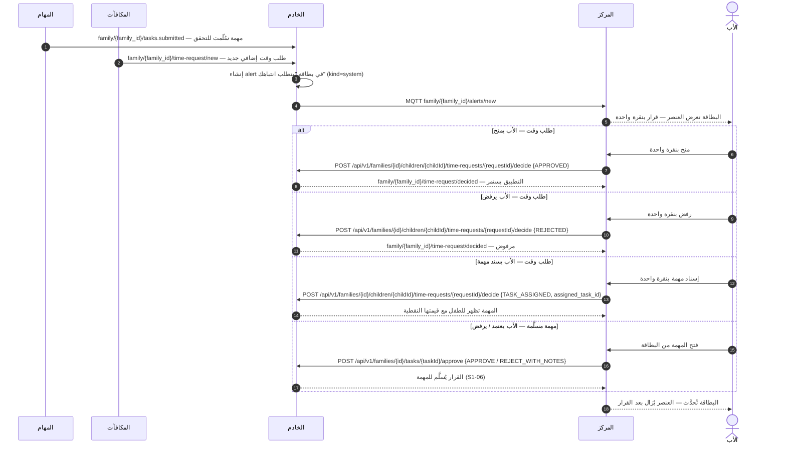

- والبالغ المفوَّض يتبع التدفق نفسه للعنصر المفوَّض به وحده (Q-268)؛ ويُفحص قراره بمفتاح نظام العنصر في S1-05/S1-06.

- المصدران: S1-05 REQ-014 (طلب الوقت الإضافي يظهر في البطاقة؛ والأب يقرر بنقرة واحدة) وS1-06 REQ-015 (`family/{family_id}/tasks.submitted` → البطاقة)؛ والموضوع الوارد الثالث `family/{family_id}/permissions/grant-expiring` (S1-03 §4-2 — Q-227) ينشئ تنبيه `kind=grant_expiring` بالمرجع نفسه (`source_ref`)؛ والبطاقة نفسها تُعرض في S1-09 وتُدفع أحداثها عبر `family/{family_id}/alerts/new` (§4-2). والبالغ المفوَّض يرى في البطاقة فقط ما فُوِّض به (Q-096) — الباقي مخفي تماماً.

### 3-ز. عرض سجل أفعال الوكيل — شفافية الذكاء (REQ-018 — §4-1)

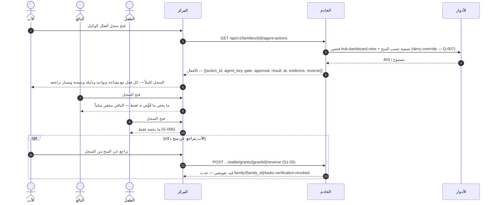

- المصدر: عقد التحقق Q-167 §3 (`AgentActionLog`) + S1-09 REQ-018 (Q-173)؛ والتراجع نقطة S1-05 (S1-05 REQ-018)؛ والتصفية الخادمية عبر S1-03 (REQ-004 · Q-007). والبوابات الخمس والمفاتيح السبعة مرجعها عقد التحقق §1/§2 — وكل فعل معروض يحمل مفتاحه وبوابته (REQ-018). والترقيم: `limit` افتراضي 50 وأقصى 100، والأحدث أولاً، و`next_cursor` للصفحة التالية (§4-1)؛ و`member_id` لغير المالك على عضو آخر → `403` بلا استبدال صامت (§7-15)؛ وبلا `member_id` يُفرض معرّف المتصل.

### 3-ح. تسجيل نظام جديد وقت النشر — وظهوره وإلغاؤه (REQ-014/015 — §4-1)

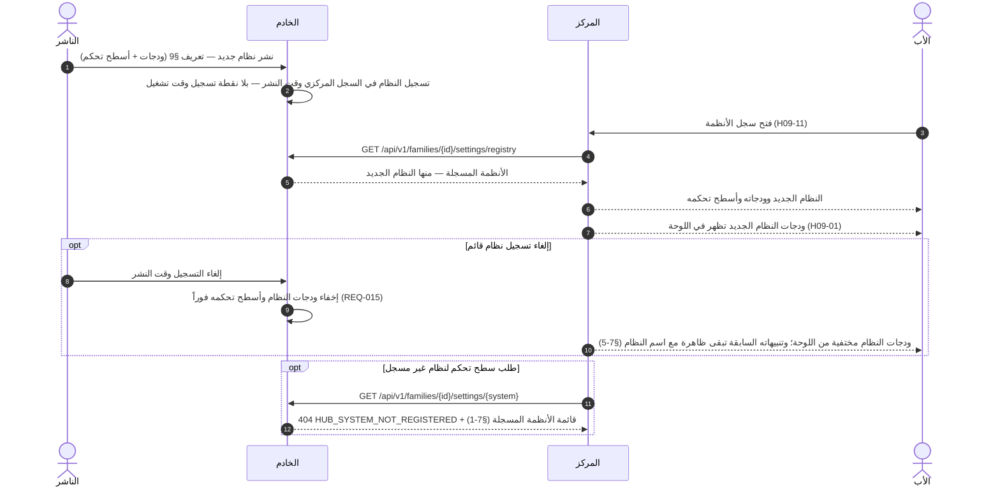

- المحفز: النشر (deploy) بتعريف §9 للنظام؛ والفاعل: الناشر — بلا شاشة تسجيل وبلا نقطة تسجيل وقت تشغيل (سطح هجوم غير ضروري — §4-1)؛ وإلغاء التسجيل يخفي الودجات والأسطح فوراً بينما تبقى التنبيهات السابقة سجل تدقيق (§7-5).

## 4. تدفق المستخدم (User Flow) — من السيناريوهات الستة (§2)

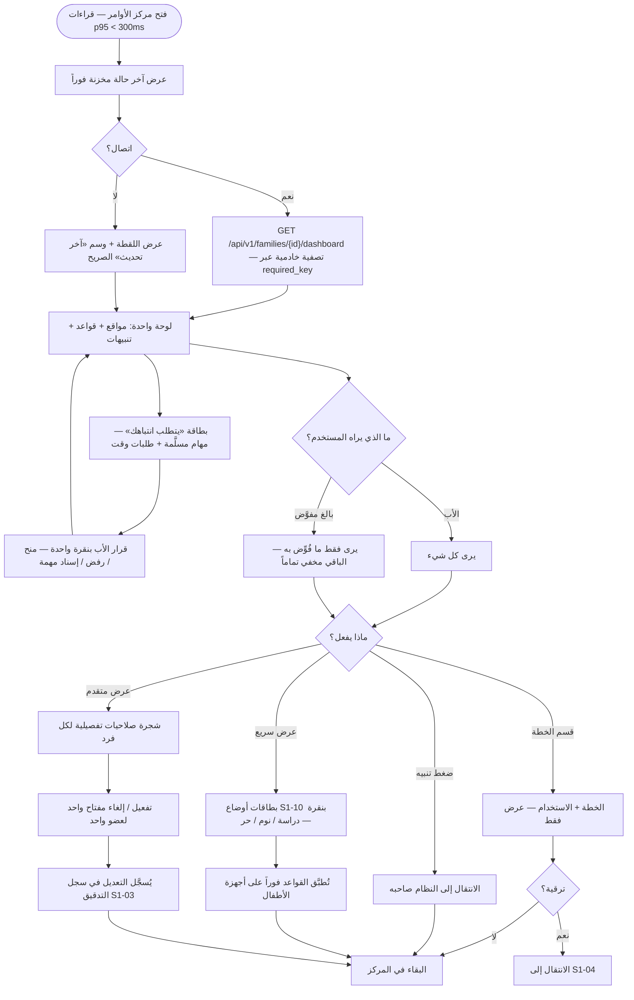

- ملاحظة: البطاقات السريعة إعدادات وضع مسبقة يملكها نظام الحماية S1-10 — "دراسة / نوم / حر" أمثلة البطاقات من السيناريو 9-3 (REQ-007)؛ وتطبيق قالب صلاحيات Q-089 (شريك/وصي محدود/مراقب) إجراء منفصل في المركز، لا بطاقة سريعة. وتبديل الملفات غير موجود في أي مسار — مؤجل للمرحلة 2 (Q-063).

## 5. مخطط تدفق البيانات (DFD — المستوى 1) — من §4/§5

العمليات مرقمة 1.0–7.0، والمخازن D1–D4. المخزنان D1 وD2 سجلان مشتركان بلا `family_id`؛ والمخزنان D3 وD4 يحملان `family_id` + عزل RLS (D-021). ومخزن خارجي واحد: `AgentActionLog` — ملك عقد التحقق (Q-167 §3)، لا جدول جديد في S1-09 (§5-5) — تقرؤه P7 عبر Ktor. التسجيل في السجل يتم وقت النشر من تعريف §9 لكل نظام — لا نقطة تسجيل وقت التشغيل (§4-1).

- **تغطية نقاط §4:** التسلسلات في §3 تغطي التدفقات الأساسية فقط؛ وكل نقطة §4-1 تظهر هنا على الأقل: `GET /api/v1/families/{id}/alerts` (قائمة التنبيهات — REQ-003، تُقرأ عبر P5) · `GET /api/v1/families/{id}/settings/registry` (السجل المركزي — REQ-005، تُقرأ عبر P3) · `GET /api/v1/families/{id}/settings/{system}` (سطح تحكم نظام واحد — REQ-008، تُقرأ عبر P3) · `GET /api/v1/families/{id}/agent-actions` (سجل أفعال الوكيل — REQ-018، تُقرأ عبر P7)؛ وبقية النقاط مرسومة في §3 (dashboard، settings PATCH، plan، alerts acknowledge).

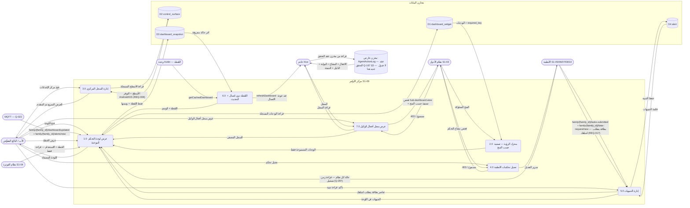

## 6. مخطط النشاط (Activity) — دورة حياة استخدام المركز

المسارات الأربعة (المستخدم / المركز — Flutter / الخادم — Ktor / الأنظمة + S1-03) كمسارات متوازية. ودفع MQTT والتحديث الخلفي للقطة يعملان **بالتوازي** مع استخدام المركز.

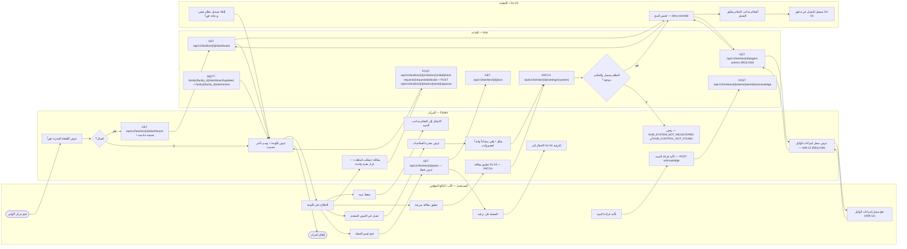

- سحب منح بالغ مفوَّض أثناء عرضه اللوحة يخفي الأقسام في التحديث التالي فوراً (§7-11)؛ ولوحة فارغة (بلا أطفال أو بلا أنظمة مسجلة) تعرض رسالة إرشادية لا خطأ: "أضف طفلاً من الإعدادات لتبدأ" (§7-4)؛ وتنبيهات نظام أُلغي تسجيله تبقى ظاهرة مع اسم النظام كسجل تدقيق (§7-5).
