# S1-09: مخططات هندسة البرمجيات (DIAGRAMS)

- **الحالة:** معتمدة — المخططات الستة معتمدة (حكم المالك 2026-11-08 — D-2، بعد موجة الإصلاح 0e4a3e2..f7da470)؛ والمواصفة معتمدة بالكامل في التخطيط
- **المواصفة:** `SPEC.md` (§§1–8 + §10 معتمدة بالكامل في التخطيط، حكم المالك 2026-11-05 · §9 أُغلق تصميمه مع بنود محمولة — Q-407، 2026-11-17)
- **تنبيه 2026-11-17 (Q-407):** المخططات أدناه لم تُعَد رسماً بعد إغلاق التصميم؛ يرسمها وكيل آخر بأمر المالك (Q-404). ما يلزم مراجعته فيها: (1) «الباقي مخفي تماماً» للبالغ المفوَّض يخص الرئيسية، وفي «التحكم» و«صلاحياتي» يظهر مقفلاً مع سببه؛ (2) الطفل في UC16 هو الطفل (7–12) والمراهق، ويرى ما نُفّذ فعلاً فقط، ودون 7 بلا شاشة؛ (3) إلغاء تسجيل نظام (UC13) يتم عند النشر، ولا إجراء له في شاشات الأب — **رُسم 2026-11-19 (Q-434):** (1) في §1 UC20 و§4-ب و§6-ب؛ (2) في §1 و3-ز و§6-ج؛ (3) في §1 UC13 و3-ح.
- **تنبيه 2026-11-18 (Q-425):** ويُضاف إلى ما يلزم رسمه: «العرض كـ» (الأب يعاين رئيسية ابنه للمشاهدة فقط)، ونوعا التحكم «مفتاح» و«فعل» في ورقة التعديل. نصّهما في `SPEC.md` §9-8 (هـ). مع دفعة المخططات (Q-412). — **رُسم 2026-11-19 (Q-434):** «العرض كـ» في §1 UC17 و3-ط و§4-ب و§6-ج؛ وأنواع التحكم الثلاثة في 3-ب و§1 UC7.
- **تنبيه 2026-11-18 (Q-426):** لا قالب لدون 7: «الطفل» في UC16 كل ابن دون 13. — **رُسم 2026-11-19 (Q-434):** لا مستخدم دون 7 ولا قالب minimal في أي مخطط؛ و«الطفل أو المراهق» في §1 و«ما يخصه ونُفّذ فعلاً فقط» في 3-ز.
- **السياق المحدد (Bounded Context):** بلا سياق خاص — عنصر عابر يعبر كل السياقات (مركز الأوامر، `CONTEXT-MAP.md` §2-أ)
- **القرارات الحاكمة:** Q-001 · Q-003 · Q-007 · Q-055 · Q-061 · Q-063 · Q-064 · Q-065 · Q-089 · Q-092 · Q-094 · Q-095 · Q-096 · Q-097 · Q-098 · D-021 · D-038 · G-006 · G-011 · Q-297
- **الأنواع الستة:** 1. حالات الاستخدام · 2. ERD · 3. التسلسل · 4. تدفق المستخدم · 5. DFD · 6. النشاط
- **الأشكال الموحدة:** مستطيل = جهة خارجية · مستطيل مستدير = عملية · معين = قرار · أسطوانة = مخزن بيانات · خط متقطع = يتضمن / اختياري

كل عنصر في المخططات الستة يتتبع إلى متطلبات SPEC (§3) أو عقودها (§4) أو قرار محكوم — لا عناصر مخترعة.

## 1. حالات الاستخدام

20 حالة استخدام من السيناريوهات الستة والمتطلبات (§2/§3) والتصميم المعتمد (§9-8): الأب يرى كل شيء، والبالغ المفوَّض يرى فقط ما فُوِّض به (القسم غير المفوَّض به مخفي تماماً لا مغلقاً برمز)، والأنظمة الأخرى ممثلة كجهات خارجية لأن المركز يجمع ولا يملك (REQ-002)، والتسجيل في السجل المركزي يتم وقت النشر لا وقت التشغيل (§4-1) — على أربع لوحات حسب الفاعل (1-أ و1-ب للأب، و1-ج للبالغ، و1-د للبالغ والطفل).
- مفاتيح هذا النظام (§6-1 — REQ-004): `hub.dashboard.view` (عرض اللوحة) · `hub.settings.view` (عرض مركز الإعدادات) · `hub.settings.edit` (تعديل تحكم — مع مفتاح التحكم نفسه) · `hub.alerts.view` (عرض التنبيهات) · `hub.alerts.acknowledge` (تأكيد قراءة تنبيه) · `hub.plan.view` (عرض الخطة والاستخدام) — للأب + البالغ المفوَّض (يُصفى حسب منحِه)؛ و`hub.settings.edit` وحده لا يمنح حق التعديل.

### 1-أ. الأب — اللوحة والحالة والتنبيهات

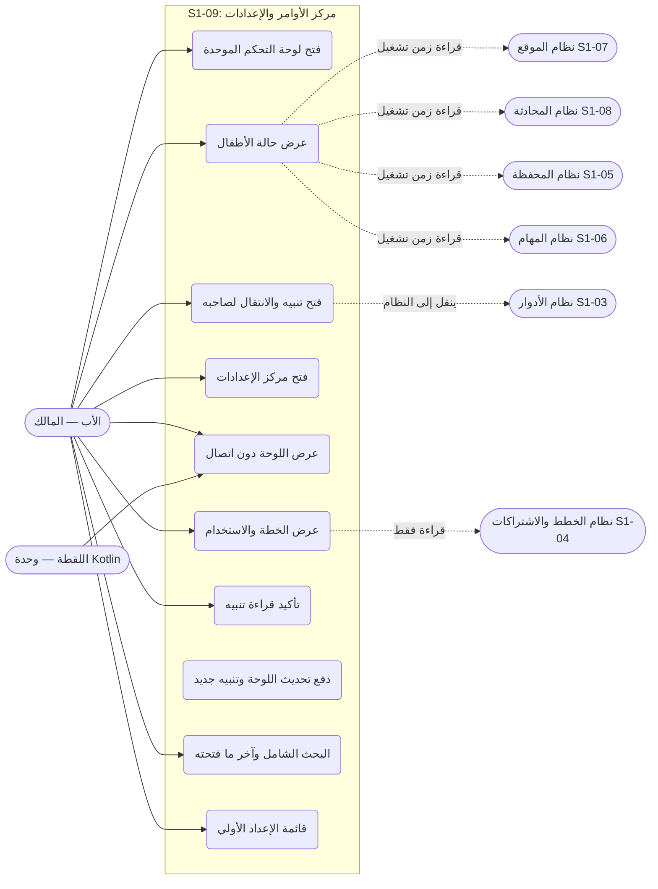

- يقرأ: ما يراه الأب عند فتح المركز: اللوحة وحالة الأطفال والتنبيهات والخطة والبحث وقائمة الإعداد الأولي، واللقطة دون اتصال من وحدة Kotlin.

### 1-ب. الأب — البطاقات والتحكم والقرارات

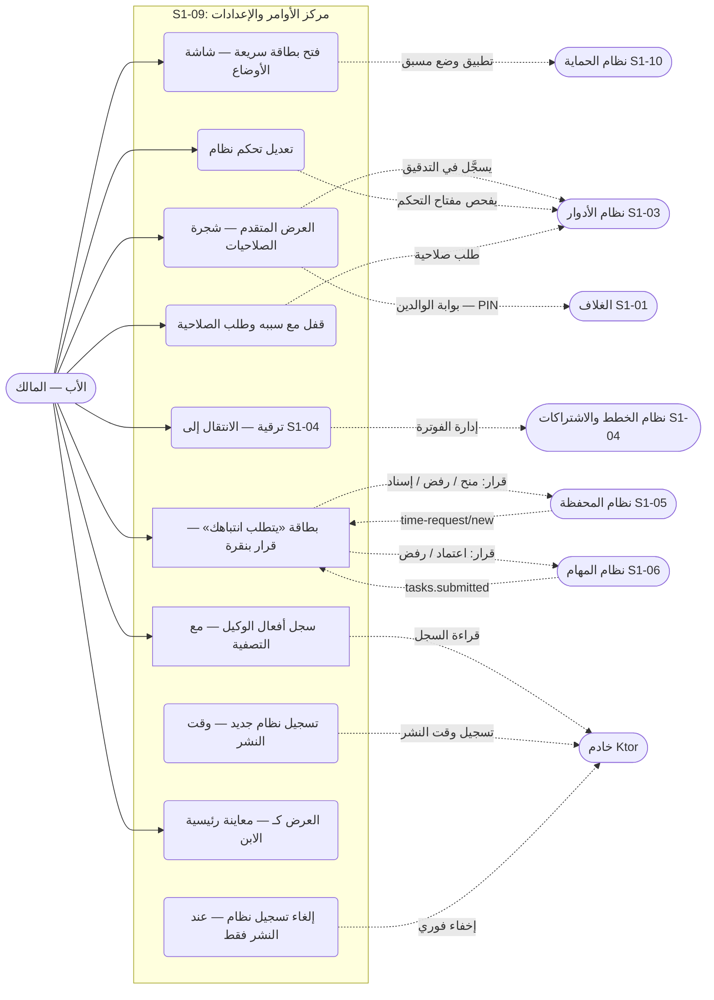

- يقرأ: ما يفعله الأب: البطاقات السريعة والعرض المتقدم والقفل والترقية وبطاقة الانتباه وسجل الوكيل والعرض كـ؛ وتسجيل الأنظمة وإلغاؤها وقت النشر.
- REQ-006 ← «العرض المتقدم» (UC6 — أُعيد 2026-11-19، دفعة الشكل 2).
- حافة UC6→S101: بوابة الوالدين — PIN أو بصمة.

### 1-ج. البالغ — اللوحة والحالة والتنبيهات

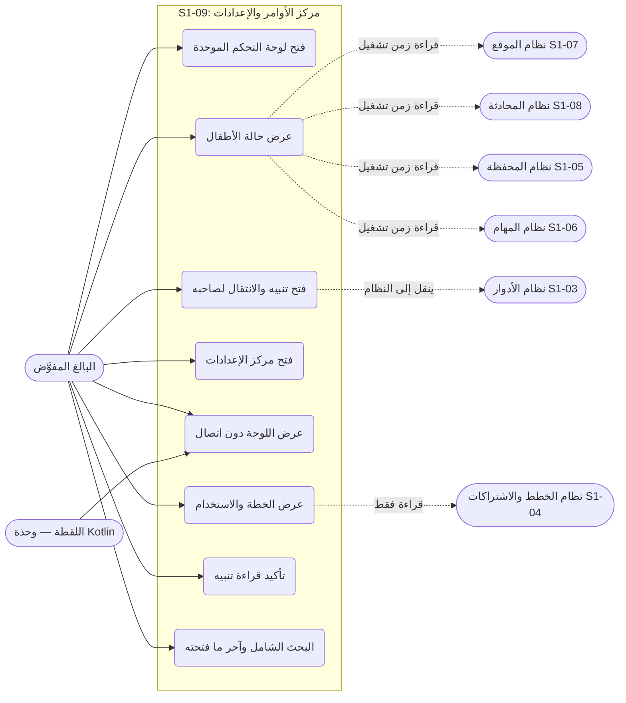

- يقرأ: ما يراه البالغ المفوَّض عند فتح المركز — مثل الأب، بقدر ما يملك من مفاتيح (UC2 يقرأ أربعة أنظمة، وUC3 يفحص المنح).

### 1-د. البالغ والطفل — القرارات والسجل والقفل

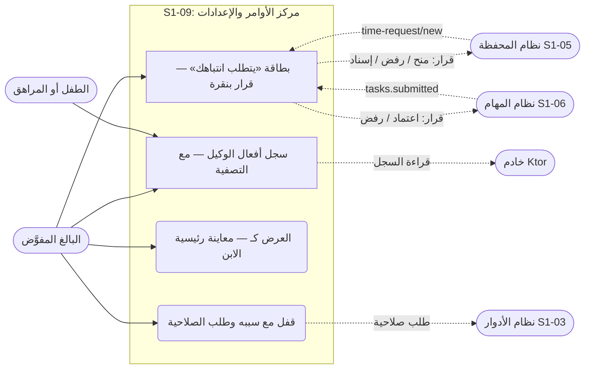

- يقرأ: ما يفعله البالغ المفوَّض من قرارات (بطاقة الانتباه، سجل الوكيل، العرض كـ، القفل)؛ والطفل أو المراهق يرى سجل أفعال الوكيل فقط.

أُعيد رسمه 2026-11-17 (Q-405): UC5 صارت «فتح بطاقة سريعة — شاشة الأوضاع» — البطاقة تفتح شاشة الأوضاع ولا تطبَّق بنقرة، وأُضيفت أوضاعي الخاصة وبطاقة «وضع جديد» إلى البطاقات السريعة.

أُعيد رسمه 2026-11-19 (Q-434 — Q-407 · Q-425 · Q-426 · Q-427): صارت 20 حالة: «العرض كـ» (UC17) والبحث الشامل و«آخر ما فتحته» (UC18) وقائمة الإعداد الأولي (UC19) والقفل مع سببه وطلبه (UC20)؛ وUC13 صارت عند النشر فقط بلا إجراء في شاشات الأب؛ وUC16 صارت مع التصفية؛ والفاعل «الطفل» صار «الطفل أو المراهق»؛ والأنظمة الخارجية صارت في جهة اليمين والفاعلون البشريون في جهة اليسار؛ وقُصّرت التسميات.

أُعيد تقسيمه 2026-11-19 (دفعة الشكل 2): قُسّمت اللوحة الواحدة (33 عقدة) إلى أربع لوحات حسب الفاعل — 1-أ و1-ب للأب، و1-ج للبالغ، و1-د للبالغ والطفل — بلا تغيير في المعنى؛ والأنظمة المجاورة مكررة بالاسم في كل لوحة تحتاجها.

- **المخفي والمقفل (Q-407):** في الرئيسية ما لا تستطيعه البالغة لا يظهر أصلاً، بلا أقفال. وفي «التحكم» و«صلاحياتي» يظهر مقفلاً مع سببه وزر طلبه (UC20). وما للمالك حصراً يظهر مقفلاً مع سببه.
- **الابن في UC16:** الطفل (كل ابن دون 13) والمراهق. يرى ما يخصه ونُفّذ فعلاً فقط، بجملة بكلماته؛ لا اقتراح معلّق ولا مرفوض (Q-407). لا قالب لدون 7 (Q-426).
- **«العرض كـ» (UC17):** الأب يرى رئيسية ابنه بقالب عمره، بشريط معاينة ثابت، بلا أي فعل وبلا نص رسالة؛ ولا يتحول إلى ابنه (DS-CC-09 · DS-NV-10 — Q-425).
- البالغ المفوَّض لا يظهر له UC5 وUC6 وUC7 وUC10 وUC15 إلا إن ملك مفتاح كل عنصر (REQ-004 · Q-096)؛ وUC15 للبالغ مشروط بأن يكون عنصر الانتباه مفوَّضاً به (H09-02 — يرى منه فقط ما فُوِّض به، ويقرر العنصر المفوَّض به وحده — H09-03)؛ والمركز لا يمنح صلاحيات — تعديل أي تحكم يتطلب مفتاح التحكم نفسه عبر S1-03 (§6-2).
- بطاقة "يتطلب انتباهك" (UC15 — REQ-017): تستهلك `family/{family_id}/tasks.submitted` (S1-06 REQ-015) و`family/{family_id}/time-request/new` (S1-05 REQ-014)؛ والأب يقرر بنقرة واحدة (منح / رفض / إسناد مهمة لطلب الوقت؛ اعتماد / رفض لمهمة مسلَّمة)؛ والبالغ المفوَّض بصلاحية القرار يقرر العنصر المفوَّض به وحده (Q-268) — انظر التسلسل 3-و.
- سجل أفعال الوكيل (UC16): يعرض `AgentActionLog` كاملاً للأب؛ والبالغ المفوَّض يرى منه ما يخص ما فُوِّض به (REQ-004)؛ والطفل (كل ابن دون 13) والمراهق يريان منه ما يخصهما ونُفّذ فعلاً فقط (G-006 · Q-407) — انظر التسلسل 3-ز.
- الحواف المنقطة عبر الأنظمة في §1 (قراءات الحالة، أحداث MQTT، القرارات بنقرة) هي حواف زمن تشغيل — قراءات وأحداث وقت التشغيل لا تبعيات بناء (Q-297)؛ فلا يبني S1-09 على S1-05/06/07/08/10 ولا يبنون عليه.
- الغلاف S1-01 يستضيف المركز (SPEC §1: «يعتمد على» + مخطط السياق)؛ والبطاقات السريعة (UC5) أوضاع S1-10 (REQ-007 — Q-405): دراسة / نوم / حر / أوضاعي الخاصة + بطاقة «وضع جديد» — تفتح شاشة الأوضاع حيث يُختار الطفل والمدة، ولا تطبَّق بنقرة.

## 2. مخطط قاعدة البيانات (ERD)

الجداول الأربعة الخاصة من §5 كما هي، مع خمسة مراجع خارجية: العائلة والعضوية (S1-02)، ومفتاح الصلاحية والمنح (S1-03)، والخطة (S1-04 — قراءة فقط). ملاحظتان: جدولا السجل (`dashboard_widget` و`control_surface`) مشتركان لكل العائلات بلا `family_id` (نفس المنطق المصحح في S1-03 §5)، و`dashboard_snapshot` لقطة واحدة لكل عائلة (PK = `family_id`). بيانات الأنظمة نفسها لا تُخزَّن هنا أبداً (REQ-002).

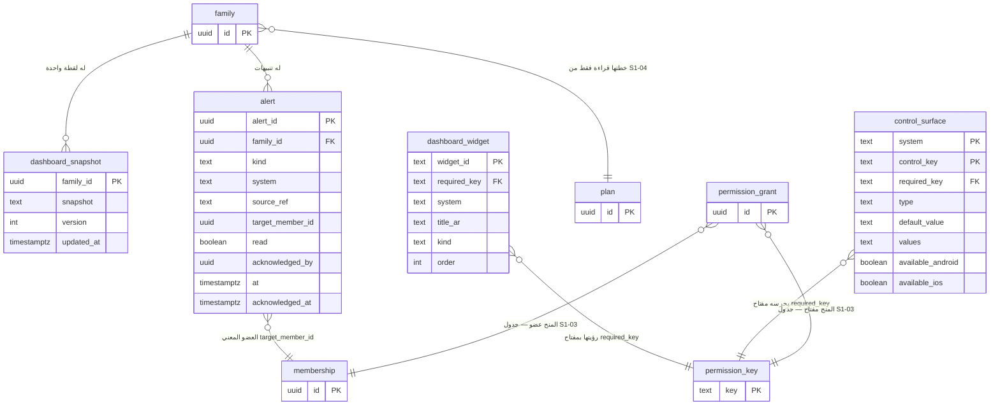

أُعيد رسمه 2026-11-19 (Q-434 — شكل فقط): ترتيب الحقول في كل جدول — الأساسي أولاً ثم الأجنبي ثم الحقول ثم التواريخ في الآخر — بلا تغيير في الحقول ولا العلاقات.

- `kind` في `dashboard_widget` من القيم الأربع فقط: `map` / `list` / `stat` / `alert` (§5-1)؛ و`kind` في `alert` من القيم الأربع فقط: `sos` / `escalation` / `grant_expiring` / `system` (§5-4)؛ و`type` في `control_surface` من القيم الثلاث فقط: `select` / `switch` / `action` (§5-2)؛ وأنواع هذا المخطط تتبع اتفاقية Q-177 (Q-267): يرسم `text` لما نوعه الحقيقي `jsonb` في §5 (`default_value`/`values`/`snapshot`)، و§5 مرجع الأنواع الحقيقية؛ وما عداها يطابق §5 حرفياً (`widget_id` نص، و`acknowledged_by` ‏`uuid`)؛ و`source_ref` في `alert` بصيغة `{system}:{kind}:{id}` (§5-4)؛ و`version` في `dashboard_snapshot` يزيده الخادم وحده (§5-3).

## 3. التسلسل (Sequence) — من عقود §4

عشرة مخططات، كل واحد لتدفق واحد:

### 3-أ. فتح اللوحة الموحدة (REQ-001/016 — §4-1 + §4-3)

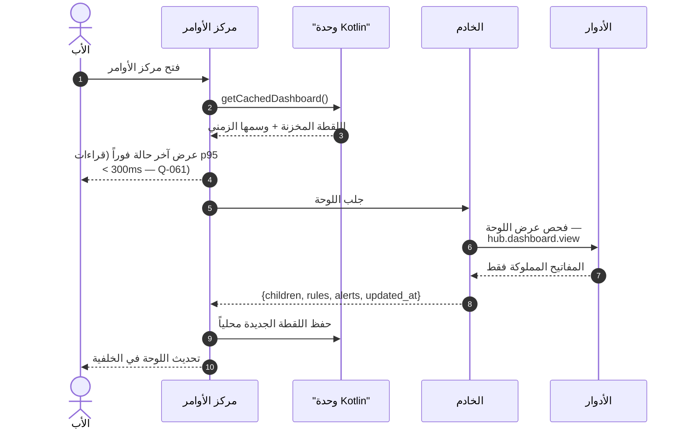
- الرسالة 5: `GET /api/v1/families/{id}/dashboard?since`.
- الرسالة 6: فحص hub.dashboard.view — تصفية الودجات عبر required_key.

أُعيد رسمه 2026-11-19 (Q-434 — شكل فقط): ترتيب المشاركين — المستخدم، ثم التطبيق (وحدة Kotlin المحلية)، ثم الخادم، ثم نظام الأدوار — بلا تغيير في الرسائل.

- الودجات المخفية لا تُرسَل للعميل أصلاً (§6-3)؛ واللقطة المخزنة تُعرض فوراً ثم يُحدَّث في الخلفية (REQ-016)؛ و`?since` طابع RFC 3339 UTC — بلا `since` لقطة كاملة، ومعه دلتا (المصفوفة الفارغة تعني «لا تغيير») — §4-1؛ واللقطة المحلية نسخة مخزنة من صف الخادم (`family_id`, `version`) لا سجل مستقل — والخادم وحده يكتب الصف (§5-3).

### 3-ب. تعديل تحكم نظام (REQ-004/008 — §4-1)

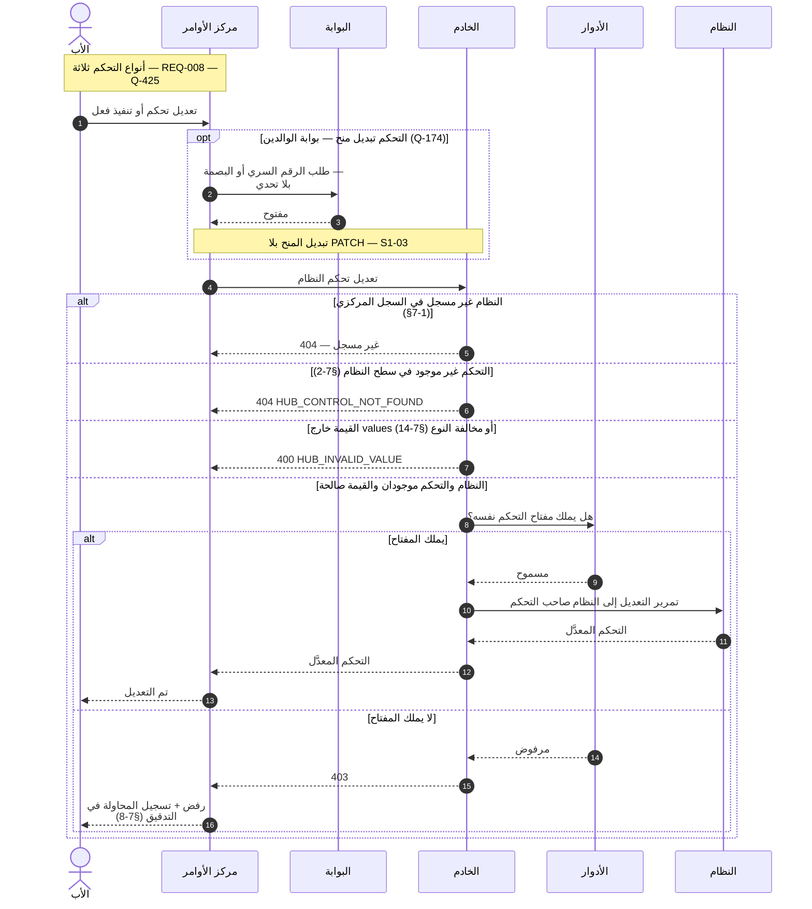
- الرسالة 1: تعديل تحكم (control_key, value) — أو تنفيذ فعل.
- الرسالة 2: طلب PIN الأب أو بصمته — بلا تحدي خادم.
- الرسالة 4: `PATCH /api/v1/families/{id}/settings/{system}`.
- الرسالة 5: 404 HUB_SYSTEM_NOT_REGISTERED + قائمة الأنظمة المسجلة.
- ملاحظة: أنواع التحكم ثلاثة (REQ-008 — Q-425): اختيار من قيم، مفتاح تشغيل وإيقاف، وفعل يُنفَّذ مرة — وما عداها يفتح شاشة خدمته.
- ملاحظة: تبديل المنح يُنفَّذ عبر S1-03 (`POST /api/v1/families/{id}/members/{memberId}/grants`) بلا challenge_id/signature — لا عبر PATCH.

أُعيد رسمه 2026-11-19 (Q-434): أنواع التحكم الثلاثة (اختيار/مفتاح/فعل — REQ-008 · Q-425) في ملاحظة فوق المخطط، والرسالة الأولى صارت تعديلاً أو تنفيذ فعل؛ وترتيب المشاركين — المستخدم، ثم التطبيق (البوابة المحلية)، ثم الخادم، ثم نظام الأدوار، ثم النظام صاحب التحكم.

- مفتاح `hub.settings.edit` وحده لا يمنح حق التعديل (§6-1)؛ وحالات رموز HUB: `HUB_SYSTEM_NOT_REGISTERED` و`HUB_CONTROL_NOT_FOUND` خطأا `404`، و`HUB_INVALID_VALUE` خطأ `400` (§4-4)؛ والتعارض المتزامن على نفس التحكم يُمرَّر إلى النظام صاحبه ويُحل بقواعده (مثال S1-03 REQ-019) — المركز لا يبت في التعارض (§7-9).

### 3-ج. تنبيه جديد وتأكيد قراءته (REQ-003 — §4-1 + §4-2)

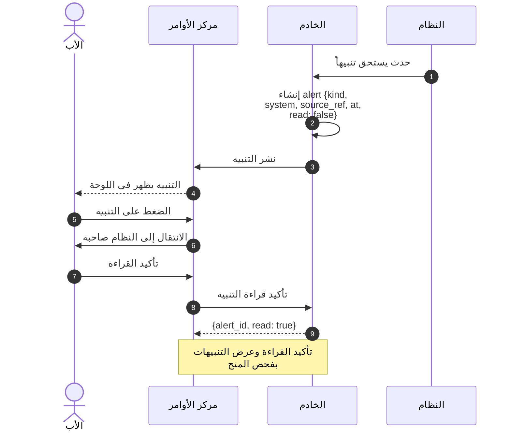
- الرسالة 1: حدث يستحق تنبيهاً (SOS / تصعيد / انتهاء منح).
- الرسالة 3: `MQTT family/{family_id}/alerts/new`.
- الرسالة 8: `POST /api/v1/families/{id}/alerts/{alertId}/acknowledge`.
- ملاحظة: تأكيد القراءة يفحص hub.alerts.acknowledge عبر S1-03؛ وعرض التنبيهات يفحص hub.alerts.view (§6-1).

أُعيد رسمه 2026-11-19 (Q-434 — شكل فقط): ترتيب المشاركين — المستخدم، ثم التطبيق، ثم الخادم، ثم النظام صاحب الحدث — بلا تغيير في الرسائل.

- تنبيه SOS يصل دون اتصال متأخراً عند عودة الاتصال مع وسمه الزمني الأصلي — لا يُعرض كأنه الآن (§7-10).

### 3-د. دون اتصال — اللقطة المخزنة (REQ-010/011 — §4-3)

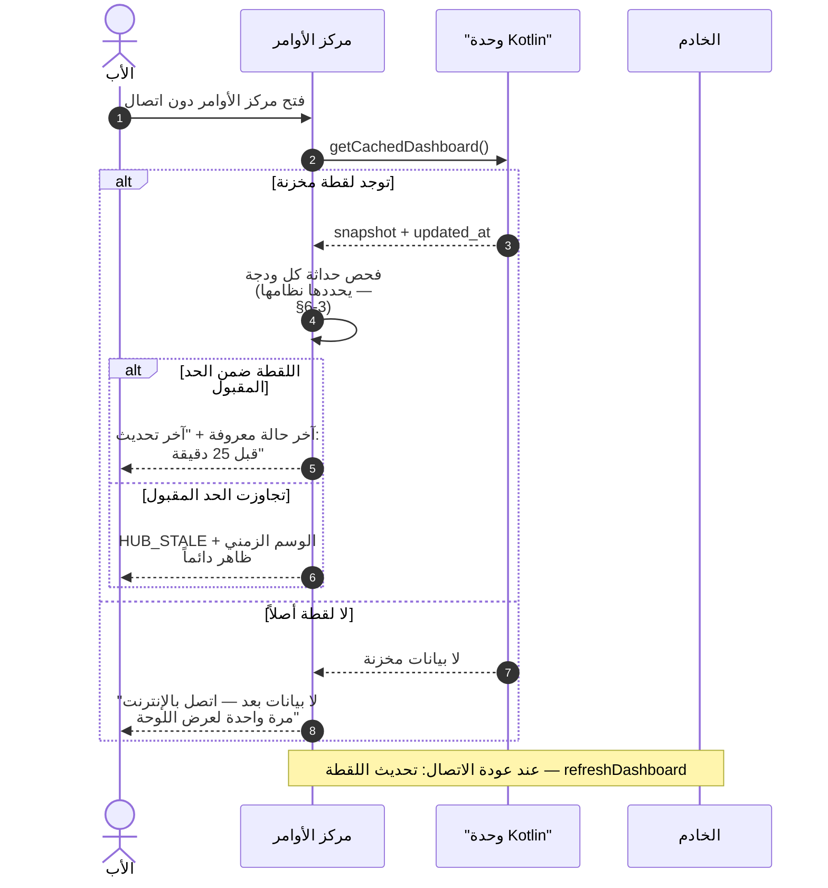

- "قبل 25 دقيقة" مثال من السيناريو 9-5؛ والبيانات القديمة لا تُعرض كأنها حية أبداً (§6-2)؛ واللقطة التالفة تُتجاهل وتُعاد من الخادم عند الاتصال (§7-12)؛ واللقطة المحلية نسخة مخزنة من صف الخادم (`family_id`, `version`) — والخادم وحده يكتب الصف ويزيد `version` (§5-3).

### 3-هـ. عرض الخطة والترقية (REQ-012/013 — §4-1)

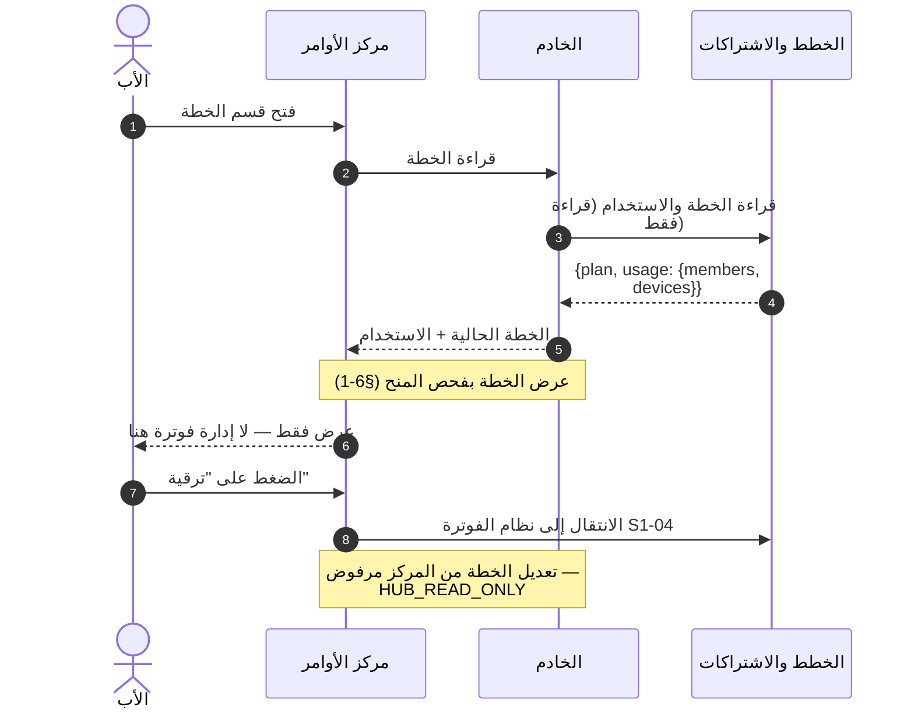
- الرسالة 2: `GET /api/v1/families/{id}/plan`.
- ملاحظة: عرض الخطة يفحص hub.plan.view عبر S1-03 (§6-1).
- ملاحظة: أي محاولة تعديل للخطة من المركز → HUB_READ_ONLY + رابط الانتقال إلى S1-04 (§9-2).

### 3-و. بطاقة "يتطلب انتباهك" — قرار الأب — أو البالغ المفوَّض للعنصر المفوَّض به — بنقرة واحدة (REQ-017 · Q-268 · S1-05 REQ-014 · S1-06 REQ-015 — §4-2)

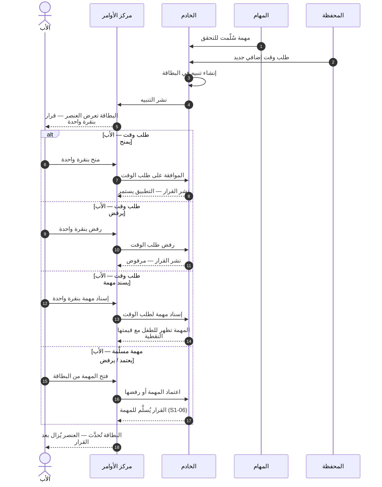
- الرسالة 1: `family/{family_id}/tasks.submitted` — مهمة سُلّمت للتحقق.
- الرسالة 2: `family/{family_id}/time-request/new` — طلب وقت إضافي جديد.
- الرسالة 3: إنشاء alert في بطاقة "يتطلب انتباهك" (kind=system).
- الرسالة 4: `MQTT family/{family_id}/alerts/new`.
- الرسالة 7: `POST /api/v1/families/{id}/children/{childId}/time-requests/{requestId}/decide {APPROVED}`.
- الرسالة 8: `family/{family_id}/time-request/decided` — التطبيق يستمر.
- الرسالة 10: `POST /api/v1/families/{id}/children/{childId}/time-requests/{requestId}/decide {REJECTED}`.
- الرسالة 11: `family/{family_id}/time-request/decided` — مرفوض.
- الرسالة 13: `POST /api/v1/families/{id}/children/{childId}/time-requests/{requestId}/decide {TASK_ASSIGNED, assigned_task_id}`.
- الرسالة 16: `POST /api/v1/families/{id}/tasks/{taskId}/occurrences/{occurrenceId}/approve {APPROVE / REJECT_WITH_NOTES}`.

أُعيد رسمه 2026-11-19 (Q-434 — شكل فقط): ترتيب المشاركين — المستخدم، ثم التطبيق، ثم الخادم، ثم نظاما المهام والمكافآت — بلا تغيير في الرسائل.

- والبالغ المفوَّض يتبع التدفق نفسه للعنصر المفوَّض به وحده (Q-268)؛ ويُفحص قراره بمفتاح نظام العنصر في S1-05/S1-06.

- المصدران: S1-05 REQ-014 (طلب الوقت الإضافي يظهر في البطاقة؛ والأب يقرر بنقرة واحدة) وS1-06 REQ-015 (`family/{family_id}/tasks.submitted` → البطاقة)؛ والموضوع الوارد الثالث `family/{family_id}/permissions/grant-expiring` (S1-03 §4-2 — Q-227) ينشئ تنبيه `kind=grant_expiring` بالمرجع نفسه (`source_ref`)؛ والبطاقة نفسها تُعرض في S1-09 وتُدفع أحداثها عبر `family/{family_id}/alerts/new` (§4-2). والبالغ المفوَّض يرى في البطاقة فقط ما فُوِّض به (Q-096) — الباقي مخفي تماماً.

### 3-ز. عرض سجل أفعال الوكيل — شفافية الذكاء (REQ-018 — §4-1)

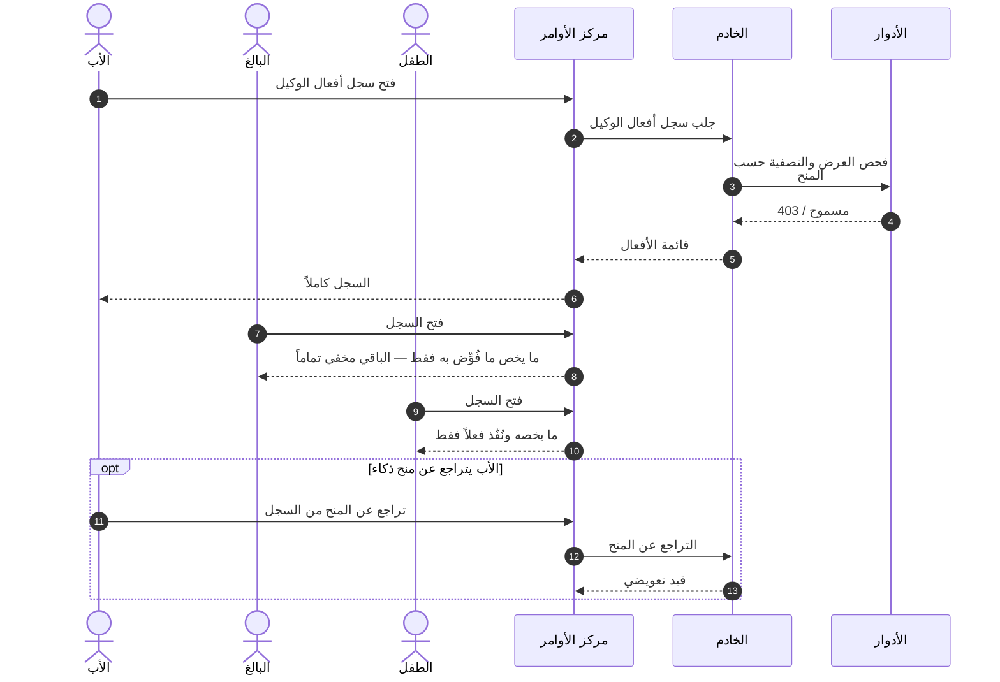
- الرسالة 1: فتح سجل أفعال الوكيل — ويصفّي بالفرد، وبنوع الفعل والمدة من ورقة «تصفية».
- الرسالة 2: `GET /api/v1/families/{id}/agent-actions?member_id&action&from&to`.
- الرسالة 3: فحص hub.dashboard.view + تصفية حسب المنح (deny-override — Q-007).
- الرسالة 5: الأفعال — [{action_id, agent_key, gate, approval, result, at, evidence, reverse}].
- الرسالة 6: السجل كاملاً — كل فعل مع مفتاحه وبوابته ودليله ونتيجته ومسار تراجعه.
- الرسالة 10: ما يخصه ونُفّذ فعلاً فقط — بجملة بكلماته — لا معلّق ولا مرفوض (G-006 · Q-407).
- الرسالة 12: `POST .../wallet/grants/{grantId}/reverse` (S1-05).
- الرسالة 13: قيد تعويضي — حدث `family/{family_id}/tasks.verification-revoked`.

أُعيد رسمه 2026-11-19 (Q-434): التصفية بالفرد ونوع الفعل والمدة من ورقة «تصفية» (`ai-filter` — Q-427) في الرسالة الأولى وعقدة القراءة؛ والابن يرى ما يخصه ونُفّذ فعلاً فقط، بجملة بكلماته، لا معلّق ولا مرفوض (Q-407).

- المصدر: عقد التحقق Q-167 §3 (`AgentActionLog`) + S1-09 REQ-018 (Q-173)؛ والتراجع نقطة S1-05 (S1-05 REQ-018)؛ والتصفية الخادمية عبر S1-03 (REQ-004 · Q-007). والبوابات الخمس والمفاتيح السبعة مرجعها عقد التحقق §1/§2 — وكل فعل معروض يحمل مفتاحه وبوابته (REQ-018). والترقيم: `limit` افتراضي 50 وأقصى 100، والأحدث أولاً، و`next_cursor` للصفحة التالية (§4-1)؛ و`member_id` لغير المالك على عضو آخر → `403` بلا استبدال صامت (§7-15)؛ وبلا `member_id` يُفرض معرّف المتصل.

### 3-ح. تسجيل نظام جديد وقت النشر — وظهوره وإلغاؤه (REQ-014/015 — §4-1)

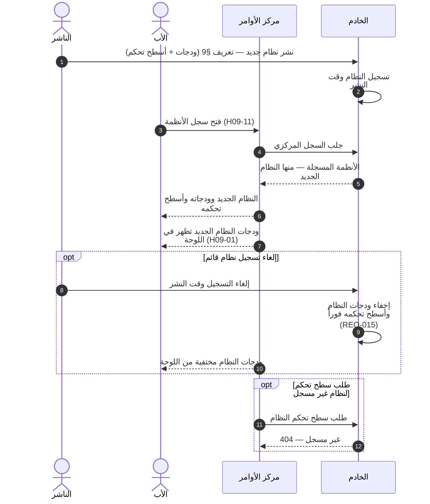
- الرسالة 2: تسجيل النظام في السجل المركزي وقت النشر — بلا نقطة تسجيل وقت تشغيل.
- الرسالة 4: `GET /api/v1/families/{id}/settings/registry`.
- الرسالة 10: ودجات النظام مختفية من اللوحة؛ وتنبيهاته السابقة تبقى ظاهرة مع اسم النظام (§7-5).
- الرسالة 11: `GET /api/v1/families/{id}/settings/{system}`.
- الرسالة 12: 404 HUB_SYSTEM_NOT_REGISTERED + قائمة الأنظمة المسجلة (§7-1).

أُعيد رسمه 2026-11-19 (Q-434 — شكل فقط): ترتيب المشاركين — الناشر والأب، ثم التطبيق، ثم الخادم — بلا تغيير في الرسائل.

- المحفز: النشر (deploy) بتعريف §9 للنظام؛ والفاعل: الناشر — بلا شاشة تسجيل وبلا نقطة تسجيل وقت تشغيل (سطح هجوم غير ضروري — §4-1)؛ وإلغاء التسجيل يخفي الودجات والأسطح فوراً بينما تبقى التنبيهات السابقة سجل تدقيق (§7-5).

### 3-ط. «العرض كـ» — معاينة رئيسية الابن (DS-CC-09 · DS-NV-10 — Q-425)

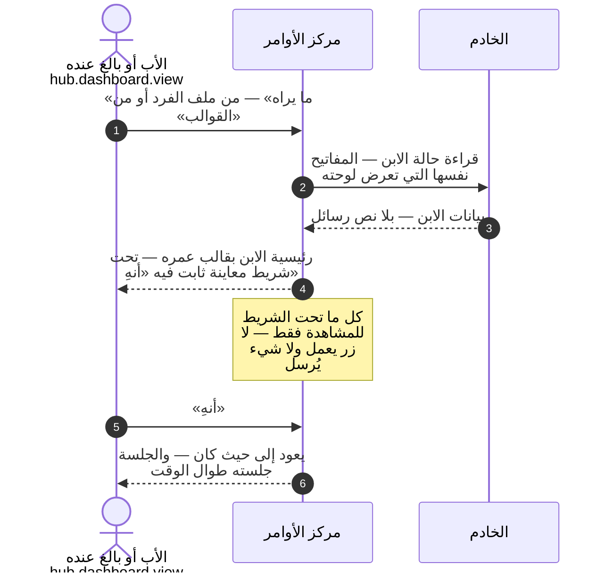

رُسم 2026-11-19 (Q-434 — Q-425): مخطط جديد — السطح `view-as` (§9-8 هـ).

- الأب لا يتحول إلى ابنه ولا يدخل بحسابه: المعاينة عرض على هاتف الأب فقط، ولا تُسجَّل فعلاً للابن.

### 3-ي. البحث الشامل في الإعدادات و«آخر ما فتحته» (H09-14 — Q-407 · Q-427)

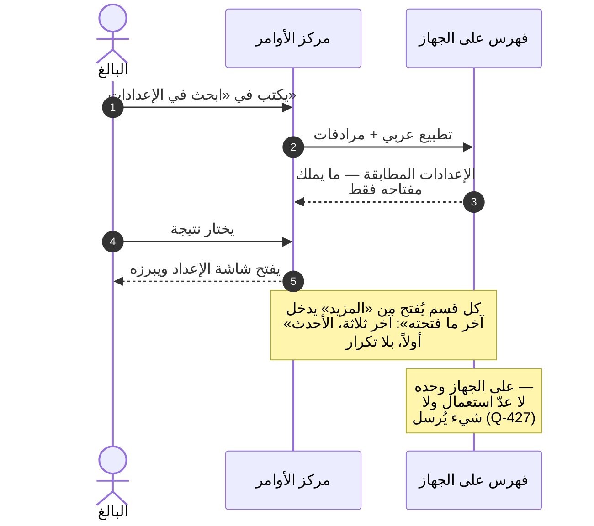
- الرسالة 2: تطبيع عربي + مرادفات — «السهر» يجد نافذة النوم — ويتجاهل «ال» التعريف.

رُسم 2026-11-19 (Q-434 — Q-427): مخطط جديد — البحث الشامل و«آخر ما فتحته» في أعلى «المزيد» (H09-14).

- «الأكثر استعمالاً» ليس في المرحلة 1 (Q-427). و«الخدمات» تظهر في القائمة وفي البحث للمالك وحده.

## 4. تدفق المستخدم (User Flow) — من السيناريوهات الستة (§2)

### 4-أ. فتح المركز واللوحة وبطاقة الانتباه

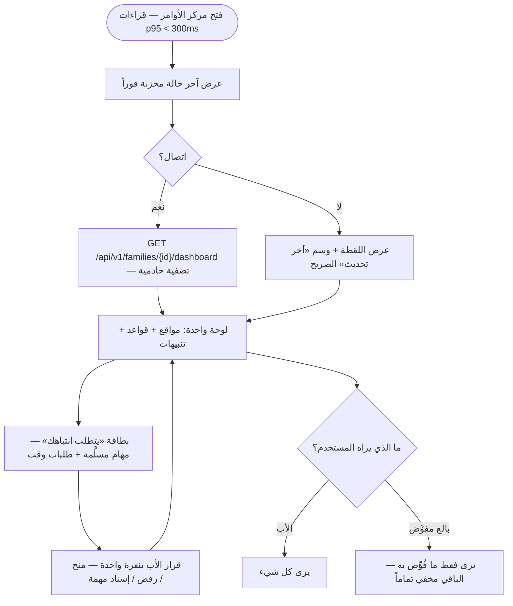

### 4-ب. الإجراءات من اللوحة

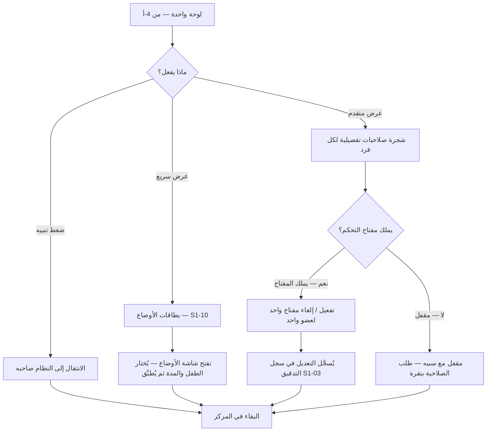

- يقرأ: من اللوحة إلى الإجراءات: التنقل، والبطاقات السريعة، والعرض المتقدم مع القفل.
- بطاقات الأوضاع: دراسة / نوم / حر / أوضاعي الخاصة + وضع جديد.
- أُعيد تقسيمه 2026-11-19 (دفعة الشكل 2): قُسّم مخطط 4-ب (19 عقدة) إلى ثلاث لوحات — 4-ب للإجراءات من اللوحة (11 عقدة)، و4-ج للخطة والترقية (5 عقد)، و4-د لمركز الإعدادات (7 عقد) — بلا تغيير في المعنى.

### 4-ج. الخطة والترقية

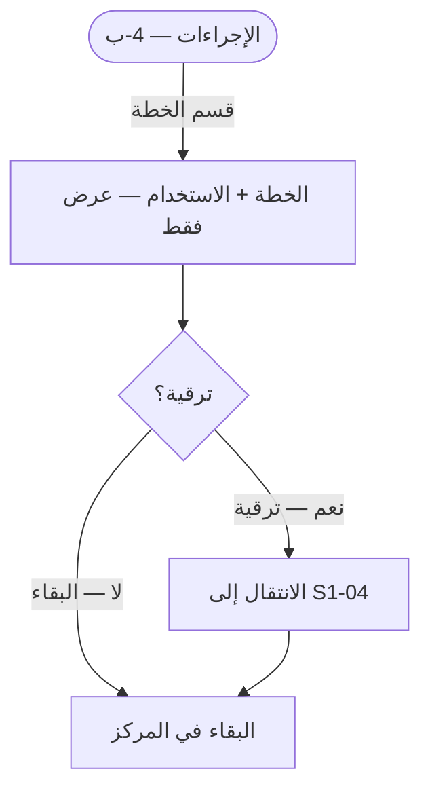

- يقرأ: قسم الخطة يعرض الخطة والاستخدام (عرض فقط)؛ والترقية تنتقل إلى نظام الفوترة.

- يقرأ: من اللوحة إلى الإجراءات: التنقل، والبطاقات السريعة، والعرض المتقدم مع القفل، والخطة مع الترقية.
- بطاقات الأوضاع: دراسة / نوم / حر / أوضاعي الخاصة + وضع جديد.
- أُعيد تقسيمه 2026-11-19 (دفعة الشكل 2): قُسّم مخطط 4-ب (19 عقدة) إلى لوحتين — 4-ب للإجراءات من اللوحة، و4-ج لمركز الإعدادات — بلا تغيير في المعنى.

### 4-د. مركز الإعدادات

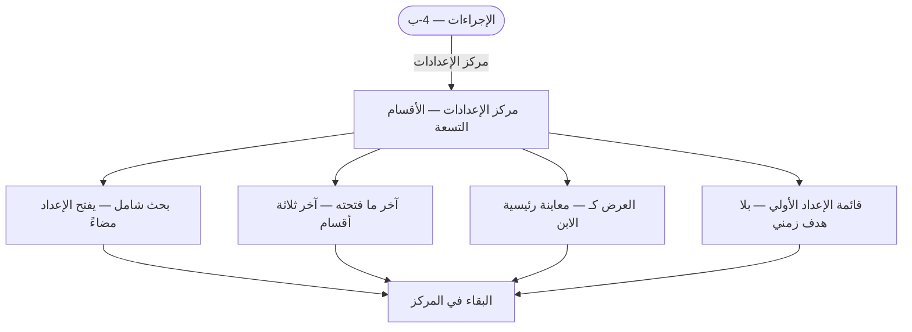

- يقرأ: مركز الإعدادات: البحث الشامل و«آخر ما فتحته» و«العرض كـ» وقائمة الإعداد الأولي — وكلها تنتهي بالبقاء في المركز.

أُعيد رسمه 2026-11-17 (Q-405): البطاقات السريعة صارت دراسة / نوم / حر / أوضاعي الخاصة + وضع جديد، وتفتح شاشة الأوضاع (اختيار الطفل والمدة ثم التطبيق) بدل التطبيق بنقرة.

أُعيد رسمه 2026-11-19 (Q-434): قُسّم المخطط الواحد (22 عقدة) إلى لوحتين — 4-أ الفتح واللوحة وبطاقة الانتباه (11 عقدة)، و4-ب الإجراءات ومركز الإعدادات (19 عقدة)؛ وأُضيف إلى 4-ب فرع القفل مع سببه وطلبه (Q-402)، وفرع مركز الإعدادات: البحث الشامل و«آخر ما فتحته» و«العرض كـ» وقائمة الإعداد الأولي (Q-424 · Q-425 · Q-427). والمسار السعيد في كل لوحة عمود واحد مستقيم؛ والفروع تخرج إلى جهة واحدة.

أُعيد تقسيمه 2026-11-19 (دفعة الشكل 2): قُسّم مخطط 4-ب (19 عقدة) إلى ثلاث لوحات — 4-ب للإجراءات من اللوحة (11 عقدة)، و4-ج للخطة والترقية (5 عقد)، و4-د لمركز الإعدادات (7 عقد) — بلا تغيير في المعنى.

- ملاحظة: البطاقات السريعة إعدادات وضع مسبقة يملكها نظام الحماية S1-10 — دراسة / نوم / حر / أوضاعي الخاصة + وضع جديد (REQ-007 — Q-405)؛ والبطاقة تفتح شاشة الأوضاع حيث يُختار الطفل والمدة، ولا تطبَّق بنقرة. وتطبيق قالب صلاحيات Q-089 (شريك/وصي محدود/مراقب) إجراء منفصل في المركز، لا بطاقة سريعة. وتبديل الملفات غير موجود في أي مسار — مؤجل للمرحلة 2 (Q-063).

## 5. مخطط تدفق البيانات (DFD — المستوى 1) — من §4/§5

العمليات مرقمة 1.0–7.0، والمخازن D1–D4. المخزنان D1 وD2 سجلان مشتركان بلا `family_id`؛ والمخزنان D3 وD4 يحملان `family_id` + عزل RLS (D-021). ومخزن خارجي واحد: `AgentActionLog` — ملك عقد التحقق (Q-167 §3)، لا جدول جديد في S1-09 (§5-5) — تقرؤه P7 عبر Ktor. التسجيل في السجل يتم وقت النشر من تعريف §9 لكل نظام — لا نقطة تسجيل وقت التشغيل (§4-1).

- **تغطية نقاط §4:** التسلسلات في §3 تغطي التدفقات الأساسية فقط؛ وكل نقطة §4-1 تظهر هنا على الأقل: `GET /api/v1/families/{id}/alerts` (قائمة التنبيهات — REQ-003، تُقرأ عبر P5) · `GET /api/v1/families/{id}/settings/registry` (السجل المركزي — REQ-005، تُقرأ عبر P3) · `GET /api/v1/families/{id}/settings/{system}` (سطح تحكم نظام واحد — REQ-008، تُقرأ عبر P3) · `GET /api/v1/families/{id}/agent-actions?member_id&action&from&to` (سجل أفعال الوكيل — REQ-018، تُقرأ عبر P7؛ والتصفية بالفرد ونوع الفعل والمدة من ورقة `ai-filter` — Q-427)؛ وبقية النقاط مرسومة في §3 (dashboard، settings PATCH، plan، alerts acknowledge). والبحث الشامل و«آخر ما فتحته» على الجهاز وحده (فهرس محلي — بلا مخزن خادم جديد — Q-427).

### 5-أ. عرض اللوحة (P1)

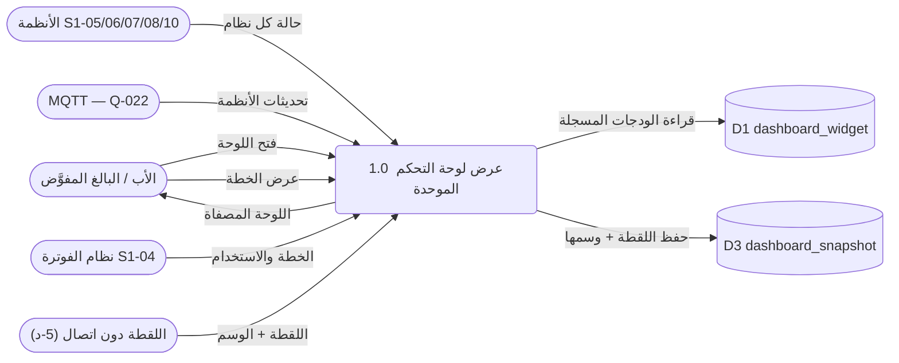

- يقرأ: الأب يفتح اللوحة؛ والودجات تُقرأ من D1 وتُصفَّى حسب المنح (5-ب)؛ والأنظمة واللقطة دون اتصال وMQTT والخطة تدخل العرض.
- أُعيد تقسيمه 2026-11-19 (دفعة الشكل 2): قُسّمت لوحة 5-أ (14 عقدة) إلى لوحتين — 5-أ لعرض اللوحة (8 عقد)، و5-ب لفحص المنح والتصفية (4 عقد) — بلا تغيير في المعنى؛ وعقدة الإشارة P2x حُذفت من 5-أ لأن حافتها العائدة (P2x→P1) أضافت رتبة كاملة للعرض، وخطوة التصفية مرسومة كاملة في 5-ب (D1x→P2→P1x) ويشير إليها سطر القراءة.
- حافة Systems→P1: حالة كل نظام — قراءة زمن تشغيل.
- حافة MQTT→P1: dashboard/updated + alerts/new.
- حافة S104→P1: الخطة + الاستخدام — قراءة فقط.

### 5-ب. فحص المنح والتصفية (P2)

```mermaid
flowchart LR
    S103([نظام الأدوار S1-03])
    P2(2.0 محرك الرؤية — تصفية حسب المنح)
    D1x(["قراءة الودجات المسجلة (5-أ)"])
    P1x(["عرض اللوحة (5-أ)"])
    D1x -->|الودجات + required_key| P2
    S103 -->|المنح المملوكة| P2
    P2 -->|الودجات المسموحة فقط| P1x
```

- يقرأ: الودجات تُفحص حسب المنح المملوكة في S103؛ ولا يصل اللوحة إلا المسموح.

- يقرأ: الأب يفتح اللوحة؛ وP2 يصفّي الودجات حسب المنح؛ والأنظمة واللقطة دون اتصال وMQTT والخطة تدخل العرض.
- أُعيد تقسيمه 2026-11-19 (دفعة الشكل 2): قُسّمت لوحة 5-أ (14 عقدة) إلى ثلاث لوحات — 5-أ لعرض اللوحة، و5-ب للتنبيهات، و5-ج للقطة دون اتصال — بلا تغيير في المعنى.

### 5-ج. التنبيهات (P5)

```mermaid
flowchart LR
    Father([الأب / البالغ المفوَّض])
    Systems([الأنظمة S1-05/06/07/08/10])
    P5(5.0 إدارة التنبيهات)
    D4[(D4 alert)]
    P1x(["عرض اللوحة (5-أ)"])
    Systems -->|التنبيهات والأحداث| P5
    Systems -->|tasks.submitted + time-request/new| P5
    P5 -->|حفظ التنبيه| D4
    D4 -->|قائمة التنبيهات| P5
    Father -->|تأكيد قراءة تنبيه| P5
    P5 -->|عناصر بطاقة يتطلب انتباهك| P1x
    P5 -->|التنبيهات في اللوحة| P1x
```

- يقرأ: الأنظمة ترسل التنبيهات والأحداث إلى P5؛ وP5 يحفظها في D4 ويعرضها في اللوحة؛ والأب يؤكد قراءتها.

### 5-د. اللقطة دون اتصال (P6)

```mermaid
flowchart LR
    Kotlin([اللقطة — وحدة Kotlin])
    P6(6.0 اللقطة دون اتصال + التحديث)
    D3[(D3 dashboard_snapshot)]
    Ktor([خادم Ktor])
    P1x(["عرض اللوحة (5-أ)"])
    D3 -->|آخر حالة معروفة| P6
    Kotlin -->|getCachedDashboard| P6
    P6 -->|اللقطة + الوسم| P1x
    P6 -->|refreshDashboard عند عودة الاتصال| Ktor
```

- يقرأ: دون اتصال، وحدة Kotlin تقرأ اللقطة من D3 وتعرضها؛ وعند عودة الاتصال تُحدَّث من الخادم.

### 5-هـ. السجل المركزي والتحكمات (P3+P4)

```mermaid
flowchart LR
    Father([الأب / البالغ المفوَّض])
    S103([نظام الأدوار S1-03])
    Systems([الأنظمة S1-05/06/07/08/10])
    P3(3.0 إدارة السجل المركزي)
    P4(4.0 تعديل تحكمات الأنظمة)
    D2[(D2 control_surface)]
    Father -->|فتح مركز الإعدادات| P3
    P3 -->|قراءة الأسطح المسجلة| D2
    D2 -->|الأسطح + التوفر Android/iOS| P3
    P3 -->|العرض السريع ثم المتقدم| Father
    Father -->|تعديل تحكم| P4
    P4 -->|فحص مفتاح التحكم| S103
    S103 -->|مسموح / 403| P4
    P4 -->|تمرير التعديل| Systems
```

- يقرأ: الأب يسجّل الأنظمة في السجل المركزي ويلغيها؛ ويعدّل تحكماتها بعد فحص المفاتيح في S1-03.
- REQ-009 ← «الأسطح + التوفر» (حافة D2→P3 — أُعيد 2026-11-19، دفعة الشكل 2).
- أُعيد تقسيمه 2026-11-19 (دفعة الشكل 2): قُسّمت لوحة 5-ب القديمة (9 عقد) إلى لوحتين — 5-د للسجل المركزي والتحكمات، و5-هـ لسجل الوكيل — بلا تغيير في المعنى.

### 5-و. سجل الوكيل (P7)

```mermaid
flowchart LR
    Father([الأب / البالغ المفوَّض])
    S103([نظام الأدوار S1-03])
    P7(7.0 عرض سجل أفعال الوكيل)
    Ktor([خادم Ktor])
    ExtLog[(مخزن خارجي — AgentActionLog)]
    Father -->|عرض سجل أفعال الوكيل| P7
    P7 -->|فحص المنح والتصفية| S103
    S103 -->|مسموح / 403| P7
    P7 -->|قراءة السجل| Ktor
    Ktor -->|قراءة من المخزن| ExtLog
    ExtLog -->|الأفعال ومرفقاتها| Ktor
    Ktor -->|السجل| P7
    P7 -->|السجل المصفى| Father
```

- يقرأ: الأب يفتح سجل أفعال الوكيل؛ وP7 يفحص المنح في S1-03 ثم يجلب السجل من المخزن الخارجي عبر الخادم.
- مخزن خارجي: AgentActionLog — عقد التحقق Q-167 §3 — لا جدول جديد هنا.
- حافة P7→S103: فحص hub.dashboard.view + تصفية حسب المنح.
- حافة Ktor→ExtLog: قراءة من مخزن عقد التحقق.
- حافة ExtLog→Ktor: الأفعال + المفتاح + البوابة + الدليل + النتيجة.

أُعيد رسمه 2026-11-19 (Q-434 — شكل فقط): قُسّم المخطط الواحد (19 عقدة في شريط أفقي واحد) إلى لوحتين بلا صناديق — 5-أ عرض اللوحة والتنبيهات واللقطة (14 عقدة)، و5-ب السجل المركزي والتحكمات وسجل الوكيل (10 عقدة) — لأن اتجاه TB داخل الصناديق لا يكدّس العقد في mermaid 11؛ والعقد والعمليات والمخازن والتدفقات نفسها قبل وبعد، والسجل المصفى من P7 يُعرض للمستخدم في لوحته (P1 — في 5-أ).

أُعيد تقسيمه 2026-11-19 (دفعة الشكل 2): قُسّمت لوحتا 5-أ و5-ب إلى ست لوحات — لوحة لكل عملية: 5-أ عرض اللوحة (8 عقد)، و5-ب فحص المنح والتصفية (4 عقد)، و5-ج التنبيهات (5 عقد)، و5-د اللقطة دون اتصال (5 عقد)، و5-هـ السجل المركزي والتحكمات (6 عقد)، و5-و سجل الوكيل (5 عقد) — بلا تغيير في المعنى.

## 6. مخطط النشاط (Activity) — دورة حياة استخدام المركز

المسارات الأربعة (المستخدم / المركز — Flutter / الخادم — Ktor / الأنظمة + S1-03) في ثماني لوحات: 6-أ الفتح واللوحة، و6-ب الضغط على تنبيه، و6-ج بطاقة الانتباه، و6-د البطاقات السريعة والعرض المتقدم، و6-هـ تطبيق التعديل والقفل، و6-و الخطة، و6-ز سجل الوكيل، و6-ح مركز الإعدادات. ودفع MQTT والتحديث الخلفي للقطة يعملان **بالتوازي** مع استخدام المركز.

### 6-أ. فتح المركز واللوحة

```mermaid
flowchart TD
    subgraph User [المستخدم — الأب / البالغ المفوَّض]
        direction TB
        U1([فتح مركز الأوامر])
        U2[الاطلاع على اللوحة]
        U7([إغلاق المركز])
    end
    subgraph Hub [المركز — Flutter]
        direction TB
        H1[عرض اللقطة المخزنة فوراً]
        H2{اتصال؟}
        H3[جلب اللوحة + تصفية خادمية]
        H4["عرض اللوحة + وسم «آخر تحديث»"]
    end
    subgraph Server [الخادم — Ktor]
        direction TB
        V1[جلب اللوحة من الخادم]
    end
    subgraph Systems [الأنظمة + S1-03]
        direction TB
        G1[فحص المنح — deny-override]
    end
    U1 --> H1
    H1 --> H2
    H2 -->|نعم — متصل| H3
    H2 -->|لا — دون اتصال| H4
    H3 --> V1
    V1 --> G1
    G1 --> V1
    V1 --> H4
    H4 --> U2
    H4 --> U7
```

- يقرأ: فتح المركز يعرض اللقطة المحفوظة فوراً، ثم يجلب اللوحة من الخادم عند الاتصال؛ وتحديثات MQTT تصل اللوحة في الخلفية (6-ج).
- H3 وV1: `GET /api/v1/families/{id}/dashboard`.
- أُعيد تقسيمه 2026-11-19 (دفعة الشكل 2): قُسّمت لوحة 6-أ (17 عقدة) إلى ثلاث لوحات — 6-أ لفتح المركز واللوحة (9 عقد)، و6-ب للضغط على تنبيه (6 عقد)، و6-ج لبطاقة الانتباه (5 عقد) — بلا تغيير في المعنى؛ وتحديث MQTT يعيش في 6-ج لا في 6-أ.

### 6-ب. الضغط على تنبيه

```mermaid
flowchart TD
    subgraph User [المستخدم — الأب / البالغ المفوَّض]
        direction TB
        U2x[الاطلاع على اللوحة — 6-أ]
        U3[ضغط تنبيه]
        U8[تأكيد قراءة التنبيه]
    end
    subgraph Hub [المركز — Flutter]
        direction TB
        H5[الانتقال إلى النظام صاحب التنبيه]
        H12[تأكيد قراءة التنبيه — POST acknowledge]
    end
    subgraph Server [الخادم — Ktor]
        direction TB
        V3[تأكيد قراءة التنبيه]
    end
    U2x --> U3
    U3 --> H5
    U8 --> H12
    H12 --> V3
```

- يقرأ: الضغط على تنبيه ينتقل إلى نظامه ويؤكد قراءته.
- V3: `POST /api/v1/families/{id}/alerts/{alertId}/acknowledge`.
- أُعيد تقسيمه 2026-11-19 (دفعة الشكل 2): قُسّمت لوحة 6-ب القديمة (10 عقد) إلى لوحتين — 6-ب للضغط على تنبيه (6 عقد)، و6-ج لبطاقة الانتباه (5 عقد) — بلا تغيير في المعنى.

### 6-ج. بطاقة الانتباه

```mermaid
flowchart TD
    subgraph User [المستخدم — الأب / البالغ المفوَّض]
        direction TB
        U2x[الاطلاع على اللوحة — 6-أ]
    end
    subgraph Hub [المركز — Flutter]
        direction TB
        H10["بطاقة «يتطلب انتباهك» — قرار بنقرة واحدة"]
        H4x["عرض اللوحة (6-أ)"]
    end
    subgraph Server [الخادم — Ktor]
        direction TB
        V6[قرار بنقرة]
        V5[تحديث اللوحة — MQTT]
    end
    U2x --> H10
    H10 --> V6
    V6 --> H4x
    V5 --> H4x
```

- يقرأ: بطاقة «يتطلب انتباهك» تعرض العناصر وتسلّم القرار بنقرة؛ وتحديثات MQTT تعرض اللوحة.
- V5: `MQTT: family/{family_id}/dashboard/updated + family/{family_id}/alerts/new`.
- V6: قرار بنقرة — POST decide + approve (الرسائل 7 و10 و13 و16 في 3-و).

- يقرأ: الضغط على تنبيه ينتقل إلى نظامه ويؤكد قراءته؛ وبطاقة «يتطلب انتباهك» تعرض العناصر وتسلّم القرار بنقرة؛ وتحديثات MQTT تعرض اللوحة.
- V3: `POST /api/v1/families/{id}/alerts/{alertId}/acknowledge`.
- V5: `MQTT: family/{family_id}/dashboard/updated + family/{family_id}/alerts/new`.
- V6: قرار بنقرة — POST decide + approve (الرسائل 7 و10 و13 و16 في 3-و).

### 6-د. البطاقات السريعة والعرض المتقدم

```mermaid
flowchart TD
    subgraph User [المستخدم — الأب / البالغ المفوَّض]
        direction TB
        U4[فتح بطاقة سريعة]
        U5[تعديل في العرض المتقدم]
    end
    subgraph Hub [المركز — Flutter]
        direction TB
        H6[فتح شاشة الأوضاع واختيار الطفل والمدة — S1-10]
        H7[عرض شجرة الصلاحيات]
        H17{يملك مفتاح هذا التحكم؟}
        H11[يفعّل / يلغي مفتاحاً واحداً لعضو واحد]
        H18[مقفل مع سببه — طلب الصلاحية بنقرة]
    end
    subgraph Server [الخادم — Ktor]
        direction TB
        V9[تطبيق الوضع — S1-10]
    end
    U4 --> H6
    H6 --> V9
    U5 --> H7
    H7 --> H17
    H17 -->|نعم — يملك المفتاح| H11
    H17 -->|لا — مقفل| H18
```

- يقرأ: البطاقة السريعة تفتح شاشة الأوضاع وتطبق الوضع؛ والعرض المتقدم يعرض شجرة الصلاحيات، والمقفل منها يُعرض مع سببه وطلب الصلاحية.
- V9: `POST .../mode-presets/{preset}` — تطبيق الوضع (S1-10).
- أُعيد تقسيمه 2026-11-19 (دفعة الشكل 2): قُسّمت لوحة 6-ب القديمة (14 عقدة) إلى لوحتين — 6-د للبطاقات السريعة والعرض المتقدم، و6-هـ لتطبيق التعديل والقفل — بلا تغيير في المعنى.

### 6-هـ. تطبيق التعديل والقفل

```mermaid
flowchart TD
    subgraph Hub [المركز — Flutter]
        direction TB
        H11x[تعديل تحكم — 6-د]
        H13[رفض — نظام غير مسجل أو تحكم غير موجود]
    end
    subgraph Server [الخادم — Ktor]
        direction TB
        V2[تعديل تحكم النظام]
        V7{النظام مسجل والتحكم موجود؟}
    end
    subgraph Systems [الأنظمة + S1-03]
        direction TB
        G1[فحص المنح — deny-override]
        G2[النظام صاحب التحكم يطبّق التعديل]
        G3[تسجيل التعديل في تدقيق S1-03]
    end
    H11x --> V2
    V2 --> V7
    V7 -->|نعم — مسجل وموجود| G1
    V7 -->|لا — غير مسجل أو مفقود| H13
    G1 --> G2
    G2 --> G3
```

- يقرأ: التعديل يفحص المنح في الخادم؛ فإن كان مسجلاً وموجوداً مرّره إلى نظامه فطبّقه وسجّله في التدقيق، وإلا عُرض الرفض.
- V2: `PATCH /api/v1/families/{id}/settings/{system}`.

### 6-و. الخطة

```mermaid
flowchart TD
    subgraph User [المستخدم — الأب / البالغ المفوَّض]
        direction TB
        U6[فتح قسم الخطة]
        U9[الضغط على ترقية]
        U7([إغلاق المركز])
    end
    subgraph Hub [المركز — Flutter]
        direction TB
        H8[عرض الخطة — قراءة فقط]
        H9[الانتقال للترقية — S1-04]
    end
    subgraph Server [الخادم — Ktor]
        direction TB
        V4[قراءة الخطة]
    end
    U6 --> H8
    H8 --> V4
    H8 --> U9
    U9 --> H9
    H9 --> U7
```

- يقرأ: قسم الخطة يعرض الخطة (قراءة فقط)؛ و«ترقية» تنتقل إلى نظام الفوترة.
- H8: `GET /api/v1/families/{id}/plan` — عرض فقط.
- V4: `GET /api/v1/families/{id}/plan`.
- أُعيد تقسيمه 2026-11-19 (دفعة الشكل 2): قُسّمت لوحة 6-ج القديمة (16 عقدة) إلى ثلاث لوحات — 6-و للخطة، و6-ز لسجل الوكيل، و6-ح لمركز الإعدادات — بلا تغيير في المعنى.

### 6-ز. سجل الوكيل

```mermaid
flowchart TD
    subgraph User [المستخدم — الأب / البالغ المفوَّض]
        direction TB
        U10["فتح سجل إجراءات الوكيل (H09-12)"]
    end
    subgraph Hub [المركز — Flutter]
        direction TB
        H14["عرض سجل إجراءات الوكيل — H09-12 (REQ-018)"]
    end
    subgraph Server [الخادم — Ktor]
        direction TB
        V8[جلب سجل أفعال الوكيل]
    end
    subgraph Systems [الأنظمة + S1-03]
        direction TB
        G1[فحص المنح — deny-override]
    end
    U10 --> H14
    H14 --> V8
    V8 --> G1
    G1 --> V8
    V8 --> H14
    H14 --> U10
```

- يقرأ: فتح سجل إجراءات الوكيل يعرضه من المخزن الخارجي عبر الخادم، بلا تحديث دوري (REQ-018).
- V8: `GET /api/v1/families/{id}/agent-actions` (REQ-018).

### 6-ح. مركز الإعدادات

```mermaid
flowchart TD
    subgraph User [المستخدم — الأب / البالغ المفوَّض]
        direction TB
        U11[فتح «العرض كـ»]
        U12[بحث في الإعدادات]
        U13[فتح قائمة الإعداد الأولي]
    end
    subgraph Hub [المركز — Flutter]
        direction TB
        H15[معاينة رئيسية الابن — شريط ثابت]
        H16[بحث شامل + آخر ثلاثة أقسام]
        H19[قائمة الإعداد الأولي — بلا هدف زمني]
    end
    U11 --> H15
    H15 --> U11
    U12 --> H16
    H16 --> U12
    U13 --> H19
    H19 --> U13
```

- يقرأ: «العرض كـ» يعاين رئيسية الابن بشريط ثابت؛ والبحث الشامل يعرض آخر ثلاثة أقسام؛ وقائمة الإعداد الأولي بلا هدف زمني.

أُعيد رسمه 2026-11-17 (Q-405): البطاقة السريعة تُفتح لا تُطبَّق — H6 صارت «فتح شاشة أوضاع S1-10» وتتصل بنقطة تطبيق الوضع V9 (`POST .../mode-presets/{preset}`) بدل PATCH الإعدادات.

أُعيد رسمه 2026-11-19 (Q-434): قُسّم المخطط الواحد (37 عقدة) إلى ثلاث لوحات TD — 6-أ الفتح واللوحة والتنبيهات وبطاقة الانتباه (17 عقدة)، و6-ب السريعة والعرض المتقدم والقفل (14 عقدة)، و6-ج الخطة وسجل الوكيل ومركز الإعدادات (16 عقدة)؛ وأُضيف إلى 6-ب فرع القفل مع سببه وطلبه (Q-402)، وإلى 6-ج «العرض كـ» والبحث و«آخر ما فتحته» وقائمة الإعداد الأولي (Q-424 · Q-425 · Q-427)؛ والمسار السعيد في كل لوحة عمود واحد مستقيم. وإلغاء تسجيل نظام (UC13) يظهر في تسلسل 3-ح — وهو فعل ناشر لا نشاط مستخدم، فلا يظهر في هذه اللوحات.

أُعيد تقسيمه 2026-11-19 (دفعة الشكل 2): قُسّمت اللوحات الثلاث إلى ثماني لوحات — 6-أ الفتح واللوحة (9 عقد)، و6-ب الضغط على تنبيه (6 عقد)، و6-ج بطاقة الانتباه (5 عقد)، و6-د البطاقات السريعة والعرض المتقدم (8 عقد)، و6-هـ تطبيق التعديل والقفل (7 عقد)، و6-و الخطة (6 عقد)، و6-ز سجل الوكيل (4 عقد)، و6-ح مركز الإعدادات (6 عقد) — بلا تغيير في المعنى.

- سحب منح بالغ مفوَّض أثناء عرضه اللوحة يخفي الأقسام في التحديث التالي فوراً (§7-11)؛ ولوحة فارغة (بلا أطفال أو بلا أنظمة مسجلة) تعرض رسالة إرشادية لا خطأ: "أضف طفلاً من الإعدادات لتبدأ" (§7-4)؛ وتنبيهات نظام أُلغي تسجيله تبقى ظاهرة مع اسم النظام كسجل تدقيق (§7-5).
