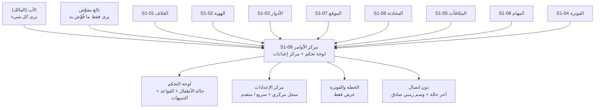
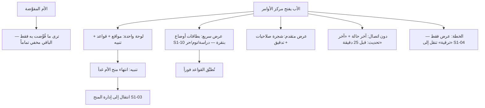

# S1-09: مركز الأوامر والإعدادات (Command Center & Settings)

- **الحالة:** approved | **المرحلة:** 1 (نواة الحماية) · **آخر تحديث:** 2026-11-05
- **القرارات الحاكمة:** Q-003 · Q-007 · Q-055 · Q-064 · Q-065 · Q-092 · Q-094 · Q-095 · Q-096 · Q-097 · Q-098 · D-021 · D-038 · G-006 · G-011
- **حالة المراجعة:** §§1–8 + §10 معتمدة بالكامل في التخطيط (حكم المالك 2026-11-05) · §9 في مرحلة التصميم.
- **الأدلة المرجعية:** المواصفة القديمة S1-09 (مرجع فقط، G-009) · Deep-dives: Life360 (لوحة العائلة) · FamilyWall (لوحة العائلة بأقسام) · S1-01 (معتمد) · S1-02 (معتمد) · S1-03 (معتمد)

## 1. الهدف والتحليل والنطاق

مركز الأوامر والإعدادات هو **"الميناء المعماري"** للمنصة: لوحة تحكم موحدة للأب (حالة الأطفال + القواعد + التنبيهات) + مركز إعدادات موحد تسجل فيه الأنظمة أسطح تحكمها — في مكان واحد، بلا إعدادات مبعثرة.

**التحليل (لماذا هذا النظام):** كل نظام يملك شاشته وقواعده، لكن الأب يحتاج مكاناً واحداً يرى فيه كل شيء ويتحكم بكل شيء. بدون مركز موحد تتشتت الإعدادات في شاشات فرعية منعزلة، ويضيع الأب بين الأنظمة. لذلك S1-09 هو **الميناء**: الأنظمة تسجل ودجاتها (للوحة) وأسطح تحكمها (للإعدادات) في سجل مركزي، والأب يدير عائلته كلها من هنا.

**داخل النطاق:**
- لوحة تحكم موحدة: حالة الأطفال (الموقع والقواعد والتنبيهات) + قواعد الحماية + التنبيهات (SOS، محاولات تصعيد، انتهاء منح) في شاشة واحدة.
- مركز إعدادات موحد: سجل مركزي (manifest) تسجل فيه الأنظمة أسطح تحكمها (Q-092)؛ عرض مزدوج: سريع بقوالب أولاً ثم متقدم (شجرة تفصيلية).
- الرؤية حسب المنح: الأب يرى كل شيء؛ البالغ المفوَّض يرى فقط ما فُوِّض به (deny-override).
- دون اتصال (اليمن): آخر حالة معروفة مع وسم زمني صريح وصادق (offline-first).
- الخطة والفوترة: عرض فقط (الخطة الحالية + الاستخدام)؛ الإدارة في S1-04.

**خارج النطاق (أنظمة أخرى):**
- ميزات الأنظمة نفسها (الحماية، الموقع، المحادثة، المكافآت، المهام) — S1-09 يجمعها فقط، لا يملكها.
- إدارة الفوترة والترقية (S1-04).
- تبديل الملفات (مؤجل للمرحلة 2 — أولوية، Q-063).

**يعتمد على:** S1-01 (الغلاف والوضعان) + S1-02 (العضوية) + S1-03 (الأدوار والصلاحيات — من يرى ماذا).

**المصطلحات:** لوحة تحكم (dashboard) · مركز إعدادات (settings hub) · سجل مركزي (manifest/registry) · ودجة (widget) · سطح تحكم (control surface) · عرض سريع/متقدم (quick/advanced).

**من التطبيقات المفككة (§1):** نمط Life360 — لوحة العائلة تجمع حالة الأعضاء في مكان واحد؛ ونمط FamilyWall — لوحة العائلة بأقسام؛ نأخذ منهما أن **اللوحة تجمع ولا تملك**: كل نظام يعرض حالته في اللوحة، وقواعده تبقى في نظامه.

**رسم توضيحي — أين يُستخدم مركز الأوامر (للفهم السريع):**

## 2. سيناريوهات المستخدم

### 9-1: الأب يفتح مركز الأوامر ويرى كل شيء في لوحة واحدة
- **الممثل:** الأب (المالك). **السياق:** صباحاً، قبل أن يبدأ الأطفال يومهم.
- **التدفق:** 1) الأب يفتح تطبيق الأهل على لوحة مركز الأوامر. 2) يرى في شاشة واحدة: مواقع أطفاله على الخريطة، وقواعد الحماية النشطة، وتنبيهاً واحداً (انتهاء منح الأم غداً). 3) يضغط التنبيه فينتقل إلى إدارة المنح (S1-03). **النتيجة:** صورة العائلة كاملة في نظرة واحدة — بلا تنقل بين الأنظمة.

### 9-2: الأم المفوَّضة ترى فقط ما فُوِّضت به
- **الممثل:** الأم (بالغة مفوَّضة). **السياق:** الأم تفتح مركز الأوامر للاطمئنان على الأطفال.
- **التدفق:** 1) الأم تفتح المركز. 2) ترى حالة الأطفال وقواعد الحماية (مفوَّضة بهما). 3) لا ترى قسم الفوترة ولا إدارة المنح (غير مفوَّضة بهما) — القسمان مخفيان تماماً لا مغلقان برمز. **النتيجة:** الرؤية تتبع المنح بدقة (Q-096) — ما لم يُفوَّض به لا يظهر أصلاً.

### 9-3: الأب يغيّر قاعدة من العرض السريع
- **الممثل:** الأب. **السياق:** حان وقت الدراسة؛ الأب يريد تفعيل وضع الدراسة بسرعة.
- **التدفق:** 1) الأب يفتح مركز الإعدادات على العرض السريع. 2) يرى بطاقات أوضاع مسبقة بنقرة واحدة من نظام الحماية S1-10 (مواصفته قيد الكتابة): [وضع الدراسة] [وضع النوم] [وضع حر]. 3) يضغط [وضع الدراسة] — تُطبَّق القواعد فوراً على أجهزة الأطفال. 4) وتطبيق قالب تفويض Q-089 (شريك/وصي محدود/مراقب) إجراء منفصل في المركز — لا من هذه البطاقات. **النتيجة:** تحكم كامل بنقرة واحدة — بلا شجرة إعدادات.

### 9-4: الأب يفتح العرض المتقدم ويعدّل شجرة صلاحيات
- **الممثل:** الأب. **السياق:** الأب يريد ضبطاً دقيقاً لا تغطيه البطاقات.
- **التدفق:** 1) الأب ينتقل من العرض السريع إلى المتقدم. 2) يرى شجرة الصلاحيات التفصيلية لكل فرد. 3) يفعّل/يلغي مفتاحاً واحداً لعضو واحد. 4) يُسجَّل التعديل في سجل التدقيق (S1-03). **النتيجة:** الدقة الكاملة متاحة لمن يريدها — دون أن تعيق من لا يريدها.

### 9-5: دون اتصال — آخر حالة مع وسم صادق
- **الممثل:** الأب في قرية يمنية بلا تغطية. **السياق:** انقطع النت؛ الأب يريد الاطمئنان على ابنه.
- **التدفق:** 1) الأب يفتح مركز الأوامر دون اتصال. 2) اللوحة تعرض آخر حالة معروفة مع وسم زمني صريح: "آخر تحديث: قبل 25 دقيقة". 3) الأب يعرف أن الموقع قديم ولا يتصرف على أساسه كأنه حي. **النتيجة:** صدق لا وهم — لا بيانات قديمة تُعرض كأنها حية (Q-097).

### 9-6: الأب يرى خطته ويضغط الترقية
- **الممثل:** الأب. **السياق:** الأب يريد معرفة خطته الحالية واستهلاكه.
- **التدفق:** 1) الأب يفتح قسم الخطة في مركز الأوامر. 2) يرى: الخطة الحالية + الاستخدام (عدد الأعضاء/الأجهزة) — عرض فقط. 3) يضغط "ترقية" فينتقل إلى نظام الفوترة (S1-04) لإتمام الترقية. **النتيجة:** الخطة حاضرة أينما كان الأب، وإدارتها في مكانها الصحيح.

**مخطط السيناريوهات (§2 — بصري):**

## 3. المتطلبات الوظيفية

### اللوحة
- **REQ-001:** لوحة تحكم موحدة تعرض حالة الأطفال (الموقع + القواعد النشطة + التنبيهات) في شاشة واحدة. [Q-094 · DIRECT]
- **REQ-002:** اللوحة تجمع ولا تملك: كل ودجة تعرض حالة نظامها؛ قواعد كل نظام تبقى في نظامه. [§1 · DERIVED]
- **REQ-003:** التنبيهات في اللوحة: SOS + محاولات تصعيد + انتهاء منح + أحداث الأنظمة — والضغط على أي تنبيه ينقل إلى النظام صاحبه. [Q-094 · DERIVED]
- **REQ-004:** الرؤية حسب المنح: كل عنصر في اللوحة يظهر فقط لمن يملك مفتاحه (deny-override)؛ غير المفوَّض به مخفي تماماً لا مغلق برمز. [Q-096 · Q-007 · DIRECT]

### مركز الإعدادات
- **REQ-005:** سجل مركزي (manifest) تسجل فيه الأنظمة أسطح تحكمها؛ لا تسجيل مباشر في الواجهة. [Q-095 · Q-092 · DIRECT]
- **REQ-006:** عرض مزدوج: سريع (بطاقات جاهزة بنقرة واحدة) أولاً، ثم متقدم (شجرة تفصيلية لكل فرد). [Q-095 · DIRECT]
- **REQ-007:** البطاقات السريعة إعدادات وضع مسبقة يملكها نظام الحماية S1-10 (وضع الدراسة/وضع النوم/وضع حر — تطبِّق قواعد على أجهزة الأطفال) ويعرضها المركز في العرض السريع؛ وتطبيق قالب صلاحيات Q-089 إجراء منفصل في المركز، لا بطاقة سريعة. [Q-089 · Q-092 · DIRECT — مواصفة S1-10 قيد الكتابة (Q-141)]
- **REQ-008:** كل سطح تحكم مسجل يحمل: `control_key` + النوع (`select`/`switch`/`action`) + القيمة الافتراضية + القيم المتاحة. [08-قديم · DERIVED]
- **REQ-009:** مصفوفة التوفر الصادقة: كل تحكم يعرض توفره في Android مقابل iOS. [Q-005 · 08-قديم · DERIVED]

### دون اتصال
- **REQ-010:** دون اتصال يعرض المركز آخر حالة معروفة مع وسم زمني صريح. [Q-097 · DIRECT]
- **REQ-011:** البيانات القديمة لا تُعرض كأنها حية أبداً — وسم "آخر تحديث" إلزامي على كل عنصر قديم. [Q-097 · DERIVED]

### الخطة
- **REQ-012:** قسم الخطة يعرض الخطة الحالية + الاستخدام — عرض فقط. [Q-098 · DIRECT]
- **REQ-013:** زر الترقية ينقل إلى S1-04؛ لا إدارة فوترة في المركز. [Q-098 · DIRECT]

### التسجيل والأداء
- **REQ-014:** تسجيل نظام جديد (ودجات + أسطح تحكم) يتم عبر السجل المركزي فقط. [Q-095 · DERIVED]
- **REQ-015:** إلغاء تسجيل نظام (أو تعطيله) يخفي ودجاته وأسطح تحكمه فوراً من المركز. [Q-095 · DERIVED]
- **REQ-016:** فتح اللوحة يعرض آخر حالة مخزنة فوراً (قراءات اللوحة p95 أقل من 300ms — Q-061) ثم يحدّث في الخلفية. [Q-061 · DIRECT]

### بطاقة الانتباه
- **REQ-017:** بطاقة "يتطلب انتباهك" في اللوحة تعرض تسليمات المهام (`tasks.submitted` من S1-06) وطلبات الوقت الإضافي (S1-05)؛ والأب يقرر بنقرة واحدة (منح/رفض/إسناد مهمة لطلب الوقت؛ اعتماد/رفض للتسليم). [S1-05/S1-06 · DERIVED]

## 4. الواجهات والعقود

### 4-1. نقاط الوصول (REST — `/api/v1`)

| الطريقة والمسار | الغرض | المدخل | المخرج |
|---|---|---|---|
| `GET /families/{id}/dashboard` | اللوحة الموحدة (REQ-001): حالة الأطفال + القواعد النشطة + التنبيهات | `?since` (للتحديث التدريجي) | `{children: [...], rules: [...], alerts: [...], updated_at}` |
| `GET /families/{id}/settings/registry` | السجل المركزي (REQ-005): الأنظمة المسجلة وأسطح تحكمها | — | `[{system, widgets: [...], controls: [{control_key, type, default, values}]}]` |

**ملاحظة:** `GET /families/{id}/settings/registry` عرض إعدادات العائلة فوق السجلات العالمية (`dashboard_widget` و`control_surface` في §5 — بلا `family_id`)، لا سجلاً لكل عائلة.
| `GET /families/{id}/settings/{system}` | سطح تحكم نظام واحد (REQ-008) | — | `{system, controls: [{control_key, type, value, available_android, available_ios}]}` |
| `PATCH /families/{id}/settings/{system}` | تعديل تحكمات نظام (يفحص الصلاحية عبر S1-03) | `{control_key, value}` | التحكم المعدَّل — `403` إن لم يملك المفتاح |
| `GET /families/{id}/plan` | الخطة والاستخدام — عرض فقط (REQ-012) | — | `{plan, usage: {members, devices}}` |
| `GET /families/{id}/alerts` | قائمة التنبيهات (REQ-003) | `?unread_only&from` | `[{alert_id, kind, system, at, read}]` |
| `POST /families/{id}/alerts/{alertId}/acknowledge` | تأكيد قراءة تنبيه | — | `{alert_id, read: true}` |

**ملاحظة:** التسجيل في السجل المركزي يتم وقت النشر (deploy) من تعريف §9 لكل نظام — لا نقطة تسجيل وقت التشغيل (سطح هجوم غير ضروري).

### 4-2. الأحداث (MQTT → لوحة الأهل)

| الموضوع | الغرض |
|---|---|
| `family/{family_id}/dashboard/updated` | دفع تحديث اللوحة (حالة طفل/قاعدة تغيرت) |
| `family/{family_id}/alerts/new` | دفع تنبيه جديد (SOS، تصعيد، انتهاء منح) |

### 4-3. قناة المنصة (MethodChannel — Flutter ↔ Kotlin)

| الطريقة | الغرض |
|---|---|
| `getCachedDashboard() → snapshot` | آخر حالة مخزنة + وسمها الزمني (REQ-010 — دون اتصال) |
| `refreshDashboard()` | تحديث اللوحة في الخلفية عند عودة الاتصال |

### 4-4. صيغة الخطأ الموحدة

`{code, message_ar, trace_id}` — كما في S1-02 §4. رموز هذا النظام: `HUB_SYSTEM_NOT_REGISTERED` (نظام غير مسجل) · `HUB_CONTROL_NOT_FOUND` (تحكم غير موجود) · `HUB_READ_ONLY` (محاولة كتابة في قسم عرض فقط — الخطة) · `HUB_STALE` (البيانات أقدم من الحد المقبول — تُعرض مع وسمها لا كأنها حية).

## 5. البيانات — النموذج

المركز يجمع ولا يملك: جداوله الخاصة هي السجل واللقطة والتنبيهات فقط؛ بيانات الأنظمة تبقى في أنظمتها. جداول العائلة تحمل `family_id` + RLS (D-021)؛ سجل المركز مشترك لكل العائلات بلا `family_id` (نفس المنطق المصحح في S1-03 §5).

### 5-1. `dashboard_widget` — الودجات المسجلة (REQ-001/002/005)
| الحقل | النوع | ملاحظات |
|---|---|---|
| `widget_id` | text (PK) | مثال `location.map` |
| `system` | text | النظام صاحب الودجة (مثال `S1-07`) |
| `title_ar` | text | العنوان العربي |
| `kind` | text | `map` / `list` / `stat` / `alert` |
| `order` | int | ترتيب العرض في اللوحة |
| `required_key` | text (FK → `permission_key`) | مفتاح رؤيتها — تُخفى عمن لا يملكه (REQ-004) |

### 5-2. `control_surface` — سجل أسطح التحكم (REQ-005/008/009)
| الحقل | النوع | ملاحظات |
|---|---|---|
| `system` | text | النظام صاحب السطح |
| `control_key` | text | مثال `roles.partner_delegation_preset` — إجراء تطبيق قالب تفويض (Q-089)، لا بطاقة سريعة (REQ-007) |
| `type` | text | `select` / `switch` / `action` |
| `default_value` | jsonb | القيمة الافتراضية |
| `values` | jsonb | القيم المتاحة |
| `available_android` / `available_ios` | boolean | مصفوفة التوفر الصادقة (REQ-009) |
| PK | (`system`, `control_key`) | |

### 5-3. `dashboard_snapshot` — اللقطة المخزنة دون اتصال (REQ-010/011)
| الحقل | النوع | ملاحظات |
|---|---|---|
| `family_id` | uuid (PK, FK) | + RLS |
| `snapshot` | jsonb | آخر حالة معروفة للوحة |
| `updated_at` | timestamptz | الوسم الزمني الصريح (REQ-011) |

### 5-4. `alert` — التنبيهات (REQ-003)
| الحقل | النوع | ملاحظات |
|---|---|---|
| `alert_id` | uuid (PK) | |
| `family_id` | uuid (FK) | + RLS |
| `kind` | text | `sos` / `escalation` / `grant_expiring` / `system` |
| `system` | text | النظام صاحب التنبيه (للانتقال إليه) |
| `target_member_id` | uuid (nullable) | العضو المعني |
| `at` | timestamptz | |
| `read` | boolean | |
| `acknowledged_by` / `acknowledged_at` | uuid / timestamptz (nullable) | |

### 5-5. مراجع (بلا تكرار)
- العضوية والدور: S1-02 (`membership`) · المنح والرؤية: S1-03 (`permission_grant` — أي عنصر يراه من) · الخطة والاستخدام: S1-04 (قراءة فقط — REQ-012).

## 6. القواعد والصلاحيات

### 6-1. مفاتيح هذا النظام (`hub.*`)

| المفتاح | الوصف | لمن؟ |
|---|---|---|
| `hub.dashboard.view` | عرض لوحة التحكم | الأب + البالغ المفوَّض (الودجات تُصفى حسب منحِه) |
| `hub.settings.view` | عرض مركز الإعدادات | الأب + البالغ المفوَّض (الأسطح تُصفى حسب منحِه) |
| `hub.settings.edit` | تعديل تحكم في المركز — مطلوب إلى جانب مفتاح التحكم نفسه (دفاع في العمق: حق تعديل المركز + مفتاح التحكم)؛ ولا يمنح وحده حق التعديل | حسب مفتاح التحكم |
| `hub.alerts.view` | عرض التنبيهات | الأب + البالغ المفوَّض |
| `hub.alerts.acknowledge` | تأكيد قراءة تنبيه | الأب + البالغ المفوَّض |
| `hub.plan.view` | عرض الخطة والاستخدام | الأب + البالغ المفوَّض |

### 6-2. الثوابت الصلبة (لا تُكسر أبداً)
- الرؤية تتبع المنح: ما لم يُفوَّض به لا يظهر أصلاً (Q-096 + Q-007 deny-override).
- الخطة عرض فقط: لا يوجد مفتاح كتابة للفوترة في هذا النظام (Q-098).
- البيانات القديمة لا تُعرض كأنها حية أبداً (Q-097).
- تعديل أي تحكم يتطلب `hub.settings.edit` إلى جانب مفتاح التحكم نفسه عبر S1-03 (دفاع في العمق) — المركز لا يمنح صلاحيات (REQ-004/§4-1).
- المركز لا يخزن بيانات أعمال الأنظمة — لقطات وسجل فقط (REQ-002).

### 6-3. قواعد العرض
- **تصفية الودجات:** كل ودجة تُفحص عبر `required_key`؛ المخفية لا تُرسل للعميل أصلاً (لا تُخفى بالواجهة فقط).
- **العرض المزدوج:** السريع أولاً (بطاقات)؛ المتقدم عند طلب الأب صراحة (Q-095).
- **حداثة اللقطة:** كل ودجة تعلن حداثتها المقبولة (يحددها نظامها)؛ تجاوزها → `HUB_STALE` + الوسم الزمني ظاهر دائماً.

## 7. الحالات الحدية والأخطاء

1. **نظام غير مسجل:** طلب سطح تحكم لنظام غير مسجل في السجل → `HUB_SYSTEM_NOT_REGISTERED` + قائمة الأنظمة المسجلة.
2. **تحكم غير موجود:** طلب تحكم غير موجود في سطح النظام → `HUB_CONTROL_NOT_FOUND`.
3. **كتابة في الخطة:** محاولة تعديل الخطة من المركز → `HUB_READ_ONLY` + رابط الانتقال إلى S1-04.
4. **لوحة فارغة:** عائلة بلا أطفال أو بلا أنظمة مسجلة بعد → رسالة إرشادية (لا خطأ): "أضف طفلاً من الإعدادات لتبدأ".
5. **نظام ملغى تسجيله:** ودجاته وأسطح تحكمه تختفي فوراً (REQ-015)؛ تنبيهاته السابقة تبقى ظاهرة مع اسم النظام (سجل تدقيق).
6. **لقطة قديمة:** تجاوز حداثة ودجة → `HUB_STALE` + الوسم الزمني ظاهر دائماً (لا تُعرض كأنها حية).
7. **لا لقطة أصلاً:** أول فتح دون اتصال ولا لقطة مخزنة → "لا بيانات بعد — اتصل بالإنترنت مرة واحدة لعرض اللوحة".
8. **تعديل دون مفتاح:** تعديل تحكم دون مفتاحه → `403` عبر S1-03 + تسجيل المحاولة في التدقيق.
9. **تعديل متزامن:** تعديلان على نفس التحكم في آن واحد → يُمرَّر إلى النظام صاحب التحكم ويُحل بقواعد التزامن الخاصة به (مثال: S1-03 REQ-019)؛ المركز لا يبت في التعارض.
10. **تنبيه SOS دون اتصال:** يصل متأخراً عند عودة الاتصال مع وسمه الزمني الأصلي — لا يُعرض كأنه الآن.
11. **سحب منح أثناء العرض:** بالغ مفوَّض تُسحب منه منح وهو يعرض اللوحة → التحديث التالي يخفي الأقسام فوراً (لا تبقى ظاهرة حتى إعادة الفتح).
12. **لقطة تالفة:** فساد اللقطة المخزنة محلياً → تُتجاهل وتُعاد من الخادم عند الاتصال؛ ودون اتصال → "لا بيانات موثوقة".

## 8. معايير القبول

- **ACC-001:** اللوحة تعرض حالة الأطفال (الموقع + القواعد النشطة + التنبيهات) في شاشة واحدة. [REQ-001]
- **ACC-002:** اللوحة تجمع فقط — لا بيانات أعمال مخزنة في المركز. [REQ-002]
- **ACC-003:** الضغط على تنبيه ينقل إلى النظام صاحبه. [REQ-003]
- **ACC-004:** البالغ المفوَّض يرى فقط ما فُوِّض به؛ غير المفوَّض به مخفي تماماً لا مغلقاً. [REQ-004]
- **ACC-005:** السجل يعرض الأنظمة المسجلة وأسطح تحكمها؛ ولا نقطة تسجيل وقت التشغيل. [REQ-005 · §4]
- **ACC-006:** العرض المزدوج: سريع أولاً ببطاقات أوضاع S1-10، ثم متقدم عند الطلب؛ وتطبيق قالب Q-089 إجراء منفصل. [REQ-006/007]
- **ACC-007:** كل تحكم مسجل يحمل `control_key` + النوع + الافتراضي + المتاح + التوفر Android/iOS. [REQ-008/009]
- **ACC-008:** دون اتصال: آخر حالة مع وسم صريح؛ والقديم لا يُعرض كأنه حي أبداً. [REQ-010/011]
- **ACC-009:** الخطة عرض فقط؛ وزر الترقية ينقل إلى S1-04. [REQ-012/013]
- **ACC-010:** إلغاء تسجيل نظام يخفي ودجاته وأسطح تحكمه فوراً. [REQ-015]
- **ACC-011:** قراءات اللوحة p95 أقل من 300ms. [REQ-016 · Q-061]
- **ACC-012:** مفاتيح `hub.*` الستة مطبقة؛ وتعديل أي تحكم يتطلب `hub.settings.edit` + مفتاحه عبر S1-03. [§6]
- **ACC-013:** بطاقة "يتطلب انتباهك" تعرض `tasks.submitted` (S1-06) وطلبات الوقت الإضافي (S1-05)؛ والأب يقرر بنقرة واحدة. [REQ-017]

## 9. قائمة الشاشات

في مرحلة التصميم.

## 10. خطة التنفيذ

### خطوات البناء بالترتيب
1. جداول السجل والتنبيهات واللقطة + RLS (dashboard_widget, control_surface, alert, dashboard_snapshot).
2. محرك الرؤية: تصفية خادمية عبر `required_key` + فحص S1-03.
3. نقاط الوصول REST السبعة + أحداث MQTT (dashboard/updated, alerts/new).
4. اللقطة المخزنة دون اتصال + MethodChannel (getCachedDashboard / refreshDashboard).
5. الشاشات بعد التصميم (اللوحة + مركز الإعدادات — §9).

- **بذر المفاتيح في السجل المركزي:** مفاتيح `hub.*` الستة (§6: `hub.dashboard.view` · `hub.settings.view` · `hub.settings.edit` · `hub.alerts.view` · `hub.alerts.acknowledge` · `hub.plan.view`) تُزرع في جدول `permission_key` المركزي (S1-03 §10-1) وقت النشر — لا منح لمفتاح غير مزروع (S1-03 REQ-009).

### الوحدات
- Ktor: وحدة `hub` (لوحة + سجل + تنبيهات).
- Flutter: شاشتا اللوحة ومركز الإعدادات + مخزن اللقطة.
- Kotlin: اللقطة المخزنة + التحديث في الخلفية.

### التبعيات
- S1-01 (الغلاف) · S1-02 (العضوية) · S1-03 (الصلاحيات) · S1-04 (الخطة — قراءة فقط) · Q-022 (MQTT) · مختبر Q-027 (قياس Q-061).

### منهج الاختبار
- وحدة: محرك الرؤية + السجل + اللقطة.
- تكامل: نقاط الوصول + الأحداث + التصفية الخادمية.
- قبول: ACC-001…ACC-012.
- أداء: قراءات اللوحة p95 أقل من 300ms (Q-061) في مختبر Q-027.

## أسئلة مفتوحة (من هذه المواصفة)

لا أسئلة مفتوحة من هذه المواصفة حتى الآن.

## ملحق أ: الاستخلاص من الهندسة العكسية (RE) — ما نُعيد استخدامه فعلاً

| المصدر المفكك | الآلية المستخلصة | أين تُستخدم في المواصفة |
|---|---|---|
| Life360 | لوحة العائلة تجمع حالة الأعضاء (الخريطة + الحالة) في مكان واحد | لوحة التحكم الموحدة (§1، §3) |
| FamilyWall | لوحة العائلة بأقسام (تقويم/مهام/موقع) | مركز يجمع الأنظمة (§1، §3) |
