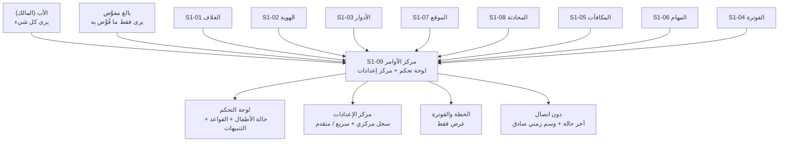
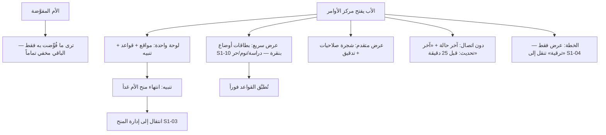

# S1-09: مركز الأوامر والإعدادات (Command Center & Settings)

- **الحالة:** approved | **المرحلة:** 1 (نواة الحماية) · **آخر تحديث:** 2026-11-05
- **القرارات الحاكمة:** Q-001 · Q-003 · Q-007 · Q-055 · Q-064 · Q-065 · Q-092 · Q-094 · Q-095 · Q-096 · Q-097 · Q-098 · D-021 · D-038 · G-006 · G-011
- **حالة المراجعة:** §§1–8 + §10 معتمدة بالكامل في التخطيط (حكم المالك 2026-11-05) · §9 في مرحلة التصميم.
- **الأدلة المرجعية:** المواصفة القديمة S1-09 (مرجع فقط، G-009) · Deep-dives: Life360 (لوحة العائلة) · FamilyWall (لوحة العائلة بأقسام) · S1-01 (معتمد) · S1-02 (معتمد) · S1-03 (معتمد)

## 1. الهدف والتحليل والنطاق

مركز الأوامر والإعدادات هو **"الميناء المعماري"** للمنصة: لوحة تحكم موحدة للأب (حالة الأطفال + القواعد + التنبيهات) + مركز إعدادات موحد تسجل فيه الأنظمة أسطح تحكمها — في مكان واحد، بلا إعدادات مبعثرة.

**التحليل (لماذا هذا النظام):** كل نظام يملك شاشته وقواعده، لكن الأب يحتاج مكاناً واحداً يرى فيه كل شيء ويتحكم بكل شيء. بدون مركز موحد تتشتت الإعدادات في شاشات فرعية منعزلة، ويضيع الأب بين الأنظمة. لذلك S1-09 هو **الميناء**: الأنظمة تسجل ودجاتها (للوحة) وأسطح تحكمها (للإعدادات) في سجل مركزي، والأب يدير عائلته كلها من هنا.

**داخل النطاق:**
- لوحة تحكم موحدة: حالة الأطفال (الموقع والقواعد والتنبيهات) + قواعد الحماية + التنبيهات (SOS، محاولات تصعيد، انتهاء منح) في شاشة واحدة.
- مركز إعدادات موحد: سجل مركزي (manifest) تسجل فيه الأنظمة أسطح تحكمها (Q-092)؛ عرض مزدوج: سريع بقوالب أولاً ثم متقدم (شجرة تفصيلية).
- الرؤية حسب المنح: الأب يرى كل شيء؛ البالغ المفوَّض يرى فقط ما فُوِّض به (deny-override).
- دون اتصال (اليمن): آخر حالة معروفة مع وسم زمني صريح وصادق (offline-first).
- الخطة والفوترة: عرض فقط (الخطة الحالية + الاستخدام)؛ الإدارة في S1-04.

**خارج النطاق (أنظمة أخرى):**
- ميزات الأنظمة نفسها (الحماية، الموقع، المحادثة، المكافآت، المهام) — S1-09 يجمعها فقط، لا يملكها.
- إدارة الفوترة والترقية (S1-04).
- تبديل الملفات (مؤجل للمرحلة 2 — أولوية، Q-063).

**يعتمد على:** S1-01 (الغلاف والوضعان) + S1-02 (العضوية) + S1-03 (الأدوار والصلاحيات — من يرى ماذا).

**المصطلحات:** لوحة تحكم (dashboard) · مركز إعدادات (settings hub) · سجل مركزي (manifest/registry) · ودجة (widget) · سطح تحكم (control surface) · عرض سريع/متقدم (quick/advanced).

**من التطبيقات المفككة (§1):** نمط Life360 — لوحة العائلة تجمع حالة الأعضاء في مكان واحد؛ ونمط FamilyWall — لوحة العائلة بأقسام؛ نأخذ منهما أن **اللوحة تجمع ولا تملك**: كل نظام يعرض حالته في اللوحة، وقواعده تبقى في نظامه.

**رسم توضيحي — أين يُستخدم مركز الأوامر (للفهم السريع):**



## 2. سيناريوهات المستخدم

### 9-1: الأب يفتح مركز الأوامر ويرى كل شيء في لوحة واحدة
- **الممثل:** الأب (المالك). **السياق:** صباحاً، قبل أن يبدأ الأطفال يومهم.
- **التدفق:** 1) الأب يفتح تطبيق الأهل على لوحة مركز الأوامر. 2) يرى في شاشة واحدة: مواقع أطفاله على الخريطة، وقواعد الحماية النشطة، وتنبيهاً واحداً (انتهاء منح الأم غداً). 3) يضغط التنبيه فينتقل إلى إدارة المنح (S1-03). **النتيجة:** صورة العائلة كاملة في نظرة واحدة — بلا تنقل بين الأنظمة.

### 9-2: الأم المفوَّضة ترى فقط ما فُوِّضت به
- **الممثل:** الأم (بالغة مفوَّضة). **السياق:** الأم تفتح مركز الأوامر للاطمئنان على الأطفال.
- **التدفق:** 1) الأم تفتح المركز. 2) ترى حالة الأطفال وقواعد الحماية (مفوَّضة بهما). 3) لا ترى قسم الفوترة ولا إدارة المنح (غير مفوَّضة بهما) — القسمان مخفيان تماماً لا مغلقان برمز. **النتيجة:** الرؤية تتبع المنح بدقة (Q-096) — ما لم يُفوَّض به لا يظهر أصلاً.

### 9-3: الأب يغيّر قاعدة من العرض السريع
- **الممثل:** الأب. **السياق:** حان وقت الدراسة؛ الأب يريد تفعيل وضع الدراسة بسرعة.
- **التدفق:** 1) الأب يفتح مركز الإعدادات على العرض السريع. 2) يرى بطاقات أوضاع مسبقة بنقرة واحدة من نظام الحماية S1-10 (مواصفته معتمدة (Q-146)): [وضع الدراسة] [وضع النوم] [وضع حر]. 3) يضغط [وضع الدراسة] — تُطبَّق القواعد فوراً على أجهزة الأطفال. 4) وتطبيق قالب تفويض Q-089 (شريك/وصي محدود/مراقب) إجراء منفصل في المركز — لا من هذه البطاقات. **النتيجة:** تحكم كامل بنقرة واحدة — بلا شجرة إعدادات.

### 9-4: الأب يفتح العرض المتقدم ويعدّل شجرة صلاحيات
- **الممثل:** الأب. **السياق:** الأب يريد ضبطاً دقيقاً لا تغطيه البطاقات.
- **التدفق:** 1) الأب ينتقل من العرض السريع إلى المتقدم. 2) يرى شجرة الصلاحيات التفصيلية لكل فرد. 3) يفعّل/يلغي مفتاحاً واحداً لعضو واحد. 4) يُسجَّل التعديل في سجل التدقيق (S1-03). **النتيجة:** الدقة الكاملة متاحة لمن يريدها — دون أن تعيق من لا يريدها.

### 9-5: دون اتصال — آخر حالة مع وسم صادق
- **الممثل:** الأب في قرية يمنية بلا تغطية. **السياق:** انقطع النت؛ الأب يريد الاطمئنان على ابنه.
- **التدفق:** 1) الأب يفتح مركز الأوامر دون اتصال. 2) اللوحة تعرض آخر حالة معروفة مع وسم زمني صريح: "آخر تحديث: قبل 25 دقيقة". 3) الأب يعرف أن الموقع قديم ولا يتصرف على أساسه كأنه حي. **النتيجة:** صدق لا وهم — لا بيانات قديمة تُعرض كأنها حية (Q-097).

### 9-6: الأب يرى خطته ويضغط الترقية
- **الممثل:** الأب. **السياق:** الأب يريد معرفة خطته الحالية واستهلاكه.
- **التدفق:** 1) الأب يفتح قسم الخطة في مركز الأوامر. 2) يرى: الخطة الحالية + الاستخدام (عدد الأعضاء/الأجهزة) — عرض فقط. 3) يضغط "ترقية" فينتقل إلى نظام الفوترة (S1-04) لإتمام الترقية. **النتيجة:** الخطة حاضرة أينما كان الأب، وإدارتها في مكانها الصحيح.

**مخطط السيناريوهات (§2 — بصري):**



## 3. المتطلبات الوظيفية

### اللوحة
- **REQ-001:** لوحة تحكم موحدة تعرض حالة الأطفال (الموقع + القواعد النشطة + التنبيهات) في شاشة واحدة. [Q-094 · DIRECT]
- **REQ-002:** اللوحة تجمع ولا تملك: كل ودجة تعرض حالة نظامها؛ قواعد كل نظام تبقى في نظامه. [§1 · DERIVED]
- **REQ-003:** التنبيهات في اللوحة: SOS + محاولات تصعيد + انتهاء منح + أحداث الأنظمة — والضغط على أي تنبيه ينقل إلى النظام صاحبه. [Q-094 · DERIVED]
- **REQ-004:** الرؤية حسب المنح: كل عنصر في اللوحة يظهر فقط لمن يملك مفتاحه (deny-override)؛ غير المفوَّض به مخفي تماماً لا مغلق برمز. [Q-096 · Q-007 · DIRECT]

### مركز الإعدادات
- **REQ-005:** سجل مركزي (manifest) تسجل فيه الأنظمة أسطح تحكمها؛ لا تسجيل مباشر في الواجهة. [Q-095 · Q-092 · DIRECT]
- **REQ-006:** عرض مزدوج: سريع (بطاقات جاهزة بنقرة واحدة) أولاً، ثم متقدم (شجرة تفصيلية لكل فرد). [Q-095 · DIRECT]
- **REQ-007:** البطاقات السريعة إعدادات وضع مسبقة يملكها نظام الحماية S1-10 (وضع الدراسة/وضع النوم/وضع حر — تطبِّق قواعد على أجهزة الأطفال) ويعرضها المركز في العرض السريع؛ وتطبيق قالب صلاحيات Q-089 إجراء منفصل في المركز، لا بطاقة سريعة. [Q-089 · Q-092 · DIRECT — مواصفة S1-10 معتمدة (Q-141 · Q-146)]
- **REQ-008:** كل سطح تحكم مسجل يحمل: `control_key` + النوع (`select`/`switch`/`action`) + القيمة الافتراضية + القيم المتاحة. [08-قديم · DERIVED]
- **REQ-009:** مصفوفة التوفر الصادقة: كل تحكم يعرض توفره في Android مقابل iOS. [Q-005 · 08-قديم · DERIVED]

### دون اتصال
- **REQ-010:** دون اتصال يعرض المركز آخر حالة معروفة مع وسم زمني صريح. [Q-097 · DIRECT]
- **REQ-011:** البيانات القديمة لا تُعرض كأنها حية أبداً — وسم "آخر تحديث" إلزامي على كل عنصر قديم. [Q-097 · DERIVED]

### الخطة
- **REQ-012:** قسم الخطة يعرض الخطة الحالية + الاستخدام — عرض فقط. [Q-098 · DIRECT]
- **REQ-013:** زر الترقية ينقل إلى S1-04؛ لا إدارة فوترة في المركز. [Q-098 · DIRECT]

### التسجيل والأداء
- **REQ-014:** تسجيل نظام جديد (ودجات + أسطح تحكم) يتم عبر السجل المركزي فقط. [Q-095 · DERIVED]
- **REQ-015:** إلغاء تسجيل نظام (أو تعطيله) يخفي ودجاته وأسطح تحكمه فوراً من المركز. [Q-095 · DERIVED]
- **REQ-016:** فتح اللوحة يعرض آخر حالة مخزنة فوراً (قراءات اللوحة p95 أقل من 300ms — Q-061) ثم يحدّث في الخلفية. [Q-061 · DIRECT]

### بطاقة الانتباه
- **REQ-017:** بطاقة "يتطلب انتباهك" في اللوحة تعرض تسليمات المهام (`family/{family_id}/tasks.submitted` من S1-06) وطلبات الوقت الإضافي (S1-05)؛ والأب يقرر بنقرة واحدة (منح/رفض/إسناد مهمة لطلب الوقت؛ اعتماد/رفض للتسليم). [S1-05/S1-06 · DERIVED]

### شفافية الذكاء

- **REQ-018:** سطح شفافية الذكاء: مركز التحكم (S1-09) هو سطح عرض سجل أفعال الوكيل (`AgentActionLog` — عقد التحقق Q-167 §3): يعرض كل فعل مع مفتاح قدرته (`agent.*`) وبوابة موافقته ودليله ونتيجته ومسار تراجعه؛ والأب يرى السجل كاملاً؛ والبالغ المفوَّض يرى منه ما يخص ما فُوِّض به (تصفية خادمية — REQ-004)؛ والطفل يرى منه ما يخصه فقط (G-006). والعرض يُفحص بمفتاح `hub.dashboard.view` (لا مفتاح جديد — السجل عرض قراءة في اللوحة). [Q-173 · Q-167 · DIRECT]

## 4. الواجهات والعقود

### 4-1. نقاط الوصول (REST — `/api/v1`)

| الطريقة والمسار | الغرض | المدخل | المخرج |
|---|---|---|---|
| `GET /api/v1/families/{id}/dashboard` | اللوحة الموحدة (REQ-001): حالة الأطفال + القواعد النشطة + التنبيهات | `?since` (للتحديث التدريجي) | `{children: [...], rules: [...], alerts: [...], updated_at}` |
| `GET /api/v1/families/{id}/settings/registry` | السجل المركزي (REQ-005): الأنظمة المسجلة وأسطح تحكمها | — | `[{system, widgets: [...], controls: [{control_key, type, default, values}]}]` |

**ملاحظة:** `GET /api/v1/families/{id}/settings/registry` عرض إعدادات العائلة فوق السجلات العالمية (`dashboard_widget` و`control_surface` في §5 — بلا `family_id`)، لا سجلاً لكل عائلة.
| `GET /api/v1/families/{id}/settings/{system}` | سطح تحكم نظام واحد (REQ-008) | — | `{system, controls: [{control_key, type, value, available_android, available_ios}]}` |
| `PATCH /api/v1/families/{id}/settings/{system}` | تعديل تحكمات نظام (يفحص الصلاحية عبر S1-03) | `{control_key, value}` | التحكم المعدَّل — `403` إن لم يملك المفتاح |
| `GET /api/v1/families/{id}/plan` | الخطة والاستخدام — عرض فقط (REQ-012) — كما في S1-04 §4 (التعريف القانوني في S1-04 وحده) | — | انظر S1-04 §4 |
| `GET /api/v1/families/{id}/alerts` | قائمة التنبيهات (REQ-003) | `?unread_only&from` | `[{alert_id, kind, system, at, read}]` |
| `POST /api/v1/families/{id}/alerts/{alertId}/acknowledge` | تأكيد قراءة تنبيه | — | `{alert_id, read: true}` |
| `GET /api/v1/families/{id}/agent-actions` | سجل أفعال الوكيل (REQ-018): كل فعل مع مفتاحه وبوابته ودليله ونتيجته ومسار تراجعه — كاملاً للأب، وما يخص المفوَّض/الطفل فقط له | `?member_id&action&from` | `[{action_id, agent_key, gate, approval, result, at, evidence, reverse}]` |

**ملاحظة:** التسجيل في السجل المركزي يتم وقت النشر (deploy) من تعريف §9 لكل نظام — لا نقطة تسجيل وقت التشغيل (سطح هجوم غير ضروري).

### 4-2. الأحداث (MQTT → لوحة الأهل)

| الموضوع | QoS | Retained | الغرض |
|---|---|---|---|
| `family/{family_id}/dashboard/updated` | 1 | لا | دفع تحديث اللوحة (حالة طفل/قاعدة تغيرت) |
| `family/{family_id}/alerts/new` | 1 | لا | دفع تنبيه جديد (SOS، تصعيد، انتهاء منح) |

### 4-3. قناة المنصة (MethodChannel — Flutter ↔ Kotlin)

| الطريقة | الغرض |
|---|---|
| `getCachedDashboard() → snapshot` | آخر حالة مخزنة + وسمها الزمني (REQ-010 — دون اتصال) |
| `refreshDashboard()` | تحديث اللوحة في الخلفية عند عودة الاتصال |

### 4-4. صيغة الخطأ الموحدة

`{code, message_ar, trace_id}` — كما في S1-02 §4. رموز هذا النظام: `HUB_SYSTEM_NOT_REGISTERED` (نظام غير مسجل) · `HUB_CONTROL_NOT_FOUND` (تحكم غير موجود) · `HUB_READ_ONLY` (محاولة كتابة في قسم عرض فقط — الخطة) · `HUB_STALE` (البيانات أقدم من الحد المقبول — تُعرض مع وسمها لا كأنها حية).

## 5. البيانات — النموذج

المركز يجمع ولا يملك: جداوله الخاصة هي السجل واللقطة والتنبيهات فقط؛ بيانات الأنظمة تبقى في أنظمتها. جداول العائلة تحمل `family_id` + RLS (D-021)؛ سجل المركز مشترك لكل العائلات بلا `family_id` (نفس المنطق المصحح في S1-03 §5).

### 5-1. `dashboard_widget` — الودجات المسجلة (REQ-001/002/005)
| الحقل | النوع | ملاحظات |
|---|---|---|
| `widget_id` | text (PK) | مثال `location.map` |
| `system` | text | النظام صاحب الودجة (مثال `S1-07`) |
| `title_ar` | text | العنوان العربي |
| `kind` | text | `map` / `list` / `stat` / `alert` |
| `order` | int | ترتيب العرض في اللوحة |
| `required_key` | text (FK → `permission_key`) | مفتاح رؤيتها — تُخفى عمن لا يملكه (REQ-004) |

### 5-2. `control_surface` — سجل أسطح التحكم (REQ-005/008/009)
| الحقل | النوع | ملاحظات |
|---|---|---|
| `system` | text | النظام صاحب السطح |
| `control_key` | text | مثال `roles.partner_delegation_preset` — إجراء تطبيق قالب تفويض (Q-089)، لا بطاقة سريعة (REQ-007) |
| `type` | text | `select` / `switch` / `action` |
| `default_value` | jsonb | القيمة الافتراضية |
| `values` | jsonb | القيم المتاحة |
| `available_android` / `available_ios` | boolean | مصفوفة التوفر الصادقة (REQ-009) |
| PK | (`system`, `control_key`) | |

### 5-3. `dashboard_snapshot` — اللقطة المخزنة دون اتصال (REQ-010/011)
| الحقل | النوع | ملاحظات |
|---|---|---|
| `family_id` | uuid (PK, FK) | + RLS |
| `snapshot` | jsonb | آخر حالة معروفة للوحة |
| `updated_at` | timestamptz | الوسم الزمني الصريح (REQ-011) |

### 5-4. `alert` — التنبيهات (REQ-003)
| الحقل | النوع | ملاحظات |
|---|---|---|
| `alert_id` | uuid (PK) | |
| `family_id` | uuid (FK) | + RLS |
| `kind` | text | `sos` / `escalation` / `grant_expiring` / `system` |
| `system` | text | النظام صاحب التنبيه (للانتقال إليه) |
| `target_member_id` | uuid (nullable) | العضو المعني |
| `at` | timestamptz | |
| `read` | boolean | |
| `acknowledged_by` / `acknowledged_at` | uuid / timestamptz (nullable) | |

### 5-5. مراجع (بلا تكرار)
- العضوية والدور: S1-02 (`membership`) · المنح والرؤية: S1-03 (`permission_grant` — أي عنصر يراه من) · الخطة والاستخدام: S1-04 (قراءة فقط — REQ-012).
- سجل أفعال الوكيل: عقد التحقق (AI-VERIFICATION-CONTRACT.md §3 — `AgentActionLog` — قراءة فقط من المركز؛ لا جدول جديد هنا).

## 6. القواعد والصلاحيات

### 6-1. مفاتيح هذا النظام (`hub.*`)

| المفتاح | الوصف | لمن؟ |
|---|---|---|
| `hub.dashboard.view` | عرض لوحة التحكم | الأب + البالغ المفوَّض (الودجات تُصفى حسب منحِه) |
| `hub.settings.view` | عرض مركز الإعدادات | الأب + البالغ المفوَّض (الأسطح تُصفى حسب منحِه) |
| `hub.settings.edit` | تعديل تحكم في المركز — مطلوب إلى جانب مفتاح التحكم نفسه (دفاع في العمق: حق تعديل المركز + مفتاح التحكم)؛ ولا يمنح وحده حق التعديل | حسب مفتاح التحكم |
| `hub.alerts.view` | عرض التنبيهات | الأب + البالغ المفوَّض |
| `hub.alerts.acknowledge` | تأكيد قراءة تنبيه | الأب + البالغ المفوَّض |
| `hub.plan.view` | عرض الخطة والاستخدام | الأب + البالغ المفوَّض |

### 6-2. الثوابت الصلبة (لا تُكسر أبداً)
- الرؤية تتبع المنح: ما لم يُفوَّض به لا يظهر أصلاً (Q-096 + Q-007 deny-override).
- الخطة عرض فقط: لا يوجد مفتاح كتابة للفوترة في هذا النظام (Q-098).
- البيانات القديمة لا تُعرض كأنها حية أبداً (Q-097).
- تعديل أي تحكم يتطلب `hub.settings.edit` إلى جانب مفتاح التحكم نفسه عبر S1-03 (دفاع في العمق) — المركز لا يمنح صلاحيات (REQ-004/§4-1).
- تبديل منح من المركز يتطلب PIN الأب أو بصمته عبر بوابة الوالدين (Q-065) — **بلا تحدي خادم (Q-174: البصمة والرمز تكفيان؛ والسهولة أولاً)**. والمخاطرة المقبولة بقرار المالك: التنفيذ يعتمد على الجلسة + البوابة المحلية، لا على مفتاح توقيع الجهاز (Q-164) — فجلسة مسروقة قد تبدّل منحاً من هذا السطح وحده؛ وتخففها ضوابط الجلسة (30 يوماً + تدوير التحديث Q-075، والإبطال عند فك الإقران).
- المركز لا يخزن بيانات أعمال الأنظمة — لقطات وسجل فقط (REQ-002).

### 6-3. قواعد العرض
- **تصفية الودجات:** كل ودجة تُفحص عبر `required_key`؛ المخفية لا تُرسل للعميل أصلاً (لا تُخفى بالواجهة فقط).
- **العرض المزدوج:** السريع أولاً (بطاقات)؛ المتقدم عند طلب الأب صراحة (Q-095).
- **حداثة اللقطة:** كل ودجة تعلن حداثتها المقبولة (يحددها نظامها)؛ تجاوزها → `HUB_STALE` + الوسم الزمني ظاهر دائماً.

## 7. الحالات الحدية والأخطاء

1. **نظام غير مسجل:** طلب سطح تحكم لنظام غير مسجل في السجل → `HUB_SYSTEM_NOT_REGISTERED` + قائمة الأنظمة المسجلة.
2. **تحكم غير موجود:** طلب تحكم غير موجود في سطح النظام → `HUB_CONTROL_NOT_FOUND`.
3. **كتابة في الخطة:** محاولة تعديل الخطة من المركز → `HUB_READ_ONLY` + رابط الانتقال إلى S1-04.
4. **لوحة فارغة:** عائلة بلا أطفال أو بلا أنظمة مسجلة بعد → رسالة إرشادية (لا خطأ): "أضف طفلاً من الإعدادات لتبدأ".
5. **نظام ملغى تسجيله:** ودجاته وأسطح تحكمه تختفي فوراً (REQ-015)؛ تنبيهاته السابقة تبقى ظاهرة مع اسم النظام (سجل تدقيق).
6. **لقطة قديمة:** تجاوز حداثة ودجة → `HUB_STALE` + الوسم الزمني ظاهر دائماً (لا تُعرض كأنها حية).
7. **لا لقطة أصلاً:** أول فتح دون اتصال ولا لقطة مخزنة → "لا بيانات بعد — اتصل بالإنترنت مرة واحدة لعرض اللوحة".
8. **تعديل دون مفتاح:** تعديل تحكم دون مفتاحه → `403` عبر S1-03 + تسجيل المحاولة في التدقيق.
9. **تعديل متزامن:** تعديلان على نفس التحكم في آن واحد → يُمرَّر إلى النظام صاحب التحكم ويُحل بقواعد التزامن الخاصة به (مثال: S1-03 REQ-019)؛ المركز لا يبت في التعارض.
10. **تنبيه SOS دون اتصال:** يصل متأخراً عند عودة الاتصال مع وسمه الزمني الأصلي — لا يُعرض كأنه الآن.
11. **سحب منح أثناء العرض:** بالغ مفوَّض تُسحب منه منح وهو يعرض اللوحة → التحديث التالي يخفي الأقسام فوراً (لا تبقى ظاهرة حتى إعادة الفتح).
12. **لقطة تالفة:** فساد اللقطة المخزنة محلياً → تُتجاهل وتُعاد من الخادم عند الاتصال؛ ودون اتصال → "لا بيانات موثوقة".

## 8. معايير القبول

- **ACC-001:** اللوحة تعرض حالة الأطفال (الموقع + القواعد النشطة + التنبيهات) في شاشة واحدة. [REQ-001]
- **ACC-002:** اللوحة تجمع فقط — لا بيانات أعمال مخزنة في المركز. [REQ-002]
- **ACC-003:** الضغط على تنبيه ينقل إلى النظام صاحبه. [REQ-003]
- **ACC-004:** البالغ المفوَّض يرى فقط ما فُوِّض به؛ غير المفوَّض به مخفي تماماً لا مغلقاً. [REQ-004]
- **ACC-005:** السجل يعرض الأنظمة المسجلة وأسطح تحكمها؛ ولا نقطة تسجيل وقت التشغيل. [REQ-005 · §4]
- **ACC-006:** العرض المزدوج: سريع أولاً ببطاقات أوضاع S1-10، ثم متقدم عند الطلب؛ وتطبيق قالب Q-089 إجراء منفصل. [REQ-006/007]
- **ACC-007:** كل تحكم مسجل يحمل `control_key` + النوع + الافتراضي + المتاح + التوفر Android/iOS. [REQ-008/009]
- **ACC-008:** دون اتصال: آخر حالة مع وسم صريح؛ والقديم لا يُعرض كأنه حي أبداً. [REQ-010/011]
- **ACC-009:** الخطة عرض فقط؛ وزر الترقية ينقل إلى S1-04. [REQ-012/013]
- **ACC-010:** إلغاء تسجيل نظام يخفي ودجاته وأسطح تحكمه فوراً. [REQ-015]
- **ACC-011:** قراءات اللوحة p95 أقل من 300ms. [REQ-016 · Q-061]
- **ACC-012:** مفاتيح `hub.*` الستة مطبقة؛ وتعديل أي تحكم يتطلب `hub.settings.edit` + مفتاحه عبر S1-03. [§6]
- **ACC-013:** بطاقة "يتطلب انتباهك" تعرض `family/{family_id}/tasks.submitted` (S1-06) وطلبات الوقت الإضافي (S1-05)؛ والأب يقرر بنقرة واحدة. [REQ-017]
- **ACC-014:** سطح شفافية الذكاء يعرض سجل أفعال الوكيل كاملاً للأب (مع المفتاح والبوابة والدليل والنتيجة والتراجع)؛ والمفوَّض يرى ما يخص تفويضه؛ والطفل ما يخصه فقط. [REQ-018 · Q-173]

## 9. قائمة الشاشات

**الحالة:** مسودة (drafted) — للمراجعة الصباحية؛ لا اعتماد ليلاً.
>
المصدر: `SPEC.md` §§1–8 + §10 و`DIAGRAMS.md` §1 (16 حالة استخدام UC1–UC16) لنفس النظام، وقالب المواصفة (Q-091)، وقائمة قبول المسودات `design-draft-acceptance.md`.
كل شاشة تستشهد بـ REQ واحد على الأقل + معيار DS واحد على الأقل. لا رقم ولا تاريخ ولا عدد بلا مصدر (REQ أو قرار محكوم أو معيار DS).
العربية أولاً RTL (Q-070)؛ كل نص من مفاتيح الترجمة بنمط `screens.<screen-id>.<element>` (DS-MC-01)؛ المفاتيح اشتقاق ميكانيكي من معرف الشاشة وعنصرها، لا محتوى مخترع.

## قيود صريحة (تُقرأ قبل كل شاشة)

- **Q-201 (بوابة «قبل التصميم» مفتوحة):** هذا النظام بلا شاشات حذف/تصدير مباشرة؛ لكن اللوحة ترتبط بشاشات الحذف في S1-03 (R03-14/R03-15) القائمة على افتراض 30 يوماً — **«قابل للتغيير بعد استشارة PDPL (Q-201)»** — وأي تغيير في المدة يظهر في بانر «حذف معلق» هنا عبر S1-03 لا عبر شاشة في هذا النظام.
- **Q-042 / Q-044:** بلا خط عربي نهائي وبلا درجات ألوان 50–950 نهائية — كل المسودات البصرية في §9 على رموز نظام التصميم الحالية فقط (DS-CL، DS-TY بأسمائها)، والقيد مسجل لا قرار ضمني.
- **Q-043:** لا شعار SVG ولا شخصية مرشد مخترعة — العلامة في كل رأس شاشة علامة نصية «عائلتي» بألوان DS-BR فقط (كحلي 1F3A6B / أخضر 1F6B3B / برتقالي CF5B2C / ذهبي C8A24A / كريمي FCFAED — D-024)، والفجوة مسجلة في §9-6 (G-H09-5).
- **Q-045:** التصميم للهاتف أولاً؛ والحد الأدنى على اللوحي «لا ينكسر» (S-001) — كل شاشة تعمل في Compact وMedium وExpanded بلا فقد حالة (DS-SP-04، DS-NV-06)؛ والنطاق الكامل للوحي/الطيّ بطاقة صباحية.
- **Q-046:** بلا سياسة تحليلات للأطفال — لا أحداث تحليلية في شاشات الأطفال إلا «بلا بيانات شخصية» (QUALITY-GATES §2)؛ وشاشتا شفافية الذكاء (H09-12/H09-13) تعرضان للطفل ما يخصه فقط بلا أي حدث تحليلي.
- **Q-157:** لا هدف «24 ساعة» في أي شاشة — قائمة الإعداد الأولي في H09-01 (DS-CC-10) بلا هدف زمني حتى يُحسم (حوكمة)؛ والنسبة تُقاس من إنجاز بنود القائمة فقط.
- **Q-063:** تبديل الملفات مؤجل للمرحلة 2 — وضع واحد ثابت لكل جهاز في المرحلة 1؛ والمركز نفسه للأب والبالغ المفوَّض (وضع الأهل)، والطفل/المراهق يريان من شفافية الذكاء ما يخصهما فقط (H09-12/H09-13).
- **Q-065:** بوابة الوالدين = PIN الأب فقط، بلا سؤال حسابي (DS-CM-05: 5 محاولات خاطئة → قفل 5 دقائق).
- **Q-174 (استثناء):** تبديل منح من المركز (H09-07 — العرض المتقدم) يكتفي بـ PIN/بصمة الأب عبر بوابة الوالدين — بلا nonce وبلا توقيع جهازي؛ والتنفيذ يعتمد على الجلسة + البوابة المحلية (مخاطرة مقبولة بقرار المالك — السهولة أولاً). هذا الاستثناء لا ينطبق على بدء/قبول نقل الملكية أو حذف العائلة في S1-03.

## 9-1. فهرس الشاشات

| المعرف | الاسم | الوضع | الأدوار المستهدفة | الغرض | REQ | معايير DS |
|---|---|---|---|---|---|---|
| H09-01 | اللوحة الموحدة | أهل | المالك + بالغ مفوَّض (مصفّى) | حالة الأطفال + القواعد + التنبيهات في شاشة واحدة، من اللقطة فوراً ثم تحديث خلفي | REQ-001، REQ-002، REQ-010، REQ-011، REQ-016 | DS-CC-01، DS-CC-02، DS-CC-03، DS-CC-04، DS-CC-08، DS-CC-11 |
| H09-02 | بطاقة «يتطلب انتباهك» | أهل | المالك (+ مفوَّض بما فُوِّض به) | تسليمات المهام + طلبات الوقت الإضافي بترتيب الأولوية P0–P3 | REQ-003، REQ-017 | DS-CC-02، DS-CC-03، DS-CC-04، DS-CM-02 |
| H09-03 | ورقة قرار عنصر انتباه | أهل | المالك | قرار الأب بنقرة واحدة: منح/رفض/إسناد مهمة؛ اعتماد/رفض تسليم | REQ-017 | DS-SE-05، DS-CM-02، DS-ST-01 |
| H09-04 | قائمة التنبيهات | أهل | المالك + بالغ مفوَّض (مصفّى) | كل التنبيهات: SOS + تصعيد + انتهاء منح + أحداث الأنظمة | REQ-003 | DS-CC-04، DS-ST-01، DS-ST-07 |
| H09-05 | تفصيل تنبيه + تأكيد القراءة | أهل | المالك + بالغ مفوَّض | تفصيل التنبيه + الانتقال إلى النظام صاحبه + تأكيد القراءة | REQ-003 | DS-CC-02، DS-ST-01، DS-NV-03 |
| H09-06 | العرض السريع — بطاقات الأوضاع | أهل | المالك (+ مفوَّض بما فُوِّض به) | بطاقات أوضاع S1-10 بنقرة واحدة: دراسة / نوم / حر | REQ-006، REQ-007 | DS-CC-05، DS-SE-01، DS-SE-04 |
| H09-07 | العرض المتقدم — شجرة الصلاحيات | أهل | المالك | شجرة تفصيلية لكل فرد: تفعيل/إلغاء مفتاح واحد لعضو واحد | REQ-006 | DS-SE-01، DS-SE-03، DS-CM-02 |
| H09-08 | صفحة نظام — سطح تحكم نظام واحد | أهل | المالك + بالغ مفوَّض (مصفّى) | كل تحكمات نظام مسجل: القيمة الفعالة + المصدر + التوفر Android/iOS | REQ-005، REQ-008، REQ-009 | DS-SE-01، DS-SE-02، DS-SE-03، DS-CM-02 |
| H09-09 | تعديل تحكم | أهل | المالك + بالغ مفوَّض (بمفتاح التحكم) | تعديل قيمة تحكم واحد + تراجع فوري + تسجيل في التدقيق | REQ-008 | DS-SE-05، DS-SE-06، DS-SE-12، DS-ST-04 |
| H09-10 | قسم الخطة — قراءة فقط + ترقية | أهل | المالك + بالغ مفوَّض (قراءة) | الخطة الحالية + الاستخدام (عرض فقط) + زر ترقية ينقل إلى S1-04 | REQ-012، REQ-013 | DS-CM-02، DS-ST-03، DS-CH-02 |
| H09-11 | سجل الأنظمة المسجلة | أهل | المالك | الأنظمة المسجلة في السجل المركزي وودجاتها وأسطح تحكمها | REQ-005، REQ-014، REQ-015 | DS-CC-01، DS-SE-01، DS-ST-01 |
| H09-12 | سطح شفافية الذكاء — سجل أفعال الوكيل | أهل/مراهق/طفل | المالك (كاملاً) + مفوَّض (ما يخص تفويضه) + طفل (ما يخصه فقط) | كل فعل وكيل مع مفتاحه وبوابته ودليله ونتيجته ومسار تراجعه | REQ-018 | DS-CC-06، DS-CH-06، DS-ST-01 |
| H09-13 | تفصيل فعل وكيل | أهل/مراهق/طفل | كما في H09-12 | تفصيل فعل واحد + الدليل + النتيجة + مسار التراجع | REQ-018 | DS-CH-06، DS-ST-01، DS-MC-01 |
| H09-14 | مركز الإعدادات — الأقسام التسعة والبحث | أهل | المالك + بالغ مفوَّض (مصفّى) | الأقسام التسعة الثابتة + البحث الشامل الذي يفتح التحكم مضاءً | REQ-005، REQ-006 | DS-SE-01، DS-SE-08، DS-NV-09، DS-NV-01 |

## 9-2. تفصيل الشاشات

### H09-01 — اللوحة الموحدة

- **الوضع:** أهل. **الأدوار المستهدفة:** المالك (يرى كل شيء) + بالغ مفوَّض (يرى فقط ما فُوِّض به — الباقي مخفي تماماً لا مغلقاً برمز، REQ-004).
- **الغرض:** لوحة تحكم موحدة تعرض حالة الأطفال (الموقع + القواعد النشطة + التنبيهات) في شاشة واحدة (REQ-001)؛ واللوحة تجمع ولا تملك — كل ودجة تعرض حالة نظامها وقواعد كل نظام تبقى في نظامه (REQ-002). مصدرها `GET /api/v1/families/{id}/dashboard` + اللقطة المخزنة `getCachedDashboard()` (§4-1/§4-3). البنية من DS (command-center §2): `header_slot` ثم `status_strip` ثم `hero_slot` (أهم عنصر الآن — P0 يغطيه ولا يمكن إخفاؤه) ثم `quick_actions_slot` (3–6 إجراءات) ثم `cards_feed`.
- **REQ:** REQ-001، REQ-002، REQ-004، REQ-010 (دون اتصال: آخر حالة معروفة مع وسم زمني صريح)، REQ-011 (القديم لا يُعرض كأنه حي أبداً — وسم «آخر تحديث» إلزامي على كل عنصر قديم)، REQ-016 (عرض آخر حالة مخزنة فوراً — قراءات اللوحة p95 أقل من 300ms، Q-061 — ثم تحديث في الخلفية).
- **الحقول الرئيسية:** رأس العائلة + الإشعارات + SOS (DS-CC-02: زر SOS دائم — Q-067)؛ شريط «العرض كـ» الثابت فوق اللوحة (DS-CC-09: يعرض رئيسية الهدف دون إجراءات ودون محتوى رسائل)؛ شريط الحالة («الجميع بخير» / «أفراد يحتاجون انتباهك»)؛ `hero_slot`: أهم عنصر (P0 أولاً — DS-CC-03)؛ بطاقة «يتطلب انتباهك» (H09-02)؛ بطاقات الأفراد (موقع مختصر + وقته + بطارية + إجراءات)؛ بطاقات الخدمات المفعّلة بأولويتها؛ وسم «آخر تحديث» على كل عنصر قديم؛ قائمة الإعداد الأولي لعائلة جديدة (DS-CC-10: أضف أول فرد، أقرن جهاز طفل، فعّل مشاركة الموقع، اختر قالباً، عيّن جهات طوارئ (SOS)، ادعُ الشريك — كل بند يفتح معالجه ويُشطَب عند الإنجاز؛ **بلا هدف زمني — Q-157**).
- **التنقل:** من: تبويب «الرئيسية» (مركز القيادة — DS-NV-03 في navigation §3)؛ إشعار (رابط عميق `fos://hub/dashboard` — DS-NV-03). إلى: H09-02 (بطاقة الانتباه)؛ H09-04 (قائمة التنبيهات)؛ H09-05 (تفصيل تنبيه)؛ H09-06 (العرض السريع)؛ H09-14 (مركز الإعدادات)؛ أنظمة S1-05/06/07/08/10 عبر روابط الودجات العميقة (REQ-003: الضغط على تنبيه ينقل إلى النظام صاحبه).
- **الحالات (DS-ST):** تحميل: عرض اللقطة المخزنة فوراً (Skeleton بشكل الودجات — DS-CC-08) ثم تحديث خلفي؛ فارغة: عائلة بلا أطفال أو بلا أنظمة مسجلة — رسالة إرشادية (لا خطأ): «أضف طفلاً من الإعدادات لتبدأ» (§7-4 — نص حرفي من SPEC) + قائمة الإعداد الأولي (DS-CC-10)؛ خطأ: فشل ودجة واحدة لا يعطّل البقية — بطاقة خطأ داخل الودجة مع إعادة محاولة (DS-CC-04، DS-ST-06)؛ بلا اتصال: آخر حالة معروفة + وسم صريح («آخر تحديث: قبل 25 دقيقة» — مثال السيناريو 9-5) + بانر «أنت دون اتصال»؛ ولا لقطة أصلاً: «لا بيانات بعد — اتصل بالإنترنت مرة واحدة لعرض اللوحة» (§7-7 — نص حرفي من SPEC)؛ نجاح: اللوحة كاملة + تحديث خلفي صامت.
- **وايرفريم:**
```text
┌─────────────────────────────────┐
│ عائلتي        [🔔] [SOS]         │
│ الجميع بخير ✓ · آخر تحديث: قبل  │
│ 25 دقيقة                        │
├─────────────────────────────────┤
│ ⚠ تنبيه: انتهاء منح الأم غداً   │
│   [عرض ←]                       │
├─────────────────────────────────┤
│ يتطلب انتباهك (العدد)          │
│  • مهمة سُلّمت — عمر             │
│  • طلب وقت إضافي — سارة          │
├─────────────────────────────────┤
│ [بطاقة فرد: عمر — الموقع +      │
│  البطارية + آخر تحديث]          │
│ [بطاقة فرد: سارة …]             │
│ [بطاقات الخدمات …]              │
└─────────────────────────────────┘
```
- **رموز DS المستخدمة:** DS-CC-01، DS-CC-02، DS-CC-03، DS-CC-04، DS-CC-08، DS-CC-10، DS-CC-11، DS-ST-01، DS-ST-05، DS-ST-06، DS-ST-07، DS-ST-09، DS-CM-04، DS-RT-01، DS-MC-01، DS-SP-04.
- **النصوص (مفاتيح الترجمة):**
  - `screens.h09_dashboard.title`: «مركز الأوامر»
  - `screens.h09_dashboard.all_ok`: «الجميع بخير»
  - `screens.h09_dashboard.last_update`: «آخر تحديث: قبل {time}»
  - `screens.h09_dashboard.empty_family`: «أضف طفلاً من الإعدادات لتبدأ»
  - `screens.h09_dashboard.no_data_yet`: «لا بيانات بعد — اتصل بالإنترنت مرة واحدة لعرض اللوحة»
  - `screens.h09_dashboard.offline_banner`: «أنت دون اتصال»
  - `screens.h09_dashboard.setup_checklist_title`: «أكمل إعداد عائلتك»
  - `screens.h09_dashboard.setup_add_member`: «أضف أول فرد»
  - `screens.h09_dashboard.setup_pair_device`: «أقرن جهاز طفل»
  - `screens.h09_dashboard.setup_location`: «فعّل مشاركة الموقع»
  - `screens.h09_dashboard.setup_template`: «اختر قالباً»
  - `screens.h09_dashboard.setup_sos`: «عيّن جهات طوارئ (SOS)»
  - `screens.h09_dashboard.setup_invite`: «ادعُ الشريك»

### H09-02 — بطاقة «يتطلب انتباهك»

- **الوضع:** أهل. **الأدوار المستهدفة:** المالك؛ والبالغ المفوَّض يرى منها فقط ما فُوِّض به (REQ-004).
- **الغرض:** بطاقة في اللوحة تعرض تسليمات المهام (`family/{family_id}/tasks.submitted` من S1-06) وطلبات الوقت الإضافي (S1-05) بترتيب الأولوية P0–P3 (DS-CC-03)؛ والعنصر الذي عولج يختفي من كل الأجهزة (DS-CC-03)؛ والحد: ≤ 7 بطاقات قبل التمرير للبالغين (DS-CC-03 في command-center §3).
- **REQ:** REQ-003 (التنبيهات في اللوحة — الضغط ينقل إلى النظام صاحبه)، REQ-017 (البطاقة تعرض العنصرين والأب يقرر بنقرة واحدة).
- **الحقول الرئيسية:** قائمة العناصر (كل عنصر: نوعه + العضو + الوقت + الأولوية)؛ زر قرار سريع على كل عنصر (يفتح H09-03)؛ عدّاد العناصر المعلقة؛ حالة «لا شيء يحتاج انتباهك» الإيجابية (DS-ST-07 في states §2.2).
- **التنقل:** من: H09-01 (`hero_slot` / `cards_feed`). إلى: H09-03 (ورقة القرار)؛ S1-05/S1-06 (تفصيل الطلب/التسليم في نظامه).
- **الحالات (DS-ST):** تحميل: Skeleton لقائمة العناصر؛ فارغة: «كل شيء على ما يرام» — إيجابية بلا إجراء (DS-ST-07)؛ خطأ: فشل تحميل عنصر واحد لا يعطّل البطاقة (DS-ST-06)؛ بلا اتصال: آخر عناصر مخزنة + وسم عمرها، والقرارات تتجمع في صندوق الصادر (DS-ST-05)؛ نجاح: القائمة + اختفاء العنصر بعد القرار من كل الأجهزة.
- **وايرفريم:**
```text
┌─────────────────────────────────┐
│ يتطلب انتباهك (العدد)          │
├─────────────────────────────────┤
│ • مهمة سُلّمت — عمر             │
│   «رتب غرفتك» · (الوقت)         │
│   [اعتماد] [رفض]                │
│ • طلب وقت إضافي — سارة          │
│   30 دقيقة · (الوقت)            │
│   [منح] [رفض] [إسناد مهمة]      │
└─────────────────────────────────┘
```
- **رموز DS المستخدمة:** DS-CC-02، DS-CC-03، DS-CC-04، DS-CM-02، DS-ST-01، DS-ST-05، DS-ST-06، DS-ST-07، DS-MC-01.
- **النصوص (مفاتيح الترجمة):**
  - `screens.h09_attention.title`: «يتطلب انتباهك»
  - `screens.h09_attention.count`: «{count} عناصر»
  - `screens.h09_attention.all_ok`: «كل شيء على ما يرام»
  - `screens.h09_attention.task_submitted`: «مهمة سُلّمت — {name}»
  - `screens.h09_attention.time_request`: «طلب وقت إضافي — {name}»
  - `screens.h09_attention.approve`: «اعتماد»
  - `screens.h09_attention.reject`: «رفض»
  - `screens.h09_attention.grant`: «منح»
  - `screens.h09_attention.assign_task`: «إسناد مهمة»

### H09-03 — ورقة قرار عنصر انتباه

- **الوضع:** أهل. **الأدوار المستهدفة:** المالك وحده (القرار بنقرة واحدة للأب — REQ-017).
- **الغرض:** ورقة سفلية (`FosBottomSheet` — قرار سريع/اختيار = ورقة، DS-NV-05 في navigation §5.2) لقرار واحد على عنصر انتباه: لطلب الوقت: منح / رفض / إسناد مهمة (`POST /api/v1/families/{id}/children/{childId}/time-requests/{requestId}/decide` — منح / رفض / إسناد مهمة)؛ ولمهمة مسلَّمة: اعتماد / رفض (`POST /api/v1/families/{id}/tasks/{taskId}/approve {APPROVE | REJECT_WITH_NOTES}`) — DIAGRAMS 3-و.
- **REQ:** REQ-017.
- **الحقول الرئيسية:** ملخص العنصر (العضو + الطلب/التسليم + التفاصيل)؛ أزرار القرار (بنقرة واحدة)؛ حقل ملاحظات الرفض (اختياري — `REJECT_WITH_NOTES`)؛ منتقي المهمة عند «إسناد مهمة» (المهمة تظهر للطفل مع قيمتها النقطية — DIAGRAMS 3-و)؛ زر إغلاق بالسحب/الرجوع بلا فقدان (DS-NV-05 في navigation §5.3).
- **التنقل:** من: H09-02. إلى: H09-02 (بعد القرار — العنصر يُزال)؛ H09-01.
- **الحالات (DS-ST):** تحميل: مؤشر في زر القرار + منع النقر المزدوج؛ فارغة: لا تنطبق (قرار على عنصر قائم)؛ خطأ: فشل القرار — Snackbar مع إعادة محاولة (DS-ST-02)؛ بلا اتصال: القرار يُحفظ في صندوق الصادر ويُنفَّذ عند الاتصال (DS-ST-05)؛ نجاح: إغلاق الورقة + Snackbar «تم القرار» + اختفاء العنصر من كل الأجهزة.
- **وايرفريم:**
```text
┌─────────────────────────────────┐
│ طلب وقت إضافي — سارة            │
│ 30 دقيقة على الجهاز              │
│                                 │
│ [منح] [رفض] [إسناد مهمة]        │
│ ملاحظة (اختياري): [………]         │
└─────────────────────────────────┘
```
- **رموز DS المستخدمة:** DS-SE-05، DS-CM-02، DS-ST-01، DS-ST-02، DS-ST-05، DS-MC-01، DS-NV-05.
- **النصوص (مفاتيح الترجمة):**
  - `screens.h09_attention_decision.title_time`: «طلب وقت إضافي — {name}»
  - `screens.h09_attention_decision.title_task`: «مهمة سُلّمت — {name}»
  - `screens.h09_attention_decision.grant`: «منح»
  - `screens.h09_attention_decision.reject`: «رفض»
  - `screens.h09_attention_decision.assign_task`: «إسناد مهمة»
  - `screens.h09_attention_decision.approve`: «اعتماد»
  - `screens.h09_attention_decision.reject_notes`: «ملاحظة (اختياري)»
  - `screens.h09_attention_decision.done`: «تم القرار»

### H09-04 — قائمة التنبيهات

- **الوضع:** أهل. **الأدوار المستهدفة:** المالك + بالغ مفوَّض (مصفّى بما فُوِّض به — REQ-004).
- **الغرض:** قائمة التنبيهات كلها (SOS + محاولات تصعيد + انتهاء منح + أحداث الأنظمة — REQ-003)؛ مصدرها `GET /api/v1/families/{id}/alerts?unread_only&from` (§4-1)؛ وأنواع `alert.kind` الأربع فقط: `sos` / `escalation` / `grant_expiring` / `system` (§5-4).
- **REQ:** REQ-003.
- **الحقول الرئيسية:** تصفية (غير المقروءة فقط / الكل + بالنوع + بالنظام)؛ صف كل تنبيه (النوع + النظام صاحبه + العضو المعني + الوقت + حالة القراءة)؛ شارة P0 للطارئ (DS-CC-02: لا يمكن إخفاؤها حتى الإقرار)؛ تنبيهات نظام أُلغي تسجيله تبقى ظاهرة مع اسم النظام (§7-5).
- **التنقل:** من: H09-01 (أيقونة الإشعارات / شريط الحالة). إلى: H09-05 (تفصيل تنبيه)؛ النظام صاحب التنبيه (REQ-003).
- **الحالات (DS-ST):** تحميل: Skeleton للقائمة؛ فارغة: «لا تنبيهات» — إيجابية (DS-ST-07)؛ خطأ: بطاقة خطأ مع إعادة محاولة (DS-ST-06)؛ بلا اتصال: آخر قائمة مخزنة + وسم عمرها (DS-ST-05)؛ نجاح: القائمة + تحميل المزيد عند التمرير.
- **وايرفريم:**
```text
┌─────────────────────────────────┐
│ التنبيهات                       │
│ [غير المقروءة] [الكل]           │
├─────────────────────────────────┤
│ ⚠ SOS — عمر · (الوقت)          │
│   [غير مقروء]                   │
│ ● انتهاء منح — سارة · غداً      │
│ ● محاولة تصعيد — عمر · أمس      │
└─────────────────────────────────┘
```
- **رموز DS المستخدمة:** DS-CC-04، DS-ST-01، DS-ST-05، DS-ST-06، DS-ST-07، DS-MC-01، DS-MC-08.
- **النصوص (مفاتيح الترجمة):**
  - `screens.h09_alerts.title`: «التنبيهات»
  - `screens.h09_alerts.unread_only`: «غير المقروءة»
  - `screens.h09_alerts.all`: «الكل»
  - `screens.h09_alerts.empty`: «لا تنبيهات»
  - `screens.h09_alerts.kind_sos`: «SOS»
  - `screens.h09_alerts.kind_escalation`: «محاولة تصعيد»
  - `screens.h09_alerts.kind_grant_expiring`: «انتهاء منح»
  - `screens.h09_alerts.kind_system`: «حدث نظام»

### H09-05 — تفصيل تنبيه + تأكيد القراءة

- **الوضع:** أهل. **الأدوار المستهدفة:** المالك + بالغ مفوَّض (بمفتاح `hub.alerts.view`).
- **الغرض:** تفصيل تنبيه واحد + الانتقال إلى النظام صاحبه (REQ-003) + تأكيد القراءة عبر `POST /api/v1/families/{id}/alerts/{alertId}/acknowledge` → `{alert_id, read: true}` (§4-1)؛ وتنبيه SOS دون اتصال يصل متأخراً عند عودة الاتصال مع وسمه الزمني الأصلي — لا يُعرض كأنه الآن (§7-10).
- **REQ:** REQ-003.
- **الحقول الرئيسية:** رأس التنبيه (النوع + الأولوية + الوقت الأصلي + وسم «وصل متأخراً» إن كان SOS دون اتصال)؛ التفصيل (العضو المعني + النظام صاحبه + الوصف)؛ زر «الانتقال إلى {النظام}» (رابط عميق — DS-NV-03)؛ زر «تأكيد القراءة» (يفحص `hub.alerts.acknowledge` عبر S1-03)؛ حالة P0: يبقى حتى الإقرار ويختفي من كل الأجهزة عند الإقرار (DS-CC-02).
- **التنقل:** من: H09-01؛ H09-04؛ إشعار دفع (رابط عميق يحمل `notification_id` — DS-NV-07 في navigation §7). إلى: النظام صاحب التنبيه (S1-03 لإدارة المنح — سيناريو 9-1: تنبيه انتهاء منح الأم → إدارة المنح)؛ H09-04.
- **الحالات (DS-ST):** تحميل: Skeleton؛ فارغة: لا تنطبق (تفصيل تنبيه قائم)؛ خطأ: التنبيه غير موجود — بطاقة خطأ مع إعادة محاولة؛ بلا اتصال: آخر نسخة مخزنة + وسم عمرها، وتأكيد القراءة يتجمع في صندوق الصادر (DS-ST-05)؛ نجاح: التفصيل + إقرار يخفي التنبيه من كل الأجهزة.
- **وايرفريم:**
```text
┌─────────────────────────────────┐
│ ← تنبيه: انتهاء منح             │
│ سارة · ينتهي غداً · نظام الأدوار│
│                                 │
│ تنتهي منح سارة غداً. راجع       │
│ منحها قبل الانتهاء.             │
│                                 │
│ [الانتقال إلى إدارة المنح]      │
│ [تأكيد القراءة]                 │
└─────────────────────────────────┘
```
- **رموز DS المستخدمة:** DS-CC-02، DS-ST-01، DS-ST-05، DS-NV-03، DS-MC-01، DS-MC-08.
- **النصوص (مفاتيح الترجمة):**
  - `screens.h09_alert_detail.title`: «تنبيه: {kind}»
  - `screens.h09_alert_detail.go_to_system`: «الانتقال إلى {system}»
  - `screens.h09_alert_detail.acknowledge`: «تأكيد القراءة»
  - `screens.h09_alert_detail.late_arrival`: «وصل متأخراً — وقته الأصلي: {time}»
  - `screens.h09_alert_detail.grant_expiring_body`: «تنتهي منح {name} غداً. راجع منحها قبل الانتهاء.»

### H09-06 — العرض السريع — بطاقات الأوضاع

- **الوضع:** أهل. **الأدوار المستهدفة:** المالك؛ والبالغ المفوَّض يرى البطاقات التي يملك مفاتيحها فقط (REQ-004).
- **الغرض:** العرض السريع أولاً (REQ-006): بطاقات جاهزة بنقرة واحدة — أوضاع مسبقة يملكها نظام الحماية S1-10 (وضع الدراسة / وضع النوم / وضع حر — تطبِّق قواعد على أجهزة الأطفال) ويعرضها المركز؛ وتطبيق قالب تفويض Q-089 (شريك/وصي محدود/مراقب) إجراء منفصل في المركز، لا بطاقة سريعة (REQ-007 — سيناريو 9-3).
- **REQ:** REQ-006، REQ-007.
- **الحقول الرئيسية:** بطاقات الأوضاع الثلاثة (الاسم + الوصف + زر تطبيق بنقرة)؛ شارة الوضع النشط حالياً؛ رابط «تطبيق قالب تفويض» (إجراء منفصل — يفتح R03-07 في S1-03 عبر المركز)؛ رابط «العرض المتقدم» (H09-07).
- **التنقل:** من: H09-01؛ H09-14 (قسم «الخدمات» — الحماية). إلى: H09-07 (العرض المتقدم)؛ R03-07 (تطبيق قالب تفويض — عبر S1-03)؛ H09-01 (بعد التطبيق — Snackbar «تم تطبيق وضع الدراسة»).
- **الحالات (DS-ST):** تحميل: Skeleton للبطاقات؛ فارغة: لا أوضاع مسجلة (نظام الحماية غير مسجل) — «لا أوضاع متاحة بعد» + رابط السجل (H09-11) (DS-ST-07)؛ خطأ: فشل تطبيق وضع — Snackbar مع إعادة محاولة (DS-ST-02)؛ بلا اتصال: البطاقات معطلة بحالة صادقة (التطبيق يحتاج الخادم) + شارة «ستُرسل عند الاتصال» إن حُفظ الطلب في صندوق الصادر (DS-ST-05)؛ نجاح: الوضع النشط يظهر بشارة + Snackbar.
- **وايرفريم:**
```text
┌─────────────────────────────────┐
│ ← الإعدادات السريعة             │
│                                 │
│ [وضع الدراسة]  [وضع النوم]      │
│ [وضع حر]  ● النشط: (الوضع المطبق)│
│                                 │
│ تطبيق قالب تفويض (شريك/وصي/     │
│ مراقب) إجراء منفصل: [تطبيق قالب]│
│                                 │
│ [العرض المتقدم ←]               │
└─────────────────────────────────┘
```
- **رموز DS المستخدمة:** DS-CC-05، DS-SE-01، DS-SE-04، DS-ST-01، DS-ST-02، DS-ST-05، DS-ST-07، DS-MC-01، DS-NV-01.
- **النصوص (مفاتيح الترجمة):**
  - `screens.h09_quick.title`: «الإعدادات السريعة»
  - `screens.h09_quick.study`: «وضع الدراسة»
  - `screens.h09_quick.sleep`: «وضع النوم»
  - `screens.h09_quick.free`: «وضع حر»
  - `screens.h09_quick.active`: «النشط: {mode}»
  - `screens.h09_quick.template_note`: «تطبيق قالب تفويض إجراء منفصل، لا بطاقة سريعة»
  - `screens.h09_quick.apply_template`: «تطبيق قالب»
  - `screens.h09_quick.advanced`: «العرض المتقدم»
  - `screens.h09_quick.applied`: «تم تطبيق {mode}»
  - `screens.h09_quick.empty`: «لا أوضاع متاحة بعد»

### H09-07 — العرض المتقدم — شجرة الصلاحيات

- **الوضع:** أهل. **الأدوار المستهدفة:** المالك وحده (سيناريو 9-4).
- **الغرض:** العرض المتقدم عند طلب الأب صراحة (REQ-006): شجرة الصلاحيات التفصيلية لكل فرد — تفعيل/إلغاء مفتاح واحد لعضو واحد؛ ويُسجَّل التعديل في سجل التدقيق (S1-03). تبديل المنح من هنا يكتفي بـ PIN/بصمة الأب عبر بوابة الوالدين — بلا تحدي خادم (Q-174).
- **REQ:** REQ-006.
- **الحقول الرئيسية:** مبدّل أفراد (شرائح — DS-SE-05 في settings §5)؛ شجرة المفاتيح لكل فرد (صفوف `FosSettingRow` بمبدّل كل مفتاح + القيمة الفعالة + شارة المصدر + زر `info.why`)؛ خطوة Parent Gate عند تبديل منح (Q-174 — PIN/بصمة فقط)؛ زر «تراجع» 10 ثوانٍ بعد كل تبديل (DS-MT-07)؛ رابط سجل التدقيق (R03-13).
- **التنقل:** من: H09-06 (العرض السريع → المتقدم)؛ H09-14. إلى: H09-06 (عودة للسريع)؛ R03-13 (سجل التدقيق)؛ R03-02 (صلاحيات عضو — التفصيل الكامل في S1-03).
- **الحالات (DS-ST):** تحميل: Skeleton للشجرة؛ فارغة: فرد بلا أي مفاتيح — «بلا أي منح بعد» (DS-ST-07)؛ خطأ: `403` (تعديل دون مفتاح — عبر S1-03 + تسجيل المحاولة في التدقيق، §7-8) بصيغة DS-MC-03؛ تعارض متزامن: يُمرَّر إلى النظام صاحب التحكم ويُحل بقواعده (مثال S1-03 REQ-019) — المركز لا يبت في التعارض (§7-9)؛ بلا اتصال: قراءة من اللقطة + الكتابة في صندوق الصادر (DS-ST-05)؛ نجاح: Snackbar + تراجع.
- **وايرفريم:**
```text
┌─────────────────────────────────┐
│ ← العرض المتقدم                 │
│ [سارة] [عمر] [أحمد]             │
├─────────────────────────────────┤
│ ▸ الهوية (عدد المفاتيح)         │
│   ☑ دعوة أعضاء        [لماذا؟]  │
│   ☐ تعديل قواعد الحماية — حساس  │
│ ─────────────────────────────── │
│ [بوابة الوالدين: PIN أو بصمة]   │
│ عند تبديل منح — بلا تحدي خادم   │
└─────────────────────────────────┘
```
- **رموز DS المستخدمة:** DS-SE-01، DS-SE-03، DS-CM-02، DS-ST-01، DS-ST-02، DS-ST-04، DS-ST-05، DS-ST-07، DS-MC-01، DS-MC-03.
- **النصوص (مفاتيح الترجمة):**
  - `screens.h09_advanced.title`: «العرض المتقدم»
  - `screens.h09_advanced.back_quick`: «عودة للعرض السريع»
  - `screens.h09_advanced.gate_note`: «تبديل منح من المركز يكتفي بـ PIN أو بصمة الأب — بلا تحدي خادم (Q-174)»
  - `screens.h09_advanced.toggle_done`: «تم التعديل وسُجِّل في التدقيق»
  - `screens.h09_advanced.empty`: «بلا أي منح بعد»

### H09-08 — صفحة نظام — سطح تحكم نظام واحد

- **الوضع:** أهل. **الأدوار المستهدفة:** المالك + بالغ مفوَّض (الأسطح تُصفى حسب منحِه — REQ-004).
- **الغرض:** سطح تحكم نظام واحد مسجل (`GET /api/v1/families/{id}/settings/{system}` — §4-1): كل تحكماته بصفوف موحدة (`FosSettingRow`) تتولد من السجل بلا شيفرة خاصة (DS-SE-01)؛ وكل صف يعرض القيمة الفعالة وشارة المصدر وفتح «لماذا؟» (DS-SE-03)؛ وكل تحكم يعرض توفره Android مقابل iOS (REQ-009 — الحقول `available_android` / `available_ios` في `control_surface` §5-2).
- **REQ:** REQ-005 (السطح من السجل المركزي)، REQ-008 (كل تحكم: `control_key` + النوع + الافتراضي + المتاح)، REQ-009 (مصفوفة التوفر الصادقة).
- **الحقول الرئيسية:** رأس النظام (الاسم + حالته الصادقة: فعّالة/غير مفعّلة/ناقصة صلاحية/ترقية — DS-CC-05 في command-center §5) + زر الإعدادات؛ القوالب الجاهزة للنظام (إن وجدت)؛ المجموعات الرئيسية (`FosSettingRow`s حسب `group_key`)؛ حسب الفرد: مبدّل أفراد يعرض القيمة الفعالة لكل فرد؛ تفاصيل متقدمة (قسم قابل للطي، مغلق افتراضياً، شارة «للمتقدمين» — settings §3)؛ سجل التغييرات للخدمة (رابط للتدقيق مصفّى)؛ شارة التوفر على كل صف (`FosAvailabilityBadge` — الحالات السبع: `available` / `unavailable_on_device` / `pending_approval` / `not_delegated` / `disabled_by_owner` / `requires_upgrade` / `coming_soon`).
- **التنقل:** من: H09-14 (قسم «الخدمات»)؛ H09-01 (بطاقة خدمة → لوحة الخدمة)؛ H09-11 (من سجل الأنظمة). إلى: H09-09 (تعديل تحكم)؛ H09-07 (العرض المتقدم)؛ R03-13 (سجل التدقيق مصفّى بالنظام).
- **الحالات (DS-ST):** تحميل: Skeleton للصفوف؛ فارغة: كل تحكمات النظام غير مرئية لهذا المستخدم — المجموعة لا تظهر أصلاً (settings §3)؛ خطأ: نظام غير مسجل — `HUB_SYSTEM_NOT_REGISTERED` + قائمة الأنظمة المسجلة (§7-1)؛ تحكم غير موجود — `HUB_CONTROL_NOT_FOUND` (§7-2)؛ بلا اتصال: آخر قيم مخزنة + وسم عمرها (DS-ST-05)؛ نجاح: الصفحة كاملة.
- **وايرفريم:**
```text
┌─────────────────────────────────┐
│ ← الحماية — فعّالة              │
│ [القوالب الجاهزة]               │
├─────────────────────────────────┤
│ وقت الشاشة                      │
│  الحد اليومي: ساعتان [لماذا؟]   │
│  [Android ✓] [iOS ✓]            │
│ ─────────────────────────────── │
│  وضع الدراسة: مفعّل             │
│  [Android ✓] [iOS: محدود]       │
├─────────────────────────────────┤
│ ▸ تفاصيل متقدمة (للمتقدمين)     │
│ [سجل التغييرات]                 │
└─────────────────────────────────┘
```
- **رموز DS المستخدمة:** DS-SE-01، DS-SE-02، DS-SE-03، DS-CM-02، DS-ST-01، DS-ST-02، DS-ST-03، DS-ST-05، DS-CC-05، DS-MC-01.
- **النصوص (مفاتيح الترجمة):**
  - `screens.h09_system_page.title`: «{system}»
  - `screens.h09_system_page.advanced`: «تفاصيل متقدمة»
  - `screens.h09_system_page.advanced_badge`: «للمتقدمين»
  - `screens.h09_system_page.change_log`: «سجل التغييرات»
  - `screens.h09_system_page.why`: «لماذا؟»
  - `screens.h09_system_page.available_android`: «Android: متوفر»
  - `screens.h09_system_page.available_ios`: «iOS: متوفر»
  - `screens.h09_system_page.ios_limited`: «iOS: محدود بقيود النظام»

### H09-09 — تعديل تحكم

- **الوضع:** أهل. **الأدوار المستهدفة:** المالك + بالغ مفوَّض يملك مفتاح التحكم نفسه (تعديل أي تحكم يتطلب `hub.settings.edit` إلى جانب مفتاح التحكم نفسه — دفاع في العمق؛ و`hub.settings.edit` وحده لا يمنح حق التعديل — §6-2).
- **الغرض:** تعديل قيمة تحكم واحد عبر `PATCH /api/v1/families/{id}/settings/{system}` (§4-1)؛ والتعديل يُمرَّر إلى النظام صاحب التحكم (المركز لا يملك القواعد — REQ-002)؛ وكل تغيير ينتج `AuditEntry` وإشعاراً حيث ينبغي (DS-SE-12).
- **REQ:** REQ-008.
- **الحقول الرئيسية:** صف التحكم (الاسم الإنساني لا المفتاح + الوصف + القيمة الحالية + شارة المصدر)؛ محرر القيمة بحسب النوع (`select` / `switch` / `action` — §5-2): مفتاح فوري + تراجع (toggle)، شرائح أو ورقة اختيار (choice)، زر إجراء بتأكيد حسب الخطورة (action)؛ معاينة الأثر بالجمل («سيُغلق جهاز [الاسم] بعد ساعتين اليوم» — settings §13)؛ حفظ صريح للمحررات المعقدة + تحذير مغادرة (DS-SE-06)؛ خطوة step-up للخطورة العالية عبر Parent Gate (DS-SE-05).
- **التنقل:** من: H09-08 (النقر على صف تحكم). إلى: H09-08 (بعد التعديل — Snackbar + تراجع)؛ R03-13 (سجل التدقيق).
- **الحالات (DS-ST):** تحميل: مؤشر في الزر/السطر + منع التكرار؛ فارغة: لا تنطبق؛ خطأ: `403` (تعديل دون مفتاح التحكم — §7-8) و`HUB_CONTROL_NOT_FOUND` (§7-2) بصيغة DS-MC-03؛ تعارض: يُمرَّر إلى النظام صاحبه (مثال S1-03 REQ-019) — عرض الفرق بلا فقدان صامت (DS-ST-04)؛ بلا اتصال: يُحفظ في صندوق الصادر (DS-ST-05)؛ نجاح: Snackbar «تم التعديل» + تراجع 10 ثوانٍ (DS-MT-07).
- **وايرفريم:**
```text
┌─────────────────────────────────┐
│ ← تعديل: الحد اليومي            │
│ القيمة الحالية: ساعتان          │
│ المصدر: من إعداد العائلة        │
│                                 │
│ [منزلق + اختيارات سريعة: 30 د،  │
│  ساعة، ساعتان]                  │
│ الأثر: سيُغلق جهاز عمر بعد      │
│ ساعتين اليوم                    │
│                                 │
│ [حفظ]  [تراجع]                  │
└─────────────────────────────────┘
```
- **رموز DS المستخدمة:** DS-SE-05، DS-SE-06، DS-SE-12، DS-ST-02، DS-ST-04، DS-ST-05، DS-MC-01، DS-MC-03، DS-CM-02.
- **النصوص (مفاتيح الترجمة):**
  - `screens.h09_edit_control.title`: «تعديل: {control}»
  - `screens.h09_edit_control.current`: «القيمة الحالية: {value}»
  - `screens.h09_edit_control.source`: «المصدر: {source}»
  - `screens.h09_edit_control.save`: «حفظ»
  - `screens.h09_edit_control.done`: «تم التعديل»
  - `screens.h09_edit_control.forbidden`: «لا تملك مفتاح هذا التحكم»
  - `screens.h09_edit_control.unsaved`: «تغييرات غير محفوظة»

### H09-10 — قسم الخطة — قراءة فقط + ترقية

- **الوضع:** أهل. **الأدوار المستهدفة:** المالك + بالغ مفوَّض بمفتاح `hub.plan.view` (قراءة فقط).
- **الغرض:** قسم الخطة يعرض الخطة الحالية + الاستخدام (عدد الأعضاء/الأجهزة) — عرض فقط (REQ-012)؛ وزر الترقية ينقل إلى S1-04؛ ولا إدارة فوترة في المركز (REQ-013)؛ وأي محاولة تعديل للخطة من المركز → `HUB_READ_ONLY` + رابط الانتقال إلى S1-04 (§7-3).
- **REQ:** REQ-012، REQ-013.
- **الحقول الرئيسية:** اسم الخطة الحالية؛ الاستخدام (الأعضاء + الأجهزة)؛ شارة اقتراب الحد (`FosPlanLimitBanner` — لا يظهر لتجارب الأطفال والمراهقين، DS-CM-09)؛ زر «ترقية» (ينقل إلى S1-04)؛ نص «عرض فقط — الإدارة في نظام الفوترة».
- **التنقل:** من: H09-01 (بطاقة الخطة)؛ H09-14 (قسم «الخطة والفوترة»). إلى: S1-04 (إتمام الترقية)؛ H09-01.
- **الحالات (DS-ST):** تحميل: Skeleton؛ فارغة: لا خطة بعد — «لا خطة بعد» + زر «عرض الخطط» (يربط S1-04)؛ خطأ: `HUB_READ_ONLY` عند محاولة كتابة (DS-ST-02)؛ بلا اتصال: آخر خطة مخزنة + وسم عمرها (DS-ST-05)؛ نجاح: الخطة + الاستخدام. **لا شاشة دفع/ترقية/سعر في أي تجربة طفل أو مراهق** (DS-CH-02) — القسم مخفي تماماً عنهما (انظر §9-4).
- **وايرفريم:**
```text
┌─────────────────────────────────┐
│ ← الخطة                         │
│ خطتك الحالية: (اسم الخطة)       │
│ الأعضاء: (العدد) · الأجهزة:     │
│ (العدد)                         │
│                                 │
│ عرض فقط — الإدارة في نظام       │
│ الفوترة                         │
│ [ترقية ←]                       │
└─────────────────────────────────┘
```
- **رموز DS المستخدمة:** DS-CM-02، DS-CM-09، DS-ST-01، DS-ST-02، DS-ST-03، DS-ST-05، DS-CH-02، DS-MC-01.
- **النصوص (مفاتيح الترجمة):**
  - `screens.h09_plan.title`: «الخطة»
  - `screens.h09_plan.current`: «خطتك الحالية: {plan}»
  - `screens.h09_plan.usage`: «الأعضاء: {members} · الأجهزة: {devices}»
  - `screens.h09_plan.read_only`: «عرض فقط — الإدارة في نظام الفوترة»
  - `screens.h09_plan.upgrade`: «ترقية»
  - `screens.h09_plan.no_plan`: «لا خطة بعد»

### H09-11 — سجل الأنظمة المسجلة

- **الوضع:** أهل. **الأدوار المستهدفة:** المالك وحده (عرض السجل المركزي).
- **الغرض:** عرض السجل المركزي (`GET /api/v1/families/{id}/settings/registry` — §4-1): الأنظمة المسجلة وودجاتها وأسطح تحكمها (REQ-005)؛ والتسجيل نفسه يتم وقت النشر من تعريف §9 لكل نظام — لا نقطة تسجيل وقت التشغيل (سطح هجوم غير ضروري — §4-1)؛ وإلغاء تسجيل نظام يخفي ودجاته وأسطح تحكمه فوراً من المركز (REQ-015).
- **REQ:** REQ-005، REQ-014 (السجل يعرض نتيجة التسجيل وقت النشر — التسجيل نفسه بلا واجهة، انظر §9-5)، REQ-015.
- **الحقول الرئيسية:** قائمة الأنظمة المسجلة (كل نظام: اسمه + ودجاته + أسطح تحكمه + عدد التحكمات)؛ حالة كل نظام (مسجل / أُلغي تسجيله — ودجاته مخفية فوراً؛ وتنبيهاته السابقة تبقى ظاهرة مع اسم النظام، §7-5)؛ رابط صفحة النظام (H09-08).
- **التنقل:** من: H09-14 (قسم «الخدمات»)؛ H09-08. إلى: H09-08 (صفحة نظام)؛ H09-01 (اللوحة بعد إلغاء تسجيل — الودجات مختفية).
- **الحالات (DS-ST):** تحميل: Skeleton للقائمة؛ فارغة: لا أنظمة مسجلة بعد — «لا أنظمة مسجلة بعد» (DS-ST-07)؛ خطأ: بطاقة خطأ مع إعادة محاولة (DS-ST-06)؛ بلا اتصال: آخر نسخة مخزنة + وسم عمرها (DS-ST-05)؛ نجاح: القائمة.
- **وايرفريم:**
```text
┌─────────────────────────────────┐
│ سجل الأنظمة                     │
├─────────────────────────────────┤
│ الحماية S1-10                   │
│  (عدد الودجات) · (عدد التحكمات) │
│  [فتح ←]                        │
│ الموقع S1-07                    │
│  (عدد الودجات) · (عدد التحكمات) │
│  [فتح ←]                        │
│ …                               │
└─────────────────────────────────┘
```
- **رموز DS المستخدمة:** DS-CC-01، DS-SE-01، DS-ST-01، DS-ST-05، DS-ST-06، DS-ST-07، DS-MC-01.
- **النصوص (مفاتيح الترجمة):**
  - `screens.h09_registry.title`: «سجل الأنظمة»
  - `screens.h09_registry.widgets_count`: «{count} ودجات»
  - `screens.h09_registry.controls_count`: «{count} تحكمات»
  - `screens.h09_registry.empty`: «لا أنظمة مسجلة بعد»
  - `screens.h09_registry.open`: «فتح»

### H09-12 — سطح شفافية الذكاء — سجل أفعال الوكيل

- **الوضع:** أهل (المالك/المفوَّض) + مراهق + طفل — كلٌّ بما يخصه. **الأدوار المستهدفة:** المالك (السجل كاملاً)؛ البالغ المفوَّض (ما يخص ما فُوِّض به — تصفية خادمية، REQ-004)؛ الطفل (ما يخصه فقط — G-006).
- **الغرض:** مركز التحكم هو سطح عرض سجل أفعال الوكيل (`AgentActionLog` — عقد التحقق Q-167 §3): يعرض كل فعل مع مفتاح قدرته (`agent.*`) وبوابة موافقته ودليله ونتيجته ومسار تراجعه (REQ-018)؛ والعرض يُفحص بمفتاح `hub.dashboard.view` (لا مفتاح جديد — السجل عرض قراءة في اللوحة). مصدرها `GET /api/v1/families/{id}/agent-actions?member_id&action&from` (§4-1).
- **REQ:** REQ-018.
- **الحقول الرئيسية:** قائمة الأفعال (كل فعل: مفتاح القدرة `agent.*` + البوابة + النتيجة + الوقت)؛ تصفية (بالعضو + بالفعل + بالفترة)؛ شارة «ما يخصك فقط» للمفوَّض/الطفل (التصفية خادمية — الباقي لا يُرسل للعميل أصلاً، §6-3)؛ رابط تفصيل الفعل (H09-13)؛ بلا محتوى رسائل أو صور في أي صف (DS-CC-06).
- **التنقل:** من: H09-01 (قسم الشفافية في اللوحة)؛ H09-14 (قسم «الخصوصية والبيانات» — settings §2). إلى: H09-13 (تفصيل فعل)؛ S1-05 (التراجع عن منح ذكاء — نقطة `POST .../wallet/grants/{grantId}/reverse`، DIAGRAMS 3-ز).
- **الحالات (DS-ST):** تحميل: Skeleton للقائمة؛ فارغة: «لا أفعال وكيل بعد» (DS-ST-07)؛ خطأ: بطاقة خطأ مع إعادة محاولة (DS-ST-06)؛ بلا اتصال: آخر نسخة مخزنة + وسم عمرها (DS-ST-05)؛ نجاح: القائمة المصفاة. **بلا أحداث تحليلية** (Q-046)؛ وبلا محتوى رسائل (DS-CC-06).
- **وايرفريم:**
```text
┌─────────────────────────────────┐
│ سجل أفعال الوكيل                │
│ [العضو: الكل ▼] [الفعل: الكل ▼] │
├─────────────────────────────────┤
│ ● تحقق من مهمة — عمر            │
│   agent.task.verify · بوابة:     │
│   موافقة الأب · ناجح · (الوقت)  │
│   [التفاصيل ←]                  │
│ ● منح نقاط — سارة               │
│   agent.reward.grant · ناجح     │
└─────────────────────────────────┘
```
- **رموز DS المستخدمة:** DS-CC-06، DS-CH-06، DS-ST-01، DS-ST-05، DS-ST-06، DS-ST-07، DS-MC-01، DS-RT-01.
- **النصوص (مفاتيح الترجمة):**
  - `screens.h09_agent_log.title`: «سجل أفعال الوكيل»
  - `screens.h09_agent_log.only_yours`: «ما يخصك فقط»
  - `screens.h09_agent_log.empty`: «لا أفعال وكيل بعد»
  - `screens.h09_agent_log.gate`: «بوابة: {gate}»
  - `screens.h09_agent_log.result`: «النتيجة: {result}»
  - `screens.h09_agent_log.details`: «التفاصيل»

### H09-13 — تفصيل فعل وكيل

- **الوضع:** أهل/مراهق/طفل — كلٌّ بما يخصه (كما في H09-12). **الأدوار المستهدفة:** كما في H09-12.
- **الغرض:** تفصيل فعل وكيل واحد: مفتاح القدرة (`agent.*`) + بوابة الموافقة + الدليل (`evidence`) + النتيجة + مسار التراجع (`reverse`) — الحقول الخمسة من `GET /api/v1/families/{id}/agent-actions` (§4-1: `[{action_id, agent_key, gate, approval, result, at, evidence, reverse}]`).
- **REQ:** REQ-018.
- **الحقول الرئيسية:** رأس الفعل (المفتاح + الوقت)؛ البوابة والموافقة؛ الدليل (ملخص بلا محتوى رسائل — DS-CC-06)؛ النتيجة؛ مسار التراجع (زر «تراجع عن هذا الفعل» حيث ينطبق — ينقل إلى S1-05)؛ شارة «ما يخصك فقط» للمفوَّض/الطفل.
- **التنقل:** من: H09-12. إلى: H09-12؛ S1-05 (التراجع).
- **الحالات (DS-ST):** تحميل: Skeleton؛ فارغة: لا تنطبق (تفصيل فعل قائم)؛ خطأ: الفعل غير موجود أو خارج نطاق المشاهد — بطاقة خطأ بلا كشف وجود (DS-ST-02 في states §10: رسائل الخطأ لا تكشف وجود كيان لا حق للمستخدم برؤيته)؛ بلا اتصال: آخر نسخة مخزنة + وسم عمرها (DS-ST-05)؛ نجاح: التفصيل الكامل.
- **وايرفريم:**
```text
┌─────────────────────────────────┐
│ ← فعل وكيل                      │
│ agent.task.verify · (الوقت)     │
│ البوابة: موافقة الأب             │
│ الدليل: (ملخص بلا محتوى رسائل)  │
│ النتيجة: ناجح                   │
│                                 │
│ [تراجع عن هذا الفعل]            │
└─────────────────────────────────┘
```
- **رموز DS المستخدمة:** DS-CH-06، DS-ST-01، DS-ST-02، DS-ST-05، DS-MC-01، DS-CC-06.
- **النصوص (مفاتيح الترجمة):**
  - `screens.h09_agent_action.title`: «فعل وكيل»
  - `screens.h09_agent_action.gate`: «البوابة: {gate}»
  - `screens.h09_agent_action.evidence`: «الدليل»
  - `screens.h09_agent_action.result`: «النتيجة: {result}»
  - `screens.h09_agent_action.reverse`: «تراجع عن هذا الفعل»
  - `screens.h09_agent_action.only_yours`: «ما يخصك فقط»

### H09-14 — مركز الإعدادات — الأقسام التسعة والبحث

- **الوضع:** أهل. **الأدوار المستهدفة:** المالك + بالغ مفوَّض (مصفّى بما فُوِّض به — REQ-004).
- **الغرض:** مركز الإعدادات بهيكله الثابت من تسعة أقسام (settings §2): 1. العائلة 2. الأفراد 3. الخدمات 4. القوالب 5. الموافقات والاستثناءات 6. القواعد 7. التدقيق 8. الخصوصية والبيانات 9. الخطة والفوترة (المالك) — مع بحث شامل أعلى المركز يفتح التحكم المقصود ويبرزه (DS-NV-09، DS-SE-08).
- **REQ:** REQ-005 (الأقسام تتولد من السجل المركزي)، REQ-006 (العرض المزدوج: سريع أولاً ثم متقدم — رابطا H09-06/H09-07 من هنا).
- **الحقول الرئيسية:** بحث شامل (تطبيع عربي DS-RT-05 + مرادفات: «النوم» ← ساعات الهدوء — settings §9)؛ قائمة الأقسام التسعة (كل قسم: الاسم + الوصف + شارة ما يحتاج انتباهاً — «إعدادات تحتاج انتباهك»، settings §9)؛ «الأحدث والأكثر استخداماً» كاختصارات؛ على الأحجام الكبيرة: قائمة الأقسام والمحتوى جنباً إلى جنب + فتات خبز (DS-NV-06 في navigation §6)؛ الإعدادات الشخصية (لغة، إشعاراتي، خصوصيتي، الوصول، أجهزتي) في «أنا/الحساب» لكل الملفات — ليست في مركز الإدارة (settings §2).
- **التنقل:** من: تبويب «التحكم» (DS-NV-03 في navigation §3 و§6). إلى: H09-06 (العرض السريع)؛ H09-07 (العرض المتقدم)؛ H09-08 (صفحة نظام)؛ H09-10 (قسم الخطة)؛ H09-11 (سجل الأنظمة)؛ H09-12 (شفافية الذكاء)؛ R03-01 (إدارة الأعضاء — S1-03)؛ أي تحكم مباشرة من نتيجة بحث (رابط عميق `fos://controls/{control_key}?member={id}` — DS-NV-07 في navigation §7).
- **الحالات (DS-ST):** تحميل: Skeleton لقائمة الأقسام؛ فارغة: لا نتائج بحث — «لا نتائج لـ {query}» + «مسح البحث» (DS-ST-07)؛ خطأ: بطاقة خطأ مع إعادة محاولة (DS-ST-06)؛ بلا اتصال: آخر بنية مخزنة + وسم عمرها، والكتابات في صندوق الصادر (DS-ST-05)؛ نجاح: الأقسام التسعة + البحث.
- **وايرفريم:**
```text
┌─────────────────────────────────┐
│ مركز الإعدادات                  │
│ [بحث: ابحث عن إعداد…]           │
├─────────────────────────────────┤
│ 1. العائلة                      │
│ 2. الأفراد                      │
│ 3. الخدمات                      │
│ 4. القوالب                      │
│ 5. الموافقات والاستثناءات        │
│ 6. القواعد                      │
│ 7. التدقيق                      │
│ 8. الخصوصية والبيانات           │
│ 9. الخطة والفوترة               │
└─────────────────────────────────┘
```
- **رموز DS المستخدمة:** DS-SE-01، DS-SE-08، DS-NV-09، DS-NV-01، DS-NV-06، DS-ST-01، DS-ST-05، DS-ST-06، DS-ST-07، DS-RT-05، DS-MC-01.
- **النصوص (مفاتيح الترجمة):**
  - `screens.h09_settings_hub.title`: «مركز الإعدادات»
  - `screens.h09_settings_hub.search_hint`: «ابحث عن إعداد…»
  - `screens.h09_settings_hub.section_family`: «العائلة»
  - `screens.h09_settings_hub.section_members`: «الأفراد»
  - `screens.h09_settings_hub.section_services`: «الخدمات»
  - `screens.h09_settings_hub.section_templates`: «القوالب»
  - `screens.h09_settings_hub.section_approvals`: «الموافقات والاستثناءات»
  - `screens.h09_settings_hub.section_rules`: «القواعد»
  - `screens.h09_settings_hub.section_audit`: «التدقيق»
  - `screens.h09_settings_hub.section_privacy`: «الخصوصية والبيانات»
  - `screens.h09_settings_hub.section_plan`: «الخطة والفوترة»
  - `screens.h09_settings_hub.no_results`: «لا نتائج لـ {query}»

## 9-3. سطح التحكم (Q-092) — قلب سطح التحكم مع S1-03

### (أ) جرد التحكمات

**أولاً — مفاتيح `hub.*` الستة (SPEC §6-1 — الأسماء حرفياً من المواصفة):**

| `control_key` (مفتاح البوابة) | النوع | الافتراضي (لمن؟) | القيم المتاحة | الشاشة |
|---|---|---|---|---|
| `hub.dashboard.view` | بوابة صلاحية (قراءة) | المالك + البالغ المفوَّض (الودجات تُصفى حسب منحِه) | ممنوح / غير ممنوح | H09-01، H09-12 |
| `hub.settings.view` | بوابة صلاحية (قراءة) | المالك + البالغ المفوَّض (الأسطح تُصفى حسب منحِه) | ممنوح / غير ممنوح | H09-06، H09-07، H09-08، H09-14 |
| `hub.settings.edit` | بوابة صلاحية (كتابة) | حسب مفتاح التحكم — مطلوب إلى جانب مفتاح التحكم نفسه (دفاع في العمق)؛ ولا يمنح وحده حق التعديل | ممنوح / غير ممنوح | H09-09 |
| `hub.alerts.view` | بوابة صلاحية (قراءة) | المالك + البالغ المفوَّض | ممنوح / غير ممنوح | H09-04، H09-05 |
| `hub.alerts.acknowledge` | بوابة صلاحية (فعل) | المالك + البالغ المفوَّض | ممنوح / غير ممنوح | H09-05 |
| `hub.plan.view` | بوابة صلاحية (قراءة) | المالك + البالغ المفوَّض | ممنوح / غير ممنوح | H09-10 |

**ثانياً — صفوف `control_surface` في المركز (SPEC §5-2: `control_key` + `type` + `default_value` + `values` + `available_android` / `available_ios`):**

| `control_key` | النظام المالك | النوع | القيمة الافتراضية | القيم المتاحة | الشاشة |
|---|---|---|---|---|---|
| بطاقات أوضاع S1-10 (دراسة / نوم / حر) | S1-10 (يعرضها المركز — REQ-007) | `action` | يحدده S1-10 — لا افتراضي محكوم في S1-09 | دراسة / نوم / حر | H09-06 |
| `roles.partner_delegation_preset` | S1-03 (إجراء تطبيق قالب تفويض Q-089 — مثال §5-2) | `action` | بلا تطبيق (إجراء لحظي) | شريك / وصي محدود / مراقب | H09-06 (رابط) → R03-07 |
| أسطح تحكم الأنظمة الأخرى | كل نظام (تُعرَّف في §9 لنظامه — Q-092) | `select` / `switch` / `action` | يحددها نظامها | يحددها نظامها | H09-08 |

**ملاحظة:** أسطح تحكم الأنظمة الأخرى لا تُخترع هنا — كل نظام يعرّف سطحه في §9 الخاص به (DS-SE-01: صفحة الإعدادات تتولد من السجل و§9)، والمركز يعرضها فقط. عدد أسطح كل نظام مصدره سجله وقت التنفيذ.

### (ب) العرض المزدوج: سريع مقابل متقدم

| | العرض السريع (بطاقات) | العرض المتقدم (شجرة) |
|---|---|---|
| **الشاشات** | H09-06 (بطاقات أوضاع S1-10) | H09-07 (شجرة الصلاحيات لكل فرد) + H09-08 (صفحة نظام — كل تحكماته) |
| **لمن** | الأب الذي يريد تحكماً بنقرة واحدة (سيناريو 9-3) | الأب الذي يريد ضبطاً دقيقاً (سيناريو 9-4) |
| **القاعدة** | بطاقات جاهزة بنقرة واحدة؛ وتطبيق قالب Q-089 إجراء منفصل لا بطاقة (REQ-007) | شجرة تفصيلية + سجل تضارب: التعارض المتزامن يُمرَّر إلى النظام صاحبه (مثال S1-03 REQ-019) ويُسجَّل في تدقيق S1-03 |
| **السلوك** | تُطبَّق القواعد فوراً على أجهزة الأطفال | تفعيل/إلغاء مفتاح واحد لعضو واحد + تراجع 10 ثوانٍ (DS-MT-07) |

### (ج) من يتحكم بماذا

| المتحكم | يتحكم في | لا يتحكم في أبداً |
|---|---|---|
| المالك (الأب) | كل شيء في المركز: اللوحة كاملة، كل البطاقات، كل الأسطح، سجل أفعال الوكيل كاملاً | — |
| بالغ مفوَّض | ما فُوِّض به فقط: ودجاته وأسطحه مصفاة خادمياً (REQ-004)؛ وتعديل تحكم يتطلب `hub.settings.edit` + مفتاح التحكم نفسه | ما لم يُفوَّض به — مخفي تماماً لا مغلقاً برمز (Q-096)؛ ولا يمنح صلاحيات (المركز لا يمنح — §6-2) |
| مراهق (13–17) | يرى من سجل أفعال الوكيل ما يخصه فقط (REQ-018)؛ ويطلب تعديل المقفل من «إعداداتي» (DS-SE-10) | اللوحة والبطاقات السريعة والأسطح والخطة — مخفية تماماً |
| طفل (دون 13) | يرى من سجل أفعال الوكيل ما يخصه فقط (REQ-018) | كل شيء آخر في المركز — مخفي تماماً (DS-SE-10) |
| الوكيل | لا يتحكم في المركز — أفعاله تُعرض فقط في H09-12/H09-13 | — |

### (د) مصفوفة التوفر الصادقة — Android مقابل iOS (REQ-009)

الجدول المرئي نفسه هنا في §9 — كل صف يحمل الحقلين `available_android` / `available_ios` من جدول `control_surface` (§5-2). القاعدة: Q-005 — Android وiOS معاً؛ والتحكم العميق بالطفل Android فقط بحسب قيود Apple.

| التحكم / القدرة | `available_android` | `available_ios` | المصدر / الملاحظة |
|---|---|---|---|
| عرض اللوحة والودجات (H09-01) | متوفر | متوفر | واجهة Flutter (Q-068) |
| بطاقة «يتطلب انتباهك» والقرار بنقرة (H09-02/H09-03) | متوفر | متوفر | قرارات خادمية — بلا اعتماد على قدرات الجهاز |
| التنبيهات وتأكيد القراءة (H09-04/H09-05) | متوفر | متوفر | واجهة Flutter + نقاط REST |
| بطاقات أوضاع S1-10 (H09-06: دراسة/نوم/حر) | متوفر | **محدود بقيود Apple** | الفرض على جهاز الطفل Android فقط بحسب قيود Apple (Q-005)؛ وتفصيل حدود iOS يحدده S1-10 §9 (فجوة G-H09-2) |
| العرض المتقدم — شجرة الصلاحيات (H09-07) | متوفر | متوفر | تبديل منح عبر Parent Gate (Q-174) — بلا اعتماد على قدرات الجهاز |
| صفحة نظام وأسطح تحكمه (H09-08/H09-09) | متوفر | متوفر / محدود بحسب التحكم | كل تحكم يعرض توفره الخاص في صفه (`FosAvailabilityBadge` — DS-ST-03)؛ والتحكم Android فقط يظهر لجهاز iOS كـ `unavailable_on_device` مع البديل (settings §7) |
| قسم الخطة (H09-10) | متوفر | متوفر | عرض فقط — قراءة من S1-04 |
| سجل الأنظمة (H09-11) | متوفر | متوفر | عرض سجل |
| سجل أفعال الوكيل (H09-12/H09-13) | متوفر | متوفر | عرض قراءة فقط |

## 9-4. خريطة قوالب العرض (Q-090)

أي شاشة يراها كل قالب — لبنة Q-090 لهذا النظام. القاعدة: غير المفوَّض مخفي تماماً (REQ-004)؛ والطفل/المراهق لا يريان أي صفحة إدارية (DS-SE-10)؛ ولا شاشة دفع/ترقية/سعر في أي تجربة طفل أو مراهق (DS-CH-02).

| الشاشة | `minimal` (دون 7) | `standard` طفل (7–12) | `standard` مراهق (13–17) | ما يُخفى عن كل قالب |
|---|---|---|---|---|
| H09-01 اللوحة الموحدة | مخفية تماماً | مخفية تماماً | مخفية تماماً | مركز الأوامر للأب والمفوَّض فقط؛ ورئيسية الطفل/المراهق في S1-01 (مرشد/مهام/مكافآت — child-mode §3) |
| H09-02/H09-03 بطاقة الانتباه والقرار | مخفية تماماً | مخفية تماماً | مخفية تماماً | قرارات الأب فقط (REQ-017) |
| H09-04/H09-05 التنبيهات | مخفية تماماً | مخفية تماماً | مخفية تماماً | تنبيهات الأهل فقط؛ وتنبيهات الطفل/المراهق تظهر في تجربته الخاصة (S1-01) |
| H09-06/H09-07/H09-08/H09-09 السريع والمتقدم وأسطح الأنظمة | مخفية تماماً | مخفية تماماً | مخفية تماماً | كل أسطح التحكم إدارية؛ والمراهق يطلب تعديل المقفل من «إعداداتي» (DS-SE-10) لا من هنا |
| H09-10 قسم الخطة | مخفية تماماً | مخفية تماماً | مخفية تماماً | DS-CH-02 + DS-CM-09: لا خطة/ترقية/سعر في تجارب الأطفال والمراهقين |
| H09-11 سجل الأنظمة | مخفية تماماً | مخفية تماماً | مخفية تماماً | عرض إداري للمالك فقط |
| H09-12/H09-13 شفافية الذكاء | **يراها — ما يخصه فقط** | **يراها — ما يخصه فقط** | **يراها — ما يخصه فقط** | يُخفى عن كل قالب كل فعل لا يخص صاحبه (تصفية خادمية — REQ-004)؛ ويُخفى محتوى الرسائل دائماً (DS-CC-06)؛ وبلا أحداث تحليلية (Q-046) |
| H09-14 مركز الإعدادات | مخفية تماماً | مخفية تماماً | مخفية تماماً | DS-SE-10: لا صفحة إدارية لتجربة child (بقالبيه)؛ والمراهق يرى «إعداداتي» الشخصية + «ماذا تراقب عائلتي؟» في «أنا» لا مركز الإدارة |

**ملاحظة Q-090:** خريطة هذا النظام تكتمل هنا؛ والقالب الكامل للمنصة يُبنى تراكمياً مع §9 لكل نظام (قالب المواصفة سطر 37).

## 9-5. تغطية REQ

| REQ | الشاشة/الشاشات | ملاحظة |
|---|---|---|
| REQ-001 | H09-01 | اللوحة الموحدة: حالة الأطفال + القواعد + التنبيهات |
| REQ-002 | H09-01 | اللوحة تجمع ولا تملك — روابط عميقة إلى الأنظمة؛ وقواعد كل نظام تبقى في نظامه |
| REQ-003 | H09-02، H09-04، H09-05 | التنبيهات في اللوحة والقائمة والتفصيل + الانتقال إلى النظام صاحبه |
| REQ-004 | كل الشاشات (قاعدة عابرة) | الرؤية حسب المنح في كل شاشة — غير المفوَّض مخفي تماماً |
| REQ-005 | H09-08، H09-11، H09-14 | السجل المركزي يعرض الأنظمة وأسطحها؛ والصفحات تتولد منه |
| REQ-006 | H09-06، H09-07، H09-14 | العرض المزدوج: سريع أولاً ثم متقدم |
| REQ-007 | H09-06 | بطاقات أوضاع S1-10 + قالب Q-089 إجراء منفصل |
| REQ-008 | H09-08، H09-09 | كل تحكم: `control_key` + النوع + الافتراضي + المتاح |
| REQ-009 | H09-08 | مصفوفة التوفر في صف كل تحكم + الجدول المرئي في §9-3 (د) |
| REQ-010 | H09-01 | دون اتصال: آخر حالة معروفة مع وسم زمني صريح |
| REQ-011 | H09-01 | وسم «آخر تحديث» إلزامي على كل عنصر قديم |
| REQ-012 | H09-10 | قسم الخطة: عرض فقط |
| REQ-013 | H09-10 | زر الترقية ينقل إلى S1-04 |
| REQ-014 | H09-11 | يعرض نتيجة التسجيل فقط؛ التسجيل نفسه بلا واجهة (يتم وقت النشر من تعريف §9 — §4-1) |
| REQ-015 | H09-11 | إلغاء تسجيل نظام: ودجاته وأسطحه تختفي فوراً — يظهر أثره في H09-01/H09-11 |
| REQ-016 | H09-01 | عرض اللقطة فوراً (p95 أقل من 300ms — Q-061) ثم تحديث خلفي |
| REQ-017 | H09-02، H09-03 | بطاقة «يتطلب انتباهك» + ورقة القرار بنقرة واحدة |
| REQ-018 | H09-12، H09-13 | سطح شفافية الذكاء + تفصيل الفعل |

**خلاصة التغطية:** 14 شاشة؛ 18 REQ مغطاة؛ 0 بلا واجهة؛ المجموع 18 REQ.

## 9-6. فجوات مسجلة (بمالك + بوابة) — ما بلا مصدر لا يُملأ تخميناً

| الفجوة | المالك | البوابة |
|---|---|---|
| G-H09-1: هدف «أول فرد خلال 24 ساعة» (Q-157) بلا مصدر محكوم — قائمة الإعداد الأولي في H09-01 بلا هدف زمني؛ والنسبة تُقاس من إنجاز البنود فقط (DS-CC-10) | حوكمة (Q-157) | مرحلة التصميم |
| G-H09-2: توفر بطاقات أوضاع S1-10 السريعة على iOS يحدده S1-10 §9 — هذا §9 يسجل «محدود بقيود Apple» (Q-005) بلا تفصيل | S1-10 / تصميم | تصميم S1-10 §9 |
| G-H09-3: قيم `freshness_ttl` لكل ودجة غير محكومة؛ والعرض الحالي وسم «آخر تحديث» (REQ-011) | كل نظام | تصميم كل نظام |
| G-H09-4: CH-003 — حدود تنبيه الأهل عند إشارات الضيق (مراجعة سلامة طفل + قانونية) — لا تُصمَّم تخميناً؛ ولا شاشة تنبيه ضيق في §9 هذا | مراجعة سلامة طفل + قانوني | قبل التصميم |
| G-H09-5: لا شعار SVG ولا شخصية مرشد (Q-043 — B-001/B-002) — العلامة النصية «عائلتي» بألوان DS-BR بديل مؤقت فقط | المستخدم (Q-043) | قبل التنفيذ البصري |
| G-H09-6: Q-201 — افتراض 30 يوماً للحذف/التطهير قابل للتغيير بعد استشارة PDPL؛ وبانر «حذف معلق» في H09-01 يقرأ مدته من S1-03 لا من شاشة هنا | المالك (Q-201) | قبل التصميم |
| G-H09-7: عدد ودجات/تحكمات كل نظام في H09-11 بلا مصدر محكوم في S1-09 — يُعرض من السجل وقت التنفيذ ولا يُثبَّت رقم في المسودة | كل نظام / تخطيط | قبل التنفيذ |
| G-H09-8: «العرض كـ» (DS-CC-09: يعرض رئيسية الهدف دون إجراءات) بلا شاشة مستقلة في §9 هذا — يظهر كشريط ثابت فوق H09-01 (DS-NV-10)؛ وتفصيله في `design-system/command-center-and-dashboards.md:115` | S1-01 / تصميم | تصميم S1-01 §9 |

## 9-7. ملاحظة الاستخلاص من الهندسة العكسية (RE)

- نمط Life360 (ملحق أ في SPEC): لوحة العائلة تجمع حالة الأعضاء في مكان واحد — يُستخدم في H09-01 (اللوحة الموحدة تجمع ولا تملك).
- نمط FamilyWall (ملحق أ في SPEC): لوحة العائلة بأقسام — يُستخدم في H09-14 (الأقسام التسعة الثابتة لمركز الإعدادات) وH09-01 (بطاقات الخدمات).
- لا آلية أخرى من التطبيقات المفككة تُستخدم في §9 هذا — وما عداه من SPEC (§§1–8) هو المصدر الوحيد للشاشات.

## 10. خطة التنفيذ

### خطوات البناء بالترتيب
1. جداول السجل والتنبيهات واللقطة + RLS (dashboard_widget, control_surface, alert, dashboard_snapshot).
2. محرك الرؤية: تصفية خادمية عبر `required_key` + فحص S1-03.
3. نقاط الوصول REST الثمانية + أحداث MQTT (family/{family_id}/dashboard/updated, family/{family_id}/alerts/new).
4. اللقطة المخزنة دون اتصال + MethodChannel (getCachedDashboard / refreshDashboard).
5. الشاشات بعد التصميم (اللوحة + مركز الإعدادات — §9).

- **بذر المفاتيح في السجل المركزي:** مفاتيح `hub.*` الستة (§6: `hub.dashboard.view` · `hub.settings.view` · `hub.settings.edit` · `hub.alerts.view` · `hub.alerts.acknowledge` · `hub.plan.view`) تُزرع في جدول `permission_key` المركزي (S1-03 §10-1) وقت النشر — لا منح لمفتاح غير مزروع (S1-03 REQ-009).

### الوحدات
- Ktor: وحدة `hub` (لوحة + سجل + تنبيهات).
- Flutter: شاشتا اللوحة ومركز الإعدادات + مخزن اللقطة.
- Kotlin: اللقطة المخزنة + التحديث في الخلفية.

### التبعيات
- S1-01 (الغلاف) · S1-02 (العضوية) · S1-03 (الصلاحيات) · S1-04 (الخطة — قراءة فقط) · Q-022 (MQTT) · مختبر Q-027 (قياس Q-061).

### منهج الاختبار
- وحدة: محرك الرؤية + السجل + اللقطة.
- تكامل: نقاط الوصول + الأحداث + التصفية الخادمية.
- قبول: ACC-001…ACC-014.
- أداء: قراءات اللوحة p95 أقل من 300ms (Q-061) في مختبر Q-027.

## أسئلة مفتوحة (من هذه المواصفة)

لا أسئلة مفتوحة من هذه المواصفة حتى الآن.

## ملحق أ: الاستخلاص من الهندسة العكسية (RE) — ما نُعيد استخدامه فعلاً

| المصدر المفكك | الآلية المستخلصة | أين تُستخدم في المواصفة |
|---|---|---|
| Life360 | لوحة العائلة تجمع حالة الأعضاء (الخريطة + الحالة) في مكان واحد | لوحة التحكم الموحدة (§1، §3) |
| FamilyWall | لوحة العائلة بأقسام (تقويم/مهام/موقع) | مركز يجمع الأنظمة (§1، §3) |
