# S1-10: مخططات هندسة البرمجيات (DIAGRAMS)

- **الحالة:** مسودة — بانتظار مراجعة Juno واعتماد المالك؛ والمواصفة معتمدة بالكامل في التخطيط
- **المواصفة:** `SPEC.md` (§§1–8 + §10 معتمدة بالكامل في التخطيط)
- **القرارات الحاكمة:** Q-134 (هيكل الملف) · Q-002 · Q-031 · Q-061 · Q-065 · Q-067 · Q-106 · Q-141 · Q-142 · Q-143 · Q-144 · Q-145 · Q-146
- **الأنواع الستة:** 1. حالات الاستخدام · 2. ERD · 3. التسلسل · 4. تدفق المستخدم · 5. DFD · 6. النشاط
- **الأشكال الموحدة:** مستطيل = جهة خارجية · مستطيل مستدير = عملية · معين = قرار · أسطوانة = مخزن بيانات · خط متقطع = يتضمن / اختياري

## 1. حالات الاستخدام

13 حالة استخدام من السيناريوهات السبعة والمتطلبات (§2/§3): الأب ينشئ القواعد والجداول ويرتب الأنواع ويفعّل الوضع الحر؛ والبالغ المفوَّض يدير القواعد حسب القالب (حذف القاعدة وإعادة الترتيب قابلان للتفويض — Q-146)؛ والوضع الحر للمالك وحده (Q-143)؛ والطفل والمراهق يفتحان التطبيقات ويطلبان وقتاً إضافياً دون اتصال؛ وأي محاولة تعطيل تتضمن تنبيهاً فورياً وإعادة تفعيل. والتسليم إلى S1-05 (دورة النقاط) وS1-09 (البطاقات والتنبيهات) ممثلان كجهات خارجية.

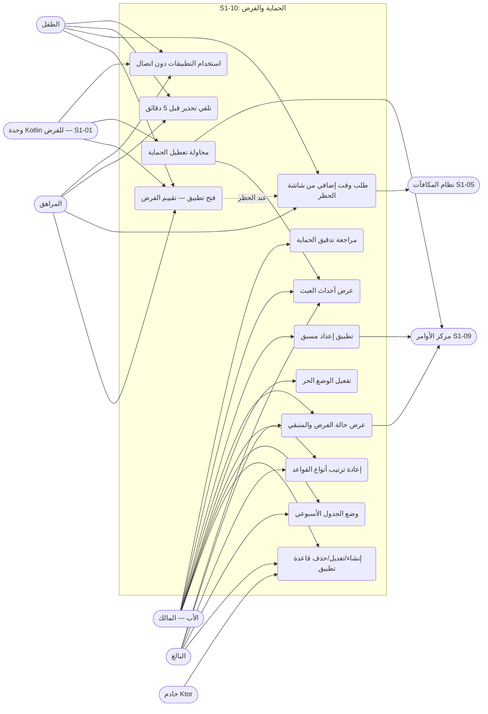

- ملاحظة: حذف القاعدة (`protection.rule.delete`) وإعادة ترتيب الأنواع (`protection.priority.edit`) **قابلان للتفويض حسب القالب** (Q-146) — لذلك يظهر البالغ في UC1 وUC3. والوضع الحر (`protection.free_mode.activate`) **للمالك وحده** (Q-143) — لذلك لا يظهر البالغ في UC4. وزر SOS لا يظهر هنا لأنه ملك S1-01/S1-07 ولا يُحظر أبداً بأي قاعدة (Q-067).

## 2. مخطط قاعدة البيانات (ERD)

الجداول الثمانية من §5 كما هي، مع أربعة مراجع خارجية: العائلة (S1-02)، والعضوية (S1-02)، والوقت الممنوح (S1-05)، و`AuditEvent` (النواة المشتركة). ملاحظات: كل الجداول الثمانية جداول عائلة تحمل `family_id` + عزل RLS (D-021) — ولا جداول سجل عالمية في هذا النظام. وحقول jsonb (`windows` و`order` و`remaining_by_app`) تُرسم `string` لأن Mermaid لا يعرف jsonb — كما في مخططات S1-05. وحقل `minutes_by_weekday` هو `int[7]` — الفهرس 0 = الأحد، 1 = الاثنين، 2 = الثلاثاء، 3 = الأربعاء، 4 = الخميس، 5 = الجمعة، 6 = السبت؛ وكل قيمة 0–1440. و`rule_priority.child_id` فارغ = ترتيب العائلة الافتراضي؛ وصف الطفل تجاوز اختياري عنه (REQ-011). و`enforcement_state` مرآة خادمية لحالة الجهاز — وتقييم الجهاز المحلي هو المرجع دون اتصال (REQ-025). ومخازن العميل (مرآة Drift للقواعد والجدول والترتيب والقناع + Outbox) ليست جداول خادم — انظر §5.

```mermaid
erDiagram
    family ||--o{ app_rule : "له قواعد"
    family ||--o{ daily_total_quota : "له حصص إجمالية"
    family ||--o{ weekly_schedule : "له جدول"
    family ||--o{ rule_priority : "له ترتيب"
    family ||--o{ enforcement_state : "له حالة فرض"
    family ||--o{ app_usage_daily : "له استهلاك يومي"
    family ||--o{ free_mode_session : "له جلسات وضع حر"
    family ||--o{ tamper_event : "له أحداث عبث"
    membership ||--o{ app_rule : "قواعد طفل"
    membership ||--|| daily_total_quota : "حصة طفل"
    membership ||--o{ weekly_schedule : "جدول طفل"
    membership ||--o{ rule_priority : "ترتيب طفل أو العائلة"
    membership ||--|| enforcement_state : "حالة طفل"
    membership ||--o{ app_usage_daily : "استهلاك طفل"
    membership ||--o{ free_mode_session : "جلسات طفل"
    membership ||--o{ tamper_event : "عبث على جهاز طفل"
    granted_time }o--|| enforcement_state : "الممنوح يدخل في المتبقي"
    app_rule ||--o{ AuditEvent : "تغييراته تُسجَّل"
    daily_total_quota ||--o{ AuditEvent : "تغييراتها تُسجَّل"
    weekly_schedule ||--o{ AuditEvent : "تغييراته تُسجَّل"
    rule_priority ||--o{ AuditEvent : "تغييراته تُسجَّل"
    free_mode_session ||--o{ AuditEvent : "تفعيله وانتهاؤه يُسجَّلان"
    tamper_event ||--o{ AuditEvent : "كل حدث يُسجَّل"

    app_rule {
        string rule_id PK
        string family_id FK
        string child_id FK
        string app_package
        string action
        int minutes_by_weekday
        string created_by
        datetime created_at
        datetime updated_at
    }
    daily_total_quota {
        string quota_id PK
        string family_id FK
        string child_id FK
        int minutes_by_weekday
        string created_by
        datetime created_at
        datetime updated_at
    }
    weekly_schedule {
        string schedule_id PK
        string family_id FK
        string child_id FK
        string windows
        int version
        datetime updated_at
    }
    rule_priority {
        string priority_id PK
        string family_id FK
        string child_id FK
        string order
        string updated_by
        datetime updated_at
    }
    enforcement_state {
        string child_id PK
        string family_id FK
        datetime last_evaluated_at
        string active_rule_type
        string remaining_by_app
        datetime next_boundary_at
        datetime free_mode_until
        string tamper_status
        datetime updated_at
    }
    app_usage_daily {
        string usage_id PK
        string family_id FK
        string child_id FK
        string app_package
        datetime usage_date
        int seconds_used
        datetime updated_at
    }
    free_mode_session {
        string session_id PK
        string family_id FK
        string child_id FK
        string activated_by
        datetime activated_at
        datetime expires_at
        datetime cancelled_at
        string status
    }
    tamper_event {
        string event_id PK
        string family_id FK
        string child_id FK
        string device_id
        string kind
        datetime detected_at
        boolean reactivation_attempted
        datetime resolved_at
        boolean notified
    }
    family {
        string id PK
    }
    membership {
        string id PK
    }
    granted_time {
        string id PK
    }
    AuditEvent {
        string id PK
    }
```

## 3. التسلسل (Sequence) — من عقود §4

سبعة مخططات، كل واحد لتدفق واحد:

### 3-أ. إنشاء قاعدة تطبيق + دفع عبر MQTT (REQ-001/026 — §4-2 + §4-3)

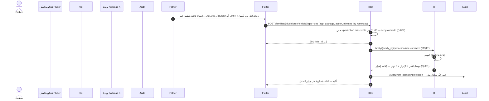

- قاعدة واحدة لكل (طفل، تطبيق) — قيد وحيد (REQ-001)؛ وكل دقيقة في `minutes_by_weekday` بين 0 و1440؛ والتطبيق بلا قاعدة = سماح، لا حظر ضمني.

### 3-ب. حفظ الجدول الأسبوعي مع كشف التعارض (REQ-006 — §4-2)

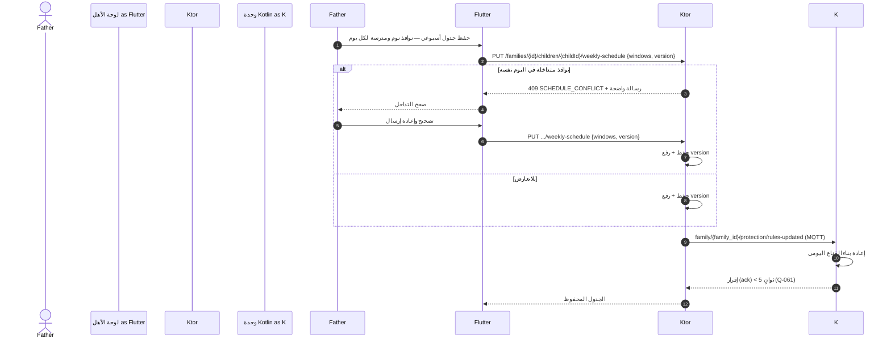

- ملاحظة: تعديل متزامن من والد آخر على نسخة قديمة → `409 VERSION_CONFLICT` — يُعاد تحميل أحدث حالة قبل إعادة المحاولة (نمط S1-03 REQ-019 — قفل تفاؤلي على `version`).

### 3-ج. تقييم الفرض عند فتح تطبيق (REQ-008/010/011/012 — §4-1 evaluateNow + Q-145)

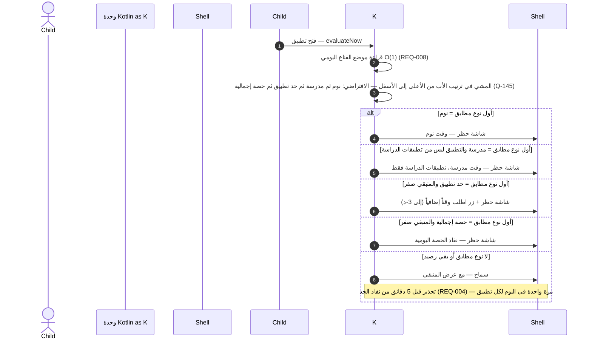

- الترتيب الافتراضي يعمل بلا إعداد؛ والأب يعيد ترتيب الأنواع لكل عائلة ولكل طفل (REQ-011)؛ والوقت المكتسب أو الممنوح يضيف دقائق إلى حد التطبيق فقط — ولا يفتح تطبيقاً في وقت نوم أو مدرسة (REQ-012). وزر SOS لا يُحظر أبداً (Q-067) — خارج هذا التدفق.

### 3-د. نفاد الحد — شاشة الحظر وطلب وقت (REQ-003/004/005 + S1-05)

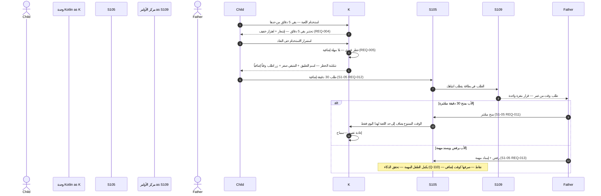

### 3-هـ. الوضع الحر — تفعيل وانتهاء (REQ-018/019/020 — Q-143)

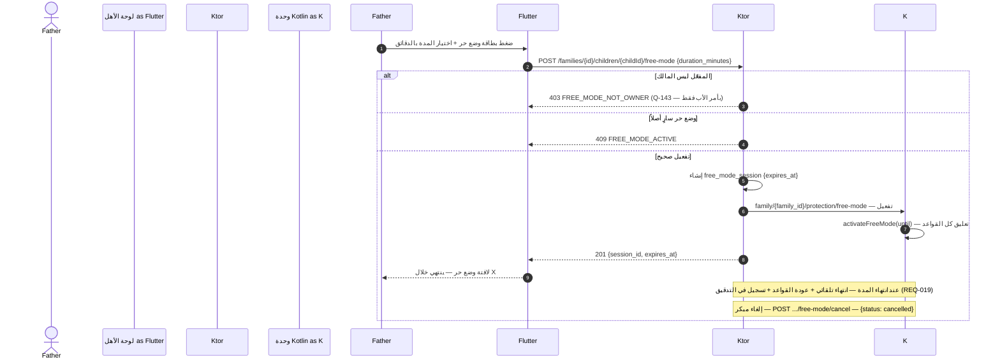

- أثناء الوضع الحر: زر SOS يعمل كالعادة؛ والاستخدام يُحسب في التقارير ولا يُحدَّد؛ والوضع الحر لا يمسح تنبيهات العبث المعلقة ولا يوقف محاولات إعادة التفعيل (REQ-020).

### 3-و. كشف العبث — تنبيه + إعادة تفعيل (REQ-021/022/023 — Q-144)

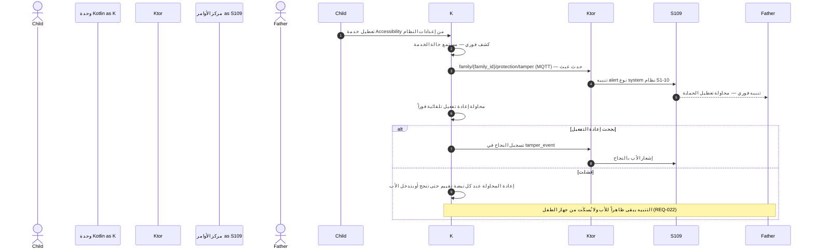

- أنواع العبث: `UNINSTALL_ATTEMPT` · `ACCESSIBILITY_DISABLED` · `DEVICE_ADMIN_REVOKED` · `VPN_DISCONNECTED` · `SERVICE_KILLED` (REQ-021). ودون اتصال يُحفظ حدث العبث في Outbox بأولوية قصوى. وإلغاء تثبيت وكيل الطفل يتطلب PIN الأب (REQ-023 — Q-065 · Q-142 — نمط Bark Kids: رمز يصدره الأب).

### 3-ز. مزامنة دون اتصال (REQ-014/015/016/017 — Q-064)

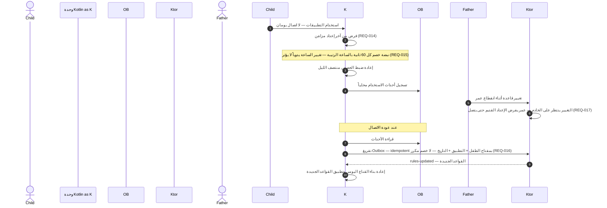

## 4. تدفق المستخدم (User Flow) — من السيناريوهات السبعة (§2)

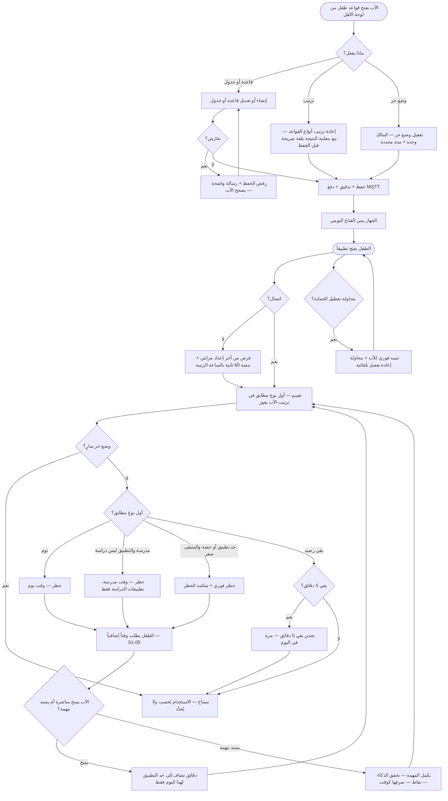

- ملاحظة: زر SOS لا يُحظر أبداً — يعمل في كل مسار، في وقت النوم والمدرسة والوضع الحر (Q-067).
- ملاحظة: القواعد تتبع الطفل لا الجهاز — عند بلوغ الطفل 13 سنة تبقى قواعده سارية ويُشعَر الأب ليراجعها؛ وعند استبدال الجهاز تُعاد القواعد نفسها بالإقران الجديد (REQ-027).
- ملاحظة: تغيير الجدول يسري عند الاستلام؛ وإن صار الوقت الحالي محظوراً بالتغيير الجديد يُطبَّق الحظر فوراً حتى لو كان التطبيق مفتوحاً حينها (REQ-009).

## 5. مخطط تدفق البيانات (DFD — المستوى 1) — من §4/§5

العمليات مرقمة 1.0–7.0، والمخازن D1–D7 جداول خادم (PostgreSQL)، والمخزنان L1–L2 مخازن عميل على جهاز الطفل (Drift/Outbox — محلية، ليست جداول خادم). و`enforcement_state` (D4) مرآة خادمية لحالة الجهاز — وتقييم الجهاز المحلي هو المرجع دون اتصال (REQ-025). والإعدادات المسبقة (REQ-024) تُطبَّق ذرّياً عبر P1+P2 — كل قواعدها أو لا شيء.

- **تغطية نقاط §4:** التسلسلات في §3 تغطي التدفقات الأساسية فقط؛ وكل نقطة §4 تظهر هنا على الأقل: `GET/POST/PATCH/DELETE .../app-rules` (3-أ · P1) · `GET/PUT .../weekly-schedule` (3-ب · P2) · `GET/PUT .../rule-priority` (3-ج · P3) · `POST .../free-mode` و`POST .../free-mode/cancel` (3-هـ · P5) · `GET .../enforcement-state` (P4 · D4) · `POST .../mode-presets/{preset}` (P1+P2 ذرّياً) · `GET .../audit/protection` (التدفقات إلى AuditEvent).

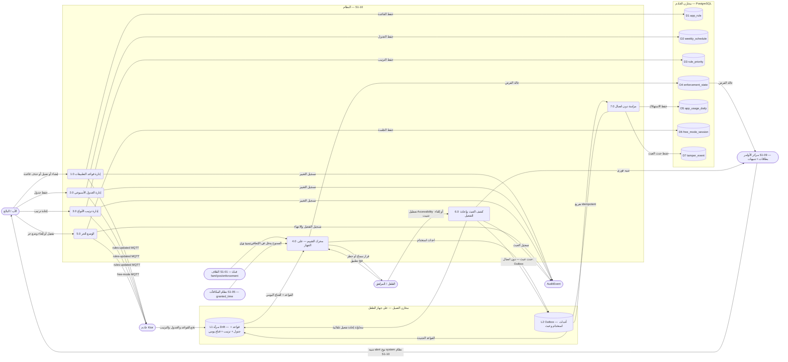

## 6. مخطط النشاط (Activity) — دورة حياة القاعدة والفرض

المسارات الأربعة (الأب / الطفل / وحدة Kotlin / الخادم) كمسارات متوازية. والأنشطة الخلفية (نبضة الخصم كل 60 ثانية + مراقبة العبث + تفريغ Outbox) تعمل **بالتوازي** مع استخدام التطبيق.

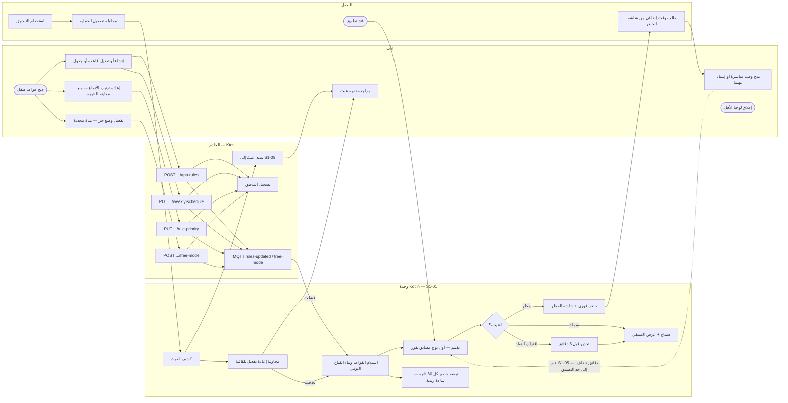

- عند انتهاء الوضع الحر يعود التقييم فوراً — والتطبيق المفتوح المخالف يُغلق مع شاشة الحظر (REQ-019/004).
- الحالات الحدية (§7): تغيير ساعة الجهاز يدوياً لا يؤثر — النبضة بالساعة الرتيبة؛ وتعديلان متزامنان من والدين → `409 VERSION_CONFLICT` وإعادة تحميل؛ واستبدال الجهاز يعيد القواعد نفسها بالإقران الجديد — القواعد تتبع الطفل لا الجهاز.
