# S1-10: مخططات هندسة البرمجيات (DIAGRAMS)

- **الحالة:** معتمدة — المخططات الستة معتمدة (حكم المالك 2026-11-08 — D-2، بعد موجة الإصلاح 0e4a3e2..f7da470)؛ والمواصفة معتمدة بالكامل في التخطيط [تحديث 2026-11-17 (Q-406): أُغلق تصميم النظام؛ وأُعيد رسم المخططات 2026-11-17 لتطابق Q-405/Q-406 (REQ-032/033، الكيانان `custom_mode` و`mode_session`).] [تحديث 2026-11-19 (Q-419 · Q-434): أُضيف كشف التعارض عند الحفظ وبطاقته (UC20/UC21، 3-ل، 3-م، وفروع §4/§6)؛ وأُعيد ضبط الشكل على قواعد §3 (لوحات ≤20 عقدة، وتسلسلات ≤20 رسالة، وERD مجموعتان). المفاتيح 94 والمتطلبات 219 ثابتة.]
- **المواصفة:** `SPEC.md` (§§1–8 + §10 معتمدة بالكامل في التخطيط)
- **السياق المحدد (Bounded Context):** #3 الحماية والتحكم بالجهاز (Child Protection) — `CONTEXT-MAP.md` §2 صف 3
- **القرارات الحاكمة:** Q-001 · Q-007 · Q-134 (هيكل الملف) · Q-002 · Q-031 · Q-061 · Q-065 · Q-067 · Q-106 · Q-141 · Q-142 · Q-143 · Q-144 · Q-145 · Q-146 · Q-168 · Q-343 · Q-405 · Q-406 · Q-419 · Q-426 · Q-431 · Q-434
- **الأنواع الستة:** 1. حالات الاستخدام · 2. ERD · 3. التسلسل · 4. تدفق المستخدم · 5. DFD · 6. النشاط
- **الأشكال الموحدة:** مستطيل بطرفين مستديرين = طرف خارج العملية المرسومة (مستخدم، نظام مجاور، خدمة، أو الخادم) · مستطيل = شاشة أو خطوة، وفي مخطط تدفق البيانات عملية مرسومة في لوحة أخرى · مستطيل مستدير الزوايا = عملية · معين = قرار · أسطوانة = مخزن بيانات · خط متقطع = يتضمن / اختياري

## 1. حالات الاستخدام (REQ-001/002/003/006/010/011/013/018/024/032/033 — Q-419)

يُقرأ منه: من يفعل ماذا في الحماية والفرض — الأهل يديرون القواعد والأوضاع، والأبناء يستخدمون التطبيقات ويطلبون وقتاً، ووحدة الفرض تقيّم وتكشف العبث.

21 حالة استخدام من السيناريوهات الثمانية والمتطلبات (§2/§3): الأب ينشئ القواعد والجداول ويرتب الأنواع ويفعّل الوضع الحر وينشئ الأوضاع الخاصة ويطبّق الأوضاع؛ والبالغ المفوَّض يدير القواعد حسب القالب (حذف القاعدة وإعادة الترتيب قابلان للتفويض — Q-146)؛ والوضع الحر للمالك وحده (Q-143)؛ والطفل والمراهق يفتحان التطبيقات ويطلبان وقتاً إضافياً دون اتصال؛ وأي محاولة تعطيل تتضمن تنبيهاً فورياً وإعادة تفعيل. والتسليم إلى S1-05 (دورة النقاط) وS1-09 (البطاقات والتنبيهات) ممثلان كجهات خارجية. والوضع الحر والأوضاع الجاهزة والخاصة تُطبَّق من شاشة واحدة «الأوضاع» (S10-09 وS10-10 سطح واحد — Q-405). وكشف التعارض عند الحفظ (UC20) يتضمنه كل حفظ في هذا النظام (قاعدة تطبيق، جدول، ترتيب، حصة، تصفية ويب، استثناء موقع، وضع خاص، تطبيق وضع)؛ وصفحة تعارضات قواعد الطفل (UC21) يفتحها الأب والبالغ المفوَّض لحسم ما حُفظ مع تعارض أو ما ظهر بعد آخر حفظ (Q-419 — §9.8 (و)).

### 1-أ. إدارة القواعد والأوضاع (REQ-001/002/003/006/010/011/013/018/024/032/033 — Q-419)

يُقرأ منه: ما يديره الأهل — القواعد والجدول والترتيب والوضع الحر والأوضاع والتصفية — وأين يدخل كشف التعارض.

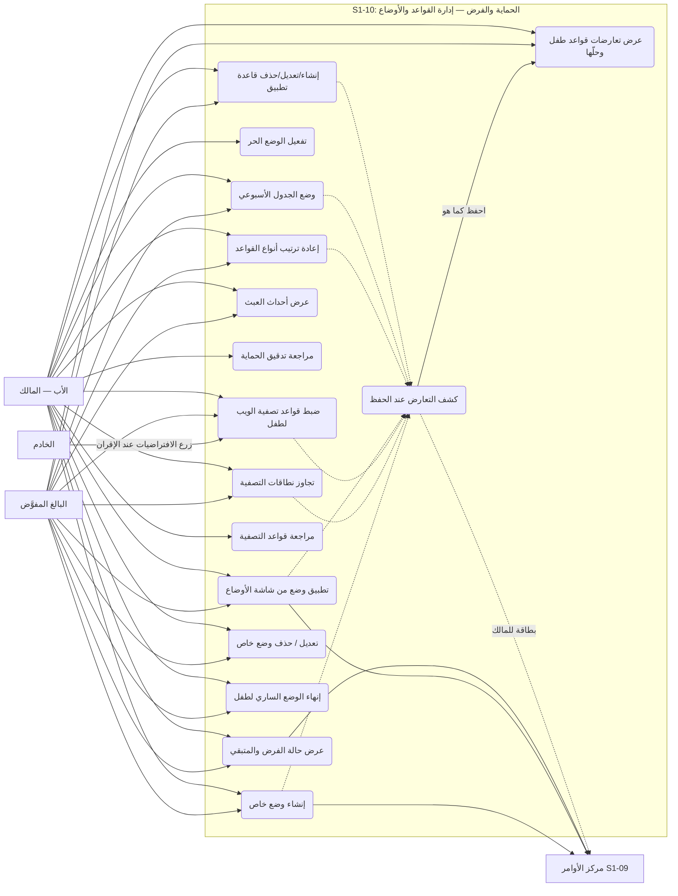

### 1-ب. استخدام الطفل والفرض (REQ-003/004/005/008/010/021/022/023)

يُقرأ منه: ما يفعله الأبناء ووحدة الفرض — فتح التطبيقات وطلب الوقت والعمل دون اتصال وكشف العبث.

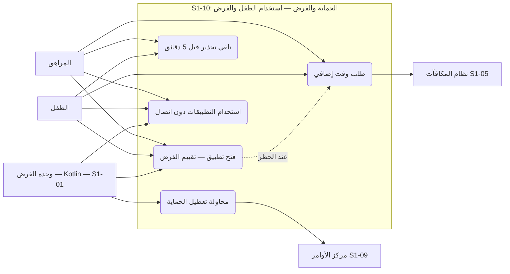

- ملاحظة: محاولة التعطيل (UC9) تُعرض أحداثها في UC12 (عرض أحداث العبث — اللوحة 1-أ)؛ والبطاقة الموحدة للتعارض (UC20) تُتضمَّن أيضاً من حفظ الحصة وتطبيقات الدراسة ضمناً مع UC1، ومن حفظ مهمة أو حدث (S1-06) ومنح الوقت (S1-05) — انظر 3-ل.

أُعيد رسمه 2026-11-17 (Q-405 · Q-406): أُضيفت UC17 (إنشاء وضع خاص) وUC18 (تعديل/حذف وضع خاص) وUC19 (إنهاء الوضع الساري لطفل)؛ وصارت UC11 «تطبيق وضع — جاهز أو خاص — من شاشة الأوضاع» ويدخلها البالغ المفوَّض بمفتاح تطبيق الأوضاع كما يدخل UC19؛ والعدد صار 19.

رُسم 2026-11-19 (Q-419 · Q-434): أُضيفت UC20 (كشف التعارض عند الحفظ) وUC21 (عرض تعارضات قواعد طفل وحلّها)؛ وقُسّم المخطط إلى لوحتين 1-أ/1-ب؛ وصارت الجهات الخارجية مستطيلات؛ واختصرت التسميات؛ والعدد صار 21.

- ملاحظة: حذف القاعدة (`protection.rule.delete`) وإعادة ترتيب الأنواع (`protection.priority.edit`) **قابلان للتفويض حسب القالب** (Q-146) — لذلك يظهر البالغ في UC1 وUC3. والوضع الحر (`protection.free_mode.activate`) **للمالك وحده** (Q-143) — لذلك لا يظهر البالغ في UC4. وزر SOS لا يظهر هنا لأنه ملك S1-01/S1-07 ولا يُحظر أبداً بأي قاعدة (Q-067).
- ملاحظة (Q-405 · Q-406): الأوضاع الخاصة — الإنشاء والتعديل والحذف (UC17/UC18) بمفاتيح قواعد التطبيقات الثلاثة (إنشاء/تعديل/حذف)، والتطبيق (UC11) والإنهاء (UC19) بمفتاح تطبيق الأوضاع (`protection.mode_preset.apply`) — بلا مفتاح جديد؛ والوضع الحر والأوضاع الجاهزة والخاصة من شاشة واحدة «الأوضاع» (S10-09 وS10-10 سطح واحد).
- قواعد تصفية الويب (UC14/UC15 — REQ-028/029/030 — Q-343): التحرير للمالك وحده (`protection.filter.edit`)، والعرض للأب + البالغ المفوَّض حسب القالب (`protection.filter.view`)؛ ومراجعة بلوغ 13 سنة واستبدال الجهاز (UC16 — REQ-027 — S10-14) للمالك.

## 2. مخطط قاعدة البيانات (ERD — §5)

يُقرأ منه: جداول النظام الاثنا عشر وعلاقاتها — اللوحة 2-أ للقواعد والحصة والحالة، واللوحة 2-ب للأوضاع والعبث والتصفية.

الجداول الاثنا عشر من §5 كما هي، مع أربعة مراجع خارجية: العائلة (S1-02)، والعضوية (S1-02)، والوقت الممنوح (S1-05)، و`AuditEvent` (النواة المشتركة). تسميات العلاقات موحدة: «يملك» للملكية، و«يُسجَّل في» للتدقيق، و«من فئة» لفئة القاعدة. وترتيب الحقول في كل جدول: الأساسي، ثم الأجنبية، ثم الحقول، ثم التواريخ. ولا جدول ولا حقل للتعارض (Q-419): وسم «متعارض» وصفحة التعارضات مشتقة من الجداول القائمة. ملاحظات: أحد عشر من الجداول الاثني عشر جداول عائلة تحمل `family_id` + عزل RLS (D-021)؛ والاستثناء الوحيد `web_category` — قاموس منصة ثابت بلا بيانات عائلة (لا `family_id` ولا RLS — Q-343). وحقول jsonb (`windows` و`order` و`remaining_by_app`) تُرسم `text` (مفردات ERD الموحدة Q-177 — النوع الحقيقي `jsonb` في §5) — كما في مخططات S1-05. وحقل `minutes_by_weekday` هو `int[7]` — الفهرس 0 = الأحد، 1 = الاثنين، 2 = الثلاثاء، 3 = الأربعاء، 4 = الخميس، 5 = الجمعة، 6 = السبت؛ وكل قيمة 0–1440. و`rule_priority.child_id` فارغ = ترتيب العائلة الافتراضي؛ وصف الطفل تجاوز اختياري عنه (REQ-011). و`enforcement_state` مرآة خادمية لحالة الجهاز — وتقييم الجهاز المحلي هو المرجع دون اتصال (REQ-025)؛ وتحمل `active_mode` (الوضع الساري: `study` أو `sleep` أو معرّف وضع خاص) و`active_mode_until`، و`active_rule_type` يأخذ القيمة `mode` حين يحسم وضع سارٍ (Q-405). و`app_rule.action` يقبل الفراغ: صف بلا إجراء يحمل علامة الدراسة `is_study_app` وحدها لتطبيق لا قاعدة له (REQ-007 · Q-405). و`mode_session.mode` نص: `study` أو `sleep` أو معرّف `custom_mode` — بلا مفتاح أجنبي إلى `custom_mode`. ومخازن العميل (مرآة Drift للقواعد والجدول والترتيب والقناع + Outbox) ليست جداول خادم — انظر §5. ولا علاقة مفاتيح بين `granted_time` وأي جدول هنا — الوقت الممنوح من S1-05 يدخل في "الإضافي" لصيغة المتبقي (REQ-002: المتبقي = الحصة + الإضافي − المستهلك) عبر محرك التقييم (DFD: S105→P4)؛ وحقل `remaining_by_app` في `enforcement_state` لقطة محسوبة للمتبقي لا علاقة تخزين.

### 2-أ. القواعد والجدول والترتيب والحصة والحالة (§5)

يُقرأ منه: جداول القواعد والحصة وحالة الفرض وعلاقاتها بالعائلة والعضوية والتدقيق.

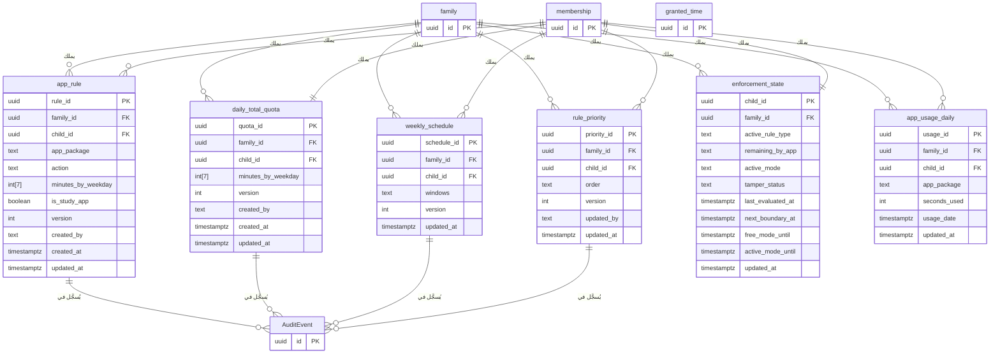

### 2-ب. الأوضاع والعبث والتصفية (§5)

يُقرأ منه: جداول الأوضاع الخاصة والوضع الحر والعبث وتصفية الويب وعلاقاتها.

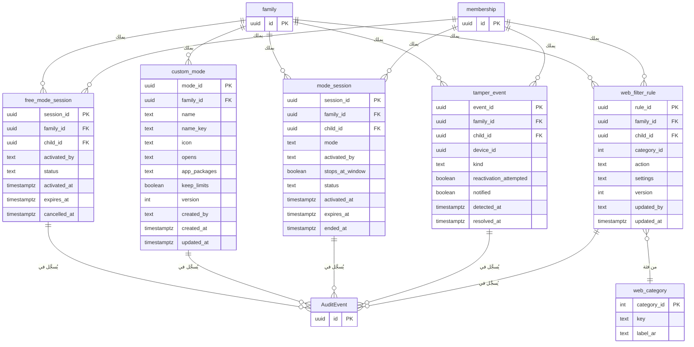

أُعيد رسمه 2026-11-17 (Q-405 · Q-406): أُضيف الكيانان `custom_mode` (تعريف وضع خاص على مستوى العائلة) و`mode_session` (جلسة وضع سارٍ لطفل) مع علاقاتهما والتدقيق؛ وأُضيف إلى `enforcement_state` حقلا `active_mode` و`active_mode_until`؛ و`app_rule.action` يقبل الفراغ لصف علامة الدراسة وحده؛ والعدد صار 12 جدولاً.

رُسم 2026-11-19 (Q-434): قُسّم المخطط إلى لوحتين 2-أ/2-ب؛ ووُحّدت تسميات العلاقات؛ وأُعيد ترتيب حقول الجداول الخمسة (التواريخ في الآخر).

- ملاحظة: `app_rule.action` يقبل الفراغ — صف بلا إجراء يحمل علامة الدراسة `is_study_app` وحدها لتطبيق لا قاعدة له (REQ-007 · Q-405).

## 3. التسلسل (Sequence) — من عقود §4 (REQ-001/002/003/004/005/006/008/009/010/011/012/013/014/015/016/017/018/019/020/021/022/023/024/026/027/028/029/030/031/032/033 — Q-419)

يُقرأ منه: تسلسل كل تدفق — من يحفظ القاعدة إلى من ينفذها على الجهاز — بترتيب مشاركين واحد: المستخدم، ثم التطبيق بمكوناته المحلية، ثم الخادم، ثم الخدمات الخارجية.

خمسة عشر مخططاً، كل واحد لتدفق واحد (3-ج و3-ك لوحتان لكل منهما؛ و3-ل و3-م جديدان لكشف التعارض Q-419):
- **عقد MQTT (Q-168 — الإحالة الصريحة إلى `docs/family-os/governance/architecture/MQTT-BROKER-SPEC.md`):** الوسيط Eclipse Mosquitto 2.x — عقدة واحدة في المرحلة 1 — TLS 1.2+ على المنفذ 8883 + mTLS (شهادة خادم + شهادة جهاز)؛ والأوامر (`family/{family_id}/devices/{device_id}/commands` / `family/{family_id}/protection/rules-updated` / `family/{family_id}/protection/free-mode`) QoS 1 + إقرار تطبيقي إلزامي؛ والعبث (`family/{family_id}/protection/tamper`) QoS 1؛ والحالة الدورية (`family/{family_id}/device/{device_id}/state`) QoS 0 + محفوظة؛ وبلا QoS 2 — التكرار يُغطيه `command_id`؛ وكل أمر يحمل `command_id` (idempotency)؛ والجلسة دائمة (clean session = false)؛ وlast will على `family/{family_id}/devices/{device_id}/status` = `offline`.
- **قنوات المنصة (§4-1 — `MethodChannel("familyos/enforcement")` و`EventChannel("familyos/enforcement/events")`):** الطرق الست الجديدة: `applySchedule(schedule: WeeklySchedule) -> void` (دفع الجدول الأسبوعي) · `applyPriority(order: List<RuleType>) -> void` (دفع ترتيب الأنواع) · `getEnforcementState() -> EnforcementState` (حالة الفرض للعرض) · `activateFreeMode(until: timestamp) -> void` (تفعيل الوضع الحر) · `evaluateNow() -> EnforcementDecision` (تقييم فوري عند فتح تطبيق) · `applyWebFilterRules(rules: WebFilterRules) -> void` (دفع قواعد تصفية الويب إلى VPN QProxy — REQ-028/029/030)؛ والأحداث: `enforcement_state` (موروثة) + `rule_blocked` و`tamper_detected` و`free_mode_changed`.

### 3-أ. إنشاء قاعدة تطبيق + دفع عبر MQTT (REQ-001/026 — §4-2 + §4-3)

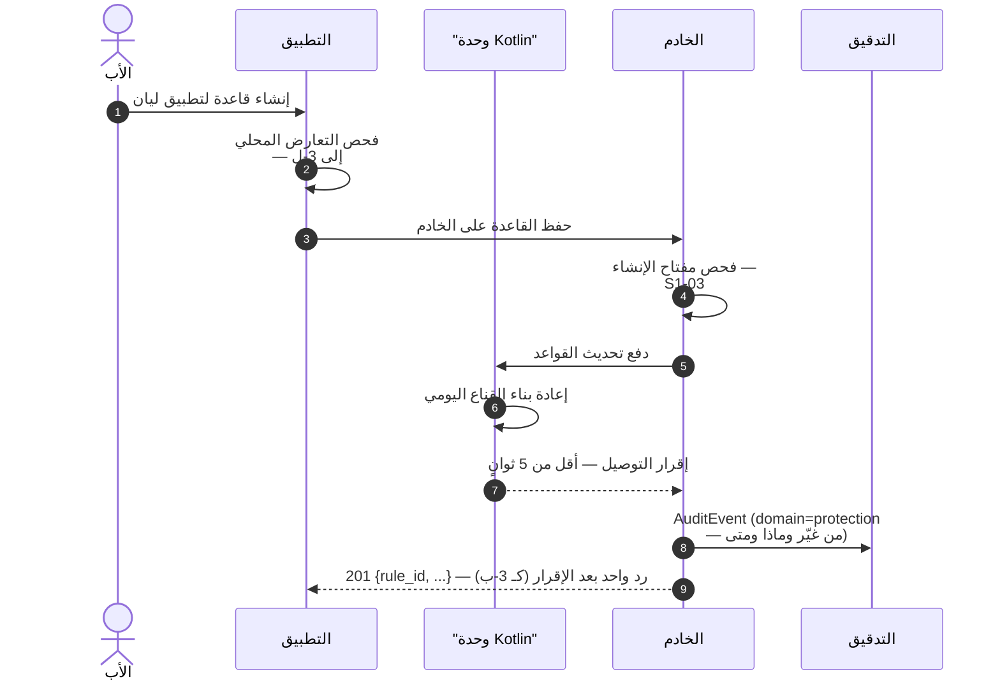

- الرسالة 1: إنشاء قاعدة لتطبيق ليان — ALLOW أو BLOCK أو LIMIT + دقائق لكل يوم أسبوع.
- الرسالة 2: فحص التعارض المحلي (Q-419 — إلى 3-ل).
- الرسالة 3: `POST /api/v1/families/{id}/children/{childId}/app-rules {app_package, action, minutes_by_weekday}`.
- الرسالة 4: فحص `protection.rule.create` عبر S1-03 — deny-override (Q-007).
- الرسالة 5: `family/{family_id}/protection/rules-updated` (MQTT — QoS 1).
- الرسالة 7: إقرار (ack) — QoS 1 — توصيل الأمر + الإقرار < 5 ثوانٍ (Q-061).

- قاعدة واحدة لكل (طفل، تطبيق) — قيد وحيد (REQ-001)؛ وكل دقيقة في `minutes_by_weekday` بين 0 و1440؛ والتطبيق بلا قاعدة = سماح، لا حظر ضمني؛ والرد `201` واحد بعد الإقرار — لا رد مبكر ولا تأكيد ثانٍ (نموذج 3-ب نفسه — و`POST .../app-rules` في §4-2 يعرّف `201` وحده).

### 3-ب. حفظ الجدول الأسبوعي مع كشف التعارض (REQ-006 — §4-2)

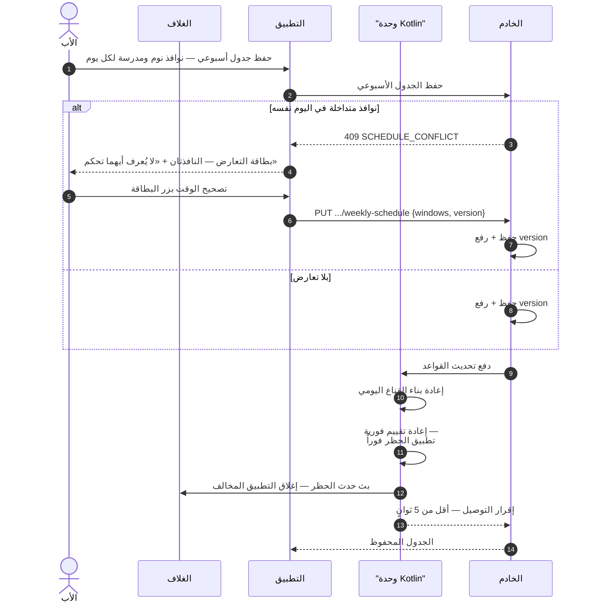

- الرسالة 2: `PUT /api/v1/families/{id}/children/{childId}/weekly-schedule {windows, version}`.
- الرسالة 8: `family/{family_id}/protection/rules-updated` (MQTT — QoS 1).
- الرسالة 10: إعادة تقييم فورية — إن صار الوقت الحالي محظوراً يُطبَّق الحظر فوراً دون انتظار الحد التالي (REQ-009).
- الرسالة 11: بث `rule_blocked` عبر EventChannel — إغلاق التطبيق المفتوح المخالف + شاشة الحظر.
- الرسالة 12: إقرار (ack) — QoS 1 < 5 ثوانٍ (Q-061).

- ملاحظة: تعديل متزامن من والد آخر على نسخة قديمة → `409 VERSION_CONFLICT` — يُعاد تحميل أحدث حالة قبل إعادة المحاولة (نمط S1-03 REQ-019 — قفل تفاؤلي على `version`). وكشف التعارض يشمل التداخل الليلي عبر منتصف الليل (REQ-006): نافذة `end_time <= start_time` تمتد إلى اليوم التالي. ونافذة تُحفظ فوق مهمة أو حدث موعده داخلها تُحذَّر ولا تُمنع (الحالة 4 — إلى 3-ل).

### 3-ج1. تقييم الفرض — الوضع الحر والوضع الساري (REQ-033 — الدرجتان الأولى والثانية — Q-405)

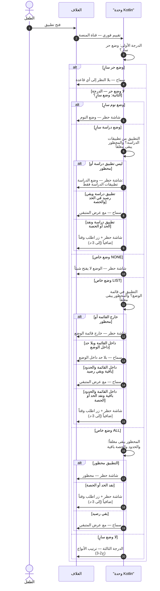

- الرسالة 2: `evaluateNow()` — `MethodChannel("familyos/enforcement")`.

### 3-ج2. تقييم الفرض — ترتيب أنواع القواعد (REQ-008/010/011/012 — الدرجة الثالثة — Q-145)

تتمة 3-ج1 حين لا يكون وضع سارٍ.

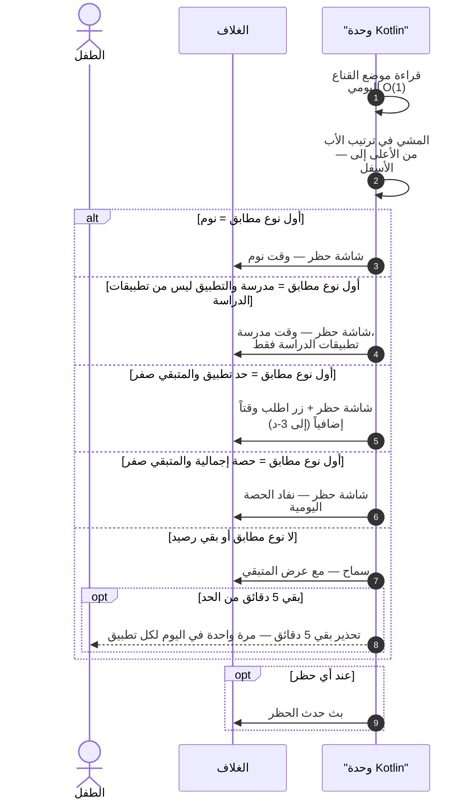

- الرسالة 2: المشي في ترتيب الأب من الأعلى إلى الأسفل — الافتراضي: نوم ثم مدرسة ثم حد تطبيق ثم حصة إجمالية.
- الرسالة 9: بث `rule_blocked` عبر EventChannel.

أُعيد رسمه 2026-11-17 (Q-405): التقييم صار سلّم REQ-033 بثلاث درجات — حر، ثم وضع سارٍ (جاهز أو خاص)، ثم ترتيب أنواع القواعد؛ والمحظور يبقى مغلقاً في كل وضع عدا الحر؛ ووضع `ALL` يبقي الحدود والحصة والمحظور؛ ووضع الدراسة يفتح تطبيقات الدراسة وحدها مع بقاء الحد والحصة.

قُسّم 2026-11-19 (Q-434) إلى لوحتين 3-ج1/3-ج2؛ وحُوّلت الملاحظتان إلى opt؛ وحُذفت أرقام المتطلبات من الرسائل إلى العناوين.

- ملاحظة (تعارض في المواصفة — يُبلَّغ ولا يُحسم): نص `evaluateNow` في SPEC §4-1 ما زال يصف الفحصين القديمين (وضع حر ثم ترتيب الأنواع) ولم يُحدَّث بدرجة الوضع الساري؛ والسلّم هنا من REQ-033 (§3). وكذلك `getEnforcementState` في §4-1 ما زال يرجع الحقول القديمة بلا `active_mode`.

- صيغة المتبقي عند التقييم (REQ-002): المتبقي = الحصة + الإضافي − المستهلك؛ والحصة من `daily_total_quota`، والإضافي من S1-05، والمستهلك من `app_usage_daily`.
- الترتيب الافتراضي يعمل بلا إعداد؛ والأب يعيد ترتيب الأنواع لكل عائلة ولكل طفل (REQ-011)؛ والوقت المكتسب أو الممنوح يضيف دقائق إلى حد التطبيق فقط — ولا يفتح تطبيقاً في وقت نوم أو مدرسة (REQ-012). وزر SOS لا يُحظر أبداً (Q-067) — خارج هذا التدفق.

### 3-د. نفاد الحد — شاشة الحظر وطلب وقت (REQ-003/004/005 + S1-05)

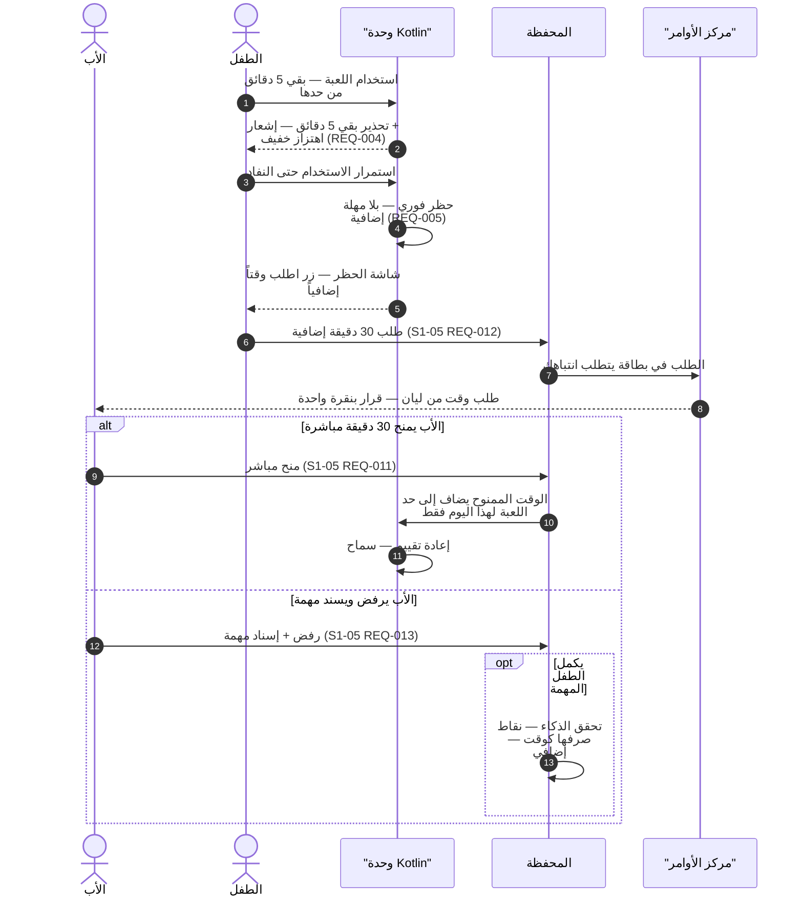

- الرسالة 5: شاشة الحظر — اسم التطبيق + المتبقي صفر + زر اطلب وقتاً إضافياً.

### 3-هـ. الوضع الحر — تفعيل وانتهاء (REQ-018/019/020 — Q-143)

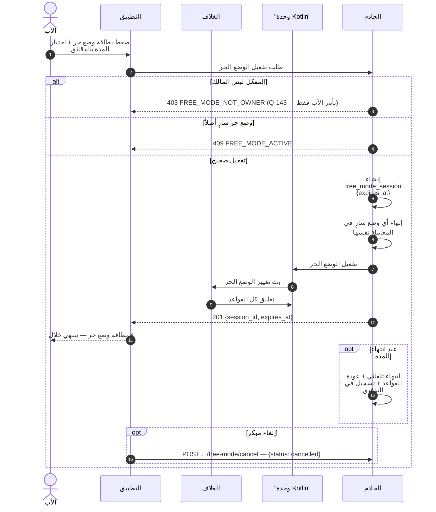

- الرسالة 2: `POST /api/v1/families/{id}/children/{childId}/free-mode {duration_minutes}`.
- الرسالة 6: إنهاء أي وضع سارٍ (`mode_session`) عند الطفل في المعاملة نفسها (REQ-033 أ).
- الرسالة 7: `family/{family_id}/protection/free-mode` — تفعيل (MQTT — QoS 1).
- الرسالة 8: بث `free_mode_changed` عبر `EventChannel("familyos/enforcement/events")`.
- الرسالة 9: `activateFreeMode(until)` — `MethodChannel("familyos/enforcement")` — تعليق كل القواعد.

- أثناء الوضع الحر: زر SOS يعمل كالعادة؛ والاستخدام يُحسب في التقارير ولا يُحدَّد؛ والوضع الحر لا يمسح تنبيهات العبث المعلقة ولا يوقف محاولات إعادة التفعيل (REQ-020). ونموذج الرد هنا يختلف عن 3-أ/3-ب قصداً: الجلسة تُنشأ خادمياً فيُرجع `201` فور إرسال أمر التفعيل عبر MQTT — لأن `201` هنا يثبت إنشاء الجلسة لا سريانها على الجهاز؛ وإقرار الجهاز يصل لاحقاً عبر موضوع الإقرارات `devices/{device_id}/acks` (§4-3) — فلا ينتظر الأب الإقرار ليرى البطاقة. والجلسة منتهية متى بلغ الوقت `expires_at` ولو بقي `status` مخزَّناً ACTIVE — والخادم يصحّح `status` إلى EXPIRED كسولاً عند أول قراءة/تفعيل/مزامنة لاحقة (بلا وظيفة مسح)، وحدث التدقيق يحمل `expires_at` (REQ-019).

### 3-و. كشف العبث — تنبيه + إعادة تفعيل (REQ-021/022/023 — Q-144)

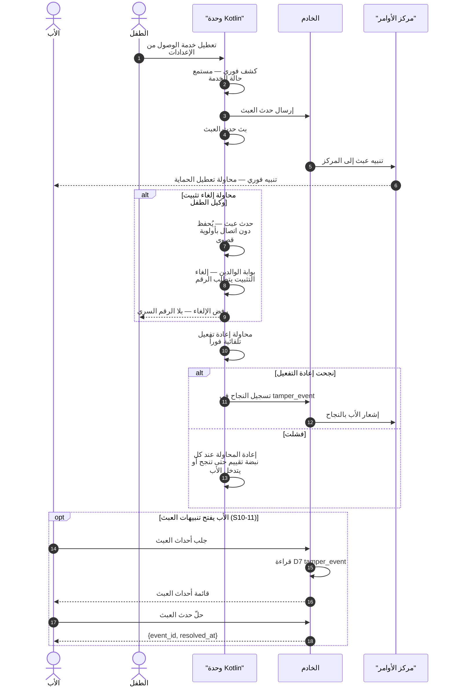

- الرسالة 1: تعطيل خدمة Accessibility من إعدادات النظام.
- الرسالة 3: `family/{family_id}/protection/tamper` (MQTT — QoS 1) — حدث عبث.
- الرسالة 4: بث `tamper_detected` عبر `EventChannel("familyos/enforcement/events")`.
- الرسالة 5: تنبيه alert نوع system نظام S1-10.
- الرسالة 7: حدث عبث `UNINSTALL_ATTEMPT` — يُحفظ في Outbox دون اتصال بأولوية قصوى.
- الرسالة 8: بوابة الوالدين (S1-01 REQ-006) — إلغاء التثبيت يتطلب PIN الأب (REQ-023).
- الرسالة 9: رفض إلغاء التثبيت بلا PIN الأب.
- الرسالة 14: `GET /api/v1/families/{id}/children/{childId}/tamper-events?limit&before` — المفتاح `protection.tamper.view`.
- الرسالة 16: `{events: [{event_id, kind, detected_at, reactivation_attempted, resolved_at, notified}], next_cursor}`.
- الرسالة 17: `POST .../tamper-events/{eventId}/resolve` — حلّ بعد التدخل (REQ-022).

- أنواع العبث: `UNINSTALL_ATTEMPT` · `ACCESSIBILITY_DISABLED` · `DEVICE_ADMIN_REVOKED` · `VPN_DISCONNECTED` · `SERVICE_KILLED` (REQ-021). ودون اتصال يُحفظ حدث العبث في Outbox بأولوية قصوى. وإلغاء تثبيت وكيل الطفل يتطلب PIN الأب (REQ-023 — Q-065 · Q-142 — نمط Bark Kids: رمز يصدره الأب). والتنبيه يبقى ظاهراً للأب ولا يُسكَت من جهاز الطفل (REQ-022).

### 3-ز. مزامنة دون اتصال (REQ-014/015/016/017 — Q-064)

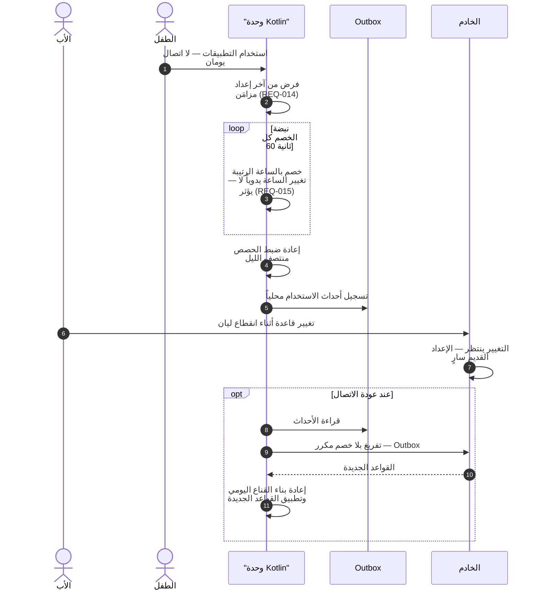

- الرسالة 4: إعادة ضبط الحصص منتصف الليل بالمرساة (REQ-005): منتصف ليل تقويمي مخزَّن من `family.time_zone` + إزاحة رتيبة — تُعاد تثبيتها عند كل مزامنة/إقلاع؛ وبلا اتصال بعد إعادة تشغيل لا إعادة ضبط حتى إعادة التثبيت.
- الرسالة 7: التغيير ينتظر على الخادم — ليان تفرض الإعداد القديم حتى تتصل (REQ-017).
- الرسالة 9: تفريغ Outbox — `idempotent` بمفتاح الطفل + التطبيق + التاريخ — لا خصم مكرر (REQ-016).
- الرسالة 10: `family/{family_id}/protection/rules-updated` — القواعد الجديدة.

### 3-ح. دورة الأمر والإقرار عبر MQTT (REQ-001/026 — §4-3 + Q-168)

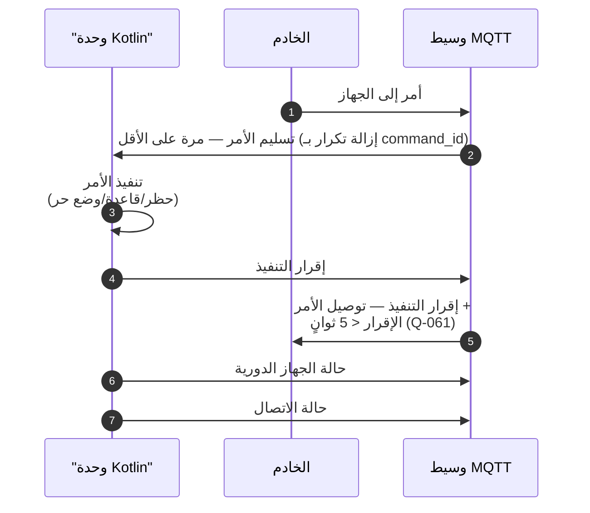

- الرسالة 1: `family/{family_id}/devices/{device_id}/commands` (MQTT — QoS 1 + `command_id`).
- الرسالة 4: `family/{family_id}/devices/{device_id}/acks` (MQTT — QoS 1 + `command_id` + النتيجة).
- الرسالة 6: `family/{family_id}/device/{device_id}/state` (MQTT — QoS 0 — محفوظة).
- الرسالة 7: `family/{family_id}/devices/{device_id}/status` (MQTT — محفوظة + `last will = offline`).

- الوسيط Eclipse Mosquitto 2.x — TLS 1.2+ على 8883 + mTLS (Q-168).

### 3-ط. تطبيق وضع — جاهز أو خاص (REQ-024/032/033 — §4-2 POST .../mode-presets/{preset} · Q-405)

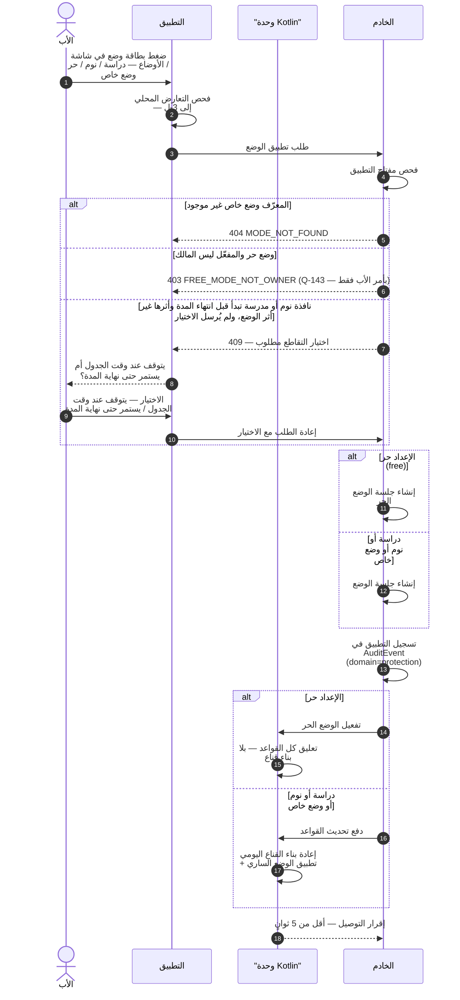

- الرسالة 2: فحص التعارض المحلي — الوضع يفتح تطبيقاً محظوراً؟ (Q-419 — إلى 3-ل).
- الرسالة 3: `POST /api/v1/families/{id}/children/{childId}/mode-presets/{preset} {duration_minutes, on_schedule_cross?}`.
- الرسالة 4: فحص المفتاح: دراسة/نوم/خاص `protection.mode_preset.apply` — والحر `protection.free_mode.activate`.
- الرسالة 7: `409 SCHEDULE_CROSS_CHOICE_REQUIRED`.
- الرسالة 10: `POST .../mode-presets/{preset} {duration_minutes, on_schedule_cross: stop | continue}`.
- الرسالة 11: إنشاء `free_mode_session {expires_at}` — وينهي أي `mode_session` سارية (REQ-033 أ).
- الرسالة 12: إنشاء `mode_session {mode, expires_at, stops_at_window}` — وينهي أي وضع سارٍ أو وضع حر (REQ-033 أ).
- الرسالة 14: `family/{family_id}/protection/free-mode` (MQTT — QoS 1).
- الرسالة 16: `family/{family_id}/protection/rules-updated` (MQTT — QoS 1).
- الرسالة 18: إقرار (ack) < 5 ثوانٍ (Q-061).

أُعيد رسمه 2026-11-17 (Q-405): `{preset}` يقبل `study` أو `sleep` أو `free` أو معرّف وضع خاص؛ والمدة مطلوبة لكل وضع؛ والتقاطع مع نافذة جدول أثرها غير أثر الوضع يُرجع `409 SCHEDULE_CROSS_CHOICE_REQUIRED` حتى يختار الأب؛ والتطبيق ينهي أي وضع سارٍ أو وضع حر في المعاملة نفسها (وضع واحد لكل طفل)؛ ومعرّف خاص غير موجود يُرجع `404 MODE_NOT_FOUND`.

رُسم 2026-11-19 (Q-434): المشارك «مركز الأوامر» صار «شاشة الأوضاع» (S110)؛ وأُضيف فحص التعارض المحلي قبل POST.

- المعاينة قبل التطبيق (S10-10) تذكر أثر الوضع على كل طفل باسمه وتقول إن الجديد ينهي الساري (REQ-033 أ/هـ)؛ وبلا مدة لا تطبيق (Q-087).

### 3-ي. حفظ قواعد تصفية الويب + دفع إلى VPN QProxy (REQ-028/029/030/031 — Q-343)

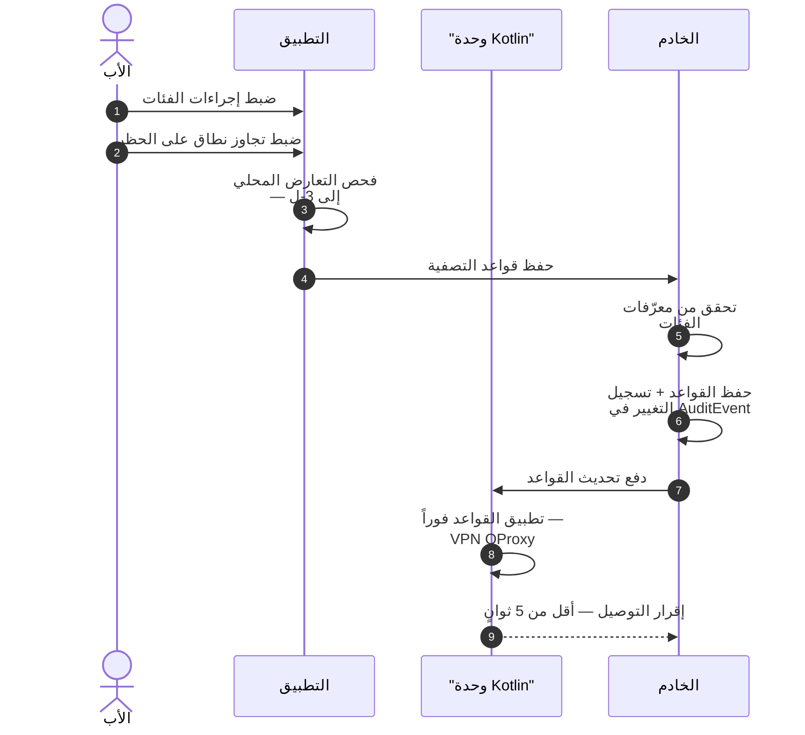

- الرسالة 1: ضبط إجراء `pornography` على BLOCK و`gambling` على BLOCK و`socialNetwork` على ALERT (S10-15).
- الرسالة 2: ضبط تجاوز `example.com` على BLOCK (S10-16).
- الرسالة 3: فحص التعارض المحلي — موقع تطبيق محظور مفتوح؟ (Q-419 — إلى 3-ل).
- الرسالة 4: `PUT /api/v1/families/{id}/children/{childId}/web-filter-rules {categories, domains, flags}` — `protection.filter.edit`.
- الرسالة 5: تحقق: معرّف فئة غير معروف → `400 INVALID_WEB_FILTER` — لا يُخزَّن شيء.
- الرسالة 7: `family/{family_id}/protection/rules-updated` (MQTT — QoS 1).
- الرسالة 8: `applyWebFilterRules(rules)` — تطبيق فوري على مسار التصفية (VPN QProxy).
- الرسالة 9: إقرار (ack) < 5 ثوانٍ (Q-061).

- تجاوز النطاق يفوز على إجراء الفئة (REQ-029)؛ والطفل المقترن حديثاً تُزرع قواعده بالافتراضيات قبل أي إجراء من الأب (REQ-031). والفئات العشر المحظورة من أول يوم (Q-405): 14 إباحية · 12 محتوى ناضج · 7 قمار · 3 مخدرات · 1 كحول · 21 تبغ · 23 عنف · 24 أسلحة · 15 ألفاظ بذيئة · 29 بروكسي/ثغرات؛ والعشرون الباقية `ALLOW`؛ وكلها قابلة لتعديل الأب. والإجراء `IGNORE` (3) لا يُعرض في المرحلة 1 والخادم يرفضه `INVALID_RULE`؛ والمعروض: سماح، حظر، تنبيه (REQ-029 · Q-405).
[تصحيح 2026-11-08 (Q-343 — Q343-01): معرّف الشاشة S10-16 (تجاوزات نطاقات التصفية — REQ-029) كان غائباً من هذا الملف رغم أن مضمونه كان موجوداً: تسلسل 3-ي يحمل `domains` في حمولة PUT، والملاحظة أعلاه تستشهد بـ REQ-029 «تجاوز النطاق يفوز على إجراء الفئة»؛ أُضيف المعرف في تسلسل 3-ي وعقدة FWeb في §4 بنمط S10-15 نفسه، بلا تغيير في عدد التغطية (REQ-029 مغطى بـ S10-16 أصلاً في SPEC :903).]

رُسم 2026-11-19 (Q-434): المشارك «التطبيق» صار «لوحة الأهل»؛ وأُضيف فحص التعارض المحلي قبل PUT.

### 3-ك1. إدارة الأوضاع الخاصة — إنشاء وتعديل (REQ-032/033 — §4-2 · Q-405)

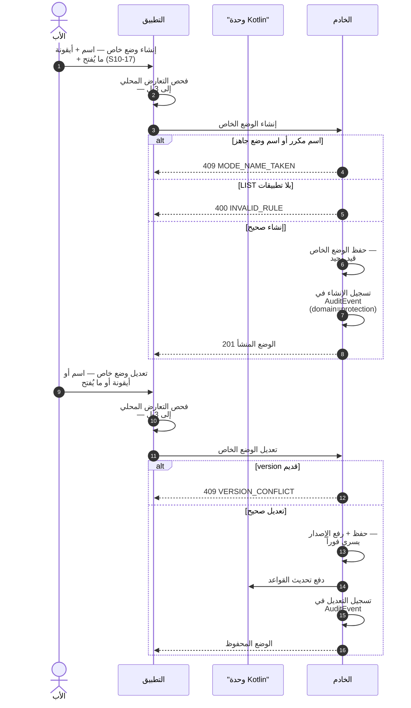

- الرسالة 2: فحص التعارض المحلي — الوضع يفتح تطبيقاً محظوراً؟ (Q-419 — إلى 3-ل).
- الرسالة 3: `POST /api/v1/families/{id}/custom-modes {name, icon, opens, app_packages?, keep_limits?}`.
- الرسالة 6: حفظ `custom_mode {mode_id, name_key}` — قيد وحيد (`family_id, name_key`).
- الرسالة 10: فحص التعارض المحلي — الوضع يفتح تطبيقاً محظوراً؟ (Q-419 — إلى 3-ل).
- الرسالة 11: `PUT /api/v1/families/{id}/custom-modes/{modeId} {name, icon, opens, app_packages?, keep_limits?, version}`.
- الرسالة 13: حفظ + رفع `version` — يسري فوراً على من يسري عليهم (REQ-032).
- الرسالة 14: `family/{family_id}/protection/rules-updated` (MQTT — QoS 1).

### 3-ك2. إدارة الأوضاع الخاصة — حذف وإنهاء الوضع الساري (REQ-032/033 — §4-2 · Q-405)

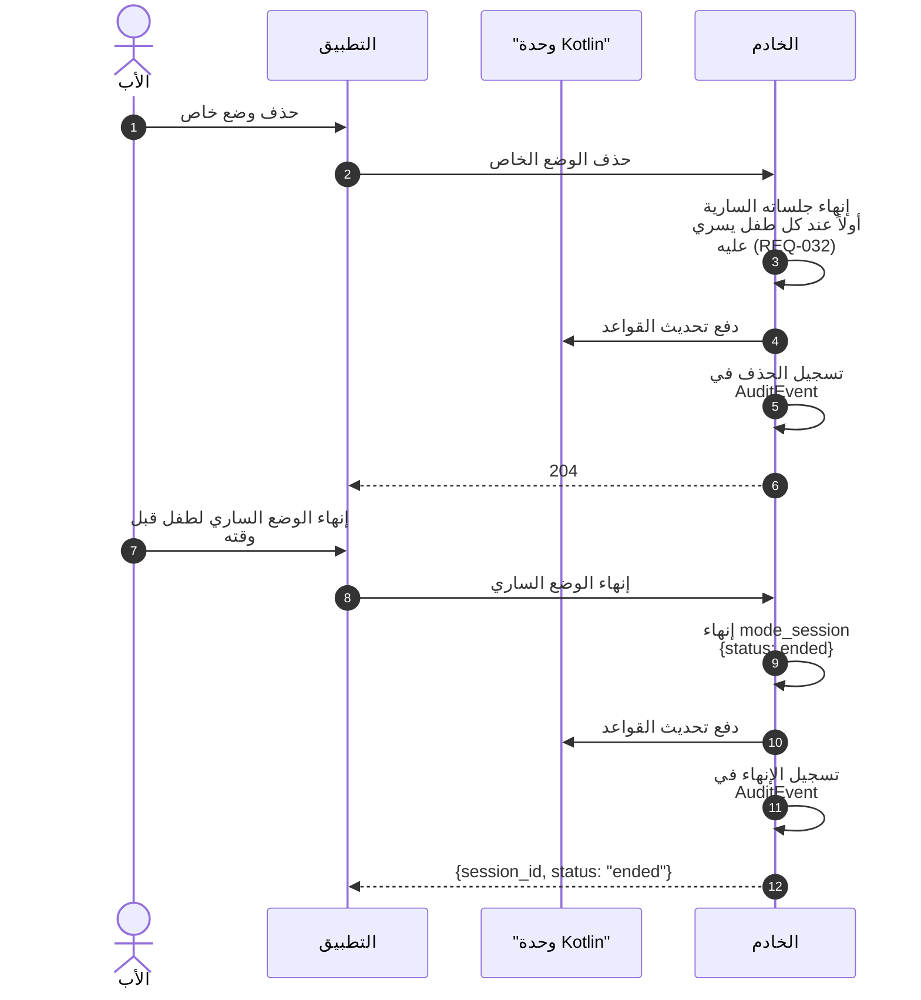

- الرسالة 2: `DELETE /api/v1/families/{id}/custom-modes/{modeId}`.
- الرسالة 4: `family/{family_id}/protection/rules-updated` (MQTT — QoS 1).
- الرسالة 8: `DELETE /api/v1/families/{id}/children/{childId}/active-mode`.
- الرسالة 10: `family/{family_id}/protection/rules-updated` (MQTT — QoS 1).

قُسّم 2026-11-19 (Q-434) إلى لوحتين 3-ك1/3-ك2؛ وأُضيف فحص التعارض المحلي قبل الإنشاء والتعديل.

رُسم 2026-11-17 (Q-405): مخطط جديد — نقاط الأوضاع الخاصة الخمس: الإنشاء بمفتاح `protection.rule.create`، والتعديل بمفتاح `protection.rule.edit`، والحذف بمفتاح `protection.rule.delete`، والإنهاء بمفتاح `protection.mode_preset.apply`؛ وتعديل وضع سارٍ يسري فوراً؛ وحذفه ينهي جلساته أولاً.

### 3-ل. كشف التعارض عند الحفظ — لا تعارض صامت (REQ-006/013/029/033 — §9.8 (و) — Q-419)

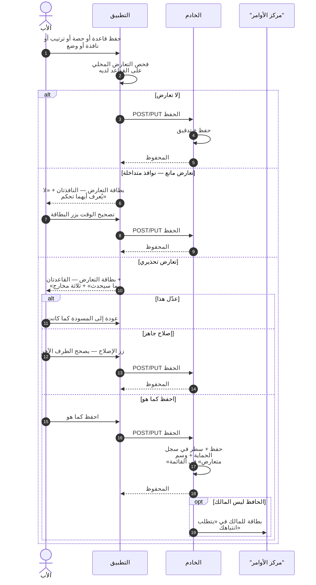

رُسم 2026-11-19 (Q-419 · Q-434): مخطط جديد — الفحص محلي في التطبيق قبل كل حفظ من الحفظات الثلاث عشرة (قاعدة تطبيق، حصة، ترتيب، نافذة جدول، تطبيقات دراسة، فئة ويب، تجاوز نطاق، وضع خاص، مهمة، حدث، منح وقت، الموافقة على طلب وقت، تطبيق وضع)؛ والبطاقة الموحدة: عنوان الحالة، ثم القاعدتان جنباً إلى جنب (اسم + قيمة لكل منهما)، ثم «ما سيحدث» في جملة واحدة، ثم أزرار الحل؛ والمستوى المانع بلا «احفظ كما هو»، والتحذيري بثلاثة مخارج.

- الحالة 2 («مسموح دائماً» يُغلق في النوم أو المدرسة بترتيب الأولوية) بيان في صفحة القاعدة يسمّي أوقات الإغلاق — لا بطاقة ولا تعارض.
- الحالة 3 (وقت إضافي أثناء النوم أو المدرسة أو وضع سارٍ) تُرسم في S1-05 (تدفق المنح) — تُرجع هنا ولا تُكرَّر.
- الحالتان 4–5 (مهمة أو حدث داخل النوم أو المدرسة؛ حدثان لشخص واحد بفاصل أقل من ساعة) تُرسمان في S1-06 — تُرجعان هنا ولا تُكرَّران.
- الحالة 6: خريطة «التطبيق ← موقعه أو فئته» مصدرها فهرس التطبيقات عند التنفيذ (Q-419)؛ والفحص مرسوم عاماً.
- «ظهر بعد آخر حفظ»: يُفحص كلما تغيّرت نسخة القواعد التي عند التطبيق — بعد كل حفظ، وبعد كل مزامنة، وعند فتح الرئيسية أو صفحة حماية الطفل. الفحص محلي (Q-419).
- زر الإصلاح الذي يغيّر الطرف الآخر يظهر لمن له تعديله فقط. من لا يملك التعديل يرى البطاقة كاملة بلا هذا الزر، ويبقى له «عدّل هذا» و«احفظ كما هو».
- وسم «متعارض» يُشتق عند العرض من نتيجة الفحص المحلي، بلا حقل مخزَّن؛ و«من أبقاه كما هو» من سطر سجل الحماية (REQ-026).
- هذا الفحص محلي في التطبيق على القواعد لديه؛ ولا يغيّر قرار المحرك (سلّم REQ-033)؛ وليس `VERSION_CONFLICT` (تعديلان متزامنان — شيء آخر) ولا `400 INVALID_RULE` ولا `400 INVALID_WEB_FILTER`.
- المفاتيح 94 والمتطلبات 219 ثابتة — لا مفتاح جديد (Q-419).

### 3-م. صفحة تعارضات قواعد طفل — عرض وحسم (Q-419 (ج)/(و))

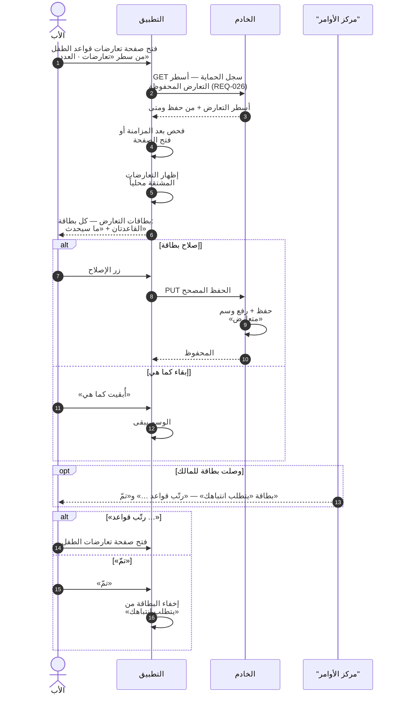

- الرسالة 5: إظهار التعارضات المشتقة محلياً — «ظهر بعد آخر حفظ · لم يقرّر فيه أحد».

رُسم 2026-11-19 (Q-419 · Q-434): مخطط جديد — الصفحة تُفتح من سطر «تعارضات · العدد» في صفحة حماية الطفل («تنتظر قرارك» أو «أُبقيت كما هي»)؛ وتعرض التعارضات المحفوظة «كما هي» والتعارضات المشتقة محلياً «ظهر بعد آخر حفظ»؛ وكل بطاقة تُحسم بإصلاح أو إبقاء.

- بطاقة المالك: «رتّب قواعد …» يفتح صفحة تعارضات ذلك الطفل؛ و«تمّ» يخفي البطاقة من «يتطلب انتباهك» فقط، والتعارض باقٍ في صفحته بوسمه.
- صفحتا التعارض مكوّن مشترك بلا رقم شاشة (§9.8 و).
- المفاتيح 94. الرقم 95 في نص Q-419 كان العدد يوم كُتب، قبل حذف مفتاح القسيمة (Q-421).

## 4. تدفق المستخدم (User Flow) — من السيناريوهات الثمانية (§2) (REQ-003/004/005/006/009/013/018/021/022/027/028/029/032/033 — Q-419)

يُقرأ منه: مسار الأب من فتح القواعد إلى الحفظ، ثم مسار التقييم على الجهاز — عشر لوحات، والمسار السعيد في كل لوحة عمود واحد مستقيم. واللوحات مترابطة بعقد حدودية (شكل الملعب) + ملاحظات نصية تحتها.

### 4-أ. حفظ قاعدة أو جدول أو ترتيب — مع كشف التعارض (REQ-006/013/033 — Q-419)

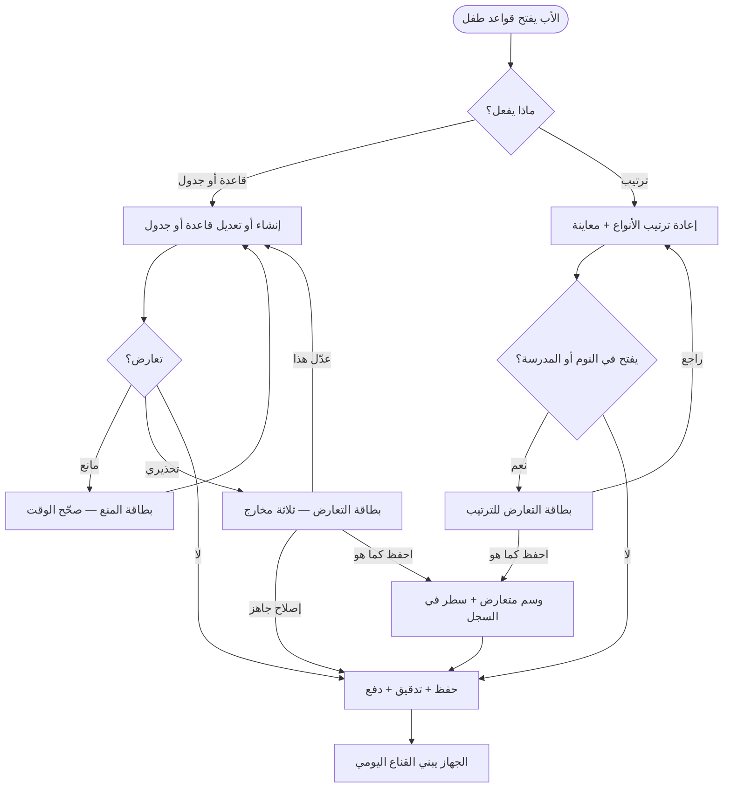

- إلى 4-هـ: الجهاز يبني القناع اليومي ثم يقيّم عند فتح التطبيق.

### 4-ب. تصفية الويب (REQ-028/029/030/031 — Q-343)

```mermaid
flowchart TD
    FStart([الأب يفتح تصفية الويب لطفل]) --> FWeb[ضبط قواعد التصفية + تجاوزات النطاقات]
    FWeb --> FWebChk{تعارض تطبيق مع موقعه؟}
    FWebChk -->|نعم| FWebCard[بطاقة التعارض — احظر موقعه أيضاً / اسمح بموقعه]
    FWebCard -->|إصلاح| FWeb
    FWebCard -->|احفظ كما هو| FWebVal
    FWebChk -->|لا| FWebVal{معرّف فئة غير معروف؟}
    FWebVal -->|نعم| FWebRej[رفض 400 — لا يُخزَّن شيء]
    FWebRej --> FWeb
    FWebVal -->|لا| FWebSave[حفظ + تدقيق + دفع MQTT]
    FWebSave --> FWebApply[VPN QProxy يطبق القواعد فوراً]
```

### 4-ج. الأوضاع — الوضع الحر وتطبيق وضع (REQ-018/024/033 — Q-405)

يُقرأ منه: تفعيل الوضع الحر وتطبيق وضع جاهز أو خاص — والبطاقة حين يفتح الوضع تطبيقاً محظوراً.

```mermaid
flowchart TD
    FStart([الأب يفتح شاشة الأوضاع]) --> FModes[جاهزة + خاصة + وضع حر — سطح واحد]
    FModes --> FFree[تفعيل وضع حر — المالك وحده + مدة]
    FModes --> FApply[تطبيق وضع جاهز أو خاص — مدة + اختيار التقاطع]
    FFree --> FFreeSave[إنشاء جلسة وضع حر + تدقيق + دفع]
    FApply --> FApplyChk{الوضع يفتح تطبيقاً محظوراً؟}
    FApplyChk -->|نعم — بطاقة التعارض| FApplyCard[بطاقة التعارض للوضع]
    FApplyCard -->|احفظ كما هو| FApplySave[إنشاء جلسة وضع + تدقيق + دفع]
    FApplyCard -->|عدّل| FApply
    FApplyChk -->|لا — إنشاء الجلسة| FApplySave
```

### 4-د. الأوضاع — وضع خاص وإنهاؤه (REQ-032/033 — Q-405)

يُقرأ منه: إنشاء وضع خاص أو تعديله أو حذفه، وإنهاء الوضع الساري لطفل.

```mermaid
flowchart TD
    InM([من 4-ج: شاشة الأوضاع]) --> FCustom[إنشاء / تعديل / حذف وضع خاص]
    InM --> FEnd[إنهاء الوضع الساري لطفل]
    FCustom --> FCustomChk{الوضع يفتح تطبيقاً محظوراً؟}
    FCustomChk -->|نعم — بطاقة التعارض| FCustomCard[بطاقة التعارض للوضع الخاص]
    FCustomCard -->|احفظ كما هو| FCustomSave[حفظ التعريف + تدقيق + دفع]
    FCustomCard -->|عدّل| FCustom
    FCustomChk -->|لا — حفظ التعريف| FCustomSave
    FEnd --> FEndSave[إنهاء جلسة وضع + تدقيق + دفع]
```

### 4-هـ. التقييم — الوضع الحر والنوم والدراسة (REQ-033 — Q-405)

يُقرأ منه: الدرجتان الأولى والثانية من سلّم التقييم — الحر، ثم النوم والدراسة.

```mermaid
flowchart TD
    CToReq([من 4-أ: الجهاز يبني القناع اليومي]) --> COpen([الطفل يفتح تطبيقاً])
    COpen --> CConn{اتصال؟}
    CConn -->|لا — فرض دون اتصال| COff[فرض من آخر إعداد مزامَن + نبضة 60 ثانية]
    COff --> CEval
    CConn -->|نعم — متصل| CEval[تقييم بسلّم من ثلاث درجات]
    CEval --> CFree{وضع حر سارٍ؟}
    CFree -->|نعم — سماح| CAllow[سماح — الاستخدام يُحسب ولا يُحدَّد]
    CFree -->|لا — فحص الوضع| CMode{وضع سارٍ؟}
    CMode -->|لا — ترتيب الأنواع| CToMatch([إلى 4-ح: ترتيب الأنواع])
    CMode -->|نوم| CBlockN[حظر — وقت نوم]
    CMode -->|دراسة| CToStudy([إلى 4-و: وضع الدراسة])
    CMode -->|خاص| CToSpecial([إلى 4-ز: الوضع الخاص])
```

### 4-و. التقييم — وضع الدراسة (REQ-033 — Q-405)

يُقرأ منه: وضع الدراسة الساري — تطبيقات الدراسة وحدها، مع بقاء الحد والحصة.

```mermaid
flowchart TD
    InS([من 4-هـ: وضع دراسة سارٍ]) --> CStudy{التطبيق من تطبيقات الدراسة؟}
    CStudy -->|لا — حظر المدرسة| CBlockS[حظر — وقت مدرسة، تطبيقات الدراسة فقط]
    CStudy -->|نعم — محظور| CBlockB[حظر — محظور]
    CStudy -->|نعم — بقي رصيد| CWarn{بقي 5 دقائق؟}
    CStudy -->|نعم — نفد الحد أو الحصة| CBlockQ[حظر فوري]
    CWarn -->|نعم — تحذير| CWarn2[تحذير بقي 5 دقائق]
    CWarn2 --> CAllow[سماح — مع عرض المتبقي]
    CWarn -->|لا — سماح| CAllow
```

### 4-ز. التقييم — الوضع الخاص (REQ-033 — Q-405)

يُقرأ منه: الوضع الخاص الساري — NONE لا يفتح شيئاً، وLIST قائمته، وALL كل شيء عدا المحظور.

```mermaid
flowchart TD
    InP([من 4-هـ: وضع خاص سارٍ]) -->|NONE| CBlockM[حظر — لا يفتح شيئاً]
    InP -->|LIST| CList{التطبيق في قائمة الوضع؟}
    InP -->|ALL| CAllB{التطبيق محظور؟}
    CList -->|لا| CBlockM
    CList -->|نعم — محظور| CBlockB[حظر — محظور]
    CList -->|نعم — بلا حد داخل الوضع| CAllow[سماح — بلا حد]
    CList -->|نعم — الحدود باقية وبقي رصيد| CWarn{بقي 5 دقائق؟}
    CList -->|نعم — الحدود باقية ونفد الحد أو الحصة| CBlockQ[حظر فوري]
    CAllB -->|نعم — حظر| CBlockB
    CAllB -->|لا — بقي رصيد| CWarn
    CAllB -->|لا — نفد الحد أو الحصة| CBlockQ
    CWarn -->|نعم — تحذير| CWarn2[تحذير بقي 5 دقائق]
    CWarn2 --> CAllow2[سماح — مع عرض المتبقي]
    CWarn -->|لا — سماح| CAllow2
```

- عند أي حظر بحد أو حصة أو وقت: الطفل يطلب وقتاً إضافياً (4-ط).

### 4-ح. التقييم — ترتيب الأنواع (REQ-008/010/011/012 — Q-145)

يُقرأ منه: الدرجة الثالثة — المشي في ترتيب الأب حتى أول نوع مطابق.

```mermaid
flowchart TD
    CToMatch2([من 4-هـ: لا وضع سارٍ]) --> CMatch{أول نوع مطابق؟}
    CMatch -->|نوم| CBlockN[حظر — وقت نوم]
    CMatch -->|مدرسة والتطبيق ليس دراسة| CBlockS[حظر — وقت مدرسة، تطبيقات الدراسة فقط]
    CMatch -->|حد تطبيق أو حصة والمتبقي صفر| CBlockQ[حظر فوري]
    CMatch -->|بقي رصيد| CWarn{بقي 5 دقائق؟}
    CWarn -->|نعم — تحذير| CWarn2[تحذير بقي 5 دقائق]
    CWarn2 --> CAllow[سماح — مع عرض المتبقي]
    CWarn -->|لا — سماح| CAllow
```

- عند أي حظر بحد أو حصة أو وقت: الطفل يطلب وقتاً إضافياً (4-ط).

### 4-ط. طلب وقت إضافي (REQ-003/004/005)

يُقرأ منه: الطفل يطلب وقتاً إضافياً عند الحظر — منح مباشر أو إسناد مهمة.

```mermaid
flowchart TD
    CReq([الطفل يطلب وقتاً إضافياً]) --> FDec{الأب يمنح مباشرة أم يسند مهمة؟}
    FDec -->|يمنح| CGrant[دقائق تضاف إلى حد التطبيق لهذا اليوم فقط]
    CGrant --> CEval2([إعادة التقييم — إلى 4-هـ])
    FDec -->|يسند مهمة| CTask[يكمل المهمة — تحقق الذكاء — نقاط — صرفها كوقت]
    CTask --> CEval2
```

### 4-ي. مراجعة القواعد والعبث (REQ-021/022/027)

يُقرأ منه: مراجعة قواعد التصفية عند بلوغ 13 أو استبدال الجهاز، ومراقبة العبث المستمرة.

```mermaid
flowchart TD
    RStart([بلوغ الطفل 13 سنة أو استبدال جهازه]) --> RNotify[إشعار الأب لمراجعة قواعد التصفية]
    RNotify --> RReview{الأب يراجع القواعد؟}
    RReview -->|نعم — ضبط التصفية| FWeb2([إلى 4-ب: ضبط قواعد التصفية])
    RReview -->|لا — القواعد تبقى| RKeep[القواعد تبقى سارية كما هي]
    CTamperStart([مراقبة مستمرة على الجهاز]) --> CTamper{محاولة تعطيل الحماية؟}
    CTamper -->|نعم — تنبيه وإعادة تفعيل| CTAlert[تنبيه فوري للأب + محاولة إعادة تفعيل تلقائية]
    CTAlert --> COpen2([إلى 4-هـ: الطفل يفتح تطبيقاً])
```

أُعيد رسمه 2026-11-17 (Q-405): فُرع «الأوضاع» صار شاشة واحدة (جاهزة + خاصة + وضع حر) بمسارات التطبيق والإنشاء/التعديل/الحذف والإنهاء؛ والتقييم صار سلّم REQ-033 — حر، ثم وضع سارٍ (نوم/دراسة/NONE/LIST/ALL)، ثم ترتيب الأنواع.

قُسّم 2026-11-19 (Q-419 · Q-434) إلى ست لوحات 4-أ/4-ب/4-ج/4-د/4-هـ/4-و؛ وصار «تعارض؟» بطاقتين (مانع بلا «احفظ كما هو»، وتحذيري بثلاثة مخارج)؛ وأُضيف فحص التعارض في تصفية الويب والأوضاع؛ واللوحات مترابطة بعقد حدودية وملاحظات نصية.

أُعيد تقسيمه 2026-11-19 (دفعة الشكل 2): 4-ج صارت لوحتين (الحر وتطبيق وضع + وضع خاص وإنهاؤه)، و4-د ثلاث لوحات (الحر والنوم والدراسة + وضع الدراسة + الوضع الخاص)، و4-و لوحتين (طلب الوقت + مراجعة القواعد والعبث)؛ وصارت اللوحات عشراً 4-أ…4-ي؛ ووُسّعت تسميات «نعم/لا» المجردة إلى نتيجة في اللوحات المقسّمة.

- ملاحظة: زر SOS لا يُحظر أبداً — يعمل في كل مسار، في وقت النوم والمدرسة والوضع الحر (Q-067).
- ملاحظة: القواعد تتبع الطفل لا الجهاز — عند بلوغ الطفل 13 سنة تبقى قواعده سارية ويُشعَر الأب ليراجعها؛ وعند استبدال الجهاز تُعاد القواعد نفسها بالإقران الجديد (REQ-027).
- ملاحظة: تغيير الجدول يسري عند الاستلام؛ وإن صار الوقت الحالي محظوراً بالتغيير الجديد يُطبَّق الحظر فوراً حتى لو كان التطبيق مفتوحاً حينها (REQ-009).

## 5. مخطط تدفق البيانات (DFD — المستوى 1) — من §4/§5 (REQ-001/002/006/013/014/016/017/021/024/026/028/032/033 — Q-419)

يُقرأ منه: أين تُحفظ كل قاعدة وأين تُقرأ عند التقييم — تسع لوحات، لوحة لكل عملية (و5-و عمليتان مترابطتان: الحر والأوضاع): قواعد التطبيقات، ثم الجدول الأسبوعي، ثم ترتيب الأنواع، ثم الحصة اليومية، ثم قواعد التصفية، ثم الأوضاع والوضع الحر، ثم التقييم على الجهاز، ثم كشف العبث، ثم مزامنة دون اتصال.

العمليات مرقمة 1.0–10.0، والمخازن D1–D12 جداول خادم (PostgreSQL)، والمخزنان L1–L2 مخازن عميل على جهاز الطفل (Drift/Outbox — محلية، ليست جداول خادم). و`enforcement_state` (D4) مرآة خادمية لحالة الجهاز — وتقييم الجهاز المحلي هو المرجع دون اتصال (REQ-025) — وتحمل الوضع الساري (`active_mode` و`active_mode_until` — Q-405). والأوضاع (REQ-024/032/033) عبر P10: دراسة/نوم/خاص بإنشاء `mode_session` (D12) — والحر عبر P5/D6 (إنشاء جلسة — لا قواعد ولا بناء قناع)؛ ووضع واحد لكل طفل، والجديد ينهي السابق. وصيغة المتبقي (REQ-002): المتبقي = الحصة + الإضافي − المستهلك؛ والحصة من `daily_total_quota.minutes_by_weekday` ليوم الأسبوع، والإضافي هو الوقت الممنوح/المصروف من S1-05 (`granted_time`)، والمستهلك من `app_usage_daily.seconds_used`. ولا حافة D5→P4: المستهلك في الصيغة هو `seconds_used` نفسه، لكنه يُحسب على الجهاز محلياً (نبضة خصم كل 60 ثانية) ولا يُقرأ من D5؛ وD5 مرآة خادمية يكتب فيها P7 فقط (مزامنة upsert — REQ-016) (Q-188).

- **تغطية نقاط §4:** التسلسلات في §3 تغطي التدفقات الأساسية فقط؛ وكل نقطة §4 تظهر هنا على الأقل: `GET/POST/PATCH/DELETE .../app-rules` (3-أ · P1) · `GET/PUT .../weekly-schedule` (3-ب · P2) · `GET/PUT .../rule-priority` (3-ج · P3) · `GET/PUT .../daily-total-quota` (P8 · D8) · `GET/PUT .../web-filter-rules` (3-ي · P9 · D9/D10) · `POST .../free-mode` و`POST .../free-mode/cancel` (3-هـ · P5) · `GET .../enforcement-state` (P4 · D4) · `GET .../tamper-events` و`POST .../tamper-events/{eventId}/resolve` (يقرآن/يكتبان D7 عبر Ktor — S10-11 · 3-و) · `POST .../mode-presets/{preset}` (دراسة/نوم/خاص عبر P10/D12، والحر عبر P5/D6 — 3-ط) · `GET .../audit/protection` (التدفقات إلى AuditEvent). و§4-1 (قناة المنصة) و§4-3 (أحداث MQTT) خارج هذه الملاحظة. وهذه الملاحظة مرجع لنقاط §4 (بلا رسم كل نقطة في تسلسل).

- **مواضيع MQTT:** `family/{family_id}/protection/rules-updated` · `family/{family_id}/protection/free-mode` · `family/{family_id}/protection/tamper` · `family/{family_id}/device/{device_id}/state` · ملخص التدقيق `family/{family_id}/protection/audit`.

- **ملاحظة الشكل (دفعة الشكل 2، 2026-11-19):** لوحات §5 أفقية (LR) مسطحة بلا صناديق تجميع — كما في S1-02 §5 وكما يأمر أمر الشكل 2 (§4-2: لوحة لكل عملية). جُرّبت اللوحات عمودية (TD) أولاً كما في إصلاح S1-03، فقُيست 5-أ 1672 و5-ب 1439 و5-هـ 1606 — فوق حد 1280 حتى بعد تقصير التسميات — فرُجّع عن TD. والعقد والحواف والتسميات كما هي؛ التقسيم والاتجاه وحدهما تغيّرا.

### 5-أ. قواعد التطبيقات (P1 — REQ-001/002/006/013/026 — Q-419)

يُقرأ منه: حفظ قاعدة تطبيق — والتعارض يُفحص محلياً قبل الحفظ.

```mermaid
flowchart LR
    Father([الأب / البالغ])
    S109([مركز الأوامر S1-09])
    MQTT([وسيط MQTT])
    Audit([AuditEvent])
    Check{تعارض؟}
    P1(1.0 قواعد التطبيقات)
    D1[(D1 app_rule)]

    Father -->|حفظ| Check
    Check -->|بلا تعارض| P1
    Check -->|بطاقة التعارض| Father
    Check -->|بطاقة للمالك| S109
    S109 -->|بطاقة «يتطلب انتباهك»| Father
    P1 -->|حفظ القاعدة| D1
    P1 -->|rules-updated| MQTT
    P1 -->|تسجيل التغيير| Audit
    Audit -->|ملخص الحدث| MQTT
    MQTT -->|ملخص حدث التدقيق| Father
```

- فحص التعارض محلي في التطبيق على القواعد لديه (مرآة L1 في 5-ز) — مدخلاته D1/D2/D3/D8/D10/D11 عبر المرآة، لا استعلامات خادم هنا.
- بطاقة التعارض تصل إلى المالك حين يحفظ غير المالك «كما هو» (3-ل).

### 5-ب. الجدول الأسبوعي (P2 — REQ-006 — Q-419)

يُقرأ منه: حفظ الجدول الأسبوعي — والتعارض يُفحص محلياً قبل الحفظ.

```mermaid
flowchart LR
    Father([الأب / البالغ])
    S109([مركز الأوامر S1-09])
    MQTT([وسيط MQTT])
    Audit([AuditEvent])
    Check{تعارض؟}
    P2(2.0 الجدول الأسبوعي)
    D2[(D2 weekly_schedule)]

    Father -->|حفظ| Check
    Check -->|بلا تعارض| P2
    Check -->|بطاقة التعارض| Father
    Check -->|بطاقة للمالك| S109
    S109 -->|بطاقة «يتطلب انتباهك»| Father
    P2 -->|حفظ الجدول| D2
    P2 -->|rules-updated| MQTT
    P2 -->|تسجيل التغيير| Audit
    Audit -->|ملخص الحدث| MQTT
    MQTT -->|ملخص حدث التدقيق| Father
```

### 5-ج. ترتيب الأنواع (P3 — REQ-001/002/006/013/026 — Q-419)

يُقرأ منه: حفظ ترتيب الأنواع — والتعارض يُفحص محلياً قبل الحفظ.

```mermaid
flowchart LR
    Father([الأب / البالغ])
    S109([مركز الأوامر S1-09])
    MQTT([وسيط MQTT])
    Audit([AuditEvent])
    Check{تعارض؟}
    P3(3.0 ترتيب الأنواع)
    D3[(D3 rule_priority)]

    Father -->|حفظ| Check
    Check -->|بلا تعارض| P3
    Check -->|بطاقة التعارض| Father
    Check -->|بطاقة للمالك| S109
    S109 -->|بطاقة «يتطلب انتباهك»| Father
    P3 -->|حفظ الترتيب| D3
    P3 -->|rules-updated| MQTT
    P3 -->|تسجيل التغيير| Audit
    Audit -->|ملخص الحدث| MQTT
    MQTT -->|ملخص حدث التدقيق| Father
```

### 5-د. الحصة الإجمالية اليومية (P8 — REQ-002/028 — Q-419)

يُقرأ منه: حفظ الحصة اليومية — وهي للأب وحده (Q-184).

```mermaid
flowchart LR
    Father([الأب / البالغ])
    S109([مركز الأوامر S1-09])
    MQTT([وسيط MQTT])
    Audit([AuditEvent])
    Check{تعارض؟}
    P8(8.0 الحصة اليومية)
    D8[(D8 daily_total_quota)]

    Father -->|حفظ| Check
    Check -->|بلا تعارض| P8
    Check -->|بطاقة التعارض| Father
    Check -->|بطاقة للمالك| S109
    S109 -->|بطاقة «يتطلب انتباهك»| Father
    P8 -->|حفظ الحصة| D8
    P8 -->|rules-updated| MQTT
    P8 -->|تسجيل التغيير| Audit
    Audit -->|ملخص الحدث| MQTT
    MQTT -->|ملخص حدث التدقيق| Father
```

- «الحصة اليومية» في العقدة P8 هي الحصة الإجمالية اليومية (REQ-002).

### 5-هـ. قواعد تصفية الويب (P9 — REQ-002/028 — Q-419)

يُقرأ منه: حفظ قواعد التصفية — والفئات الثلاثون مصدرها D9.

```mermaid
flowchart LR
    Father([الأب / البالغ])
    S109([مركز الأوامر S1-09])
    MQTT([وسيط MQTT])
    Audit([AuditEvent])
    Check{تعارض؟}
    D9[(D9 web_category)]
    P9(9.0 قواعد تصفية الويب)
    D10[(D10 web_filter_rule)]

    Father -->|حفظ| Check
    Check -->|بلا تعارض| P9
    Check -->|بطاقة التعارض| Father
    Check -->|بطاقة للمالك| S109
    S109 -->|بطاقة «يتطلب انتباهك»| Father
    D9 -->|الفئات الثلاثون| P9
    P9 -->|حفظ القواعد| D10
    P9 -->|rules-updated| MQTT
    P9 -->|تسجيل التغيير| Audit
    Audit -->|ملخص الحدث| MQTT
    MQTT -->|ملخص حدث التدقيق| Father
```

### 5-و. الأوضاع والوضع الحر (P5/P10 — REQ-018/024/032/033)

يُقرأ منه: إنشاء الأوضاع الخاصة وتطبيقها، وتفعيل الوضع الحر — والجلسات التي تُنهي بعضها.

```mermaid
flowchart LR
    Father([الأب / البالغ])
    MQTT([وسيط MQTT])
    Audit([AuditEvent])
    P5(5.0 الوضع الحر)
    P10(10.0 إدارة الأوضاع وتطبيقها)
    D6[(D6 free_mode_session)]
    D11[(D11 custom_mode)]
    D12[(D12 mode_session)]

    Father -->|تفعيل أو إلغاء| P5
    P5 -->|حفظ الجلسة| D6
    P5 -->|ينهي جلسة الوضع| D12
    P5 -->|free-mode| MQTT
    P5 -->|تسجيل التفعيل والانتهاء| Audit
    Father -->|إدارة وضع خاص| P10
    Father -->|تطبيق أو إنهاء| P10
    P10 -->|حفظ التعريف| D11
    P10 -->|حفظ الجلسة| D12
    P10 -->|ينهي جلسة الحر| D6
    P10 -->|rules-updated| MQTT
    P10 -->|تسجيل كل حدث| Audit
```

### 5-ز. التقييم على الجهاز (P4 — REQ-002/014/025)

يُقرأ منه: محرك التقييم يقرأ القواعد والقناع والوضع الساري من المرآة — ويكتب حالة الفرض.

```mermaid
flowchart LR
    Child([الطفل / المراهق])
    S101([الغلاف S1-01])
    S105([المحفظة S1-05])
    S109([مركز الأوامر S1-09])
    MQTT([وسيط MQTT])
    P4(4.0 محرك التقييم)
    D4[(D4 enforcement_state)]
    L1[(L1 مرآة — Drift)]
    L2x[(L2 Outbox — 5-ح/5-ط)]

    MQTT -->|دفع القواعد والوضع| L1
    L1 -->|من المرآة| P4
    S101 -->|قناة familyos/enforcement| P4
    S105 -->|الممنوح في الإضافي| P4
    Child -->|فتح تطبيق| P4
    P4 -->|قرار سماح أو حظر| Child
    P4 -->|حالة الفرض| D4
    P4 -->|حالة الفرض + المتبقي| S105
    D4 -->|حالة الفرض| S109
    P4 -->|أحداث استخدام| L2x
    P4 -->|state| MQTT
```

- مرآة L1 (Drift): قواعد + جدول + ترتيب + قناع يومي.
- P4 يقرأ الحصة اليومية من D8 (5-د).
- دفع القواعد إلى L1 يتم عبر MQTT؛ والخادم Ktor هو من ينشرها — والخادم جزء من النظام: هو داخل العمليات ولا عقدة مستقلة له.
- «محرك التقييم» في العقدة P4 هو محرك التقييم على الجهاز.

### 5-ح. كشف العبث وإعادة التفعيل (P6 — REQ-014/016/017/021)

يُقرأ منه: كشف العبث — التنبيه الفوري وإعادة التفعيل وحفظ الحدث.

```mermaid
flowchart LR
    Child([الطفل / المراهق])
    Father([الأب / البالغ])
    S109([مركز الأوامر S1-09])
    MQTT([وسيط MQTT])
    Audit([AuditEvent])
    P6(6.0 كشف العبث وإعادة التفعيل)
    L2[(L2 Outbox — أحداث استخدام وعبث)]
    P4x[(P4 محرك التقييم — 5-ز)]

    Child -->|تعطيل الحماية| P6
    P6 -->|حدث عبث — دون اتصال| L2
    P6 -->|إعادة تفعيل تلقائية| P4x
    P6 -->|تنبيه فوري| S109
    S109 -->|تنبيه فوري| Father
    P6 -->|تسجيل العبث| Audit
    P6 -->|tamper| MQTT
```

### 5-ط. مزامنة دون اتصال (P7 — REQ-014/016/017/021)

يُقرأ منه: تفريغ Outbox عند عودة الاتصال — الاستهلاك والأحداث والقواعد الجديدة.

```mermaid
flowchart LR
    L2[(L2 Outbox — أحداث استخدام وعبث)]
    P7(7.0 مزامنة دون اتصال)
    L1x[(L1 مرآة — 5-ز — Drift)]
    D5[(D5 app_usage_daily)]
    D7[(D7 tamper_event)]

    L2 -->|تفريغ idempotent| P7
    P7 -->|حفظ الاستهلاك| D5
    P7 -->|القواعد الجديدة| L1x
    P7 -->|حفظ حدث العبث| D7
```

- D5 مرآة خادمية يكتب فيها P7 فقط.
- الوسيط Eclipse Mosquitto 2.x — TLS 1.2+ على 8883 + mTLS (Q-168).

أُعيد رسمه 2026-11-17 (Q-405): أُضيفت العملية P10 (إدارة الأوضاع الخاصة وتطبيق الأوضاع) والمخزنان D11 (`custom_mode`) وD12 (`mode_session`)؛ والوضع الساري يُدفع إلى مرآة العميل L1 ويُقرأ في التقييم P4؛ وتفعيل الحر ينهي جلسة الوضع الساري وتطبيق وضع ينهي جلسة الحر.

قُسّم 2026-11-19 (Q-419 · Q-434) إلى لوحتين 5-أ/5-ب؛ وأُضيف فحص التعارض المحلي (Check) قبل كل حفظ؛ وقُصّرت تسميات الحواف ونُقلت مواضيع MQTT الطويلة إلى النص تحت اللوحتين؛ والخادم جزء من النظام: هو داخل العمليات ولا عقدة مستقلة له. والصناديق التجميعية (عمليات/مخازن) أُعيدت بعد فحص العين: النسخة المسطحة بلا صناديق نثرت العقد على كامل العرض وصعُب تتبعها، فعادت الصناديق كما في DFD الأصلي.

أُعيد تقسيمه 2026-11-19 (دفعة الشكل 2): 5-أ صارت ثلاث لوحات (قواعد/جدول/ترتيب)، و5-ب لوحتين (حصة/تصفية)، و5-هـ لوحتين (عبث/مزامنة)؛ وصارت اللوحات تسعاً 5-أ…5-ط، لوحة لكل عملية (و5-و عمليتان مترابطتان: الحر والأوضاع)؛ وقُصّرت تسميات الحواف الطويلة، ونُقلت مواضيع MQTT إلى مقدمة §5؛ وجُرّبت اللوحات عمودية (TD) فرُجّع عنها (5-أ 1672 و5-ب 1439 و5-هـ 1606) — اللوحات الآن أفقية (LR) مسطحة بلا صناديق تجميع، كما في S1-02 §5. والنسخة المسطحة التي رُفضت في Q-434 كانت للوحتين الكبيرتين (16–20 عقدة)؛ أما لوحات العملية الواحدة (5–9 عقد) فمسطحة كما في S1-02 §5.

## 6. مخطط النشاط (Activity) — دورة حياة القاعدة والفرض (REQ-003/004/005/006/013/018/019/021/022/024/032/033 — Q-419)

يُقرأ منه: دورة حياة القاعدة من إنشائها إلى فرضها على الجهاز — سبع لوحات: مسار الأب في ثلاث لوحات، ومسار الخادم في لوحتين، ومسار الطفل ووحدة Kotlin في لوحتين.

المسارات الأربعة (الأب / الطفل / وحدة Kotlin / الخادم) كمسارات متوازية في ثلاث لوحات. والأنشطة الخلفية (نبضة الخصم كل 60 ثانية + مراقبة العبث + تفريغ Outbox) تعمل **بالتوازي** مع استخدام التطبيق.

### 6-أ. مسار الأب — القواعد والترتيب (REQ-003/006/013 — Q-419)

يُقرأ منه: الأب ينشئ قاعدة أو جدولاً أو يعيد الترتيب — وفحص التعارض قبل الحفظ.

```mermaid
flowchart TD
    subgraph Father [الأب]
        direction TB
        F1([فتح قواعد طفل])
        F2[إنشاء أو تعديل قاعدة أو جدول]
        FChk{تعارض؟}
        FBlock[بطاقة المنع — صحّح الوقت]
        FCard[بطاقة التعارض — ثلاثة مخارج]
        FKeep[وسم متعارض + سطر في السجل]
        F3[إعادة ترتيب الأنواع — مع معاينة النتيجة]
        FOrdChk{يفتح في النوم أو المدرسة؟}
        FOrdCard[بطاقة التعارض للترتيب]
    end
    SV([حفظ في الخادم])
    F1 --> F2
    F2 --> FChk
    FChk -->|مانع| FBlock
    FBlock --> F2
    FChk -->|تحذيري| FCard
    FCard -->|عدّل هذا| F2
    FCard -->|إصلاح جاهز| SV
    FCard -->|احفظ كما هو| FKeep
    FKeep --> SV
    FChk -->|لا — حفظ| SV
    F1 --> F3
    F3 --> FOrdChk
    FOrdChk -->|نعم — بطاقة التعارض| FOrdCard
    FOrdCard -->|احفظ كما هو| SV
    FOrdCard -->|راجع| F3
    FOrdChk -->|لا — حفظ| SV
```

### 6-ب. مسار الأب — الأوضاع ومراجعة التعارضات (REQ-018/024/032/033 — Q-419)

يُقرأ منه: الأب يفعّل وضعاً أو ينشئ وضعاً خاصاً أو يراجع صفحة التعارضات.

```mermaid
flowchart TD
    subgraph Father [الأب]
        direction TB
        F4[تفعيل وضع حر + مدة]
        F4a[تطبيق وضع جاهز/خاص + مدة]
        F4b[إنشاء/تعديل/حذف وضع]
        F4c[إنهاء الوضع الساري]
        F8[مراجعة التعارضات]
    end
    InA([من 6-أ: فتح قواعد طفل])
    SV([حفظ في الخادم])
    InA --> F4
    InA --> F4a
    InA --> F4b
    InA --> F4c
    InA --> F8
    F4 --> SV
    F4a --> SV
    F4b --> SV
    F4c --> SV
    F8 --> SV
```

### 6-ج. مسار الأب — منح الوقت ومراجعة العبث (REQ-003/021/022)

يُقرأ منه: الأب يمنح وقتاً أو يسند مهمة حين يطلب الطفل، ويراجع تنبيه العبث.

```mermaid
flowchart TD
    subgraph Father [الأب]
        direction TB
        F5[منح وقت مباشرة أو إسناد مهمة]
        F6[مراجعة تنبيه عبث]
        F7([إغلاق لوحة الأهل])
    end
    InC([من 6-و: طلب وقت إضافي])
    InV([من 6-هـ: تنبيه عبث])
    SV([حفظ في الخادم])
    InC --> F5
    F5 --> SV
    InV --> F6
    F6 --> F7
```

### 6-د. مسار الخادم — حفظ القواعد والجدول والترتيب (REQ-001/006/013)

يُقرأ منه: الخادم يحفظ القاعدة أو الجدول أو الترتيب، ويدفعها ويسجّلها.

```mermaid
flowchart TD
    subgraph Server [الخادم — Ktor]
        direction TB
        V1[POST .../app-rules]
        V2[PUT .../weekly-schedule]
        V3[PUT .../rule-priority]
        V5["MQTT rules-updated / free-mode"]
        V6[تسجيل التدقيق]
    end
    InA([من 6-أ: حفظ])
    OutK([إلى 6-و: استلام القواعد])
    InA --> V1
    InA --> V2
    InA --> V3
    V1 --> V5
    V2 --> V5
    V3 --> V5
    V1 --> V6
    V2 --> V6
    V3 --> V6
    V5 --> OutK
```

### 6-هـ. مسار الخادم — الأوضاع والعبث (REQ-024/026/032/033)

يُقرأ منه: الخادم يحفظ الأوضاع ويدفعها، ويبلّغ العبث إلى مركز الأوامر.

```mermaid
flowchart TD
    subgraph Server [الخادم — Ktor]
        direction TB
        V4[POST .../free-mode]
        V8["POST .../mode-presets"]
        V9["نقاط الأوضاع الخاصة"]
        V5["MQTT rules-updated / free-mode"]
        V6[تسجيل التدقيق]
        V7[تنبيه عبث]
    end
    InA([من 6-ب: حفظ])
    InK([من 6-ز: حدث عبث])
    OutK([إلى 6-و: استلام القواعد])
    OutF([إلى 6-ج: مراجعة تنبيه عبث])
    InA --> V4
    InA --> V8
    InA --> V9
    V4 --> V5
    V8 --> V5
    V9 --> V5
    V4 --> V6
    V8 --> V6
    V9 --> V6
    V5 --> OutK
    InK --> V7
    V7 --> V6
    V7 --> OutF
```

- نقاط الأوضاع الخاصة V9: `GET/POST .../custom-modes` + `PUT/DELETE .../custom-modes/{modeId}` + `DELETE .../children/{childId}/active-mode`.

### 6-و. مسار الطفل — التقييم (REQ-003/004/005/033)

يُقرأ منه: الطفل يفتح تطبيقاً فيقيّم الفرض — سماح أو تحذير أو حظر.

```mermaid
flowchart TD
    subgraph Child [الطفل]
        direction TB
        C1([فتح تطبيق])
        C2[استخدام التطبيق]
        C3[طلب وقت إضافي من شاشة الحظر]
    end
    subgraph Kotlin [وحدة Kotlin — S1-01]
        direction TB
        K1[استلام القواعد وبناء القناع اليومي]
        K2[تقييم بسلّم من ثلاث درجات]
        K3{النتيجة؟}
        K4[سماح + عرض المتبقي]
        K5[تحذير قبل 5 دقائق]
        K6[حظر فوري + شاشة الحظر]
    end
    InV([من 6-د: دفع القواعد])
    InM([من 6-هـ: دفع وضع])
    OutF([إلى 6-ج: منح وقت أو إسناد مهمة])
    InV --> K1
    InM --> K1
    K1 --> K2
    C1 --> K2
    K2 --> K3
    K3 -->|سماح| K4
    K3 -->|اقتراب النفاد| K5
    K5 --> K4
    K3 -->|حظر| K6
    K4 --> C2
    K6 --> C3
    C3 --> OutF
```

### 6-ز. مسار الطفل — العبث والنبضة (REQ-013/021/022)

يُقرأ منه: نبضة الخصم كل 60 ثانية، ومحاولة تعطيل الحماية وإعادة تفعيلها.

```mermaid
flowchart TD
    subgraph Child [الطفل]
        direction TB
        C4[محاولة تعطيل الحماية]
    end
    subgraph Kotlin [وحدة Kotlin — S1-01]
        direction TB
        K7[نبضة خصم كل 60 ثانية]
        K8[كشف العبث]
        K9[محاولة إعادة تفعيل تلقائية]
    end
    K1x([من 6-و: استلام القواعد])
    C2x([من 6-و: استخدام التطبيق])
    K2x([إلى 6-و: تقييم])
    OutS([إلى 6-هـ: تنبيه عبث])
    OutF2([إلى 6-ج: مراجعة تنبيه عبث])
    K1x --> K7
    C2x --> C4
    C4 --> K8
    K8 --> K9
    K8 --> OutS
    K9 -->|نجحت| K2x
    K9 -->|فشلت| OutF2
```

أُعيد رسمه 2026-11-17 (Q-405): التقييم صار سلّم REQ-033؛ وأُضيفت عقد الأوضاع (تطبيق وضع F4a، وإنشاء/تعديل/حذف وضع خاص F4b، وإنهاء الوضع الساري F4c) مع نقطتي الخادم V8/V9.

قُسّم 2026-11-19 (Q-419 · Q-434) إلى ثلاث لوحات TD — 6-أ مسار الأب، 6-ب مسار الخادم، 6-ج مسار الطفل ووحدة Kotlin — مترابطة بعقد حدودية؛ وأُضيف فحص التعارض (FChk/FOrdChk) ومراجعة صفحة التعارضات (F8) في 6-أ؛ وقُصّر V9 ونُقلت نقاطه إلى النص تحت 6-ب؛ وأُضيفت حافة K4→C2 (السماح يفتح الاستخدام) لإكمال مسار الطفل.

أُعيد تقسيمه 2026-11-19 (دفعة الشكل 2): 6-أ صارت ثلاث لوحات (قواعد/ترتيب + أوضاع/تعارضات + منح وقت/عبث)، و6-ب لوحتين (قواعد + أوضاع/عبث)، و6-ج لوحتين (تقييم + عبث/نبضة)؛ وصارت اللوحات سبعاً 6-أ…6-ز.

- عند انتهاء الوضع الحر يعود التقييم فوراً — والتطبيق المفتوح المخالف يُغلق مع شاشة الحظر (REQ-019/004).
- الحالات الحدية (§7): تغيير ساعة الجهاز يدوياً لا يؤثر — النبضة بالساعة الرتيبة؛ وتعديلان متزامنان من والدين → `409 VERSION_CONFLICT` وإعادة تحميل؛ واستبدال الجهاز يعيد القواعد نفسها بالإقران الجديد — القواعد تتبع الطفل لا الجهاز.
