# S1-10: مخططات هندسة البرمجيات (DIAGRAMS)

- **الحالة:** معتمدة — المخططات الستة معتمدة (حكم المالك 2026-11-08 — D-2، بعد موجة الإصلاح 0e4a3e2..f7da470)؛ والمواصفة معتمدة بالكامل في التخطيط [تحديث 2026-11-17 (Q-406): أُغلق تصميم النظام؛ وأُعيد رسم المخططات 2026-11-17 لتطابق Q-405/Q-406 (REQ-032/033، الكيانان `custom_mode` و`mode_session`).]
- **المواصفة:** `SPEC.md` (§§1–8 + §10 معتمدة بالكامل في التخطيط)
- **السياق المحدد (Bounded Context):** #3 الحماية والتحكم بالجهاز (Child Protection) — `CONTEXT-MAP.md` §2 صف 3
- **القرارات الحاكمة:** Q-001 · Q-007 · Q-134 (هيكل الملف) · Q-002 · Q-031 · Q-061 · Q-065 · Q-067 · Q-106 · Q-141 · Q-142 · Q-143 · Q-144 · Q-145 · Q-146 · Q-168 · Q-343 · Q-405 · Q-406
- **الأنواع الستة:** 1. حالات الاستخدام · 2. ERD · 3. التسلسل · 4. تدفق المستخدم · 5. DFD · 6. النشاط
- **الأشكال الموحدة:** مستطيل = جهة خارجية · مستطيل مستدير = عملية · معين = قرار · أسطوانة = مخزن بيانات · خط متقطع = يتضمن / اختياري

## 1. حالات الاستخدام

19 حالة استخدام من السيناريوهات الثمانية والمتطلبات (§2/§3): الأب ينشئ القواعد والجداول ويرتب الأنواع ويفعّل الوضع الحر وينشئ الأوضاع الخاصة ويطبّق الأوضاع؛ والبالغ المفوَّض يدير القواعد حسب القالب (حذف القاعدة وإعادة الترتيب قابلان للتفويض — Q-146)؛ والوضع الحر للمالك وحده (Q-143)؛ والطفل والمراهق يفتحان التطبيقات ويطلبان وقتاً إضافياً دون اتصال؛ وأي محاولة تعطيل تتضمن تنبيهاً فورياً وإعادة تفعيل. والتسليم إلى S1-05 (دورة النقاط) وS1-09 (البطاقات والتنبيهات) ممثلان كجهات خارجية. والوضع الحر والأوضاع الجاهزة والخاصة تُطبَّق من شاشة واحدة «الأوضاع» (S10-09 وS10-10 سطح واحد — Q-405).

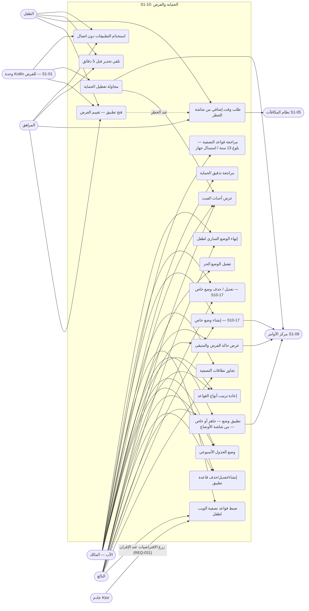

أُعيد رسمه 2026-11-17 (Q-405 · Q-406): أُضيفت UC17 (إنشاء وضع خاص) وUC18 (تعديل/حذف وضع خاص) وUC19 (إنهاء الوضع الساري لطفل)؛ وصارت UC11 «تطبيق وضع — جاهز أو خاص — من شاشة الأوضاع» ويدخلها البالغ المفوَّض بمفتاح تطبيق الأوضاع كما يدخل UC19؛ والعدد صار 19.

- ملاحظة: حذف القاعدة (`protection.rule.delete`) وإعادة ترتيب الأنواع (`protection.priority.edit`) **قابلان للتفويض حسب القالب** (Q-146) — لذلك يظهر البالغ في UC1 وUC3. والوضع الحر (`protection.free_mode.activate`) **للمالك وحده** (Q-143) — لذلك لا يظهر البالغ في UC4. وزر SOS لا يظهر هنا لأنه ملك S1-01/S1-07 ولا يُحظر أبداً بأي قاعدة (Q-067).
- ملاحظة (Q-405 · Q-406): الأوضاع الخاصة — الإنشاء والتعديل والحذف (UC17/UC18) بمفاتيح قواعد التطبيقات الثلاثة (إنشاء/تعديل/حذف)، والتطبيق (UC11) والإنهاء (UC19) بمفتاح تطبيق الأوضاع (`protection.mode_preset.apply`) — بلا مفتاح جديد؛ والوضع الحر والأوضاع الجاهزة والخاصة من شاشة واحدة «الأوضاع» (S10-09 وS10-10 سطح واحد).
- قواعد تصفية الويب (UC14/UC15 — REQ-028/029/030 — Q-343): التحرير للمالك وحده (`protection.filter.edit`)، والعرض للأب + البالغ المفوَّض حسب القالب (`protection.filter.view`)؛ ومراجعة بلوغ 13 سنة واستبدال الجهاز (UC16 — REQ-027 — S10-14) للمالك.

## 2. مخطط قاعدة البيانات (ERD)

الجداول الاثنا عشر من §5 كما هي، مع أربعة مراجع خارجية: العائلة (S1-02)، والعضوية (S1-02)، والوقت الممنوح (S1-05)، و`AuditEvent` (النواة المشتركة). ملاحظات: أحد عشر من الجداول الاثني عشر جداول عائلة تحمل `family_id` + عزل RLS (D-021)؛ والاستثناء الوحيد `web_category` — قاموس منصة ثابت بلا بيانات عائلة (لا `family_id` ولا RLS — Q-343). وحقول jsonb (`windows` و`order` و`remaining_by_app`) تُرسم `text` (مفردات ERD الموحدة Q-177 — النوع الحقيقي `jsonb` في §5) — كما في مخططات S1-05. وحقل `minutes_by_weekday` هو `int[7]` — الفهرس 0 = الأحد، 1 = الاثنين، 2 = الثلاثاء، 3 = الأربعاء، 4 = الخميس، 5 = الجمعة، 6 = السبت؛ وكل قيمة 0–1440. و`rule_priority.child_id` فارغ = ترتيب العائلة الافتراضي؛ وصف الطفل تجاوز اختياري عنه (REQ-011). و`enforcement_state` مرآة خادمية لحالة الجهاز — وتقييم الجهاز المحلي هو المرجع دون اتصال (REQ-025)؛ وتحمل `active_mode` (الوضع الساري: `study` أو `sleep` أو معرّف وضع خاص) و`active_mode_until`، و`active_rule_type` يأخذ القيمة `mode` حين يحسم وضع سارٍ (Q-405). و`app_rule.action` يقبل الفراغ: صف بلا إجراء يحمل علامة الدراسة `is_study_app` وحدها لتطبيق لا قاعدة له (REQ-007 · Q-405). و`mode_session.mode` نص: `study` أو `sleep` أو معرّف `custom_mode` — بلا مفتاح أجنبي إلى `custom_mode`. ومخازن العميل (مرآة Drift للقواعد والجدول والترتيب والقناع + Outbox) ليست جداول خادم — انظر §5. ولا علاقة مفاتيح بين `granted_time` وأي جدول هنا — الوقت الممنوح من S1-05 يدخل في "الإضافي" لصيغة المتبقي (REQ-002: المتبقي = الحصة + الإضافي − المستهلك) عبر محرك التقييم (DFD: S105→P4)؛ وحقل `remaining_by_app` في `enforcement_state` لقطة محسوبة للمتبقي لا علاقة تخزين.

```mermaid
erDiagram
    family ||--o{ app_rule : "له قواعد"
    family ||--o{ daily_total_quota : "له حصص إجمالية"
    family ||--o{ weekly_schedule : "له جدول"
    family ||--o{ rule_priority : "له ترتيب"
    family ||--o{ enforcement_state : "له حالة فرض"
    family ||--o{ app_usage_daily : "له استهلاك يومي"
    family ||--o{ free_mode_session : "له جلسات وضع حر"
    family ||--o{ tamper_event : "له أحداث عبث"
    family ||--o{ custom_mode : "له أوضاع خاصة"
    family ||--o{ mode_session : "له جلسات أوضاع"
    membership ||--o{ app_rule : "قواعد طفل"
    membership ||--o{ mode_session : "جلسات أوضاع طفل"
    membership ||--|| daily_total_quota : "حصة طفل"
    membership ||--o{ weekly_schedule : "جدول طفل"
    membership ||--o{ rule_priority : "ترتيب طفل أو العائلة"
    membership ||--|| enforcement_state : "حالة طفل"
    membership ||--o{ app_usage_daily : "استهلاك طفل"
    membership ||--o{ free_mode_session : "جلسات طفل"
    membership ||--o{ tamper_event : "عبث على جهاز طفل"
    app_rule ||--o{ AuditEvent : "تغييراته تُسجَّل"
    daily_total_quota ||--o{ AuditEvent : "تغييراتها تُسجَّل"
    weekly_schedule ||--o{ AuditEvent : "تغييراته تُسجَّل"
    rule_priority ||--o{ AuditEvent : "تغييراته تُسجَّل"
    free_mode_session ||--o{ AuditEvent : "تفعيله وانتهاؤه يُسجَّلان"
    custom_mode ||--o{ AuditEvent : "إنشاؤه وتعديله وحذفه يُسجَّل"
    mode_session ||--o{ AuditEvent : "بدء الوضع وانتهاؤه يُسجَّلان"
    tamper_event ||--o{ AuditEvent : "كل حدث يُسجَّل"
    family ||--o{ web_filter_rule : "له قواعد تصفية"
    membership ||--o{ web_filter_rule : "قواعد تصفية طفل"
    web_filter_rule }o--|| web_category : "قاعدة فئة"
    web_filter_rule ||--o{ AuditEvent : "تغييراتها تُسجَّل"

    app_rule {
        uuid rule_id PK
        uuid family_id FK
        uuid child_id FK
        text app_package
        text action
        %% action فارغ = صف علامة دراسة فقط لتطبيق لا قاعدة له (REQ-007 · Q-405)
        int[7] minutes_by_weekday
        boolean is_study_app
        int version
        text created_by
        timestamptz created_at
        timestamptz updated_at
    }
    daily_total_quota {
        uuid quota_id PK
        uuid family_id FK
        uuid child_id FK
        int[7] minutes_by_weekday
        int version
        text created_by
        timestamptz created_at
        timestamptz updated_at
    }
    weekly_schedule {
        uuid schedule_id PK
        uuid family_id FK
        uuid child_id FK
        text windows
        int version
        timestamptz updated_at
    }
    rule_priority {
        uuid priority_id PK
        uuid family_id FK
        uuid child_id FK
        text order
        int version
        text updated_by
        timestamptz updated_at
    }
    enforcement_state {
        uuid child_id PK
        uuid family_id FK
        timestamptz last_evaluated_at
        text active_rule_type
        text remaining_by_app
        timestamptz next_boundary_at
        timestamptz free_mode_until
        text active_mode
        timestamptz active_mode_until
        text tamper_status
        timestamptz updated_at
    }
    app_usage_daily {
        uuid usage_id PK
        uuid family_id FK
        uuid child_id FK
        text app_package
        timestamptz usage_date
        int seconds_used
        timestamptz updated_at
    }
    free_mode_session {
        uuid session_id PK
        uuid family_id FK
        uuid child_id FK
        text activated_by
        timestamptz activated_at
        timestamptz expires_at
        timestamptz cancelled_at
        text status
    }
    custom_mode {
        uuid mode_id PK
        uuid family_id FK
        text name
        text name_key
        text icon
        text opens
        text app_packages
        boolean keep_limits
        int version
        text created_by
        timestamptz created_at
        timestamptz updated_at
    }
    mode_session {
        uuid session_id PK
        uuid family_id FK
        uuid child_id FK
        text mode
        text activated_by
        timestamptz activated_at
        timestamptz expires_at
        boolean stops_at_window
        timestamptz ended_at
        text status
    }
    tamper_event {
        uuid event_id PK
        uuid family_id FK
        uuid child_id FK
        uuid device_id
        text kind
        timestamptz detected_at
        boolean reactivation_attempted
        timestamptz resolved_at
        boolean notified
    }
    web_category {
        int category_id PK
        text key
        text label_ar
    }
    web_filter_rule {
        uuid rule_id PK
        uuid family_id FK
        uuid child_id FK
        int category_id
        text action
        text settings
        int version
        text updated_by
        timestamptz updated_at
    }
    family {
        uuid id PK
    }
    membership {
        uuid id PK
    }
    granted_time {
        uuid id PK
    }
    AuditEvent {
        uuid id PK
    }
```

أُعيد رسمه 2026-11-17 (Q-405 · Q-406): أُضيف الكيانان `custom_mode` (تعريف وضع خاص على مستوى العائلة) و`mode_session` (جلسة وضع سارٍ لطفل) مع علاقاتهما والتدقيق؛ وأُضيف إلى `enforcement_state` حقلا `active_mode` و`active_mode_until`؛ و`app_rule.action` يقبل الفراغ لصف علامة الدراسة وحده؛ والعدد صار 12 جدولاً.

## 3. التسلسل (Sequence) — من عقود §4

أحد عشر مخططاً، كل واحد لتدفق واحد:
- **عقد MQTT (Q-168 — الإحالة الصريحة إلى `docs/family-os/governance/architecture/MQTT-BROKER-SPEC.md`):** الوسيط Eclipse Mosquitto 2.x — عقدة واحدة في المرحلة 1 — TLS 1.2+ على المنفذ 8883 + mTLS (شهادة خادم + شهادة جهاز)؛ والأوامر (`family/{family_id}/devices/{device_id}/commands` / `family/{family_id}/protection/rules-updated` / `family/{family_id}/protection/free-mode`) QoS 1 + إقرار تطبيقي إلزامي؛ والعبث (`family/{family_id}/protection/tamper`) QoS 1؛ والحالة الدورية (`family/{family_id}/device/{device_id}/state`) QoS 0 + محفوظة؛ وبلا QoS 2 — التكرار يُغطيه `command_id`؛ وكل أمر يحمل `command_id` (idempotency)؛ والجلسة دائمة (clean session = false)؛ وlast will على `family/{family_id}/devices/{device_id}/status` = `offline`.
- **قنوات المنصة (§4-1 — `MethodChannel("familyos/enforcement")` و`EventChannel("familyos/enforcement/events")`):** الطرق الست الجديدة: `applySchedule(schedule: WeeklySchedule) -> void` (دفع الجدول الأسبوعي) · `applyPriority(order: List<RuleType>) -> void` (دفع ترتيب الأنواع) · `getEnforcementState() -> EnforcementState` (حالة الفرض للعرض) · `activateFreeMode(until: timestamp) -> void` (تفعيل الوضع الحر) · `evaluateNow() -> EnforcementDecision` (تقييم فوري عند فتح تطبيق) · `applyWebFilterRules(rules: WebFilterRules) -> void` (دفع قواعد تصفية الويب إلى VPN QProxy — REQ-028/029/030)؛ والأحداث: `enforcement_state` (موروثة) + `rule_blocked` و`tamper_detected` و`free_mode_changed`.

### 3-أ. إنشاء قاعدة تطبيق + دفع عبر MQTT (REQ-001/026 — §4-2 + §4-3)

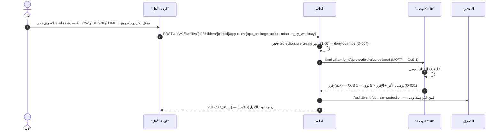

- قاعدة واحدة لكل (طفل، تطبيق) — قيد وحيد (REQ-001)؛ وكل دقيقة في `minutes_by_weekday` بين 0 و1440؛ والتطبيق بلا قاعدة = سماح، لا حظر ضمني؛ والرد `201` واحد بعد الإقرار — لا رد مبكر ولا تأكيد ثانٍ (نموذج 3-ب نفسه — و`POST .../app-rules` في §4-2 يعرّف `201` وحده).

### 3-ب. حفظ الجدول الأسبوعي مع كشف التعارض (REQ-006 — §4-2)

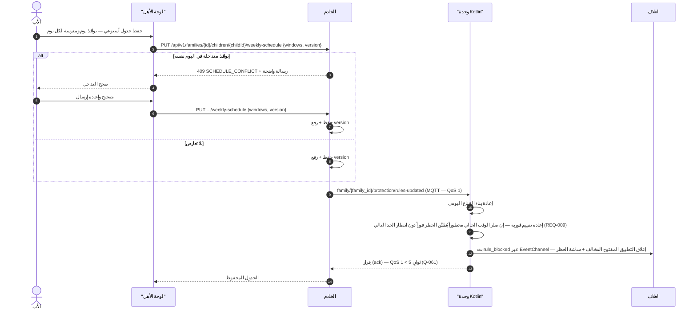

- ملاحظة: تعديل متزامن من والد آخر على نسخة قديمة → `409 VERSION_CONFLICT` — يُعاد تحميل أحدث حالة قبل إعادة المحاولة (نمط S1-03 REQ-019 — قفل تفاؤلي على `version`). وكشف التعارض يشمل التداخل الليلي عبر منتصف الليل (REQ-006): نافذة `end_time <= start_time` تمتد إلى اليوم التالي.

### 3-ج. تقييم الفرض عند فتح تطبيق (REQ-008/010/011/012/033 — §4-1 evaluateNow + Q-145 · Q-405)

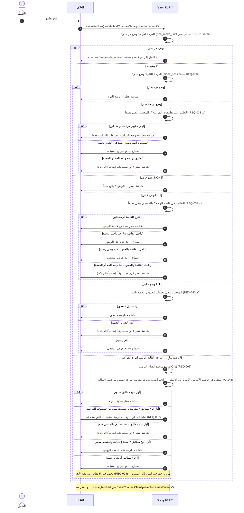

أُعيد رسمه 2026-11-17 (Q-405): التقييم صار سلّم REQ-033 بثلاث درجات — حر، ثم وضع سارٍ (جاهز أو خاص)، ثم ترتيب أنواع القواعد؛ والمحظور يبقى مغلقاً في كل وضع عدا الحر؛ ووضع `ALL` يبقي الحدود والحصة والمحظور؛ ووضع الدراسة يفتح تطبيقات الدراسة وحدها مع بقاء الحد والحصة.

- ملاحظة (تعارض في المواصفة — يُبلَّغ ولا يُحسم): نص `evaluateNow` في SPEC §4-1 ما زال يصف الفحصين القديمين (وضع حر ثم ترتيب الأنواع) ولم يُحدَّث بدرجة الوضع الساري؛ والسلّم هنا من REQ-033 (§3). وكذلك `getEnforcementState` في §4-1 ما زال يرجع الحقول القديمة بلا `active_mode`.

- صيغة المتبقي عند التقييم (REQ-002): المتبقي = الحصة + الإضافي − المستهلك؛ والحصة من `daily_total_quota`، والإضافي من S1-05، والمستهلك من `app_usage_daily`.
- الترتيب الافتراضي يعمل بلا إعداد؛ والأب يعيد ترتيب الأنواع لكل عائلة ولكل طفل (REQ-011)؛ والوقت المكتسب أو الممنوح يضيف دقائق إلى حد التطبيق فقط — ولا يفتح تطبيقاً في وقت نوم أو مدرسة (REQ-012). وزر SOS لا يُحظر أبداً (Q-067) — خارج هذا التدفق.

### 3-د. نفاد الحد — شاشة الحظر وطلب وقت (REQ-003/004/005 + S1-05)

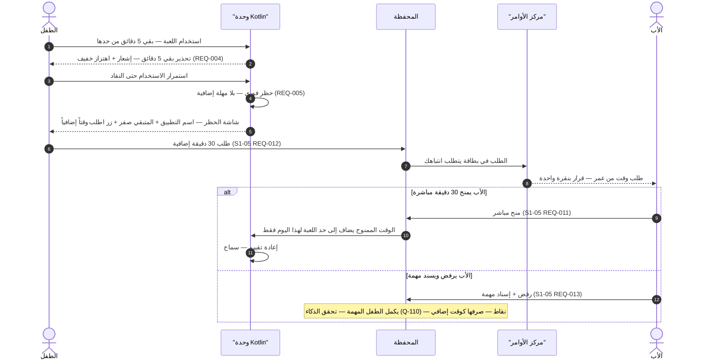

### 3-هـ. الوضع الحر — تفعيل وانتهاء (REQ-018/019/020 — Q-143)

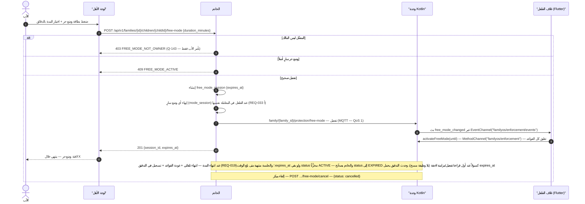

- أثناء الوضع الحر: زر SOS يعمل كالعادة؛ والاستخدام يُحسب في التقارير ولا يُحدَّد؛ والوضع الحر لا يمسح تنبيهات العبث المعلقة ولا يوقف محاولات إعادة التفعيل (REQ-020). ونموذج الرد هنا يختلف عن 3-أ/3-ب قصداً: الجلسة تُنشأ خادمياً فيُرجع `201` فور إرسال أمر التفعيل عبر MQTT — لأن `201` هنا يثبت إنشاء الجلسة لا سريانها على الجهاز؛ وإقرار الجهاز يصل لاحقاً عبر موضوع الإقرارات `devices/{device_id}/acks` (§4-3) — فلا ينتظر الأب الإقرار ليرى اللافتة.

### 3-و. كشف العبث — تنبيه + إعادة تفعيل (REQ-021/022/023 — Q-144)

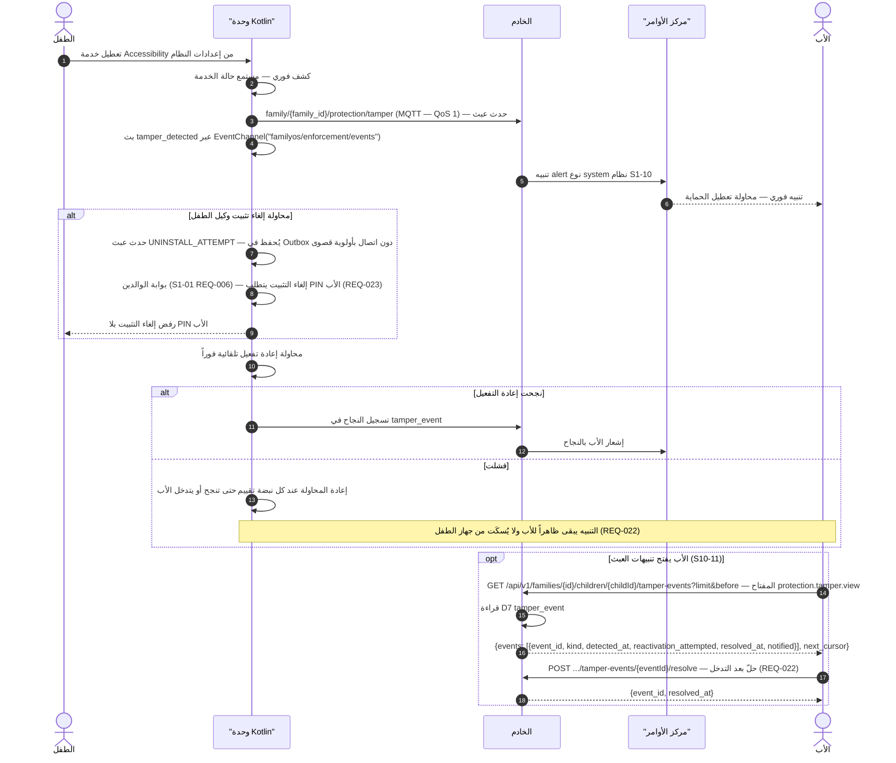

- أنواع العبث: `UNINSTALL_ATTEMPT` · `ACCESSIBILITY_DISABLED` · `DEVICE_ADMIN_REVOKED` · `VPN_DISCONNECTED` · `SERVICE_KILLED` (REQ-021). ودون اتصال يُحفظ حدث العبث في Outbox بأولوية قصوى. وإلغاء تثبيت وكيل الطفل يتطلب PIN الأب (REQ-023 — Q-065 · Q-142 — نمط Bark Kids: رمز يصدره الأب).

### 3-ز. مزامنة دون اتصال (REQ-014/015/016/017 — Q-064)

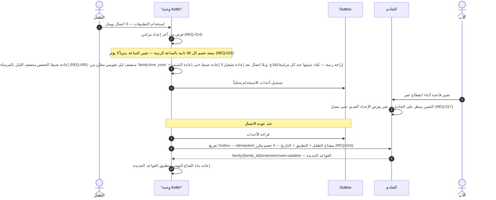

### 3-ح. دورة الأمر والإقرار عبر MQTT (REQ-001/026 — §4-3 + Q-168)

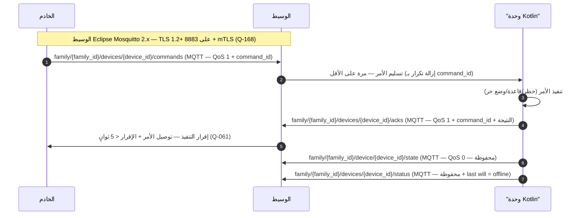

### 3-ط. تطبيق وضع — جاهز أو خاص (REQ-024/032/033 — §4-2 POST .../mode-presets/{preset} · Q-405)

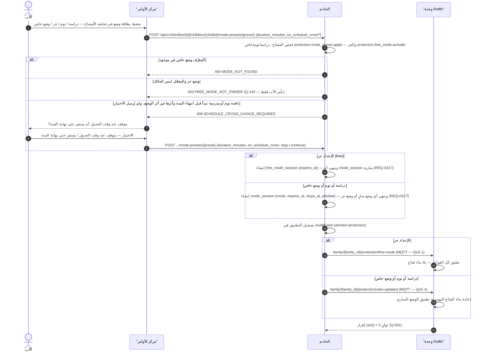

أُعيد رسمه 2026-11-17 (Q-405): `{preset}` يقبل `study` أو `sleep` أو `free` أو معرّف وضع خاص؛ والمدة مطلوبة لكل وضع؛ والتقاطع مع نافذة جدول أثرها غير أثر الوضع يُرجع `409 SCHEDULE_CROSS_CHOICE_REQUIRED` حتى يختار الأب؛ والتطبيق ينهي أي وضع سارٍ أو وضع حر في المعاملة نفسها (وضع واحد لكل طفل)؛ ومعرّف خاص غير موجود يُرجع `404 MODE_NOT_FOUND`.

- المعاينة قبل التطبيق (S10-10) تذكر أثر الوضع على كل طفل باسمه وتقول إن الجديد ينهي الساري (REQ-033 أ/هـ)؛ وبلا مدة لا تطبيق (Q-087).

### 3-ي. حفظ قواعد تصفية الويب + دفع إلى VPN QProxy (REQ-028/029/030/031 — Q-343)

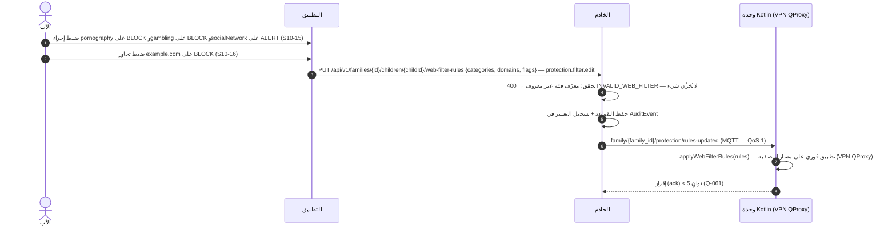

- تجاوز النطاق يفوز على إجراء الفئة (REQ-029)؛ والطفل المقترن حديثاً تُزرع قواعده بالافتراضيات قبل أي إجراء من الأب (REQ-031). والفئات العشر المحظورة من أول يوم (Q-405): 14 إباحية · 12 محتوى ناضج · 7 قمار · 3 مخدرات · 1 كحول · 21 تبغ · 23 عنف · 24 أسلحة · 15 ألفاظ بذيئة · 29 بروكسي/ثغرات؛ والعشرون الباقية `ALLOW`؛ وكلها قابلة لتعديل الأب. والإجراء `IGNORE` (3) لا يُعرض في المرحلة 1 والخادم يرفضه `INVALID_RULE`؛ والمعروض: سماح، حظر، تنبيه (REQ-029 · Q-405).
[تصحيح 2026-11-08 (Q-343 — Q343-01): معرّف الشاشة S10-16 (تجاوزات نطاقات التصفية — REQ-029) كان غائباً من هذا الملف رغم أن مضمونه كان موجوداً: تسلسل 3-ي يحمل `domains` في حمولة PUT، والملاحظة أعلاه تستشهد بـ REQ-029 «تجاوز النطاق يفوز على إجراء الفئة»؛ أُضيف المعرف في تسلسل 3-ي وعقدة FWeb في §4 بنمط S10-15 نفسه، بلا تغيير في عدد التغطية (REQ-029 مغطى بـ S10-16 أصلاً في SPEC :903).]

### 3-ك. إدارة الأوضاع الخاصة — إنشاء وتعديل وحذف وإنهاء (REQ-032/033 — §4-2 · Q-405)

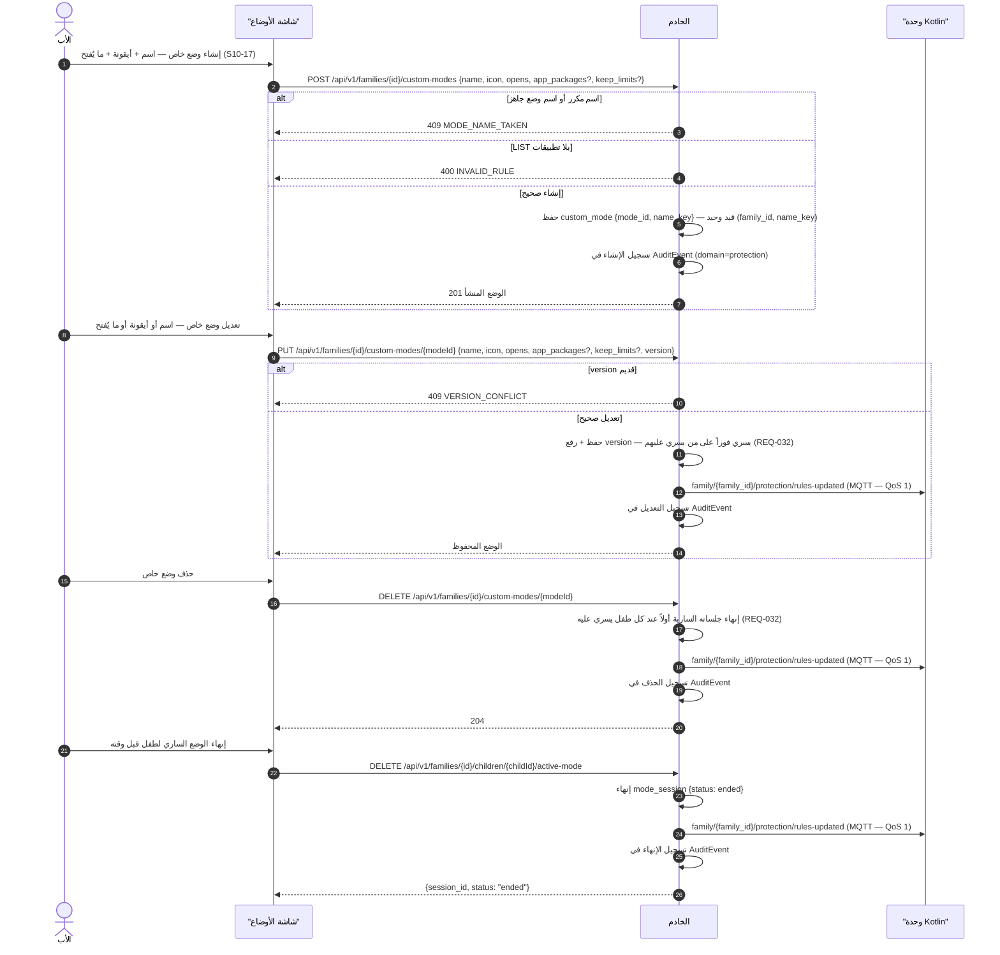

رُسم 2026-11-17 (Q-405): مخطط جديد — نقاط الأوضاع الخاصة الخمس: الإنشاء بمفتاح `protection.rule.create`، والتعديل بمفتاح `protection.rule.edit`، والحذف بمفتاح `protection.rule.delete`، والإنهاء بمفتاح `protection.mode_preset.apply`؛ وتعديل وضع سارٍ يسري فوراً؛ وحذفه ينهي جلساته أولاً.

## 4. تدفق المستخدم (User Flow) — من السيناريوهات الثمانية (§2)

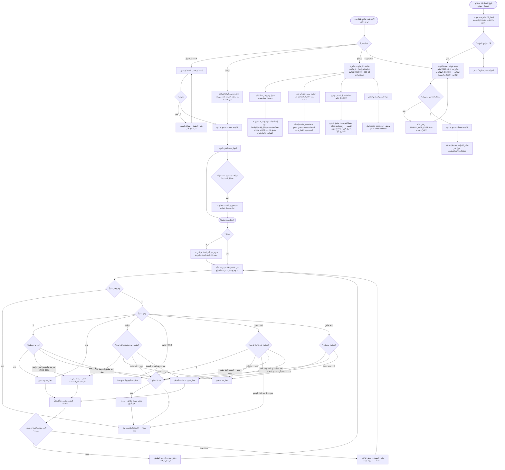

أُعيد رسمه 2026-11-17 (Q-405): فُرع «الأوضاع» صار شاشة واحدة (جاهزة + خاصة + وضع حر) بمسارات التطبيق والإنشاء/التعديل/الحذف والإنهاء؛ والتقييم صار سلّم REQ-033 — حر، ثم وضع سارٍ (نوم/دراسة/NONE/LIST/ALL)، ثم ترتيب الأنواع.

- ملاحظة: زر SOS لا يُحظر أبداً — يعمل في كل مسار، في وقت النوم والمدرسة والوضع الحر (Q-067).
- ملاحظة: القواعد تتبع الطفل لا الجهاز — عند بلوغ الطفل 13 سنة تبقى قواعده سارية ويُشعَر الأب ليراجعها؛ وعند استبدال الجهاز تُعاد القواعد نفسها بالإقران الجديد (REQ-027).
- ملاحظة: تغيير الجدول يسري عند الاستلام؛ وإن صار الوقت الحالي محظوراً بالتغيير الجديد يُطبَّق الحظر فوراً حتى لو كان التطبيق مفتوحاً حينها (REQ-009).

## 5. مخطط تدفق البيانات (DFD — المستوى 1) — من §4/§5

العمليات مرقمة 1.0–10.0، والمخازن D1–D12 جداول خادم (PostgreSQL)، والمخزنان L1–L2 مخازن عميل على جهاز الطفل (Drift/Outbox — محلية، ليست جداول خادم). و`enforcement_state` (D4) مرآة خادمية لحالة الجهاز — وتقييم الجهاز المحلي هو المرجع دون اتصال (REQ-025) — وتحمل الوضع الساري (`active_mode` و`active_mode_until` — Q-405). والأوضاع (REQ-024/032/033) عبر P10: دراسة/نوم/خاص بإنشاء `mode_session` (D12) — والحر عبر P5/D6 (إنشاء جلسة — لا قواعد ولا بناء قناع)؛ ووضع واحد لكل طفل، والجديد ينهي السابق. وصيغة المتبقي (REQ-002): المتبقي = الحصة + الإضافي − المستهلك؛ والحصة من `daily_total_quota.minutes_by_weekday` ليوم الأسبوع، والإضافي هو الوقت الممنوح/المصروف من S1-05 (`granted_time`)، والمستهلك من `app_usage_daily.seconds_used`. ولا حافة D5→P4: المستهلك في الصيغة هو `seconds_used` نفسه، لكنه يُحسب على الجهاز محلياً (نبضة خصم كل 60 ثانية) ولا يُقرأ من D5؛ وD5 مرآة خادمية يكتب فيها P7 فقط (مزامنة upsert — REQ-016) (Q-188).

- **تغطية نقاط §4:** التسلسلات في §3 تغطي التدفقات الأساسية فقط؛ وكل نقطة §4 تظهر هنا على الأقل: `GET/POST/PATCH/DELETE .../app-rules` (3-أ · P1) · `GET/PUT .../weekly-schedule` (3-ب · P2) · `GET/PUT .../rule-priority` (3-ج · P3) · `GET/PUT .../daily-total-quota` (P8 · D8) · `GET/PUT .../web-filter-rules` (3-ي · P9 · D9/D10) · `POST .../free-mode` و`POST .../free-mode/cancel` (3-هـ · P5) · `GET .../enforcement-state` (P4 · D4) · `GET .../tamper-events` و`POST .../tamper-events/{eventId}/resolve` (يقرآن/يكتبان D7 عبر Ktor — S10-11 · 3-و) · `POST .../mode-presets/{preset}` (دراسة/نوم/خاص عبر P10/D12، والحر عبر P5/D6 — 3-ط) · `GET/POST .../custom-modes` و`PUT/DELETE .../custom-modes/{modeId}` و`DELETE .../children/{childId}/active-mode` (P10 · D11/D12 — 3-ك) · `GET .../audit/protection` (التدفقات إلى AuditEvent). و§4-1 (قناة المنصة) و§4-3 (أحداث MQTT) خارج هذه الملاحظة. وهذه الملاحظة مرجع لنقاط §4 (بلا رسم كل نقطة في تسلسل).

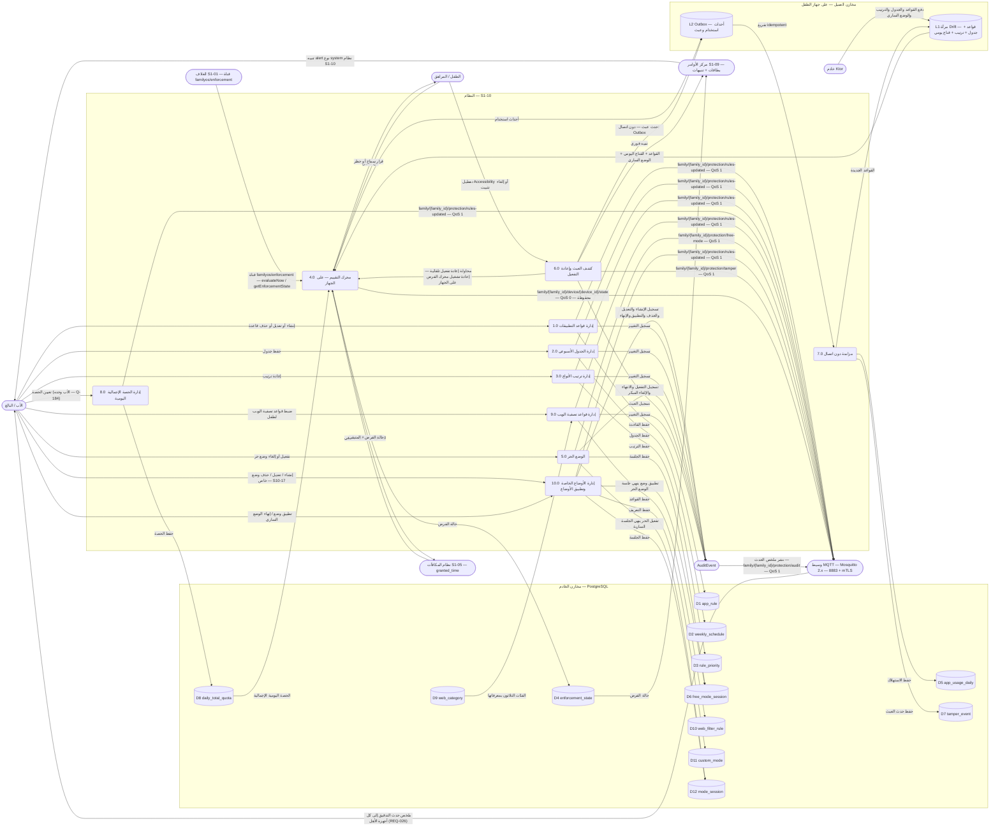

أُعيد رسمه 2026-11-17 (Q-405): أُضيفت العملية P10 (إدارة الأوضاع الخاصة وتطبيق الأوضاع) والمخزنان D11 (`custom_mode`) وD12 (`mode_session`)؛ والوضع الساري يُدفع إلى مرآة العميل L1 ويُقرأ في التقييم P4؛ وتفعيل الحر ينهي جلسة الوضع الساري وتطبيق وضع ينهي جلسة الحر.

## 6. مخطط النشاط (Activity) — دورة حياة القاعدة والفرض

المسارات الأربعة (الأب / الطفل / وحدة Kotlin / الخادم) كمسارات متوازية. والأنشطة الخلفية (نبضة الخصم كل 60 ثانية + مراقبة العبث + تفريغ Outbox) تعمل **بالتوازي** مع استخدام التطبيق.

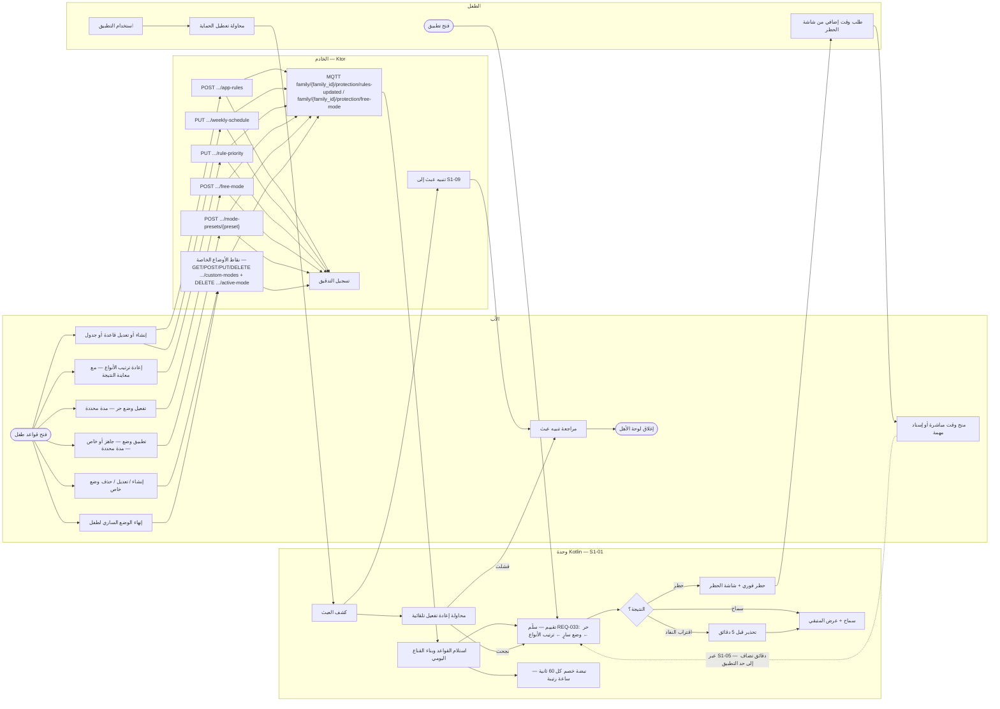

أُعيد رسمه 2026-11-17 (Q-405): التقييم صار سلّم REQ-033؛ وأُضيفت عقد الأوضاع (تطبيق وضع F4a، وإنشاء/تعديل/حذف وضع خاص F4b، وإنهاء الوضع الساري F4c) مع نقطتي الخادم V8/V9.

- عند انتهاء الوضع الحر يعود التقييم فوراً — والتطبيق المفتوح المخالف يُغلق مع شاشة الحظر (REQ-019/004).
- الحالات الحدية (§7): تغيير ساعة الجهاز يدوياً لا يؤثر — النبضة بالساعة الرتيبة؛ وتعديلان متزامنان من والدين → `409 VERSION_CONFLICT` وإعادة تحميل؛ واستبدال الجهاز يعيد القواعد نفسها بالإقران الجديد — القواعد تتبع الطفل لا الجهاز.
