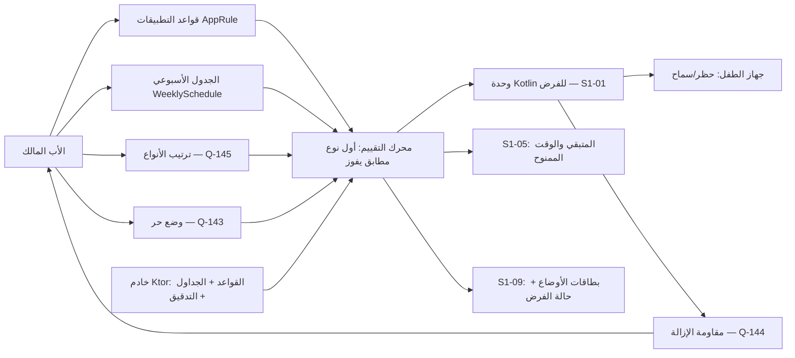
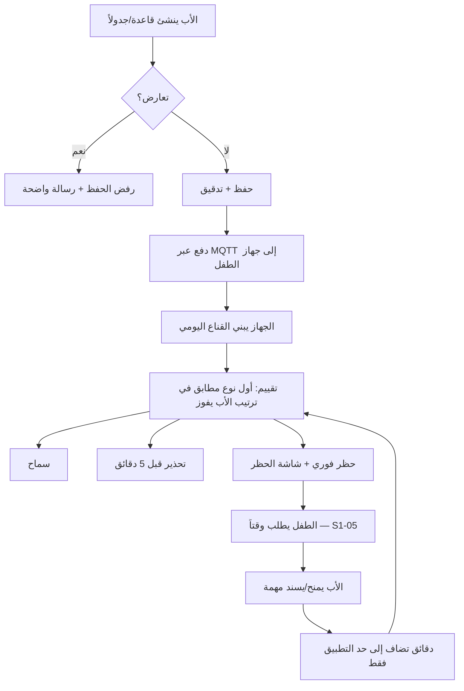
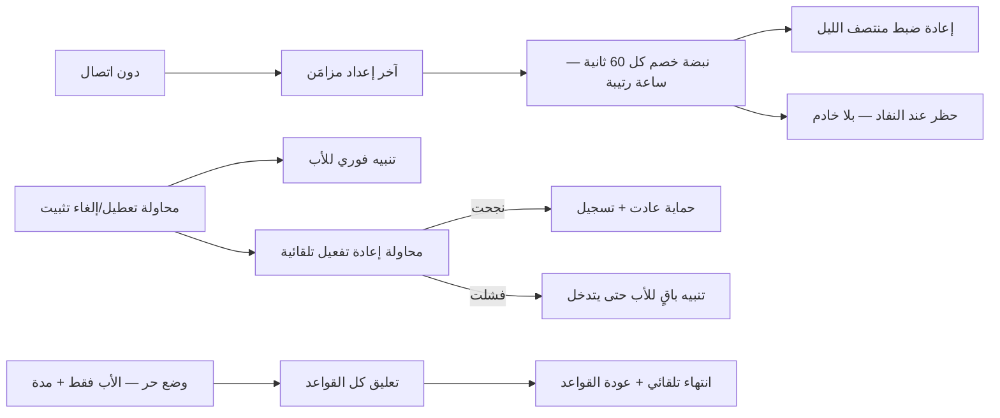

# S1-10: الحماية والفرض (Protection & Enforcement)

- **الحالة:** approved | **المرحلة:** 1 (نواة الحماية) · **آخر تحديث:** 2026-11-06
- **القرارات الحاكمة:** Q-002 · Q-003 · Q-005 · Q-006 · Q-007 · Q-008 · Q-022 · Q-031 · Q-061 · Q-062 · Q-063 · Q-064 · Q-065 · Q-068 · Q-106 · Q-107 · Q-110 · Q-111 · Q-112 · Q-114 · Q-115 · Q-116 · Q-141 · Q-142 · Q-143 · Q-144 · Q-145 · Q-146 · D-021 · D-023 · D-038 · G-006 · G-007 · G-009
- **حالة المراجعة:** §§1–8 + §10 معتمدة بالكامل في التخطيط (حكم المالك 2026-11-06) · **§9 في مرحلة التصميم (Q-091)**.
- **الأدلة المرجعية:** المراجعة الناقدة الكاملة 2026-11-06 (الحرجة ح1) · `ARCHITECTURE.md` §5.2/§5.3 · `CONTEXT-MAP.md` سياق #3 · Qustodio (حصص + تسلسل + نبضة دون اتصال) · FamiSafe (قائمة الجدول الأسبوعي) · Qustodio Kids + Bark Kids (مقاومة الإزالة) · S1-01 (معتمد) · S1-05 (معتمد) · S1-09 (معتمد)

## 1. الهدف والتحليل والنطاق

**الهدف:** هذا النظام هو قلب نواة الحماية (Q-002) — المالك الذي أشارت إليه المعمارية (`ARCHITECTURE.md` §5.2: `ScheduleEngine` · `CommandDispatcher` · `EnforcementSync`؛ و§5.3: `DEVICE — APP_RULE` / `WEEKLY_SCHEDULE`) والمواصفات التسع دون أن يملكه أحد (الحرجة ح1 من المراجعة الناقدة 2026-11-06). الغلاف (S1-01) يستضيف التنفيذ في وحدة Kotlin؛ وهذا النظام يملك **القرار**: أي قاعدة، وأي جدول، وأي ترتيب، ومتى يُحظر التطبيق ومتى يُسمح — على جهاز الطفل، متصلاً كان أو دون اتصال.

**القواعد الثلاث الحاكمة:**
1. **الترتيب الافتراضي يعمل فوراً (Q-145):** النوم > المدرسة > حدود التطبيقات > الحصة الإجمالية — بلا أي إعداد من الأب.
2. **الأب يملك الترتيب (Q-145 + Q-003):** يعيد ترتيب أنواع القواعد بحرية لكل عائلة ولكل طفل؛ وعند التعارض يفوز أول نوع مطابق في ترتيبه.
3. **الوقت المكتسب لا يتفوق على أي قاعدة (Q-145):** الوقت الممنوح أو المصروف من النقاط يضيف دقائق إلى حصة التطبيق فقط — لا يفتح تطبيقاً في وقت نوم أو مدرسة.

**مخطط سياق النظام (§1 — بصري):**

**داخل النطاق:**
- قواعد التطبيقات (`AppRule`): لكل طفل ولكل تطبيق — سماح (`ALLOW`) / حظر (`BLOCK`) / حد دقائق يومي (`LIMIT`) لكل يوم أسبوع (0–1440 دقيقة).
- الجدول الأسبوعي (`WeeklySchedule`): نوافذ نوم ومدرسة لكل يوم أسبوع، بترميز قائمة 7 أيام (نمط FamiSafe المستخلص) وكشف تعارض عند الحفظ؛ والتقييم يبني قناعاً يومياً (bitmask) في الذاكرة عند كل مزامنة لتقييم O(1).
- تسلسل الفرض (Q-145): الأنواع الأربعة (نوم / مدرسة / حدود تطبيقات / حصة إجمالية) بترتيب افتراضي + إعادة ترتيب بيد الأب لكل عائلة ولكل طفل.
- الفرض دون اتصال: القواعد تُفرض من آخر إعداد مزامَن؛ نبضة خصم كل 60 ثانية؛ ساعة رتيبة (Monotonic) ضد العبث بالساعة؛ إعادة ضبط منتصف الليل.
- شاشة الحظر + تحذير قبل 5 دقائق من نفاد الحد + حظر فوري عند النفاد؛ ومن شاشة الحظر يطلب الطفل وقتاً إضافياً (دورة S1-05).
- الوضع الحر (Q-143): تعليق كل القواعد مؤقتاً بأمر الأب وحده وبمدة محددة، ينتهي تلقائياً وتعود القواعد.
- مقاومة الإزالة (Q-144): كشف محاولة إلغاء التثبيت أو تعطيل إمكانية الوصول أو سحب DeviceAdmin أو فصل VPN + تنبيه فوري للأب + محاولة إعادة تفعيل تلقائية.
- إعدادات الأوضاع المسبقة: وضع الدراسة / وضع النوم / وضع حر — يملكها هذا النظام وتعرضها بطاقات S1-09 السريعة (S1-09 REQ-007).
- حالة الفرض: القواعد النشطة والوقت المتبقي لكل تطبيق والحد التالي — تُعرض في ودجة S1-09 وتُستهلك في S1-05.

**خارج النطاق (أنظمة أخرى):**
- الغلاف والوضعان وبوابة الوالدين وزر SOS والـ Outbox → S1-01 (هذا النظام يستهلك قناة `familyos/enforcement` ولا يعيد تعريفها).
- الهوية والتسجيل وOTP وربط الأجهزة → S1-02.
- محرك الصلاحيات والتفويض والقوالب → S1-03 (هذا النظام يفحص مفاتيح `protection.*` عبره).
- محاسبة النقاط والمحفظة ودورة الكسب → S1-05 (هذا النظام يستهلك المتبقي والوقت الممنوح ولا يملك المحفظة).
- المهام والتحقق بالذكاء → S1-06.
- الموقع والأسوار وتوصيل SOS → S1-07 (زر SOS لا يُحظر أبداً — ثابت صلب هنا وفي S1-07).
- الخطط والدفع وحصص SMS → S1-04.
- تصفية المحتوى عبر VPN (قواعد فئات المحتوى) → خارج نطاق هذه المواصفة؛ التنفيذ في وحدة Kotlin (S1-01)؛ وملكية قواعد التصفية سؤال مفتوح (Q-159: هل تعيش في S1-10 أم في نظام لاحق؟ — قبل تنفيذ المرحلة 1).

**يعتمد على:** S1-01 (الغلاف ووحدة Kotlin للفرض + Outbox + Parent Gate) + S1-02 (العضوية) + S1-03 (مفاتيح الصلاحيات) + S1-05 (المتبقي والوقت الممنوح) + S1-09 (بطاقات الأوضاع + التنبيهات).

**المصطلحات:** قاعدة تطبيق (`AppRule`) · جدول أسبوعي (`WeeklySchedule`) · نوع قاعدة (نوم / مدرسة / حد تطبيق / حصة إجمالية) · ترتيب الأنواع (الأول المطابق يفوز) · وضع حر (`Free Mode`) · مقاومة إزالة (Anti-Removal) · نبضة خصم (Deduction Pulse) · ساعة رتيبة (Monotonic Clock) · شاشة الحظر (Block Screen).

## 2. سيناريوهات المستخدم

### 10-1: الأب يضع الجدول الأسبوعي لعمر
- **الممثل:** الأب (المالك). **السياق:** عمر (10 سنوات)؛ الأب يريد نوماً من 9 مساءً ومدرسة الأحد–الخميس 7 صباحاً – 1 ظهراً.
- **التدفق:** 1) الأب يفتح قواعد عمر من لوحة الأهل. 2) يضيف نافذة نوم (21:00–06:00 كل يوم) ونافذة مدرسة (الأحد–الخميس 07:00–13:00). 3) النظام يكشف تعارضاً (نافذة مدرسة تتداخل مع نافذة نوم قديمة) فيرفض الحفظ مع رسالة واضحة. 4) الأب يصحح التداخل فيُحفظ الجدول. 5) يُدفع الجدول إلى جهاز عمر عبر MQTT؛ والجهاز يبني القناع اليومي ويطبق القواعد فوراً. **النتيجة:** جدول أسبوعي سارٍ بلا تعارض، ومزامَن على جهاز الطفل.

### 10-2: نفاد وقت اللعبة — شاشة الحظر ودورة النقاط
- **الممثل:** عمر (طفل). **السياق:** الساعة 4 عصراً؛ لعبة عمر لها حد 60 دقيقة؛ استخدمها كلها.
- **التدفق:** 1) قبل 5 دقائق من النفاد يظهر تحذير "بقي 5 دقائق". 2) عند النفاد تُحظر اللعبة فوراً وتظهر شاشة الحظر (اسم التطبيق + الوقت المتبقي + زر "اطلب وقتاً إضافياً"). 3) عمر يطلب 30 دقيقة. 4) يظهر الطلب في بطاقة "يتطلب انتباهك" في S1-09. 5) الأب يمنح 30 دقيقة مباشرة (S1-05 REQ-011) — أو يرفض ويسند مهمة (S1-05 REQ-013). 6) الوقت الممنوح يضاف إلى حد اللعبة لهذا اليوم فقط وينتهي بنهايته. **النتيجة:** حظر فوري عند النفاد، ودورة النقاط كاملة تعمل عبر شاشة الحظر.

### 10-3: حظر وقت المدرسة رغم بقاء الرصيد
- **الممثل:** عمر. **السياق:** الثلاثاء 10 صباحاً (وقت مدرسة)؛ عمر يفتح لعبة وما زال له 40 دقيقة من حصتها.
- **التدفق:** 1) عمر يفتح اللعبة. 2) محرك التقييم يفحص الترتيب الافتراضي: النوم لا يطابق (ليس وقت نوم) → المدرسة تطابق → القرار: حظر (تطبيقات الدراسة فقط). 3) لا ينظر المحرك إلى حد التطبيق ولا إلى الحصة الإجمالية — أول نوع مطابق يفوز. 4) تظهر شاشة الحظر "وقت مدرسة — تطبيقات الدراسة فقط". **النتيجة:** وقت المدرسة يحظر اللعبة رغم بقاء الرصيد؛ والترتيب الافتراضي يعمل كما حُكم.

### 10-4: وقت النوم، وأسبوع الامتحانات
- **الممثل:** عمر + الأب. **السياق:** الخميس 10 مساءً؛ عمر يراجع للامتحان بتطبيق دراسة؛ قاعدة النوم تقول "مقفل".
- **التدفق:** 1) عمر يفتح تطبيق الدراسة — يُحظر (النوم أولاً في الترتيب الافتراضي). 2) الأب يسحب "المدرسة/الدراسة" فوق "النوم" في ترتيب عمر لهذا الأسبوع فقط. 3) عمر يفتح تطبيق الدراسة — يُسمح (المدرسة تطابق أولاً، والدراسة مسموحة فيها)؛ ويفتح لعبة — تُحظر (النوم ما زال فوق حد التطبيق والحصة). 4) بعد الامتحانات يعيد الأب الترتيب كما كان. **النتيجة:** الترتيب بيد الأب يعبّر عن أولوية العائلة دون حذف أي قاعدة.

### 10-5: الوضع الحر في عطلة نهاية الأسبوع
- **الممثل:** الأب. **السياق:** الجمعة؛ الأب يريد تعليق القواعد ساعتين لزيارة عائلية.
- **التدفق:** 1) الأب يضغط بطاقة [وضع حر] في S1-09 ويختار المدة (ساعتان). 2) تُعلَّق كل قواعد الفرض على أجهزة الأطفال؛ وتظهر لافتة واضحة في لوحة الأهل "وضع حر — ينتهي خلال 1:47". 3) زر SOS يعمل كالعادة؛ والاستخدام أثناء الوضع الحر يُحسب في التقارير ولا يُحدَّد. 4) تنتهي الساعتان — تعود القواعد تلقائياً بلا أي إجراء؛ ويُسجَّل التفعيل والانتهاء في التدقيق. **النتيجة:** تعليق مؤقت صريح بلا ثغرة دائمة.

### 10-6: محاولة تعطيل الحماية
- **الممثل:** عمر يحاول تعطيل إمكانية الوصول (Accessibility) من إعدادات النظام. **السياق:** جهاز الطفل.
- **التدفق:** 1) عمر يعطّل Accessibility. 2) وحدة Kotlin تكشف التعطيل فوراً (مستمع حالة الخدمة). 3) تنبيه فوري للأب (MQTT/دفع؛ وإن كان دون اتصال يُحفظ في Outbox بأولوية قصوى) + محاولة إعادة تفعيل تلقائية (إعادة طلب تفعيل الخدمة). 4) إن نجحت إعادة التفعيل يُسجَّل الحدث ويُشعَر الأب بالنجاح؛ وإن فشلت تستمر المحاولة عند كل نبضة تقييم حتى تنجح أو يتدخل الأب، ويبقى التنبيه ظاهراً للأب ولا يُسكَت من جهاز الطفل. **النتيجة:** لا تعطيل صامت — الأب يعلم فوراً، والحماية تحاول العودة وحدها.

### 10-7: فرض دون اتصال في اليمن
- **الممثل:** عمر في اليمن. **السياق:** لا اتصال يومان؛ القواعد المزامنة آخر مرة ما زالت سارية.
- **التدفق:** 1) عمر يستخدم التطبيقات؛ نبضة الخصم كل 60 ثانية تخصم من الحدود بالساعة الرتيبة (تغيير ساعة الجهاز يدوياً لا يغيّر شيئاً). 2) عند منتصف الليل تُعاد الحصص اليومية. 3) الأب يغيّر قاعدة أثناء انقطاع عمر — التغيير ينتظر في Outbox/الخادم؛ وجهاز عمر يفرض الإعداد القديم حتى يتصل. 4) عند عودة الاتصال: تُدفع القاعدة الجديدة + تُزامَن أحداث الاستخدام دون تكرار. **النتيجة:** الحماية لا تتوقف بانقطاع الاتصال؛ ولا خصم مكرر ولا التفاف بالساعة.

**مخطط دورة حياة القاعدة (§2 — بصري):**

**مخطط التقييم دون اتصال ومقاومة الإزالة (§2 — بصري):**

## 3. المتطلبات الوظيفية

### قواعد التطبيقات
- **REQ-001:** قاعدة تطبيق واحدة لكل طفل ولكل تطبيق: إجراء `ALLOW` (سماح دائم) / `BLOCK` (حظر دائم) / `LIMIT` (حد دقائق يومي)؛ وحد الدقائق لكل يوم أسبوع (0–1440 دقيقة)؛ والتطبيق بلا قاعدة = سماح (لا حظر ضمني). [Q-002 · RE-Qustodio `AppRuleDto` · DIRECT]
- **REQ-002:** الحصة اليومية الإجمالية لكل طفل ولكل يوم أسبوع (0–1440 دقيقة)؛ والمتبقي = الحصة + الإضافي − المستهلك (صيغة Qustodio المستخلصة)؛ والوقت الممنوح/المصروف من S1-05 يدخل في "الإضافي" لحساب المتبقي. [Q-002 · RE-Qustodio `screenTime.ts` · DIRECT]
- **REQ-003:** عند نفاد حد تطبيق تظهر شاشة الحظر فوراً: اسم التطبيق + الوقت المتبقي (صفر) + زر "اطلب وقتاً إضافياً" (→ S1-05 REQ-012)؛ ولا يفتح التطبيق بأي طريق آخر. [Q-002 · S1-05 REQ-012 · DERIVED]
- **REQ-004:** تحذير قبل 5 دقائق من نفاد حد أي تطبيق (إشعار + اهتزاز خفيف)؛ والتحذير لكل تطبيق مرة واحدة في اليوم عند أول اقتراب من حده. [RE-Qustodio · DERIVED]
- **REQ-005:** حظر فوري عند النفاد — بلا مهلة إضافية بعد التحذير؛ والحد يُعاد ضبطه منتصف الليل. [RE-Qustodio · DERIVED]

### الجدول الأسبوعي
- **REQ-006:** الجدول الأسبوعي قائمة 7 أيام (نمط FamiSafe `ScreenTimeTool` المستخلص: `allow_time`/`start_time`/`end_time` لكل يوم)؛ وكل نافذة نوعها نوم أو مدرسة؛ وحفظ جدول فيه نافذتان متداخلتان في اليوم نفسه يُرفض مع رسالة واضحة. [Q-002 · RE-FamiSafe · DIRECT]
- **REQ-007:** نافذة النوم: لا يُفتح أي تطبيق أثناءها؛ وزر SOS يعمل دائماً (ثابت صلب). نافذة المدرسة: تطبيقات الدراسة فقط (قائمة يحددها الأب)؛ وغيرها يُحظر. [Q-002 · Q-067 · DERIVED]
- **REQ-008:** التقييم يبني قناعاً يومياً (bitmask) في الذاكرة عند كل مزامنة: لكل دقيقة من اليوم حالة (مسموح/محظور) مشتقة من الجدول؛ والتقييم عند فتح تطبيق O(1) (قراءة موضع القناع). [ARCH §5.2 · DIRECT — تركيبنا، لا استخلاص]
- **REQ-009:** تغيير الجدول يسري على جهاز الطفل عند استلامه (دفع MQTT)؛ وإن صار الوقت الحالي محظوراً بالتغيير الجديد يُطبَّق الحظر فوراً دون انتظار الحد التالي. [Q-002 · DERIVED]

### تسلسل الفرض (Q-145)
- **REQ-010:** الترتيب الافتراضي لأنواع القواعد: النوم > المدرسة > حدود التطبيقات > الحصة الإجمالية؛ ويعمل فوراً بلا أي إعداد من الأب. [Q-145 · DIRECT]
- **REQ-011:** الأب يعيد ترتيب أنواع القواعد بحرية لكل عائلة؛ ولكل طفل تجاوز اختياري عن ترتيب العائلة؛ والتقييم يمشي الترتيب من الأعلى إلى الأسفل وأول نوع مطابق للّحظة يفوز — ولا ينظر إلى ما تحته. [Q-145 · DIRECT]
- **REQ-012:** الوقت المكتسب أو الممنوح (من S1-05: منح مباشر أو صرف نقاط) يضيف دقائق إلى حد التطبيق فقط؛ ولا يفتح تطبيقاً في وقت نوم أو مدرسة؛ ولا يرفع نوعاً فوق نوع في الترتيب. [Q-145 · DIRECT]
- **REQ-013:** شاشة ترتيب الأنواع تعرض للأب نتيجة ترتيبه بلغة صريحة قبل الحفظ (مثال: "بهذا الترتيب يستطيع طفلك استخدام رصيده حتى بعد وقت النوم")؛ والحفظ بلا معاينة النتيجة مرفوض تصميماً — لا ترتيب أعمى. [Q-145 · Q-003 · DERIVED]

### الفرض دون اتصال
- **REQ-014:** القواعد تُفرض دون اتصال من آخر إعداد مزامَن؛ ولا قاعدة تعتمد على الاتصال. [Q-002 · Q-064 · DIRECT]
- **REQ-015:** نبضة خصم كل 60 ثانية دون اتصال بالساعة الرتيبة (Monotonic) — تغيير ساعة الجهاز يدوياً لا يغيّر الخصم ولا يؤخر الحظر؛ وإعادة ضبط الحصص منتصف الليل بالساعة الرتيبة. [RE-Qustodio · DERIVED]
- **REQ-016:** أحداث الاستخدام دون اتصال تُسجَّل محلياً وتُزامَن عند عودة الاتصال عبر Outbox؛ والمزامنة idempotent بمفتاح (الطفل + التطبيق + التاريخ) — لا خصم مكرر. [Q-064 · S1-01 REQ-009 · DERIVED]
- **REQ-017:** تغيير قاعدة أثناء انقطاع جهاز الطفل ينتظر على الخادم؛ والجهاز يفرض الإعداد القديم حتى يتصل ويستلم الجديد؛ ولا يُطبَّق أي تغيير قبل استلامه كاملاً. [Q-002 · DERIVED]

### الوضع الحر (Q-143)
- **REQ-018:** الوضع الحر يعلّق كل قواعد الفرض مؤقتاً؛ والتفعيل للمالك (`is_owner`) وحده — لا يفعّله بالغ مفوَّض ولا يفعّله الطفل. [Q-143 · DIRECT]
- **REQ-019:** التفعيل بمدة يحددها الأب بالدقائق عند التفعيل؛ ولا مدة افتراضية — بلا مدة لا تفعيل؛ وينتهي تلقائياً بانتهاء المدة وتعود القواعد دون أي إجراء؛ والتفعيل والانتهاء والإلغاء المبكر كلها تُسجَّل في التدقيق. [Q-143 · DIRECT]
- **REQ-020:** أثناء الوضع الحر: لافتة واضحة في لوحة الأهل (وضع حر — ينتهي خلال X)؛ وزر SOS يعمل كالعادة؛ والاستخدام أثناءه يُحسب في التقارير ولا يُحدَّد؛ والوضع الحر لا يمسح تنبيهات العبث المعلقة. [Q-143 · Q-067 · DERIVED]

### مقاومة الإزالة (Q-144)
- **REQ-021:** كشف العبث: محاولة إلغاء تثبيت التطبيق، تعطيل خدمة Accessibility، سحب DeviceAdmin، فصل VPN، قتل خدمة الخلفية — كل واحد حدث عبث: تنبيه فوري للأب (MQTT/دفع؛ وإن كان دون اتصال يُحفظ في Outbox بأولوية قصوى) + محاولة إعادة تفعيل تلقائية فوراً. [Q-144 · Q-031 · DIRECT]
- **REQ-022:** إعادة التفعيل: تستمر المحاولة عند كل نبضة تقييم حتى تنجح أو يتدخل الأب؛ وكل محاولة وكل فشل يُسجَّلان في التدقيق؛ والتنبيه يبقى ظاهراً للأب ولا يُسكَت من جهاز الطفل — إسكاته من لوحة أهل مصادق عليها فقط. [Q-144 · DIRECT]
- **REQ-023:** إلغاء تثبيت وكيل الطفل يتطلب PIN الأب (بوابة الوالدين — S1-01 REQ-006؛ نمط Bark Kids: رمز يصدره الأب). [Q-144 · Q-065 · RE-Bark · DIRECT]

### إعدادات الأوضاع والتكامل
- **REQ-024:** إعدادات الأوضاع المسبقة يملكها هذا النظام: وضع الدراسة (نوافذ مدرسة + تطبيقات الدراسة فقط) / وضع النوم (نافذة نوم الآن) / وضع حر (Q-143)؛ وكل إعداد حزمة قواعد تُطبَّق ذرّياً (كلها أو لا شيء)؛ وتعرضها بطاقات S1-09 السريعة. [Q-092 · S1-09 REQ-007 · DIRECT]
- **REQ-025:** حالة الفرض مكشوفة للأنظمة: القواعد النشطة + الوقت المتبقي لكل تطبيق + الحد التالي + حالة الوضع الحر + حالة العبث — يستهلكها S1-09 (الودجة والتنبيهات) وS1-05 (المتبقي). [S1-09 · S1-05 · DERIVED]
- **REQ-026:** كل تغيير قاعدة/جدول/ترتيب/وضع حر يُسجَّل في التدقيق (AuditEvent, domain=protection: من غيّر/ماذا/متى) ويُدفع إلى كل أجهزة الأهل. [Q-003 · DERIVED]
- **REQ-027:** القواعد تتبع الطفل لا الجهاز: عند بلوغ الطفل 13 سنة وتحوله إلى مراهق (S1-03 REQ-003) تبقى قواعده سارية ويُشعَر الأب ليراجعها؛ والفرض يسري على الطفل والمراهق معاً (المحفظة وحدها للأطفال — Q-109). وعند استبدال الجهاز تُعاد القواعد نفسها بالإقران الجديد. [Q-080 · Q-109 · S1-03 REQ-003 · DERIVED]

## 4. الواجهات والعقود

### 4-1. قنوات المنصة (Flutter ↔ Kotlin) — امتداد لقناة S1-01، لا إعادة تعريف

قناة `MethodChannel("familyos/enforcement")` ملك S1-01 (§4.1) — طرقها الموروثة (`isEnforcementActive` · `applyAppRules` · `getDeviceHealth` · `requestParentGate`) تُستهلك كما هي. هذا النظام يضيف إليها الطرق التالية فقط:

| الطريقة الجديدة | الغرض |
|---|---|
| `applySchedule(schedule: WeeklySchedule) -> void` | دفع الجدول الأسبوعي إلى وحدة Kotlin؛ تبني القناع اليومي فوراً |
| `applyPriority(order: List<RuleType>) -> void` | دفع ترتيب أنواع القواعد (Q-145) إلى وحدة Kotlin |
| `getEnforcementState() -> EnforcementState {active_rule_type, remaining_by_app, next_boundary_at, free_mode_until}` | حالة الفرض الحالية للعرض في الغلاف وودجة S1-09 |
| `activateFreeMode(until: timestamp) -> void` | تفعيل الوضع الحر على الجهاز (يُستدعى عند استلام أمر التفعيل) |
| `evaluateNow() -> EnforcementDecision {allowed, blocking_rule_type, remaining_seconds}` | تقييم فوري عند فتح تطبيق — أول نوع مطابق في ترتيب الأب يفوز |

قناة الأحداث `EventChannel("familyos/enforcement/events")` (S1-01) تبث `enforcement_state` — وتُضاف إليها أحداث `rule_blocked` و`tamper_detected` و`free_mode_changed`.

### 4-2. نقاط الوصول REST (Ktor — `/api/v1`)

| الطريقة والمسار | الغرض | المدخل | المخرج |
|---|---|---|---|
| `GET /families/{id}/children/{childId}/app-rules` | قائمة قواعد التطبيقات | — | `[{rule_id, app_package, action, minutes_by_weekday}]` |
| `POST /families/{id}/children/{childId}/app-rules` | إنشاء قاعدة (REQ-001) | `{app_package, action, minutes_by_weekday?}` | `201 {rule_id, ...}` |
| `PATCH /families/{id}/children/{childId}/app-rules/{ruleId}` | تعديل قاعدة | `{action?, minutes_by_weekday?}` | القاعدة المعدَّلة |
| `DELETE /families/{id}/children/{childId}/app-rules/{ruleId}` | حذف قاعدة (الأب + البالغ المفوَّض حسب القالب — Q-146) | — | `204` + دفع `rules-updated` |
| `GET /families/{id}/children/{childId}/weekly-schedule` | الجدول الأسبوعي | — | `{schedule_id, windows, version}` |
| `PUT /families/{id}/children/{childId}/weekly-schedule` | استبدال الجدول (REQ-006) | `{windows, version}` — قفل تفاؤلي: `version` قديم → `409` | الجدول المحفوظ |
| `GET /families/{id}/rule-priority` | ترتيب الأنواع الحالي | `?child_id=` (بلاه = ترتيب العائلة) | `{order: ["sleep","school","app_limit","total_quota"]}` |
| `PUT /families/{id}/rule-priority` | إعادة ترتيب الأنواع (REQ-011) | `{order, child_id?}` | الترتيب المحفوظ |
| `POST /families/{id}/children/{childId}/free-mode` | تفعيل الوضع الحر (REQ-018/019) | `{duration_minutes}` — المالك فقط | `{session_id, expires_at}` — `201` |
| `POST /families/{id}/children/{childId}/free-mode/cancel` | إلغاء مبكر للوضع الحر | — | `{session_id, status: "cancelled"}` |
| `GET /families/{id}/children/{childId}/enforcement-state` | حالة الفرض (REQ-025) | — | `{active_rule_type, remaining_by_app, next_boundary_at, free_mode_until, tamper_status}` |
| `POST /families/{id}/children/{childId}/mode-presets/{preset}` | تطبيق إعداد مسبق (REQ-024) | `preset: "study" \| "sleep" \| "free"` (+ `duration_minutes` للحر) | القواعد المطبَّقة |
| `GET /families/{id}/audit/protection` | سجل تدقيق الحماية (REQ-026) | `?child_id&from&to` | قائمة الأحداث |

الأخطاء: صيغة موحدة `{code, message_ar, trace_id}`؛ كل طلب يحمل سياق `family_id`؛ رفض أي طلب خارج العائلة (403). رموز هذا النظام (`PRT_*`): `RULE_NOT_FOUND` · `INVALID_RULE` (دقائق خارج 0–1440 أو حزمة غير معروفة) · `SCHEDULE_CONFLICT` (نوافذ متداخلة — REQ-006) · `FREE_MODE_NOT_OWNER` (التفعيل للمالك فقط — REQ-018) · `FREE_MODE_ACTIVE` (وضع حر سارٍ أصلاً) · `PRIORITY_INVALID` (نوع غير معروف أو مكرر في الترتيب) · `APP_NOT_MANAGED` (التطبيق خارج إدارة النظام) · `VERSION_CONFLICT` (قفل تفاؤلي — أعد التحميل).

### 4-3. أحداث MQTT (البادئة الموحدة `family/{family_id}/` — D-021)

| الموضوع | الاتجاه | الغرض |
|---|---|---|
| `family/{family_id}/protection/rules-updated` | خادم → طفل | تغيّرت قاعدة/جدول/ترتيب → الجهاز يعيد المزامنة ويبني القناع اليومي |
| `family/{family_id}/protection/free-mode` | خادم → طفل | تفعيل/إلغاء/انتهاء الوضع الحر (REQ-019) |
| `family/{family_id}/protection/tamper` | طفل → خادم | حدث عبث (REQ-021) → تنبيه فوري للأب + تنبيه `alert` نوع `system` في S1-09 |
| `family/{family_id}/device/{device_id}/state` | طفل → خادم | حالة الفرض الدورية (S1-01 §4.3 — تُستهلك هنا مرآةً في `enforcement_state`) |

كل أمر يحمل `command_id` (idempotency)؛ والإقرار (ack) إلزامي؛ وتوصيل الأمر + الإقرار < 5 ثوانٍ (Q-061 — S1-01 REQ-022).

## 5. البيانات — النموذج

**قاعدة ملزمة (الصياغة المصححة — S1-03 §5):** جداول العائلة تحمل `family_id` + عزل RLS (D-021)؛ ولا جداول سجل عالمية في هذا النظام — كل جداوله جداول عائلة. كل تغيير قاعدة/جدول/ترتيب/وضع حر يُسجَّل في `AuditEvent` (domain=`protection`).

| الجدول | الحقول الرئيسية | ملاحظة |
|---|---|---|
| `app_rule` | `rule_id` (PK) · `family_id` · `child_id` (FK → membership) · `app_package` · `action` (`ALLOW`/`BLOCK`/`LIMIT`) · `minutes_by_weekday` int[7] (الفهرس 0 = الأحد، 1 = الاثنين، 2 = الثلاثاء، 3 = الأربعاء، 4 = الخميس، 5 = الجمعة، 6 = السبت؛ كل قيمة 0–1440) · `created_by` · `created_at` · `updated_at` | قاعدة واحدة لكل (طفل، تطبيق) — قيد وحيد (REQ-001) |
| `weekly_schedule` | `schedule_id` (PK) · `family_id` · `child_id` (FK → membership) · `windows` jsonb (قائمة 7 أيام: `[{day, start_time, end_time, kind: "sleep" \| "school"}]` — نمط FamiSafe) · `version` int (قفل تفاؤلي — REQ-006) · `updated_at` | جدول واحد لكل طفل؛ النوافذ المتداخلة في اليوم نفسه مرفوضة عند الحفظ (REQ-006) |
| `rule_priority` | `priority_id` (PK) · `family_id` · `child_id` (nullable — فارغ = ترتيب العائلة الافتراضي) · `order` jsonb (مصفوفة الأنواع الأربعة: `["sleep","school","app_limit","total_quota"]` — الافتراضي Q-145) · `updated_by` · `updated_at` | صف العائلة (child_id فارغ) هو الافتراضي؛ وصف الطفل تجاوز اختياري عنه (REQ-011) |
| `enforcement_state` | `child_id` (PK) · `family_id` · `last_evaluated_at` · `active_rule_type` (nullable) · `remaining_by_app` jsonb · `next_boundary_at` (nullable) · `free_mode_until` (nullable) · `tamper_status` (`none`/`active`/`unresolved`) · `updated_at` | مرآة خادمية لحالة الجهاز (لقراءات S1-09) — ليست المرجع؛ تقييم الجهاز المحلي هو المرجع دون اتصال (REQ-025) |
| `app_usage_daily` | `usage_id` (PK) · `family_id` · `child_id` · `app_package` · `usage_date` · `seconds_used` · `updated_at` | حقائق الاستهلاك اليومية؛ والمزامنة upsert بمفتاح (الطفل + التطبيق + التاريخ) — لا خصم مكرر (REQ-016) |
| `free_mode_session` | `session_id` (PK) · `family_id` · `child_id` · `activated_by` (المالك) · `activated_at` · `expires_at` · `cancelled_at` (nullable) · `status` (`ACTIVE`/`EXPIRED`/`CANCELLED`) | جلسة وضع حر واحدة نشطة لكل طفل في الوقت الواحد (REQ-019) |
| `tamper_event` | `event_id` (PK) · `family_id` · `child_id` · `device_id` · `kind` (`UNINSTALL_ATTEMPT`/`ACCESSIBILITY_DISABLED`/`DEVICE_ADMIN_REVOKED`/`VPN_DISCONNECTED`/`SERVICE_KILLED`) · `detected_at` · `reactivation_attempted` bool · `resolved_at` (nullable) · `notified` bool | كل حدث عبث يُسجَّل ويُبلَّغ عنه؛ وحلّه بتدخل الأب أو نجاح إعادة التفعيل (REQ-021/022) |

**مراجع:** عضوية الطفل من S1-02 (membership)؛ الوقت الممنوح/المصروف من S1-05 (`granted_time` — يدخل في "الإضافي" لحساب المتبقي، REQ-002)؛ بوابة الوالدين المحلية من S1-01 (`parent_gate` — مخزن محلي، Q-142)؛ تنبيهات العبث تظهر في S1-09 كـ `alert` نوع `system` ونظام `S1-10` (نمط تنبيهات مصنف S1-08). **مخازن العميل (ليست جداول خادم):** القواعد + الجدول + الترتيب + القناع اليومي في Drift على جهاز الطفل؛ وأحداث الاستخدام والعبث في Outbox دون اتصال.

## 6. القواعد والصلاحيات

### مفاتيح الصلاحيات (`protection.*`)
- `protection.rule.view` — عرض قواعد التطبيقات والجدول (الأب + البالغ المفوَّض حسب القالب).
- `protection.rule.create` — إنشاء قاعدة تطبيق (الأب + البالغ المفوَّض حسب القالب).
- `protection.rule.edit` — تعديل قاعدة تطبيق (الأب + البالغ المفوَّض حسب القالب).
- `protection.rule.delete` — حذف قاعدة تطبيق (الأب + البالغ المفوَّض حسب القالب — Q-146).
- `protection.schedule.edit` — تعديل الجدول الأسبوعي (الأب + البالغ المفوَّض حسب القالب).
- `protection.priority.edit` — إعادة ترتيب أنواع القواعد (الأب + البالغ المفوَّض حسب القالب — Q-146؛ Q-145 "الأب يعيد ترتيب").
- `protection.free_mode.activate` — تفعيل/إلغاء الوضع الحر (المالك وحده — Q-143 "بأمر الأب فقط").
- `protection.tamper.view` — عرض أحداث العبث (الأب + البالغ المفوَّض حسب القالب).
- `protection.state.view` — عرض حالة الفرض والمتبقي (الأب + البالغ المفوَّض حسب القالب؛ والطفل يرى حالته في الغلاف بلا مفتاح — شاشة الحظر تعرضها بطبيعتها).

### ثوابت صلبة (لا تُكسر)
- زر SOS لا يُحظر أبداً — بأي قاعدة، وفي أي نافذة، وفي الوضع الحر (Q-067).
- القواعد تُفرض دون اتصال من آخر إعداد مزامَن (REQ-014) — لا قاعدة تعتمد على الاتصال.
- deny-override (Q-007)؛ والغموض يُفسَّر لصالح حماية الطفل؛ و`scope` و`valid_until` إلزاميان في كل منح (Q-007).
- لا قراءة محتوى رسائل أبداً (Q-031) — الفرض يرى التطبيقات والأوقات فقط، لا محتواها.
- الوضع الحر للمالك وحده + بمدة محددة + ينتهي تلقائياً (Q-143).
- الأب يرى كل شيء؛ والبالغ المفوَّض يرى ما فُوِّض له فقط؛ ولا يرى أي طفل قواعد طفل آخر.
- تنبيه العبث لا يُسكَت من جهاز الطفل (REQ-022) — إسكاته من لوحة أهل مصادق عليها فقط.
- لا صلاحيات إشرافية للأطفال/المراهقين (D-038) — ولا يعدّل أي طفل قواعده بنفسه.

### قواعد التشغيل
- التقييم: أول نوع مطابق في ترتيب الأب يفوز (REQ-011)؛ وداخل النوع الواحد لا تعارض بالبناء (قاعدة واحدة لكل تطبيق؛ ونوافذ غير متداخلة — REQ-001/006).
- المتبقي = الحصة + الإضافي − المستهلك (REQ-002)؛ والإضافي = الوقت الممنوح المباشر + الوقت المصروف من النقاط (S1-05).
- إعداد مسبق يُطبَّق ذرّياً (كل قواعده أو لا شيء)؛ وفشله يعيد الحالة السابقة بلا تغيير جزئي.
- تغيير قاعدة يُدفع فوراً عبر MQTT؛ والجهاز يعيد بناء القناع اليومي عند الاستلام قبل أي تقييم جديد.

## 7. الحالات الحدية والأخطاء

1. **دون اتصال لأيام:** الجهاز يفرض الإعداد القديم؛ والتغييرات تنتظر على الخادم؛ وعند عودة الاتصال تُدفع القواعد الجديدة + تُزامَن أحداث الاستخدام دون تكرار (REQ-014/016/017).
2. **العبث بساعة الجهاز:** تغيير الساعة يدوياً لا يغيّر الخصم ولا يؤخر الحظر — النبضة بالساعة الرتيبة (REQ-015)؛ وفرق الساعة بين الجهاز والخادم يُسجَّل في التدقيق عند اكتشافه.
3. **تغيير جدول منتصف اليوم:** يسري عند الاستلام؛ وإن صار الوقت الحالي محظوراً يُطبَّق الحظر فوراً — حتى لو كان التطبيق مفتوحاً حينها (يُغلق مع شاشة الحظر) (REQ-009).
4. **بلوغ الطفل 13 سنة:** قواعده تبقى سارية؛ والأب يُشعَر ليراجعها (REQ-027)؛ والوقت المكتسب يتوقف (لا نقاط للمراهقين — Q-109) لكن حدود التطبيقات تستمر.
5. **استبدال الجهاز:** القواعد لكل طفل لا لكل جهاز — بالإقران الجديد تُعاد القواعد نفسها؛ ولا قواعد تُبنى من الصفر على جهاز جديد (REQ-027).
6. **انتهاء الوضع الحر أثناء استخدام تطبيق:** تحذير بالآلية نفسها (5 دقائق قبل الانتهاء)؛ وعند الانتهاء يُطبَّق الترتيب فوراً — والتطبيق المفتوح المخالف يُغلق مع شاشة الحظر (REQ-019/004).
7. **تعديلان متزامنان من والدين:** قفل تفاؤلي على `version` — التعديل الثاني يفشل (`VERSION_CONFLICT`)؛ يُعاد تحميل أحدث حالة قبل إعادة المحاولة (نمط S1-03 REQ-019).
8. **إلغاء تثبيت تطبيق ثم إعادة تثبيته:** القاعدة تبقى بالحزمة (package)؛ وعند إعادة التثبيت تسري فوراً (REQ-001).
9. **قاعدة لتطبيق غير مثبَّت:** تُحفظ وتسري عند تثبيته؛ ولا خطأ عند الإنشاء.
10. **تطبيق نظام (مثل المتجر):** القواعد تسري على أي تطبيق بالحزمة؛ والغلاف نفسه ومسار SOS لا يُحظران أبداً (ثابت صلب).
11. **قتل خدمة الخلفية (Battery Optimization):** إعادة تشغيل الخدمة مسؤولية الغلاف (S1-01)؛ وعند إعادة التشغيل يعيد S1-10 التقييم من آخر إعداد مزامَن قبل أي سماح.
12. **فصل VPN:** حدث عبث (REQ-021) لمسار التصفية فقط — فرض قواعد التطبيقات لا يعتمد على VPN (يُفرض عبر Accessibility/UsageStats)؛ وفصل VPN لا يوقف حظر التطبيقات.
13. **وضع حر أثناء حدث عبث غير محلول:** الوضع الحر لا يمسح تنبيهات العبث ولا يوقف محاولات إعادة التفعيل (REQ-020) — التعليق للقواعد وحدها، لا للتنبيهات.

## 8. معايير القبول

- **ACC-001:** قاعدة تطبيق (ALLOW/BLOCK/LIMIT + دقائق لكل يوم أسبوع) تُنشأ وتسري على جهاز الطفل؛ والتطبيق بلا قاعدة = سماح. ← REQ-001
- **ACC-002:** المتبقي = الحصة + الإضافي − المستهلك في كل وقت؛ والوقت الممنوح من S1-05 يظهر في المتبقي. ← REQ-002
- **ACC-003:** عند نفاد حد تطبيق تظهر شاشة الحظر فوراً مع زر "اطلب وقتاً إضافياً"؛ ولا يفتح التطبيق بأي طريق آخر. ← REQ-003
- **ACC-004:** تحذير قبل 5 دقائق من نفاد الحد؛ وحظر فوري عند النفاد؛ وإعادة ضبط منتصف الليل. ← REQ-004/005
- **ACC-005:** جدول أسبوعي بلا نوافذ متداخلة؛ وحفظ جدول متداخل يُرفض مع رسالة واضحة. ← REQ-006
- **ACC-006:** نافذة النوم تحظر كل التطبيقات؛ وزر SOS يعمل فيها؛ ونافذة المدرسة تسمح بتطبيقات الدراسة فقط. ← REQ-007
- **ACC-007:** التقييم O(1) بالقناع اليومي؛ وتغيير الجدول يسري فور استلامه. ← REQ-008/009
- **ACC-008:** الترتيب الافتراضي (النوم > المدرسة > حدود التطبيقات > الحصة) يعمل بلا إعداد؛ وإعادة ترتيب الأب تغيّر الفائز عند التعارض فوراً. ← REQ-010/011
- **ACC-009:** الوقت المكتسب يضيف دقائق إلى حد التطبيق فقط؛ ولا يفتح تطبيقاً في وقت نوم أو مدرسة. ← REQ-012
- **ACC-010:** شاشة الترتيب تعرض نتيجة الترتيب بلغة صريحة قبل الحفظ. ← REQ-013
- **ACC-011:** دون اتصال يومان: القواعد تُفرض من آخر إعداد؛ ونبضة 60 ثانية بالساعة الرتيبة؛ وتغيير الساعة يدوياً لا يؤثر؛ ولا خصم مكرر عند المزامنة. ← REQ-014/015/016/017
- **ACC-012:** الوضع الحر: تفعيله للمالك وحده؛ وبلا مدة لا تفعيل؛ وينتهي تلقائياً وتعود القواعد؛ وكل شيء مسجَّل في التدقيق. ← REQ-018/019/020
- **ACC-013:** تعطيل Accessibility: تنبيه فوري للأب + محاولة إعادة تفعيل تلقائية؛ والتنبيه لا يُسكَت من جهاز الطفل؛ وإلغاء التثبيت يتطلب PIN الأب. ← REQ-021/022/023
- **ACC-014:** إعداد مسبق (دراسة/نوم/حر) يُطبَّق ذرّياً ويظهر في بطاقات S1-09 السريعة؛ وحالة الفرض مكشوفة لـ S1-09 وS1-05. ← REQ-024/025
- **ACC-015:** كل تغيير قاعدة/جدول/ترتيب/وضع حر مسجَّل في التدقيق (domain=protection) ومدفوع إلى كل أجهزة الأهل؛ والقواعد تتبع الطفل عند بلوغ 13 وعند استبدال الجهاز. ← REQ-026/027

## 9. قائمة الشاشات

في مرحلة التصميم.

## 10. خطة التنفيذ (Implementation Plan)

### 10-1. خطوات البناء بالترتيب
1. **الجداول + RLS** (§5: `app_rule` + `weekly_schedule` + `rule_priority` + `enforcement_state` + `app_usage_daily` + `free_mode_session` + `tamper_event`) + قيد وحيد (طفل، تطبيق) + فهارس (`child_id`, `app_package`, `usage_date`).
2. **نقاط القواعد والجدول والترتيب** (REST §4-2: قواعد/جدول/أولوية + قفل تفاؤلي على `version` + كشف تعارض النوافذ).
3. **محرك التقييم** (تسلسل Q-145 + بناء القناع اليومي + صيغة المتبقي) — وحدة Ktor باسم `protection`؛ وكل قاعدة تقييم لها اختبار.
4. **تكامل وحدة Kotlin** (S1-01 §4.1: طرق `applySchedule`/`applyPriority`/`getEnforcementState`/`activateFreeMode`/`evaluateNow` الجديدة + بث `rule_blocked`/`tamper_detected`/`free_mode_changed`).
5. **الفرض دون اتصال** (نبضة 60 ثانية + ساعة رتيبة + إعادة ضبط منتصف الليل + Outbox idempotent).
6. **شاشة الحظر + التحذير 5 دقائق** + ربط طلب الوقت الإضافي بدورة S1-05.
7. **الوضع الحر** (تفعيل/انتهاء تلقائي/إلغاء مبكر + لافتة لوحة الأهل) + **إعدادات الأوضاع المسبقة** + بطاقات S1-09 السريعة.
8. **مقاومة الإزالة** (مستمعات العبث + إعادة التفعيل + تنبيهات `tamper` + تنبيه S1-09 نوع `system`).
9. **تكامل حالة الفرض** (مرآة `enforcement_state` + ودجة S1-09 + استهلاك S1-05 للمتبقي).
10. **الشاشات** — تُبنى بعد مرحلة التصميم (§9)؛ هذه الخطة تعتمد على مخرجاتها.
11. **بذر المفاتيح** — بذر مفاتيح `protection.*` التسعة في السجل المركزي (S1-03 §10-1) عند النشر — لا منح لمفتاح غير مزروع (S1-03 REQ-009).

### 10-2. الوحدات/المكونات
- **الخادم (Ktor):** وحدة `protection` (القواعد + الجدول + الترتيب + التقييم + الوضع الحر + العبث + التدقيق)؛ ووحدة `sync` (MQTT).
- **العميل (Flutter):** شاشات القواعد والجدول والترتيب (§9)؛ وشاشة الحظر؛ ومخزن Drift للقواعد والجدول والترتيب والقناع.
- **الأصلي (Kotlin):** امتداد وحدة `enforcement` في S1-01 (التقييم + مستمعات العبث + النبضة + الساعة الرتيبة).

### 10-3. التبعيات
- S1-01 (الغلاف ووحدة Kotlin للفرض + قناة `familyos/enforcement` + Outbox + Parent Gate) · S1-02 (العضوية) · S1-03 (مفاتيح الصلاحيات) · S1-05 (المتبقي والوقت الممنوح) · S1-09 (بطاقات الأوضاع + التنبيهات) · S1-07 (ثابت SOS) · Q-022 (MQTT) · مختبر Q-027 (للاختبار).

### 10-4. نهج الاختبار
- **وحدات:** محرك التقييم (الترتيب الافتراضي + إعادة ترتيب الأب + تجاوز الطفل + أول مطابق يفوز) — كل قاعدة تقييم لها اختبار؛ وبناء القناع اليومي؛ وكشف تعارض النوافذ؛ وانتهاء الوضع الحر.
- **تكامل:** النقاط الـ 13 (§4-2) + أحداث MQTT الثلاثة (§4-3) + طرق MethodChannel الجديدة (§4-1) + دورة الحظر ← الطلب ← المنح (S1-05) + العبث ← التنبيه.
- **قبول:** ACC-001…015 — كل معيار له اختبار آلي.
- **دون اتصال (اليمن):** يومان دون اتصال + عبث بالساعة + تغيير قاعدة أثناء الانقطاع + مزامنة بلا تكرار.
- **أداء:** التقييم O(1) عند فتح تطبيق (قراءة موضع قناع)؛ وتوصيل الأمر + الإقرار < 5 ثوانٍ (Q-061) — يُقاسان في مختبر Q-027.

## أسئلة مفتوحة (من هذه المواصفة)

- **Q-159:** ملكية قواعد تصفية المحتوى عبر VPN — هل تعيش في S1-10 أم في نظام لاحق؟ (المالك: حوكمة؛ الاستحقاق: قبل تنفيذ المرحلة 1).

## ملحق أ: الاستخلاص من الهندسة العكسية (RE) — ما نُعيد استخدامه فعلاً

| المصدر المفكك | الآلية المستخلصة | أين تُستخدم في المواصفة |
|---|---|---|
| Qustodio — نموذج الحصة لكل تطبيق (`TimeQuotaDto` + `AppRuleDto`) | حصة يومية إجمالية لكل يوم أسبوع (0–1440 دقيقة) + حد لكل تطبيق (ALLOW/BLOCK/LIMIT ودقائق لكل تطبيق)؛ والمتبقي = الحصة + الإضافي − المستهلك؛ وتحذير قبل 5 دقائق؛ وحظر فوري عند النفاد؛ ودون اتصال: نبضة خصم كل 60 ثانية + إعادة ضبط منتصف الليل + ساعة رتيبة | §3 REQ-001/002/004/005/015 · §5 (`app_rule` · `app_usage_daily`) |
| Qustodio — تسلسل الفرض (`screenTime.ts`) | تسلسل الفرض: النوم > المدرسة > نفاد الحصة | §3 REQ-010 — **كالترتيب الافتراضي فقط** (Q-145)؛ وإعادة الترتيب بيد الأب تركيبنا |
| Qustodio — الجدول الأسبوعي (RRULE + حساب دائري 10080 دقيقة/أسبوع) | جدول أسبوعي متكرر + كشف تعارض عند الحفظ | §3 REQ-006 (الترميز قائمة 7 أيام نمط FamiSafe؛ وكشف التعارض) |
| FamiSafe (parent) — ترميز قائمة الجدول الأسبوعي `ScreenTimeTool` | قوائم أعداد صحيحة لـ 7 أيام (`allow_time`/`start_time`/`end_time`) — بلا عمليات bitmask موثقة | §5 (`weekly_schedule.windows` — قائمة، لا bitmask) |
| Qustodio Kids — DeviceAdmin + Accessibility + VPN + مقاومة الإزالة | مقاومة الإزالة عبر Accessibility + خدمة خلفية دائمة + DeviceAdmin | §3 REQ-021/022 · §4-1 (حدود وحدة Kotlin) |
| Bark Kids — رمز جهاز يصدره الأب | إلغاء تثبيت وكيل الطفل يتطلب رمزاً يصدره الأب | §3 REQ-023 (إلغاء التثبيت يتطلب PIN الأب — S1-01 REQ-006) |

**ملاحظة صدق:** التسلسل مع إعادة الترتيب بيد الأب (Q-145)، والوضع الحر (Q-143)، وتجاوز الترتيب لكل طفل، ومعاينة نتيجة الترتيب بلغة صريحة قبل الحفظ (REQ-013)، وبناء القناع اليومي في الذاكرة لتقييم O(1) (REQ-008) — كلها تركيب جديد من عندنا، لا سابقة لها في تطبيق واحد. وادعاء أن ترميز FamiSafe "bitmask" غير صحيح (الملف قوائم أعداد صحيحة لـ 7 أيام بلا عمليات bitmask)؛ والـ bitmask عندنا قناع تقييم يُبنى في الذاكرة، لا ترميز مخزَّن — كما تنص المعمارية (§5.2) على محرك تقييم لا على ترميز مخزَّن.
